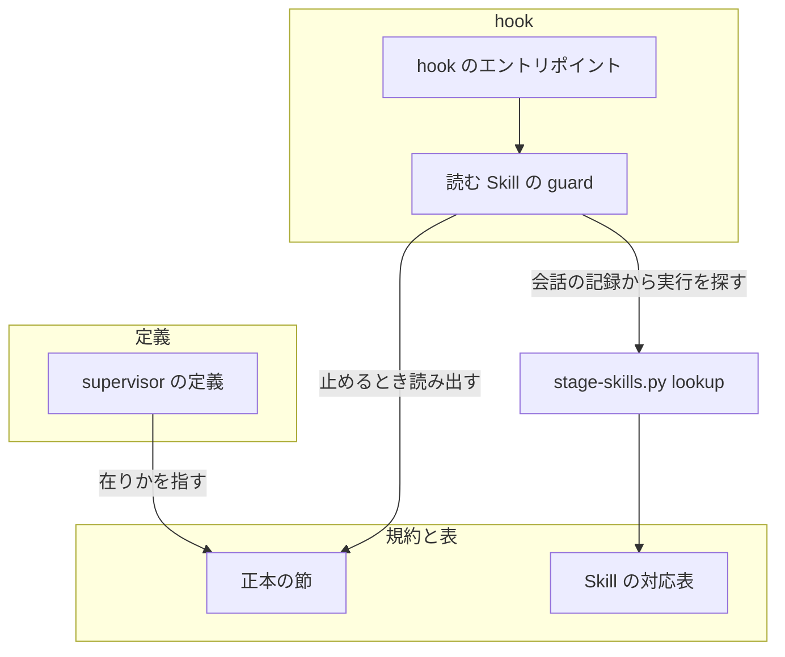
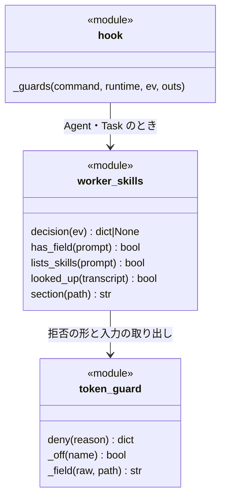
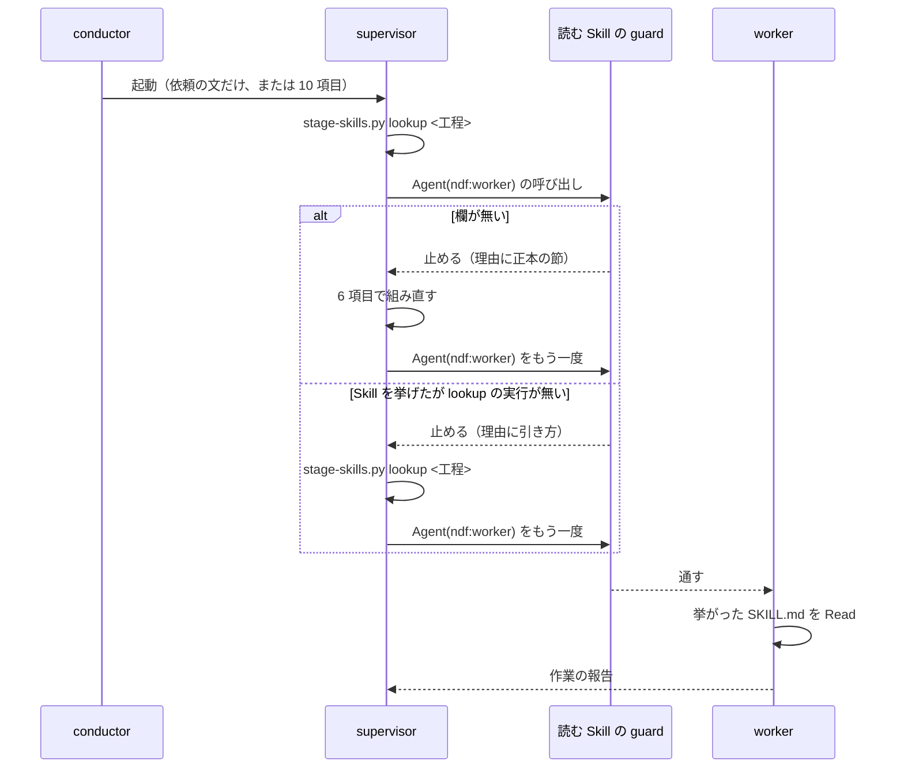

# Agent の supervisor: 起動する ndf:worker に、いま通している工程の規則の Skill が届く（#2399）

## 目的

- **今どうなっているか**: Agent の `ndf:supervisor` が `ndf:worker` を起動するとき、起動指示に「読む Skill」の欄が無い。v10.27.10 で 2 回起動した。2 回とも supervisor は正本の節（`agent-layers.md` の「supervisor → worker」）を読まず、Skill の対応表も引かなかった。設計の工程の worker に `document-style` が届いていない
- **誰に効くか**: プランのテンプレートが無いフェーズを Agent の 3 層で回す利用者（設計・確定仕様化・振り返りなど、文書を書く工程の worker の成果物を受け取る人）
- **変えると何が成り立つか**: conductor が起動指示をどの形で書いても、supervisor が起動する `ndf:worker` の起動指示に「読む Skill」の欄が入る。worker は対応表が挙げる Skill を作業の前に読む

## 適用範囲

- **働く範囲**: このリポジトリと、NDF を Claude Code へ導入したすべてのリポジトリ。Codex には Agent の supervisor が無いため働かない。プランの worker（`supervise.py` が起動する `claude -p`）は対象外で、振る舞いは変わらない
- **プロジェクトごとに違うもの**: 無し（工程と Skill の組は NDF の対応表が持ち、プロジェクトの設定を読まない）。止める判定は環境変数 `NDF_WORKER_SKILLS_GUARD=0` で外せる
- **当たるモード**: supervisor でフェーズを回すすべてのモード（`standard` / `documentation` / `legacy-refactor` / `light` / `operation`）

## あるべき姿の根拠

| 根拠 | 種類 | 何を示すか |
| --- | --- | --- |
| 再現の 2 回の実起動の記録（2026-11-02 15:33・15:35 JST）で、supervisor の Tool の呼び出しに `agent-layers.md` の Read と `stage-skills.py` の実行が 1 件も無い | 実測 | 定義に「規約の正本は〜にある」と書くだけでは、supervisor は正本を読まない。言語モデルへの指示だけに頼らない経路が要る |
| 同じ記録の 2 回目で、supervisor は worker への指示をファイルへ書き、Agent の `prompt` には「このファイルを読め」の 1 行だけを渡した | 実測 | 検査は Agent の `prompt` の本文を見る。欄を `prompt` の本文に置くことを、止めた理由の文で求める |
| 今の hook（Agent の呼び出し 1 回）の所要時間は 44〜52 ms。312 KB の supervisor の会話の記録から `stage-skills.py` の実行を探す走査は、Python の起動 14 ms を除いて 1 ms 程度 | 実測 | 判定を hook に足しても、秒の上限（起動 1 回あたり +2 秒）に収まる |
| 「supervisor → worker」の節（`agent-layers.md` の 184〜215 行）は 4,965 バイト（2,405 文字）。`agent-layers.md` の全体は 41,294 バイト | 実測 | supervisor に正本のファイル全体を読ませるより、止めたときに節だけを返す方が、読み込む量が 8 分の 1 程度で済む |

要求と受け入れ条件は #2399 の本文にある（コピーは `issues/issue-2399-requirements.md`）。この文書は「どう作るか」だけを扱う。

## ドメインモデル

### コンテキスト

| コンテキスト | 何の語が 1 つの意味に決まるか |
| --- | --- |
| NDF の工程（`ndf-workflow`） | 3 層（conductor・supervisor・worker）・起動指示・読む Skill・Skill の対応表・工程 |

1 つのコンテキストに収まる。hook は同じコンテキストの規約（正本の節）をそのまま読み、語を翻訳しない。

### 集約

| 集約 | 持ち主（書き換えてよいもの） | 根 | エンティティ | 値オブジェクト |
| --- | --- | --- | --- | --- |
| worker の起動指示 | supervisor（Agent の `ndf:supervisor` と `ndf:supervisor-waits`） | 起動指示（Agent の呼び出し 1 回） | — | 読む Skill の欄（Skill の名前と `SKILL.md` の絶対パスの並び、または「無し」）・作業・入力・手順・返す形・置き場所 |
| Skill の対応表 | この課題では変えない（`stage-skills.json`） | 対応表 | 工程の行 | Skill の名前とパスの組 |

読む Skill の guard は起動指示を書き換えない。止めるか通すかだけを決め、直すのは持ち主の supervisor である。起動指示は対応表を Skill の名前とパスで参照し、対応表の行を持たない。

### 不変条件

| # | 集約 | 条件 | 破れたときの扱い |
| --- | --- | --- | --- |
| I1 | worker の起動指示 | supervisor が起動する `ndf:worker` の起動指示の `prompt` は、「読む Skill」の欄を持つ（値は Skill の並びか「無し」） | 読む Skill の guard が起動を止め、正本の「supervisor → worker」の節を止めた理由に添えて返す |
| I2 | worker の起動指示 | 欄に Skill を挙げた起動の前に、その supervisor が `stage-skills.py lookup` を打っている | 読む Skill の guard が起動を止め、対応表の引き方（`stage-skills.py` の絶対パスつき）を返す |
| I3 | Skill の対応表 | 工程と Skill の組は対応表の 1 か所にだけある。supervisor の定義・正本の節・読む Skill の guard のコードは Skill の名前を書かない | 受け入れ条件 6 の `grep` が当たる。テストが落ちる |
| I4 | worker の起動指示 | `ndf:supervisor` と `ndf:supervisor-waits` の定義の本文は、frontmatter を除いて同じである | 受け入れ条件 5 の `diff` が 0 以外を返す |
| I5 | worker の起動指示 | supervisor 以外（conductor・人・ほかのエージェント）が起動する `ndf:worker` と、`ndf:worker` 以外の起動は止めない | 読む Skill の guard が判定をせずに通す |
| I6 | worker の起動指示 | 読む Skill の guard が呼び手の会話の記録を読めないときと、判定の途中で失敗したときは、起動を止めない | 判定をせずに通す（hook の既存の原則「どの失敗も終了コード 0 で通す」）。ただし欄が無い起動（「処理の流れ」の判定 4）で正本の節が読めないときは、この失敗に含めずに止め、理由に正本のファイルのパスと見出しの名前を書く |

### ドメインイベント

| # | イベント | 発生元 | 受け手 |
| --- | --- | --- | --- |
| E1 | conductor が supervisor を起動した | conductor | supervisor |
| E2 | supervisor が worker の起動指示の形を得た | supervisor の定義（指す 1 文）、または E7 の止めた理由 | supervisor |
| E3 | supervisor が `stage-skills.py lookup <工程>` を打った | supervisor | 読む Skill の guard（E4 の判定で会話の記録から読む） |
| E4 | supervisor が「読む Skill」の欄つきで `ndf:worker` を起動した | supervisor | 読む Skill の guard、worker |
| E5 | worker が挙がった `SKILL.md` を読んだ | worker | — （作業の前提。E6 の成果物に規則が効く） |
| E6 | worker が規則に従って文書を書き、作業の報告を返した | worker | supervisor |
| E7 | 読む Skill の guard が起動を止めた | 読む Skill の guard | supervisor（止めた理由を読み、E3 からやり直す） |

E1〜E6 は要求の番号を引き継ぐ。E7 はこの設計で足す。

### 用語

| 用語 | 意味 | 用語集への反映 |
| --- | --- | --- |
| 読む Skill の guard | supervisor が `ndf:worker` を起動する Agent の呼び出しを PreToolUse の hook で見て、「読む Skill」の欄が無い起動と、対応表を引かずに Skill を挙げた起動を止める判定。止めた理由に正本の「supervisor → worker」の節を添える | 追加 |

「読む Skill」「Skill の対応表」は用語集の意味のまま使う。

## 機能一覧

| # | 機能 | 誰が使うか |
| --- | --- | --- |
| F1 | supervisor が、定義から worker の起動指示の形（正本の節）の在りかを知る | supervisor |
| F2 | 「読む Skill」の欄が無い `ndf:worker` の起動を止め、正本の節を返す | supervisor（止められた側） |
| F3 | 対応表を引かずに Skill を挙げた `ndf:worker` の起動を止め、引き方を返す | supervisor（止められた側） |
| F4 | 読む Skill の guard を環境変数で外す | 利用者 |

## 構成要素

| 要素 | 責務 |
| --- | --- |
| supervisor の定義（`plugins/ndf/agents/supervisor.md`・`supervisor-waits.md`） | worker の起動指示は正本の「supervisor → worker」の 6 項目で組むこと、欠けた起動は hook が止めて節を返すことを、1 段落で指す。規約を写さない。2 つの本文は同じに保つ |
| 読む Skill の guard（新設 `plugins/ndf/scripts/hook_lib/worker_skills.py`） | Agent（旧名 Task）の呼び出しのうち、呼び手が supervisor で相手が `ndf:worker` のものだけを判定する。欄の有無と値（「無し」か Skill か）を `prompt` から読み、Skill を挙げたときは呼び手の会話の記録に `stage-skills.py lookup` の実行があるかを見る。止めるときは正本の節をその場でファイルから読み出して理由に添える |
| hook のエントリポイント（`plugins/ndf/scripts/hook.py`） | Claude Code の PreToolUse で Agent・Task のときに読む Skill の guard を締め切りの中で打ち、拒否をほかの拒否と同じ規則で出す。docstring の振り分けの表に 1 行足す |
| 正本の節（`plugins/ndf/skills/development-workflow/references/agent-layers.md` の「supervisor → worker」） | 「読む Skill」の行に、欄の無い起動と対応表を引かずに Skill を挙げた起動を hook が止めることを 1 文で足す。決め方そのものは変えない |
| テスト（新設 `plugins/ndf/scripts/tests/test_worker_skills_guard.py`） | 不変条件 I1・I2・I5・I6 と、止めた理由に節が入ることを縛る |
| 用語集（`docs/glossary/glossary.json` と生成物 `docs/glossary.md`） | 「読む Skill の guard」を足す |

hook の登録（`plugins/ndf/hooks/claude.json`）は変えない。PreToolUse の matcher は既に `Agent|Task` を含む。

### システムの文脈


外部の系は Claude Code の実行環境だけである。PreToolUse の hook の入力（呼び手の `agent_id`・`agent_type`・`transcript_path`・`tool_input`）は Claude Code が決める。拒否の返し方（`permissionDecision: deny`）も Claude Code が決める。この変更はどちらも使う側に留まる。

### 構成要素の関係



テストと用語集は図に含めない（どちらも実行の経路に現れない）。

### 配置

配置は変わらない。読む Skill の guard は、既存の hook と同じ 1 プロセス（SessionStart が用意した環境の Python）の中で動く。境界をまたいで新しく流れるものは無く、hook は呼び手の会話の記録（利用者のホームの下のファイル）を読むだけで書かない。

### 置き場所

```text
plugins/ndf/
├── agents/
│   ├── supervisor.md              # 変更（1 段落を足す）
│   └── supervisor-waits.md        # 変更（同じ段落）
├── scripts/
│   ├── hook.py                    # 変更（振り分けと docstring）
│   ├── hook_lib/
│   │   └── worker_skills.py       # 新設
│   └── tests/
│       └── test_worker_skills_guard.py  # 新設
└── skills/development-workflow/references/
    └── agent-layers.md            # 変更（「読む Skill」の行に 1 文）
docs/glossary/glossary.json        # 変更（語を 1 つ足す）
docs/glossary.md                   # 生成（glossary.py render）
```

## 構造

読む Skill の guard は型を持たず、関数だけでできる。既存の token の guard の部品（拒否の形・環境変数の判定・入力の取り出し）を使い、重ねて定義しない。



関数の名前と分け方は実装（`tdd-cycle`）で決めてよい。縛るのは、判定のエントリポイントが 1 つで、`hook.py` の振り分けからだけ呼ばれることである。

## 処理の流れ



読む Skill の guard の判定は、上から順に次のとおりである。最初に当たった行で決まる。

| # | 条件 | 結果 |
| --- | --- | --- |
| 1 | `NDF_WORKER_SKILLS_GUARD=0` | 通す |
| 2 | Tool が Agent・Task でない、または `subagent_type` が `ndf:worker` でない | 通す |
| 3 | 呼び手の `agent_type` が `ndf:supervisor`・`ndf:supervisor-waits` のどちらでもない | 通す |
| 4 | `prompt` に「読む Skill」の欄が無い | 止める。理由は「欄が無い」と、正本の節の本文と、`$SCRIPTS` の絶対パス |
| 5 | 欄の値が「無し」 | 通す |
| 6 | 呼び手の会話の記録が読めない | 通す |
| 7 | 呼び手の会話の記録に `stage-skills.py lookup` の実行が無い | 止める。理由は「対応表を引いていない」と、`stage-skills.py` の絶対パスを入れた引き方と、正本の節の在りか |
| 8 | 上のどれにも当たらない | 通す |

欄は、行の先頭（箇条書きの記号・表の区切り・見出しの記号を除いたところ）に「読む Skill」の語があり、区切り（`:`・`：`・`|`）か行末が続く行とする。値は同じ行の区切りの後、空なら次の空でない行の先頭である。欄の見分け方の細部（記号の組み合わせ）は実装で走らせて決める。

正本の節が読めない（ファイルが無い・見出しが見つからない）ときも 4 は止め、理由には節の本文の代わりに正本のファイルのパスと見出しの名前を書く。

## 非機能の実現方式

| 大項目 | 要求の条件 | 実現方式 | 確かめ方 |
| --- | --- | --- | --- |
| 性能・拡張性 | supervisor の起動 1 回あたりに増える費用と秒を、設計 PR で実測値として示す。上限は起動 1 回あたり費用 $0.10・秒 +2 秒。超えるときは設計で示して承認ゲート 1 で決める | 判定は既存の hook のプロセスの中で打ち、プロセスを増やさない。会話の記録の走査は Agent（`ndf:worker`）の呼び出しのときだけ行う。supervisor に正本のファイル全体（41,294 バイト）を読ませず、止めたときだけ節（4,965 バイト）を返す。定義に足すのは 1 段落 | 秒: 実測は下の表。費用: マージ前の手動確認（前提 4 の条件で 1 回ずつ）で、supervisor の起動 1 回の費用を変更の前後で比べる |
| 運用・保守性 | 「読む Skill」の決め方の正本は `agent-layers.md` の「supervisor → worker」の 1 か所のままにし、supervisor の定義や conductor の規則へ同じ規約を写さない | 定義は在りかを指す 1 段落だけを持つ。hook は止めたときに正本の節をファイルから読み出して返し、コードに規約の文を持たない。工程と Skill の名前は対応表にだけ置く | 受け入れ条件 6 の `grep` が 0 件。テストで、止めた理由の節が正本のファイルの中身から作られることを縛る |

秒の実測（2026-11-02、この worktree）:

| 測ったもの | 値 | 上限との関係 |
| --- | --- | --- |
| 今の hook の 1 回（Agent・`ndf:worker`・supervisor から） | 44 / 46 / 52 ms（3 回） | 読む Skill の guard はこのプロセスの中で走る |
| 会話の記録の走査（312 KB、再現の 2 回目の supervisor の記録） | 15 ms（Python の起動 14 ms を含む） | 足し分は 1 ms 程度 |
| `stage-skills.py lookup 設計` の 1 回 | 43 ms | supervisor が打つ。今の規約がすでに求めている呼び出しで、この設計が足すものではない |

費用は、止めずに通った起動では定義に足す 1 段落の分だけ増え、止めた起動では止められた Agent の呼び出し 1 回の出力と、返した節の入力が増える。どちらも未実測で、マージ前の手動確認で測る（「未確認のまま残ること」）。

## 決定の記録

### 決定 1: conductor の起動指示の形に依らずに届けるため、経路を supervisor の定義と hook に置き、conductor の規則には足さない

受け入れ条件 1 は、conductor の起動指示が依頼の文だけのときにも成り立つことを求める。conductor の起動指示の規則は 10 項目の形で書いたときにしか supervisor へ届かず、依頼の文だけの起動では届かない。supervisor の定義は起動の形に依らず読み込まれ、hook は supervisor の Tool の呼び出しそのものを見るため、どちらも起動の形に左右されない。

conductor の守る規則 14 個に worker の起動指示の形を足す案は採らない。依頼の文だけの起動を救えず、規則を conductor の起動指示へ写すことにもなる。

根拠: Value 6 / Value 7（MVV 版 4）

### 決定 2: 言語モデルへの指示だけに頼らないため、「読む Skill」の欄の無い起動を hook で止める

再現の 2 回は、定義に正本の在りかが書かれていても supervisor が読まなかったことを示す。指示の文を増やすだけでは、同じ読み飛ばしが起きうる。欄の有無は機械で判定でき、判定の要らない確かめは hook が持つ。

誤って止める危険は 3 つの条件で抑える。対象を supervisor が起動する `ndf:worker` に限る（conductor の読解や単発の起動は止めない）。工程に入る前の作業は欄の値を「無し」と書けば通る。`NDF_WORKER_SKILLS_GUARD=0` で外せる。止めるのではなく案内（`additionalContext`）を足す形は採らない。案内は呼び出しを止めないため、欄の無い起動指示のまま worker が動く。

根拠: Value 4 / Value 6（MVV 版 4）

### 決定 3: 正本を写さずに形を届けるため、止めた理由に正本の節をその場で読み出して添える

hook は止めるときに `agent-layers.md` から「supervisor → worker」の節を読み出し、理由の本文に入れる。正本はファイルの 1 か所のままで、節を直せば次の拒否からその文が届く。supervisor の定義は在りかを指す 1 段落だけを持ち、「読め」とは書かない。読ませると supervisor は 41,294 バイトのファイル全体を読み、起動のたびに費用が増える。

定義へ節を写す案は、正本が 2 つになるため採らない。supervisor の起動の時点で節を注入する案（SubagentStart の hook）は採らない。worker を起動しないフェーズでも毎回費用が掛かり、このリポジトリの hook でまだ使っていない事象で、動きを確かめていない。

根拠: Value 7 / Value 10（MVV 版 4）

### 決定 4: 誤って止めないため、欄の値の検査は「無し」かどうかと、対応表を引いた記録の有無までにする

欄に Skill を挙げた起動では、呼び手の会話の記録に `stage-skills.py lookup` の実行があるかだけを見る。挙げた名前とパスが lookup の出力と一致するかは見ない。起動指示は自由な文で、欄の範囲を切り出す規則が要り、規則が外れると正しい起動を止める。一致は受け入れ条件 1 の実起動で確かめる。

「無し」と書いて検査を抜ける起動は止められない。これは残るリスクとして扱う（「未確認のまま残ること」）。

根拠: Value 1 / Value 4（MVV 版 4）

### 決定 5: token の guard の責務を広げないため、読む Skill の guard を別のモジュールに置く

token の guard は文脈の大きさと待ち方を見る判定の集まりで、起動指示の中身は見ていない。読む Skill の guard は起動指示の形を見るため、`hook_lib/` に新しいモジュールを置く。拒否の形と入力の取り出しは、token の guard の部品をそのまま使う。

根拠: Value 6（MVV 版 4）

## テスト設計

| 受け入れ条件・不変条件 | どの振る舞いで縛るか | どう壊したら落ちるべきか |
| --- | --- | --- |
| 受け入れ条件 1・2・3 | 実起動（前提 4 の条件、起動指示の 2 つの形で 2 回ずつ）の記録で、worker を起動する `prompt` に `document-style` の名前と lookup と同じパス、supervisor の Bash に `stage-skills.py lookup 設計`、worker の Read に `SKILL.md` がある。マージ前は実装の worktree で 1 回ずつ | 定義の段落を外し hook を止めた状態（`NDF_WORKER_SKILLS_GUARD=0`）で、欄の無い起動が再現する |
| 受け入れ条件 4 | 単体テスト: 欄の値が「無し」の起動は、会話の記録に lookup の実行が無くても通る。実起動の記録で、工程に入る前の作業の起動指示に「無し」の欄がある | 「無し」でも lookup の記録を求めるように壊すと落ちる |
| 受け入れ条件 5・I4 | `diff`（受け入れ条件 5 のコマンド）が 0 を返す | 片方の定義だけに段落を足すと 0 以外になる |
| 受け入れ条件 6・I3 | `grep -rn "document-style" plugins/ndf/agents plugins/ndf/skills/development-workflow/references/agent-layers.md` が 0 件。読む Skill の guard のコードに Skill の名前の文字列が無い | 定義・正本の節・guard のどれかに Skill の名前を書くと当たる |
| 受け入れ条件 7 | `plugins/ndf/scripts/tests` の既存テストがすべて通る | プランの worker の Skill の渡し方（`supervise_lib`）に触れると既存テストが落ちる |
| I1 | 単体テスト: supervisor から `ndf:worker` を起動し、`prompt` に欄が無い入力で拒否が返り、理由に正本の節の見出しの下の本文が入る | 欄の判定を常に「ある」と返すように壊すと落ちる。理由を固定の文にして節を読み出さないように壊すと落ちる（テストは一時ファイルの正本で節の中身を差し替えて確かめる） |
| I2 | 単体テスト: 欄に Skill を挙げ、会話の記録に lookup の実行が無いと拒否、有ると通る | 記録を見ずに通すように壊すと、無い方の入力で落ちる |
| I5 | 単体テスト: 呼び手が supervisor でない（`agent_type` が無い・別の名前）、または `subagent_type` が `ndf:worker` でない入力は、欄が無くても通る | 呼び手の判定を外すと、conductor からの起動の入力で落ちる |
| I6 | 単体テスト: 会話の記録のパスが読めない入力で、欄に Skill を挙げた起動が通る。環境変数で外したときも通る。正本の節が見つからないときは止め、理由に正本のパスが入る | 記録が読めないときに止めるように壊すと落ちる |

## 設計の結果

| 課題 | 扱い | 取り込み先 | 触るファイル |
| --- | --- | --- | --- |
| #2399 | 実装する | — | `plugins/ndf/agents/supervisor.md`、`plugins/ndf/agents/supervisor-waits.md`、`plugins/ndf/scripts/hook.py`、`plugins/ndf/scripts/hook_lib/worker_skills.py`、`plugins/ndf/scripts/tests/test_worker_skills_guard.py`、`plugins/ndf/skills/development-workflow/references/agent-layers.md`、`docs/glossary/glossary.json`、`docs/glossary.md` |

## 未確認のまま残ること

| 項目 | 内容 |
| --- | --- |
| 費用の実測 | 止めずに通った起動と、1 回止められた起動の費用の増分は未実測。マージ前の手動確認で、supervisor の起動 1 回の費用を変更の前後で比べる。上限 $0.10 を超えたら承認ゲート 2 の資料に載せる |
| 「無し」による抜け | 設計の工程でも欄に「無し」と書けば読む Skill の guard を通る。実起動（受け入れ条件 1）で起きないことを確かめる。起きたら、直前の lookup の出力が空でないのに「無し」と書いた起動を止める判定を別の課題で検討する |
| 「入力」「手順」の欄の欠け | 定義の段落は 6 項目すべてを指し、止めた理由の節も 6 項目を含む。ただし読む Skill の guard が見るのは「読む Skill」だけで、欄があれば「入力」「手順」が欠けても通る。マージ前の手動確認の記録で 2 つの欄の有無を見て、欠けていたら別の課題へ起こす |
| hook の入力の `agent_type` | supervisor の中の Tool の呼び出しで `agent_type` が `ndf:supervisor` になることは、既存の判定（収束ループの前で寿命 5 分の supervisor を止める判定）が使っている。`ndf:supervisor-waits` の値は、マージ前の手動確認で記録を見て確かめる |
