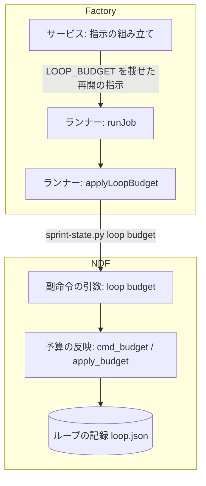
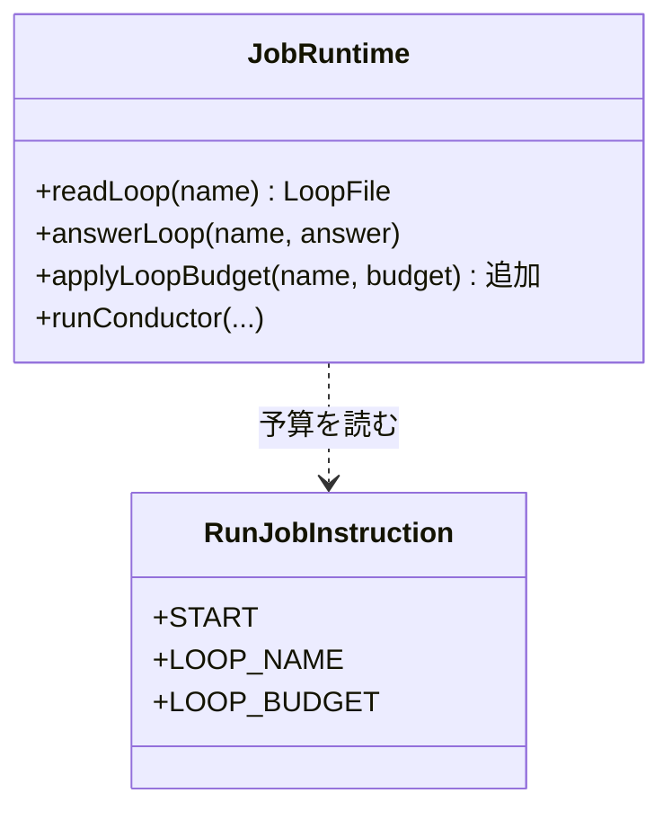
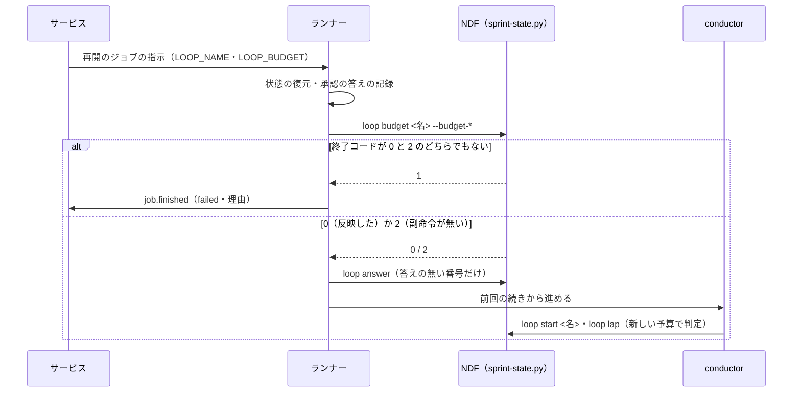

# Factory の開発ループ: 承認待ち・利用上限待ちの間に変えた予算で、再開した後の止まる判定を行う（#2405）

## 目的

- **今どうなっているか**: Factory の画面でループの予算を変えても、承認の答えや利用上限のリセット時刻の後に作られる再開のジョブ（`START=resume`）は予算を NDF へ渡さない。NDF は古い予算のまま周回を締め、止まるかを判定する
- **誰に効くか**: 承認待ち・利用上限待ちで止まっている開発ループの予算を、画面で変える Factory の利用者
- **変えると何が成り立つか**: 再開のジョブで、conductor（ジョブの中で NDF の工程を進める Claude のセッション）を起こす前に、NDF のループの記録の予算が画面の予算と同じ値になる。画面の「予算の残り」と NDF の止まる判定が同じ予算を使う

## 適用範囲

- **働く範囲**: Factory のサービス（`factory/api`）とランナー（`factory/runner`）、NDF の `sprint-state.py loop` の副命令。NDF の副命令は配布先のリポジトリでも使えるが、呼ぶのは Factory のランナーだけである
- **プロジェクトごとに違うもの**: 無し（予算の値は実行ジョブの指示の `LOOP_BUDGET` から引数で受ける）
- **当たるモード**: `standard`

## あるべき姿の根拠

| 根拠 | 種類 | 何を示すか |
| --- | --- | --- |
| #2405 の受け入れ条件「承認待ちの間に予算を変えたループを再開すると、NDF の止まる条件の判定が新しい予算で行われる」 | 利用者の指示の原文（起票者の文。承認ゲート 1 で確かめる） | 変えた予算が再開の後の判定に効くこと |
| `factory/api/src/runs/control.ts` の実行ジョブの指示の組み立てが、`LOOP_BUDGET` を `START=loop` のときだけ載せている | 実測（コードの読み取り） | 再開のジョブに予算が載らないこと |
| `plugins/ndf/scripts/lib/sprint_loop.py` の `cmd_start` が、既にあるループで予算の上書きの後に止まった記録を解く手続き（`resume_stopped`）を続けて行う | 実測（コードの読み取り） | 既存の `loop start` を打ち直すと、予算のほかの処理も起きること |

要求と受け入れ条件は #2405 の本文にある（コピーは [issue-2405-requirements.md](issue-2405-requirements.md) ）。この文書は「どう作るか」だけを扱う。

## ドメインモデル

### コンテキスト

| コンテキスト | 何の語が 1 つの意味に決まるか |
| --- | --- |
| Neural Development Factory（`ndf-factory`） | 開発ループの行・実行・再開のジョブ・実行ジョブの指示 |
| NDF の開発ワークフロー（`ndf-workflow`） | ループの記録・ループの予算・予算の履歴・止まる条件 |

**関係は腐敗防止層である。** Factory（下流）は NDF のループの記録を直接書かず、ランナーが NDF の副命令を打って変える。読むときもランナーの翻訳（`factory/runner/src/loop-file.ts`）を通す。この変更もこの関係のまま、予算の書き込みを NDF の副命令 1 つに寄せる。

### 集約

| 集約 | 持ち主（書き換えてよいもの） | 根 | エンティティ | 値オブジェクト |
| --- | --- | --- | --- | --- |
| 開発ループ（Factory） | サービスのループの制御（`updateBudget`。この変更では変えない） | ループの行 | — | ループの予算（周回の数・費用・時間。単位ごとに空を許す） |
| 実行ジョブ（Factory） | サービスの実行の制御（`control.ts`） | ジョブ | — | ループの実行の入力（名前・マイルストーン・予算・除く課題・答え） |
| ループの記録（NDF） | NDF の `sprint-state.py loop` の副命令（`sprint_loop.py`） | ループの記録 | 周回・人の判断待ち | ループの予算・予算の履歴の行（時刻・前・後） |

ランナーはループの記録を書き換える持ち主ではない。NDF の副命令を打つ呼び出し側である。

### 不変条件

| # | 集約 | 条件 | 破れたときの扱い |
| --- | --- | --- | --- |
| I1 | 実行ジョブ | ループに属する再開のジョブの指示は、宣言した単位があればジョブを作った時点のループの予算を `LOOP_BUDGET` に持つ。ループに属さない実行のジョブは `LOOP_BUDGET` を持たない | 契約の検査（`validateRunJobInstruction`）と単体テストで落とす |
| I2 | ループの記録 | 予算の反映は、予算と予算の履歴のほかを変えない（止まった記録・周回・人の判断待ちは前と同じ） | NDF の単体テストで落とす |
| I3 | ループの記録 | 予算の履歴の行は、予算が変わったときだけ 1 行足す。同じ値の反映では足さない | NDF の単体テストで落とす |
| I4 | 実行ジョブ | `LOOP_BUDGET` を持つ再開のジョブでは、予算の反映が成功するまで conductor を起こさない。失敗したらジョブを失敗で終え、理由をジョブの出力に残す。例外は、導入した NDF に副命令が無い（終了コード 2）ときだけで、反映せずに今の振る舞いで続ける（決定 6） | ランナーの単体テストで落とす |

### ドメインイベント

| # | イベント | 発生元 | 受け手 |
| --- | --- | --- | --- |
| E1 | 利用者がループの予算を変えた | サービスのループの制御（`updateBudget`。既存） | 次に作る再開のジョブ・周回のジョブ（E2） |
| E2 | サービスが再開のジョブを作った | サービスの実行の制御（`requestResume`・`resumeAfterReset`） | ランナー（実行ジョブの指示として） |
| E3 | ランナーが保存した状態を復元した | ランナー | ランナー自身（E4 へ進む） |
| E4 | ランナーがループの記録の予算を新しい値にした | NDF の `loop budget`（ランナーが打つ） | conductor（E5 へ進む） |
| E5 | conductor が前回の続きから進めた | conductor | NDF（`loop start` の再開・周回の締め） |
| E6 | NDF が周回を締め、止まる条件を新しい予算で判定した | NDF の `loop lap` / `loop gate` | ランナー（`loop.stopped` へ翻訳してサービスへ送る。既存） |

### 用語

| 用語 | 意味 | 用語集への反映 |
| --- | --- | --- |
| 再開のジョブ | `START=resume` の実行ジョブ。承認の答えで起こすものと、利用上限のリセット時刻の後に起こすものがある。保存した状態を復元して前回の続きから進める | 意味の変更なし（要求で追加済み） |
| 予算の反映 | ループの記録の予算を、渡した単位の値で上書きすること。止まった記録の解除・周回の締めを伴わない | 追加（`ndf-workflow`） |

## 機能一覧

| # | 機能 | 誰が使うか |
| --- | --- | --- |
| F1 | 再開のジョブの指示に、そのときのループの予算を載せる | サービス（承認の答え・リセット時刻の後の再開） |
| F2 | 予算だけをループの記録へ反映する副命令（`sprint-state.py loop budget`） | ランナー（手で打つ利用者も使える） |
| F3 | 再開のジョブで、conductor を起こす前に予算を反映する | ランナー |

## 構成要素

| 要素 | 責務 |
| --- | --- |
| サービスの実行ジョブの指示の組み立て（`factory/api/src/runs/control.ts` の `buildInstruction`） | ループの実行の入力があれば、`START=loop` と `START=resume` の両方で宣言した予算を `LOOP_BUDGET` に載せる。マイルストーンは `START=loop` だけのまま |
| ランナーの手順（`factory/runner/src/main.ts` の `runJob`） | `START=resume` で `LOOP_NAME` と `LOOP_BUDGET` があれば、状態の復元と承認の答えの記録の後、人の判断待ちへの答えの前に、予算の反映を呼ぶ。失敗したら conductor を起こさない |
| ランナーの実行の部品（`factory/runner/src/runtime.ts` の `JobRuntime` の実装） | 新しいメソッド `applyLoopBudget(name, budget)` で `sprint-state.py loop budget <名> --budget-<単位> <値>…` を打つ。終了コードが 0 なら `"applied"`、2 なら `"unsupported"` を返し、ほかは例外を投げる。引数の並べ方は `loopPrompt` と同じ関数で作る |
| NDF の副命令の引数（`plugins/ndf/scripts/lib/sprint_loop_cli.py`） | `loop budget <名> [--budget-laps N] [--budget-usd X] [--budget-hours H] [--root]` を足し、`cmd_budget` へ振り分ける |
| NDF の予算の反映（`plugins/ndf/scripts/lib/sprint_loop.py` の `cmd_budget`） | 排他の中で記録を読み、既存の `apply_budget` で上書きし、記録を書く。止まった記録・周回・人の判断待ちに触れない |
| 確定仕様（`docs/specifications/ndf-factory-dev-loops.md`・`docs/specifications/ndf-workflow-development-loop.md`）と NDF の手順（`plugins/ndf/skills/development-workflow/references/loop.md`） | 再開のジョブにも予算が届くこと、ランナーの手順、`loop budget` の副命令の契約を書く |

図には文書（確定仕様・NDF の手順・用語集）を含めない。

## 構造

変える型は `JobRuntime` の 1 つである。`RunJobInstruction` は形を変えず、`JobRuntime` が読む側として載せる。

- `JobRuntime.applyLoopBudget(name: string, budget: string): Promise<"applied" | "unsupported">`。`budget` は指示の `LOOP_BUDGET` の文字列（`laps=3,usd=60` の形）をそのまま渡す。テストの偽物はこのメソッドを差し替える
- `RunJobInstruction` の形は変えない（前提 4）。`START=resume` で `LOOP_BUDGET` が載るのは値の出所の変更だけである

## 入出力の契約

### `sprint-state.py loop budget`（追加）

| 項目 | 書くこと |
| --- | --- |
| 名前 | `python3 plugins/ndf/scripts/sprint-state.py loop budget <ループ名> [--budget-laps N] [--budget-usd X] [--budget-hours H] [--root <根>]` |
| 入力 | ループ名（必須）。`--budget-*` は数（`float`）で、1 つ以上が必須。`--root` は既存の副命令と同じ |
| 出力（成功） | 終了コード 0。結果 JSON（`status: ok`）。`metrics.status` は `changed`（予算の履歴へ 1 行足した）か `unchanged`（同じ値だった）。`metrics.budget` に反映の後の予算、`items` に足した予算の履歴の行（`unchanged` なら空） |
| 失敗の形 | 終了コード 1。`--budget-*` が 1 つも無い、ループの記録が無いか読めない（既存の `read_loop_record` の `LoopError`）、書けない（`OSError`）。記録は変えない。終了コード 2 は返さない（2 は引数の解析の誤りだけに残し、ランナーが「副命令が無い」と読む。決定 6） |
| 互換性 | 副命令の追加だけである。`loop start` の `--budget-*` は変えない |

`loop start` と違い、使ってよい条件（`.ndf/pace.json` の `loop` 節・プロジェクト MVV）を照らさない。予算の反映は記録の 1 項目の上書きで、ループを始めも続けもしないためである。止まった記録（`status: stopped`）にも反映し、止まった記録は解かない。

### 実行ジョブの指示（値の出所の変更）

| 項目 | 内容 |
| --- | --- |
| 置き場所 | `factory/contracts/schemas/run-job-instruction.schema.json`（変えない） |
| 変わる約束 | `START=resume` でループの実行の入力があれば、宣言した単位を `LOOP_BUDGET` に載せる（`START=loop` と同じ並べ方） |
| 互換性の扱い | 契約は既に許している。古い版のランナーは `START=resume` の `LOOP_BUDGET` を読まずに無視する（今の振る舞いのまま） |
| 検査の手段 | サービスの単体テストで、組み立てた指示を `validateRunJobInstruction` に通す |

## 処理の流れ

再開のジョブのランナーの手順は次の順になる。太字の手順 3 が足す手順である。

| 手順 | 中身 | 失敗したとき |
| --- | --- | --- |
| 1. 状態の復元 | `POST /run-jobs/state`（`get`）で保存した状態を戻す | ジョブを失敗で終える（既存） |
| 2. 承認の答えの記録 | `APPROVAL_REQUEST_ID` があれば `sprint-state.py gate` で書く | 同上（既存） |
| **3. 予算の反映** | `LOOP_NAME` と `LOOP_BUDGET` があれば `sprint-state.py loop budget <名> --budget-*` を打つ | 終了コード 2（導入した NDF に副命令が無い）は、標準エラーへ 1 行残して手順 4 へ進む。ほかの 0 以外は conductor を起こさずジョブを失敗で終え、「ループの記録へ予算を反映できない（終了コード N）」を出力の要約へ残す |
| 4. 人の判断待ちへの答え | `LOOP_ANSWERS` のうち答えの無い番号へ `loop answer` を打つ | 同上（既存） |
| 5. conductor | 「前回の続きから進めてください」で起こす。conductor が `loop start <名>`（予算なし）で止まった記録を解き、続きを進める | 既存 |

予算の反映が失敗したジョブは状態を保存しない（手順の後の `saveState` まで進まない）。次の再開のジョブは、反映の前に保存した状態から復元し、もう一度反映する。

## 非機能の実現方式

| 大項目 | 要求の条件 | 実現方式 | 確かめ方 |
| --- | --- | --- | --- |
| 運用・保守性 | 予算の上書きの規則（単位ごとの上書きと予算の履歴）は NDF の 1 か所に置き、ランナーとサービスに同じ規則を写さない | `cmd_budget` は `loop start` と同じ `apply_budget` を呼ぶ。ランナーは値の文字列を引数へ並べるだけで、比べも履歴も持たない | NDF の単体テストで、`loop budget` と `loop start --budget-*` が同じ予算の履歴の行を作ることを確かめる |
| 移行性 | 既に動いているループと保存済みの状態は、そのまま次の再開のジョブで新しい規則に乗る。データの移行は要らない | 記録の形を変えない。保存済みの状態を復元した後に副命令を打つだけである | NDF の単体テストで、予算の履歴を持たない記録（古い記録）へ反映できることを確かめる（`apply_budget` の `setdefault`） |

## 決定の記録

### 決定 1: 予算のほかの処理を起こさないため、予算だけを反映する副命令 `loop budget` を NDF に足し、ランナーが打つ

既存の `loop start <名> --budget-*` は、既にあるループで予算を上書きした後に止まった記録を解く手続き（承認ゲート 2 の答えの処理・周回の締め・予算超過の判定し直し）を続けて行う。ランナーがこれを打つと、その手続きが conductor より先に起き、続けて conductor が打つ `loop start` は解けた後の記録を見る。受け入れ条件 7 の「conductor が前回の続きから進めるときに既存のとおり 1 回だけ起きる」が成り立たない。予算だけを変える副命令にすると、止まった記録の扱いは conductor の `loop start` に残る。

再開の指示の文へ予算を足して conductor に `--budget-*` を打たせる形は採らない。決まった手順を AI に任せることになり、conductor が打ち忘れても検出できない。ランナーが打てば、終了コードで成否が決まる。

根拠: Value 5 / Value 7（MVV 版 5）

### 決定 2: 予算の上書きの規則を 1 か所に置くため、`cmd_budget` は既存の `apply_budget` を呼ぶ

単位ごとの上書きと、変わったときだけ予算の履歴へ 1 行足す規則は `apply_budget` が既に持つ。新しい副命令はその関数を排他の中で呼び、記録を書くだけにする。ランナーとサービスは値を比べず、履歴も持たない。

根拠: Value 7 / Value 8（MVV 版 5）

### 決定 3: 書き込みの対象が重ならないため、予算の反映は承認の答えの記録の後、人の判断待ちへの答えの前に置く

予算の反映が変えるのは記録の予算と予算の履歴だけで、人の判断待ちへの答え（`loop answer`）が変えるのは人の判断待ちの行と周回のスプリント状態である。どちらも同じ排他の中で記録を読み直して書くため、どちらを先にしても記録は同じになる。そのうえで反映を先に置くのは、反映が失敗したときにループの記録へ何も書かずにジョブを終えられるためである。承認の答えの記録（`sprint-state.py gate`）は周回のスプリント状態を書き、ループの記録には触れない。

根拠: Value 5（MVV 版 5）

### 決定 4: 重複を避けるため、予算の反映は `START=resume` だけで行い、`START=loop` は既存の `--budget-*` のまま渡す

周回のジョブ（`START=loop`）は conductor の起動の指示に `--budget-*` を既に並べ、`loop start` が新しいループの記録を作るときにも上書きする。最初の周回ではループの記録がまだ無いため、副命令を先に打つと記録が無いことで失敗する。再開のジョブだけが予算を渡す手段を持たないため、そこだけに足す。

根拠: Value 3（MVV 版 5）

### 決定 5: 指示の値の出所を 1 つにするため、サービスは再開のジョブにも周回のジョブと同じ並べ方で `LOOP_BUDGET` を載せる

`buildInstruction` の予算の並べ方を `START=loop` の条件の外へ出し、ループの実行の入力があれば両方で使う。入力（`resumeLoopInput`）はジョブを作る時点のループの行から読むため、その時点の予算が載る。マイルストーンは `START=loop` だけのままにする（再開では選定をやり直さない）。

根拠: Value 7（MVV 版 5）

### 決定 6: 版を固定した既存の実行の再開を止めないため、副命令が無い NDF（終了コード 2）では反映せずに続ける

Factory の実行は作った時点の NDF の版を固定し、再開のジョブも同じ版を導入する。この変更より前の版で作り、承認待ち・利用上限待ちのまま残る実行を再開すると、その NDF には `loop budget` が無く、引数の解析が終了コード 2 で終わる（今の `sprint-state.py loop budget x --budget-usd 3` で確かめた）。これを失敗にすると、今は動いている再開が止まる。終了コード 2 のときは反映せずに今の振る舞いで続け、次の周回のジョブ（新しい版で作る）から予算が届く。

版の下限を設定に置いてサービスが `LOOP_BUDGET` を載せるかを決める形は採らない。下限の版はリリースで初めて決まり、配布先の設定を足す手間が増える。新しい `loop budget` は終了コード 2 を返さないため、2 は副命令が無いことだけを表す。

根拠: 共通原則の上位の原則（人を守る）/ Value 1（MVV 版 5）

## テスト設計

| 受け入れ条件・不変条件 | どの振る舞いで縛るか | どう壊したら落ちるべきか |
| --- | --- | --- |
| 受け入れ条件 1・I4 | ランナー: 承認の依頼の識別子のある再開のジョブで、偽の実行の部品の `applyLoopBudget` が書いた予算を、`runConductor` の偽物が起動の時点で読むと新しい値である。呼ぶ順は状態の復元 → 承認の答えの記録 → 予算の反映 → 人の判断待ちへの答え → conductor | 反映の呼び出しを conductor の後へ移す、または消すと落ちる |
| 受け入れ条件 2 | ランナー: 承認の依頼の識別子の無い再開のジョブでも、受け入れ条件 1 と同じ順で反映を呼ぶ | 反映を `APPROVAL_REQUEST_ID` の有無の条件の中へ入れると落ちる |
| 受け入れ条件 3 | NDF: 費用の予算 60 のループへ `loop budget --budget-usd 40` を打ち、消費の和 50 で周回を締めると `budget_usd` で止まる | `cmd_budget` が記録を書かない、または別の鍵へ書くと落ちる |
| 受け入れ条件 4 | NDF: 費用の予算 40 のループへ `loop budget --budget-usd 100` を打ち、消費の和 50 で周回を締めると止まる条件を書かない | 同上 |
| 受け入れ条件 5・I1 | サービス: 予算を変えた後の `requestResume` と `resumeAfterReset` の指示に、変えた予算の `LOOP_BUDGET` が載り、`validateRunJobInstruction` を通る | 予算の並べ方を `START=loop` の条件の中へ戻すと落ちる |
| 受け入れ条件 6・I3 | NDF: 同じ値の `loop budget` では予算の履歴の行数が変わらず `unchanged`、違う値では 1 行増えて `changed` | 比べずに毎回足すと落ちる |
| 受け入れ条件 7・I2 | NDF: `gate2_returned` で止まった記録へ `loop budget` を打つと、予算と予算の履歴のほか（`status`・`stop`・`stops`・周回・人の判断待ち）が前と同じである。その後の `loop start <名>` で止まった記録の解除が 1 回起きる | `cmd_budget` から `resume_stopped` を呼ぶと落ちる |
| 受け入れ条件 8 | ランナー: `LOOP_BUDGET` の無い再開のジョブでは `applyLoopBudget` を呼ばない | 条件を `LOOP_NAME` だけにすると落ちる |
| 受け入れ条件 9・I1 | サービス: ループに属さない実行の再開のジョブの指示に `LOOP_BUDGET` が無い。ランナー: `LOOP_NAME` の無いジョブでは反映を呼ばない | ループの入力の有無を見ずに載せると落ちる |
| 受け入れ条件 10・I4 | ランナー: `applyLoopBudget` が例外を投げると `runConductor` を呼ばず、`job.finished` が失敗で要約に理由を持つ。NDF: 記録の無いループ名と `--budget-*` の無い呼び出しで終了コード 1 | 例外を握りつぶして進めると落ちる |
| I4 の例外（決定 6） | ランナー: `applyLoopBudget` が `"unsupported"` を返すと conductor を起こし、ジョブは今の振る舞いで終わる。実行の部品: 終了コード 2 を `"unsupported"`、1 を例外へ写す | 2 を例外にする、または 1 を `"unsupported"` にすると落ちる |
| 引数の並べ方 | ランナー: `laps=3,usd=60` から `--budget-laps 3 --budget-usd 60` を作る関数を、`loopPrompt` と `applyLoopBudget` が共有する | 片方だけ並べ方を変えると、既存の `loopPrompt` のテストか新しいテストが落ちる |

## 設計の結果

| 課題 | 扱い | 取り込み先 | 触るファイル |
| --- | --- | --- | --- |
| #2405 | 実装する | — | `factory/api/src/runs/control.ts`、`factory/api/src/runs/loops.test.ts`、`factory/runner/src/main.ts`、`factory/runner/src/runtime.ts`、`factory/runner/src/runner.test.ts`、`factory/runner/src/loop.test.ts`、`plugins/ndf/scripts/lib/sprint_loop.py`、`plugins/ndf/scripts/lib/sprint_loop_cli.py`、`plugins/ndf/scripts/tests/test_sprint_loop.py`、`plugins/ndf/skills/development-workflow/references/loop.md`、`docs/specifications/ndf-factory-dev-loops.md`、`docs/specifications/ndf-workflow-development-loop.md`、`docs/glossary/glossary.json`、`docs/glossary.md` |

## 未確認のまま残ること

| 項目 | 内容 |
| --- | --- |
| 実物のプロセスでの通し | ランナーのテストは実行の部品を偽物に替える。実物の `sprint-state.py loop budget` をランナーから打つ通しは、リリース後テスト（要求の「検証手段」の手動確認）で確かめる |
| 指示を作る間の予算の変更 | `requestResume` がループの入力を読んでからジョブを書くまでの間に予算が変わると、そのジョブは変わる前の予算を持つ。変えた予算は次のジョブで届く。要求の「含まない」（動いているジョブへの割り込み）と同じ扱いにする |
| 古い版の NDF で作った実行 | 決定 6 のとおり、その実行の再開では予算が届かず、今の振る舞いのまま残る。リリースの時点で承認待ち・利用上限待ちに残る実行の数は未確認。次の周回のジョブからは届く |
