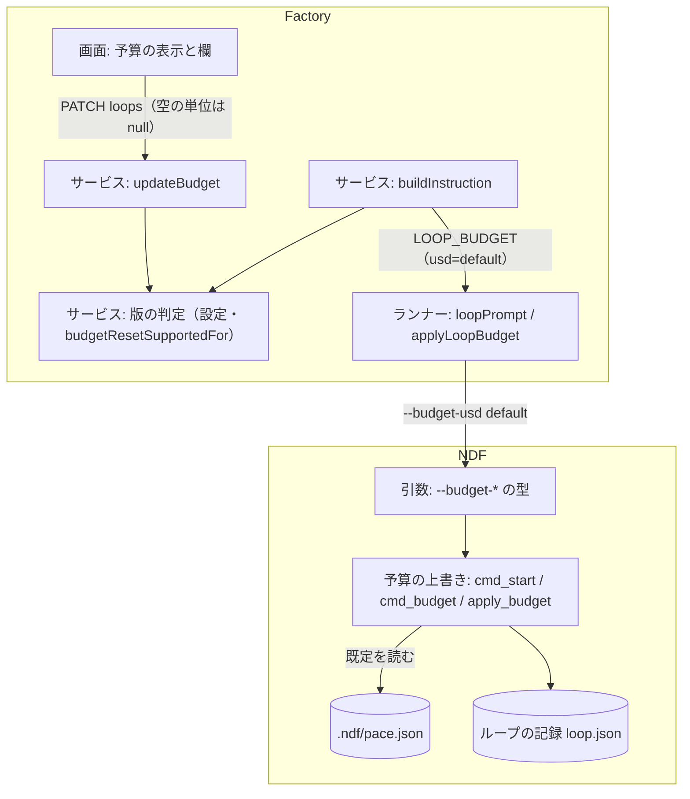
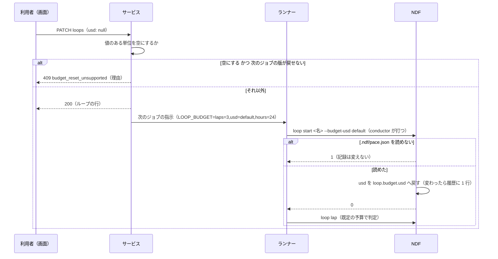

# Factory の開発ループ: 予算の欄を空にすると、次のジョブからリポジトリの既定の予算で止まる判定を行う（#2406）

## 目的

- **今どうなっているか**: Factory の画面で開発ループの予算の欄を空にして保存しても、サービスは空の単位を実行ジョブの指示に載せない。NDF は渡された単位だけを上書きする。そのため、一度 `usd=10` を渡したループは、欄を空にした後も費用の予算 10 USD のまま止まる判定を行う。画面は空の単位を「掛けない」と出し、上限が無いように読める
- **誰に効くか**: 開発ループの予算を一度入れた後、リポジトリの既定に戻したい Factory の利用者
- **変えると何が成り立つか**: 空にした単位は、次の周回のジョブと再開のジョブで NDF がリポジトリの既定の予算（`.ndf/pace.json` の `loop.budget`）へ戻す。画面は空の単位を「リポジトリの既定」と出す。既定へ戻せない古い NDF の版で動くループでは、空にする変更を理由つきで断る

## 適用範囲

- **働く範囲**: Factory のサービス（`factory/api`）・契約（`factory/contracts`）・画面（`factory/web`）。NDF では `sprint-state.py loop start` と `loop budget`（#2405 で足す副命令）。NDF の引数は配布先のリポジトリでも使えるが、既定へ戻す指示を出すのは Factory だけである
- **プロジェクトごとに違うもの**: 予算の既定の値。各リポジトリの `.ndf/pace.json` の `loop.budget` で受ける（設定）。Factory は値を持たない。既定へ戻せる NDF の版の下限は Factory の設定（環境変数）で受ける
- **当たるモード**: `standard`

## あるべき姿の根拠

| 根拠 | 種類 | 何を示すか |
| --- | --- | --- |
| #2406 の受け入れ条件「予算の欄を空にした後の周回で、NDF がリポジトリの既定の予算で止まる条件を判定する」 | 利用者の指示の原文（起票者の文。承認ゲート 1 で確かめる） | 空の欄が既定の予算を意味すること |
| `docs/specifications/ndf-factory-dev-loops-data-and-contracts.md` のループの行の `budget` の説明「空は宣言しない（NDF の `.ndf/pace.json` の既定）」 | 実測（確定仕様の読み取り） | Factory の契約が、空の単位を既定の予算として既に約束していること |
| `factory/api/src/runs/control.ts` の `buildInstruction` が値のある単位だけを `LOOP_BUDGET` に並べ、`plugins/ndf/scripts/lib/sprint_loop.py` の `apply_budget` が渡された単位だけを上書きする | 実測（コードの読み取り） | 空にした単位が前の値のまま残る仕組み |
| 今の NDF で `sprint-state.py loop start x --budget-usd default` を打つと、`invalid float value: 'default'` で終了コード 2 になる | 実測（2026-11-05 に実行） | 古い版の NDF は既定へ戻す指示を引数の誤りとして断ること |

要求と受け入れ条件は #2406 の本文にある（コピーは [issue-2406-requirements.md](issue-2406-requirements.md) ）。この文書は「どう作るか」だけを扱う。前提にするのは #2405 の設計（[issue-2405-design.md](issue-2405-design.md) ）である（要求の前提 4）。その設計が足す副命令 `loop budget` と、ランナーの予算の反映を使う。

## ドメインモデル

### コンテキスト

| コンテキスト | 何の語が 1 つの意味に決まるか |
| --- | --- |
| Neural Development Factory（`ndf-factory`） | 開発ループの行・ループの予算の空の単位・実行ジョブの指示・実行の NDF の版 |
| NDF の開発ワークフロー（`ndf-workflow`） | ループの記録・ループの予算・予算の既定・予算の履歴・止まる条件 |

**関係は腐敗防止層である（#2405 と同じ）。** Factory（下流）は予算の既定の値を知らず、ループの記録を直接書かない。Factory の「空の単位」は、実行ジョブの指示の上で「既定へ戻す指示」へ翻訳し、NDF がその時点のリポジトリの設定から値を決める。

### 集約

| 集約 | 持ち主（書き換えてよいもの） | 根 | エンティティ | 値オブジェクト |
| --- | --- | --- | --- | --- |
| 開発ループ（Factory） | サービスのループの制御（`factory/api/src/runs/loops.ts` の `updateBudget`） | ループの行 | — | ループの予算（周回の数・費用・時間。単位ごとに数か空） |
| 実行ジョブ（Factory） | サービスの実行の制御（`factory/api/src/runs/control.ts` の `buildInstruction`） | ジョブ | — | ループの実行の入力（名前・マイルストーン・予算・除く課題・答え） |
| ループの記録（NDF） | NDF の `sprint-state.py loop` の副命令（`plugins/ndf/scripts/lib/sprint_loop.py`） | ループの記録 | 周回・人の判断待ちの行 | ループの予算（3 単位とも正の数）・予算の履歴の行（時刻・前・後） |

ランナーは指示の値を NDF の引数へ並べる呼び出し側で、どの集約の持ち主でもない。

### 不変条件

| # | 集約 | 条件 | 破れたときの扱い |
| --- | --- | --- | --- |
| I1 | ループの記録 | 予算は既定へ戻した後も 3 単位とも正の数を持つ。「既定へ戻す指示」の値を記録に書かない | NDF の単体テストで落とす |
| I2 | ループの記録 | 既定へ戻した単位の値は、反映の時点のメインディレクトリの `.ndf/pace.json` の `loop.budget` の値で、宣言が無い単位は組み込みの既定である | NDF の単体テストで落とす。`.ndf/pace.json` を読めないときは記録を変えずに断る |
| I3 | ループの記録 | 予算の履歴は、既定へ戻す指示でも値が変わったときだけ 1 行足す | NDF の単体テストで落とす |
| I4 | ループの記録 | 予算の値が数でも既定へ戻す指示でもないときは、記録を変えずに引数の誤りとして断る | NDF の単体テストで落とす |
| I5 | 実行ジョブ | 既定へ戻せる版の実行のジョブの指示では、ループの行の空の単位を `<単位>=default` として `LOOP_BUDGET` に載せ、値のある単位を数で載せる | サービスの単体テストと契約の検査（`validateRunJobInstruction`）で落とす |
| I6 | 実行ジョブ | 既定へ戻せない版の実行のジョブの指示に `default` を載せない（値のある単位だけを載せる。今と同じ） | サービスの単体テストで落とす |
| I7 | 開発ループ | 次のジョブが既定へ戻せない版で動くループでは、値のある単位を空にする予算の変更を断り、ループの行を変えない | サービスの単体テストで落とす |

### ドメインイベント

| # | イベント | 発生元 | 受け手 |
| --- | --- | --- | --- |
| E1 | 利用者がループの予算の単位を空にして保存した | サービスのループの制御（`updateBudget`） | 次に作る周回のジョブ・再開のジョブ（E2） |
| E2 | サービスが次のジョブの指示に、空の単位を「既定へ戻す」として載せた | サービスの実行の制御（`buildInstruction`） | ランナー（実行ジョブの指示として） |
| E3 | ランナーが NDF へ既定へ戻す指示を渡した | ランナー（周回のジョブは conductor の起動の指示、再開のジョブは #2405 の予算の反映） | NDF（`loop start` / `loop budget`） |
| E4 | NDF がループの記録の予算の単位を、リポジトリの既定の値へ戻した | NDF の予算の上書き（`apply_budget`） | NDF の止まる条件の判定（E5） |
| E5 | NDF が周回を締め、既定の値で止まる条件を判定した | NDF の `loop lap` / `loop gate` | ランナー（`loop.stopped` へ翻訳してサービスへ送る。既存） |

### 用語

| 用語 | 意味 | 用語集への反映 |
| --- | --- | --- |
| 予算の既定 | 開発ループの予算の単位ごとの既定の値。リポジトリの .ndf/pace.json の loop.budget の値で、宣言が無い単位は NDF の組み込みの値 | 意味の変更なし（要求で追加済み） |
| 既定へ戻す指示 | 開発ループの予算の単位に、数の代わりに渡す値 `default`。NDF が反映の時点の予算の既定でその単位を上書きする。Factory は予算の欄が空の単位をこの指示として実行ジョブの指示に載せる | 追加（`ndf-workflow`） |
| 予算の反映 | 開発ループの記録の予算を、渡した単位の値で上書きすること | 意味の変更なし（#2405 で追加済み。渡す値に既定へ戻す指示が加わる） |

## 機能一覧

| # | 機能 | 誰が使うか |
| --- | --- | --- |
| F1 | NDF の `--budget-*` が既定へ戻す指示 `default` を受け、その単位をリポジトリの予算の既定へ戻す（`loop start`・`loop budget`） | conductor・ランナー（手で打つ利用者も使える） |
| F2 | 周回のジョブと再開のジョブの指示に、空の単位を既定へ戻す指示として載せる | サービス |
| F3 | 既定へ戻せない版で動くループで、値のある単位を空にする予算の変更を断り、理由を返す | Factory の利用者（画面と API） |
| F4 | 予算の単位が空のとき、一覧と詳細の「予算の残り」と予算の欄に、リポジトリの既定に従うことを出す | Factory の利用者 |

## 構成要素

| 要素 | 責務 |
| --- | --- |
| NDF の引数（`plugins/ndf/scripts/lib/sprint_loop_cli.py`） | `loop start` と `loop budget` の `--budget-*` の型を、正の数か `default` を受ける 1 つの関数にする。どちらでもなければ引数の解析の誤り（終了コード 2）にし、記録に触れない |
| NDF の予算の上書き（`plugins/ndf/scripts/lib/sprint_loop.py` の `apply_budget`） | 予算の既定を受け取り、`default` の単位をその値に置き換えてから上書きする。値が変わったときだけ予算の履歴に 1 行足す（今と同じ規則） |
| NDF の副命令（`sprint_loop.py` の `cmd_start` と #2405 の `cmd_budget`） | `cmd_start` は使ってよい条件の判定で読んだ `loop` 節の予算を既定として渡す。`cmd_budget` は `default` の単位があるときだけ `pace.read_loop` で既定を読み、読めなければ記録を変えずに終了コード 1 で断る |
| サービスの版の判定（`factory/api/src/runs/version.ts`） | 既定へ戻せる版かを判定する関数を足す。比べ方は `isLegacyVersion` と同じで、下限が無い・読めない版は戻せない側に倒す |
| サービスの設定（`factory/api/src/runs/control.ts` の `RunControlConfig`） | 環境変数 `NDF_BUDGET_RESET_MIN_VERSION`（既定へ戻せる NDF の版の下限）を読む |
| サービスの指示の組み立て（`control.ts` の `buildInstruction`） | 実行の版が既定へ戻せる版なら、空の単位を `<単位>=default` として `LOOP_BUDGET` に並べる。戻せない版なら今どおり値のある単位だけを並べる。周回のジョブと再開のジョブで同じ並べ方を使う（#2405 の決定 5） |
| サービスの実行の制御の問い合わせ（`control.ts` に足す公開メソッド） | ループの次のジョブが使う NDF の版（今の実行があればその版、無ければ今のマーケットプレイスの版）が既定へ戻せるかを返す |
| サービスのループの制御（`loops.ts` の `updateBudget`） | 値のある単位を空にする変更のときだけ上の問い合わせを呼び、戻せなければ 409 `budget_reset_unsupported` で断る |
| 実行ジョブの指示の契約（`factory/contracts/schemas/run-job-instruction.schema.json` と生成した型） | `LOOP_BUDGET` の値の形に `default` を加える |
| 予算の API の記述（`factory/contracts/openapi/loops.yaml`） | 予算の空の単位の意味と、予算の変更の 409 `budget_reset_unsupported` を書く |
| 画面の予算の表示（`factory/web/src/pages/loopParts.tsx`・`factory/web/src/pages/LoopDetailPage.tsx`・`factory/web/src/i18n/ja.json`） | 「予算の残り」の空の単位を「リポジトリの既定」と出す。予算の欄の空のときの表示（入力欄の placeholder）を足す。「掛けない」の文言（`loops.noBudget`）を消す。予算の変更が `budget_reset_unsupported` で断られたら翻訳の文を出す |
| ランナー（`factory/runner/src/runtime.ts`） | 変えない。`loopPrompt` と #2405 の引数の並べ方は `<単位>=<値>` を `--budget-<単位> <値>` へそのまま写すため、`default` も同じく渡る。テストだけを足す |
| 確定仕様と NDF の手順（要求の対象範囲に挙げた 4 つの確定仕様と `plugins/ndf/skills/development-workflow/references/loop.md`） | `--budget-*` が `default` を受けること、空の単位の意味、`LOOP_BUDGET` の形、版の下限の設定を書く |

図には文書（確定仕様・NDF の手順・用語集・API の記述）と契約のスキーマを含めない。

## 構造

変える関数と型は次のとおりである。新しいクラスは作らない。

| 対象 | 変更 |
| --- | --- |
| `sprint_loop.BUDGET_DEFAULT` | 追加。既定へ戻す指示の値 `"default"` を 1 か所に置く定数 |
| `sprint_loop_cli.budget_value(text) -> float \| str` | 追加。`"default"` なら `BUDGET_DEFAULT`、数として読めれば `float`、ほかは `argparse.ArgumentTypeError`。`loop start` と `loop budget` の `--budget-*` の `type` に使う |
| `sprint_loop.apply_budget(env, rec, given, defaults)` | 引数 `defaults`（予算の既定。3 単位の数）を足す。`given` の `BUDGET_DEFAULT` を `defaults` の値へ置き換えてから今の規則で上書きする |
| `RunControlConfig.budgetResetMinVersion: string \| null` | 追加。`NDF_BUDGET_RESET_MIN_VERSION` から読む |
| `version.supportsBudgetReset(version, minVersion): boolean` | 追加。`minVersion` が無い・どちらかの版が読めないときは偽、`version >= minVersion` なら真 |
| `RunControl.budgetResetSupportedFor(loop: DevLoop): Promise<{ supported: boolean; ndfVersion: string }>` | 追加。`loop.currentRunId` があればその実行の `ndfVersion`、無ければ `deps.ndfVersion()` の値で判定する |

## 入出力の契約

### NDF の `--budget-*`（受ける値を広げる）

| 項目 | 書くこと |
| --- | --- |
| 名前 | `sprint-state.py loop start [<名>] [--budget-laps V] [--budget-usd V] [--budget-hours V] …` と `sprint-state.py loop budget <名> [--budget-* V]…`（#2405） |
| 入力 | `V` は数か `default`。`default` は「その単位をリポジトリの予算の既定へ戻す」 |
| 出力（成功） | 今と同じ結果 JSON。`metrics.budget` は既定へ戻した後の数の予算 |
| 失敗の形 | `V` が数でも `default` でもない: 引数の解析の誤りで終了コード 2、記録は変えない。`loop budget` で `default` を渡したのに `.ndf/pace.json` を読めない: 終了コード 1（`LoopError`）、記録は変えない。`loop start` は今どおり使ってよい条件の判定で `.ndf/pace.json` を読めなければ終了コード 1 |
| 互換性 | 数を渡す使い方は変わらない。古い版の NDF は `default` を引数の解析の誤り（終了コード 2）で断る（「あるべき姿の根拠」の実測）。そのためサービスは古い版の実行へ `default` を載せない（I6） |

### 実行ジョブの指示の `LOOP_BUDGET`（形を広げる）

| 項目 | 内容 |
| --- | --- |
| 置き場所 | `factory/contracts/schemas/run-job-instruction.schema.json` |
| 変わる約束 | 値の形を `^(laps=(\d+(\.\d+)?\|default))?(,?usd=(\d+(\.\d+)?\|default))?(,?hours=(\d+(\.\d+)?\|default))?$` にする。説明は「単位ごとに数か default（その単位をリポジトリの既定へ戻す）を並べる」 |
| 載せる条件 | ループの実行の入力があり、`START` が `loop` か `resume`（#2405）。既定へ戻せる版の実行では 3 単位すべてを並べる（空の単位は `default`）。戻せない版の実行では値のある単位だけを並べ、1 つも無ければ載せない（今と同じ） |
| 互換性の扱い | 契約を広げるだけで、数だけの値は今と同じに通る。古い版のランナーと NDF には `default` が届かない（I6） |
| 検査の手段 | 契約のテスト（`factory/contracts/tests/definitions.test.ts`）と、サービスの単体テストで組み立てた指示を `validateRunJobInstruction` に通す |

### 予算の変更の API（断る理由を 1 つ足す）

| 項目 | 内容 |
| --- | --- |
| 置き場所 | `factory/contracts/openapi/loops.yaml` の `updateLoopBudget` と `Budget` の説明 |
| 変わる約束 | 要素の失敗に 409 `budget_reset_unsupported` を足す。条件は「変更の前に値のある単位を `null` にする」かつ「次のジョブが使う NDF の版が既定へ戻せない」。`details` に `ndf_version` と `units`（空にしようとした単位）を持つ。`message` は「このループの次のジョブが使う NDF（版 {版}）は予算をリポジトリの既定へ戻せません。値を入れるか、次の周回が新しい版で始まってから空にしてください」 |
| 断らない変更 | 値を入れる・値を変える・もともと空の単位を空のままにする変更は、版によらず今どおり受ける |
| 互換性の扱い | 断る理由が増えるだけで、要求の形と成功の応答は変わらない。送らない単位と `null` の単位を空として扱う契約（要求の前提 3）は変えない |
| 検査の手段 | 契約のテストで OpenAPI を読み込む既存の検査と、サービスの単体テスト |

### 画面

変わる画面は「リポジトリ」の画面のループの一覧と、ループの詳細の 2 つである。遷移は変わらない。

| 画面 | 項目 | 変わる表示 |
| --- | --- | --- |
| ループの一覧・詳細 | 予算の残り | 値のある単位は今どおり残りを出す。空の単位は「{単位}はリポジトリの既定」とまとめて 1 項目で出す（例: `2 周 / 費用・時間はリポジトリの既定`）。3 単位とも空なら「周回の数・費用・時間はリポジトリの既定」 |
| ループの一覧（始める）・詳細（予算を変える） | 予算の 3 つの欄 | 空の欄に placeholder「空ならリポジトリの既定」を出す。入力規則は今どおり（正の数か空） |
| ループの詳細（予算を変える） | 断られたとき | `code` が `budget_reset_unsupported` なら、翻訳の文に `details.ndf_version` を差し込んで予算の欄の誤りとして出す。ほかの失敗は今どおり |

翻訳のファイル（`factory/web/src/i18n/ja.json`）で足す語と消す語は次のとおりである。

| キー | 扱い | 文 |
| --- | --- | --- |
| `loops.followsDefault` | 足す | 「{{units}}はリポジトリの既定」 |
| `loops.unitLaps`・`loops.unitUsd`・`loops.unitHours` | 足す | 「周回の数」「費用」「時間」 |
| `loops.budgetPlaceholder` | 足す | 「空ならリポジトリの既定」 |
| `loopDetail.budgetResetUnsupported` | 足す | 「このループの次のジョブが使う NDF（版 {{version}}）は予算をリポジトリの既定へ戻せません。値を入れるか、次の周回が新しい版で始まってから空にしてください」 |
| `loops.noBudget` | 消す | — |

## 処理の流れ

周回のジョブで、費用の欄を空にしたループが次の周回を始めるまでの流れである。再開のジョブは、手順 4 の渡し先が #2405 の予算の反映（`applyLoopBudget` → `loop budget`）に変わるだけで、ほかは同じである。

| 手順 | 中身 | 失敗したとき |
| --- | --- | --- |
| 1. 予算の変更 | `updateBudget` が要求の予算を読み、前の予算と比べて値のある単位を空にするかを調べる。空にするときだけ `budgetResetSupportedFor` を呼ぶ | 戻せない版なら 409 で断り、ループの行を書かない。終わりの状態のループは今どおり 409 `already_finished` |
| 2. 指示の組み立て | `buildInstruction` が実行の版で `supportsBudgetReset` を呼び、真なら空の単位を `default` で並べる | 既存の断りの理由でジョブを作らない |
| 3. 引数の並べ方 | ランナーが `<単位>=<値>` を `--budget-<単位> <値>` へ写す（変えない） | 既存 |
| 4. 予算の反映 | 周回のジョブは conductor が `loop start` を、再開のジョブはランナーが `loop budget` を打つ。NDF は `default` の単位を予算の既定へ置き換えて上書きする | `.ndf/pace.json` を読めなければ記録を変えずに終了コード 1。再開のジョブでは #2405 のとおりジョブを失敗で終える |
| 5. 止まる条件の判定 | 周回を締めるとき、既定へ戻した予算と消費を比べる（既存） | 既存 |

## 非機能の実現方式

| 大項目 | 要求の条件 | 実現方式 | 確かめ方 |
| --- | --- | --- | --- |
| 運用・保守性 | 既定の値を決める規則は NDF の 1 か所に置き、Factory に写さない | 既定の値は `pace.read_loop` だけが決め（`.ndf/pace.json` と組み込みの既定）、`apply_budget` はそれを受け取って置き換えるだけにする。Factory は `default` という指示だけを持ち、値を持たない | NDF の単体テストで、`.ndf/pace.json` の宣言の有無ごとに既定へ戻した値を確かめる。`factory/` に予算の既定の数（3・60・24）を書かないことを、サービスのテストが既定の値を参照しない形で保つ |
| 移行性 | 既に動いているループと保存済みのループの行は、データの移行なしで次のジョブから新しい規則に乗る | ループの行の予算の形（単位ごとに数か `null`）と NDF のループの記録の形を変えない。空の単位の意味の翻訳は指示の組み立ての時点だけで行う | サービスの単体テストで、既存の形のループの行から作った指示に `default` が載ることを確かめる |

## 決定の記録

### 決定 1: 既存の受け渡しの経路をそのまま通すため、既定へ戻す指示を `--budget-*` の値 `default` で表す

受け渡しの経路は次の 3 つで、どれも値を文字列のまま写す。

- サービスの `LOOP_BUDGET` の `<単位>=<値>`
- ランナーの `loopPrompt` と #2405 の引数の並べ方
- conductor が `loop start` へ渡す `--budget-*`

値で表せば、ランナーと conductor の手順を変えずに NDF まで届く。古い版の NDF は `default` を引数の解析の誤り（終了コード 2）で断ることを実測で確かめた。

別の引数（`--reset-budget usd`）で表す形は採らない。指示の契約に別のキーが要り、ランナーの 2 つの並べ方と conductor の手順にも別の経路を足すことになる。古い版の NDF での失敗の仕方（終了コード 2）は値で表す形と同じで、得るものが無い。

根拠: Value 5 / Value 7（MVV 版 5）

### 決定 2: 既定の値の正本をリポジトリに残すため、`default` を数へ置き換えるのは NDF の反映の時点に限る

既定の値は各リポジトリの `.ndf/pace.json` に置き、周回の途中で設定を直したときも次の反映から新しい値が効くようにする（要求の前提 2）。Factory が値を読んで数で渡す形は採らない。Factory はリポジトリの設定を読む経路を持たない。また、値の決め方（宣言の無い単位を組み込みの既定で埋める規則）を 2 か所に持つことになる。

根拠: Value 6 / Value 7（MVV 版 5）

### 決定 3: サービスが前の値を覚えずに済むよう、空の単位は毎回 `default` として載せる

ループの行は単位ごとに数か空だけを持ち、「直前に空にした」ことを持たない。空の単位を毎回 `default` で渡しても、履歴は増えない。NDF は値が変わらなければ予算の履歴に行を足さない（I3）。最初の周回（ループの記録がまだ無い）でも、新しい記録の予算は既定から作るため、`default` で上書きしても値は変わらない。

空にした直後のジョブにだけ載せる形は採らない。ループの行に「既定へ戻す待ち」を足すことになり、データの移行が要る（要求の非機能の条件「移行性」に反する）。

根拠: Value 5（MVV 版 5）/ スプリント Value 2（スプリント MVV 44cd096d）

### 決定 4: 古い版の NDF へ `default` を届けないため、既定へ戻せる版の下限を設定 `NDF_BUDGET_RESET_MIN_VERSION` に置き、サービスが判定する

受け入れ条件 7 は、空にする変更を画面と API の時点で断ることを求める。断る判断はジョブを作る前に要るため、ランナーや NDF の終了コードでは間に合わない。版の比べ方は並行の実行の判定（`NDF_PARALLEL_MIN_VERSION`・`isLegacyVersion`）と同じにする。下限が無い・読めない版は戻せない側に倒す。設定が無い間は、空にする変更を断り、指示には今どおり値のある単位だけを載せる。

下限の版をコードに埋め込む形は採らない。下限はこの変更を含む NDF の版で、リリースで初めて決まる（#2405 の決定 6 と同じ理由）。ランナーが終了コード 2 を見て既定へ戻すのを諦める形も採らない。利用者の変更を受けた後で黙って効かなくなり、画面の予算と NDF の判定が食い違う。

根拠: 共通原則の上位の原則（人を守る）/ Value 6（MVV 版 5）/ スプリント Value 4（スプリント MVV 44cd096d）

### 決定 5: 断る判定と指示の組み立てが同じ版を見るため、判定に使う版は「ループの今の実行の版、無ければ今のマーケットプレイスの版」にする

周回のジョブは周回を始める時点のマーケットプレイスの版で新しい実行を作り、再開のジョブは今の実行の版を引き継ぐ。今の実行があるループ（`running`・`awaiting_approval`）では、その版で判定する。次のジョブがその実行の再開になりうるためである。今の実行の無いループ（`between_laps`）では、次の周回が使う版は今のマーケットプレイスの版である。指示の組み立ては常に実行の版で判定するため、受けた変更は次のジョブで `default` として届く。

`running` のループで今の実行が古い版のとき、次のジョブが新しい版の周回でも断る。戻せないジョブへ空の予算を渡して黙って効かなくなる側より、断って理由を出す側を選ぶ。

根拠: 共通原則の上位の原則（人を守る）/ スプリント Value 1（スプリント MVV 44cd096d）

### 決定 6: 画面の文言を翻訳のファイルに置くため、画面は断りの `code` から翻訳の文を選び、API の `message` は API の利用者向けに残す

ループの一覧の画面（`factory/web/src/pages/LoopsPage.tsx`）は、既に断りの `code` を見て翻訳のファイルの文を出している。見ている `code` は `milestone_in_use` と `loop_name_in_use` である。予算の変更の断りも同じ形にし、`details.ndf_version` を文に差し込む。API と MCP から使う者は `code` と `message` で同じ理由を読める。

409 の `message` をそのまま出す今の汎用の経路（`factory/web/src/context.tsx` の `failureText`）に任せる形は採らない。画面の文がサービスのコードに置かれ、言語を足すときにサービスを書き換えることになる。

根拠: スプリント Value 5 / スプリント Value 4（スプリント MVV 44cd096d）

### 決定 7: 「上限が無い」と読ませないため、空の単位は「リポジトリの既定」と出し、値は出さない

空の単位は NDF の予算の既定で止まるため、「掛けない」は事実と違う。既定の値そのものは Factory が持たない（決定 2、要求の「含まない」）。そのため画面は値を出さずに、従う先がリポジトリの設定であることだけを出す。予算の欄にも同じ意味の placeholder を出し、空にしたときの結果を保存の前に読めるようにする。

根拠: スプリント Value 1（スプリント MVV 44cd096d）/ Value 6（MVV 版 5）

## テスト設計

| 受け入れ条件・不変条件 | どの振る舞いで縛るか | どう壊したら落ちるべきか |
| --- | --- | --- |
| 受け入れ条件 1・I5 | サービス: 予算 `{usd: 10}` で始めたループの費用を `null` にした後、既定へ戻せる版で作った周回のジョブの指示の `LOOP_BUDGET` が `laps=default,usd=default,hours=default` で、`validateRunJobInstruction` を通る。ランナー: `usd=default` を含む指示から `loopPrompt` が `--budget-usd default` を作る。NDF: 費用 10 の記録へ `loop start <名> --budget-usd default` を打つと、記録の費用が `.ndf/pace.json` の `loop.budget.usd` になる | 空の単位を並べから外す・`default` を NDF で数へ置き換えない・ランナーが値を書き換えると落ちる |
| 受け入れ条件 2 | NDF: 費用 10 から既定（60）へ戻した記録で、費用の和 15 の周回を締めると `budget_usd` の止まる条件を書かない | 置き換えの前の値（10）で判定すると落ちる |
| 受け入れ条件 3・I2 | NDF: `.ndf/pace.json` に `loop.budget` が無い・一部の単位だけ宣言がある、の 2 通りで、既定へ戻した値が宣言の値か組み込みの既定（3・60・24）になる | 宣言の無い単位を空や 0 にすると落ちる |
| 受け入れ条件 4 | サービス: 承認待ちのループの費用を空にした後の `requestResume` の指示に `usd=default` が載る。ランナー: 再開のジョブで `applyLoopBudget` に `usd=default` を含む値が渡り、引数が `--budget-usd default` になる。NDF: `loop budget <名> --budget-usd default` が記録の費用を既定へ戻し、止まった記録・周回・人の判断待ちの行を変えない | 再開のジョブの並べ方だけ `default` を外す・`cmd_budget` が既定を読まないと落ちる |
| 受け入れ条件 5・I3 | NDF: 既に既定の値の記録へ `default` を打つと予算の履歴の行数が変わらない。値が違う記録では 1 行増え、`to` が数である。新しいループを `default` だけで始めると履歴は空である | 比べずに毎回足す・`to` に `default` を書くと落ちる |
| 受け入れ条件 6 | 画面: 予算の残りが `{laps: 2, usd: null, hours: null}` のとき「費用・時間はリポジトリの既定」を含み、「掛けない」を含まない。3 単位とも空でも同じ文の形で出る。予算の欄の placeholder が出る | 空の単位を表示から外す・`loops.noBudget` を残すと落ちる |
| 受け入れ条件 7・I7 | サービス: 下限より古い版の実行を持つ承認待ちのループで、費用 10 を `null` にする変更が 409 `budget_reset_unsupported`（`details.ndf_version`）になり、ループの行の予算が 10 のまま。同じループで値を変える変更と、もともと空の単位を空のままにする変更は通る。今の実行が無いループでは、マーケットプレイスの版で判定する。設定が無いときは断る。画面: `budget_reset_unsupported` の失敗で、版を差し込んだ翻訳の文が予算の欄の誤りとして出る | 判定を版によらず通す・空のままの単位まで断る・今の実行の版を見ないと落ちる |
| 受け入れ条件 8・I6 | サービス: 3 単位とも値のあるループの周回と再開の指示が `laps=…,usd=…,hours=…`（数だけ）で、今と同じ。既定へ戻せない版の実行の指示には `default` が載らない。ランナー: 既存の `loopPrompt` のテストがそのまま通る | 版を見ずに `default` を並べる・値のある単位の並べ方を変えると落ちる |
| 受け入れ条件 9 | サービス: 予算をすべて空にして始めたループの最初の周回の指示が、既定へ戻せる版では 3 単位とも `default`、戻せない版では `LOOP_BUDGET` を持たない。NDF: 新しいループを 3 単位とも `default` で始めると、予算が予算の既定で履歴が空である | 最初の周回で `default` を値の無い単位として扱わず誤りにすると落ちる |
| 受け入れ条件 10・I4 | NDF: `--budget-usd abc` を `loop start` と `loop budget` に渡すと終了コード 2 で、記録が前と同じ | `budget_value` が読めない値を `default` や 0 として通すと落ちる |
| I1 | NDF: 既定へ戻した後の `loop status --json` の `budget` が 3 単位とも数である | 記録に `default` を書くと落ちる |
| I2（読めないとき） | NDF: `.ndf/pace.json` の `loop.budget` が誤った形のとき、`loop budget --budget-usd default` が終了コード 1 で記録を変えない。数だけの `loop budget` は `.ndf/pace.json` を読まずに通る | 読めないときに組み込みの既定へ黙って倒す・数だけのときも読むと落ちる |
| 版の判定 | サービス: `supportsBudgetReset` が下限と同じ版・新しい版で真、古い版・開発版の接尾辞の付いた同じ版・下限が無い・読めない版で偽 | 比べ方を `isLegacyVersion` と違えると落ちる |

## 設計の結果

| 課題 | 扱い | 取り込み先 | 触るファイル |
| --- | --- | --- | --- |
| #2406 | 実装する | — | `plugins/ndf/scripts/lib/sprint_loop.py`、`plugins/ndf/scripts/lib/sprint_loop_cli.py`、`plugins/ndf/scripts/tests/test_sprint_loop.py`、`plugins/ndf/skills/development-workflow/references/loop.md`、`factory/api/src/runs/control.ts`、`factory/api/src/runs/loops.ts`、`factory/api/src/runs/version.ts`、`factory/api/src/runs/control.test.ts`、`factory/api/src/runs/loops.test.ts`、`factory/contracts/schemas/run-job-instruction.schema.json`、`factory/contracts/src/generated/`、`factory/contracts/openapi/loops.yaml`、`factory/contracts/tests/definitions.test.ts`、`factory/runner/src/loop.test.ts`、`factory/runner/src/runner.test.ts`、`factory/web/src/pages/loopParts.tsx`、`factory/web/src/pages/LoopDetailPage.tsx`、`factory/web/src/i18n/ja.json`、`factory/web/src/App.test.tsx`、`docs/specifications/ndf-factory-dev-loops.md`、`docs/specifications/ndf-factory-dev-loops-data-and-contracts.md`、`docs/specifications/ndf-factory-contracts-and-progress.md`、`docs/specifications/ndf-workflow-development-loop.md`、`docs/glossary/glossary.json`、`docs/glossary.md` |

## 未確認のまま残ること

| 項目 | 内容 |
| --- | --- |
| 設定の置き場 | `NDF_BUDGET_RESET_MIN_VERSION` を入れる場所は private リポジトリのインフラの定義で、このリポジトリからは確かめられない。入れるまでは、値のある単位を空にする変更を断る（決定 4）。リリースの手順で、この変更を含む NDF の版を下限に入れる |
| conductor の引数の受け渡し | 周回のジョブでは、conductor（AI）が起動の指示の `--budget-usd default` を `loop start` へ写す。テストは起動の指示までを確かめ、conductor が写すことは実物で確かめていない。リリース後テスト（要求の「検証手段」の手動確認）で、予算の履歴に既定へ戻した行が残ることを見る |
| マーケットプレイスの版を戻したとき | 受けた変更の後にマーケットプレイスの NDF を下限より古い版へ戻すと、次の周回の指示から `default` が外れ、空の単位は前の値のまま残る。版を戻す運用は今のところ無く、起きたときは版を戻した時点の予算の変更で断られる |
| #2405 の実装の形 | 再開のジョブの経路（`applyLoopBudget` と `loop budget`）は #2405 の設計に沿って書いた。#2405 の実装が設計と違う形でマージされたときは、受け入れ条件 4 のテストの置き場を実装に合わせる（要求の前提 4） |
