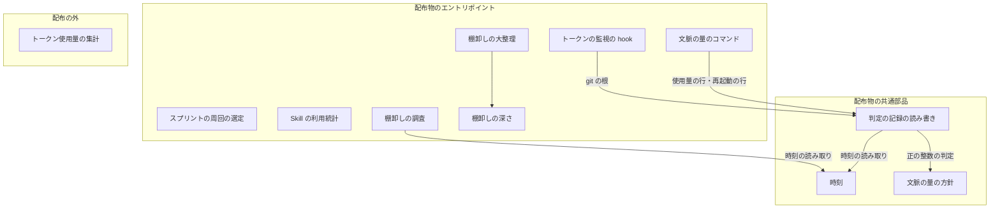
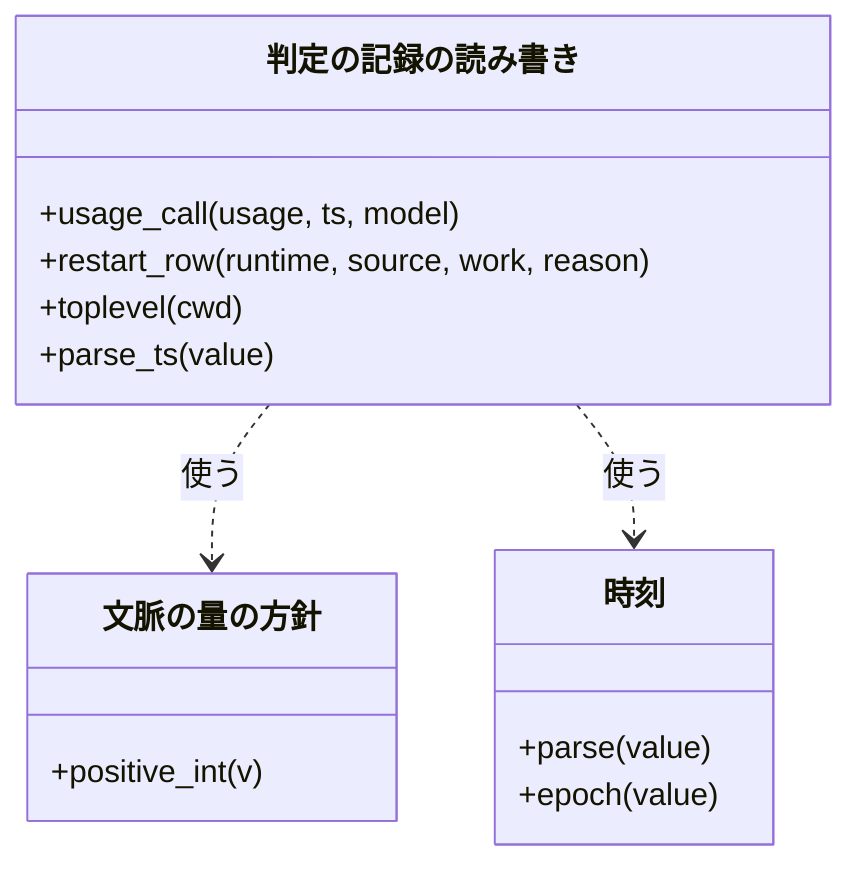
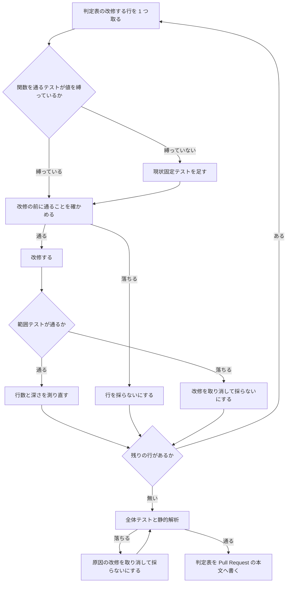

# NDF のスクリプト: 見送ったリファクタリングの提案 24 件を判定し、長い関数と重複を減らす（#2422）

## 目的

- **今どうなっているか**: スプリント lflow-1 の cross-refactoring（PR #2414）が、提案 24 件を時間の予算（`budget`）で見送った。対象は文脈の量の判定（`context-policy.py` と `lib/context_decisions.py`）・課題の棚卸し（`upkeep_*.py`）・Skill の利用統計（`skill-stats.py`）などである。これらに長い関数と同じ処理の重複が残っている
- **誰に効くか**: これらのファイルを次に直す実装者と、そのスプリントの cross-refactoring。重複が残ると同じ修正を 2 か所へ入れ、同じ提案が毎回出て時間で見送られる
- **変えると何が成り立つか**: 24 行のそれぞれが「改修した」か「採らない（理由つき）」に決まる。改修した行は、同じ処理の本体が `plugins/` の中で 1 か所になり、長い関数は短く浅くなる。コマンドの引数・終了コード・出力・記録のファイルの形は変わらない

## 適用範囲

- **働く範囲**: このリポジトリの次の 3 か所。配布物の中の関数の分け方は変わるが、配布先のリポジトリから見える振る舞いは変わらない
  - `plugins/ndf/scripts/`
  - `plugins/ndf/skills/{skill-stats,backlog-refinement}/scripts/`
  - リポジトリだけで使う `scripts/token-usage.py`
- **プロジェクトごとに違うもの**: 無し（内部の関数の置き場と分け方だけを変える）
- **当たるモード**: `standard`（要求の前提 5。7 つのファイル群の構造を変える）

## あるべき姿の根拠

| 根拠 | 種類 | 何を示すか |
| --- | --- | --- |
| PR #2414 のコメント `cross-refactoring plan rf2414` の「見送った提案」の表（24 行が `budget`） | 実測（記録の読み取り） | 各行の兆候と手法。この設計の判定表の出所 |
| 2026-11-04 の `develop`（`729dcbe40`）で、各行の定義を Python の構文木（`ast`）で読み、行範囲と入れ子の深さを測った値（下の判定表） | 実測 | 改修の前の行数と深さ。受け入れ条件 4 の「前」の値 |
| 同じ日の `grep -rn "show-toplevel" plugins/ndf/scripts` で、`hook_lib/token_guard.py:456` と `lib/context_decisions.py:75` が同じ引数・同じ時間の上限（5 秒）・同じ失敗の扱いで git を呼ぶ | 実測 | 行 10 の重複の相手 |
| 同じ日の `lib/context_policy.py:21・34・35` に `TRIAL`・`DENY`・`REASON_CAPACITY`・`REASON_COST` があり、`token_guard.py:373・375` は使い、`token_guard.py:333・336・338` は生の文字列で比べる | 実測 | 行 5 は新しい定数を作らず、既存の定数へ寄せれば足りる |
| 契約のチェック（`scripts/contracts_lib/extract_py.py:246-292`）は、書き込みの式に書かれた f 文字列からファイル名を拾う。`append_decision` の書き込み先をパスを作る関数へ置き換えた一時コピーで `check-ndf-contracts.py --draft` を流すと、`writes` から `*.decisions.jsonl` が消えた | 実測（`git archive` で `/tmp` へ展開したコピー） | 行 22・24 の「重複」は契約を抽出させるための形で、まとめると契約が変わる |

要求と受け入れ条件は #2422 の本文にある（コピーは [issue-2422-requirements.md](issue-2422-requirements.md)）。この文書は「どう作るか」だけを扱う。

## ドメインモデル

### コンテキスト

| コンテキスト | 何の語が 1 つの意味に決まるか |
| --- | --- |
| NDF の cross-refactoring（`ndf-cross-refactoring`） | 見送った提案・兆候・手法（24 行の出所） |
| NDF の開発ワークフロー（`ndf-workflow`） | 判定の記録・文脈の量の方針・全体テスト・スプリントの周回（直すコードの多くが属する） |
| NDF の課題の棚卸し（`ndf-issue-upkeep`） | 調査・見直し・大整理（`upkeep_*.py` が属する） |

関係は**順応者**（Conformist）である。この変更は、`ndf-cross-refactoring` が残した見送った提案を、その語と兆候の分類（duplication など）のまま受け取る。そのうえで、残り 2 つのコンテキストのコードの構造を直す。`ndf-cross-refactoring` の側は何も変えない。

### 集約

**集約は変えない。** この変更が書き換えるのは、関数の置き場と分け方だけである。新しく持つ状態は、実装の Pull Request の本文に載せる判定表だけである。判定表は記録として 1 回書くもので、後から書き換える集約ではない。

| 集約 | 持ち主（書き換えてよいもの） | 根 | エンティティ | 値オブジェクト |
| --- | --- | --- | --- | --- |
| 判定表 | 実装の Pull Request の本文（実装の担当だけが書く） | 判定表 | 行（見送った提案 1 件。ファイル・シンボル・兆候で識別する） | 判定（改修した / 採らない）・採らない理由・改修の前後の行数と深さ |

### 不変条件

I1〜I3 は既存の振る舞いを保つ条件、I4〜I7 はこの変更で成り立たせる条件である。

| # | 集約 | 条件 | 破れたときの扱い |
| --- | --- | --- | --- |
| I1 | — | コマンドの引数・終了コード・標準出力の結果 JSON・hook の出力の文面が、改修の前と同じ | その行の改修を取り消し、判定を「採らない（振る舞いが変わる）」にする |
| I2 | — | `plugins/ndf/contracts/` に差分が無い（契約の抽出が拾う書き込み先・環境変数が変わらない） | その行の改修を取り消す |
| I3 | — | 記録のファイル（判定の記録・適用値・調査の記録・周回の状態・数え上げ）の行のキーと値が、改修の前と同じ | その行の改修を取り消す |
| I4 | 判定表 | 24 行すべてに判定があり、「採らない」の行には理由が 1 つある | 実装の Pull Request を出さない |
| I5 | — | 重複の行を「改修した」なら、同じ処理の本体が `plugins/` の中で 1 か所にある | 残った重複を寄せるまで、その行を「改修した」にしない |
| I6 | — | 長い関数・深い入れ子の行を「改修した」なら、対象の関数の行数か深さが改修の前より小さい | その行を「採らない」にする |
| I7 | — | `plugins/` の Python が `scripts/` を import しない | その import を取り除く |

### ドメインイベント

| # | イベント | 発生元 | 受け手 |
| --- | --- | --- | --- |
| E1 | 各行を今のコードと突き合わせ、改修するか採らないかを決めた | この設計（下の判定表） | 実装の担当（E2 の対象を決める） |
| E2 | 改修する行の関数を通る現状固定テストを足した | 実装の担当（`tdd-cycle`） | 実装の担当（E3 の前提） |
| E3 | 1 行（または同じ重複を解く複数行）ごとに改修を適用した | 実装の担当（`refactoring`） | 全体テスト |
| E4 | 全体テストと静的解析が通った | 全体テストと静的解析 | 実装の担当（E5 の前提） |
| E5 | 24 行の判定と理由を Pull Request の本文に記録した | 実装の担当 | 承認ゲート 2 で見る人 |

### 用語

| 用語 | 意味 | 用語集への反映 |
| --- | --- | --- |
| 見送った提案 | 計画に入らなかった提案と見送った改善項目を合わせたもの。この文書では #2422 の表の 24 行 | 無し（既存の語。`ndf-cross-refactoring`） |
| 現状固定テスト | 改修の前の出力をそのまま期待値にして、構造を変える前後で同じ出力が出ることを縛るテスト | 追加（`ndf-workflow`） |

この文書で「判定表」と書くのは、見送った提案の行ごとに判定（改修した / 採らない）・理由・改修の前後の行数と深さを並べた表である。実装の Pull Request の本文に置く。この課題だけで使う語のため、用語集には足さない。

## 機能一覧

利用者から見た機能は変えない。この変更が成り立たせるのは、保守の作業から見た次の 3 つである。

| # | 機能 | 誰が使うか |
| --- | --- | --- |
| F1 | 見送った提案の行ごとに、改修したか、採らない理由を 1 か所で読める | 承認ゲート 2 で見る人、次の周回の棚卸し |
| F2 | 同じ処理（使用量の行の組み立て・時刻の読み取り・git の根の取得・再起動の行の組み立て・正の整数の判定・「実行した」行の判定）を 1 か所で直せる | これらのファイルを次に直す実装者 |
| F3 | 長い関数を、名前の付いた手順の並びとして読める | 同上 |

## 24 行の判定表

**判定の数**: 改修する 17 行（1・2・3・4・5・6・7・10・11・12・14・15・16・17・18・19・21）、採らない 7 行（8・9・13・20・22・23・24）。重大度 major の 10 行（1・2・3・4・5・6・12・13・14・15）のうち、改修するのは 13 を除く 9 行である。

**行番号は #2422 の表の行の順である。** 行数は `ast` の定義の行から本体の最後の行まで（docstring を含む）とする。深さは関数の本体から数えた `if`/`for`/`while`/`with`/`try` の段数で、`elif` は `if` と同じ段に数える。実装の担当は改修の後に同じ測り方で測り直し、Pull Request の本文の表へ前後の値を書く。

| 行 | ファイル#シンボル | 兆候 | 判定 | 前の行数 / 深さ | 改修の中身、または採らない理由 |
| --- | --- | --- | --- | --- | --- |
| 1 | `context-policy.py#ledger_calls` | duplication | 改修する | 20 / 1 | 使用量の行の組み立てを `context_decisions.usage_call` へ寄せる（行 15 と同じ重複。決定 1） |
| 2 | `context-policy.py#report_work` | long_method | 改修する | 59 / 3 | 区間の作成・部分の合算・再起動の数え上げ・やり直しの数え上げ・丸めを、同じファイルの関数へ抜き出す |
| 3 | `context-policy.py#session_parts` | long_method | 改修する | 55 / 3 | 印の境目の取得・サブエージェントの加算・帳簿の加算を、同じファイルの関数へ抜き出す |
| 4 | `skill-stats.py#aggregate_by_project` | deep_nesting | 改修する | 38 / 5 | 利用者の発言 1 件を数える部分を同じファイルの関数へ抜き出す（深さ 3 の見込み） |
| 5 | `token_guard.py#_trial_cause` | magic_value | 改修する | 11 / 1 | `"trial"`・`"容量"`・`"費用"` を既存の `context_policy.TRIAL`・`context_policy.REASON_CAPACITY`・`context_policy.REASON_COST` に置き換える |
| 6 | `context_decisions.py#parse_ts` | duplication | 改修する | 7 / 1 | 本体を `clock` の時刻の読み取りへ寄せ、同じ本体の `upkeep_research.py#_iso_epoch` も寄せる（決定 2） |
| 7 | `upkeep_research.py#run_research` | long_method | 改修する | 84 / 4 | 空きを待って止まる理由を返す部分と、経過を書く内側の関数を、同じファイルの関数へ抜き出す |
| 8 | `context-policy.py#IDLE_CAP` | duplication | 採らない | 1 / — | `plugins/` の中に重複の相手が無い。相手は配布の外の `scripts/token-usage.py:60` だけ（要求の前提 3） |
| 9 | `upkeep_research.py#research_one` | deep_nesting | 採らない | 25 / 1 | 入れ子は 1 段で、深い入れ子の兆候に当たらない |
| 10 | `token_guard.py#plan_hint` | duplication | 改修する | 23 / 1 | git の根の取得を `context_decisions.toplevel` の呼び出しに置き換える（`context_decisions` は関数の中で import する） |
| 11 | `upkeep_depth.py#diffs_since` | duplication | 改修する | 4 / 0 | 「その深さを実行した」行の判定と最後の位置を、同じファイルの関数 2 つへ寄せ、`_ran`・`_due_overhaul` からも使う |
| 12 | `scripts/token-usage.py#read_codex` | long_method | 改修する | 58 / 4 | Codex の記録を 1 行ずつ読む部分と、使用量を組む部分を、同じファイルの関数へ抜き出す |
| 13 | `upkeep_research.py#run_research` | long_parameter_list | 採らない | 引数 11 個 | 11 個は待つ条件・記録の持ち主・試験用の差し替えに分かれ、1 つの組として渡っていない。まとめると呼び出し元 13 か所（CLI 1・試験 12）が変わり、得るものが無い |
| 14 | `skill-stats.py#emit_json` | data_clump | 改修する | 53 / 1 | 一緒に渡る 6 つの値（エージェント・集計・合計の行・合計・使用量・除外の数）を 1 つの値の型にまとめ、`emit_markdown` も同じ型を受ける |
| 15 | `context_decisions.py#read_calls` | duplication | 改修する | 59 / 2 | 行 1 と同じ。`usage_call` を新しく作り、両方から使う |
| 16 | `context_decisions.py#read_calls` | long_method | 改修する | 59 / 2 | 自動の要約の検出・最初の発言の取得・呼び出しの登録を、同じファイルの関数へ抜き出す（行 15 の後に行う） |
| 17 | `context_policy.py#_positive_int` | duplication | 改修する | 2 / 0 | 公開の名前 `positive_int` にし、`context_decisions.py#read_window` の同じ判定を置き換える |
| 18 | `sprint_loop_select.py#run_selection` | long_method | 改修する | 70 / 2 | 選べなかったときの止まり方と、周回の行を作って記録する部分を、同じファイルの関数へ抜き出す |
| 19 | `upkeep_overhaul.py#count_types` | divergent_change | 改修する | 37 / 2 | 型ごとの件数・本文からの部品の拾い出し・月ごとの数え上げを、同じファイルの関数 3 つへ分ける。戻す辞書のキーと順序は保つ |
| 20 | `terminal.py#Terminal` | hidden_dependency | 採らない | 199 / — | 環境変数で待ち時間を調整するのは `relay_lib` 全体の約束で、同じ読み方が他に 12 か所ある。1 クラスだけ引数にすると揃いが崩れ、終了の待ちを生成の時点で読むと読む時刻が変わる |
| 21 | `context-policy.py#cmd_record` | duplication | 改修する | 17 / 1 | 再起動の行の組み立て（セッションの読み取り・境目の行・`cut` と再起動の付与）を `context_decisions.py` の関数へ寄せ、`record_restart` と共有する。`context-policy.py#cli_row` は消す |
| 22 | `context_decisions.py#append_decision` | duplication | 採らない | 9 / 2 | 書き込みの式に書いたパスは、契約のチェックが書き込み先を拾うための形である。パスを作る関数へ寄せると契約が変わる（あるべき姿の根拠の 5 行目） |
| 23 | `context_decisions.py#attach_marks` | duplication | 採らない | 10 / 2 | 本体に重複の相手が無い。似ているのは呼ぶ側の区間の作り方で、`report_work` は帳簿にあるセッションを除くなど意図して違う |
| 24 | `context_decisions.py#write_applied` | duplication | 採らない | 18 / 3 | 行 22 と同じ理由（`*.applied.json` も書き込みの式から拾われる） |

## 構成要素

**新しいモジュールは作らない。** 寄せる先は、重複の片方がすでにある既存のモジュールにする。

| 要素 | 責務 | 判定表の行 |
| --- | --- | --- |
| 判定の記録の読み書き（`lib/context_decisions.py`） | 使用量の行の組み立て（`usage_call`）と、再起動の行の組み立てを持つ。`read_calls` を短くする | 1・6・15・16・17・21 |
| 文脈の量のコマンド（`context-policy.py`） | 帳簿の読み取りと作業の報告を、抜き出した関数の並びにする | 1・2・3・21 |
| 文脈の量の方針（`lib/context_policy.py`） | 正の整数の判定を公開する | 17 |
| 時刻（`lib/clock.py`） | 時刻の文字列を秒へ変える関数を持つ（`parse` の上に置く） | 6 |
| トークンの監視の hook（`hook_lib/token_guard.py`） | 試行方式の拒否の句と、計画の案内を、既存の定数と関数で組む | 5・10 |
| スプリントの周回の選定（`lib/sprint_loop_select.py`） | 選定の本体を、止まり方と周回の開始の 2 つの関数へ分ける | 18 |
| Skill の利用統計（`skill-stats/scripts/skill-stats.py`） | 発言 1 件の数え上げを抜き出し、エージェントの報告を 1 つの値の型で渡す | 4・14 |
| 課題の棚卸しの調査（`upkeep_research.py`） | 調査の本体を短くし、時刻の読み取りを `clock` へ寄せる | 6・7 |
| 課題の棚卸しの深さ（`upkeep_depth.py`） | 「実行した」行の判定を 1 か所にする | 11 |
| 課題の棚卸しの大整理（`upkeep_overhaul.py`） | 数え上げを変わる理由ごとの関数に分ける | 19 |
| トークン使用量の集計（`scripts/token-usage.py`、配布の外） | Codex の記録の読み取りを短くする | 12 |
| 現状固定テスト | 改修する関数の今の出力を固定する。既存のテストが値を縛っていない関数にだけ足す | 2・3・4・14・18 |



図に載せていない要素: 現状固定テスト（どの要素からも呼ばれない）。スプリントの周回の選定・Skill の利用統計・トークン使用量の集計は、ファイルの中だけで閉じる改修なので、他の要素への線を持たない。

### パッケージ・モジュール構成

変えるファイルだけを書く。新設は無い（テストの関数の追加は既存のテストファイルへ入れる）。

```text
plugins/ndf/
├── scripts/
│   ├── context-policy.py          # 行 1・2・3・21（cli_row を消す）
│   ├── hook_lib/token_guard.py    # 行 5・10
│   └── lib/
│       ├── clock.py               # 行 6（秒へ変える関数を足す）
│       ├── context_decisions.py   # 行 1・6・15・16・17・21（usage_call・再起動の行を足す）
│       ├── context_policy.py      # 行 17（positive_int）
│       └── sprint_loop_select.py  # 行 18
└── skills/
    ├── skill-stats/scripts/skill-stats.py               # 行 4・14
    └── backlog-refinement/scripts/
        ├── upkeep_research.py     # 行 6・7
        ├── upkeep_depth.py        # 行 11
        └── upkeep_overhaul.py     # 行 19
scripts/token-usage.py             # 行 12（配布の外）
```

## 構造

触る関数と、寄せた後の呼び出しの向きだけを描く。同じファイルの中へ抜き出す関数は描かない。



- `usage_call` は 1 回の呼び出しの使用量の行（入力・出力・読み込み・キャッシュの書き込み 2 種・文脈の量・時刻・モデル）を返す。帳簿の行だけが持つ秒は、呼ぶ側の `ledger_calls` が足す。キーの順は今の 2 か所と同じにする
- `restart_row` の名前と引数は実装で決める。満たす条件は、`cmd_record` と `record_restart` の両方が、セッションの読み取りと `cut`・再起動の付与をこの関数に任せ、記録の行と標準出力が変わらないことである
- `epoch` の名前は実装で決めてよい。`parse_ts` は呼び出し元が多い（`context_decisions.py` と `context-policy.py`）ため、名前を残して `epoch` を呼ぶ

## 処理の流れ

行ごとの改修は、次の順で進める。この順は構成要素の表のどの要素にも同じように当たり、要素ごとの違いは判定表と下の順序の表が持つ。止まったときは、その行だけを取り消して判定を「採らない」にし、次の行へ進む。



**同じファイルの行どうしの順序**は次のとおりにする。後の行が前の行の結果を前提にするためである。

| 先に行う | 後に行う | 理由 |
| --- | --- | --- |
| 行 15（`usage_call` を作る） | 行 1・行 16 | 行 1 は `usage_call` を呼び、行 16 は `usage_call` を除いた残りを抜き出す |
| 行 17（`positive_int`） | — | 他の行と当たらない |
| 行 21（再起動の行） | 行 2・3 | 同じ `context-policy.py` の差分を小さく保つ |
| 行 6（`clock` の関数） | 行 7 | 行 7 は同じ `upkeep_research.py` を直す |

ファイル群（文脈の量・hook・周回・統計・棚卸し・集計）の間には順序の依存が無い。

## 非機能の実現方式

| 大項目 | 条件 | 実現方式 |
| --- | --- | --- |
| 運用・保守性 | 対象のスクリプトのコマンドの引数・終了コード・出力は変わらない。利用者の手元での操作は増えない | 改修はモジュールの中の関数の分け方と、`plugins/` の中の置き場だけに限る。`plugins/ndf/contracts/` の差分が無いことを契約のチェックで確かめる（I2）。hook の応答時間は既存の締切のテスト（`tests/test_hook_deadline.py`）で見る |

## 決定の記録

### 決定 1: 使用量の行の組み立てを 1 か所にするため、判定の記録の読み書きのモジュールに置く

使用量の行は、セッションの記録の読み取り（`read_calls`）と帳簿の読み取り（`ledger_calls`）の 2 か所で同じキーと同じ計算で作られている。`context-policy.py` は `context_decisions.py` を import しており、逆向きの import は無い。`context_decisions.py` に置けば向きは変わらず、hook からも使える。

使用量の帳簿のモジュール（`usage_ledger`）へ置く形は採らない。帳簿は書く側の形を持つモジュールで、セッションの記録の読み取りの都合を持ち込むことになる。

根拠: Value 7（MVV 版 5）

### 決定 2: 時刻の読み取りの本体を 1 か所にするため、`clock` の `parse` の上に秒へ変える関数を置く

`parse_ts` と `upkeep_research.py#_iso_epoch` は本体が同じで、`clock.parse` は同じ読み取りを一般化した関数である。秒へ変える関数を `clock` に 1 つ置き、2 つの関数はそれを呼ぶ。`clock` は標準ライブラリだけを import するため、hook が読むモジュールにも循環は生じない。

`clock.parse` は前後の空白と小文字の `z` も読む。この 2 つを含む時刻は NDF の記録に現れない（記録の時刻は `clock.now_iso` が書く）。そのため、改修の前に `None` を返していた入力が読めるようになっても、記録を読む結果は変わらない。この差は現状固定テストでは縛らない。

`#_iso_epoch` は判定表に無い関数である。重複の行は重複の相手を寄せなければ I5 を満たせないため、重複の行の改修は重複の相手を含めて扱う。形の違う時刻の読み取り（`slow_step.py:346` は `"null"` も読む、`check-trigger.py:248` は UTC へ変える など）は同じ処理ではないため寄せない。

根拠: Value 7 / Value 3（MVV 版 5）

### 決定 3: 契約の抽出を保つため、書き込み先のパスの重複（行 22・24）は採らない

契約のチェックは、書き込みの式に書かれた f 文字列から書き込み先のファイル名を拾う。パスを作る関数へ寄せると、契約から書き込み先が消え、受け入れ条件の「`plugins/ndf/contracts/` に差分が無い」を破る。契約の抽出の方を直すのはこの課題の範囲の外である（要求の対象範囲は表の関数に限る）。

根拠: Value 3 / Value 7（MVV 版 5）

### 決定 4: 1 クラスだけ揃いを崩さないため、ラッパーの端末の環境変数の読み方（行 20）は採らない

`relay_lib` は、待ち時間を環境変数で調整する約束を 12 か所で同じ書き方で持つ。端末のクラスだけを引数で受ける形にすると、同じパッケージに 2 つの書き方が残る。揃えるならパッケージ全体を直す変更になり、この課題の範囲を超える。

根拠: Value 7 / Value 3（MVV 版 5）

### 決定 5: 呼び出し元を変えずに済む範囲に留めるため、調査の本体の引数（行 13）は採らない

`run_research` の 11 個の引数は、待つ条件・記録の持ち主・試験用の差し替えに分かれ、どれも 1 つの組として渡っていない。値の型にまとめると、CLI の 1 か所と試験の 12 か所が変わり、関数が受ける情報は変わらない。

一緒に渡る組は内側の `log_call` と `research_one` の `run`・`loop`・`lap` にある。これは判定表に無い関数の兆候で、この課題では扱わない。

根拠: Value 3（MVV 版 5）

### 決定 6: 既存のテストを振る舞いの基準にし、値を縛るテストが無い関数にだけ現状固定テストを足す

既存のテストが出力の値を縛っている関数（行 1・5・6・7・10・11・12・15・16・17・19・21）は、そのテストを改修の前後で通す。値を縛っていない関数にだけ、今の出力を期待値にするテストを足す。対象は、行 2・3 の作業の報告の秒・費用・再起動の数、行 4 のトリガーとヒットの数、行 14 のエージェントの報告の JSON、行 18 の直しの周回の印である。`.md` の文言を照合するテストは書かない。

すべての行に新しく現状固定テストを足す形は採らない。同じ振る舞いを縛るテストが 2 つになり、片方だけが直される。

根拠: Value 1 / Value 5（MVV 版 5）

### 決定 7: 承認ゲート 1 で範囲を縮められるよう、行をファイル群の単位で独立に改修できる順にする

要求の未決 1（24 行すべてか、major の 10 行に絞るか）は承認ゲート 1 で決まる。ファイル群の間には順序の依存を持たせない（処理の流れの表）。そのため、絞ると決まった場合は外れた行を「採らない（承認ゲート 1 で範囲を絞った）」として判定表に残し、残りの行だけを改修する。設計を作り直さない。

根拠: Value 2 / Value 3（MVV 版 5）

## テスト設計

| 受け入れ条件・不変条件 | どの振る舞いで縛るか | どう壊したら落ちるべきか |
| --- | --- | --- |
| 受け入れ条件 1・I4（24 行の判定と理由） | Pull Request の本文の判定表を、承認ゲート 2 で人が読む（テストにしない） | — |
| 受け入れ条件 2（改修した行の関数を通るテストが前後で通る） | 判定表の「改修する」17 行それぞれで、関数を通るテストを改修の前のコミットと後のコミットで流す | 抜き出した関数の中で値を 1 つ変える（例: 使用量の行のキャッシュの書き込みを 1 種落とす）と落ちる |
| 受け入れ条件 3・I5（重複の本体が 1 か所） | 行 1・6・10・11・15・17・21 の処理を `grep` で探し、定義が `plugins/` の中で 1 件になる | 重複を 1 つ戻すと 2 件になる |
| 受け入れ条件 4・I6（行数か深さが小さい） | 行 2・3・4・7・12・16・18 の関数を `ast` で測り、前後の値を判定表へ書く | 抜き出した関数を元へ戻すと前の値に戻る |
| 受け入れ条件 5（名前の無い値） | 行 5 の比較が `context_policy` の定数を通る | 生の文字列へ戻すと `grep` で見つかる |
| 受け入れ条件 6・I1・I3（全体テスト） | `uv run --frozen --project . --all-extras pytest . -q -n 4` | 作業の報告の秒・再起動の数、エージェントの報告の JSON のキーと順序、数え上げの辞書のキーの順を変えると、足した現状固定テストか既存のテストが落ちる |
| 受け入れ条件 7（静的解析） | `python3 scripts/check-script-structure.py`・`python3 scripts/check-ndf-contracts.py`・`bash scripts/check-lint.sh` が 0 | — |
| 受け入れ条件 8・I2（契約の差分が無い） | `git diff --stat develop -- plugins/ndf/contracts/` が空 | 書き込みの式のパスを関数へ置き換えると、契約のチェックが差分を出す |
| 受け入れ条件 9・I7（`scripts/` を import しない） | `git diff develop -- plugins/` の追加の行に `scripts/` のモジュールの import が無い | `token-usage.py` の関数を import すると見つかる |
| 受け入れ条件 10（版が変わらない） | `git diff develop -- plugins/ndf/.claude-plugin/plugin.json` が空 | — |
| 行 10 の hook の応答時間 | 既存の `tests/test_hook_deadline.py` | `plan_hint` で判定の記録のモジュールを最上位で import して重くすると、締切を超えれば落ちる |

## 設計の結果

| 課題 | 扱い | 取り込み先 | 触るファイル |
| --- | --- | --- | --- |
| #2422 | 実装する | — | `plugins/ndf/scripts/context-policy.py`、`plugins/ndf/scripts/hook_lib/token_guard.py`、`plugins/ndf/scripts/lib/clock.py`、`plugins/ndf/scripts/lib/context_decisions.py`、`plugins/ndf/scripts/lib/context_policy.py`、`plugins/ndf/scripts/lib/sprint_loop_select.py`、`plugins/ndf/skills/skill-stats/`、`plugins/ndf/skills/backlog-refinement/`、`plugins/ndf/scripts/tests/`、`scripts/token-usage.py`、`scripts/tests/`、`docs/glossary/` |

## 未確認のまま残ること

| 項目 | 内容 |
| --- | --- |
| 行 10 の hook の読み込みの時間 | `plan_hint` が判定の記録のモジュールを読むと、エージェントの起動の hook で読み込みが増える。手元の `python3 -X importtime` で累計 約 43 ms と測ったが、締切への余裕は未確認。実装で締切のテストを流して確かめる |
| 判定表の前の値の再現 | 表の値は判定表の冒頭の測り方を 1 本の `ast` のスクリプトで `729dcbe40` に当てた値である。スクリプトはリポジトリに置かないため、実装の担当は同じ測り方で前（`develop`）と後を測り直し、本文の表に書く |
| 範囲の外で見つけた重複 | `token_guard.py:398` の `"拒否"`（`_judge` の中）、`plan_hint` と `guard_context` のサブエージェントの除外、`run_research` の内側の `run`・`loop`・`lap` の組、`research_one` の同じ条件の 2 回の評価。どれも判定表に無い関数で、利用者へ届く不具合ではないため起票しない（Value 3）。次の周回の cross-refactoring が提案すれば、そのとき判定する |
| 要求の未決 1・2 | 24 行すべてか major の 10 行に絞るか、見送った提案を起票する手順と Value 3 の食い違いの扱いは、承認ゲート 1 で決まる（決定 7） |
