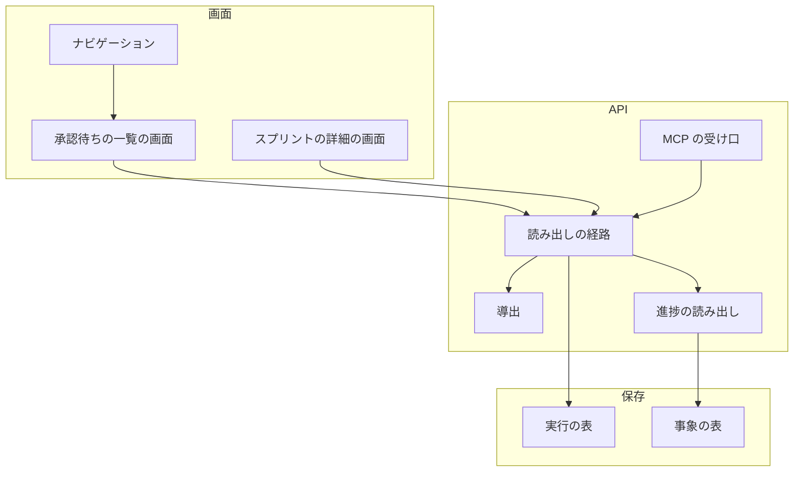
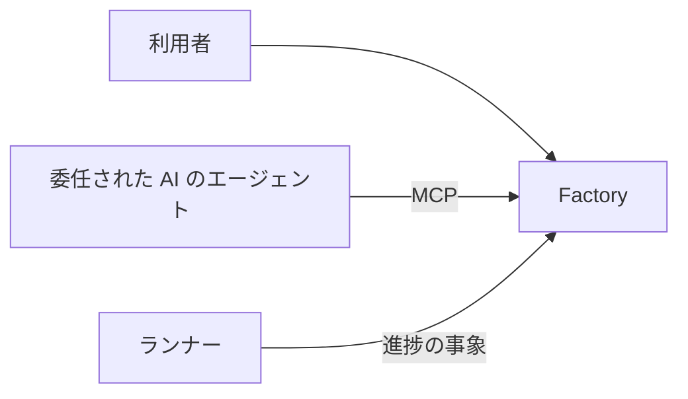
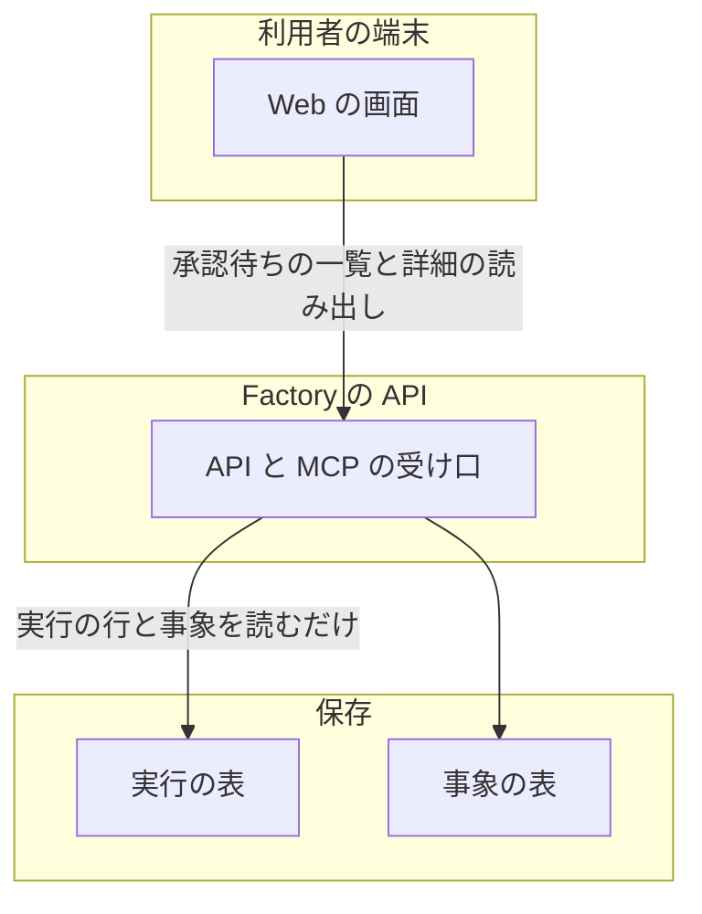
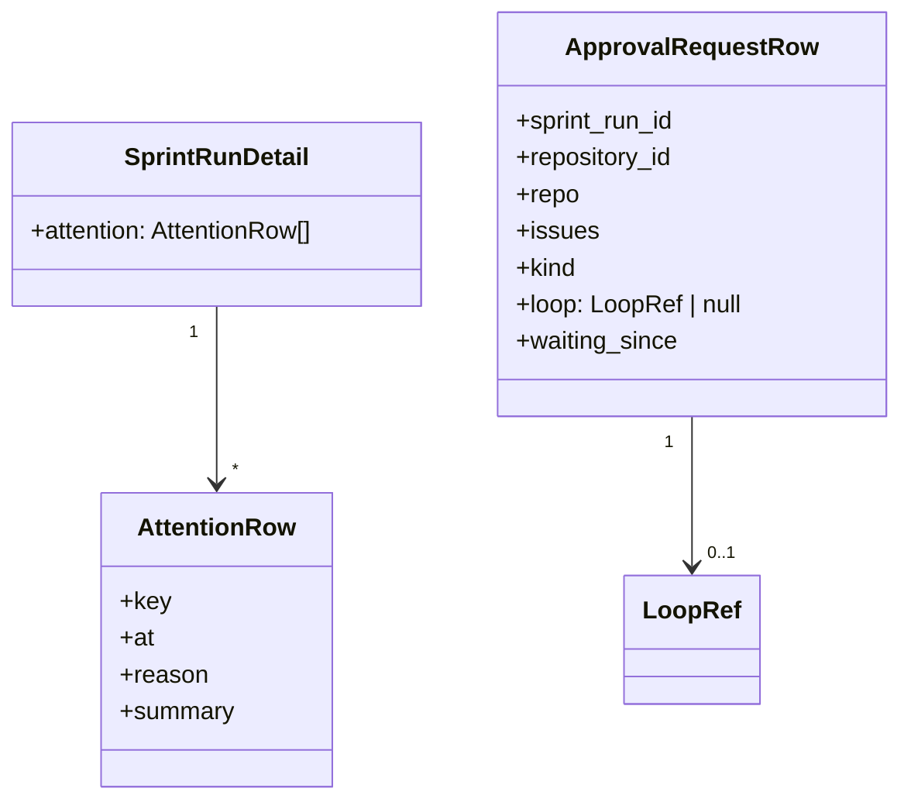
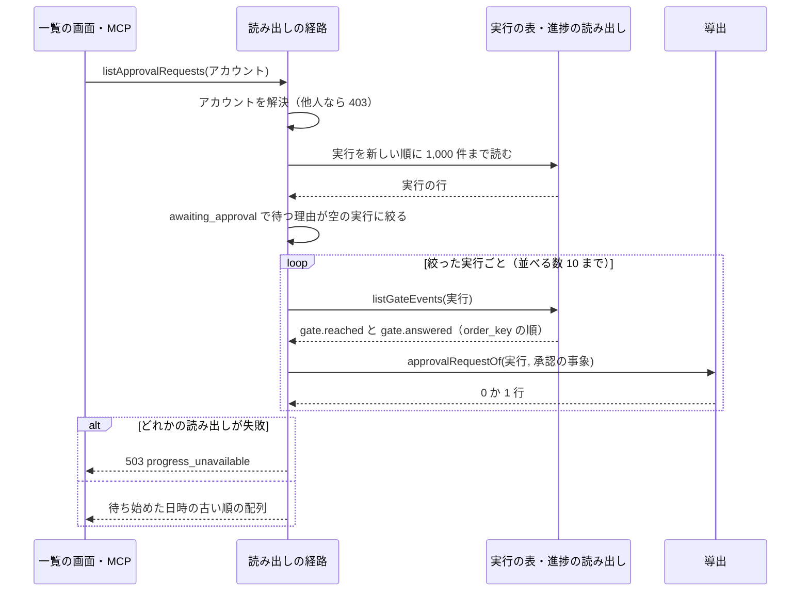
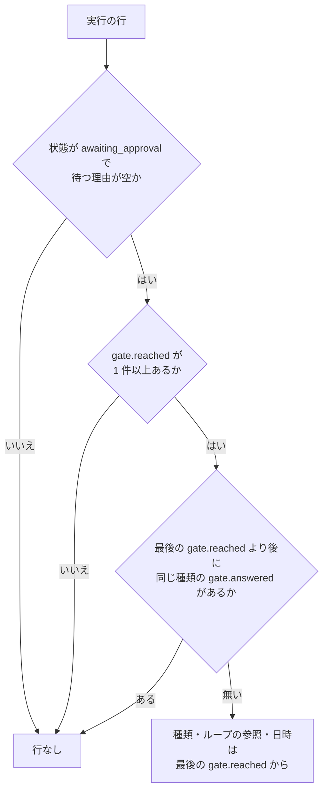
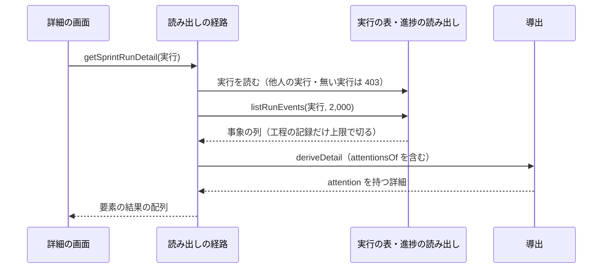

# NDF Factory: 取り込みで止まった理由と、承認を待つ依頼の一覧を Web の画面で読める（#2430）

## 目的

- **今どうなっているか**: ランナーは取り込みで解けない衝突を進捗の事象（`attention`、理由 `base_conflict`）で送る。承認の依頼（`gate.reached`）にはループの名前と周回の番号を載せている。Web の画面はどちらも出さない。スプリントの詳細は状態・失敗の理由・作成日時だけを出し、承認の画面は画面の地図に予定として載るだけで、経路を持たない
- **誰に効くか**: スプリントの実行と開発ループを Factory で回す利用者と、利用者が委任した AI のエージェント
- **変えると何が成り立つか**: 取り込みの衝突で止まった理由をスプリントの詳細だけで読める。複数のループと単発の実行が人の答えを待っているとき、どのループの何周目の、どの種類の承認の依頼かを 1 つの一覧で読める。同じ一覧を API と MCP でも読める

## 適用範囲

- **働く範囲**: このリポジトリの `factory/`（Web の画面・API・契約）と、画面の地図の確定仕様だけ。NDF のプラグイン（`plugins/`）と配布先のリポジトリでは働かない
- **プロジェクトごとに違うもの**: 無し（Factory の中だけで閉じ、プロジェクトごとの設定を読まない）
- **当たるモード**: `standard`（新しい画面と API の操作を足し、公開インタフェースが変わる）

## あるべき姿の根拠

| 根拠 | 種類 | 何を示すか |
| --- | --- | --- |
| #2347 の受け入れ条件 7・13 の原文（承認ゲート 1 で利用者が承認） | 利用者の指示の原文 | 取り込みの衝突は画面に並び、複数のループの承認の依頼が 1 つの一覧に並ぶ |
| リリース後テストの記録（Pull Request #2426 のコメント、2026-11-02 21:50 JST） | 実測 | `factory/web/src` に `attention`・`base_conflict` を出すコードが 0 件。承認の画面は `status: "planned"`・`path: null` |
| `factory/api/src/accounts/limits.ts` 15〜19 行の同時の実行の数（1・3・10） | 実測 | 承認を待つ実行は枠を持ったまま待つため、1 つのアカウントで同時に待つ実行は料金プランの同時の数までになる（決定 3） |

要求と受け入れ条件は #2430 の本文にある（コピーは `issues/issue-2430-requirements.md`）。この文書は「どう作るか」だけを扱う。

## ドメインモデル

### コンテキスト

| コンテキスト | 何の語が 1 つの意味に決まるか |
| --- | --- |
| Factory（`ndf-factory`） | スプリントの実行・進捗の事象・承認の依頼・承認待ちの一覧・取り込みの衝突 |

1 つのコンテキストの中で閉じる。ランナーとの間の進捗の事象の形は公開された言語（`factory/contracts/schemas/progress-event.schema.json`）である。この変更では変えない。

### 集約

この変更は集約を書き換えない。どちらの集約も読むだけで、画面と API に返す形（読み出しの形）を導く。

| 集約 | 持ち主（書き換えてよいもの） | 根 | エンティティ | 値オブジェクト |
| --- | --- | --- | --- | --- |
| スプリントの実行 | 実行の制御（`factory/api/src/runs/control.ts`）。この変更は状態と待つ理由を読むだけ | スプリントの実行 | 実行ジョブ | 状態・待つ理由（`awaitingReason`） |
| 進捗の事象の列 | 進捗の受け口（`factory/api/src/progress/append.ts`）。この変更は読むだけ | スプリントの実行の事象の列 | 事象（`attention`・`gate.reached`・`gate.answered`） | 理由と要約・承認の種類・ループの参照（名前と周回の番号） |

読み出しの形は 2 つ足す。どちらも保存せず、読むたびに導く。

| 読み出しの形 | 導くもとの集約 | 載る項目 |
| --- | --- | --- |
| 注意の行（`AttentionRow`） | 進捗の事象の列 | 鍵・日時・理由・要約 |
| 承認を待つ依頼の行（`ApprovalRequestRow`） | スプリントの実行と進捗の事象の列 | 実行の ID・リポジトリ・課題の番号・種類・ループの参照・待ち始めた日時 |

### 不変条件

| # | 集約 | 条件 | 破れたときの扱い |
| --- | --- | --- | --- |
| I1 | 進捗の事象の列 | スプリントの詳細の注意の行は、その実行の `attention` をすべて、記録された順（`order_key` の順）に持つ。工程の記録の上限（2,000 件）は注意の行を減らさない | テストで落とす。実装は工程の記録だけを上限で切る既存の読み出しを使う |
| I2 | 進捗の事象の列 | 注意の行の理由と要約は受け口が受けた値のままで、理由が `base_conflict` のときだけ画面が「取り込みで解けない衝突」と出す。ほかの理由は値そのものを出し、詳細の読み出しは 200 を返す | テストで落とす |
| I3 | スプリントの実行・進捗の事象の列 | 承認を待つ依頼の行は 1 つの実行に 0 か 1 つ。行があるのは、実行の状態が `awaiting_approval` で待つ理由が空であり、その実行の最後の `gate.reached` より後に同じ種類の `gate.answered` が無いときだけ | テストで落とす |
| I4 | 進捗の事象の列 | 行の種類・ループの参照・待ち始めた日時は、その実行の最後の `gate.reached` のもの。`loop` を持たない `gate.reached` の行のループの参照は空（画面は「—」） | テストで落とす |
| I5 | — | 一覧の行は待ち始めた日時の古い順で、同じ日時は実行の ID の順 | テストで落とす |
| I6 | スプリントの実行 | 一覧に載るのは、操作の登録の層が解決したアカウントの実行だけ。他人のアカウントの一覧は 403 `forbidden` で、スプリントの一覧と同じ本文 | 403 を返す |
| I7 | — | 一覧と詳細の読み出しは、事象の表・実行の表・GitHub へ書かない。一覧の操作は `x-ndf-access: read` で、承認を確定する操作を足さない | テストで落とす |
| I8 | — | 画面・API・MCP は同じ操作を通り、同じ行の配列を返す | テストで落とす |

### ドメインイベント

| # | イベント | 発生元 | 受け手 |
| --- | --- | --- | --- |
| E1 | ランナーが取り込みで解けない衝突を `attention`（`reason: base_conflict`）で送った | ランナー（`factory/runner/src/translate.ts`） | 進捗の受け口が保存し、スプリントの詳細の読み出しが注意の行へ導く |
| E2 | ランナーが承認の依頼を `gate.reached`（ループの実行なら `loop` つき）で送った | ランナー | 進捗の受け口が保存し、承認待ちの一覧の読み出しが行へ導く |
| E3 | 承認の依頼に答えが記録された（`gate.answered`） | 既存の答えの経路（#2173 が画面から足す） | 承認待ちの一覧の読み出しが、次に読んだときに行を外す |
| E4 | 利用者がスプリントの詳細を開き、注意の欄を読んだ | スプリントの詳細の画面 | スプリントの詳細の読み出し |
| E5 | 利用者か委任された AI のエージェントが承認待ちの一覧を読んだ | 承認待ちの一覧の画面・API・MCP | 承認待ちの一覧の読み出し |
| E6 | 利用者が一覧の行からスプリントの詳細へ移った | 承認待ちの一覧の画面 | スプリントの詳細の画面 |

### 用語

| 用語 | 意味 | 用語集への反映 |
| --- | --- | --- |
| 承認待ちの一覧 | アカウントのスプリントの実行のうち、答えの無い承認の依頼（ゲート 1・ゲート 2・判断）を、ループの名前と周回の番号とともに 1 つに並べた、読むだけの画面と API の読み出し | 追加（要求と同じ変更で反映済み） |
| 取り込みの衝突 | ベースブランチの取り込みで解けずにスプリントの実行が止まったこと。進捗の事象では `attention` の理由 `base_conflict` で届く | 追加（要求と同じ変更で反映済み） |

## 機能一覧

| # | 機能 | 誰が使うか |
| --- | --- | --- |
| F1 | スプリントの詳細で、実行の注意（理由・要約・日時）を記録された順に読む | 実行を始めた利用者・同じアカウントの席を持つ人 |
| F2 | 承認待ちの一覧を開き、答えの無い承認の依頼を種類・ループの名前・周回の番号とともに読む | 同上 |
| F3 | 承認待ちの一覧の行から、その実行のスプリントの詳細へ移る | 同上 |
| F4 | 承認待ちの一覧を API の操作と MCP のツールで読む | 利用者と、利用者が委任した AI のエージェント |
| F5 | ナビゲーションから承認待ちの一覧へ移る | 同上（画面の利用者） |

## 構成要素

| 要素 | 責務 | 置き場 |
| --- | --- | --- |
| 契約（OpenAPI） | 承認待ちの一覧の操作 `listApprovalRequests` を足し、スプリントの詳細の形に `attention` を足す | `factory/contracts/openapi/runs.yaml` |
| 共有する形 | 注意の行と承認を待つ依頼の行の型の正本。API と画面の両方が読む | `factory/contracts/src/views.ts` |
| 操作の表 | 契約から生成する操作の一覧。新しい操作が画面・API・MCP に同時に現れる | `factory/contracts/src/generated/operations.ts`（`npm run generate -w contracts` で作る） |
| 進捗の読み出し | 実行の `gate.reached` と `gate.answered` だけを `order_key` の順に返すメソッド（`listGateEvents`）を足す | `factory/api/src/progress/read.ts` |
| 導出 | 事象の列から注意の行を、実行と承認の事象から承認を待つ依頼の行を作る純粋な関数（`attentionsOf`・`approvalRequestOf`） | `factory/api/src/views/derive.ts` |
| 読み出しの経路 | 詳細の読み出しへ注意の行を足す。一覧の操作を登録し、アカウントの実行を絞って行を集める | `factory/api/src/routes/sprint-views.ts` |
| 承認待ちの一覧の画面 | 一覧を読み直しながら出し、行からスプリントの詳細へ移す | `factory/web/src/pages/ApprovalsPage.tsx`（新設） |
| スプリントの詳細の画面 | 注意の欄を足す | `factory/web/src/pages/SprintDetailPage.tsx` |
| 画面の地図と経路 | 「承認」の行を経路つきの「あり」にし、ナビゲーションの行き先にする | `factory/web/src/screens.ts`・`factory/web/src/App.tsx`・`docs/specifications/ndf-factory-screen-map.md` |
| 画面の API の呼び出しとダミー | 一覧の読み出しの呼び出しと、ダミーで起動したときのデータ | `factory/web/src/api.ts`・`factory/web/src/dummy/` |
| 翻訳のファイル | 新しい文言 | `factory/web/src/i18n/ja.json` |

MCP のツールは操作の表から作られるため（`factory/api/src/mcp/server.ts` の `tools()`）、MCP の側のコードは変えない。

### 構成要素図



図に含めない要素: 契約（OpenAPI）・共有する形・操作の表・画面の地図と経路・画面の API の呼び出しとダミー・翻訳のファイル。どれも実行の途中で呼ばれず、型・経路・文言の定義として読まれる。

### システムの文脈と配置



ランナーと進捗の事象の契約はこの変更で変えない。配置は #2172 の形のままで、実行の単位を足さない。



### パッケージ・モジュール構成

```text
factory/
├── contracts/
│   ├── openapi/runs.yaml              （変更）
│   └── src/
│       ├── views.ts                   （変更: AttentionRow・ApprovalRequestRow）
│       └── generated/operations.ts    （生成し直す）
├── api/src/
│   ├── progress/read.ts               （変更: listGateEvents）
│   ├── views/derive.ts                （変更: attentionsOf・approvalRequestOf）
│   ├── views/derive.test.ts           （変更）
│   ├── routes/sprint-views.ts         （変更: 詳細に attention・一覧の操作）
│   ├── routes/sprint-views.test.ts    （変更）
│   └── mcp/mcp.test.ts                （変更）
└── web/src/
    ├── screens.ts                     （変更）
    ├── App.tsx                        （変更）
    ├── api.ts                         （変更）
    ├── pages/ApprovalsPage.tsx        （新設）
    ├── pages/approvals.test.tsx       （新設）
    ├── pages/SprintDetailPage.tsx     （変更）
    ├── pages/sprints.test.tsx         （変更）
    ├── i18n/ja.json                   （変更）
    └── dummy/{api.ts,data.ts}         （変更）
```

## 構造

触る型だけを描く。`LoopRef` は進捗の事象の既存の型で、名前だけを置く。

| 行 | 導くもと |
| --- | --- |
| 注意の行 | 事象（`ProgressEventRecord`）の `attention` |
| 承認を待つ依頼の行 | 実行（`SprintRun`）と最後の `gate.reached` |

どちらの行も元の型を保有しない。



## 入出力の契約

仕様記述は `factory/contracts/openapi/runs.yaml` に置く。検査は `npm run lint:contracts`（Spectral）と `npm run check -w contracts`。

### 変わる約束

| 操作 | 変更 | 互換性 |
| --- | --- | --- |
| `getSprintRunDetail`（`GET /accounts/{accountId}/sprint-runs/detail`） | 要素の値 `SprintRunDetail` に必須の `attention`（`AttentionRow` の配列）を足す | 足すだけ。既存の項目の形と意味は変えない。既存の呼び出し側（画面・MCP）は知らない項目を読み飛ばす |
| `listApprovalRequests`（`GET /accounts/{accountId}/approval-requests`） | 新設。種類は一覧（`list`）、`x-ndf-access: read`、鍵と入力の本文を持たない | 新しい操作。MCP のツールが 1 つ増える |

### 新しい形

| 形 | 項目 | 型 | 空の値 | 意味 |
| --- | --- | --- | --- | --- |
| `AttentionRow` | `key` | 文字列 | — | 事象の冪等の鍵（`idempotency_key`）。画面の行の鍵 |
| | `at` | 日時（UTC） | — | 事象の日時。画面は利用者の時刻帯で出す |
| | `reason` | 文字列 | — | 受け口が受けた理由の値（`base_conflict` など） |
| | `summary` | 文字列 | — | 受け口が受けた要約 |
| `ApprovalRequestRow` | `sprint_run_id` | 文字列 | — | 待っている実行 |
| | `repository_id` | 整数 | — | リポジトリの ID |
| | `repo` | 文字列 | — | `owner/name` |
| | `issues` | 整数の配列 | 空の配列 | 実行の課題の番号 |
| | `kind` | `gate1` / `gate2` / `decision` | — | 承認の依頼の種類 |
| | `loop` | `{ name, lap }`（進捗の事象の `LoopRef`） | `null`（ループでない実行） | ループの名前と周回の番号 |
| | `waiting_since` | 日時（UTC） | — | 最後の `gate.reached` の日時 |

### 一覧の操作の失敗の形

| 状況 | 応答 |
| --- | --- |
| 承認を待つ依頼が 0 件 | 200 と空の配列 |
| ログインしていない・資格情報が無い | 401（既存の操作の登録の層） |
| 他人のアカウント | 403 `forbidden`。`listSprintRuns` と同じ本文（I6） |
| 実行の表か事象の表を読めない | 503 `progress_unavailable`（既存の `readOrUnavailable` と同じ） |

### 画面

| 画面 | 何をする場所か | 経路 |
| --- | --- | --- |
| 承認待ちの一覧（新設） | アカウントで答えを待っている承認の依頼を、古い順に読む | `/accounts/:accountId/approvals` |
| スプリントの詳細（変更） | 注意の欄を足す | `/accounts/:accountId/sprints/:sprintRunId`（変えない） |

遷移:


項目（どちらも表示だけで、入力を持たない）:

| 画面 | 項目 | 出し方 |
| --- | --- | --- |
| 承認待ちの一覧 | 種類 | 「ゲート 1」「ゲート 2」「判断」（既存の `sprintDetail.gate1`・`gate2`・`decision` の文言） |
| | ループの名前・周回の番号 | `loop` が空なら「—」 |
| | リポジトリ | `repo` |
| | 課題の番号 | スプリントの一覧と同じ出し方（`issueNumbers`） |
| | 待ち始めた日時 | 利用者の時刻帯（`format.dateTime`） |
| スプリントの詳細の注意の欄 | 理由 | `base_conflict` は「取り込みで解けない衝突」、ほかは値そのもの |
| | 要約・日時 | 要約はそのまま、日時は利用者の時刻帯 |

状態:

| 状態 | 承認待ちの一覧 | 注意の欄 |
| --- | --- | --- |
| 読み込み中 | `LoadingState` | 詳細と同じ（欄は詳細と一緒に出る） |
| 0 件 | `EmptyState`「承認を待っているものはありません」 | 欄に「ありません」 |
| 最初の読み込みの失敗 | `ErrorState` と「もう一度読む」 | 詳細と同じ |
| 読み直しの失敗 | 前の表示を残し、`StaleNotice`「読み直せませんでした（<時刻>）」 | 詳細と同じ |
| 401 | token を消してログインへ（既存の失敗の扱い） | 同じ |
| 403 | 「このアカウントを見る権限がありません」 | 同じ |
| オフライン | 枠の `ConnectionStatus` が出し、画面は最後の表示を残す | 同じ |

権限: 見える範囲はスプリントの一覧と同じで、個人・Team の管理者・席のすべてに行き先が出る（`roles: ALL_ROLES`）。一覧の画面に承認と差し戻しのボタンを置かない。

### 新しい文言（`ja.json`）

| 鍵 | 文言 |
| --- | --- |
| `screens.approvals` | 承認待ちの一覧（今の「承認」を置き換える） |
| `approvals.list` | 承認を待つ依頼 |
| `approvals.empty` | 承認を待っているものはありません |
| `approvals.kind`・`approvals.loop`・`approvals.lap`・`approvals.repository`・`approvals.issues`・`approvals.waitingSince` | 種類・ループ・周回・リポジトリ・課題・待ち始めた日時 |
| `approvals.noLoop` | — |
| `sprintDetail.attention` | 注意 |
| `sprintDetail.attentionEmpty` | ありません |
| `sprintDetail.attentionReason.base_conflict` | 取り込みで解けない衝突 |

## 処理の流れ

### 承認待ちの一覧を読む



### 行を導く



### スプリントの詳細に注意の欄を出す



読み出しを 1 回も足さない。既存の列は工程の記録（`step.recorded`）だけを上限で切る。`attention` はすべて持つ（`factory/api/src/progress/read.ts` の `capSteps`）。画面は詳細の応答の `attention` だけで欄を描く。

## 非機能の実現方式

| 大項目 | 要求の条件 | 実現方式 | 確かめ方 |
| --- | --- | --- | --- |
| 性能・拡張性 | 承認待ちの一覧は 1 回の読み出しで返す。件数の上限と分割の要否は設計で決める | 分割しない。実行の表から新しい順に 1,000 件まで読み、承認を待つ実行だけ承認の事象を読む（決定 2・決定 3）。並べる数は既存の一覧と同じ 10 | 経路のテストで、承認を待つ実行 3 件と終わった実行を混ぜ、1 回の応答に 3 行が返り、終わった実行の事象を読まないことを見る |
| セキュリティ | 一覧と `attention` の欄の見せる範囲は前提 5 のとおり。読み出しは他の読み出しと同じく監査の記録に残る。`attention` の要約は進捗の受け口で受けた値をそのまま出し、受け口の外で秘密を足さない | アカウントの解決と監査の記録は既存の操作の登録の層（`registerList` の `trace`・`contextOf`）が持つ。要約は事象の値をそのまま返し、ほかの値を足さない | 他人のアカウントで一覧を読み、403 と `listSprintRuns` と同じ本文を見る。MCP の経路の既存の記録のテストに新しい操作を加える |

## 決定の記録

### 決定 1: 答えた後の古い待ちを出さないため、行を「実行の状態」と「最後の承認の依頼」の 2 つで決め、1 つの実行に 1 行までにする

実行の状態と承認の事象の両方を条件にすると、答えの記録と再開の要求のどちらが先に届いても、答えた依頼は外れる。

答えを記録する経路（`gate.answered` の書き込み）と再開の要求（`requestResume`）は、どちらも #2173 が作る答えの経路から呼ばれる。どちらが先に届くかは、この変更の時点で決まっていない。`factory/api/src/progress/saved-answers.ts` は、#2173 までの既定として常に 503 を返す。`requestResume` の呼び出し元は、`factory/api/src/index.ts` の公開の関数だけである。

| 決め方 | 答えた依頼が残る場合 |
| --- | --- |
| 事象だけで決める | 再開したのに `gate.answered` の記録が失敗した実行の古い依頼が、待ちのまま残る |
| 状態だけで決める | 答えを記録した後で再開のジョブを起こすまでの間、答えた依頼が残る |

実行は 1 度に 1 つの依頼しか待たないため、行は最後の `gate.reached` の 1 つに限る。同じ種類の依頼を出し直したときに行が 1 つで後の日時になる（受け入れ条件 6）のも、この規則から導ける。

スプリントの詳細の承認の欄（`gatesOf`）の「待っている」をそのまま行にする形は採らない。種類ごとに状態を持つため、答えの事象の無いまま再開した実行では、1 つの実行から 2 行が出ることがある。詳細の承認の欄は変えない（受け入れ条件 13）。

待つ理由が `release_requested`・`release_stalled` の実行は承認の依頼でなく配布の依頼と停止を待っているため、行にしない。

根拠: スプリント Vision（いま何が人を待っているかが分かる）（MVV 版 5・スプリント MVV 44cd096d）

### 決定 2: 一覧の読み出しを重くしないため、実行を状態で絞ってから承認の事象だけを読むメソッドを足す

既存の詳細の読み出し（`listRunEvents`）は実行の事象をすべて読む。一覧で全実行に使うと、工程の記録の数だけ読む量が増える。進捗の読み出しに、`gate.reached` と `gate.answered` だけを `order_key` の順に返すメソッド（`listGateEvents`）を足す。このメソッドは承認を待つ状態の実行にだけ使う。実行の表は既存の `listRuns(accountId, 1000)`（バックログと月の使用量の判定が使う上限）で読む。

実行の表に状態の索引を足す形は採らない。スキーマを変えない（要求の「影響」の「データ」）ためである。読む量が問題になったときに改めて決める（未確認のまま残ること）。既存の `findLastGate` を使う形も採らない。答えの有無を決めるのに `gate.answered` も要り、2 回の読み出しになる。

根拠: スプリント Value 6（安く届けられる仕組みを選ぶ）/ Value 7（MVV 版 5・スプリント MVV 44cd096d）

### 決定 3: 件数で区切らず 1 回で全行を返す

1 つのアカウントで同時に待てる実行は、料金プランの同時の数（1・3・10。`factory/api/src/accounts/limits.ts` 15〜19 行）までである。承認を待つ実行は枠を持ったまま待つ（枠を減らすのは終わりの状態へ移るときだけ。`factory/api/src/runs/table.ts` の `finishRun`）。配布の実行（枠を持たない）を足しても、1 画面で読み切れる数に収まる（配布の実行が同時に待つ数は「未確認のまま残ること」）。分割の約束（続きの鍵）を足すと、API・MCP・画面の 3 つに使われない形が増える。

根拠: スプリント Value 1（操作を速く分かりやすく）/ Value 5（MVV 版 5・スプリント MVV 44cd096d）

### 決定 4: 名前を既存の形に揃えるため、操作を `listApprovalRequests`、画面を `/accounts/:accountId/approvals` にする

操作の名前は既存の一覧（`listSprintRuns`・`listLoops`）と同じく「list + 返すものの複数形」にする。返すものは用語集の「承認の依頼」に合わせる。操作の経路は `/accounts/{accountId}/approval-requests` である。画面は `screens.ts` に既にある `approvals` の行（予定）に経路を与える。#2173 は同じ画面へ答える操作と通知を足すため、画面の名前を「承認を待つものを読む場所」と「答える場所」で分けない。

根拠: Value 8（語をそろえる）（MVV 版 5）

### 決定 5: 形を 2 か所にコピーしないため、2 つの行の型を `factory/contracts/src/views.ts` に置き、API と画面の両方がそこを読む

スプリントの詳細の型は導出（`derive.ts`）と画面の API の呼び出し（`web/src/api.ts`）の 2 か所に同じ形で書かれている。新しい 2 つの行の型をそこへ倣って足すと、コピーが 2 つ増える。`views.ts` は「API と画面の両方が書く形の正本」として既にあり（工程の中身の本体 `StepDetailBody`）、画面も依存を持たずに読める。既存の詳細の型のコピーはこの変更では動かさない。

根拠: Value 7（同じ役割の定数・関数を分けない）（MVV 版 5）

### 決定 6: 範囲を要求のとおりに保つため、理由の文言は `base_conflict` だけを翻訳し、ほかの理由は値をそのまま出す

理由の値は進捗の事象の契約で自由な文字列で、ランナーが送る値の集合は契約で閉じていない。値ごとに文言を作ると、新しい値が届くたびに翻訳のファイルの追加が要る。翻訳の鍵が無い値は値そのものを出すため、未知の値でも詳細の読み出しと画面は落ちない（受け入れ条件 2）。

根拠: Value 3（やめる・縮めるを既定にする）/ スプリント Value 5（MVV 版 5・スプリント MVV 44cd096d）

## テスト設計

| 受け入れ条件・不変条件 | どの振る舞いで縛るか | どう壊したら落ちるべきか |
| --- | --- | --- |
| 受け入れ条件 1・I2 | `base_conflict` の注意が 1 件ある詳細を描くと、欄に「取り込みで解けない衝突」・要約・利用者の時刻帯の日時の 1 行が出る（画面の部品のテスト） | 理由の値をそのまま出す・UTC のまま出す |
| 受け入れ条件 2・I2 | 理由 `stopped` の注意は `stopped` と要約で出て、詳細の読み出しは 200（導出と経路のテスト） | 未知の理由で例外を投げる・行を捨てる |
| 受け入れ条件 3・I1 | 注意 3 件は `order_key` の順に 3 行。2,000 件を超える工程の記録と混ぜても 3 件とも残る。0 件で「ありません」 | `at` の順に並べ替える・注意を工程の記録の上限に含める・0 件で欄を消す |
| 受け入れ条件 4 | 詳細の応答の `attention` を外すと画面の欄が出ない（画面は別の読み出しを打たない） | 画面が別の操作で注意を読む |
| 受け入れ条件 5・I3・I4 | (a)(b)(c)(d) の 4 実行から 3 行が出て、(c) のループは空・画面は「—」、(d) は出ない（導出と経路のテスト、画面のテスト） | 答えた依頼を残す・`loop` の無い依頼を落とす |
| 受け入れ条件 6・I3・I5 | 同じ実行の同じ種類の `gate.reached` が 2 件で 1 行・後の日時。行は古い順、同じ日時は実行の ID の順 | 2 行出す・前の日時を使う・新しい順に並べる |
| I3（実行の状態） | 状態が `running` の実行と、待つ理由が `release_requested` の実行は、答えの事象が無くても行にならない | 状態を見ずに事象だけで決める |
| 受け入れ条件 7 | 行を押すとその実行のスプリントの詳細の経路へ移る | 経路の実行の ID を符号化しない・別の実行へ移る |
| 受け入れ条件 8 | 空の配列で「承認を待っているものはありません」 | 空の表を出す |
| 受け入れ条件 9 | 画面の地図の表と `screens.ts` の経路が一致する（既存の `docs.test.ts`）。ナビゲーションに承認待ちの一覧が出る（既存の部品のテストに加える） | 地図だけ・`screens.ts` だけを直す・`nav: false` のまま |
| 受け入れ条件 10・I6 | 他人のアカウントで 403 と `listSprintRuns` と同じ本文。席を持つ人は Team の一覧を読める | アカウントを照らさない・本文が違う |
| 受け入れ条件 11・I7・I8 | MCP のツールで読んだ結果が API の結果と同じ配列。新しい操作の `access` が `read` で、MCP のツールの説明に人だけが確定できる旨が付かない | 操作を `write`・`human` にする・MCP の結果を加工する |
| I7（書かない） | 一覧と詳細を読んだ前後で、事象の表と実行の表の中身が変わらない | 読み出しの中で事象や状態を書く |
| 受け入れ条件 12 | 1 回目の後の読み直しが失敗すると、前の行を残して「読み直せませんでした（<時刻>）」が出る | 失敗で表示を消す |
| 受け入れ条件 13 | 既存の詳細の承認の欄のテストが変わらずに通る | `gatesOf` を承認待ちの一覧の規則へ書き換える |
| 受け入れ条件 14 | `npm run check:source -w web` が通る。ダミーで起動すると注意の欄と承認待ちの一覧がダミーデータで出る（既存のダミーのテストに加える） | 画面のコードに日本語を直接書く・ダミーの呼び出しを足し忘れる |

## 設計の結果

| 課題 | 扱い | 取り込み先 | 触るファイル |
| --- | --- | --- | --- |
| #2430 | 実装する | — | `factory/contracts/openapi/runs.yaml`、`factory/contracts/src/`、`factory/api/src/progress/read.ts`、`factory/api/src/views/`、`factory/api/src/routes/sprint-views.ts`、`factory/api/src/routes/sprint-views.test.ts`、`factory/api/src/mcp/mcp.test.ts`、`factory/web/src/`、`docs/specifications/ndf-factory-screen-map.md` |

## 未確認のまま残ること

| 項目 | 内容 |
| --- | --- |
| 実環境での表示 | `factory/` はどの環境にもデプロイされていないため、取り込みの衝突で止まった実行と、2 つ以上のループが承認を待つときの表示を実環境で確かめられない（要求の「検証手段」の手動確認）。デプロイの後のリリース後テストで確かめる |
| 一覧の読む量 | 1 回の読み出しで実行の表の行を最大 1,000 件読む（決定 2）。30 秒ごとの読み直しで、開いている画面 1 つあたり 1 時間に最大 120,000 件の読み出しになる。費用は未測定。索引（GSI）が実行の状態を持っていれば、絞り込みを表の側へ移して読む量を減らせるが、索引の射影する項目は未確認 |
| 新しい順の 1,000 件より古い実行 | 承認を待ったまま、その後に 1,000 件を超える実行が作られた実行は一覧に出ない。同時の数の上限から起こりにくいが、起こらないことは確かめていない |
| 配布の実行が同時に待つ数 | 配布の実行は枠を持たないため、決定 3 の上限の根拠に含まれない。1 つのリポジトリで同時に待つ配布の実行の数の上限は、オーガナイザーの確定仕様で確かめていない |
| #2173 の要求 | #2173 の「対応待ち」の一覧をこの画面の上に作ると書き換えるかは、利用者が #2173 の着手の前に決める（要求の未決 3） |
