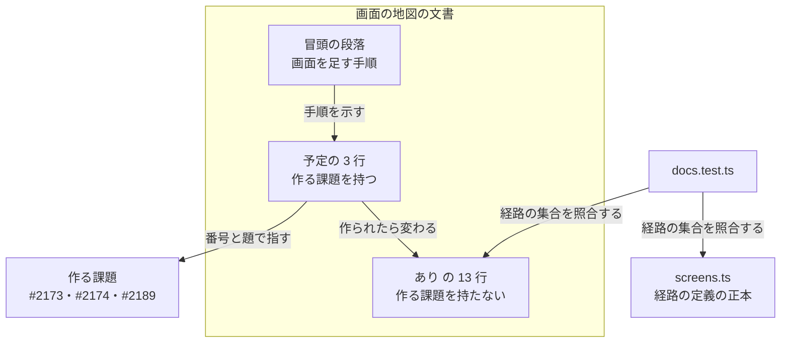
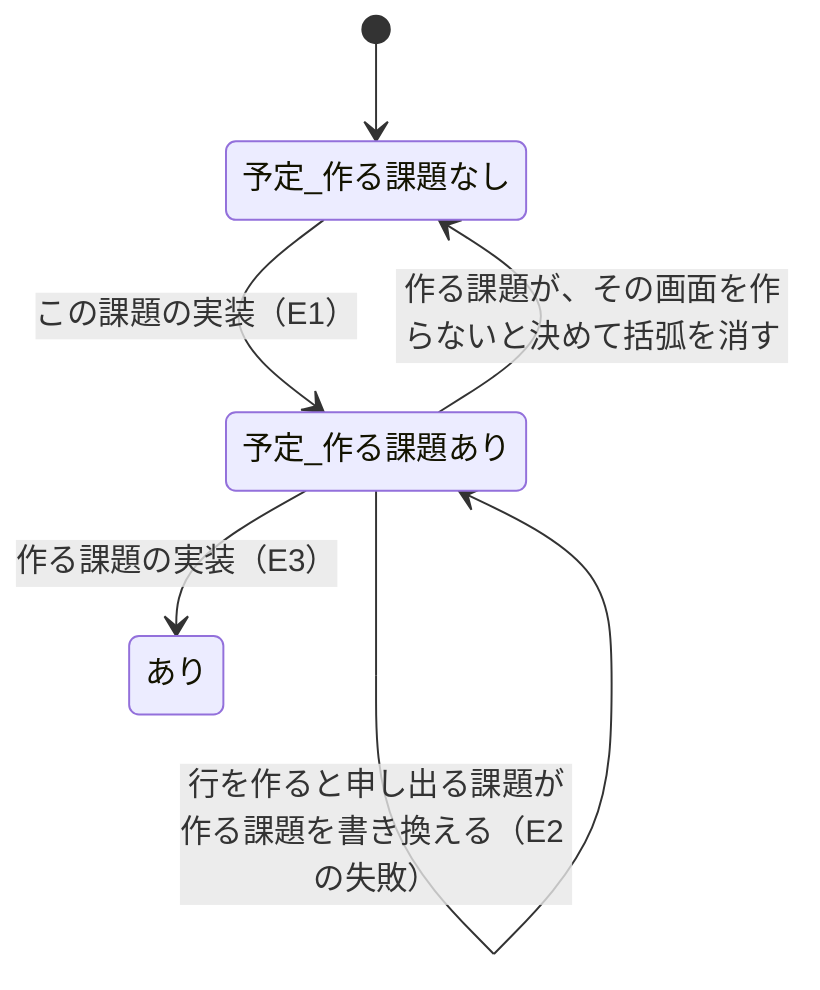

# 画面の地図: 予定の画面ごとに、その画面を作る課題が分かる（#2431）

## 目的

- **今どうなっているか**: 画面の地図（`docs/specifications/ndf-factory-screen-map.md`）で状態が「予定」の 3 行（承認・請求と使用量・手元のマシン）は、載る機能だけを書いている。どの課題がその画面を作るかは書いていない
- **誰に効くか**: Factory の画面を足す課題の設計者と実装者
- **変えると何が成り立つか**: 予定の行を読むだけで、その画面を自分の課題が作るかを判断できる。#2382（UX の土台）の受け入れ条件 2 の残り（まだ画面が無い機能の、作る課題）を、#2382 が閉じた後も画面の地図が持ち続ける

## 適用範囲

- **働く範囲**: このリポジトリの Factory の確定仕様 1 ファイルだけ。配布物（`plugins/`）と Factory のコード（`factory/`）は変えない
- **プロジェクトごとに違うもの**: 無し（Factory 固有の文書の変更で、設定と引数を持たない）
- **当たるモード**: `standard`

## あるべき姿の根拠

| 根拠 | 種類 | 何を示すか |
| --- | --- | --- |
| #2382 の受け入れ条件 2「まだ画面が無い機能は、載せる予定の画面と持ち主の課題」 | 利用者が承認ゲート 1 で確かめた条件の原文 | 予定の画面に作る課題を示すこと自体が、承認済みの要求である |
| 画面の地図の表の見出し「載る機能（確定仕様の節）」と、状態が「あり」の 13 行のうち 10 行（30〜39 行）が末尾の括弧に出所（確定仕様の節）を置く形 | 既存の文書の実測。残りの 3 行（ループ・ループの詳細・バックログ）は括弧を持たない | 予定の行の出所は、確定仕様の節がまだ無いため作る課題になる。同じ括弧の位置へ置けば、表の形を変えずに済む |
| `factory/web/src/docs.test.ts` の `tableRows` が行を ` \| ` で割り、1 列目（経路）と 4 列目（状態）だけを読む | 既存のテストのコードの実測 | 5 列目の末尾へ書き足しても、テストの読み方は変わらない |
| Factory の確定仕様は課題を裸の `#<番号>` で指す（`ndf-factory-*.md` で裸の `#2173` が 20 か所、括弧つきの `（#2173）` が 6 か所） | 既存の文書の実測（`grep -rhoE` の集計） | 課題の書き方を既存の確定仕様にそろえる |

要求と受け入れ条件は #2431 の本文にある（コピーは `issues/issue-2431-requirements.md`）。この文書は「どう作るか」だけを扱う。

## ドメインモデル

### コンテキスト

| コンテキスト | 何の語が 1 つの意味に決まるか |
| --- | --- |
| Neural Development Factory（`ndf-factory`） | 画面の地図・予定の画面・作る課題 |

変更は 1 つのコンテキストに収まる。

### 集約

| 集約 | 持ち主（書き換えてよいもの） | 根 | エンティティ | 値オブジェクト |
| --- | --- | --- | --- | --- |
| 画面の地図 | 画面の地図の文書（`docs/specifications/ndf-factory-screen-map.md`）。行ごとに、次の規則に当たる課題の変更だけが書き換えてよい（下の「行を書き換えてよい課題」） | 画面の地図の表 | 画面の行（経路・画面・役割・状態・載る機能） | 状態（あり / 予定）・作る課題（課題の番号と題） |

#### 行を書き換えてよい課題

| 行の状態 | 書き換えてよい課題 | 書き換えてよい内容 |
| --- | --- | --- |
| 予定で、作る課題が書かれていない | 予定の行に作る課題を割り当てる課題（3 行の初期値はこの課題 #2431 が書く。E1） | 作る課題の括弧を足す |
| 予定で、作る課題が書かれている | その行の作る課題 | 状態を「あり」へ変える（E3）。その画面を作らないと決まったときは、作る課題の括弧を消す |
| 予定で、作る課題が書かれている | その行を作ると申し出る別の課題（E2 の失敗） | 作る課題の括弧を自分の番号と題へ書き換える |
| あり | その行の画面を変える課題 | 既存の手順のとおり |

経路の定義（`factory/web/src/screens.ts`）は別の正本で、この集約に入らない。両者は状態が「あり」の行の経路の集合でだけ照合する（既存のテスト）。作る課題は経路を作らないため、`screens.ts` へ書き込まない。

### 不変条件

| # | 集約 | 条件 | 破れたときの扱い |
| --- | --- | --- | --- |
| I1 | 画面の地図 | 状態が「予定」の行は、どれも作る課題を 1 つ、`（作る課題: #<番号> <題>）` の形で「載る機能」の列の末尾に持つ | 実装の完了判定とリリース後テストで、予定の行を読んで落とす |
| I2 | 画面の地図 | 状態が「あり」の行は作る課題を持たない | 予定の行を「あり」へ変える課題の変更で、作る課題の括弧を確定仕様の節へ置き換える。破れ（括弧を残したまま「あり」へ変える）は、その課題の完了判定で行を読んで落とす |
| I3 | 画面の地図 | 状態が「あり」の行の経路の集合は、`screens.ts` の画面が使える経路の集合と一致する | 既存のテスト（`docs.test.ts`）が落とす |

作る課題が GitHub で open であることは、書く時点の条件として扱い、不変条件に入れない。行を書く課題の変更が、書く前に `gh issue view <番号> --json state` で `OPEN` を確かめ、`OPEN` でなければ書かない（受け入れ条件 2）。書いた後に作る課題が閉じたことを見つける検査は、この課題では作らない（「未確認のまま残ること」）。

### ドメインイベント

| # | イベント | 発生元 | 受け手 |
| --- | --- | --- | --- |
| E1 | 予定の画面に、作る課題を書いた | この課題の実装 | 画面を足す課題の設計者（E2 の読み手） |
| E2 | 画面を足す課題が、予定の行を自分の持ち物と判断した | 画面を足す課題の設計か実装 | 同じ課題の実装（E3） |
| E3 | 予定の画面を作り、行を「あり」へ変えた | 作る課題の実装 | 既存のテスト（`docs.test.ts`。I3 を照合する） |

E2 の失敗（行に自分の番号が無い）は、その行を作ると申し出る課題が、自分の変更で行の作る課題を自分の番号と題へ書き換えて扱う（「行を書き換えてよい課題」の 3 行目）。この課題は書き換えの仕組みを作らない。

### 用語

| 用語 | 意味 | 用語集への反映 |
| --- | --- | --- |
| 予定の画面 | 画面の地図で状態が「予定」の行。経路がまだ無く、載る機能だけが決まっている画面 | 追加（`ndf-factory`。要求の変更で反映済み） |
| 作る課題 | 予定の画面を作り、画面の地図のその行を「あり」へ変える GitHub の課題。#2382 は「持ち主の課題」と書く | 追加（`ndf-factory`。要求の変更で反映済み） |

「持ち主」は用語集で状態の持ち主・見直しの持ち主など別の意味に使われているため、文書では「作る課題」と書く。

## 機能一覧

| # | 機能 | 誰が使うか |
| --- | --- | --- |
| F1 | 予定の画面の行を読み、その画面を作る課題を知る | 画面を足す課題の設計者と実装者 |
| F2 | 自分の課題が作る予定の行を、「あり」の行へ変える手順を知る | 予定の画面を作る課題の実装者 |

## 構成要素

| 要素 | 責務 |
| --- | --- |
| 画面の地図の表の「予定」の 3 行（`docs/specifications/ndf-factory-screen-map.md` の 43〜45 行） | 載る機能の後に、作る課題を `（作る課題: #<番号> <題>）` で示す（F1） |
| 画面の地図の冒頭の段落（同じファイルの 3 行） | 画面を足す課題の手順に、作る課題として書かれた予定の行を作るときの扱いを足す（F2） |
| 既存のテスト（`factory/web/src/docs.test.ts`） | 変えない。状態が「あり」の行の経路の集合と `screens.ts` の一致を照合し続ける（I3） |

### 予定の 3 行の変更後の形

経路・画面・役割・状態の 4 列は変えない。5 列目の載る機能の後に括弧を足す。題は各課題の題から「NDF Factory: 」を除いたものである（2026-11-04 に `gh issue view` で確かめた）。

| 画面 | 5 列目（載る機能）の変更後 |
| --- | --- |
| 承認 | 承認の依頼・Web からの承認・通知（作る課題: #2173 承認ゲートの通知（Slack を含む）と Web からの承認） |
| 請求と使用量 | 料金プランの料金・使用量の台帳・決済（作る課題: #2174 サブスクリプションと Bedrock の token 課金） |
| 手元のマシン | 手元のマシンの登録・心拍（作る課題: #2189 手元のマシン（利用者の環境で、利用者の claude ログインで実行する）） |

### 冒頭の段落の変更後の形

今の段落の「画面を足す課題は、この表に 1 行を足し、…」の後に、次の 1 文を足す。

> 予定の行に作る課題として書かれた課題は、行を足さずにその行の状態を「あり」へ変え、経路を書き、作る課題の括弧を確定仕様の節へ置き換える（節が無ければ括弧を消す）。

## 処理の流れ

予定の行は、作る課題の変更で 1 度だけ「あり」へ変わる。逆向きの遷移は無い。

## 非機能の実現方式

| 大項目 | 条件 | 実現方式 |
| --- | --- | --- |
| 運用・保守性 | 予定の行を読むだけで、その行を自分が作るかを判断できる | 作る課題を番号だけでなく題も添えて行の中に書き、課題の一覧を開かずに判断できるようにする（決定 2） |

## 決定の記録

### 決定 1: 表の形と状態が「あり」の行を変えずに済むよう、作る課題を「載る機能」の列の末尾の括弧に書く

状態が「あり」の 13 行のうち 10 行は、載る機能の末尾の括弧に出所（確定仕様の節）を置く。予定の行には確定仕様の節がまだ無く、その出所に当たるのが作る課題である。同じ位置に置けば、行の読み方が「あり」と「予定」で 1 通りになり、「あり」へ変えるときも括弧の中身を置き換えるだけで済む。

列を足す形は採らない。13 行すべての行が変わり、受け入れ条件 4（差分を予定の 3 行と冒頭の文に限る）を満たせない。状態の列に書く形も採らない。状態の列は「あり / 予定」の 2 値で、既存のテストがその先頭の文字を読む。

根拠: Value 2 / Value 8 / スプリント Value 2（MVV 版 5・スプリント MVV 44cd096d）

### 決定 2: 課題の一覧を開かずに判断できるよう、作る課題の番号に題を添える

番号だけでは、画面を足す課題の担当が番号の指す課題を開いて確かめる手間が残る。題を添えれば、行を読むだけで自分の課題かが分かる（非機能の条件）。題は課題の題から、どの行にも共通の「NDF Factory: 」を除いて書く。

課題へのリンクの記法は使わない。Factory の確定仕様は課題を裸の `#<番号>` で指しており、書き方をそろえる。

根拠: Value 8 / スプリント Value 1（MVV 版 5・スプリント MVV 44cd096d）

### 決定 3: 状態が「あり」の行に作った課題が残らないよう、「あり」へ変えるときに作る課題の括弧を確定仕様の節へ置き換える

状態が「あり」の行は作った課題を持たない（要求の前提 5）。作る課題の括弧を残したまま「あり」へ変えると、「あり」の行だけが別の形になる。確定仕様の節がまだ無い画面では括弧を消す（ループ・ループの詳細・バックログの行と同じ形になる）。冒頭の段落に置き換えの手順を書き、作る課題の変更が手順として読めるようにする。

根拠: Value 8（MVV 版 5）

## テスト設計

| 受け入れ条件・不変条件 | どの振る舞いで縛るか | どう壊したら落ちるべきか |
| --- | --- | --- |
| 受け入れ条件 1・I1 | 画面の地図の予定の 3 行が、それぞれ #2173・#2174・#2189 を作る課題として示す（完了判定とリリース後テストで、行を読んで確かめる。文言を照合するテストは書かない） | 予定の行の 1 つから作る課題の括弧を消すと、完了判定で落ちる |
| 受け入れ条件 2（書く時点の条件） | `gh issue view <番号> --json state,title` が 3 件とも `OPEN` を返し、題がその画面を作る課題である（手動確認） | 閉じた課題の番号を書くと、手動確認で落ちる |
| 受け入れ条件 3・I2 | 冒頭の段落に、予定の行を作るときは状態を「あり」へ変え、経路を書き、作る課題の括弧を確定仕様の節へ置き換える（節が無ければ消す）手順がある（完了判定で読む） | 置き換えの手順を書かずに出すと、完了判定で落ちる |
| 受け入れ条件 4 | `git diff develop -- docs/specifications/ndf-factory-screen-map.md` の変更が 3 行目と 43〜45 行目だけで、表の行の数（あり 13 行・予定 3 行）が変わらない | 「あり」の行や見出しの行を書き換えると、差分の行で落ちる |
| 受け入れ条件 5・I3 | `factory/` で `npm test -w web` が通る（`docs.test.ts` の画面の地図の経路の集合の照合を含む） | 予定の行の状態の列を「あり」で始まる値へ変えると、テストが落ちる |
| 受け入れ条件 6 | `document-style` のセルフチェックの grep で、足した文に内部の識別子の裸の使用と、多義語の新しい当たりが無い | 足した文に `screens.ts` の識別子を裸で書くと、識別子の grep に当たる |

## 設計の結果

| 課題 | 扱い | 取り込み先 | 触るファイル |
| --- | --- | --- | --- |
| #2431 | 実装する | — | `docs/specifications/ndf-factory-screen-map.md` |

## 未確認のまま残ること

| 項目 | 内容 |
| --- | --- |
| #2174 が請求と使用量の画面を作るか | #2174 の本文は画面をまだ受け入れ条件に書いていない（要求の前提 2）。画面を作るかは #2174 の要求で決まる。作らないと決まったときは、#2174 の変更で行の作る課題の括弧を消す（「行を書き換えてよい課題」の 2 行目） |
| 書いた後に作る課題が閉じたこと | 作る課題が「あり」へ変えないまま閉じても、どの検査も落とさない。open であることは書く時点でだけ確かめる。見つけたときは、その行を作ると申し出る課題が作る課題を書き換えるか、作る課題を割り当て直す課題を起こす |
| `npm test -w web` の実行 | 設計の時点では、この worktree に Factory の依存が入っておらず未実行。実装で依存を入れて実行する。テストの読み方（1 列目と 4 列目だけを読む）はコードを読んで確かめた |
