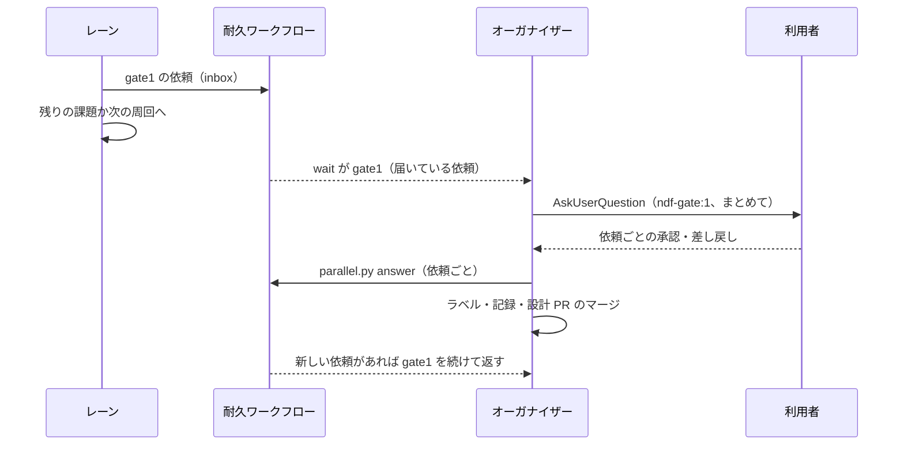

# 並列開発の設計: 承認ゲートの問いをオーガナイザーへ集める（#2436 の受け入れ条件 6c）

設計文書 [issue-2436-design.md](issue-2436-design.md) から、承認ゲート 1（設計の承認）の扱いを分けたファイル。承認ゲート 2（本番の配布）の扱いは設計文書の「まとめた配布」にある。決定の理由は [issue-2436-design-decisions.md](issue-2436-design-decisions.md) の決定 16 にある。

## 目的

- **今どうなっているか**: 承認ゲート 1 の問いは各レーンの conductor が `AskUserQuestion` で出す。1 スプリントのレーンは答えまで止まる。ループのレーンは判定できない課題を人の判断待ちへ移して残りで続けるが、利用者は答えるためにレーンごとの記録を探す
- **変えると何が成り立つか**: 並列の計画の下では、承認ゲート 1・2 の問い（`metadata.source` が `ndf-gate:1` / `ndf-gate:2`）はオーガナイザーだけが出す。届いている設計の承認の依頼は 1 回の問いにまとまる。レーンは問いを出さず、待たずに別の作業へ進む

## 当たる場面

| レーンの種類 | pace | オーガナイザーへ送る設計の承認 |
| --- | --- | --- |
| ループ（`--loop`） | `auto`（ループは常に `auto`） | MVV 判定が「従う」以外・レッドライン・判定を読めない設計。今の「人の判断待ちへ移し、残りの課題で続ける」経路に乗るもの |
| 1 スプリント | `normal` | すべての設計 |
| 1 スプリント | `auto` / `fast` | MVV 判定が「従う」以外のもの |

承認ゲートの外の問い（`metadata.source` が `ndf-ask:cost` / `irreversible` / `human-action` / `legal` / `redline`）はレーンに残す。

## 設計の承認の依頼

依頼は配布の依頼と同じ話題 `inbox` のメッセージで、`kind` で分ける。

| 項目 | 意味 |
| --- | --- |
| `kind` | `gate1` |
| `id` | `<レーン名>-g<連番>`（連番はイベント `lane-<レーン名>` の `gate1_received` に 1 を足したもの） |
| `lane`・`issue`・`pr` | レーン名・課題・設計の Pull Request |
| `report` | 承認資料（設計のプランの `report.md`）のパス |
| `verdict`・`reasons` | MVV 判定の結果と理由（pace `normal` では空） |
| `loop` | ループ名（1 スプリントのレーンでは空） |
| `sprint_state` | 承認の記録を書くスプリント状態ファイル |
| `at` | 送った時刻 |

## 処理の流れ

1. **レーンが送る。** ループのレーンは、`loop lap`・`loop gate` が課題を人の判断待ちへ移すとき（`sprint_loop_gate.py` の `move_to_waiting`）に、自分がレーンなら `parallel_lane.request_gate1()` で依頼を送る。残りの課題で続ける動きは今のまま変わらない。1 スプリントのレーンは、設計のプランが承認ゲート 1 で終わったら、conductor が `parallel.py request-gate1` を打ち、引継ぎ文書の「次にやること」に承認の後の続きのコマンドを書いて、`ndf-next` を出さずにセッションを終える
2. **耐久ワークフローが受ける。** `inbox` の `gate1` を `gate1_pending` に入れ、イベント `gate1`（`{seq, items}`）を立てる。配布の止まり（`release` の答え待ち）の間も、止まりの待ちを 60 秒ごとに抜けて `inbox` を読み、`gate1` を立てる
3. **オーガナイザーがまとめて問う。** `wait` が `gate1` を返したら、届いている依頼を 1 回の問いにまとめる。`AskUserQuestion` の 1 回の呼び出しの問いは 4 つまでのため、依頼 1 件を問い 1 つ（選択肢は「承認」「差し戻し」）にし、5 件以上なら届いた順に 4 件ずつ、同じ回の中で続けて呼ぶ。各問いには設計 PR の URL・承認資料のパス・MVV 判定の理由を添える
4. **承認ゲート 2 と重なったとき。** 同じ回の中で、承認ゲート 1 の問いを先に、承認ゲート 2 の問いを後に、別の呼び出しで出す。`metadata.source` は呼び出しごとに 1 つ（`ndf-gate:1` と `ndf-gate:2`）のため、1 つの呼び出しにまとめない。承認ゲート 2 を後にするのは、答えの時点で `develop` の先頭を比べる（決定 14）ためで、問いを出してから答えまでの間を短くする
5. **答えの後の操作はオーガナイザーが行う。** 依頼ごとに `parallel.py answer <計画名> <依頼> --approved|--rejected` を打つ（下の表）。打った後に `wait` を打ち直し、答えの間に新しい依頼が届いていれば `gate1` が続けて返り、続けて問う。設計 PR は互いに独立で、コミットとの結び付きが無いため、出し直しではなく続けて問うだけである

| レーン | 承認のとき | 差し戻しのとき |
| --- | --- | --- |
| ループ | `gh pr edit <設計 PR> --add-label design-approved`、`sprint-state.py loop answer <ループ> <課題> --approved --pr <設計 PR>`、設計 PR のマージのプラン（`design_merge.plan_design_merge` の形。名前は `design-merge-<N>`、Pull Request の番号は依頼から直に書く）を組み、`metrics.pipeline` に queue の 1 行を返す。conductor はそれを背景で流す。マージの後、レーンの次の周回の選定が課題を対象に戻す（今の `exclusion_reason` の「設計 PR がマージ待ち」の扱い） | `sprint-state.py loop answer <ループ> <課題> --rejected`。以後その課題は選ばれない（今の扱い） |
| 1 スプリント | `gh pr edit <設計 PR> --add-label design-approved` と `sprint-state.py gate <状態> "関門 1" --by user --pr <設計 PR> --outcome approved`。続けて `relay.py restart <レーン名>`（止まっていれば `relay.py spawn`）でレーンを起こす。レーンは引継ぎ文書の続きから今の承認ゲート 1 の後の手順で進み、設計 PR のマージは自分のプランの `design-approved` のステップが流す | `sprint-state.py gate <状態> "関門 1" --by user --pr <設計 PR> --outcome rejected` を書き、レーンを起こす。レーンは今の差し戻しの手順で進む |

`parallel.py answer` は、操作の結果を統一 JSON レポートで返し、耐久ワークフローへ答えたことのメッセージ（`{kind: gate1_answer, id, outcome}`）を送る。耐久ワークフローは `gate1_pending` から外す。`loop answer` は記録の排他（`locked`）を取るため、レーンが同じ記録を書いている間は待つ。

## 構成要素と触るファイル

| ファイル | 変えること |
| --- | --- |
| `plugins/ndf/scripts/lib/parallel_lane.py` | `request_gate1()`（依頼を送る） |
| `plugins/ndf/scripts/lib/parallel_run.py` | `gate1` の依頼の受け取り・イベント `gate1`・止まりの間の `inbox` の読み取り・副命令 `answer`・`request-gate1` |
| `plugins/ndf/scripts/lib/durable.py` | 止まりを自分で書くための `recv(topic, timeout)` と `set_event(key, value)` の包み（DBOS を import するのは今どおりこのモジュールだけ） |
| `plugins/ndf/scripts/lib/sprint_loop_gate.py` | `move_to_waiting` がレーンのときに依頼を送る |
| `plugins/ndf/scripts/supervise_lib/design_merge.py` | Pull Request の番号を直に受けて設計 PR のマージのプランを組む関数 |
| `plugins/ndf/skills/development-workflow/references/parallel.md` | オーガナイザーの承認ゲート 1 の問い方（まとめ方・4 件を超えるとき・承認ゲート 2 と重なったとき） |
| `plugins/ndf/skills/development-workflow/` の承認ゲート 1 の手順（`references/` のゲートの節） | レーンでは問わずに `parallel.py request-gate1` を打ってセッションを終える 1 行 |

## 入出力の契約

| 名前 | 入力 | 成功 | 失敗の形 |
| --- | --- | --- | --- |
| `parallel.py request-gate1 <計画名> --lane <名> --issue <番号> --pr <番号> --report <パス> --state <パス> [--loop <名>] [--verdict <判定> --reason <理由>...]` | — | 0。依頼を送り `metrics.id` を返す | 1: 計画が動いていない |
| `parallel.py answer <計画名> <依頼> --approved / --rejected` | 利用者の答え | 0。上の表の操作を行い、答えたことを送る。ループの承認なら `metrics.pipeline` に設計 PR のマージの queue | 1: 依頼が無い・答え済み。2: ラベルか記録を書けない（書けた操作を `items` に並べ、答えたことは送らない） |
| `parallel.py wait`（変更） | — | イベント `gate1` の `seq` が進んだときも 0 で返す（`metrics.action: gate1`、`items` に依頼） | 今のまま |

## テスト設計

| 受け入れ条件 6c | どの振る舞いで縛るか | どう壊したら落ちるべきか |
| --- | --- | --- |
| まとめて 1 回で問う | 依頼が 3 件届いた後の `wait` が `gate1` を 1 回返し、`items` に 3 件が並ぶ。5 件なら 4 件と 1 件の 2 回の呼び出しの並びを返す | 1 件ごとに `gate1` を返す・4 件を超えて 1 回に詰めると落ちる |
| 答えの時点の新しい依頼を続けて問う | 3 件に答える間に 1 件届くと、答えの後の `wait` が新しい 1 件だけの `gate1` を返す | 答えた依頼をもう一度返す・新しい依頼を落とすと落ちる |
| レーンは待たずに残りへ進む | ループのレーンで承認ゲート 1 が判定できないと、依頼を送り、残りの課題の続きの `pipeline` を返す（`AskUserQuestion` を出さない） | 依頼を送らない・答えを待つと落ちる |
| 承認の後に `loop answer` とラベル | `answer --approved` がラベルを足し、`loop answer --approved --pr` を打ち、設計 PR のマージのプランを返す | ラベルか答えの記録が欠けると落ちる |
| 差し戻し | `answer --rejected` が `loop answer --rejected` を打ち、課題は以後選ばれない。1 スプリントのレーンでは差し戻しの記録を書いてレーンを起こす | 差し戻しで承認の記録を書く・レーンを起こさないと落ちる |
| 止まりの間の依頼 | 配布の答え待ちの間に届いた `gate1` の依頼も 60 秒以内に `gate1` を立てる | 配布の答えまで返さないと落ちる |

## 未確認のまま残ること

| 項目 | 内容 |
| --- | --- |
| 承認ゲートの外の問い | `ndf-ask:cost` / `irreversible` / `human-action` / `legal` / `redline` の問いはレーンに残り、レーンはそこで止まる。オーガナイザーへ集めるかは次の課題にする |
| レーンの起こし方 | `relay.py restart <名前>` が、終えたセッションの引継ぎ文書の続きから起こすか（最初の入力を渡し直すか）は #2346 の作りを実装で確かめる。起こせなければ `relay.py spawn` で最初の入力（引継ぎ文書の続き）を渡す |
| 承認資料の置き場 | 設計のプランの `report.md` はレーンの worktree の状態ディレクトリにある。オーガナイザーがメインディレクトリから読めるパスで送る |
