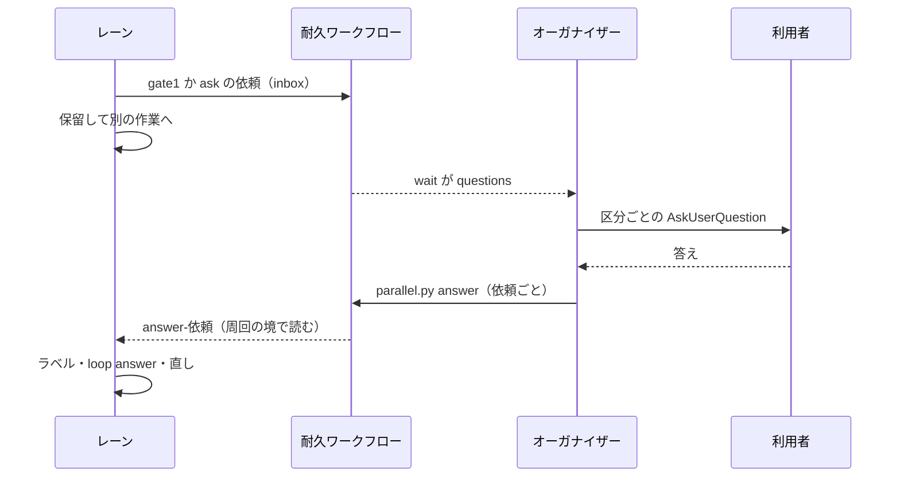

# 並列開発の設計: 問いをオーガナイザーへ集め、作業は持ち主のレーンと一時レーンへ渡す（#2436 の受け入れ条件 6c〜6f）

設計文書 [issue-2436-design.md](issue-2436-design.md) から、オーガナイザーが問いを集めて答えを配る部分を分けたファイル。レーンのループの側（質問待ち・直しの周回）は [issue-2436-design-lane-loop.md](issue-2436-design-lane-loop.md)、本番の配布は設計文書の「まとめた配布」にある。決定の理由は [issue-2436-design-decisions.md](issue-2436-design-decisions.md) の決定 16〜19 にある。

## 目的

- **今どうなっているか**: 問い（`AskUserQuestion`）は各レーンの conductor が出し、答えまでレーンが止まる。夜の間はすべてのレーンが問いで止まることがあり、利用者はレーンを回って答える
- **変えると何が成り立つか**: 並列の計画の下では、区分つきの問いはすべてオーガナイザーへ集まり、1 回の問いにまとまる。レーンは問いで止まらず、別の作業へ進む。オーガナイザーは作業を持たない。答えの後の処理は持ち主のレーンが、持ち主のいない共有の作業は一時レーンが行う

## 責務の分け方

| 担い手 | 持つもの |
| --- | --- |
| オーガナイザー | 問いを集める・示す・答えを送る。一時レーンを起こす（`relay.py spawn ... --role helper`）。終わっている持ち主のレーンを起こす（`relay.py restart <レーン>` の 1 行）。作業は持たない |
| 持ち主のレーン | 答えの後の処理（承認ラベル `design-approved`・`loop answer` の承認 / 直して出し直す / やらない・設計 PR のマージ・設計と実装の直し・revert）を周回の境で行う |
| 一時レーン（`<計画名>-rel<連番>`） | 持ち主のいない共有の作業: まとめた配布のプラン（提示のプランと本番のプラン）の実行、その失敗の対応（CI の失敗・衝突）、`release/v<版>-sync` の版数の衝突の解消。結果を耐久ワークフローへ返して自分で止まる。直せなければ問いとしてオーガナイザーへ送る |

一時レーンの起動と数え方は設計文書の「一時レーン」にある。

## 当たる問い

| 区分（`metadata.source`） | レーンの送り方 | オーガナイザーの出し方 |
| --- | --- | --- |
| `ndf-gate:1` | ループは「人の判断待ちへ移す」経路で設計の承認の依頼（`kind: gate1`）を送る。1 スプリントのレーンは conductor が `parallel.py request-gate1` を打つ。どちらも漏れた問いは hook が送る | 3 つの答え（承認 / 直して出し直す / やらない） |
| `ndf-gate:2` | レーンは配布の依頼を送るため問わない。一時レーンが本番のプランの承認ゲート 2 で止まったら、承認資料を添えた `kind: gate2` の依頼を送る。漏れた問いは hook が送る | 設計文書の「まとめた配布」 |
| `ndf-ask:redline:<番号>`・`cost`・`irreversible`・`legal`・`ndf-ask:<名前>` | hook が送る（`kind: ask`） | 問いの文面と選択肢をそのまま、区分を付けて出す |
| `ndf-ask:human-action` | hook が送る（`kind: ask`。一時レーンの問いも同じ） | 代われないため、`relay.py attach <レーン>` の 1 行を添えて「済んだ」「まだ」で問う。「済んだ」をレーンへ返す |

## 問いの hook がレーンの問いを送る

問いの hook は PreToolUse の `AskUserQuestion` の guard（`plugins/ndf/scripts/hook_lib/ask_guard.py` の `ask_decision`。判定は `lib/ask_policy.py`、区分の正本は `skills/development-workflow/references/asking.md`）である。判定が通す（`gate`・`redline`・`allowed`）問いのとき、次を足す。

1. 環境変数 `NDF_RELAY_NAME` があり、メインディレクトリの `.ndf/parallel/*/plan.json` のどれかがその名前のレーンを持つかを、ファイルだけで見る（hook の 10 秒の上限の中で DBOS を読まないため）
2. 当たれば `parallel.py request-ask` を子プロセスで打つ（上限 8 秒）。`request-ask` は `lane_of()` で動いている計画のレーンかを確かめ、問いの中身（文面・選択肢・区分・課題・作業の場所・レーン・判定の記録の `id`）を `kind: ask` のメッセージで送る
3. 送れたら `permissionDecision: deny` で問いを止め、理由に「オーガナイザーへ送った（依頼 `<id>`）。この作業を保留し、別の作業へ進め。答えは周回の境で届く」と保留の手順（下の「レーンの保留」）を返す
4. レーンでない・計画が動いていない・送れない・上限を越えたときは、今どおり問いを通す（I8 の「どの失敗も通す」と同じ）

判定が止める（`deny`・`advise`）問いは今どおりで、送らない。

## レーンの保留

| レーン | 保留の仕方 | 答えが届いたとき |
| --- | --- | --- |
| ループ（設計の承認） | 今の「人の判断待ちへ移し、残りの課題で続ける」（`move_to_waiting`） | 周回の境で読み、答えに応じて次の周回で選ぶ（[issue-2436-design-lane-loop.md](issue-2436-design-lane-loop.md)） |
| ループ（作業の途中の問い） | 周回を「質問待ち」で締め、止まったプランとステップを記録して次の周回へ進む | 周回の境で、止まったプランを続きのステップから流し、残りのステージとまとめを流す（今の承認ゲート 2 の続きの `gate2_pipeline` と同じ形） |
| 1 スプリント | 引継ぎ文書の「次にやること」に続きのコマンドと依頼の `id` を書き、`ndf-next` を出さずにセッションを終える | オーガナイザーが `relay.py restart <レーン>` で起こす。レーンは `parallel.py await --from` で答えを読み、続きから進む |

**作業の途中の問いは、課題ごとに分けて保留しない。** 人の判断待ちへ移せるのは、課題ごとにプランが分かれる設計のステージだけである（`move_to_waiting` が設計のプランの課題を外す）。実装から後のステージは周回の課題をまとめた 1 本のプランで進むため、1 つの課題だけを外せない。そのため周回ごと保留する。

## 設計の承認の依頼

依頼は配布の依頼と同じ話題 `inbox` のメッセージで、`kind` で分ける。

| 項目 | `kind: gate1` | `kind: ask` |
| --- | --- | --- |
| `id` | `<レーン名>-g<連番>` | `<レーン名>-q<連番>` |
| `lane`・`issue` | レーン名・課題 | レーン名・課題（分かれば） |
| 中身 | `pr`（設計 PR）・`report`（承認資料のパス）・`verdict`・`reasons`（MVV 判定） | `source`（区分）・`question`・`options`・`cwd`（作業の場所）・`ledger_id` |
| `loop`・`sprint_state` | ループ名・スプリント状態ファイル | 同じ |

連番はイベント `lane-<レーン名>` の `gate1_received`・`ask_received` に 1 を足したもの。

## オーガナイザーがまとめて問う

1. 耐久ワークフローは `inbox` の `gate1` と `ask` を `questions_pending` に入れ、イベント `questions`（`{seq, items}`）を立てる。配布の止まりの間も 60 秒ごとに `inbox` を読む
2. `wait` が `questions` を返したら、オーガナイザーは同じ回の中で、区分ごとに `AskUserQuestion` を呼ぶ。`metadata.source` は呼び出しごとに 1 つのため、区分の違う問いを 1 つの呼び出しにまとめない
3. 順は `ndf-gate:1` → `ndf-ask:redline:*` → ほかの `ndf-ask:*` → `ndf-gate:2` とする。承認ゲート 2 を最後にするのは、答えの時点で `develop` の先頭を比べる（決定 14）ためである
4. 1 回の呼び出しの問いは 4 つまでのため、依頼 1 件を問い 1 つにし、5 件以上の区分は届いた順に 4 件ずつ続けて呼ぶ。各問いにはレーン名・課題・設計 PR の URL か作業の場所を添える
5. 依頼ごとに `parallel.py answer` を打ち、`wait` を打ち直す。答えの間に新しい依頼が届いていれば `questions` が続けて返り、続けて問う。設計 PR と承認ゲートの外の問いは互いに独立で、コミットとの結び付きが無いため、出し直しではなく続けて問うだけである

## 答えの後の処理

オーガナイザーは `parallel.py answer` で答えのイベント `answer-<依頼>` を立てるだけにする。処理は答えを受けた持ち主のレーンが、周回の境で `parallel_lane.answers_of()`（待たずに読む）で読んで行う。1 スプリントのレーンが終わっていれば、オーガナイザーは `relay.py restart <レーン>` で起こし、レーンが起きた後に読む。

### 設計の承認（3 つの答え）

| 答え | ループのレーンが周回の境で行うこと | 1 スプリントのレーンが起きた後に行うこと |
| --- | --- | --- |
| 承認 | `gh pr edit <設計 PR> --add-label design-approved` と `sprint-state.py loop answer <ループ> <課題> --approved --pr <設計 PR>`。設計 PR のマージは次の周回のプランが行う（[issue-2436-design-lane-loop.md](issue-2436-design-lane-loop.md)） | ラベルと `sprint-state.py gate <状態> "関門 1" --by user --pr <設計 PR> --outcome approved` を書き、今の承認ゲート 1 の後の手順で進む。マージはプランの `design-approved` のステップが流す |
| 直して出し直す（指摘つき） | `sprint-state.py loop answer <ループ> <課題> --revise --note <指摘のファイル>`。課題の本文の「人の判断待ち」の節に指摘を書く | 承認の記録に `--outcome revise` と指摘を書き、設計のステージを指摘つきで流し直す |
| やらない | `sprint-state.py loop answer <ループ> <課題> --rejected`（今の差し戻し） | `--outcome rejected` を書き、今の差し戻しの手順で進む |

### 配布の差し戻し（宛先のレーンつき）

承認ゲート 2 の差し戻しでは、承認資料のレーンごとの Pull Request の内訳から、指摘の宛先のレーンを選べるようにする（`AskUserQuestion` の 2 問目で、宛先のレーンを複数選ぶ）。

| 受け手 | 答え |
| --- | --- |
| 宛先のレーン | `answer-<依頼>` に `rejected` と指摘。依頼していない宛先のレーンにも、イベント `fix-<レーン名>-<連番>` で指摘を届ける。レーンは周回の境で直しの周回を組み、直す Pull Request か revert の Pull Request を `develop` へ入れ、配布の依頼を送り直す |
| ほかのレーン | `answer-<依頼>` に `deferred`（次の配布へ）。答えの確定ではなく、依頼は `pending` に残る |

耐久ワークフローは、宛先のレーンすべてから差し戻しの後の配布の依頼が届くまで、次の配布を組まない（同じ中身をもう一度組まないため）。宛先のレーンが終わっていれば、オーガナイザーは `relay.py restart <レーン>` で起こすだけにする。

## 構成要素と触るファイル

| ファイル | 変えること |
| --- | --- |
| `plugins/ndf/scripts/hook_lib/ask_guard.py` | 通す問いのとき、レーンか一時レーンなら `parallel.py request-ask` で送って止める |
| `plugins/ndf/scripts/lib/parallel_lane.py` | `request_gate1()`・`request_ask()`・`answers_of()`（自分の依頼の答えを待たずに読む）・レーンか一時レーンかをファイルだけで見る `lane_name_in_plans()`（計画のレーン名か、作業ディレクトリの役割のファイルが `helper`） |
| `plugins/ndf/scripts/lib/parallel_run.py` | 依頼の受け取り・イベント `questions`・止まりの間の `inbox` の読み取り・副命令 `answer`・`request-gate1`・`request-ask`・`settle --rejected --to` |
| `plugins/ndf/scripts/lib/durable.py` | 止まりを自分で書くための `recv(topic, timeout)` と `set_event(key, value)` の包み |
| `plugins/ndf/scripts/lib/sprint_loop_gate.py` | `move_to_waiting` がレーンのときに依頼を送る |
| `plugins/ndf/scripts/lib/sprint_loop.py` | `loop answer` に `--revise --note`。周回の境で自分の依頼の答えを読み、答えの後の処理を行う（[issue-2436-design-lane-loop.md](issue-2436-design-lane-loop.md)） |
| `plugins/ndf/skills/development-workflow/references/parallel.md` | オーガナイザーの問い方（区分ごと・4 件ずつ・順・human-action の案内・差し戻しの宛先） |
| `plugins/ndf/skills/development-workflow/references/asking.md` | 並列の計画のレーンでは hook が問いをオーガナイザーへ送ること、送られたときの保留の手順 |

## 入出力の契約

| 名前 | 入力 | 成功 | 失敗の形 |
| --- | --- | --- | --- |
| `parallel.py request-gate1 <計画名> --lane <名> --issue <番号> --pr <番号> --report <パス> --state <パス> [--loop <名>] [--verdict <判定> --reason <理由>...]` | — | 0。依頼を送り `metrics.id` を返す | 1: 計画が動いていない |
| `parallel.py request-ask <計画名> --lane <名>` | 標準入力に問いの入力（`AskUserQuestion` の `tool_input`）と作業の場所 | 0。依頼を送り `metrics.id` を返す | 4: レーンでない（hook は問いを通す）。1: 計画が動いていない |
| `parallel.py answer <計画名> <依頼> (--approved / --revise --note <パス> / --rejected / --choice <選んだ答え>...)` | 利用者の答え | 0。答えのイベントを立てる。持ち主のレーンが終わっていれば `metrics.next` に `relay.py restart <レーン>` の 1 行 | 1: 依頼が無い・答え済み |
| `parallel.py settle <計画名> <連番> --rejected [--to <レーン>... --note <パス>]`（変更） | 差し戻しの宛先 | 0。宛先とほかのレーンへ上の表の答えを返す | 今のまま |
| `parallel.py wait`（変更） | — | イベント `questions` の `seq` が進んだときも 0 で返す（`metrics.action: questions`、`items` に依頼） | 今のまま |

## テスト設計

| 受け入れ条件 | どの振る舞いで縛るか | どう壊したら落ちるべきか |
| --- | --- | --- |
| 6c まとめて 1 回で問う | 依頼が 3 件届いた後の `wait` が `questions` を 1 回返し、`items` に 3 件が並ぶ。同じ区分が 5 件なら 4 件と 1 件の 2 回の呼び出しの並びを、区分が違えば区分ごとの呼び出しを返す | 1 件ごとに返す・区分の違う問いを 1 つの呼び出しに詰めると落ちる |
| 6c 答えの時点の新しい依頼を続けて問う | 3 件に答える間に 1 件届くと、答えの後の `wait` が新しい 1 件だけを返す | 答えた依頼をもう一度返す・新しい依頼を落とすと落ちる |
| 6c レーンは待たずに残りへ進む | ループのレーンで承認ゲート 1 が判定できないと、依頼を送り、残りの課題の続きの `pipeline` を返す | 依頼を送らない・答えを待つと落ちる |
| 6d hook の送り先（レーン） | 動いている計画のレーンで `ndf-ask:cost` の問いを出すと、`request-ask` が送り、hook が `deny` と保留の案内を返す | 送らずに通す・送ったのに通すと落ちる |
| 6d hook の送り先（レーンでない） | `NDF_RELAY_NAME` が無い・計画に無い名前・計画が終わっているときは今どおり通す。`request-ask` が落ちても通す | レーンでないのに止める・送れないのに止めると落ちる |
| 6d 質問待ちの再開 | ループのレーンの周回が「質問待ち」で締まり、答えの届いた境で止まったプランが続きのステップから流れ、残りとまとめの後に締め直る | 答えの前に流す・最初から流し直すと落ちる |
| 6d human-action | オーガナイザーへの `items` に `relay.py attach <レーン>` の 1 行が付く | 案内が無いと落ちる |
| 6e・6f 設計の 3 つの答え | `answer` は答えのイベントだけを立て、ラベルも `loop answer` も打たない。持ち主のループのレーンが周回の境で、承認ならラベルと `loop answer --approved --pr`、直して出し直すなら `--revise --note`、やらないなら `--rejected` を打つ | オーガナイザーがラベルか記録を書く・レーンが答えを読まない・指摘が記録に無いと落ちる |
| 6f 終わったレーンを起こす | 持ち主の 1 スプリントのレーンが止まっていると、`answer` が `relay.py restart <レーン>` の 1 行を返す。動いていれば返さない | 止まったレーンを起こさない・動いているレーンを起こすと落ちる |
| 6e 配布の差し戻しの宛先 | `--to lroot` の差し戻しで lroot の依頼に `rejected` と指摘、ほかに `deferred` が立ち、lroot の新しい依頼が届くまで次の配布を組まない | 全レーンに `rejected` を返す・宛先の直しの前に同じ中身で組むと落ちる |

## 未確認のまま残ること

| 項目 | 内容 |
| --- | --- |
| hook の時間 | `request-ask` の子プロセスが、`deps.require` の起動し直しを含めて 8 秒以内に終わるかは実装で測る。越えたときは問いを通す |
| 止めた問いの記録 | hook が止めた問いの判定の記録（`ask_ledger`）に、送った依頼の `id` を足す形は実装で決める |
| レーンの起こし方 | `relay.py restart <名前>` が、終えたセッションの引継ぎ文書の続きから起こすかは #2346 の作りを実装で確かめる。起こせなければ `relay.py spawn` で最初の入力（引継ぎ文書の続き）を渡す |
| 承認資料の置き場 | 設計のプランの `report.md` はレーンの worktree の状態ディレクトリにある。オーガナイザーがメインディレクトリから読めるパスで送る |
