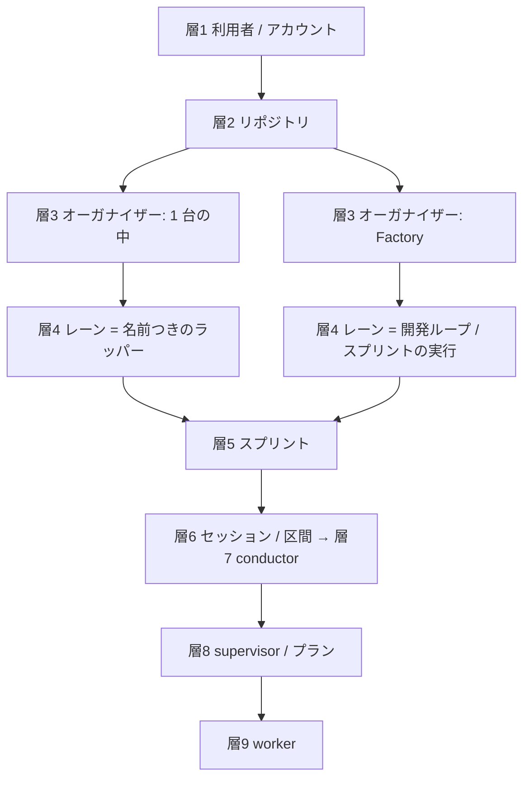

# 並列開発: 全体の階層（論理の階層と置き場）（#2436）

## 目的

- **今どうなっているか**: 2026-11-02、利用者は Neural Development Factory の側にも並列のまとめ役が要るかを検討した。その中で次の 4 つの問いと指摘が出た（#2439 の「依頼（原文）」）。「1 コンテナ = 1 ランナーか、マシン単位で 1 ランナーか」。「上位のオーガナイザー」の定義は合っているか。全体の階層を定義すべきではないか。2 つのオーガナイザーは対等というより排他ではないか。語が 2 つの軸を混ぜて使われているため、上下の関係を取り違えた
- **誰に効くか**: 並列開発を計画する利用者と、#2436・#2439 を設計・実装する conductor
- **変えると何が成り立つか**: どの語がどの層の何を指すかが 1 つに決まる。1 台の中の実装（#2436）と Factory の実装（#2439）が同じ層を担い、互いに排他だと読める

## 2 つの軸

**階層は 2 つの軸に分ける。** 論理の階層は「何の仕事を持つか」を表し、置き場は「どこで動き、同時にいくつ動かせるか」を表す。上下の関係は論理の階層でだけ言う。置き場の大小（マシンはコンテナを含む）を論理の上下として読まない。

### 軸 1: 論理の階層

| 層 | 持つもの | 1 台の中（relay.py） | Factory |
| --- | --- | --- | --- |
| 1 | 契約と使える量 | 利用者 | アカウント |
| 2 | 開発の対象 | リポジトリ | リポジトリ |
| 3 | 並列のまとめ（本番の配布を 1 本にする・問いを集める・答えの後の作業を持ち主へ返す） | オーガナイザー（`--parallel <計画名>` の conductor と耐久ワークフロー。この設計） | オーガナイザー（API と見回り。#2439） |
| 4 | 1 本の開発の流れ | レーン = 名前つきのラッパー 1 本 | レーン = 開発ループ 1 本、または手動のスプリントの実行 1 本 |
| 5 | 1 版の中身 | スプリント | スプリントの実行 |
| 6 | claude の 1 回の起動 | セッション | 区間 |
| 7 | 対話と承認ゲート | conductor | conductor |
| 8 | 1 つのフェーズ | supervisor / プラン（`plan.json`） | 同じ |
| 9 | 1 つの作業 | worker | 同じ |

- **層 3 のオーガナイザーは役割の名前で、実装が 2 つある。2 つは排他である。** Factory の実行ジョブの中では、1 台の中のオーガナイザーは動かない。Factory で動く開発のまとめは、Factory のオーガナイザーだけが持つ。2 つの実装は同じ依頼と答えの形（決定 21 の契約）を使う
- **Factory のオーガナイザーの仕事は、1 台の中のオーガナイザーの仕事すべてに、Factory 固有の仕事を足したものである。** 共通の仕事は、本番の配布を 1 本にまとめる、問いを集める、答えの後の作業を持ち主のレーンへ返す、共有の作業を一時レーンへ渡す、の 4 つである。Factory 固有の仕事は、ランナーの制御（実行ジョブの起動・停止・答えでの再開）、実行の枠と手元のランナーの枠の管理、ジョブをまたぐ状態の置き場（S3）である。1 台の中では、ランナーの制御に当たる仕事を統括役とラッパーが担う。Factory ではそれをオーガナイザーが併せて持つ（#2439）
- **排他は起動の側で守る。** ランナーは実行ジョブの環境に `NDF_FACTORY_RUN=1` を立てる（#2439）。`parallel.py init`・`run` は、これが立っていれば何も作らずに断る（終了コード 1、`status: refused`）。tmux とラッパーが無いことに頼らないのは、手元のランナーのマシンには両方があり得るためである
- **層 4 から層 6 の境は、実装によって違う。** 1 台の中では、1 本のラッパーがセッションを替えながらレーンを続ける。Factory では、承認の依頼で実行ジョブが終わる。答えで新しい実行ジョブが起き、同じレーン（ループ）が続く

### 軸 2: 置き場

| 置き場の語 | 1 台の中 | Factory |
| --- | --- | --- |
| 動く場所 | 1 台のマシンかコンテナ（tmux） | 実行ジョブ（コンテナ 1 つ）。`managed`・`byok` は ECS、`local` は手元のランナーのマシン |
| 同時の数を守るもの | 統括役（`NDF_RELAY_MAX_NAMED`） | 実行の枠（リポジトリごと）、手元のランナーの枠（`max_jobs`） |
| 層 6 をつなぐもの | ラッパー（`relay.py run`） | ランナー（実行ジョブの中のプログラム） |

- **統括役・ラッパー・ランナー・手元のランナーは置き場の語である。** 論理の層を持たない。統括役は同じコンテナのラッパーの数と一覧だけを持ち、オーガナイザーとは別である（決定 4・I13）
- **1 コンテナ = 1 実行ジョブ = 1 ランナーである。** 手元のランナーは、マシン単位で複数の実行ジョブを受け取る受け手である。それぞれのジョブの中では、別々のランナーが動く

## 語の衝突と解き方

| 衝突 | 今の状態 | 解き方（案） | 持ち主 |
| --- | --- | --- | --- |
| 層 6 の 2 つの名前 | 同じ「claude の 1 回の起動」を、`ndf-workflow` は「セッション」、`ndf-factory` は「区間」と呼ぶ | 用語集で同じ層の対応として結ぶ。名前は文脈ごとに残す（どちらも実装と契約に広く出ている） | この課題（用語集） |
| 「プラン」の 2 つの意味 | `ndf-workflow` は `plan.json`、`ndf-factory` はアカウントの契約の種類 | Factory の側を「料金プラン」に改める | #2439 |
| 「ランナー」と「手元のランナー」 | 前者はコンテナ単位のプログラム、後者はマシン単位の受け手 | 手元のランナーを、マシン単位であることが分かる語（例: 「手元の受け手」）へ改める | #2439 |
| 「上位のオーガナイザー」 | 置き場の大小を論理の上下と読んだ | 使わない。「Factory のオーガナイザー」と呼び、1 台の中のオーガナイザーとは排他とする | この課題・#2439 |

## 触るファイル

| ファイル | 変えること |
| --- | --- |
| `docs/glossary/glossary.json`・`docs/glossary.md` | 層の対応（セッション ↔ 区間）、オーガナイザーの「実装が 2 つある役割」の意味、統括役との区別 |
| `plugins/ndf/scripts/parallel.py`・`plugins/ndf/contracts/env/NDF_FACTORY_RUN.json` | `NDF_FACTORY_RUN` が立っていれば `init`・`run` が断る。環境変数の宣言を足す（立てるのは #2439 のランナー） |
| `plugins/ndf/skills/development-workflow/references/agent-layers.md` | 層 7〜9（conductor / supervisor / worker）の上に層 3〜6 があることを 1 節で示し、この階層への参照を置く |
