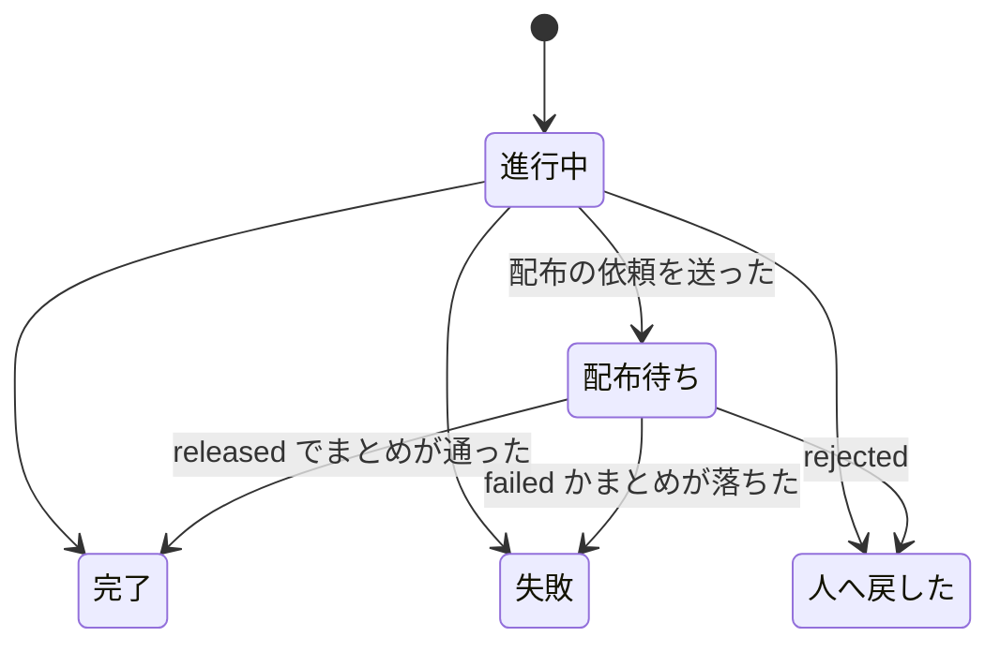

# 並列開発の設計: レーンのループが配布の答えを待たずに次の周回へ進む（#2436 の受け入れ条件 6a）

設計文書 [issue-2436-design.md](issue-2436-design.md) から、開発ループ（`--loop`）の側の変更を分けたファイル。ループの今の手順は `plugins/ndf/skills/development-workflow/references/loop.md`、契約と不変条件は確定仕様 `docs/specifications/ndf-workflow-development-loop.md` にある。

## 具体例: レーン `lroot` のループ `l20261102`

1. 周回 3 が #2501・#2502 を開発し、本番のステージで配布の依頼のプランが依頼を送った。プランは「配布の依頼」の承認ゲートとして終わり、queue はまとめ（確定仕様化・振り返り・課題を閉じる・棚卸し）を流さなかった
2. `loop lap` が周回 3 を「配布待ち」で締め、`ndf-next` を返す。夜の間、利用者は承認ゲート 2 に答えていない
3. 周回 4 の `loop select` は #2501・#2502 を「配布待ちの周回の課題」で外し、#2510 を選んで開発する。周回 4 の開発版の配布は止まらない
4. 朝、利用者が承認ゲート 2 に答え、配布が出た。周回 4 を締めた後の境で、`loop select` が周回 3 の答え（`released`、`10.28.0`）を待たずに読み、周回 3 のまとめの `pipeline` を返す
5. まとめが終わると `loop finish l20261102 3 --done <D>` が周回 3 を「完了」で締め直し、版を記録へ書く。続けて周回 5 を選ぶ

## 周回の結果「配布待ち」

| 結果 | 意味 | 締め直せるか |
| --- | --- | --- |
| `進行中` | 今のまま | — |
| `配布待ち`（新規） | 配布の依頼を送り、答えを待たずに締めた。まとめはまだ流していない | 1 回だけ、`完了` / `失敗` / `人へ戻した` へ |
| `完了` / `失敗` / `人へ戻した` | 今のまま | 締め直さない |

周回の記録（`.ndf/loop/<名>/loop.json` の `laps[]`）に `release` の項目を足す。

| 項目 | 意味 |
| --- | --- |
| `release.plan` | 配布の依頼のプランのパス |
| `release.out` | 依頼の識別子を書いたファイル（`{state_dir}/work/request.txt`） |
| `release.plan_name` | 並列の計画名 |
| `release.close_plans` | まとめのプランのパス（`loop sprint` が組んだもの。流さずに残す） |
| `release.answer` | 届いた答え（`result`・`version`・`at`）。読むまでは無い |
| `release.finish` | まとめを流した区間（`started_at`・`ended_at`）と done のパス |

## どこに何を足すか

| 今の部品 | 足すこと |
| --- | --- |
| 結果の定数（`sprint_loop_record.py` の `IN_PROGRESS, DONE, FAILED, RETURNED`） | `RELEASE_PENDING = "配布待ち"` |
| `loop sprint`（`sprint_loop.py` の `cmd_sprint`） | `build_close` が返したまとめのプランを `lap["close_plans"]` に残す |
| `loop lap`（`cmd_lap` → `sprint_loop_gate.py` の `handle_gate`） | 承認ゲートで終わった計画の「フェーズ」が `配布の依頼` なら、承認ゲート 2 の扱い（`handle_gate2`）へ進まず、新しい `handle_release_pending` が周回を `配布待ち` で締める（`close_lap` に `release` を渡す）。その後は今の `after_close` で次の周回へ進む |
| `close_lap`（`sprint_loop_gate.py`） | `配布待ち` で締められる。締め直しは新しい `finish_lap` だけが行い、`配布待ち` の行の `outcome`・`ended_at`・費用と秒・振り返り・棚卸しを 1 回だけ書き換える |
| 周回の境（`sprint_loop_select.py` の `cmd_select`、`sprint_loop.py` の `resume_stopped`、`sprint_loop_gate.py` の `after_close`） | 選定と止まる条件の判定の前に、新しい `pending_step` を通す（下の「周回の境」） |
| 新しい副命令 `loop finish <名> <周回> --done <D>`（`sprint_loop.py`・`sprint_loop_cli.py`） | まとめの done を読み、`finish_lap` で周回を `完了` か `失敗` で締め直し、周回の境へ戻る（`after_close` と同じ結果を返す） |
| 選定の除外（`sprint_loop_select.py` の `exclusion_reason`） | `配布待ち` の周回の課題を「配布待ちの周回の課題」で外す。課題はまだ閉じていない |
| 予算の消費（`sprint_loop_record.py` の `consumed`・`active_seconds`） | `配布待ち` は終わった周回として周回の数に入れる。動いていた時間には、締めるまでの区間と `release.finish` の区間を足す。周回の境で答えを待つ時間は、今の「周回の境で止まっていた時間」と同じく数えない |
| 同じ失敗の数え方（`same_failure_count`） | `配布待ち` は完了でも失敗でもないものとして読み飛ばす。締め直した後は締め直した結果で数える |
| 止まる条件（`boundary_stop`） | 下の「周回の境」の順で判定する |
| `loop status`・`loop list`・`laps.md` | `配布待ち` の周回と答えの有無を出す |
| `plugins/ndf/skills/development-workflow/references/loop.md` | 「周回ごとに打つ順」に `status: finish`・`release_wait` の 2 行、「承認ゲート」に配布の依頼の行、「記録」に `release` の項目 |
| `.ndf/pace.json` の `loop` | `release_pending_max`（配布待ちの周回の上限。既定 2） |

確定仕様の I1（終わった周回の行は書き換えない）は、「`配布待ち` の行は `loop finish` か周回の境の差し戻しで 1 回だけ締め直す」を例外として足す。確定仕様の文書は、この課題の確定仕様化で直す。

## 周回の境

`pending_step` は、選定の前と周回を締めた後の境で、`配布待ち` の周回を古い順に 1 つずつ見る。答えは `parallel_lane.answer_of(release.out)`（`durable.event_of` を `timeout 0` で読む。待たない）で読む。

| 順 | 当たる場面 | 扱い |
| --- | --- | --- |
| 1 | 止まる条件の `user_stop`・`mvv_changed` | 今どおりすぐ止まる。`配布待ち` の周回はそのまま残り、再開の境で続きを読む |
| 2 | 最も古い `配布待ち` の周回に `released` が届いている | `release.answer` に版を書き、`status: finish` と `pipeline`（`supervise.py queue <まとめのプラン> --done <D> && wait <D> && loop finish <名> <周回> --done <D>`）を返す。conductor はそれを流す |
| 3 | `rejected` が届いている | 今の承認ゲート 2 の差し戻しの扱い（`_resume_gate2` の差し戻し）と同じく、周回を `人へ戻した` で締め直す。まとめは流さない。2 へ戻って次の周回を見る |
| 4 | `failed` が届いている | 周回を `失敗` で締め直し、`failure` に配布の失敗を書く（同じ失敗に数える）。2 へ戻る |
| 5 | 答えの無い `配布待ち` の周回が `release_pending_max` 以上ある | 新しい周回を始めない。`status: release_wait` と、最も古い周回の `parallel.py await <計画名> --from <release.out> --timeout 3600` → `loop select <名>` の 1 行を返す。conductor はそれを背景で打って待つ |
| 6 | 止まる条件の `same_failure`・予算・`no_issue`・`outside_mvv` に当たり、答えの無い `配布待ち` の周回がある | 止まる前に 5 と同じく答えを待ち、まとめを流してから止まる。まとめを流さないまま止まると、課題が閉じずに残るためである |
| 7 | どれにも当たらない | 今どおり選定へ進む |

**上限を 2 にする理由。** 1 回の承認ゲート 2 で範囲に入った周回はまとめて答えを受けるため、配布待ちの周回を増やしても承認の回数は減らない。配布待ちの周回は課題を選定から外し、振り返りと棚卸しを遅らせる。2 なら、承認を待つ間に次の周回を 1 本開発でき（利用者の依頼の「承認を待っているあいだ次の sprint を実行する」）、その周回も配布待ちになった時点で待つ。

**次の周回の変更が同じ配布に入るとき。** 配布待ちの間に次の周回が `develop` へマージした変更は、承認の答えの時点の比べで出し直しの範囲に入り得る（「新しい範囲で出す」）。その周回が配布の依頼のステップに来ると、自分の Pull Request がすでに `main` にあるため依頼を送らずに `released` を返し、配布の依頼のプランは完了で終わる。queue は続けてまとめを流し、周回は `配布待ち` を経ずに `完了` で締まる。範囲に入らなかった変更は、その周回の依頼が次の配布を組む。

**開発版の版数。** 配布待ちの間に次の周回が開発版を出す。本番の版上げと開発版の版数の衝突は、配布の規則の側（[issue-2436-design-release-rule.md](issue-2436-design-release-rule.md) の「版数の衝突」）が解く。

## スプリントのレーン

ループでないスプリントのレーンは周回を持たない。conductor は配布の依頼のプランが `配布の依頼` で終わったら、`parallel.py await <計画名> --from <パス>` を背景で打って答えを待ち、`released` ならまとめのステージを流す。`rejected` は今の承認ゲート 2 の差し戻しと同じく扱う。

## テスト設計

| 受け入れ条件 6a | どの振る舞いで縛るか | どう壊したら落ちるべきか |
| --- | --- | --- |
| 待たずに次の周回へ進む | 配布の依頼のプランが `配布の依頼` の承認ゲートで終わった done を `loop lap` に渡すと、周回が `配布待ち` で締まり、`ndf_next` を返す。`gate2_returned` で止まらない | 承認ゲート 2 として止まる・まとめを流してから締めると落ちる |
| 配布待ちの課題を選ばない | 次の `loop select` が `配布待ち` の周回の課題を「配布待ちの周回の課題」で外す。`完了` に締め直した後は外さない（閉じた課題は棚卸しの順位に出ない） | 配布待ちの課題を選ぶと落ちる |
| 答えの後に残りを流す | `released` の答えのある `配布待ち` の周回があると、境が `status: finish` とまとめの `pipeline` を返し、`loop finish` が `完了` で締め直して版を書く。複数あれば古い順に 1 つずつ返す | 新しい周回を先に始める・版を書かない・新しい順に流すと落ちる |
| 差し戻しで締める | `rejected` の答えでは周回が `人へ戻した` で締まり、まとめは流れない | まとめを流す・`完了` で締めると落ちる |
| 上限で待つ | 答えの無い `配布待ち` が 2 つあると、境が新しい周回を始めずに `release_wait` を返す | 3 つ目の周回を始めると落ちる |
| 止まる前に流す | 予算に当たったとき、答えの無い `配布待ち` があれば `release_wait` を返し、まとめを流した後に止まる。`user_stop` はすぐ止まる | 予算で止まってまとめを残す・`user_stop` で待つと落ちる |
| 予算と同じ失敗 | `配布待ち` を周回の数に入れ、同じ失敗の数え方では読み飛ばす | 配布待ちを数えない・失敗として数えると落ちる |

## 触るファイル

`plugins/ndf/scripts/lib/sprint_loop.py`、`plugins/ndf/scripts/lib/sprint_loop_gate.py`、`plugins/ndf/scripts/lib/sprint_loop_record.py`、`plugins/ndf/scripts/lib/sprint_loop_select.py`、`plugins/ndf/scripts/lib/sprint_loop_cli.py`、`plugins/ndf/scripts/tests/`、`plugins/ndf/skills/development-workflow/references/loop.md`

## 未確認のまま残ること

| 項目 | 内容 |
| --- | --- |
| まとめのプランを後で流すこと | `build_close` が組んだまとめのプランを、周回を締めた後の別の queue で流して同じ結果になるか（`{queue_record}` の差し込みが流す時点に記録の Pull Request を探す。#2230）は実装で確かめる |
| 配布待ちの間のリリース後テスト | まとめのリリース後テストは配布の後に流れるため、次の周回の変更が同じ配布に入ったときは、その変更もまとめて確かめることになる。前の周回の課題に絞って確かめる形は持たない |
