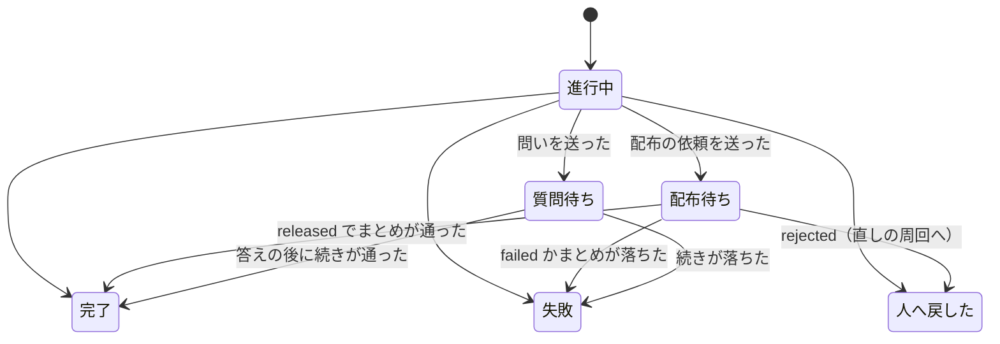

# 並列開発の設計: レーンのループが答えを待たずに次の周回へ進み、答えの後の処理を周回の境で行う（#2436 の受け入れ条件 6a・6d〜6f）

設計文書 [issue-2436-design.md](issue-2436-design.md) から、開発ループ（`--loop`）の側の変更を分けたファイル。ループの今の手順は `plugins/ndf/skills/development-workflow/references/loop.md`、契約と不変条件は確定仕様 `docs/specifications/ndf-workflow-development-loop.md` にある。

## 具体例: レーン `lroot` のループ `l20261102`

1. 周回 3 が #2501・#2502 を開発し、本番のステージで配布の依頼のプランが依頼を送った。プランは「配布の依頼」の承認ゲートとして終わり、queue はまとめ（確定仕様化・振り返り・課題を閉じる・棚卸し）を流さなかった
2. `loop lap` が周回 3 を「配布待ち」で締め、`ndf-next` を返す。夜の間、利用者は承認ゲート 2 に答えていない
3. 周回 4 の `loop select` は #2501・#2502 を「配布待ちの周回の課題」で外し、#2510 を選んで開発する。周回 4 の開発版の配布は止まらない
4. 朝、利用者が承認ゲート 2 に答え、配布が出た。周回 4 を締めた後の境で、`loop select` が周回 3 の答え（`released`、`10.28.0`）を待たずに読み、周回 3 のまとめの `pipeline` を返す
5. まとめが終わると `loop finish l20261102 3 --done <D>` が周回 3 を「完了」で締め直し、版を記録へ書く。続けて周回 5 を選ぶ

## 周回の結果「配布待ち」

| 結果 | 意味 | 締め直せるか |
| --- | --- | --- |
| `進行中` | 今のまま | — |
| `配布待ち`（新規） | 配布の依頼を送り、答えを待たずに締めた。まとめはまだ流していない | 1 回だけ、`完了` / `失敗` / `人へ戻した` へ |
| `質問待ち`（新規） | 作業の途中の問いを問いの hook がオーガナイザーへ送り、止まったプランを残して締めた | 1 回だけ、続きを流した後の結果へ |
| `完了` / `失敗` / `人へ戻した` | 今のまま | 締め直さない |

周回の記録（`.ndf/loop/<名>/loop.json` の `laps[]`）に `release` の項目を足す。

| 項目 | 意味 |
| --- | --- |
| `release.plan` | 配布の依頼のプランのパス |
| `release.out` | 依頼の識別子を書いたファイル（`{state_dir}/work/request.txt`） |
| `release.plan_name` | 並列の計画名 |
| `release.close_plans` | まとめのプランのパス（`loop sprint` が組んだもの。流さずに残す） |
| `release.answer` | 届いた答え（`result`・`version`・`at`）。読むまでは無い |
| `release.finish` | まとめを流した区間（`started_at`・`ended_at`）と done のパス |
| `question` | 質問待ちのとき: 依頼の `id`・止まったプランとステップ（`gate2_pipeline` と同じく続きのステップから流す）・done のパス |

## どこに何を足すか

| 今の部品 | 足すこと |
| --- | --- |
| 結果の定数（`sprint_loop_record.py` の `IN_PROGRESS, DONE, FAILED, RETURNED`） | `RELEASE_PENDING = "配布待ち"`・`QUESTION_PENDING = "質問待ち"` |
| 新しい副命令 `loop hold-question <名> --ref <依頼> --plan <止まったプラン> --step <続きのステップ>` | 問いの hook に止められた conductor が打つ。周回を `質問待ち` で締めて次の周回へ進む |
| `loop answer`（`cmd_answer`） | `--revise --note <パス>` を足す。人の判断待ちの行に `answer: revise` と指摘を書き、課題の本文の節にも指摘を書く |
| 人の判断待ちの答えを読む（新しい `answers_step`） | 周回の境で、自分の `gate1` の依頼の答えを `parallel_lane.answers_of()` で読む。承認ならラベル（`gh pr edit --add-label design-approved`）と `loop answer --approved --pr`、直して出し直すなら `loop answer --revise --note`、やらないなら `loop answer --rejected` を自分で打つ |
| 選定（`choose_issues`・`exclusion_reason`） | `answer: revise` の課題は順位によらず先頭に選び、設計のステージを指摘つきで流し直す（`new sprint` の設計の課題に足し、設計のプランの `design` のステップの指示に課題の本文の指摘の節を読むことを足す。同じ `design/issue-<N>` のブランチと設計 PR を使う）。`answer: approved` で設計 PR がまだマージされていない課題は「設計 PR がマージ待ち」で外さずに選び、周回の最初のステージに設計 PR のマージのプラン（`design_merge.plan_design_merge`。番号は記録の `pr`）を置く |
| `loop sprint`（`sprint_loop.py` の `cmd_sprint`） | `build_close` が返したまとめのプランを `lap["close_plans"]` に残す |
| `loop lap`（`cmd_lap` → `sprint_loop_gate.py` の `handle_gate`） | 承認ゲートで終わった計画の「フェーズ」が `配布の依頼` なら、承認ゲート 2 の扱い（`handle_gate2`）へ進まず、新しい `handle_release_pending` が周回を `配布待ち` で締める（`close_lap` に `release` を渡す）。その後は今の `after_close` で次の周回へ進む |
| `close_lap`（`sprint_loop_gate.py`） | `配布待ち` で締められる。締め直しは新しい `finish_lap` だけが行い、`配布待ち` の行の `outcome`・`ended_at`・費用と秒・振り返り・棚卸しを 1 回だけ書き換える |
| 周回の境（`sprint_loop_select.py` の `cmd_select`、`sprint_loop.py` の `resume_stopped`、`sprint_loop_gate.py` の `after_close`） | 選定と止まる条件の判定の前に、新しい `pending_step` を通す（下の「周回の境」） |
| 新しい副命令 `loop finish <名> <周回> --done <D>`（`sprint_loop.py`・`sprint_loop_cli.py`） | まとめの done を読み、`finish_lap` で周回を `完了` か `失敗` で締め直し、周回の境へ戻る（`after_close` と同じ結果を返す） |
| 選定の除外（`sprint_loop_select.py` の `exclusion_reason`） | `配布待ち` の周回の課題を「配布待ちの周回の課題」で外す。課題はまだ閉じていない |
| 予算の消費（`sprint_loop_record.py` の `consumed`・`active_seconds`） | `配布待ち` は終わった周回として周回の数に入れる。動いていた時間には、締めるまでの区間と `release.finish` の区間を足す。周回の境で答えを待つ時間は、今の「周回の境で止まっていた時間」と同じく数えない |
| 同じ失敗の数え方（`same_failure_count`） | `配布待ち` は完了でも失敗でもないものとして読み飛ばす。締め直した後は締め直した結果で数える |
| 止まる条件（`boundary_stop`） | 下の「周回の境」の順で判定する |
| `loop status`・`loop list`・`laps.md` | `配布待ち` の周回と答えの有無を出す |
| 止まる理由（`sprint_loop_record.py` の `boundary_stop`・確定仕様の止まる条件の表） | `waiting_only`（待ちだけ）を足す。再開（起こされた境）で解ける |
| 新しい副命令 `loop pending <名>` | 答えの届いた保留の周回のまとめの `pipeline` だけを返す。止まったレーンの保留の周回を一時レーンが流すときに使う（異常系 11） |
| `plugins/ndf/skills/development-workflow/references/loop.md` | 「周回ごとに打つ順」に `status: finish`・`release_wait` の 2 行、「承認ゲート」に配布の依頼の行、「記録」に `release` の項目 |
| `.ndf/pace.json` の `loop` | `release_pending_max`（配布待ちと質問待ちの周回を合わせた上限。既定 2） |

確定仕様の I1（終わった周回の行は書き換えない）は、「`配布待ち` の行は `loop finish` か周回の境の差し戻しで 1 回だけ締め直す」を例外として足す。確定仕様の文書は、この課題の確定仕様化で直す。

## 周回の境

`pending_step` は、選定の前と周回を締めた後の境で、人の判断待ちの答えと、保留の周回（`配布待ち`・`質問待ち`）を古い順に 1 つずつ見る。答えは `parallel_lane.answers_of()`（`durable.event_of` を `timeout 0` で読む。待たない）で読む。

| 順 | 当たる場面 | 扱い |
| --- | --- | --- |
| 1 | 止まる条件の `user_stop`・`mvv_changed` | 今どおりすぐ止まる。保留の周回はそのまま残り、再開の境で続きを読む |
| 2 | 人の判断待ちの課題に答えが届いている | `answers_step` が答えの後の処理（ラベル・`loop answer`）を行う。選定で次の周回に効く |
| 3 | 最も古い保留の周回（`配布待ち` か `質問待ち`）に答えが届いている | `配布待ち` に `released` なら `release.answer` に版を書き、`status: finish` と `pipeline`（`supervise.py queue <まとめのプラン> --done <D> && wait <D> && loop finish <名> <周回> --done <D>`）を返す。`質問待ち` なら、止まったプランを続きのステップから流し、残りのステージとまとめを流す `pipeline` を返す。conductor はそれを流す |
| 4 | `配布待ち` に `rejected` が届いている（宛先のレーンとして指摘つき）か、イベント `fix-<レーン名>-<連番>` が届いている | 周回を `人へ戻した` で締め直し、まとめは流さない。指摘を `rec["fixes"]` に入れ、次の周回を直しの周回にする（周回の課題を順位によらず選び、`new sprint` に指摘を渡して直す Pull Request か revert の Pull Request を作る。どちらにするかは直しの周回の実装のステップが決める）。直しの周回は配布の依頼を送り直す |
| 5 | `配布待ち` に知らせ `defer-<依頼>` が届いている（`answer-<依頼>` はまだ無い） | 答えの確定ではないため、`配布待ち` のまま次の配布を待つ。後の配布の答えは `answer-<依頼>` に 1 回だけ立つ（I10） |
| 6 | `failed` が届いている | 周回を `失敗` で締め直し、`failure` に配布の失敗を書く（同じ失敗に数える）。3 へ戻る |
| 7 | 答えの無い保留の周回が `release_pending_max` 以上ある、または選べる課題が無く保留の周回か答えの無い人の判断待ちがある | 新しい周回を始めず、新しい止まる理由 `waiting_only`（待ちだけ）で止まる。`no_issue` では止まらず、見直しも挟まない。`ndf-next` を出さずにセッションを終え、統括役の上限の枠を空ける。答えが届くと、オーガナイザーが `relay.py restart <レーン>` で起こす（[issue-2436-design-failures.md](issue-2436-design-failures.md) の異常系 6） |
| 8 | 止まる条件の `same_failure`・予算・`outside_mvv` に当たり、答えの無い保留の周回がある | 先に `waiting_only` で止まる。起こされた境で保留の周回の続きとまとめを流してから、その止まる条件で止まる。流さないまま止まると、課題が閉じずに残るためである |
| 9 | どれにも当たらない | 今どおり選定へ進む |

**上限を 2 にする理由。** 1 回の承認ゲート 2 で範囲に入った周回はまとめて答えを受けるため、配布待ちの周回を増やしても承認の回数は減らない。配布待ちの周回は課題を選定から外し、振り返りと棚卸しを遅らせる。2 なら、承認を待つ間に次の周回を 1 本開発でき（利用者の依頼の「承認を待っているあいだ次の sprint を実行する」）、その周回も配布待ちになった時点で待つ。

**次の周回の変更が同じ配布に入るとき。** 配布待ちの間に次の周回が `develop` へマージした変更は、承認の答えの時点の比べで出し直しの範囲に入り得る（「新しい範囲で出す」）。その周回が配布の依頼のステップに来ると、自分の Pull Request がすでに `main` にあるため依頼を送らずに `released` を返し、配布の依頼のプランは完了で終わる。queue は続けてまとめを流し、周回は `配布待ち` を経ずに `完了` で締まる。範囲に入らなかった変更は、その周回の依頼が次の配布を組む。

**開発版の版数。** 配布待ちの間に次の周回が開発版を出す。本番の版上げと開発版の版数の衝突は、配布の規則の側（[issue-2436-design-release-rule.md](issue-2436-design-release-rule.md) の「版数の衝突」）が解く。

## スプリントのレーン

ループでないスプリントのレーンは周回を持たない。conductor は配布の依頼のプランが `配布の依頼` で終わったら、`parallel.py await <計画名> --from <パス>` を背景で打って答えを待ち、`released` ならまとめのステージを流す。`rejected` は今の承認ゲート 2 の差し戻しと同じく扱う。

## テスト設計

| 受け入れ条件 6a | どの振る舞いで縛るか | どう壊したら落ちるべきか |
| --- | --- | --- |
| 待たずに次の周回へ進む | 配布の依頼のプランが `配布の依頼` の承認ゲートで終わった done を `loop lap` に渡すと、周回が `配布待ち` で締まり、`ndf_next` を返す。`gate2_returned` で止まらない | 承認ゲート 2 として止まる・まとめを流してから締めると落ちる |
| 配布待ちの課題を選ばない | 次の `loop select` が `配布待ち` の周回の課題を「配布待ちの周回の課題」で外す。`完了` に締め直した後は外さない（閉じた課題は棚卸しの順位に出ない） | 配布待ちの課題を選ぶと落ちる |
| 答えの後に残りを流す | `released` の答えのある `配布待ち` の周回があると、境が `status: finish` とまとめの `pipeline` を返し、`loop finish` が `完了` で締め直して版を書く。複数あれば古い順に 1 つずつ返す | 新しい周回を先に始める・版を書かない・新しい順に流すと落ちる |
| 差し戻しで締める | `rejected` の答えでは周回が `人へ戻した` で締まり、まとめは流れない | まとめを流す・`完了` で締めると落ちる |
| 上限で止まる | 答えの無い `配布待ち` が 2 つあると、境が新しい周回を始めずに `waiting_only` で止まる | 3 つ目の周回を始める・`no_issue` で止まると落ちる |
| 止まる前に流す | 予算に当たったとき、答えの無い `配布待ち` があれば `waiting_only` で止まり、起こされた境でまとめを流してから予算で止まる。`user_stop` はすぐ止まる | 予算で止まってまとめを残す・`user_stop` で待つと落ちる |
| 予算と同じ失敗 | `配布待ち` を周回の数に入れ、同じ失敗の数え方では読み飛ばす | 配布待ちを数えない・失敗として数えると落ちる |
| 6d 質問待ちの再開 | `loop hold-question` で周回が `質問待ち` で締まり、次の周回へ進む。答えの届いた境で止まったプランが続きのステップから流れ、締め直る | 答えの前に流す・最初から流し直すと落ちる |
| 6e・6f 答えの後の処理をレーンが行う | `gate1` の答えが届いた境で、レーンが承認ならラベルと `loop answer --approved --pr`、直して出し直すなら `--revise --note`、やらないなら `--rejected` を打つ | 答えを読まない・別の答えを打つと落ちる |
| 6e 直して出し直す | `revise` の課題が次の周回で順位によらず先頭に選ばれ、設計のプランの指示に指摘の節を読むことが入り、同じ設計 PR のブランチで流れる | 順位どおりに選ぶ・新しいブランチで設計し直すと落ちる |
| 6e 承認の後の設計 PR のマージ | `approved` でマージされていない課題が選ばれ、周回の最初のステージに設計 PR のマージのプランが置かれる | マージ待ちで外したまま・マージのプランが無いと落ちる |
| 6e 配布の差し戻しの宛先 | 宛先のレーンでは周回が `人へ戻した` で締まり、次の周回が直しの周回になって依頼を送り直す。宛先でないレーンでは知らせ `defer-<依頼>` を受けて `配布待ち` のまま残る | 宛先でないレーンで締め直す・宛先のレーンが直さないと落ちる |

## 触るファイル

`plugins/ndf/scripts/lib/sprint_loop.py`、`plugins/ndf/scripts/lib/sprint_loop_gate.py`、`plugins/ndf/scripts/lib/sprint_loop_gate2.py`、`plugins/ndf/scripts/lib/sprint_loop_record.py`、`plugins/ndf/scripts/lib/sprint_loop_select.py`、`plugins/ndf/scripts/lib/sprint_loop_cli.py`、`plugins/ndf/scripts/supervise_lib/sprint_waves.py`（設計のプランの指示に指摘の節）、`plugins/ndf/scripts/supervise_lib/design_merge.py`、`plugins/ndf/scripts/tests/`、`plugins/ndf/skills/development-workflow/references/loop.md`

## 未確認のまま残ること

| 項目 | 内容 |
| --- | --- |
| まとめのプランを後で流すこと | `build_close` が組んだまとめのプランを、周回を締めた後の別の queue で流して同じ結果になるか（`{queue_record}` の差し込みが流す時点に記録の Pull Request を探す。#2230）は実装で確かめる |
| 作業の途中の問いの止まり方 | 問いの hook に止められた時点で、周回のプランが続きのステップから流せる形で止まっているか（queue の途中で止まった計画の続き方）は、止まる場所ごとに実装で確かめる。続けられない場所は `質問待ち` にせず、今どおり人へ戻す |
| 直しの周回の作り方 | 実装がすでに `develop` にある課題を、指摘つきでもう 1 度スプリントにする `new sprint` の引数（直しの指示の渡し方）は実装で決める |
| 配布待ちの間のリリース後テスト | まとめのリリース後テストは配布の後に流れるため、次の周回の変更が同じ配布に入ったときは、その変更もまとめて確かめることになる。前の周回の課題に絞って確かめる形は持たない |
