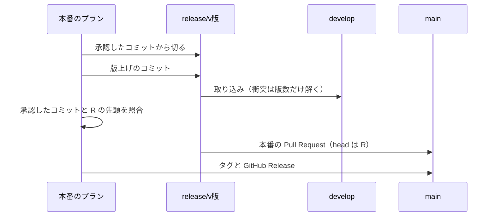

# 並列開発の設計: 本番チャネルへの Pull Request の規則の改定（#2436 の受け入れ条件 6b）

設計文書 [issue-2436-design.md](issue-2436-design.md) から、本番の配布の規則を改める部分を分けたファイル。決定の理由は [issue-2436-design-decisions.md](issue-2436-design-decisions.md) の決定 15 にある。

## 目的

- **今どうなっているか**: 本番の配布は `develop` → `main` の Pull Request で `develop` の先頭を出す。承認したコミットの後に配布の Pull Request の外のコミットが `develop` へ入ると、配布は承認ゲート（10）で止まる（#815）。レーンが並ぶと、承認を待つ間と本番のプランが流れる間に他のレーンのマージが入り、配布が止まる
- **変えると何が成り立つか**: 承認したコミットと版上げのコミットだけを `main` へ出す。`develop` は止めず、レーンの開発版の配布と確認は続く。承認の後に `develop` へ入った変更は次の配布になる

## 今の作りと改めた後

| 点 | 今の作り（コードの位置） | 改めた後 |
| --- | --- | --- |
| `release/v<版>` を切る起点 | 本番のプランの「起点」が `origin/<ベースブランチ>`（`release_templates.py` の `plan_release_package_plugin`。worktree は `paths.py` の `_resolve_base` が作る） | 承認したコミット。差し込み `{queue_approved:<計画名>}` を、名前の一致する完了した計画の approval-facts の `metrics.approved_sha` で埋める |
| 本番の Pull Request の head | `develop`（`release-steps.py` の `_merge_prod_pr` が `create_pr(root, prod, base, ...)`） | `release/v<版>`（`create_pr(root, prod, branch, ...)`） |
| 承認の照合 | `origin/<ベースブランチ>` の先頭と承認したコミットを比べる（`release_lib/approval.py` の `check_approved` → `lib/approved_commit.py` の `compare_approved`） | `origin/release/v<版>` の先頭と承認したコミットを比べる。許すのは `release/v<版>` の Pull Request のコミット（版上げ）だけで、版数の衝突を解いたときも `release/v<版>-sync` の Pull Request からは読まない |
| 本番の Pull Request のマージで指定する先頭 | 比べた `develop` の先頭（`wait_and_merge(..., expect=verdict.tip)`） | 比べた `release/v<版>` の先頭 |
| 宛先の検査 | head が `develop` のときだけ通す（`scripts/check-pr-base.sh`） | head が `develop`、または先頭が `origin/develop` の祖先の `release/v*` なら通す |
| `release/v<版>` を `develop` へマージする時期 | 本番の Pull Request の前（`_merge_release_pr`） | 同じ。版数の衝突は配布のステップが解く（下の「版数の衝突」） |

## 不変条件

| # | 条件 | 破れたときの扱い |
| --- | --- | --- |
| R1 | `main` 宛の Pull Request の head は `develop` か、先頭が `origin/develop` の祖先の `release/v*` である | `scripts/check-pr-base.sh` が落とす（継続的統合のジョブ `pr-base-guard`） |
| R2 | `release/v<版>` は承認したコミットから切り、版上げのコミット（bump・changelog・説明文）だけを足す | 承認の照合が承認の外のコミットとして承認ゲート（10）で止める |
| R3 | `release/v<版>` を `develop` へ取り込んでから、本番の Pull Request を作る | 取り込みが済むまで本番の Pull Request を作らない（今の順のまま） |
| R4 | `release/v<版>` はマージのコミットで `develop` へ取り込み、先頭を `develop` の祖先に残す | squash と rebase では取り込まない（祖先にならず R1 が落ちる） |
| R5 | `develop` へ取り込むときの衝突は、版数を持つ箇所だけを本番の版で解く。ほかの衝突は解かずに止める | 配布のステップが終了コード 1 で止まる（今の失敗の扱い） |

## 処理の流れ

1. queue が本番のプランを流す前に、「起点」の `{queue_approved:<計画名>}` を承認したコミットで埋める。埋められなければ本番のプランを流さない（#2079 の既存の扱い）。並列の計画の外のスプリントでは `<計画名>` は開発版のプラン（`release`。`DEV_SERIES`）で、並列の計画では提示のプラン（`present`）である
2. worktree は承認したコミットから `release/v<版>` で作られる。bump・changelog・説明文は今のステップのまま、承認したコミットの上に版上げのコミットを積む
3. `release` のステップは `release/v<版>` を `develop` へ取り込む（`_merge_release_pr`）。衝突が無ければ今どおりマージする。衝突があれば下の「版数の衝突」で解く
4. 承認したコミットと `origin/release/v<版>` の先頭を照合する。照合で許すコミット（`release_pr_allowed` の許す一覧）は、`release/v<版>` → `develop` の Pull Request から読む。版数の衝突を解いて `release/v<版>-sync` の Pull Request で取り込んだときも、照合には元の `release/v<版>` の Pull Request を渡す。`-sync` の head は承認の後の `develop` の変更を含むため、照合に渡すと版上げしかない `release/v<版>` でも承認ゲート（10）で止まる。外のコミットが無ければ、head を `release/v<版>` にした本番の Pull Request を作り、照合した先頭を指定してマージする。タグと GitHub Release は今どおり `main` のマージのコミットに打つ

`develop` が承認の後に進んでいても、照合する相手は `release/v<版>` で、配布は止まらない。昇格の経路（`merged-steps.py promote`。head は `develop`）は R1 の `develop` の場合に当たり、変えない。

## 版数の衝突

承認の後に他のレーンの開発版の配布が `develop` の版数を上げていると、`release/v<版>` を `develop` へ取り込むときに版数を持つ箇所（[docs/versioning-and-distribution.md](../docs/versioning-and-distribution.md) の「版数を持つ箇所」）が衝突する。

| 段 | 扱い |
| --- | --- |
| 衝突を見つける | `release/v<版>` → `develop` の Pull Request が衝突している（`mergeStateStatus` が `DIRTY`。merged-steps の終了コード 4） |
| 解く枝を作る | `release/v<版>` から `release/v<版>-sync` を作り、`origin/develop` をマージする。`release/v<版>` そのものには `develop` を取り込まない（取り込むと承認の外のコミットが `main` へ出る） |
| 解く | 衝突した箇所がすべて版数を持つ箇所なら、`release/v<版>` の側（本番の版）を取る。1 つでもほかの箇所が衝突していれば止める（R5） |
| 取り込む | `release/v<版>-sync` → `develop` の Pull Request を作ってマージする。`release/v<版>` の先頭は `release/v<版>-sync` の親として `develop` の祖先になる（R1） |
| 記録 | 照合（`release_pr_allowed`・`compare_approved`）に渡す Pull Request と、取り込みに使った Pull Request を分けて持つ。照合には元の `release/v<版>` の Pull Request（マージされずに閉じても、承認したコミットの後のコミットは版上げだけ）を渡し、`release/v<版>-sync` の Pull Request は渡さない。`release/v<版>-sync` の Pull Request は `develop` への取り込みにだけ使い、リリース記録（`record`）と後片付け（`cleanup`。head が `release/v<版>` で始まる）は両方の Pull Request を扱う |

並列の計画の下では、このステップを含む本番のプランは一時レーンが流し、衝突の解消と失敗の対応も一時レーンが行う（[issue-2436-design-approvals.md](issue-2436-design-approvals.md) の「責務の分け方」）。

**版の規則とは矛盾しない。** 解いた後の `develop` の版数は本番の版（例: `10.28.0`）になる。次の開発版の配布は、記録の版（例: `10.28.0-dev.4`）がもう出ている版以下になるため、queue が次に空いている版（`10.28.1-dev.1`）で決め直す（`queue_fill.py` の `_recheck_dev` と `release_version.taken`）。接尾辞は次に出す正式版へ付く。`CHANGELOG.md` は開発版を載せない（`CHANGELOG.md` の冒頭）ため、開発版の配布との衝突は起きない見込みで、起きたら R5 で止める。

## 互換性

並列の計画の外の本番の配布（レーンでない 1 本のスプリント・ループ）も、この規則で動く。

| 場面 | 今の振る舞い | 改めた後 |
| --- | --- | --- |
| 承認の後に `develop` が進んだ | 本番の配布が承認ゲート（10）で止まり、承認し直す | 止まらず、承認したコミットと版上げを出す。進んだ分は次の配布 |
| 本番の Pull Request | head が `develop` | head が `release/v<版>`（衝突を解いたときも `release/v<版>`） |
| `main` と `develop` の関係 | 本番の配布の直後、`main` の中身は `develop` の先頭と同じ | `main` は承認したコミットと版上げまで。`develop` はその先を持つ |

## 構成要素と触るファイル

| ファイル | 変えること |
| --- | --- |
| `scripts/check-pr-base.sh` | 引数に head の SHA を足す（`check-pr-base.sh <分岐元> [<head の SHA>]`）。head が `release/v*` なら `origin/<起点>` を fetch し、`git merge-base --is-ancestor <head の SHA> origin/<起点>` が 0 のときだけ通す |
| `.github/workflows/pr-base-guard.yml` | `actions/checkout` の `fetch-depth: 0`、環境変数で `github.event.pull_request.head.sha` を渡す |
| `plugins/ndf/scripts/release-steps.py` | `_merge_prod_pr` の head と `expect` を `release/v<版>` にする。`_merge_release_pr` に衝突のときの解く枝（`release/v<版>-sync`）を足し、照合に渡す Pull Request（元の `release/v<版>`）と取り込みの Pull Request（`-sync`）を分けて返す。`cmd_release` の照合の相手を `release/v<版>` にする |
| `plugins/ndf/scripts/release_lib/approval.py` | `check_approved` が比べる先頭を引数の参照（`release/v<版>`）から読む。止まったときの文言の参照名 |
| `plugins/ndf/scripts/release_lib/version_merge.py`（新規） | 衝突した箇所が版数を持つ箇所かの判定と、本番の版の側を取る解き方 |
| `plugins/ndf/scripts/supervise_lib/release_templates.py` | 本番のプランの「起点」を `{queue_approved:<計画名>}` にする |
| `plugins/ndf/scripts/supervise_lib/queue_fill.py` | 差し込み `{queue_approved:<計画名>}` |
| `AGENTS.md` | 「Git運用ルール」の `main` 宛の Pull Request の行を「`develop` に含まれるコミットだけ（head は `develop` か `release/v<版>`）」にする |
| `docs/versioning-and-distribution.md` | 正式版を出す手順・チャネルの説明の、本番の Pull Request の head と承認したコミットの扱い |
| `plugins/ndf/skills/release/references/release-steps.md` | `release` の `prod` の説明（「続けて `develop` → `main` をマージ」）と #815 の照合の説明 |
| `plugins/ndf/scripts/tests/`・`scripts/tests/` | 下のテスト設計 |

## テスト設計

| 条件 | どの振る舞いで縛るか | どう壊したら落ちるべきか |
| --- | --- | --- |
| R1（通す） | head が `develop`、または先頭が `origin/develop` の祖先の `release/v10.28.0` なら 0 | 祖先の判定を外す・`release/v*` の形を見ないと落ちる |
| R1（落とす） | head が `feature/x`、`develop` の祖先でない `release/v10.28.0`、SHA を渡さない `release/v*` なら 1 | 名前だけで通すと落ちる |
| R2・照合 | 承認したコミットから切った `release/v<版>` に版上げだけがあれば照合が通る。`develop` が承認の後に進んでいても止まらない。`release/v<版>` に承認の外のコミットがあれば 10 | 照合の相手を `develop` の先頭に戻すと「進んでいても止まらない」が落ちる |
| 起点 | 本番のプランの worktree が承認したコミットから作られる。`{queue_approved:<名>}` を埋められなければ流さない | 起点を `origin/develop` に戻すと落ちる |
| 版数の衝突 | `develop` で `plugin.json` の版数が `10.28.0-dev.4` に上がった後に `release/v10.28.0` を取り込むと、`release/v10.28.0-sync` で本番の版を取り、`release/v10.28.0` の先頭が `develop` の祖先になる。版数でない箇所が衝突すれば 1 で止まる | `release/v<版>` に `develop` を取り込む・版数でない衝突を解くと落ちる |
| 版数の衝突の後の照合 | 承認の後に `develop` が進み、`release/v10.28.0-sync` で取り込んだとき、`release/v10.28.0` に版上げしか無ければ照合が通り、本番の Pull Request が作られる | 照合に `-sync` の Pull Request を渡すと、承認の後の `develop` の変更が承認の外になって 10 で止まり落ちる |
| Pull Request 2420 の件 | レーン A の配布の後、範囲に入っていたレーン B が依頼のステップに来ても本番の Pull Request を作らない。レーン A の配布の承認の後にマージされたレーン B の変更は A の `main` に入らず、次の配布になる | B のための本番の Pull Request を作る・A の配布に承認の外の B の変更が入ると落ちる |

## 未確認のまま残ること

| 項目 | 内容 |
| --- | --- |
| 配布の Pull Request の取り込み方 | `release-steps.py` の `wait_and_merge` が打つ `merged-steps.py merge-when-green` の `--method` の既定がマージのコミット（`merge`）かは未確認（R4） |
| 継続的統合の祖先の判定 | `pr-base-guard` で `fetch-depth: 0` と head の SHA の受け渡しにより `git merge-base --is-ancestor` が判定できるかは、実装で Pull Request を作って確かめる |
| `main` のブランチの規則 | `main` の ruleset が `develop` 以外の head の Pull Request のマージを許すかは未確認 |
| 明示の開発版の版数 | ループの `loop sprint --dev <開発版>` が queue の版の記録で明示（`explicit`）として扱われると、本番の版が先に出た後の開発版の配布は決め直さずに止まる（`_recheck_dev`）。どちらで扱われるかは未確認 |
