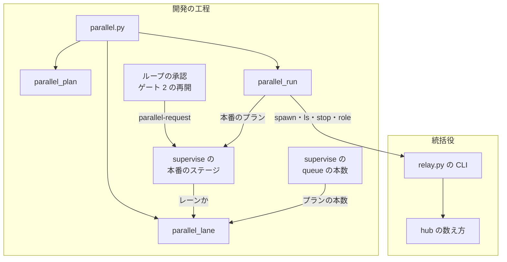
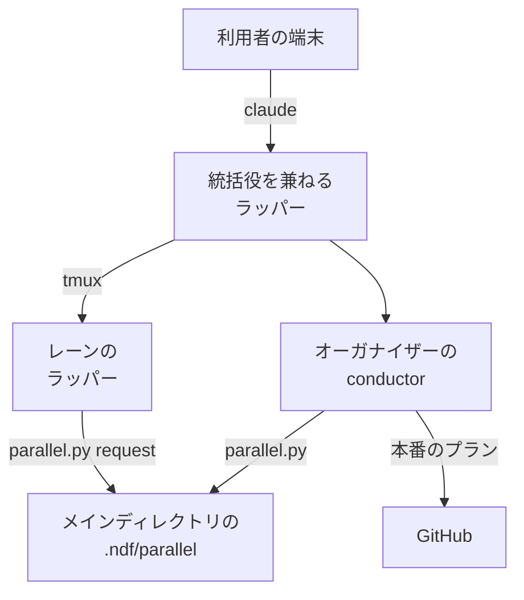
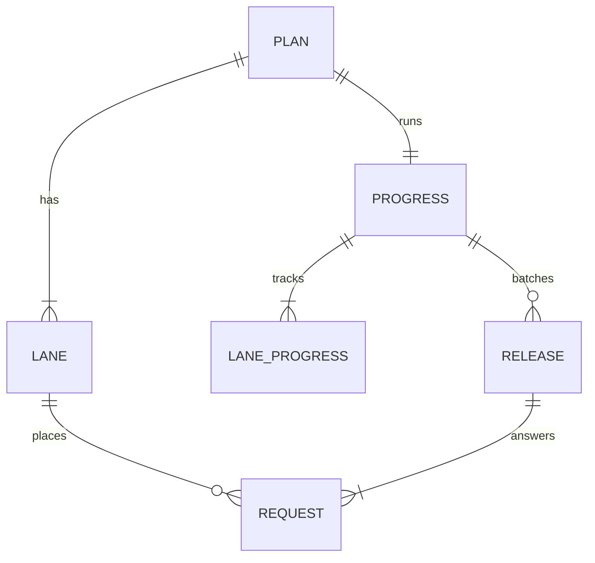
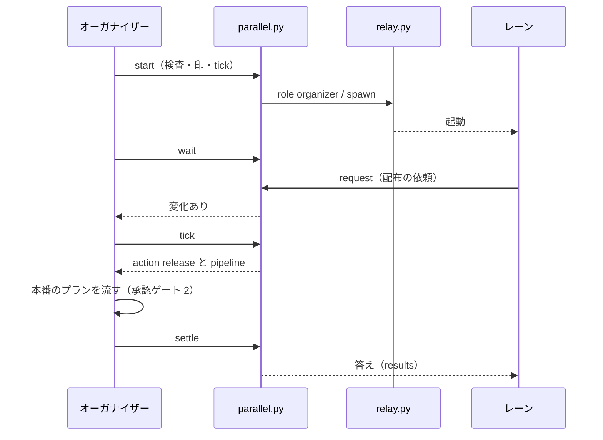
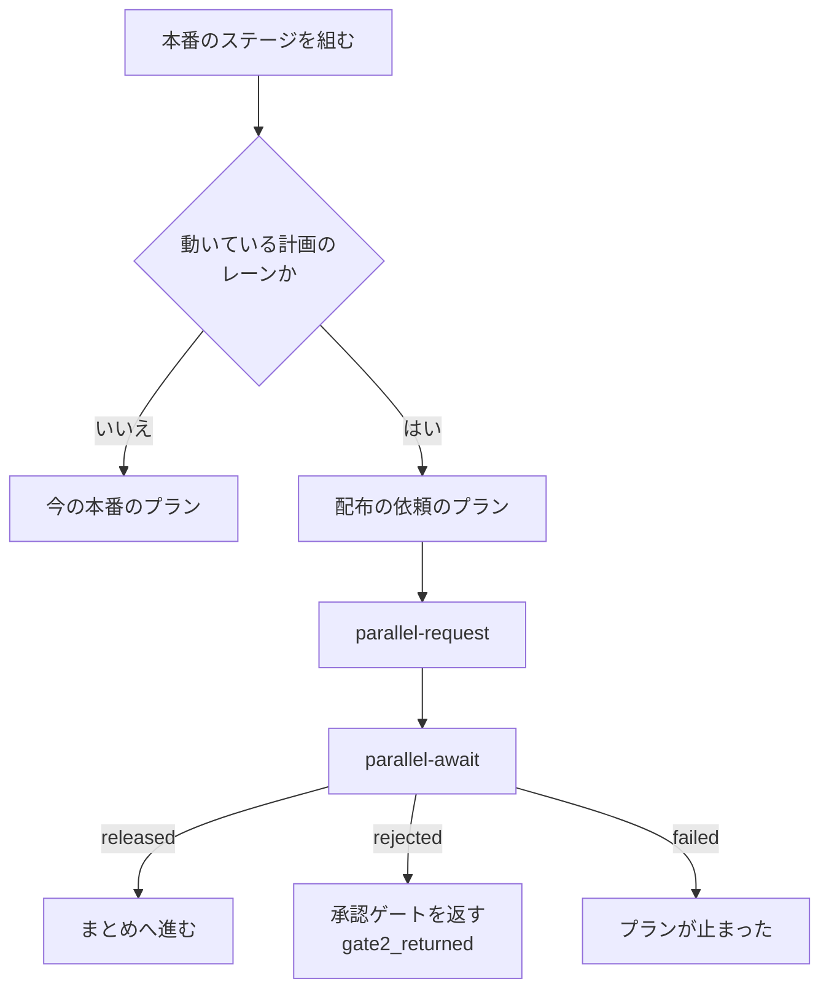
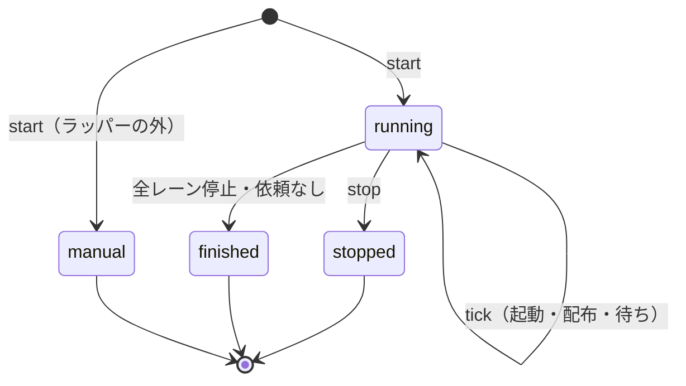

# 並列開発: 並列の計画を 1 度書き、1 行で複数のレーンを起動して本番の配布を 1 本にまとめる（#2436）

## 目的

- **今どうなっているか**: 統括役（#2346）で tmux のセッションを並べて起動できるが、並列開発を計画して始める手順が無い。2026-11-02 は 3 本の開発ループを手で起動し、共通の決まりを 3 本の引継ぎ文書へ手で書き写した。本番の配布もレーンごとに出した。先に出したレーンが他のレーンの変更をまとめて出した。そのため、別のレーンの本番の Pull Request https://github.com/devbasex/ai-plugins/pull/2420 を閉じた
- **誰に効くか**: 1 つのリポジトリで複数の開発ループかスプリントを同時に進める利用者
- **変えると何が成り立つか**: 並列の計画を 1 度書き、`/goal /ndf:development-workflow --parallel <計画名>` の 1 行を打つ。オーガナイザーがレーンを起動して監視し、レーンの本番の配布を 1 回の承認ゲート 2 と 1 本の本番の配布にまとめる

## 適用範囲

- **働く範囲**: NDF を導入したすべてのリポジトリ。起動まで行うのは Claude Code をラッパー（`relay.py`）の下で動かし、tmux があるときだけである。それ以外は、レーンを手で起動するコマンドを示して終わる
- **プロジェクトごとに違うもの**: レーンの構成（名前・最初の入力・触る場所・プランの本数・依存）は並列の計画に書く。同時に動かせるラッパーの数は環境変数 `NDF_RELAY_MAX_NAMED` で受ける。本番の配布の手段は今の配布のテンプレート（`.ndf/release.json`）のまま
- **当たるモード**: オーガナイザーはモードを持たない。レーンの中のスプリントは、今どおりモードを判定する

## あるべき姿の根拠

| 根拠 | 種類 | 何を示すか |
| --- | --- | --- |
| 依頼の原文（#2436 の「依頼（原文）」。2026-11-02） | 利用者の指示の原文 | 事前に計画を立て、レーンの数だけ引継ぎ文書を起こし、`/goal /<Skill> <指示>` の 1 行でオーガナイザーが起動を担う流れ |
| Pull Request 2420 を閉じた件（伝言 `.ndf/handoff/notice-to-lroot2.md`） | 実測 | レーンごとに本番を出すと、先に出したレーンが他のレーンの変更も出し、配布がぶつかる |
| 同時に流すプランの合計 6 本（2026-09-25 の実測。8 コア・30 GB） | 実測 | 並列の計画のプランの本数の合計の上限 |

要求と受け入れ条件は #2436 の本文にある（コピーは `issues/issue-2436-requirements.md`）。この文書は「どう作るか」だけを扱う。
決定の記録は [issue-2436-design-decisions.md](issue-2436-design-decisions.md) に分けた。

## ドメインモデル

### コンテキスト

| コンテキスト | 何の語が 1 つの意味に決まるか |
| --- | --- |
| 開発の工程（`ndf-workflow`） | 並列の計画・レーン・オーガナイザー・配布の依頼 |
| 統括役（`ndf-relay`） | ラッパー・統括役・名前つきのラッパー・同時に動かせる数 |
| 配布（`ndf-release`） | 本番の配布・承認ゲート 2・版 |

開発の工程と統括役は**公開された言語**の関係にする。開発の工程は統括役の CLI（`relay.py spawn`・`ls`・`stop`・`role`）を子プロセスで打ち、統一 JSON レポートだけを読む。統括役は並列の計画を知らない。配布へは、今のスプリントと同じく本番のプラン（`plan_mvv_release` が作るもの）を渡す。

### 集約

| 集約 | 持ち主（書き換えてよいもの） | 根 | エンティティ | 値オブジェクト |
| --- | --- | --- | --- | --- |
| 並列の計画 | `parallel.py init`（作る）。人と AI は起動の前だけ手で直してよい | 並列の計画（計画名） | レーン | 最初の入力・触る場所・プランの本数・依存 |
| 並列の進行 | オーガナイザー（`parallel.py start`・`tick`・`freeze`・`settle`・`stop`） | 並列の進行（計画名） | レーンの進行・まとめた配布 | 起動の結果・配布の結果 |
| 配布の依頼 | レーン（`parallel.py request`） | 配布の依頼（`<レーン名>-<連番>`） | — | 出す Pull Request・課題・依頼した時刻 |
| ラッパーの役割 | 統括役の CLI（`relay.py role`） | 作業ディレクトリの役割 | — | 役割の名前・計画名 |

並列の進行は、配布の依頼を識別子でだけ参照する。依頼への答え（配布の結果）は並列の進行の側に置き、依頼のファイルを書き換えない。

### 不変条件

| # | 集約 | 条件 | 破れたときの扱い |
| --- | --- | --- | --- |
| I1 | 並列の計画 | 計画名とレーン名は統括役の名前の形（`^[a-z0-9][a-z0-9_-]{0,31}$`）に合い、レーン名は計画の中で重ならない | 検査が誤りとして返す（終了コード 1） |
| I2 | 並列の計画 | レーンの数は同時に動かせる数の上限以下、プランの本数の合計は 6 以下 | 検査が誤りとして返す |
| I3 | 並列の計画 | 依存先は同じ計画のレーンで、依存は循環しない | 検査が誤りとして返す |
| I4 | 並列の計画 | 触る場所が重なるレーンの組は警告に留める | 検査が警告として返す（終了コード 0） |
| I5 | 並列の計画 | 作る前から在る引継ぎ文書を上書きしない | `init` が 1 つも書かずに止まり、名前を返す |
| I6 | 並列の進行 | 検査に誤りがある計画では、レーンを 1 本も起動しない | `start` が起動せずに誤りを返す |
| I7 | 並列の進行 | 1 本のレーンは 1 つの計画の進行の中で 1 回だけ起動する（起動し直したオーガナイザーも二重に起動しない） | 起動に成功した記録（`started`）があるレーンは起動の対象から外す。統括役に断られた記録だけのレーンは外さない |
| I8 | 並列の進行 | 依存のあるレーンは、依存先のレーンがすべて止まってから起動する | 依存先が止まるまで起動の対象から外す |
| I9 | 並列の進行 | 流れている本番の配布は 1 つの計画につき 1 本まで。配布に入る依頼は承認ゲート 2 を求める時点で確定し、その時点で届いている依頼をすべて載せる。求めた後に届いた依頼は次の配布へ回す | 流れている間は新しい配布を組まない。依頼の確定は承認ゲート 2 の直前のステップだけが行う |
| I10 | 並列の進行 | 配布の依頼 1 件には答えを 1 回だけ返す | 答えの済んだ依頼は配布の対象から外す |
| I11 | 並列の進行 | オーガナイザーが終わるのは、全レーンが止まり、答えていない依頼が無いときだけ | 条件を満たすまで終わりを返さない |
| I12 | 配布の依頼 | 並列の進行が「動いている」計画に属さないレーンは依頼を置かず、今の本番のプランを流す | 計画に属さないと判定し、今の本番のプランを組む |
| I13 | ラッパーの役割 | 同時に動かせる数から外すのは、オーガナイザーの印を持つ動いているラッパーのうち 1 本だけ | 2 本目以降の印は数に入れる |

### ドメインイベント

| # | イベント | 発生元 | 受け手 |
| --- | --- | --- | --- |
| E1 | 並列の計画を書いた | `parallel.py init` | 検査（E3） |
| E2 | レーンごとの引継ぎ文書を作った | `parallel.py init` | レーン（E6 で読む） |
| E3 | 並列の計画を検査した | `parallel.py check`（`init`・`start` の中でも打つ） | オーガナイザー（誤りなら起動しない） |
| E4 | オーガナイザーが起動した | `parallel.py start` | 統括役（`relay.py role`） |
| E5 | レーンを起動した | `parallel.py tick` | 統括役（`relay.py spawn`）・並列の進行 |
| E6 | レーンが開発を始めた | レーンの conductor | — （状態は E7 で観る） |
| E7 | レーンの状態が変わった | 統括役（`relay.py ls` が返す状態） | `parallel.py wait` |
| E8 | レーンが配布の依頼を置いた | `parallel.py request` | `parallel.py wait`・`tick` |
| E9 | オーガナイザーが承認ゲート 2 を求めた | 本番のプランの MVV 判定か、オーガナイザーの `AskUserQuestion` | 利用者 |
| E10 | 本番を配布した | 本番のプラン | `parallel.py settle` |
| E11 | 依頼したレーンへ配布の結果を返した | `parallel.py settle` | レーン（`parallel.py await`） |
| E12 | 計画名を指定して全レーンを止めた | `parallel.py stop` | 統括役（`relay.py stop <名前>`） |
| E13 | オーガナイザーが終わった | `parallel.py tick` | オーガナイザーの conductor（要約を出して終える） |

### 用語

| 用語 | 意味 | 用語集への反映 |
| --- | --- | --- |
| 並列の計画 | 1 つのリポジトリで同時に進めるレーンの一覧と、レーンに共通の決まりを書いた 1 つの文書。オーガナイザーが読む。名前（計画名）を持つ | 追加（要求の工程で反映済み） |
| レーン | 並列の計画の下で、名前つきのラッパー 1 本が進める開発の流れ。最初の入力は開発ループかスプリントの 1 つ | 追加（要求の工程で反映済み） |
| オーガナイザー | `--parallel <計画名>` で起動した conductor の役割。レーンを起動・監視し、配布の依頼をまとめて本番の配布を 1 本にする。統括役とは別 | 追加（要求の工程で反映済み） |
| 配布の依頼 | レーンが承認ゲート 2 の手前で、本番の配布をオーガナイザーへ頼むために置く 1 件のファイル | 追加（要求の工程で反映済み） |

並列の進行・まとめた配布・ラッパーの役割は、この設計の中だけで使う構成要素の名前で、用語集へは足さない。

## 機能一覧

| # | 機能 | 誰が使うか |
| --- | --- | --- |
| F1 | 並列の計画を作り、レーンごとの引継ぎ文書を作る | 利用者（`issue-plan-strategy` を通して conductor） |
| F2 | 並列の計画を検査する | conductor・オーガナイザー |
| F3 | `--parallel <計画名>` でオーガナイザーを始め、レーンを起動する | 利用者 |
| F4 | レーンの状態の変化と配布の依頼を待つ | オーガナイザー |
| F5 | 配布の依頼をまとめて 1 本の本番の配布にし、結果をレーンへ返す | オーガナイザー |
| F6 | 本番の配布の代わりに配布の依頼を置き、結果を待つ | レーン |
| F7 | オーガナイザーを同時に動かせる数から外す | 統括役 |
| F8 | 計画名を指定して全レーンを止める | 利用者 |
| F9 | ラッパーの外・tmux が無いときに、手で起動するコマンドを示す | 利用者 |
| F10 | オーガナイザーを起動し直して記録から続け、全レーンが止まったら要約して終える | オーガナイザー |

## 構成要素

| 要素 | 責務 | 新規 / 変更 |
| --- | --- | --- |
| `plugins/ndf/scripts/parallel.py` | 並列の計画と進行の CLI。副命令を下の 2 つの部品へ振り分け、統一 JSON レポートを 1 行で返す | 新規 |
| `plugins/ndf/scripts/lib/parallel_plan.py` | 並列の計画の形・検査（I1〜I4）・`plan.md` の描画・引継ぎ文書の作成（I5） | 新規 |
| `plugins/ndf/scripts/lib/parallel_run.py` | 並列の進行（起動・待ち・配布のまとめ・停止・要約。I6〜I11）と、統括役の CLI の呼び出し | 新規 |
| `plugins/ndf/scripts/lib/parallel_lane.py` | レーンの側: 自分が属する計画の判定（I12）・依頼を置く・結果を待つ・プランの本数を返す | 新規 |
| `plugins/ndf/scripts/relay_lib/hub.py` | `live()` が、オーガナイザーの印を持つ動いているラッパー 1 本を数から外す（I13） | 変更 |
| `plugins/ndf/scripts/relay_lib/hub_client.py` | `ls` の行に役割を足し、`metrics` に統括役の有無と tmux の有無を足す。`role` の副命令 | 変更 |
| `plugins/ndf/scripts/relay_lib/__init__.py` | 副命令 `role` の振り分け | 変更 |
| `plugins/ndf/scripts/supervise_lib/sprint_waves.py` | 配布の依頼のプラン（`plan_release_request`）と、まとめた配布の本番のプラン（先頭の mvv のステップの直前に `parallel-freeze` を置く）を作る | 変更 |
| `plugins/ndf/scripts/supervise_lib/sprint.py` | 本番のステージを組む 4 か所が、レーンのときだけ配布の依頼のプランを置く（1 つの関数を通す） | 変更 |
| `plugins/ndf/scripts/supervise.py` | `queue` の `--max` を省いたとき、レーンならプランの本数を既定にする | 変更 |
| `plugins/ndf/scripts/lib/sprint_loop_gate.py` | 承認ゲート 2 の後に続けるステップの候補へ、配布の依頼のプランの `parallel-request` を足す | 変更 |
| `issue-plan-strategy` の `SKILL.md` と `references/parallel-plan.md` | 並列の計画を作る手順（F1・F2） | 変更・新規 |
| `development-workflow` の `SKILL.md` と `references/parallel.md` | `--parallel <計画名>` のオーガナイザーの手順（F3〜F5・F8〜F10） | 変更・新規 |
| `development-workflow` の `references/relay.md`・`conductor-entrypoints.md`・`loop.md` | `ndf-spawn` の節から並列の計画へのリンク、`parallel.py` の行、レーンのときの本番の扱いの 1 行 | 変更 |
| `docs/glossary/glossary.json` | 4 語の正本へのリンク先を新しい参照へ向ける | 変更 |



Skill の文書（`issue-plan-strategy`・`development-workflow`）と用語集は、スクリプトを呼ぶ手順を書く側で、図には含めない。

### 置き場（パッケージ構成）

```text
plugins/ndf/
├── scripts/
│   ├── parallel.py                 # 新規
│   ├── lib/
│   │   ├── parallel_plan.py        # 新規
│   │   ├── parallel_run.py         # 新規
│   │   ├── parallel_lane.py        # 新規
│   │   └── sprint_loop_gate.py     # 変更
│   ├── relay_lib/{hub,hub_client,__init__}.py   # 変更
│   ├── supervise.py                # 変更
│   ├── supervise_lib/{sprint,sprint_waves}.py   # 変更
│   └── tests/test_parallel_*.py    # 新規
└── skills/
    ├── issue-plan-strategy/references/parallel-plan.md   # 新規
    └── development-workflow/references/parallel.md       # 新規
```

### システムの文脈と配置



オーガナイザーは、利用者が端末で打った `claude` のセッション（多くは統括役を兼ねるラッパー）で動く。レーンは統括役が tmux の中に起動する名前つきのラッパーで動く。どちらも同じコンテナの同じリポジトリのメインディレクトリを読み書きする。

## データ構造

置き場はメインディレクトリの `.ndf/parallel/<計画名>/` で、コミットしない（`.ndf/loop/` と同じ扱い）。



| ファイル | 中身 | 書き手 | 読み手 |
| --- | --- | --- | --- |
| `plan.json` | 並列の計画の正本 | `parallel.py init`（起動の前は人と AI も直してよい） | 全員 |
| `plan.md` | `plan.json` と `state.json` を人が読む形にした描画（レーンの表・決まり・配布の内訳） | `parallel.py` の副命令が書き換えるたびに作り直す | 人・レーンの conductor |
| `state.json` | 並列の進行 | オーガナイザーだけ | `parallel.py` |
| `requests/<レーン名>-<連番>.json` | 配布の依頼 1 件 | 依頼したレーンだけ | オーガナイザー |
| `results/<レーン名>-<連番>.json` | 依頼への答え 1 件 | オーガナイザーだけ | 依頼したレーン |
| `stop` | 停止の指示の印 | `parallel.py stop` | `parallel.py tick`・`wait` |

### `plan.json`

| 項目 | 型 | 必須 | 意味 |
| --- | --- | --- | --- |
| `version` | 整数 | ○ | 形の版。`1` |
| `name` | 文字列 | ○ | 計画名（I1） |
| `rules` | 文字列の配列 | ○ | レーンに共通の決まり（取り込みの衝突の解き方など）。空でもよい |
| `lanes[].name` | 文字列 | ○ | レーン名。ラッパーの名前と同じ（I1） |
| `lanes[].input.kind` | `loop` / `sprint` | ○ | 最初の入力の種類 |
| `lanes[].input.loop` | 文字列 | `loop` のとき | ループ名 |
| `lanes[].input.issues` | 整数の配列 | `sprint` のとき | スプリントの課題 |
| `lanes[].input.args` | 文字列の配列 | — | `--milestones` などの足す引数 |
| `lanes[].plans` | 整数（1 以上） | ○ | 同時に流すプランの本数（I2） |
| `lanes[].touches` | 文字列の配列 | ○ | 触る場所（パスか glob） |
| `lanes[].after` | 文字列の配列 | — | 依存先のレーン名（I3） |
| `lanes[].handoff` | 文字列 | `init` が書く | 引継ぎ文書の名（ループなら `loop-<ループ名>`、スプリントなら `issue-<最初の番号>`） |

### `state.json`

| 項目 | 意味 |
| --- | --- |
| `status` | `running`（オーガナイザーが進めている）/ `manual`（手で起動するコマンドを示した）/ `stopped`（停止の指示を受けた）/ `finished`（要約を出して終わった） |
| `organizer` | オーガナイザーの作業ディレクトリ（`NDF_RELAY_DIR`）と始めた時刻 |
| `lanes.<名>` | 起動した時刻・起動の結果（`started` か統括役の断りの理由）・最後に観た状態・止まった時刻 |
| `releases[]` | まとめた配布: 連番・含めた依頼の識別子（`freeze` が確定する）・本番のプランの状態ディレクトリと done のパス・状態（`running` / `awaiting_approval` / `released` / `rejected` / `failed`）・出した版 |

### 配布の依頼と答え

| ファイル | 項目 |
| --- | --- |
| 依頼 | `id`・`lane`・`prs`（出す版の Pull Request の番号）・`issues`・`sprint_state`（レーンのスプリントの状態ファイル）・`at` |
| 答え | `id`・`result`（`released` / `rejected` / `failed`）・`version`（`released` のとき）・`release`（まとめた配布の連番）・`reason`・`at` |

### 機能 × データ

| 機能 | `plan.json` | `state.json` | 依頼 | 答え |
| --- | --- | --- | --- | --- |
| F1 計画を作る | C | — | — | — |
| F2 検査 | R | — | — | — |
| F3 始める・起動 | R | C・U | — | — |
| F4 待つ | R | R | R | — |
| F5 まとめて配布 | R | U | R | C |
| F6 依頼と待ち（レーン） | R | R | C | R |
| F8 止める | R | U | — | — |
| F10 再開・要約 | R | R・U | R | R |

## 入出力の契約

どの副命令も、結果は統一 JSON レポート（`tool`・`status`・`summary`・`items`・`metrics`）を 1 行で標準出力へ出す。`<計画名>` の置き場は、カレントが worktree の中でもメインディレクトリに解決する。

| 名前 | 入力 | 成功 | 失敗の形 |
| --- | --- | --- | --- |
| `parallel.py init <計画名>` | 標準入力に `plan.json` の下書き（`handoff` を除く） | 0。`plan.json`・`plan.md`・引継ぎ文書を書き、パスを `items` に返す | 1: 検査の誤り・在る引継ぎ文書（名前を返し、何も書かない）・在る計画名。2: 読めない・書けない |
| `parallel.py check <計画名>` | — | 0。警告は `items`（`level: warning`）に並べる | 1: 誤りを `items`（`level: error`、`rule` に I1〜I3 の種類）に並べる。2: 計画が無い・読めない |
| `parallel.py start <計画名>` | 環境変数 `NDF_RELAY_DIR` | 0。オーガナイザーの印を置き、`tick` の結果を返す。再開なら `metrics.resumed: true` | 1: 計画が無い（置き場を返す）・検査の誤り。3: ラッパーの外・tmux が無い（`items` にレーンごとの手で起動する 1 行、`status: manual`） |
| `parallel.py tick <計画名>` | — | 0。`metrics.action` が `wait`（`metrics.next` に待ちのコマンド）/ `release`（`metrics.pipeline` に本番のプランを流す 1 行）/ `finished`（`items` にレーンごとの結果） | 1: オーガナイザーでないセッションから打った。2: 記録が読めない |
| `parallel.py wait <計画名> [--timeout 秒]` | — | 0: 変化があった（`items` に変化: 状態の変わったレーン・新しい依頼・止まったレーン・本番のプランの done） | 3: 上限に達した（既定 3600 秒。同じ `wait` を打ち直す） |
| `parallel.py settle <計画名> --done <D>` / `--rejected` | 本番のプランの done | 0: 依頼ごとに答えを書いた。`metrics.result` は `released` / `rejected` / `failed` | 4: 本番のプランが承認ゲート 2 を返した（`awaiting_approval` にして答えを書かない） |
| `parallel.py freeze <計画名> <連番>` | — | 0。答えていない依頼をすべてこの配布の依頼として確定し、`items` に依頼・`metrics.prs` に Pull Request の和を返す。`plan.md` の「配布」の節へ内訳を書く | 1: 連番の配布が流れていない・確定済み |
| `parallel.py stop <計画名>` | — | 0。`stop` の印を置き、各レーンへ `relay.py stop <名前>` を打つ | 1: 止まらないレーンがある（名前を返す） |
| `parallel.py request <計画名> --lane <名> --prs <番号>... --issues <番号>... --state <パス>` | — | 0。`metrics.id` に依頼の識別子 | 1: 計画が動いていない |
| `parallel.py await <計画名> <依頼>` `[--timeout 秒]` | — | 0: `released`（`metrics.version`） | 10: `rejected`（承認ゲートを返す終了コード）。1: `failed`。3: 上限に達した |
| `relay.py role organizer --plan <計画名>` / `relay.py role --clear` | `NDF_RELAY_DIR` | 0。作業ディレクトリへ役割のファイルを書く・消す | 1: ラッパーの外（`NDF_RELAY_DIR` が無い） |
| `relay.py ls --json`（変更） | — | 行に `role`、`metrics` に `hub`・`tmux` を足す | 今のまま |

**互換性**: 既存の副命令・引数・`ls` の既存の項目は変えない。足すのは項目だけである。`queue` の `--max` を省いたときの既定は、レーンでなければ今どおり 3 である。並列の計画に属さないループとスプリントの本番のプランは変わらない（I12）。

### オーガナイザーの起動のコマンド

```text
/goal /ndf:development-workflow --parallel <計画名> -- 終わり: [ndf-parallel] finished <計画名> の行を出したとき
```

`--parallel` があれば、`development-workflow` は判定の手順へ進まず `references/parallel.md` の手順で進む（`--loop` と同じ形）。再開のコマンドも同じ 1 行である。

### レーンの最初の入力

オーガナイザーは `relay.py spawn --name <レーン名> --json -- <最初の入力>` を、メインディレクトリをカレントにして打つ。最初の入力は次の 1 行で、レーンの conductor は引継ぎ文書の「次にやること」の 1 つ目から始める（`handoff.md` の「読む」）。

```text
/goal /ndf:development-workflow .ndf/handoff/<引継ぎ文書の名>.md の続きから
```

`init` が作る引継ぎ文書は、「進め方（利用者の指示）」に計画名・レーン名・`plan.md` のパスを書き、決まりは写さない。「次にやること」の 1 つ目と「次に実行するコマンド」には、レーンの開始のコマンドを書く。

| 最初の入力の種類 | レーンの開始のコマンド |
| --- | --- |
| ループ | `/goal /ndf:development-workflow --loop <ループ名> <args> -- 終わり: [ndf-loop] stopped <ループ名> の行を出したとき` |
| スプリント | `/goal /ndf:development-workflow #<課題>...` |

## 処理の流れ

### オーガナイザーの 1 周



`tick` は冪等で、記録と `relay.py ls --json` の今の姿だけから次の 1 手を決める。

1. `stop` の印があれば `status: stopped` にして `finished` 相当の要約を返す
2. 起動に成功した記録（`started`）の無いレーンのうち、依存先がすべて止まったものを `relay.py spawn` で起動し、結果を `lanes.<名>` に書く。統括役が上限で断ったレーンは次の `tick` で起動し直す
3. 流れている配布（`running` / `awaiting_approval`）が無く、答えていない依頼が 1 件以上あれば、まとめた配布を 1 つ組む。本番のプランを作り、`action: release` を返す。配布に入る依頼はこの時点では確定しない（I9）
4. 全レーンが止まり、答えていない依頼が無ければ `action: finished` と要約を返し、`status: finished` にして役割の印を消す（I11）
5. どれにも当たらなければ `action: wait`

まとめた配布の本番のプランは `plan_mvv_release(..., version=None, channel="prod", prs=["{queue_pr:parallel-freeze}"])` で作り、承認ゲート 2 を判定する先頭の mvv のステップの直前に、run のステップ `parallel-freeze`（`parallel.py freeze <計画名> <連番>`）を置く。このステップが承認ゲート 2 を求める時点の依頼の締切である。答えていない依頼をすべてこの配布の依頼として `releases[]` に確定し、Pull Request の和を報告に出す。`tick` が配布を組んでから承認ゲート 2 を求めるまでに届いた依頼も、この配布に入る。確定の後に届いた依頼は次の配布へ回る（I9）。版は流す時点に決まり、承認ゲート 2 の判定と承認資料は今の本番のプランのままである。依頼ごとのレーン名・Pull Request・課題の内訳は、`freeze` が `plan.md` の「配布」の節へ書く。承認を求めるときは、この内訳を承認資料に示す。

### レーンの本番のステージ



レーンかどうかは `parallel_lane.lane_of()` が決める。環境変数 `NDF_RELAY_NAME` の名前が、`state.json` の `status` が `running` の計画のレーンにあればレーンである。判定はプランを組む時点に 1 度だけ行い、組んだプランに計画名を書く。

配布の依頼のプランは 2 つの run のステップを持つ。`parallel-request` が依頼を置き、`parallel-await` が答えを待つ。`await` が上限（3）で終われば同じステップへ戻る。差し戻し（10）は承認ゲートを返したものとしてプランを終え、ループは今の `gate2_returned` の経路で止まる。止まったレーンは、今の `loop start` の続きの経路で再開し、依頼を置き直す。そのために、承認ゲート 2 の後に続けるステップの候補へ `parallel-request` を足す。

### 並列の進行の状態



`manual` と `stopped` と `finished` からは `running` に戻らない。計画をもう 1 度動かすときは、新しい計画名で `init` する。オーガナイザーが落ちても `running` のまま残り、`start` を打ち直すと I7 と I10 を守って続ける。

## 非機能の実現方式

| 大項目 | 条件 | 実現方式 |
| --- | --- | --- |
| 可用性 | オーガナイザーが止まってもレーンは動き続ける。依頼したレーンは答えまで待つ | レーンは tmux のサーバが親で、オーガナイザーと独立している（#2346）。依頼と答えはファイルで、`start` の打ち直しが `state.json` と `requests/` を読み直して続ける |
| 性能・拡張性 | プランの本数の合計は 6 本まで。レーンの数は `NDF_RELAY_MAX_NAMED` に従う | 検査が I2 で止める。レーンの `queue` の `--max` の既定がレーンのプランの本数になる |
| 運用・保守性 | スクリプトは統一 JSON レポートを返す。置き場は `.ndf/parallel/<計画名>/` でコミットしない | 全副命令が 1 行の JSON を返す。`plan.md` を描画して人が読む形を残す |
| システム環境 | Claude Code とラッパーと tmux があるときだけ起動まで行う | `start` が `NDF_RELAY_DIR` と `relay.py ls --json` の `metrics.hub`・`metrics.tmux` を見て、欠ければ `manual` を返す |

## 決定の記録

[issue-2436-design-decisions.md](issue-2436-design-decisions.md) に置く。

## テスト設計

| 受け入れ条件・不変条件 | どの振る舞いで縛るか | どう壊したら落ちるべきか |
| --- | --- | --- |
| 受け入れ条件 1・2、I5 | `init` が `plan.json`・`plan.md`・レーンの数だけの引継ぎ文書を作り、引継ぎ文書は計画のパスを持ち決まりを写さない。1 本でも在れば何も書かない | 在る引継ぎ文書を上書きするように壊す・一部だけ書いて止まるように壊すと落ちる |
| 受け入れ条件 3、I1〜I4 | 名前の形・重なり・上限・合計 6・未知の依存・循環が誤り（終了コード 1）、触る場所の重なりが警告（0） | 循環の判定を外す・重なりを誤りにする・合計の比較を「より大きい」から「以上」へずらすと落ちる |
| 受け入れ条件 4、I6・I8 | 検査に誤りがあると `relay.py spawn` を 1 回も打たない。依存のあるレーンは依存先が `stopped` になった後の `tick` で起動する | 誤りがあっても起動する・依存を無視して起動すると落ちる |
| 受け入れ条件 5 | `wait` が状態の変化・依頼・done のいずれかで 0、無ければ上限で 3 を返す | 変化を見落とす・上限を待たずに返すと落ちる |
| 受け入れ条件 6、I9・I10・I12 | 依頼が 2 件あると 1 つのまとめた配布になり、両方に同じ版の答えが書かれる。配布を組んでから承認ゲート 2 を求めるまでに届いた依頼は同じ配布に入り、承認待ちの間に届いた依頼は次の配布に入る。動いている計画に属さないレーンでは今の本番のプランが組まれる | 依頼ごとに配布を組む・承認を求める前に届いた依頼を次へ回す・承認待ちの間の依頼を今の配布へ入れる・属さないレーンに依頼のプランを組むと落ちる |
| 受け入れ条件 7、I13 | オーガナイザーの印を持つ動いているラッパー 1 本を除いて数え、既定の 3 でレーン 3 本が起動できる。印が 2 本あれば 1 本だけ除く | 印を数えない・印をすべて除くと落ちる |
| 受け入れ条件 8 | `stop` が計画のレーンすべてへ停止を打ち、止まらない名前を返す | 一部のレーンに打たない・失敗を 0 で返すと落ちる |
| 受け入れ条件 9 | `NDF_RELAY_DIR` が無い・tmux が無いと、起動せずにレーンごとの 1 行と終了コード 3 を返す | 起動を試みる・コマンドがレーンの数に足りないと落ちる |
| 受け入れ条件 11、I7 | `start` を打ち直すと、起動に成功した記録のあるレーンを起動せず、統括役に断られた記録だけのレーンは起動し直し、答えていない依頼を次の `tick` で配布に入れる | 起動に成功したレーンを起動し直す・断られたレーンを起動しない・依頼を取りこぼすと落ちる |
| 受け入れ条件 12、I11 | 全レーンが止まり答えていない依頼が無いときだけ `finished` と要約（配布した版・止まった理由）を返す | 依頼が残るのに終わる・止まっていないレーンがあるのに終わると落ちる |
| 受け入れ条件 10 | `relay.md` の `ndf-spawn` の節と用語集から `parallel-plan.md` へのリンクがある | （リンクの検査は参照切れのチェックスクリプトが見る。文言のテストは書かない） |
| レーンのプランの本数 | レーンで `queue` の `--max` を省くと計画の本数、レーンでなければ 3 | レーン判定を外すと落ちる |

## 設計の結果

| 課題 | 扱い | 取り込み先 | 触るファイル |
| --- | --- | --- | --- |
| #2436 | 実装する | — | `plugins/ndf/scripts/parallel.py`、`plugins/ndf/scripts/lib/parallel_plan.py`、`plugins/ndf/scripts/lib/parallel_run.py`、`plugins/ndf/scripts/lib/parallel_lane.py`、`plugins/ndf/scripts/lib/sprint_loop_gate.py`、`plugins/ndf/scripts/relay_lib/hub.py`、`plugins/ndf/scripts/relay_lib/hub_client.py`、`plugins/ndf/scripts/relay_lib/__init__.py`、`plugins/ndf/scripts/supervise.py`、`plugins/ndf/scripts/supervise_lib/sprint.py`、`plugins/ndf/scripts/supervise_lib/sprint_waves.py`、`plugins/ndf/scripts/tests/`、`plugins/ndf/skills/issue-plan-strategy/`、`plugins/ndf/skills/development-workflow/`、`docs/glossary/glossary.json`、`docs/glossary.md` |

## 未確認のまま残ること

| 項目 | 内容 |
| --- | --- |
| 上限の値の読み手 | 検査は conductor のプロセスの環境変数 `NDF_RELAY_MAX_NAMED` を読み、統括役は統括役のプロセスの環境変数を読む。オーガナイザーが統括役のセッションで動く通常の形では同じ値になる。別の端末から値を変えて起動した場合の食い違いは未確認で、統括役の断りは `tick` が起動し直しとして扱う |
| 開発版の配布 | レーンはそれぞれ開発版（develop）を出す。版数の接尾辞の衝突は今の `base-sync` で解く前提で、並列の計画では扱わない。実運用で衝突が続けば別の課題にする |
| 起動の後のレーンの追加 | 動いている計画へレーンを足す手順は持たない。新しい計画名で `init` し直す |
| 承認待ちのレーンの扱い | オーガナイザーは承認待ちのレーンを知らせる（`relay.py attach <名前>` の 1 行）だけで、代わりに答えない。知らせの形はリリース後テストで確かめる |
| 通しの動き | 起動から配布までの通しは単体テストで縛れない。リリース後テストで 2 レーンの計画を `--parallel` で起動して確かめる（要求の「検証手段」） |
