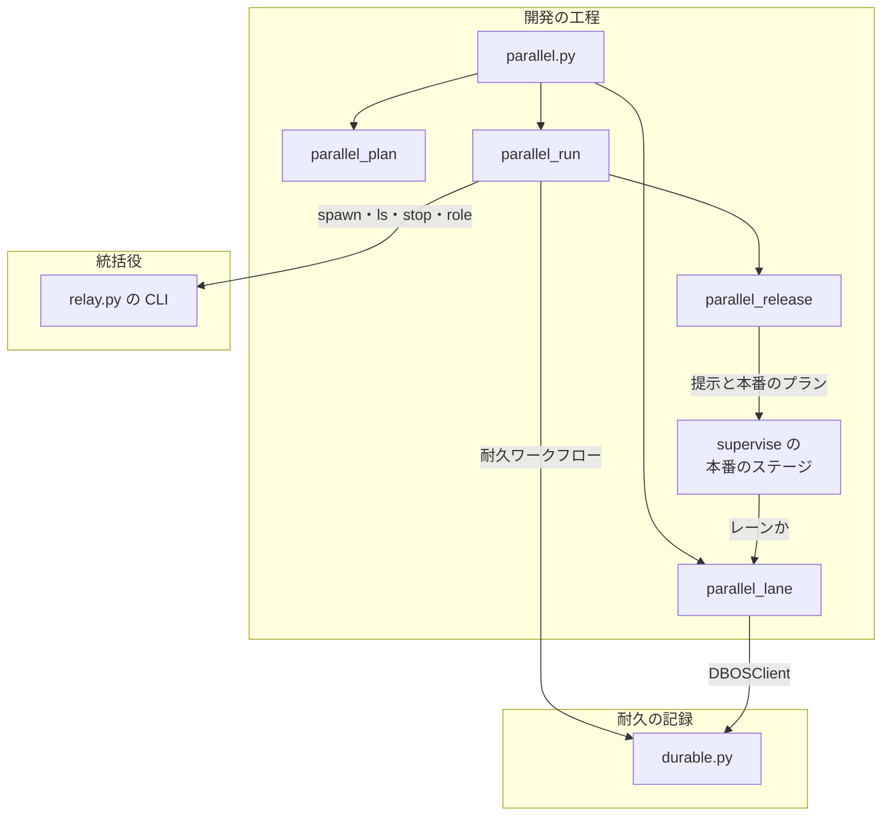
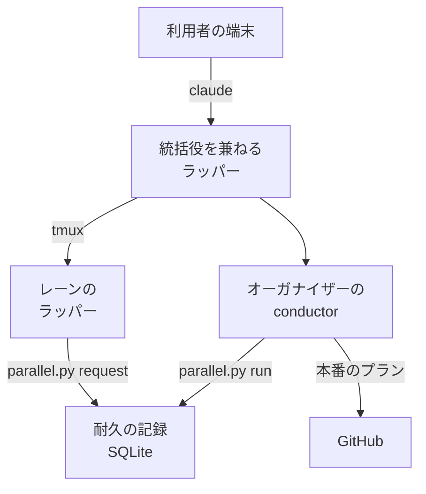
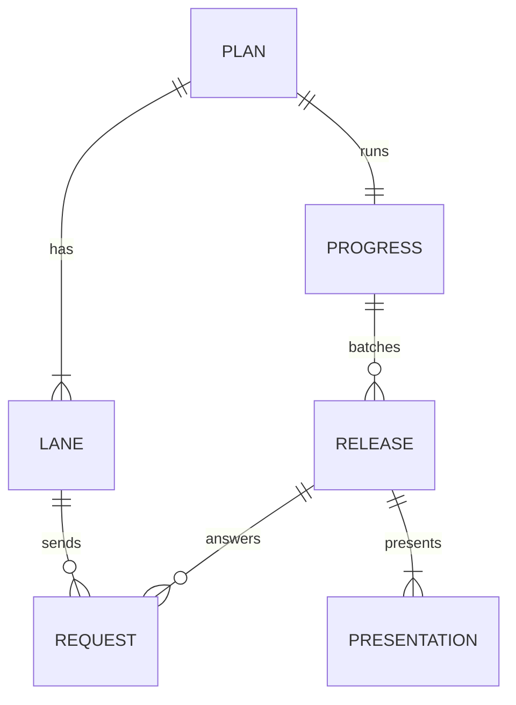
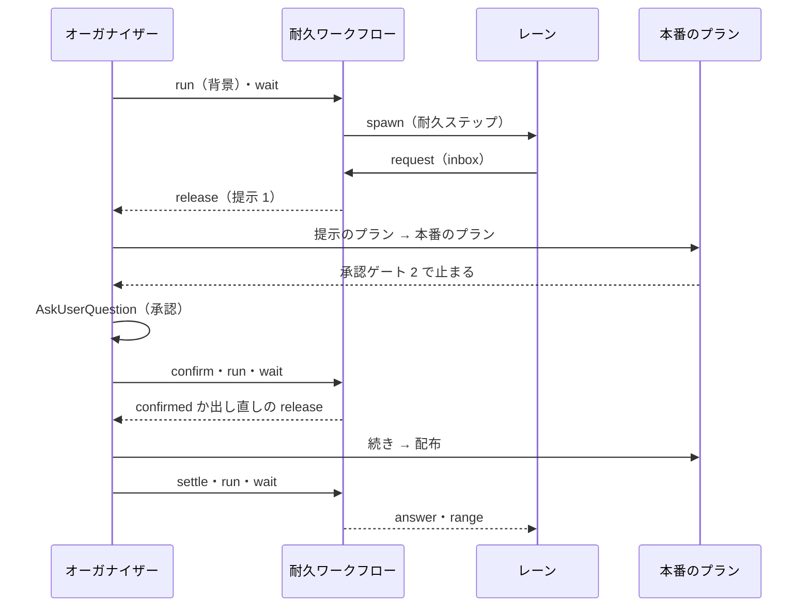
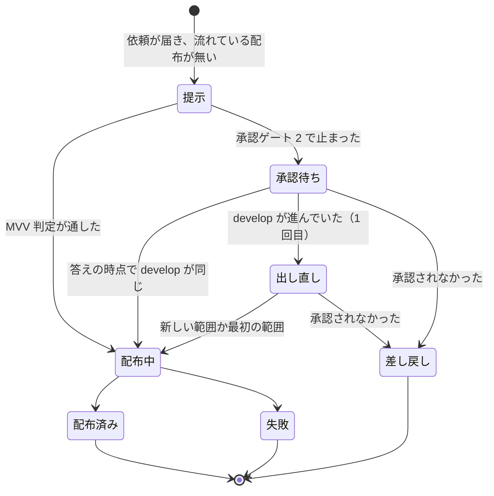
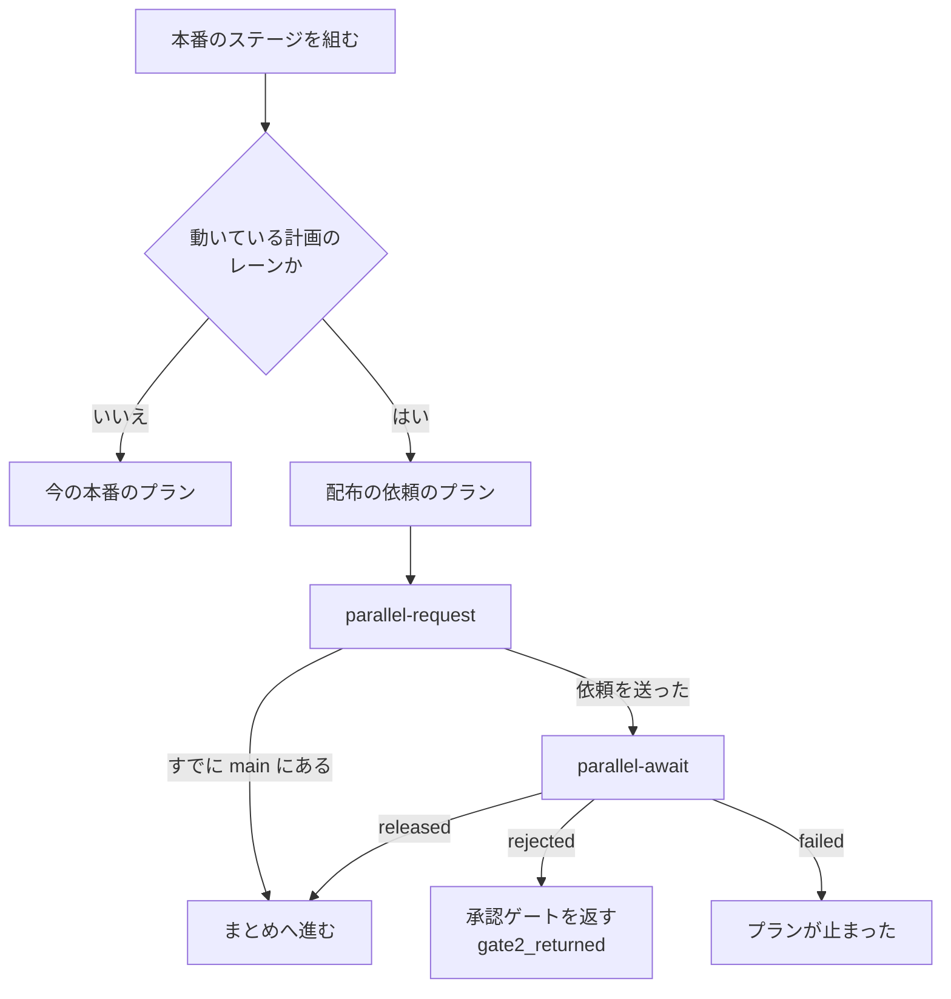
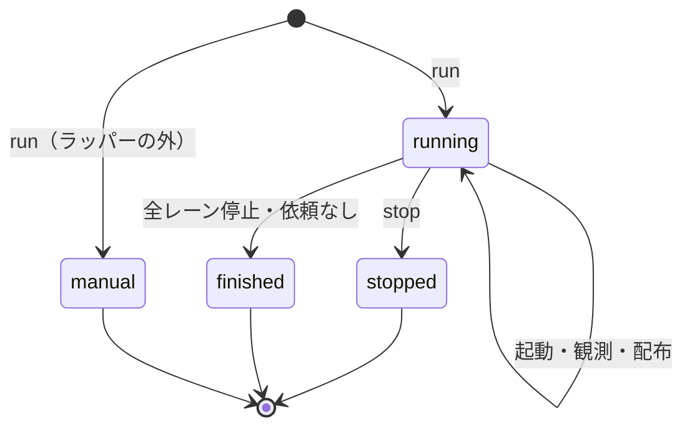

# 並列開発: 並列の計画を 1 度書き、1 行で複数のレーンを起動して本番の配布を 1 本にまとめる（#2436）

## 目的

- **今どうなっているか**: 統括役（#2346）で tmux のセッションを並べて起動できるが、並列開発を計画して始める手順が無い。2026-11-02 は 3 本の開発ループを手で起動し、共通の決まりを 3 本の引継ぎ文書へ手で書き写した。本番の配布もレーンごとに出した。先に出したレーンが他のレーンの変更をまとめて出した。そのため、別のレーンの本番の Pull Request https://github.com/devbasex/ai-plugins/pull/2420 を閉じた
- **誰に効くか**: 1 つのリポジトリで複数の開発ループかスプリントを同時に進める利用者
- **変えると何が成り立つか**: 並列の計画を 1 度書き、`/goal /ndf:development-workflow --parallel <計画名>` の 1 行を打つ。オーガナイザーがレーンを起動して監視する。レーンの配布の依頼は他のレーンを待たずにすぐ本番の配布になる。中身は承認資料を作る時点の `develop` のコミットで決まり、範囲に入った他のレーンの変更も 1 回の承認ゲート 2 で出る

## 適用範囲

- **働く範囲**: NDF を導入したすべてのリポジトリ。起動まで行うのは Claude Code をラッパー（`relay.py`）の下で動かし、tmux があるときだけである。それ以外は、レーンを手で起動するコマンドを示して終わる
- **プロジェクトごとに違うもの**: レーンの構成（名前・最初の入力・触る場所・プランの本数・依存）は並列の計画に書く。同時に動かせるラッパーの数は環境変数 `NDF_RELAY_MAX_NAMED` で受ける。本番の配布の手段は今の配布のテンプレート（`.ndf/release.json`）のまま
- **当たるモード**: オーガナイザーはモードを持たない。レーンの中のスプリントは、今どおりモードを判定する

## あるべき姿の根拠

| 根拠 | 種類 | 何を示すか |
| --- | --- | --- |
| 依頼の原文（#2436 の「依頼（原文）」。2026-11-02） | 利用者の指示の原文 | 事前に計画を立て、レーンの数だけ引継ぎ文書を起こし、`/goal /<Skill> <指示>` の 1 行でオーガナイザーが起動を担う流れ |
| 受け入れ条件 6 の改訂（2026-11-02） | 利用者の指示の原文 | 配布のために他のレーンを待たない。中身は承認資料を作る時点の `develop` のコミットで決め、承認ゲート 2 はその範囲を 1 回ずつ承認する。承認待ちの間に `develop` が進んだときの出し直しは 1 回まで |
| 人の答え待ちと本番のプランの所要（`.ndf/loop/*/loop.json` の `waiting`、`.ndf/loop/l20261031/lap-2`・`lap-3` の done） | 実測 | 人の答え待ちは 10 分〜40 時間、本番のプランは 855〜1,406 秒。承認待ちの間に他のレーンのマージが入る見込みは高い（決定 14） |
| Pull Request 2420 を閉じた件（伝言 `.ndf/handoff/notice-to-lroot2.md`） | 実測 | 本番の配布は `develop` の先頭を `main` へ出す。先に出したレーンが、`develop` にある他のレーンの変更も出す |
| 同時に流すプランの合計 6 本（2026-09-25 の実測。8 コア・30 GB） | 実測 | 並列の計画のプランの本数の合計の上限 |
| DBOS の試行（2026-11-02。下の「既存の部品で作る部分」） | 実測 | 1 つのプロセスの耐久ワークフローが待つメッセージを、サーバー無しで別のプロセスから送り、答えのイベントを読める |

要求と受け入れ条件は #2436 の本文にある（コピーは `issues/issue-2436-requirements.md`）。この文書は「どう作るか」だけを扱う。
決定の記録は [issue-2436-design-decisions.md](issue-2436-design-decisions.md) に分けた。

### 既存の部品で作る部分

並列の進行の状態・依頼と答え・待ち・打ち直しからの再開は、自分で書かずに既存のパッケージで行う。比較と採否は決定 12 にある。

| 必要なこと | 使う部品 | 依存のグループ |
| --- | --- | --- |
| 進行の状態を残し、落ちた後の打ち直しで続ける | DBOS Transact 3.1.0 の耐久ワークフローと耐久ステップ（包みは `plugins/ndf/scripts/lib/durable.py`。#1142） | `durable`（既存） |
| レーンからの依頼を受け、答えを返す | DBOS のメッセージ（`send` / `recv`）とイベント（`set_event` / `get_event`）。外のプロセスからは `DBOSClient` で送る・読む | `durable`（既存） |
| 並列の計画の形の検査 | pydantic 2.13.5 のモデル | `schema`（既存） |
| 依存の循環の検出 | 標準ライブラリの `graphlib.TopologicalSorter`（`CycleError`） | — |
| 配布の中身の Pull Request の算出 | 今の `release-steps.py approval-facts`（前のタグから承認したコミットまでの範囲の Pull Request。`release_lib/included.py`、#1274） | — |
| 承認したコミットと出すコミットの一致 | 今の `release-steps.py release --channel prod` の比較（承認の外のコミットが入ると承認ゲート（10）で止まる。`lib/approved_commit.py`、#815） | — |

試行（`org.py`・`lane.py`）では、1 つのプロセスが SQLite のシステムデータベースで耐久ワークフローを動かし、`DBOS.recv("release")` で待った。別のプロセス 2 本が `DBOSClient(system_database_url="sqlite:///...")` で `send(wid, msg, topic="release", idempotency_key=...)` を打ち、`client.get_event(wid, "answer-<レーン>", timeout_seconds=30)` で答えを受け取った。サーバーは使っていない。

## ドメインモデル

### コンテキスト

| コンテキスト | 何の語が 1 つの意味に決まるか |
| --- | --- |
| 開発の工程（`ndf-workflow`） | 並列の計画・レーン・オーガナイザー・配布の依頼 |
| 統括役（`ndf-relay`） | ラッパー・統括役・名前つきのラッパー・同時に動かせる数 |
| 配布（`ndf-release`） | 本番の配布・承認ゲート 2・版・承認したコミット |
| 耐久の記録（#1142） | 耐久ワークフロー・耐久ステップ・止まり・続き・実行の鍵 |

開発の工程と統括役は**公開された言語**の関係にする。開発の工程は統括役の CLI（`relay.py spawn`・`ls`・`stop`・`role`）を子プロセスで打ち、統一 JSON レポートだけを読む。統括役は並列の計画を知らない。配布へは、今のスプリントと同じく本番のプラン（`plan_mvv_release` が作るもの）を渡す。耐久の記録は**公開ホストサービス**で、開発の工程は `durable.py` の関数だけを呼び、DBOS を直接 import しない（#1142 の I16）。

### 集約

| 集約 | 持ち主（書き換えてよいもの） | 根 | エンティティ | 値オブジェクト |
| --- | --- | --- | --- | --- |
| 並列の計画 | `parallel.py init`（作る）。人と AI は起動の前だけ手で直してよい | 並列の計画（計画名） | レーン | 最初の入力・触る場所・プランの本数・依存 |
| 並列の進行 | 耐久ワークフロー `parallel-<計画名>`（`parallel.py run` が動かす。中身を書くのは耐久ワークフローだけ） | 並列の進行（計画名） | レーンの進行・まとめた配布・提示 | 起動の結果・提示したコミット・範囲のレーン・配布の結果 |
| 配布の依頼 | レーン（`parallel.py request` が送るメッセージ） | 配布の依頼（`<レーン名>-<連番>`） | — | 出す Pull Request・課題・依頼した時刻 |
| ラッパーの役割 | 統括役の CLI（`relay.py role`） | 作業ディレクトリの役割 | — | 役割の名前・計画名 |

まとめた配布は 1 つか 2 つの**提示**を持つ。提示は、承認ゲート 2 の資料を作った時点の `develop` のコミット（提示したコミット）と、その範囲 `main..<提示したコミット>` に入るレーンの一覧である。承認の答えの時点で `develop` が進んでいれば、同じまとめた配布に 2 つ目の提示を 1 回だけ加える（I14）。

並列の進行は、配布の依頼を識別子でだけ参照する。依頼への答え（配布の結果）は並列の進行のイベントに置き、依頼のメッセージを書き換えない。

### 不変条件

| # | 集約 | 条件 | 破れたときの扱い |
| --- | --- | --- | --- |
| I1 | 並列の計画 | 計画名とレーン名は統括役の名前の形（`^[a-z0-9][a-z0-9_-]{0,31}$`）に合い、レーン名は計画の中で重ならない | 検査が誤りとして返す（終了コード 1） |
| I2 | 並列の計画 | レーンの数は同時に動かせる数の上限以下、プランの本数の合計は 6 以下 | 検査が誤りとして返す |
| I3 | 並列の計画 | 依存先は同じ計画のレーンで、依存は循環しない | 検査が誤りとして返す |
| I4 | 並列の計画 | 触る場所が重なるレーンの組は警告に留める | 検査が警告として返す（終了コード 0） |
| I5 | 並列の計画 | 作る前から在る引継ぎ文書を上書きしない | `init` が 1 つも書かずに止まり、名前を返す |
| I6 | 並列の進行 | 検査に誤りがある計画では、レーンを 1 本も起動しない | `run` が耐久ワークフローを始めずに誤りを返す |
| I7 | 並列の進行 | 1 本のレーンは 1 つの計画の進行の中で 1 回だけ起動する（打ち直した `run` も二重に起動しない） | 起動は耐久ステップで、成功の記録（`started`）があるレーンは対象から外す。統括役に断られた記録だけのレーンは外さない |
| I8 | 並列の進行 | 依存のあるレーンは、依存先のレーンがすべて止まってから起動する | 依存先が止まるまで起動の対象から外す |
| I9 | 並列の進行 | 流れている本番の配布は 1 つの計画につき 1 本まで。依頼が届いた時点で流れている配布が無ければ、他のレーンを待たずに直ちに配布を組む（まとめるための待ち時間を置かない）。配布の中身は依頼の集合ではなく、提示したコミットの範囲 `main..<SHA>` で決まる | 流れている間に届いた依頼は、範囲に入っていればその配布の答えを待ち、入っていなければ次の配布へ回る。次の配布は今の配布が終わった直後に組む（配布は 1 本ずつ直列） |
| I10 | 並列の進行 | 配布の依頼 1 件には答えを 1 回だけ返す | 答えは耐久ワークフローの中で立てるイベントで、打ち直しは記録から同じ値を返す |
| I11 | 並列の進行 | 耐久ワークフローが終わるのは、全レーンが止まり、答えていない依頼が無いときか、停止の指示を受けたときだけ | 条件を満たすまで終わらない |
| I12 | 配布の依頼 | 動いている並列の進行（耐久ワークフローが終わっていない）に属さないレーンは依頼を送らず、今の本番のプランを流す | 計画に属さないと判定し、今の本番のプランを組む |
| I13 | ラッパーの役割 | 同時に動かせる数から外すのは、オーガナイザーの印を持つ動いているラッパーのうち 1 本だけ | 2 本目以降の印は数に入れる |
| I14 | 並列の進行 | 承認したコミットと出すコミットは一致する。承認資料に載っていない変更を承認したことにしない。出し直しは 1 つのまとめた配布で 1 回まで | 承認の答えの時点で `develop` が提示したコミットから進んでいれば、新しいコミットで承認資料を作り直し、加わった範囲を添えて同じ承認ゲート 2 を 1 回だけ出し直す。出し直した後の進みは次の配布へ回す |
| I15 | 並列の進行 | 範囲に入ったレーンは、依頼していなくてもその配布の結果を受ける。自分の Pull Request がすでに `main` にあるレーンは、依頼を送らずに `released` で続きへ進む | 配布ごとに範囲のイベント `range-<連番>` を立て、`request` が送る前に読む |

### ドメインイベント

| # | イベント | 発生元 | 受け手 |
| --- | --- | --- | --- |
| E1 | 並列の計画を書いた | `parallel.py init` | 検査（E3） |
| E2 | レーンごとの引継ぎ文書を作った | `parallel.py init` | レーン（E6 で読む） |
| E3 | 並列の計画を検査した | `parallel.py check`（`init`・`run` の中でも打つ） | オーガナイザー（誤りなら始めない） |
| E4 | オーガナイザーが始まった | `parallel.py run`（耐久ワークフローの最初の耐久ステップ） | 統括役（`relay.py role`） |
| E5 | レーンを起動した | 耐久ステップ「起動」 | 統括役（`relay.py spawn`） |
| E6 | レーンが開発を始めた | レーンの conductor | — （状態は E7 で観る） |
| E7 | レーンの状態が変わった | 耐久ステップ「観測」（`relay.py ls --json`） | 耐久ワークフロー。承認待ちになったレーンはイベント `notice` で `parallel.py wait` へ |
| E8 | レーンが配布の依頼を送った | `parallel.py request`（話題 `inbox` のメッセージ） | 耐久ワークフロー |
| E9 | 配布を提示した | 耐久ステップ「配布を組む」（イベント `release`） | オーガナイザーの conductor（`parallel.py wait`） |
| E10 | 承認ゲート 2 を求めた | 本番のプランの承認ゲート 2 の判定 | 利用者（MVV 判定が通せば利用者を経ない） |
| E11 | 承認の答えの時点のコミットを確かめた | `parallel.py confirm`（話題 `resume` のメッセージ） | 耐久ワークフロー（イベント `confirmed` か、1 回だけの出し直しの `release`） |
| E12 | 本番を配布した | 本番のプラン | `parallel.py settle` |
| E13 | 範囲のレーンへ配布の結果を返した | 耐久ワークフロー（`settle` の続きを受けたもの） | レーン（`parallel.py await`・`request`） |
| E14 | 計画名を指定して全レーンを止めた | `parallel.py stop` | 統括役（`relay.py stop <名前>`）・耐久ワークフロー |
| E15 | オーガナイザーが終わった | 耐久ワークフローの終わり | オーガナイザーの conductor（要約を出して終える） |

### 用語

| 用語 | 意味 | 用語集への反映 |
| --- | --- | --- |
| 並列の計画 | 1 つのリポジトリで同時に進めるレーンの一覧と、レーンに共通の決まりを書いた 1 つの文書。オーガナイザーが読む。名前（計画名）を持つ | 追加（要求の工程で反映済み） |
| レーン | 並列の計画の下で、名前つきのラッパー 1 本が進める開発の流れ。最初の入力は開発ループかスプリントの 1 つ | 追加（要求の工程で反映済み） |
| オーガナイザー | `--parallel <計画名>` で起動した conductor の役割。レーンを起動・監視し、配布の依頼をまとめて本番の配布を 1 本にする。統括役とは別 | 追加（要求の工程で反映済み） |
| 配布の依頼 | レーンが承認ゲート 2 の手前で、本番の配布をオーガナイザーへ頼むために送る 1 件の依頼 | 意味を直す（ファイルからメッセージへ） |

並列の進行・まとめた配布・提示・提示したコミット・ラッパーの役割は、この設計の中だけで使う構成要素の名前で、用語集へは足さない。

## 機能一覧

| # | 機能 | 誰が使うか |
| --- | --- | --- |
| F1 | 並列の計画を作り、レーンごとの引継ぎ文書を作る | 利用者（`issue-plan-strategy` を通して conductor） |
| F2 | 並列の計画を検査する | conductor・オーガナイザー |
| F3 | `--parallel <計画名>` でオーガナイザーを始め、レーンを起動する | 利用者 |
| F4 | レーンの状態の変化と配布の依頼を待つ | オーガナイザー |
| F5 | 依頼が届いたら直ちに配布を組み、承認待ちの間に `develop` が進めば 1 回だけ出し直し、結果を範囲のレーンへ返す | オーガナイザー |
| F6 | 本番の配布の代わりに配布の依頼を送り、結果を待つ（すでに配布済みなら待たない） | レーン |
| F7 | オーガナイザーを同時に動かせる数から外す | 統括役 |
| F8 | 計画名を指定して全レーンを止める | 利用者 |
| F9 | ラッパーの外・tmux が無いときに、手で起動するコマンドを示す | 利用者 |
| F10 | オーガナイザーを起動し直して記録から続け、全レーンが止まったら要約して終える | オーガナイザー |

## 構成要素

| 要素 | 責務 | 新規 / 変更 |
| --- | --- | --- |
| `plugins/ndf/scripts/parallel.py` | 並列の計画と進行の CLI。副命令を下の部品へ振り分け、統一 JSON レポートを 1 行で返す。先に `deps.require("durable", "schema")` を呼ぶ | 新規 |
| `plugins/ndf/scripts/lib/parallel_plan.py` | 並列の計画の pydantic のモデルと検査（I1〜I4。循環は `graphlib`）・`plan.md` の描画・引継ぎ文書の作成（I5） | 新規 |
| `plugins/ndf/scripts/lib/parallel_run.py` | 耐久ワークフロー `parallel` と耐久ステップ（起動・観測・停止・要約）。副命令 `run`・`wait`・`confirm`・`settle`・`stop` | 新規 |
| `plugins/ndf/scripts/lib/parallel_release.py` | まとめた配布: 提示のプランを作る・範囲の Pull Request をレーンへ対応づける（`present`）・提示したコミットと `develop` の先端を比べる 1 つの関数・答えを決める（I9・I14・I15） | 新規 |
| `plugins/ndf/scripts/lib/parallel_lane.py` | レーンの側: 自分が属する計画の判定（I12）・すでに配布済みかの判定（I15）・依頼を送る・答えを待つ・プランの本数を返す | 新規 |
| `plugins/ndf/scripts/lib/durable.py` | 外のプロセスから送る・読む関数（`DBOSClient` で耐久の記録を開く。DBOS を起動しない）を足す | 変更 |
| `plugins/ndf/scripts/relay_lib/hub.py` | `live()` が、オーガナイザーの印を持つ動いているラッパー 1 本を数から外す（I13） | 変更 |
| `plugins/ndf/scripts/relay_lib/hub_client.py` | `ls` の行に役割を足し、`metrics` に統括役の有無と tmux の有無を足す。`role` の副命令 | 変更 |
| `plugins/ndf/scripts/relay_lib/__init__.py` | 副命令 `role` の振り分け | 変更 |
| `plugins/ndf/scripts/supervise_lib/sprint_waves.py` | 配布の依頼のプラン（`plan_release_request`）と、まとめた配布の 2 つのプラン（提示のプランと本番のプラン）を作る | 変更 |
| `plugins/ndf/scripts/supervise_lib/release_templates.py` | 提示のプランが、今の開発版の承認資料のステップ（approval-facts・提示物の欄・他のプラグインの上げ幅）を版上げ無しで使えるように関数を分ける。本番のプランの承認の記録が読む状態ディレクトリを引数で受ける | 変更 |
| `plugins/ndf/scripts/supervise_lib/queue_fill.py` | 差し込み `{queue_prs:<計画名>}` を足す。名前の一致する完了した計画の状態ディレクトリの `work/prs.txt`（空白区切りの Pull Request の番号）で埋め、無ければ埋めずにそのプランを流さない | 変更 |
| `plugins/ndf/scripts/supervise_lib/sprint.py` | 本番のステージを組む 4 か所が、レーンのときだけ配布の依頼のプランを置く（1 つの関数を通す） | 変更 |
| `plugins/ndf/scripts/supervise.py` | `queue` の `--max` を省いたとき、レーンならプランの本数を既定にする | 変更 |
| `plugins/ndf/scripts/lib/sprint_loop_gate.py` | 承認ゲート 2 の後に続けるステップの候補へ、配布の依頼のプランの `parallel-request` を足す | 変更 |
| `issue-plan-strategy` の `SKILL.md` と `references/parallel-plan.md` | 並列の計画を作る手順（F1・F2） | 変更・新規 |
| `development-workflow` の `SKILL.md` と `references/parallel.md` | `--parallel <計画名>` のオーガナイザーの手順（F3〜F5・F8〜F10） | 変更・新規 |
| `development-workflow` の `references/relay.md`・`conductor-entrypoints.md`・`loop.md` | `ndf-spawn` の節から並列の計画へのリンク、`parallel.py` の行、レーンのときの本番の扱いの 1 行 | 変更 |
| `docs/glossary/glossary.json` | 4 語の正本へのリンク先を新しい参照へ向け、「配布の依頼」の意味を直す | 変更 |



Skill の文書（`issue-plan-strategy`・`development-workflow`）と用語集は、スクリプトを呼ぶ手順を書く側で、図には含めない。`relay.py` の中の数え方（`hub`）と `supervise.py` の `queue` の本数・承認ゲート 2 の再開は、上の表のとおりで図からは外した。

### 置き場（パッケージ構成）

```text
plugins/ndf/
├── scripts/
│   ├── parallel.py                 # 新規
│   ├── lib/
│   │   ├── parallel_plan.py        # 新規
│   │   ├── parallel_run.py         # 新規
│   │   ├── parallel_release.py     # 新規
│   │   ├── parallel_lane.py        # 新規
│   │   ├── durable.py              # 変更
│   │   └── sprint_loop_gate.py     # 変更
│   ├── relay_lib/{hub,hub_client,__init__}.py   # 変更
│   ├── supervise.py                # 変更
│   ├── supervise_lib/{sprint,sprint_waves,release_templates,queue_fill}.py   # 変更
│   └── tests/test_parallel_*.py    # 新規
└── skills/
    ├── issue-plan-strategy/references/parallel-plan.md   # 新規
    └── development-workflow/references/parallel.md       # 新規
```

### システムの文脈と配置



オーガナイザーは、利用者が端末で打った `claude` のセッション（多くは統括役を兼ねるラッパー）で動く。レーンは統括役が tmux の中に起動する名前つきのラッパーで動く。どちらも同じコンテナの同じ利用者で動き、同じ耐久の記録（SQLite のファイル 1 つ）と同じリポジトリのメインディレクトリを読み書きする。

## データ構造

置き場は 2 つある。どちらもコミットしない。

| 置き場 | 中身 |
| --- | --- |
| メインディレクトリの `.ndf/parallel/<計画名>/` | 並列の計画（`plan.json`）・人が読む描画（`plan.md`）・まとめた配布のプラン（`releases/`） |
| 耐久の記録 `~/.local/state/ndf/dbos/parallel-<12 字>.sqlite` | 並列の進行（耐久ワークフロー `parallel-<計画名>` の入力・耐久ステップの結果・メッセージ・イベント）。種類は `parallel`、識別は計画の置き場の絶対パス（`durable_keys.record_path`） |



| ファイル・記録 | 中身 | 書き手 | 読み手 |
| --- | --- | --- | --- |
| `plan.json` | 並列の計画の正本 | `parallel.py init`（起動の前は人と AI も直してよい） | 全員 |
| `plan.md` | `plan.json` と並列の進行を人が読む形にした描画（レーンの表・決まり・配布の内訳） | 耐久ステップ（状態が変わるたび）・`init` | 人・レーンの conductor |
| `releases/<連番>/<提示>/present.json`・`release.json` | まとめた配布の 1 つの提示の 2 つのプラン（提示のプランと本番のプラン）。状態ディレクトリはそれぞれのプランの横にできる | 耐久ステップ「配布を組む」 | `supervise.py queue` |
| `releases/<連番>/<提示>/presented.json` | 提示したコミット・範囲の Pull Request・範囲のレーン（依頼済みの印つき）・出し直しなら加わった範囲 | `parallel.py present`（提示のプランのステップ） | 耐久ステップ・`plan.md` の描画 |
| 耐久ワークフロー `parallel-<計画名>` | 並列の進行（下の表） | 耐久ワークフローだけ | `parallel.py wait`・`await`・`request`（イベントを読む） |
| レーンのプランの `{state_dir}/work/request.txt` | 送った依頼の識別子か、すでに配布済みの結果 | `parallel.py request` | `parallel.py await` |

### `plan.json`

pydantic のモデル `ParallelPlan` が正本の形を持つ。最初の入力は `kind` で分ける判別つきの共用体である。

| 項目 | 型 | 必須 | 意味 |
| --- | --- | --- | --- |
| `version` | 整数 | ○ | 形の版。`1` |
| `name` | 文字列 | ○ | 計画名（I1） |
| `rules` | 文字列の配列 | ○ | レーンに共通の決まり（取り込みの衝突の解き方など）。空でもよい |
| `lanes[].name` | 文字列 | ○ | レーン名。ラッパーの名前と同じ（I1） |
| `lanes[].input.kind` | `loop` / `sprint` | ○ | 最初の入力の種類 |
| `lanes[].input.loop` | 文字列 | `loop` のとき | ループ名 |
| `lanes[].input.issues` | 整数の配列 | `sprint` のとき | スプリントの課題 |
| `lanes[].input.args` | 文字列の配列 | — | `--milestones` などの足す引数 |
| `lanes[].plans` | 整数（1 以上） | ○ | 同時に流すプランの本数（I2） |
| `lanes[].touches` | 文字列の配列 | ○ | 触る場所（パスか glob） |
| `lanes[].after` | 文字列の配列 | — | 依存先のレーン名（I3） |
| `lanes[].handoff` | 文字列 | `init` が書く | 引継ぎ文書の名（ループなら `loop-<ループ名>`、スプリントなら `issue-<最初の番号>`） |

検査の誤りは pydantic の検証の誤りとして集める。I1〜I3 の検証は誤りの種類（`PydanticCustomError` の type）に `I1`〜`I3` を持ち、`check` はそれを `items[].rule` に写す。上限の値（`NDF_RELAY_MAX_NAMED`）は検証の文脈（`context`）で渡す。I4 の重なりは誤りにせず、モデルの検証の後に別に数える。

### 並列の進行（耐久ワークフローの記録）

並列の進行は耐久ワークフローの中の値で、打ち直すと記録から同じ値に戻る。外へ見せるのはメッセージ・イベント・出力だけである。

| 種類 | 名前 | 送り手・書き手 | 受け手・読み手 | 中身 |
| --- | --- | --- | --- | --- |
| メッセージ | 話題 `inbox` | `request`・`stop` | 耐久ワークフロー | `{kind: request, id, lane, prs, issues, sprint_state, at}` か `{kind: stop}`。冪等の鍵は `<ID>:inbox:<依頼>` と `<ID>:inbox:stop` |
| メッセージ | 話題 `resume` | `confirm`・`settle`（`durable.resume`） | 止まっている耐久ワークフロー | `{seq, phase: confirm, take}` か `{seq, phase: settle, result, version, reason}` |
| イベント | `pause` | 耐久ワークフロー | `run`・`wait` | `{seq, action, ...}`。`action` は `running` / `notice` / `release` / `confirmed` |
| イベント | `answer-<依頼>` | 耐久ワークフロー | `await` | `{result, version, release, reason, at}`（I10） |
| イベント | `range-<連番>` | 耐久ワークフロー | `request` | 出した配布の `{sha, version, prs, lanes}`（I15） |
| イベント | `lane-<レーン名>` | 耐久ワークフロー | `request` | `{received: <受け取った依頼の数>}`。次の依頼の連番を決める |
| 出力 | 耐久ワークフローの戻り値 | 耐久ワークフロー | `wait` | `{status: finished / stopped, lanes, releases}`（要約） |

耐久ワークフローが中に持つ値は次のとおりである。

| 値 | 意味 |
| --- | --- |
| `lanes.<名>` | 起動の結果（`started` か統括役の断りの理由）・最後に観た状態・止まった時刻 |
| `pending` | 受け取ってまだ答えていない依頼 |
| `releases[]` | まとめた配布: 連番・提示の一覧（1 つか 2 つ。提示したコミット・範囲のレーン）・確定したコミット・状態（`presented` / `confirmed` / `released` / `rejected` / `failed`）・出した版 |
| `stop` | 停止の指示を受けたか |

### 機能 × データ

| 機能 | `plan.json` | 並列の進行 | 依頼 | 答え・範囲 |
| --- | --- | --- | --- | --- |
| F1 計画を作る | C | — | — | — |
| F2 検査 | R | — | — | — |
| F3 始める・起動 | R | C・U | — | — |
| F4 待つ | R | R | R | — |
| F5 まとめて配布 | R | U | R | C |
| F6 依頼と待ち（レーン） | R | R | C | R |
| F8 止める | R | U | C（`stop`） | — |
| F10 再開・要約 | R | R・U | R | R |

## 入出力の契約

どの副命令も、結果は統一 JSON レポート（`tool`・`status`・`summary`・`items`・`metrics`）を 1 行で標準出力へ出す。`<計画名>` の置き場は、カレントが worktree の中でもメインディレクトリに解決する。耐久ワークフローの ID は `parallel-<計画名>` で、計画名から決まる。

| 名前 | 入力 | 成功 | 失敗の形 |
| --- | --- | --- | --- |
| `parallel.py init <計画名>` | 標準入力に `plan.json` の下書き（`handoff` を除く） | 0。`plan.json`・`plan.md`・引継ぎ文書を書き、パスを `items` に返す | 1: 検査の誤り・在る引継ぎ文書（名前を返し、何も書かない）・在る計画名。2: 読めない・書けない |
| `parallel.py check <計画名>` | — | 0。警告は `items`（`level: warning`）に並べる | 1: 誤りを `items`（`level: error`、`rule` に I1〜I3 の種類）に並べる。2: 計画が無い・読めない |
| `parallel.py run <計画名> [--after <seq>]` | 環境変数 `NDF_RELAY_DIR` | 0。耐久の記録を開いて耐久ワークフローを始めるか続け、イベント `pause` の `seq` が `--after` を超えて `action` が `release` / `confirmed` になったら、そのイベントを返して止まりのまま抜ける。耐久ワークフローが終われば要約を返す。再開なら `metrics.resumed: true` | 1: 計画が無い（置き場を返す）・検査の誤り（耐久ワークフローを始めない）。2: 耐久の記録を開けない・形式の版が違う。3: ラッパーの外・tmux が無い（耐久ワークフローを始めず、`items` にレーンごとの手で起動する 1 行、`status: manual`）。5: 同じ計画の `run` が動いている（`metrics.next` に `wait` の 1 行） |
| `parallel.py wait <計画名> [--after <seq>] [--timeout 秒]` | — | 0: イベント `pause` の `seq` が `--after` を超えた（`metrics.action` が `notice` / `release` / `confirmed`）か、耐久ワークフローが終わった（`metrics.action` が `finished` / `stopped`、`items` にレーンごとの結果）。`metrics.seq` を返す | 2: 耐久の記録が無い。3: 上限に達した（既定 3600 秒。同じ `wait` を打ち直す） |
| `parallel.py present <計画名> <連番> <提示> --approval <承認資料> --out <パス>` | 提示のプランの approval-facts が書いた承認資料 | 0。承認資料の承認したコミットと含む Pull Request を読み、レーンへ対応づけて `presented.json` を書き、範囲の Pull Request を `--out` へ空白区切りで書く。承認資料へレーンの内訳の節を足し、出し直しの提示なら加わった範囲（レーンと Pull Request）を載せる | 1: 承認資料に承認したコミットが無い。2: 読めない |
| `parallel.py confirm <計画名> <連番> [--take new / first]` | 承認ゲート 2 の答え（承認）。`--take` は出し直した提示への答えだけが持つ（新しい範囲で出す / 最初の範囲だけ出す） | 0。止まり（`action: release`）へ `phase: confirm` を送る。`metrics.next` に `run --after <seq>` と `wait --after <seq>` | 1: その連番の配布が提示の止まりに無い・出し直した提示に `--take` が無い |
| `parallel.py settle <計画名> <連番> --done <D>` / `--rejected` | 本番のプランの done | 0: 止まりへ `phase: settle` を送る。`metrics.result` は `released` / `rejected` / `failed`。`metrics.next` に `run`・`wait` | 4: 本番のプランが承認ゲートで止まっている（送らない）。1: その連番の配布が流れていない |
| `parallel.py stop <計画名>` | — | 0。`stop` を送り、各レーンへ `relay.py stop <名前>` を打つ。`run` が動いていなければ耐久の記録を開き、耐久ワークフローの終わりまで流す | 1: 止まらないレーンがある（名前を返す） |
| `parallel.py request <計画名> --lane <名> --prs <番号>... --issues <番号>... --state <パス> --out <パス>` | — | 0。`--prs` のマージのコミットがすべて `origin/main` にあれば送らずに `metrics.result: released`（版は範囲のイベントから）。無ければ依頼を送り `metrics.id` を返す。どちらも `--out` へ書く | 1: 計画が動いていない |
| `parallel.py await <計画名> --from <パス> [--timeout 秒]` | `request` の `--out` | 0: `released`（`metrics.version`） | 10: `rejected`（承認ゲートを返す終了コード）。1: `failed`。3: 上限に達した |
| `relay.py role organizer --plan <計画名>` / `relay.py role --clear` | `NDF_RELAY_DIR` | 0。作業ディレクトリへ役割のファイルを書く・消す | 1: ラッパーの外（`NDF_RELAY_DIR` が無い） |
| `relay.py ls --json`（変更） | — | 行に `role`、`metrics` に `hub`・`tmux` を足す | 今のまま |

**`durable.py` に足す関数**（外のプロセス用。どれも DBOS を起動せず、`DBOSClient` で耐久の記録のファイルを開く）:

| 関数 | 中身 |
| --- | --- |
| `client(kind, identity)` | `record_path(kind, identity)` の SQLite を開いた `DBOSClient`。ファイルが無ければ `DurableError` |
| `send_to(kind, identity, wid, msg, topic, key)` | `DBOSClient.send`（冪等の鍵つき） |
| `event_of(kind, identity, wid, key, timeout)` | `DBOSClient.get_event`。`timeout` 秒待ち、無ければ None |
| `status_of(kind, identity, wid)` | `DBOSClient.retrieve_workflow` の状態（無ければ None） |
| `wait_from(kind, identity, wid, key, after, timeout)` | `durable.wait` と同じ判定（終わりか、イベントの `seq` が `after` を超える）を外から行う |

**互換性**: 既存の副命令・引数・`ls` の既存の項目は変えない。足すのは項目だけである。`queue` の `--max` を省いたときの既定は、レーンでなければ今どおり 3 である。並列の計画に属さないループとスプリントの本番のプランは変わらない（I12）。`durable.py` の既存の関数は変えない。

### オーガナイザーの起動のコマンド

```text
/goal /ndf:development-workflow --parallel <計画名> -- 終わり: [ndf-parallel] finished <計画名> の行を出したとき
```

`--parallel` があれば、`development-workflow` は判定の手順へ進まず `references/parallel.md` の手順で進む（`--loop` と同じ形）。再開のコマンドも同じ 1 行である。

### レーンの最初の入力

耐久ステップ「起動」は `relay.py spawn --name <レーン名> --json -- <最初の入力>` を、メインディレクトリをカレントにして打つ。最初の入力は次の 1 行で、レーンの conductor は引継ぎ文書の「次にやること」の 1 つ目から始める（`handoff.md` の「読む」）。

```text
/goal /ndf:development-workflow .ndf/handoff/<引継ぎ文書の名>.md の続きから
```

`init` が作る引継ぎ文書は、「進め方（利用者の指示）」に計画名・レーン名・`plan.md` のパスを書き、決まりは写さない。「次にやること」の 1 つ目と「次に実行するコマンド」には、レーンの開始のコマンドを書く。

| 最初の入力の種類 | レーンの開始のコマンド |
| --- | --- |
| ループ | `/goal /ndf:development-workflow --loop <ループ名> <args> -- 終わり: [ndf-loop] stopped <ループ名> の行を出したとき` |
| スプリント | `/goal /ndf:development-workflow #<課題>...` |

## 処理の流れ

### オーガナイザーの conductor の手順

conductor は `run` を背景で起動し、`wait` を背景で起動して完了の通知を待つ。返った `action` ごとに次の 1 手を打つ。判断は承認ゲート 2 の提示だけで、起動・観測・まとめは耐久ワークフローが行う。

| `wait` が返したもの | conductor がすること |
| --- | --- |
| `notice` | 承認待ちのレーンの `relay.py attach <名前>` の 1 行を出し、`wait --after <seq>` を打ち直す |
| `release` | `metrics.pipeline`（提示のプランと本番のプランの queue）を流す。完了で終われば `settle --done <D>`。承認ゲート 2 の判定（approve・mvv のステップ）で止まれば、承認資料とレーンの内訳を示して `AskUserQuestion` で問う。承認なら `confirm`、差し戻しなら `settle --rejected`。出し直しの提示（`metrics.represent: true`）なら、加わった範囲を添えて「新しい範囲で出す」「最初の範囲だけ出す」「差し戻す」の 3 つで問い、`confirm --take new` / `confirm --take first` / `settle --rejected` を打つ |
| `confirmed` | 今の承認ゲート 2 の続きの手順（承認の記録と `--from`）で本番のプランを続け、終われば `settle --done <D>` |
| `finished` / `stopped` | レーンごとの結果を要約し、`[ndf-parallel] finished <計画名>` の行を出して終える |
| 終了コード 3 | 同じ `wait` を打ち直す |

`confirm` と `settle` の後は、返った `metrics.next` の `run --after <seq>` と `wait --after <seq>` を背景で打つ。止まりのまま抜けた `run` を打ち直すと、耐久ワークフローが記録から続き、届いていた続きのメッセージを読む。



### 耐久ワークフロー `parallel` の中身

耐久ワークフローの中の分岐は、耐久ステップの結果とメッセージだけで決まる。時刻・外のコマンド・ファイルを読むのはすべて耐久ステップである（打ち直しで同じ道を通るため。#1142 の I18）。

1. 計画を読み、検査し、`relay.py role organizer --plan <計画名>` を打つ（耐久ステップ）
2. 停止の指示を受けていれば、要約を出力して終わる（`status: stopped`）
3. 耐久ステップ「起動」: 起動に成功した記録（`started`）の無いレーンのうち、依存先がすべて止まったものを `relay.py spawn` で起動する。統括役が上限で断ったレーンは次の周で起動し直す（I7・I8）
4. 流れている配布が無く、答えていない依頼があれば、耐久ステップ「配布を組む」を通る。依頼のうち、範囲のイベントで答えられるもの（Pull Request がすでに出た配布の範囲にある）は答えて外す。残りがあれば、他のレーンを待たずに新しいまとめた配布（連番 n・提示 1）を組み、イベント `release` を立てて止まる（I9。下の「まとめた配布」）
5. 全レーンが止まり、答えていない依頼が無ければ、役割の印を消して要約を出力して終わる（`status: finished`。I11）
6. `inbox` のメッセージを 60 秒まで待ち（`recv`）、来たものを `pending` か停止の指示に入れる。耐久ステップ「観測」で `relay.py ls --json` を読み、レーンの状態を更新する。承認待ちになったレーンがあればイベント `notice` を立てる。2 へ戻る

`run` のプロセスは、耐久ワークフローが止まり（`release` / `confirmed`）に入ると `exit_leaving_pending` で抜ける。止まっている間に届いた依頼は SQLite に残り、続きで読まれる。

### まとめた配布



1 つの提示は 2 つのプランを 2 つのステージで流す。`metrics.pipeline` は `supervise.py queue releases/<n>/<k>/present.json --then releases/<n>/<k>/release.json --done <D>` の 1 行である（`<k>` は 1 か、出し直しの 2）。

1. 前のステージの**提示のプラン**は、今の開発版の承認資料のステップ（`release-steps.py approval-facts`・提示物の欄・他のプラグインの上げ幅）を版上げ無しで流す。approval-facts は `origin/develop` の先端を承認したコミットとし、前のタグからそのコミットまでの範囲の Pull Request を「含む PR」に並べる（今の作り。#1274）。続く `parallel.py present` が承認資料を読み、範囲の Pull Request をレーンへ対応づけて承認資料へ内訳の節を足し、範囲の Pull Request を `work/prs.txt` へ書く
2. 後のステージの**本番のプラン**は `plan_mvv_release(..., version=<出す版>, channel="prod", prs=["{queue_prs:present}"])` で作り、承認の記録が読む状態ディレクトリに提示のプランの状態ディレクトリを渡す。queue はこのステージを流す前に、差し込み `{queue_prs:<計画名>}` を名前の一致する完了した計画の `work/prs.txt` の番号の並びで埋める。`work/prs.txt` が無ければ埋めずに、本番のプランを流さない（#2079 の既存の扱い）

出す版は、耐久ステップ「配布を組む」が `origin/develop` の `plugin.json` の開発版の版数から接尾辞を外して決め、明示の版としてプランに書く。今の queue の版の差し込みは、明示の版のタグがあれば止める（`fill_release_version`）。

**範囲をレーンへ対応づける。** 依頼のあるレーンは、依頼の `prs` が範囲にあるかで決める（依頼済みの印をつける）。依頼の無いレーンは、範囲の Pull Request が閉じる課題（`closingIssuesReferences`）がスプリントのレーンの `input.issues` にあるかで決める。どちらにも当たらない Pull Request は「レーンの無い Pull Request」として内訳に並べる。範囲が配布の中身であり、内訳は承認する人が読むための表示である。

**承認の答えを受けたら、1 度だけ比べる。** conductor は `confirm` を打つ。耐久ワークフローは耐久ステップで `origin/develop` の先端を読み、提示したコミットと比べる（`parallel_release.moved()` の 1 つの関数）。出し直しの提示への `confirm` では比べない（I14）。

| 場面 | 耐久ワークフローの扱い | conductor の次の 1 手 |
| --- | --- | --- |
| 提示 1 への承認。先端が同じ | 提示したコミットで確定し、イベント `confirmed` を立てて止まる | 本番のプランを承認ゲート 2 の続きから流す |
| 提示 1 への承認。先端が進んでいる | 同じまとめた配布に提示 2 を組み、イベント `release`（`represent: true`）を立てて止まる。提示 2 のプランが今の承認資料の生成を新しいコミットで呼び直し、`present` が加わった範囲（`<提示 1 のコミット>..<新しいコミット>` の Pull Request とレーン）を載せる | 提示 2 のプランを流し、3 つの選択肢で同じ承認ゲート 2 を出し直す |
| 提示 2 への「新しい範囲で出す」 | 提示 2 のコミットで確定し、`confirmed` を立てる | 提示 2 の本番のプランを続ける |
| 提示 2 への「最初の範囲だけ出す」 | 提示 1 のコミットで確定し、`confirmed` を立てる | 提示 1 の本番のプランを続ける |

`pace: auto` と `pace: fast` で MVV 判定が承認ゲート 2 を通すときは承認待ちの間が無く、比べずに提示 1 つで配布になる。確定した後に `develop` へ入った変更は次の配布になる。ただし、確定したコミットから先へ `develop` が進んでいると、今の本番のプランは `release` のステップで承認ゲート（10）を返して止まる（#815）。この止まりの扱いは「未確認のまま残ること」の 1 行目にある。

**答えを返す。** `settle` を受けた耐久ワークフローは、確定したコミットの範囲に Pull Request が入る依頼すべてへ答え（`answer-<依頼>`）を立て、範囲のイベント `range-<n>` を立てる。範囲に入らない依頼は `pending` に残り、手順 4 が今の配布の直後に次の配布を組む。差し戻し（`--rejected`）は最後に提示した範囲に入る依頼へ `rejected` を返す。

### レーンの本番のステージ



レーンかどうかは `parallel_lane.lane_of()` が決める。環境変数 `NDF_RELAY_NAME` の名前が、耐久ワークフローが終わっていない（状態が `PENDING`）計画のレーンにあればレーンである。判定はプランを組む時点に 1 度だけ行い、組んだプランに計画名を書く。

配布の依頼のプランは 2 つの run のステップを持つ。`parallel-request` は、自分の Pull Request のマージのコミットがすべて `origin/main` にあれば依頼を送らずに `released` を `--out` へ書く（I15）。版は範囲のイベントから読む。無ければ、イベント `lane-<名>` の数に 1 を足した連番で依頼を送る。ステップの打ち直しで耐久ワークフローがまだ受け取っていなければ同じ連番になり、冪等の鍵が 2 度目を数えない。`parallel-await` は `--out` を読み、`released` なら直ちに 0 を返し、依頼の識別子なら答えのイベントを待つ。上限（3）で終われば同じステップへ戻る。差し戻し（10）は承認ゲートを返したものとしてプランを終え、ループは今の `gate2_returned` の経路で止まる。止まったレーンは、今の `loop start` の続きの経路で再開し、依頼を送り直す。そのために、承認ゲート 2 の後に続けるステップの候補へ `parallel-request` を足す。

### 並列の進行の状態



`manual` は耐久ワークフローを始めない状態で、耐久の記録は残らない。`stopped` と `finished` は耐久ワークフローの終わり（`SUCCESS`）で、戻り値の `status` が区別する。どちらからも `running` に戻らない。計画をもう 1 度動かすときは、新しい計画名で `init` する。オーガナイザーの conductor やプロセスが落ちても耐久ワークフローは `PENDING` のまま残り、`run` を打ち直すと記録から続ける（I7・I10）。

## 非機能の実現方式

| 大項目 | 条件 | 実現方式 |
| --- | --- | --- |
| 可用性 | オーガナイザーが止まってもレーンは動き続ける。依頼したレーンは答えまで待つ | レーンは tmux のサーバが親で、オーガナイザーと独立している（#2346）。依頼は SQLite に残るメッセージで、`run` の打ち直しが耐久ワークフローを記録から続けて読む |
| 性能・拡張性 | プランの本数の合計は 6 本まで。レーンの数は `NDF_RELAY_MAX_NAMED` に従う | 検査が I2 で止める。レーンの `queue` の `--max` の既定がレーンのプランの本数になる。観測の間隔は 60 秒で、レーンの停止は最長 60 秒遅れて起動と終わりの判定に効く |
| 運用・保守性 | スクリプトは統一 JSON レポートを返す。置き場はコミットしない | 全副命令が 1 行の JSON を返す。`plan.md` を描画して人が読む形を残す。耐久の記録は #1142 の置き場と掃除（30 日）に従う |
| システム環境 | Claude Code とラッパーと tmux があるときだけ起動まで行う | `run` が `NDF_RELAY_DIR` と `relay.py ls --json` の `metrics.hub`・`metrics.tmux` を見て、欠ければ `manual` を返す |

## 決定の記録

[issue-2436-design-decisions.md](issue-2436-design-decisions.md) に置く。

## テスト設計

耐久ワークフローのテストは、`NDF_DBOS_DIR` を一時ディレクトリにして本物の DBOS（SQLite）で流す。`relay.py` と `git`・`gh` は差し替える。

| 受け入れ条件・不変条件 | どの振る舞いで縛るか | どう壊したら落ちるべきか |
| --- | --- | --- |
| 受け入れ条件 1・2、I5 | `init` が `plan.json`・`plan.md`・レーンの数だけの引継ぎ文書を作り、引継ぎ文書は計画のパスを持ち決まりを写さない。1 本でも在れば何も書かない | 在る引継ぎ文書を上書きするように壊す・一部だけ書いて止まるように壊すと落ちる |
| 受け入れ条件 3、I1〜I4 | 名前の形・重なり・上限・合計 6・未知の依存・循環（`CycleError`）が誤り（終了コード 1、`rule` に I1〜I3）、触る場所の重なりが警告（0） | 循環の判定を外す・重なりを誤りにする・合計の比較を「より大きい」から「以上」へずらすと落ちる |
| 受け入れ条件 4、I6・I8 | 検査に誤りがあると耐久ワークフローを始めず `relay.py spawn` を 1 回も打たない。依存のあるレーンは依存先が `stopped` になった後の周で起動する | 誤りがあっても起動する・依存を無視して起動すると落ちる |
| 受け入れ条件 5 | `wait` が `notice`・`release`・終わりのいずれかで 0、無ければ上限で 3 を返す。レーンの承認待ちと停止は観測の耐久ステップが拾う | 変化を見落とす・上限を待たずに返すと落ちる |
| 受け入れ条件 6、I9 | 依頼が 1 件届き配布が流れていなければ、他のレーンの依頼を待たずに提示 1 を組む。範囲は依頼の集合でなく提示したコミットの `main..<SHA>` で、依頼していないレーンの Pull Request も内訳に載る | 依頼が揃うまで待つ・範囲を依頼の Pull Request の和で作る・依頼の無いレーンを内訳から落とすと落ちる |
| 受け入れ条件 6、I14（変わらない） | 承認の答えの時点で `origin/develop` の先端が提示したコミットと同じなら、`confirm` が `confirmed` を返し、そのコミットで確定する。MVV 判定が通す場合は比べずに提示 1 つで配布になる | 同じなのに出し直す・比べずに確定すると落ちる |
| 受け入れ条件 6、I14（変わった） | 先端が進んでいれば `confirm` が提示 2 を組み、加わった範囲（Pull Request とレーン）を載せた `release`（`represent: true`）を返す。`--take new` なら提示 2 の、`--take first` なら提示 1 のコミットで確定する | 進んだのに確定する・加わった範囲を載せない・選んだのと違うコミットで確定すると落ちる |
| 受け入れ条件 6、I14（出し直しの後にまた変わった） | 提示 2 への `confirm` は比べずに確定し、提示 3 を組まない。確定の後に入った Pull Request の依頼は `pending` に残り、配布の直後の次の配布に入る | 2 回目の出し直しを組む・後の依頼を今の配布の答えにすると落ちる |
| 受け入れ条件 6、I15（Pull Request 2420 の件） | レーン A の配布の範囲にレーン B の Pull Request が入ると、B は依頼していなくても範囲のイベントを受け、後で `request` に来ると依頼を送らずに `released` で進む。B のための 2 本目の本番のプランは組まれない | B の依頼で 2 本目の配布を組む・すでに `main` にあるのに待つと落ちる |
| 受け入れ条件 6、I12 | 動いている計画に属さないレーンでは今の本番のプランが組まれる | 属さないレーンに依頼のプランを組むと落ちる |
| 受け入れ条件 7、I13 | オーガナイザーの印を持つ動いているラッパー 1 本を除いて数え、既定の 3 でレーン 3 本が起動できる。印が 2 本あれば 1 本だけ除く | 印を数えない・印をすべて除くと落ちる |
| 受け入れ条件 8 | `stop` が計画のレーンすべてへ停止を打ち、止まらない名前を返し、耐久ワークフローが `stopped` で終わる | 一部のレーンに打たない・失敗を 0 で返す・耐久ワークフローが残ると落ちる |
| 受け入れ条件 9 | `NDF_RELAY_DIR` が無い・tmux が無いと、耐久ワークフローを始めず、レーンごとの 1 行と終了コード 3 を返す | 起動を試みる・コマンドがレーンの数に足りないと落ちる |
| 受け入れ条件 11、I7・I10 | 起動の耐久ステップの後でプロセスを落として `run` を打ち直すと、起動に成功したレーンを起動せず、断られたレーンは起動し直す。プロセスが抜けている間に送った依頼は続きで読まれ、答えは 1 回だけ立つ | 起動し直す・断られたレーンを起動しない・依頼を取りこぼす・答えが 2 度変わると落ちる |
| 受け入れ条件 12、I11 | 全レーンが止まり答えていない依頼が無いときだけ `finished` と要約（配布した版・止まった理由）を返す | 依頼が残るのに終わる・止まっていないレーンがあるのに終わると落ちる |
| 受け入れ条件 10 | `relay.md` の `ndf-spawn` の節と用語集から `parallel-plan.md` へのリンクがある | （リンクの検査は参照切れのチェックスクリプトが見る。文言のテストは書かない） |
| レーンのプランの本数 | レーンで `queue` の `--max` を省くと計画の本数、レーンでなければ 3 | レーン判定を外すと落ちる |
| `durable.py` の外の関数 | `DBOSClient` で送ったメッセージを、別のプロセスの耐久ワークフローが `recv` で読み、立てたイベントを `event_of` で読める（試行の形をテストにする） | 冪等の鍵を外すと 2 度目の送信が数えられて落ちる |

## 設計の結果

| 課題 | 扱い | 取り込み先 | 触るファイル |
| --- | --- | --- | --- |
| #2436 | 実装する | — | `plugins/ndf/scripts/parallel.py`、`plugins/ndf/scripts/lib/parallel_plan.py`、`plugins/ndf/scripts/lib/parallel_run.py`、`plugins/ndf/scripts/lib/parallel_release.py`、`plugins/ndf/scripts/lib/parallel_lane.py`、`plugins/ndf/scripts/lib/durable.py`、`plugins/ndf/scripts/lib/sprint_loop_gate.py`、`plugins/ndf/scripts/relay_lib/hub.py`、`plugins/ndf/scripts/relay_lib/hub_client.py`、`plugins/ndf/scripts/relay_lib/__init__.py`、`plugins/ndf/scripts/supervise.py`、`plugins/ndf/scripts/supervise_lib/sprint.py`、`plugins/ndf/scripts/supervise_lib/sprint_waves.py`、`plugins/ndf/scripts/supervise_lib/release_templates.py`、`plugins/ndf/scripts/supervise_lib/queue_fill.py`、`plugins/ndf/scripts/tests/`、`plugins/ndf/skills/issue-plan-strategy/`、`plugins/ndf/skills/development-workflow/`、`docs/glossary/glossary.json`、`docs/glossary.md` |

## 未確認のまま残ること

| 項目 | 内容 |
| --- | --- |
| 確定したコミットから先へ develop が進んだとき（判断が要る） | 「最初の範囲だけ出す」と「確定の後に入った変更は次の配布」は、確定したコミットから `main` へのマージまで `develop` が進まないことを前提にする。今の作りはこれを満たさない。本番の配布は `develop` → `main` の Pull Request（head が `develop`。`release-steps.py` の `_merge_prod_pr`）で `develop` の先端を出す。承認したコミットの後に配布の Pull Request の外のコミットが入ると、`release --channel prod` が承認ゲート（10）を返して止まる（`release_lib/approval.py` の `check_approved`、#815）。確定したコミットを出す道は 3 つある。(1) 確定から本番の配布の終わりまで、レーンの `develop` へのマージを待たせる。(2) `main` 宛の Pull Request を確定したコミットの枝から出す（`scripts/check-pr-base.sh` の方針と 2 つのチャネルの前提に反する）。(3) 止まりを今の #815 の承認ゲートとして利用者へ出し、`develop` の先端で出す（出し直しの回数が 1 を超える）。どれを採るかは決定 13 の後に決める |
| 依頼の無いレーンの対応づけ | 範囲の Pull Request をレーンへ対応づけるのは依頼の `prs` と、閉じる課題とスプリントのレーンの `input.issues` の照合だけである。ループのレーンが依頼の前に出した Pull Request は「レーンの無い Pull Request」として並ぶ。答えはレーンの名前によらず範囲のイベントで届く（I15）ため、配布の結果は欠けない |
| 提示のプランの組み立て | 今の開発版の承認資料のステップ（`_dev_approval_steps`）を版上げ無しで流せるか、本番のプランの承認の記録（`approve` の `--facts-from`）が提示のプランの状態ディレクトリを読めるかは、実装の最初に確かめる |
| 複数のプロセスが同じ SQLite に書くときの待ち | `run` のプロセスと、`DBOSClient` を開く `request`・`stop`・`confirm`・`settle`・`wait` のプロセスが同じファイルへ書く。試行は 3 プロセスで通ったが、ロックの待ち（busy）の長さと失敗の形は未確認。#1142 の I17（1 つの SQLite を開くプロセスは 1 つ）は DBOS を起動するプロセスに限る読み方にする（決定 12） |
| 長く動く耐久ワークフローの記録の量 | 観測の周ごとに `recv` と耐久ステップの記録が 2 件増え、1 日でおよそ 2,880 件になる。SQLite の大きさと打ち直しの速さへの効きは未確認 |
| 起動の耐久ステップの二重の実行 | `relay.py spawn` が成功してから記録が書かれる前にプロセスが落ちると、打ち直しで同じ起動が流れ直す。統括役が同じ名前の 2 本目を断ることを前提に、その断りを `started` として扱う。断りの形は実装で確かめる |
| 上限の値の読み手 | 検査は conductor のプロセスの環境変数 `NDF_RELAY_MAX_NAMED` を読み、統括役は統括役のプロセスの環境変数を読む。オーガナイザーが統括役のセッションで動く通常の形では同じ値になる。別の端末から値を変えて起動した場合の食い違いは未確認で、統括役の断りは次の周の起動し直しとして扱う |
| 開発版の配布 | レーンはそれぞれ開発版（develop）を出す。版数の接尾辞の衝突は今の `base-sync` で解く前提で、並列の計画では扱わない。実運用で衝突が続けば別の課題にする |
| 起動の後のレーンの追加 | 動いている計画へレーンを足す手順は持たない。新しい計画名で `init` し直す |
| 承認待ちのレーンの扱い | オーガナイザーは承認待ちのレーンを知らせる（`relay.py attach <名前>` の 1 行）だけで、代わりに答えない。知らせの形はリリース後テストで確かめる |
| 要求の前提 5 と用語の定義 | `issues/issue-2436-requirements.md` の前提 5（承認ゲート 2 を求めた後の依頼は次の配布）と「配布の依頼」の定義（1 件のファイル）は、改訂後の受け入れ条件 6 とこの設計に合わない。要求の本文の側で直す |
| 通しの動き | 起動から配布までの通しは単体テストで縛れない。リリース後テストで 2 レーンの計画を `--parallel` で起動して確かめる（要求の「検証手段」） |
