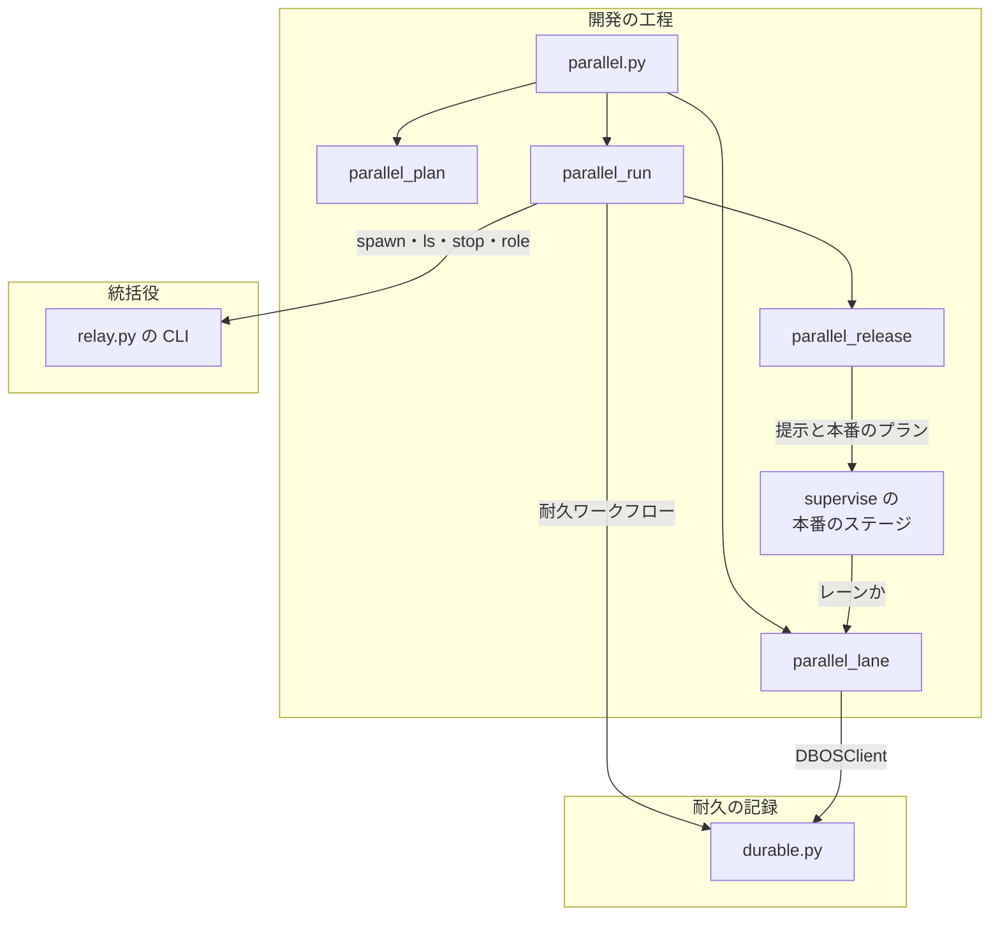
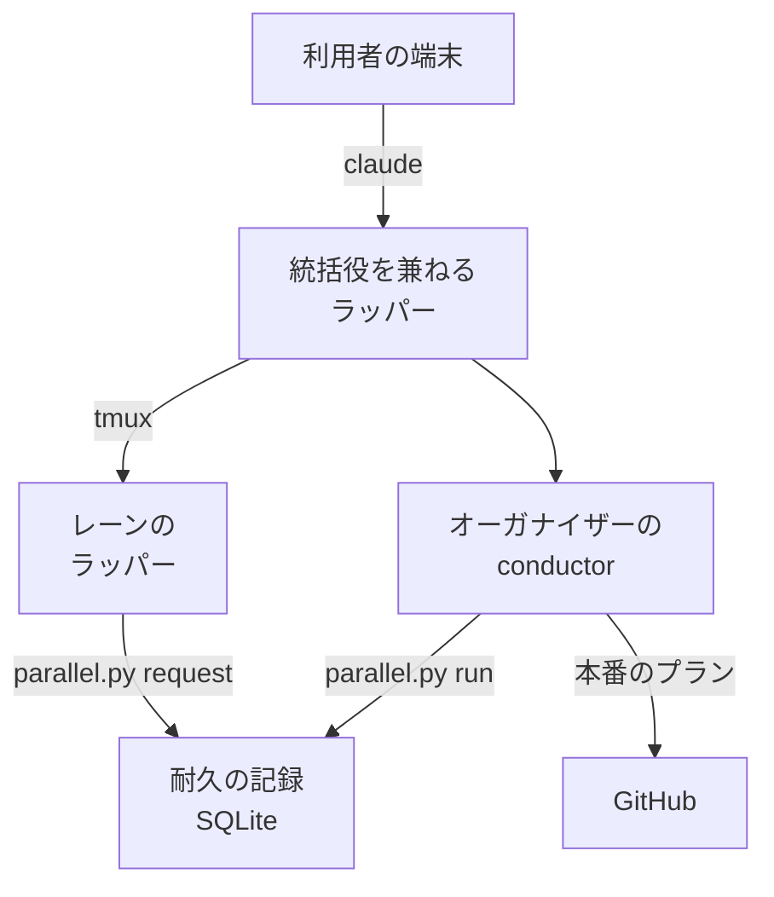
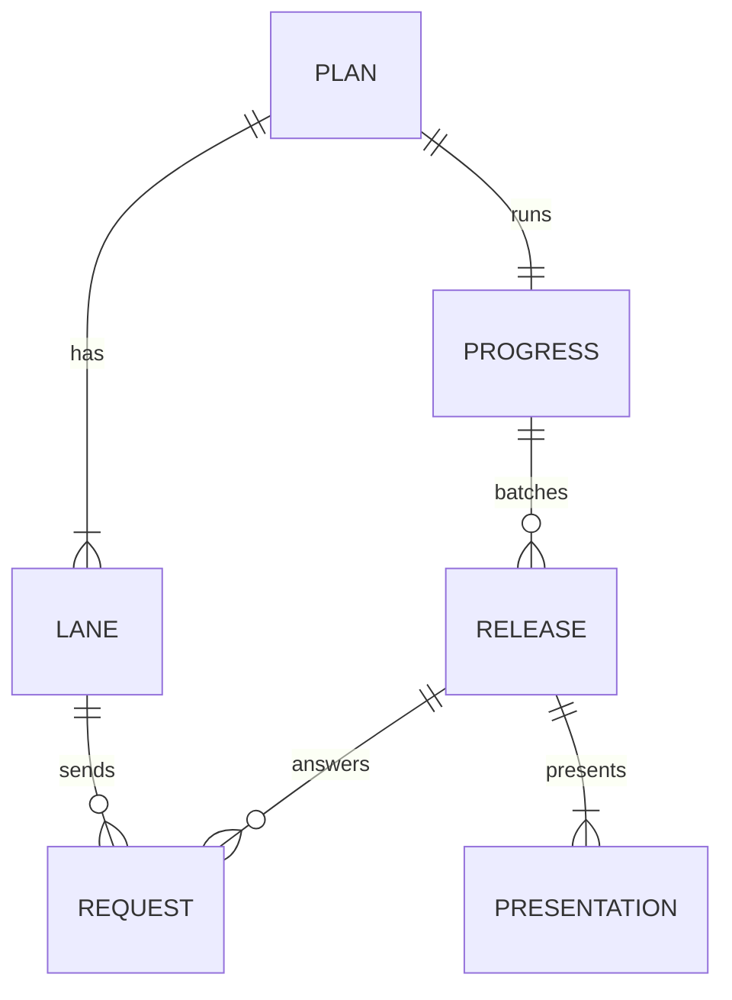
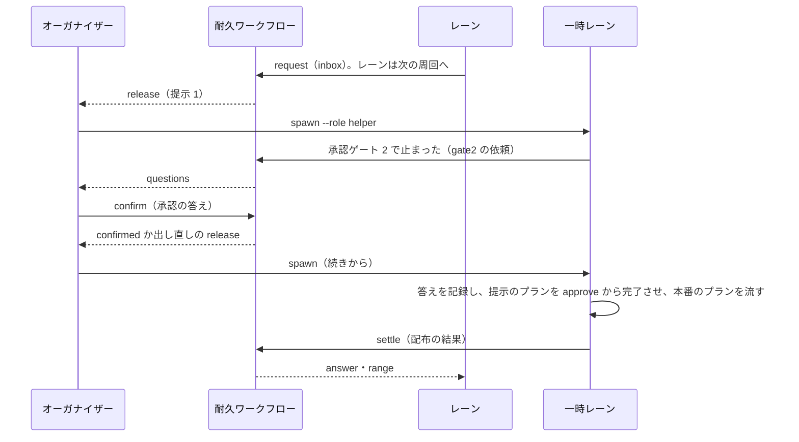
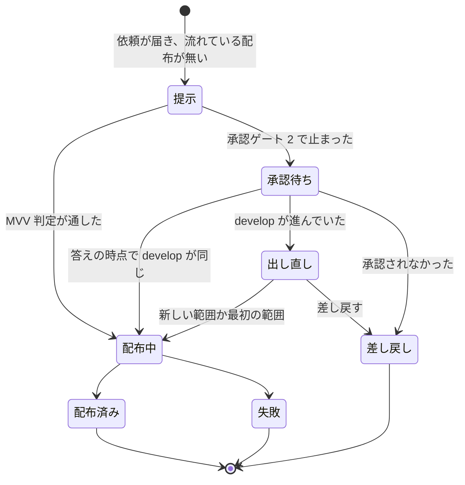
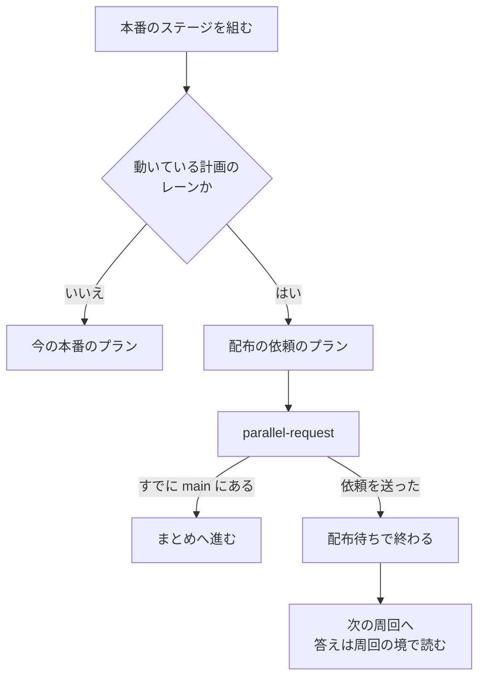

# 並列開発: 並列の計画を 1 度書き、1 行で複数のレーンを起動して本番の配布を 1 本にまとめる（#2436）

## 目的

- **今どうなっているか**: 統括役（同じコンテナで最初に起動したラッパーが兼ねる、ほかのラッパーを登録・起動し同時に動かす数を数える役。#2346）で tmux のセッションを並べて起動できるが、並列開発を計画して始める手順が無い。2026-11-02 は 3 本の開発ループを手で起動し、共通の決まりを 3 本の引継ぎ文書へ手で書き写した。本番の配布もレーンごとに出した。先に出したレーンが他のレーンの変更をまとめて出した。そのため、別のレーンの本番の Pull Request https://github.com/devbasex/ai-plugins/pull/2420 を閉じた
- **誰に効くか**: 1 つのリポジトリで複数の開発ループかスプリントを同時に進める利用者
- **変えると何が成り立つか**: 並列の計画を 1 度書き、`/goal /ndf:development-workflow --parallel <計画名>` の 1 行を打つ。オーガナイザーがレーンを起動して監視する。レーンの配布の依頼は他のレーンを待たずにすぐ本番の配布になる。中身は承認資料を作る時点の `develop` のコミットで決まり、範囲に入った他のレーンの変更も 1 回の承認ゲート 2 で出る

## 適用範囲

- **働く範囲**: NDF を導入したすべてのリポジトリ。起動まで行うのは Claude Code をラッパー（利用者の `claude` を包んで常駐し、セッションの切り替えと次のセッションの起動を行う `relay.py`）の下で動かし、tmux があるときだけである。それ以外は、レーンを手で起動するコマンドを示して終わる
- **プロジェクトごとに違うもの**: レーンの構成（名前・最初の入力・触る場所・プランの本数・依存）は並列の計画に書く。同時に動かせるラッパーの数は環境変数 `NDF_RELAY_MAX_NAMED` で受ける。本番の配布の手段は今の配布のテンプレート（`.ndf/release.json`）のまま
- **1 台の中に閉じる**: まとめるのは 1 台の中のレーンだけである。Neural Development Factory の実行をまとめるのは、同じ層の別の実装である Factory のオーガナイザー（#2439）で、2 つは排他である（Factory の実行ジョブの中では `parallel.py` が断る）。この設計は依頼と答えの形を契約として公開する（決定 21）
- **当たるモード**: オーガナイザーはモードを持たない。レーンの中のスプリントは、今どおりモードを判定する

## あるべき姿の根拠

| 根拠 | 種類 | 何を示すか |
| --- | --- | --- |
| 依頼の原文（#2436 の「依頼（原文）」。2026-11-02） | 利用者の指示の原文 | 事前に計画を立て、レーンの数だけ引継ぎ文書を起こし、`/goal /<Skill> <指示>` の 1 行でオーガナイザーが起動を担う流れ |
| 受け入れ条件 6・6a・6b の改訂（2026-11-02） | 利用者の指示の原文 | 配布のために他のレーンを待たない。中身は承認資料を作る時点の `develop` のコミットで決まり、承認ゲート 2 はその範囲を承認する。答えの時点で `develop` が進んでいれば 1 回だけ出し直す。`main` へは承認したコミットと版上げだけを出し、`develop` は止めない。レーンは配布の答えを待たずに次の周回へ進む |
| 受け入れ条件 6c〜6f の改訂（2026-11-02） | 利用者の指示の原文 | 承認待ちはできるだけまとめ、待つ間レーンは別の作業へ進む。承認ゲートの外の問いも集める。差し戻しの後の直しはオーガナイザーに積まない。答えの後の処理は持ち主のレーンへ、共有の作業はその時だけの一時レーンへ（4 本目を許す） |
| 人の答え待ちと本番のプランの所要（`.ndf/loop/*/loop.json` の `waiting`、`.ndf/loop/l20261031/lap-2`・`lap-3` の done） | 実測 | 人の答え待ちは 10 分〜40 時間、本番のプランは 855〜1,406 秒。承認待ちの間に他のレーンのマージが入る見込みは高い（決定 14） |
| Pull Request 2420 を閉じた件（伝言 `.ndf/handoff/notice-to-lroot2.md`） | 実測 | 本番の配布は `develop` の先頭を `main` へ出す。先に出したレーンが、`develop` にある他のレーンの変更も出す |
| 同時に流すプランの合計 6 本（2026-09-25 の実測。8 コア・30 GB） | 実測 | 並列の計画のプランの本数の合計の上限 |
| DBOS の試行（2026-11-02。下の「既存の部品で作る部分」） | 実測 | 1 つのプロセスの耐久ワークフローが待つメッセージを、サーバー無しで別のプロセスから送り、答えのイベントを読める |

要求と受け入れ条件は #2436 の本文にある（コピーは `issues/issue-2436-requirements.md`）。この文書は「どう作るか」だけを扱う。
決定の記録は [issue-2436-design-decisions.md](issue-2436-design-decisions.md) に分けた。部分の設計は次の 5 つに分けた。

| 文書 | 扱う部分 |
| --- | --- |
| [issue-2436-design-release-rule.md](issue-2436-design-release-rule.md) | 本番チャネルへの Pull Request の規則の改定（受け入れ条件 6b） |
| [issue-2436-design-lane-loop.md](issue-2436-design-lane-loop.md) | レーンのループが答えを待たずに次の周回へ進み、答えの後の処理を周回の境で行う（受け入れ条件 6a・6d〜6f） |
| [issue-2436-design-approvals.md](issue-2436-design-approvals.md) | 問いをオーガナイザーへ集め、作業を持ち主のレーンと一時レーンへ渡す（受け入れ条件 6c〜6f） |
| [issue-2436-design-failures.md](issue-2436-design-failures.md) | 一時レーンの失敗と異常系（受け入れ条件 6g・6h） |
| [issue-2436-design-hierarchy.md](issue-2436-design-hierarchy.md) | 全体の階層（論理の階層と置き場）。オーガナイザーとレーンが、どの層を担うか |

### 既存の部品で作る部分

並列の進行の状態・依頼と答え・待ち・打ち直しからの再開は、自分で書かずに既存のパッケージで行う。比較と採否は決定 12 にある。

| 必要なこと | 使う部品 | 依存のグループ |
| --- | --- | --- |
| 進行の状態を残し、落ちた後の打ち直しで続ける | DBOS Transact 3.1.0 の耐久ワークフローと耐久ステップ（包みは `plugins/ndf/scripts/lib/durable.py`。#1142） | `durable`（既存） |
| レーンからの依頼を受け、答えを返す | DBOS のメッセージ（`send` / `recv`）とイベント（`set_event` / `get_event`）。外のプロセスからは `DBOSClient` で送る・読む | `durable`（既存） |
| 並列の計画の形の検査 | pydantic 2.13.5 のモデル | `schema`（既存） |
| 依存の循環の検出 | 標準ライブラリの `graphlib.TopologicalSorter`（`CycleError`） | — |
| 配布の中身の Pull Request の算出 | 今の `release-steps.py approval-facts`（前のタグから承認したコミットまでの範囲の Pull Request。`release_lib/included.py`、#1274） | — |
| 承認したコミットと出すコミットの一致 | 今の `release-steps.py release --channel prod` の比較（承認の外のコミットが入ると、承認ゲートを表す終了コード 10 で止まる。`lib/approved_commit.py`、#815） | — |

試行（`org.py`・`lane.py`）では、1 つのプロセスが SQLite のシステムデータベースで耐久ワークフローを動かし、`DBOS.recv("release")` で待った。別のプロセス 2 本が `DBOSClient(system_database_url="sqlite:///...")` で `send(wid, msg, topic="release", idempotency_key=...)` を打ち、`client.get_event(wid, "answer-<レーン>", timeout_seconds=30)` で答えを受け取った。サーバーは使っていない。

## ドメインモデル

### コンテキスト

| コンテキスト | 何の語が 1 つの意味に決まるか |
| --- | --- |
| 開発の工程（`ndf-workflow`） | 並列の計画・レーン・オーガナイザー・配布の依頼 |
| 統括役（`ndf-relay`） | ラッパー・統括役・名前つきのラッパー・同時に動かせる数 |
| 配布（`ndf-release`） | 本番の配布・承認ゲート 2・版・承認したコミット |
| 耐久の記録（#1142） | 耐久ワークフロー・耐久ステップ・止まり・続き・実行の鍵 |

開発の工程と統括役は**公開された言語**の関係にする。開発の工程は統括役の CLI（`relay.py spawn`・`ls`・`stop`・`role`）を子プロセスで打ち、統一 JSON レポートだけを読む。統括役は並列の計画（`plan.json`）を読まない。`relay.py role`・`spawn --role helper` が受ける計画名は、役割のファイルへ書いて置くだけの値で、統括役はその中身を解釈しない（読むのは問いの hook とレーンの側）。統括役が数え方（I13）に使うのは役割の名前だけである。配布へは、今のスプリントと同じく本番のプラン（`plan_mvv_release` が作るもの）を渡す。耐久の記録は**公開ホストサービス**で、開発の工程は `durable.py` の関数だけを呼び、DBOS を直接 import しない（#1142 の I16）。

### 集約

| 集約 | 持ち主（書き換えてよいもの） | 根 | エンティティ | 値オブジェクト |
| --- | --- | --- | --- | --- |
| 並列の計画 | `parallel.py init`（作る）。人と AI は起動の前だけ手で直してよい | 並列の計画（計画名） | レーン | 最初の入力・触る場所・プランの本数・依存 |
| 並列の進行 | 耐久ワークフロー `parallel-<計画名>`（`parallel.py run` が動かす。中身を書くのは耐久ワークフローだけ） | 並列の進行（計画名） | レーンの進行・まとめた配布・提示 | 起動の結果・提示したコミット・範囲のレーン・配布の結果 |
| 配布の依頼 | レーン（`parallel.py request` が送るメッセージ） | 配布の依頼（`<レーン名>-<連番>`） | — | 出す Pull Request・課題・依頼した時刻 |
| ラッパーの役割 | 統括役の CLI（`relay.py role`） | 作業ディレクトリの役割 | — | 役割の名前・計画名 |

まとめた配布は 1 つか 2 つの**提示**を持つ。提示は、承認ゲート 2 の資料を作った時点の `develop` のコミット（提示したコミット）と、その範囲 `main..<提示したコミット>` に入るレーンの一覧である。承認の答えの時点で `develop` が進んでいれば、同じまとめた配布に 2 つ目の提示を加える。出し直しへの答えでは比べないため、提示は 2 つで終わる（I14）。

並列の進行は、配布の依頼を識別子でだけ参照する。依頼への答え（配布の結果）は並列の進行のイベントに置き、依頼のメッセージを書き換えない。

### 不変条件

| # | 集約 | 条件 | 破れたときの扱い |
| --- | --- | --- | --- |
| I1 | 並列の計画 | レーン名は統括役の名前の形（`^[a-z0-9][a-z0-9_-]{0,31}$`）に合い、計画の中で重ならず、一時レーンの名前の形（`-rel` と数字で終わる）に当たらない。計画名は 24 字まで（`^[a-z0-9][a-z0-9_-]{0,23}$`）。一時レーンの名前 `<計画名>-rel<連番>`（連番は 1〜9999）が 32 字に収まり、通常レーンと重ならないようにするため | 検査が誤りとして返す（終了コード 1） |
| I2 | 並列の計画 | レーンの数は同時に動かせる数の上限以下、プランの本数の合計は 6 以下 | 検査が誤りとして返す |
| I3 | 並列の計画 | 依存先は同じ計画のレーンで、依存は循環しない | 検査が誤りとして返す |
| I4 | 並列の計画 | 触る場所が重なるレーンの組は警告に留める | 検査が警告として返す（終了コード 0） |
| I19 | 並列の計画 | レーンの間で課題とマイルストーンが重ならない（`--milestones` の無いループのレーンは、ほかのレーンと重なるものとする） | 検査が誤りとして返す（[issue-2436-design-failures.md](issue-2436-design-failures.md) の異常系 7） |
| I5 | 並列の計画 | 作る前から在る引継ぎ文書を上書きしない | `init` が 1 つも書かずに止まり、名前を返す |
| I6 | 並列の進行 | 検査に誤りがある計画では、レーンを 1 本も起動しない | `run` が耐久ワークフローを始めずに誤りを返す |
| I7 | 並列の進行 | 1 本のレーンは 1 つの計画の進行の中で 1 回だけ起動する（打ち直した `run` も二重に起動しない） | 起動は耐久ステップで、成功の記録（`started`）があるレーンは対象から外す。統括役に断られた記録だけのレーンは外さない |
| I8 | 並列の進行 | 依存のあるレーンは、依存先のレーンがすべて止まってから起動する | 依存先が止まるまで起動の対象から外す |
| I9 | 並列の進行 | 流れている本番の配布は 1 つの計画につき 1 本まで。依頼が届いた時点で流れている配布が無ければ、他のレーンを待たずに直ちに配布を組む（まとめるための待ち時間を置かない）。配布の中身は依頼の集合ではなく、提示したコミットの範囲 `main..<SHA>` で決まる | 流れている間に届いた依頼は、範囲に入っていればその配布の答えを待ち、入っていなければ次の配布へ回る。次の配布は今の配布が終わった直後に組む（配布は 1 本ずつ直列） |
| I10 | 並列の進行 | 配布の依頼 1 件には最終の答え（`released` / `rejected` / `failed`）を 1 回だけ返す。次の配布へ回す知らせ（`deferred`）は答えではなく、別のイベント `defer-<依頼>` で返す | 答えは耐久ワークフローの中で立てるイベント `answer-<依頼>` で、打ち直しは記録から同じ値を返す。`defer-<依頼>` は知らせのたびに上書きしてよく、`answer-<依頼>` を立てた後は読まない |
| I11 | 並列の進行 | 耐久ワークフローが終わるのは、全レーンが止まり、答えていない依頼が無いときか、停止の指示を受けたときだけ | 条件を満たすまで終わらない |
| I12 | 配布の依頼 | 動いている並列の進行（耐久ワークフローが終わっていない）に属さないレーンは依頼を送らず、今の本番のプランを流す | 計画に属さないと判定し、今の本番のプランを組む |
| I13 | ラッパーの役割 | 同時に動かせる数から外すのは、オーガナイザーの印を持つ動いているラッパーのうち 1 本だけ。役割 `helper` の印を持つ動いているラッパーは 1 本だけ、上限を 1 本超えて許す | 2 本目以降のオーガナイザーの印は数に入れる。2 本目の `helper` は断る |
| I14 | 並列の進行 | 出すのは確定したコミット（承認したコミット）と版上げのコミットだけである。承認資料に載っていない変更を承認したことにしない | 承認の答えの時点で `develop` の先頭が提示したコミットから進んでいれば、新しい先頭で承認資料を作り直し、加わった範囲を添えて同じ承認ゲート 2 を 1 回だけ出し直す（「新しい範囲で出す」「最初の範囲だけ出す」「差し戻す」）。確定の後に `develop` へ入った変更は次の配布 |
| I15 | 並列の進行 | 範囲に入ったレーンは、依頼していなくてもその配布の結果を受ける。自分の Pull Request がすでに `main` にあるレーンは、依頼を送らずに `released` で続きへ進む | 配布ごとに範囲のイベント `range-<連番>` を立て、`request` が送る前に読む |
| I16 | 配布 | 本番チャネル（`main`）へ出すコミットは、すべて `develop` に含まれる。本番の Pull Request の head は `develop` か、先頭が `origin/develop` の祖先の `release/v<版>` | `scripts/check-pr-base.sh` が落とす（[issue-2436-design-release-rule.md](issue-2436-design-release-rule.md)） |
| I17 | 並列の進行 | 並列の計画の下で、区分つきの問い（`ndf-gate:*`・`ndf-ask:*`）を出すのはオーガナイザーだけである。レーンと一時レーンは問いで止まらず、待たずに別の作業へ進む | レーンは設計の承認の依頼（`kind: gate1`）・承認ゲート 2 の依頼（`kind: gate2`）・問いの依頼（`kind: ask`。問いの hook が送る）を送る（[issue-2436-design-approvals.md](issue-2436-design-approvals.md)） |
| I18 | 並列の進行 | オーガナイザーは作業を持たない。答えの後の処理は持ち主のレーンが、持ち主のいない共有の作業は一時レーンが行う。一時レーンは同時に 1 本まで | 一時レーンの 2 本目は統括役が断る。オーガナイザーの `answer` は答えのイベントだけを立てる |

### ドメインイベント

E1〜E13 の番号と意味は要求（[issue-2436-requirements.md](issue-2436-requirements.md)）と同じである。設計で足したイベントは、直前の要求のイベントの番号に枝番を付ける（E8a・E9a）。

| # | イベント | 発生元 | 受け手 |
| --- | --- | --- | --- |
| E1 | 並列の計画を書いた | `parallel.py init` | 検査（E3） |
| E2 | レーンごとの引継ぎ文書を作った | `parallel.py init` | レーン（E6 で読む） |
| E3 | 並列の計画を検査した | `parallel.py check`（`init`・`run` の中でも打つ） | オーガナイザー（誤りなら始めない） |
| E4 | オーガナイザーが始まった | `parallel.py run`（耐久ワークフローの最初の耐久ステップ） | 統括役（`relay.py role`） |
| E5 | レーンを起動した | 耐久ステップ「起動」 | 統括役（`relay.py spawn`） |
| E6 | レーンが開発を始めた | レーンの conductor | — （状態は E7 で観る） |
| E7 | レーンの状態が変わった | 耐久ステップ「観測」（`relay.py ls --json`） | 耐久ワークフロー。承認待ちになったレーンはイベント `notice` で `parallel.py wait` へ |
| E8 | レーンが配布の依頼を送った | `parallel.py request`（話題 `inbox` のメッセージ） | 耐久ワークフロー |
| E8a | 配布を提示した | 耐久ステップ「配布を組む」（イベント `release`） | オーガナイザーの conductor（`parallel.py wait`） |
| E9 | 承認ゲート 2 を求めた | 本番のプランの承認ゲート 2 の判定 | 利用者（MVV 判定が通せば利用者を経ない） |
| E9a | 承認の答えの時点のコミットを確かめた | `parallel.py confirm`（話題 `resume` のメッセージ） | 耐久ワークフロー（イベント `confirmed` か、1 回だけの出し直しの `release`） |
| E10 | 本番を配布した | 本番のプラン | `parallel.py settle` |
| E11 | 範囲のレーンへ配布の結果を返した | 耐久ワークフロー（`settle` の続きを受けたもの） | レーン（周回の境の `parallel.py await --timeout 0`・`request`） |
| E12 | 計画名を指定して全レーンを止めた | `parallel.py stop` | 統括役（`relay.py stop <名前>`）・耐久ワークフロー |
| E13 | オーガナイザーが終わった | 耐久ワークフローの終わり | オーガナイザーの conductor（要約を出して終える） |

### 用語

| 用語 | 意味 | 用語集への反映 |
| --- | --- | --- |
| 並列の計画 | 1 つのリポジトリで同時に進めるレーンの一覧と、レーンに共通の決まりを書いた 1 つの文書。オーガナイザーが読む。名前（計画名）を持つ | 追加（要求の工程で反映済み） |
| レーン | 並列の計画の下で、名前つきのラッパー 1 本が進める開発の流れ。最初の入力は開発ループかスプリントの 1 つ | 追加（要求の工程で反映済み） |
| オーガナイザー | `--parallel <計画名>` で起動した conductor の役割。レーンを起動・監視し、配布の依頼をまとめて本番の配布を 1 本にする。統括役とは別 | 追加（要求の工程で反映済み） |
| 配布の依頼 | レーンが承認ゲート 2 の手前で、本番の配布をオーガナイザーへ頼むために送る 1 件の依頼 | 意味を直す（ファイルからメッセージへ） |

並列の進行・まとめた配布・提示・提示したコミット・ラッパーの役割は、この設計の中だけで使う構成要素の名前で、用語集へは足さない。

この文書が前提にする既存の語は次のとおりで、正本は用語集（[docs/glossary.md](../docs/glossary.md)）にある。

| 既存の語 | 意味 |
| --- | --- |
| ラッパー | 利用者の `claude` を包んで常駐し、`ndf-next` のブロックを拾ってセッションの切り替えと次のセッションの起動を行うプロセス（`relay.py`。Claude Code だけ） |
| 統括役 | 同じコンテナで最初に起動したラッパーが兼ねる役。ほかのラッパーの登録・起動・同時に動かす数の判定・一覧だけを持つ。統括役とラッパーは別のプロセスではなく、ラッパーの 1 本が統括役を兼ねる |
| 名前つきのラッパー | 統括役に名前で登録され、tmux の 1 つの window で動くラッパー。レーンはこれで動く |
| 承認ゲート | 人手の承認を求める点。設計 Pull Request のマージ（承認ゲート 1）と、本番へ届く操作（承認ゲート 2）の 2 つだけ |
| MVV 判定 | 承認ゲートの材料が NDF の共通原則・プロジェクト MVV（[.ndf/mvv.md](../.ndf/mvv.md)）・スプリント MVV に従うかの判定。`pace: auto`・`fast` では「従う」でレッドラインが無いときだけ承認ゲートを省く |

## 機能一覧

| # | 機能 | 誰が使うか |
| --- | --- | --- |
| F1 | 並列の計画を作り、レーンごとの引継ぎ文書を作る | 利用者（`issue-plan-strategy` を通して conductor） |
| F2 | 並列の計画を検査する | conductor・オーガナイザー |
| F3 | `--parallel <計画名>` でオーガナイザーを始め、レーンを起動する | 利用者 |
| F4 | レーンの状態の変化と配布の依頼を待つ | オーガナイザー |
| F5 | 依頼が届いたら直ちに配布を組み、承認の答えの時点で `develop` が進んでいれば 1 回だけ出し直し、確定したコミットを出し、結果を範囲のレーンへ返す | オーガナイザー |
| F6 | 本番の配布の代わりに配布の依頼を送り、答えを待たずに次の周回へ進む（すでに配布済みなら依頼しない） | レーン |
| F7 | オーガナイザーを同時に動かせる数から外す | 統括役 |
| F8 | 計画名を指定して全レーンを止める | 利用者 |
| F9 | ラッパーの外・tmux が無いときに、手で起動するコマンドを示す | 利用者 |
| F10 | オーガナイザーを起動し直して記録から続け、全レーンが止まったら要約して終える | オーガナイザー |

## 構成要素

| 要素 | 責務 | 新規 / 変更 |
| --- | --- | --- |
| `plugins/ndf/scripts/parallel.py` | 並列の計画と進行の CLI。副命令を下の部品へ振り分け、統一 JSON レポートを 1 行で返す。先に `deps.require("durable", "schema")` を呼ぶ | 新規 |
| `plugins/ndf/scripts/lib/parallel_plan.py` | 並列の計画の pydantic のモデルと検査（I1〜I4。循環は `graphlib`）・`plan.md` の描画・引継ぎ文書の作成（I5） | 新規 |
| `plugins/ndf/scripts/lib/parallel_run.py` | 耐久ワークフロー `parallel` と耐久ステップ（起動・観測・停止・要約）。副命令 `run`・`wait`・`confirm`・`settle`・`stop` | 新規 |
| `plugins/ndf/scripts/lib/parallel_release.py` | まとめた配布: 提示のプランを作る・範囲の Pull Request をレーンへ対応づける（`present`）・提示したコミットと `develop` の先頭を比べる 1 つの関数（`moved`）・答えを決める（I9・I14・I15） | 新規 |
| `plugins/ndf/scripts/lib/parallel_lane.py` | レーンの側: 自分が属する計画の判定（I12）・すでに配布済みかの判定（I15）・依頼を送る・答えを読む（待たずに読むのと待つのの両方）・プランの本数を返す | 新規 |
| 配布の規則の側（`scripts/check-pr-base.sh`・`.github/workflows/pr-base-guard.yml`・`release-steps.py`・`release_lib/`・`AGENTS.md`・`docs/versioning-and-distribution.md`・`release` の Skill の文書） | 本番の Pull Request の head を `release/v<版>` にし、`release/v<版>` を承認したコミットから切る。並列の計画の外の配布にも効く（[issue-2436-design-release-rule.md](issue-2436-design-release-rule.md)） | 変更 |
| ループの側（`lib/sprint_loop*.py`・`sprint-state.py`・`loop.md`） | 周回を「配布待ち」で締めて次の周回へ進み、周回の境で答えの届いた配布待ちの周回の残りを流す（[issue-2436-design-lane-loop.md](issue-2436-design-lane-loop.md)） | 変更 |
| `plugins/ndf/scripts/lib/durable.py` | 外のプロセスから送る・読む関数（`DBOSClient` で耐久の記録を開く。DBOS を起動しない）を足す | 変更 |
| 問いの側（`hook_lib/ask_guard.py`、`parallel_run.py` の `answer`・`request-gate1`・`request-ask`、`sprint_loop_gate.py` の `move_to_waiting`、`sprint_loop.py` の `loop answer --revise`） | 問いの依頼を受け、まとめて問い、答えを持ち主のレーンへ送る（[issue-2436-design-approvals.md](issue-2436-design-approvals.md)） | 変更 |
| `plugins/ndf/scripts/relay_lib/hub.py` | `live()` が、オーガナイザーの印を持つ動いているラッパー 1 本を数から外し、判定が役割 `helper` の 1 本だけ上限を 1 本超えて許す（I13） | 変更 |
| `plugins/ndf/scripts/relay_lib/hub_client.py` | `ls` の行に役割を足し、`metrics` に統括役の有無と tmux の有無を足す。`role` の副命令。`spawn` に `--role helper --plan <計画名>`（起動するラッパーの作業ディレクトリへ役割のファイルを書く） | 変更 |
| `plugins/ndf/scripts/relay_lib/__init__.py` | 副命令 `role` の振り分け | 変更 |
| `plugins/ndf/scripts/supervise_lib/sprint_waves.py` | 配布の依頼のプラン（`plan_release_request`。ステップは `parallel-request` の 1 つ）と、まとめた配布の 2 つのプラン（提示のプランと本番のプラン）を作る | 変更 |
| `plugins/ndf/scripts/supervise_lib/release_templates.py` | 提示のプランが、今の開発版の承認資料のステップ（approval-facts・承認資料の説明の欄・他のプラグインの上げ幅）を版上げ無しで使えるように関数を分ける。提示のプランの承認ゲート 2 として、MVV 判定（`mvv`・`note`）の後に `approve` を置く組み立て関数 `present_gate_steps` を足す（今の本番のプランの、両者が排他の組み立ては変えない）。本番のプランの承認の記録が読む状態ディレクトリを引数で受ける | 変更 |
| `plugins/ndf/scripts/supervise_lib/queue_fill.py` | 差し込み `{queue_prs:<計画名>}` を足す。名前の一致する完了した計画の状態ディレクトリの `work/prs.txt`（空白区切りの Pull Request の番号）で埋め、無ければ埋めずにそのプランを流さない | 変更 |
| `plugins/ndf/scripts/supervise_lib/sprint.py` | 本番のステージを組む 4 か所が、レーンのときだけ配布の依頼のプランを置く（1 つの関数を通す） | 変更 |
| `plugins/ndf/scripts/supervise.py` | `queue` の `--max` を省いたとき、レーンならプランの本数を既定にする | 変更 |
| `issue-plan-strategy` の `SKILL.md` と `references/parallel-plan.md` | 並列の計画を作る手順（F1・F2） | 変更・新規 |
| `development-workflow` の `SKILL.md` と `references/parallel.md` | `--parallel <計画名>` のオーガナイザーの手順（F3〜F5・F8〜F10） | 変更・新規 |
| `development-workflow` の `references/relay.md`・`conductor-entrypoints.md`・`loop.md` | `ndf-spawn` の節から並列の計画へのリンク、`parallel.py` の行、レーンのときの本番の扱いの 1 行 | 変更 |
| `docs/glossary/glossary.json`・`docs/glossary.md` | 4 語の正本へのリンク先を新しい参照へ向け、「配布の依頼」の意味を直す。`docs/glossary.md` は `glossary.json` から `glossary.py render` で作り直す生成物で、手では直さない | 変更 |



Skill の文書（`issue-plan-strategy`・`development-workflow`）と用語集は、スクリプトを呼ぶ手順を書く側で、図には含めない。`relay.py` の中の数え方（`hub`）と `supervise.py` の `queue` の本数・承認ゲート 2 の再開は、上の表のとおりで図からは外した。

### 置き場（パッケージ構成）

```text
plugins/ndf/
├── scripts/
│   ├── parallel.py                 # 新規
│   ├── lib/
│   │   ├── parallel_plan.py        # 新規
│   │   ├── parallel_run.py         # 新規
│   │   ├── parallel_release.py     # 新規
│   │   ├── parallel_lane.py        # 新規
│   │   ├── durable.py              # 変更
│   │   └── sprint_loop_gate.py     # 変更
│   ├── relay_lib/{hub,hub_client,__init__}.py   # 変更
│   ├── supervise.py                # 変更
│   ├── supervise_lib/{sprint,sprint_waves,release_templates,queue_fill}.py   # 変更
│   └── tests/test_parallel_*.py    # 新規
└── skills/
    ├── issue-plan-strategy/references/parallel-plan.md   # 新規
    └── development-workflow/references/parallel.md       # 新規
```

### システムの文脈と配置



オーガナイザーは、利用者が端末で打った `claude` のセッション（多くは統括役を兼ねるラッパー）で動く。レーンは統括役が tmux の中に起動する名前つきのラッパーで動く。どちらも同じコンテナの同じ利用者で動き、同じ耐久の記録（SQLite のファイル 1 つ）と同じリポジトリのメインディレクトリを読み書きする。

## データ構造

置き場は 2 つある。どちらもコミットしない。

| 置き場 | 中身 |
| --- | --- |
| メインディレクトリの `.ndf/parallel/<計画名>/` | 並列の計画（`plan.json`）・人が読む描画（`plan.md`）・まとめた配布のプラン（`releases/`） |
| 耐久の記録 `~/.local/state/ndf/dbos/parallel-<12 字>.sqlite` | 並列の進行（耐久ワークフロー `parallel-<計画名>` の入力・耐久ステップの結果・メッセージ・イベント）。種類は `parallel`、識別は計画の置き場の絶対パス（`durable_keys.record_path`） |



| ファイル・記録 | 中身 | 書き手 | 読み手 |
| --- | --- | --- | --- |
| `plan.json` | 並列の計画の正本 | `parallel.py init`（起動の前は人と AI も直してよい） | 全員 |
| `plan.md` | `plan.json` と並列の進行を人が読む形にした描画（レーンの表・決まり・配布の内訳） | 耐久ステップ（状態が変わるたび）・`init` | 人・レーンの conductor |
| `releases/<連番>/<提示>/present.json`・`release.json` | まとめた配布の 1 つの提示の 2 つのプラン（提示のプランと本番のプラン）。状態ディレクトリはそれぞれのプランの横にできる | 耐久ステップ「配布を組む」 | `supervise.py queue` |
| `releases/<連番>/<提示>/presented.json` | 提示したコミット・範囲の Pull Request・範囲のレーン（依頼済みの印つき）・出し直しなら加わった範囲 | `parallel.py present`（提示のプランのステップ） | 耐久ステップ・`plan.md` の描画 |
| 耐久ワークフロー `parallel-<計画名>` | 並列の進行（下の表） | 耐久ワークフローだけ | `parallel.py wait`・`await`・`request`（イベントを読む） |
| レーンのプランの `{state_dir}/work/request.txt` | 送った依頼の識別子か、すでに配布済みの結果 | `parallel.py request` | ループの周回の境・スプリントのレーンの conductor（`parallel.py await --from`） |

### `plan.json`

pydantic のモデル `ParallelPlan` が正本の形を持つ。最初の入力は `kind` で分ける判別つきの共用体である。

| 項目 | 型 | 必須 | 意味 |
| --- | --- | --- | --- |
| `version` | 整数 | ○ | 形の版。`1` |
| `name` | 文字列 | ○ | 計画名（I1） |
| `rules` | 文字列の配列 | ○ | レーンに共通の決まり（取り込みの衝突の解き方など）。空でもよい |
| `lanes[].name` | 文字列 | ○ | レーン名。ラッパーの名前と同じ（I1） |
| `lanes[].input.kind` | `loop` / `sprint` | ○ | 最初の入力の種類 |
| `lanes[].input.loop` | 文字列 | `loop` のとき | ループ名 |
| `lanes[].input.issues` | 整数の配列 | `sprint` のとき | スプリントの課題 |
| `lanes[].input.args` | 文字列の配列 | — | `--milestones` などの足す引数 |
| `lanes[].plans` | 整数（1 以上） | ○ | 同時に流すプランの本数（I2） |
| `lanes[].touches` | 文字列の配列 | ○ | 触る場所（パスか glob） |
| `lanes[].after` | 文字列の配列 | — | 依存先のレーン名（I3） |
| `lanes[].handoff` | 文字列 | `init` が書く | 引継ぎ文書の名（ループなら `loop-<ループ名>`、スプリントなら `issue-<最初の番号>`） |

検査の誤りは pydantic の検証の誤りとして集める。I1〜I3 の検証は誤りの種類（`PydanticCustomError` の type）に `I1`〜`I3` を持ち、`check` はそれを `items[].rule` に写す。上限の値（`NDF_RELAY_MAX_NAMED`）は検証の文脈（`context`）で渡す。I4 の重なりは誤りにせず、モデルの検証の後に別に数える。

### 並列の進行（耐久ワークフローの記録）

並列の進行は耐久ワークフローの中の値で、打ち直すと記録から同じ値に戻る。外へ見せるのはメッセージ・イベント・出力だけである。

| 種類 | 名前 | 送り手・書き手 | 受け手・読み手 | 中身 |
| --- | --- | --- | --- | --- |
| メッセージ | 話題 `inbox` | `request`・`request-gate1`・`request-ask`・一時レーン（`gate2`）・`stop` | 耐久ワークフロー | `{kind: request, id, lane, prs, issues, sprint_state, at}`・`{kind: gate1 / gate2 / ask, ...}`（[issue-2436-design-approvals.md](issue-2436-design-approvals.md)）・`{kind: stop}`。冪等の鍵は `<ID>:inbox:<依頼>` と `<ID>:inbox:stop` |
| メッセージ | 話題 `resume` | `confirm`・`settle`（`durable.resume`） | 止まっている耐久ワークフロー | `{seq, phase: confirm, take}` か `{seq, phase: settle, result, version, reason}` |
| イベント | `pause` | 耐久ワークフロー | `wait` | `{seq, action, ...}`。`action` は `running` / `notice` / `release` / `confirmed`。`wait` が返すのは `notice`・`release`・`confirmed` |
| イベント | `answer-<依頼>` | 耐久ワークフロー | `await` | `{result, version, release, reason, at}`。`result` は `released` / `rejected` / `failed` の最終の答えだけ（I10） |
| イベント | `defer-<依頼>` | 耐久ワークフロー | `await` | `{seq, reason, at}`。差し戻しの宛先でない依頼を次の配布へ回した知らせ。依頼は `pending` に残る（I10） |
| イベント | `range-<連番>` | 耐久ワークフロー | `request` | 出した配布の `{sha, version, prs, lanes}`（I15） |
| イベント | `lane-<レーン名>` | 耐久ワークフロー | オーガナイザーの状態の表示 | `{received, gate1_received, ask_received}`（受け取った依頼の数）。状態の表示にだけ使い、依頼の `id` の採番には使わない |
| イベント | `questions` | 耐久ワークフロー | `wait` | `{seq, items}`。答えていない問いの依頼 |
| イベント | `fix-<レーン名>-<連番>` | 耐久ワークフロー | 宛先のレーン（周回の境） | 配布の差し戻しの指摘 |
| 出力 | 耐久ワークフローの戻り値 | 耐久ワークフロー | `wait` | `{status: finished / stopped, lanes, releases}`（要約） |

耐久ワークフローが中に持つ値は次のとおりである。

| 値 | 意味 |
| --- | --- |
| `lanes.<名>` | 起動の結果（`started` か統括役の断りの理由）・最後に観た状態・止まった時刻 |
| `pending` | 受け取ってまだ答えていない依頼 |
| `releases[]` | まとめた配布: 連番・提示の一覧（1 つか 2 つ。提示したコミット・範囲のレーン）・確定したコミット・状態（`presented` / `confirmed` / `released` / `rejected` / `failed`）・出した版 |
| `stop` | 停止の指示を受けたか |

### 機能 × データ

| 機能 | `plan.json` | 並列の進行 | 依頼 | 答え・範囲 |
| --- | --- | --- | --- | --- |
| F1 計画を作る | C | — | — | — |
| F2 検査 | R | — | — | — |
| F3 始める・起動 | R | C・U | — | — |
| F4 待つ | R | R | R | — |
| F5 まとめて配布 | R | U | R | C |
| F6 依頼と待ち（レーン） | R | R | C | R |
| F8 止める | R | U | C（`stop`） | — |
| F10 再開・要約 | R | R・U | R | R |

## 入出力の契約

どの副命令も、結果は統一 JSON レポート（`tool`・`status`・`summary`・`items`・`metrics`）を 1 行で標準出力へ出す。終了コード 10 は、プランのステップが承認ゲートとして止まったことを表す（10〜19 を承認ゲートとして扱う今の決まり。`plugins/ndf/scripts/supervise_lib/plan.py` の「ステップの遷移」）。`request` が依頼を送って 10 で終わると、配布の依頼のプランは承認ゲートとして終わる。`<計画名>` の置き場は、カレントが worktree の中でもメインディレクトリに解決する。耐久ワークフローの ID は `parallel-<計画名>` で、計画名から決まる。

| 名前 | 入力 | 成功 | 失敗の形 |
| --- | --- | --- | --- |
| `parallel.py init <計画名>` | 標準入力に `plan.json` の下書き（`handoff` を除く） | 0。`plan.json`・`plan.md`・引継ぎ文書を書き、パスを `items` に返す | 1: 検査の誤り・在る引継ぎ文書（名前を返し、何も書かない）・在る計画名。2: 読めない・書けない |
| `parallel.py check <計画名>` | — | 0。警告は `items`（`level: warning`）に並べる | 1: 誤りを `items`（`level: error`、`rule` に I1〜I3 の種類）に並べる。2: 計画が無い・読めない |
| `parallel.py start <計画名>` | 環境変数 `NDF_RELAY_DIR` | 0。`run` をセッションから切り離して起動する（動いていれば今の pid を返す）。`metrics.next` に `wait` の 1 行 | 1: 別のセッションが持ち主として動いている（持ち主を返す）。ほかは `run` と同じ |
| `parallel.py run <計画名>` | 環境変数 `NDF_RELAY_DIR` | 0。耐久の記録を開いて耐久ワークフローを始めるか続け、終わるまで動き続ける長命のプロセス。終われば要約を返す。再開なら `metrics.resumed: true` | 1: 計画が無い（置き場を返す）・検査の誤り（耐久ワークフローを始めない）。2: 耐久の記録を開けない・形式の版が違う。3: ラッパーの外・tmux が無い（耐久ワークフローを始めず、`items` にレーンごとの手で起動する 1 行、`status: manual`）。5: 同じ計画の `run` が動いている（`metrics.next` に `wait` の 1 行） |
| `parallel.py wait <計画名> [--after <seq>] [--timeout 秒]` | — | 0: イベント `pause` の `seq` が `--after` を超えて `action` が `notice` / `release` / `confirmed` になったか、イベント `questions` の `seq` が進んだか、耐久ワークフローが終わった（`metrics.action` が `finished` / `stopped`、`items` にレーンごとの結果）。`metrics.seq` を返す | 2: 耐久の記録が無い。3: 上限に達した（既定 3600 秒。同じ `wait` を打ち直す） |
| `parallel.py present <計画名> <連番> <提示> --approval <承認資料> --out <パス>` | 提示のプランの approval-facts が書いた承認資料 | 0。承認資料の承認したコミットと含む Pull Request を読み、レーンへ対応づけて `presented.json` を書き、範囲の Pull Request を `--out` へ空白区切りで書く。承認資料へレーンの内訳の節を足し、出し直しの提示なら加わった範囲（レーンと Pull Request）を載せる | 1: 承認資料に承認したコミットが無い。2: 読めない |
| `parallel.py confirm <計画名> <連番> [--take new / first]` | 承認ゲート 2 の答え（承認）。`--take` は出し直した提示への答えだけが持つ | 0。止まり（`action: release`）へ `phase: confirm` を送る | 1: その連番の配布が提示の止まりに無い・出し直した提示に `--take` が無い |
| `parallel.py settle <計画名> <連番> --done <D>` / `--rejected` | 本番のプランの done | 0: 止まりへ `phase: settle` を送る。`metrics.result` は `released` / `rejected` / `failed` | 4: 本番のプランが承認ゲートで止まっている（送らない）。1: その連番の配布が流れていない |
| `parallel.py stop <計画名>` | — | 0。`stop` を送り、各レーンへ `relay.py stop <名前>` を打つ。`run` が動いていなければ耐久の記録を開き、耐久ワークフローの終わりまで流す | 1: 止まらないレーンがある（名前を返す） |
| `parallel.py request <計画名> --lane <名> --prs <番号>... --issues <番号>... --state <パス> --out <パス>` | — | 0: `--prs` のマージのコミットがすべて `origin/main` にあり、送らずに `metrics.result: released`（版は範囲のイベントから）。10: 依頼を送った（配布待ち。`metrics.id`）。どちらも `--out` へ書く | 1: 計画が動いていない |
| `parallel.py await <計画名> --from <パス> [--timeout 秒]` | `request` の `--out` | 0: `released`（`metrics.version`）。`--timeout 0` は待たずに読む。返るのは `answer-<依頼>` が立ったときだけで、知らせ `defer-<依頼>` では返らず `answer-<依頼>` を待ち続ける（I10） | 10: `rejected`。1: `failed`。3: 上限に達した（`--timeout 0` なら答えがまだ無い）。どちらも `defer-<依頼>` が立っていれば `metrics.deferred` に知らせの `{seq, reason}` を載せ、無ければ `null` |
| `relay.py role organizer --plan <計画名>` / `relay.py role --clear` | `NDF_RELAY_DIR` | 0。作業ディレクトリへ役割のファイルを書く・消す | 1: ラッパーの外（`NDF_RELAY_DIR` が無い） |
| `relay.py spawn --role helper --plan <計画名>`（変更） | `NDF_RELAY_DIR` | 0。起動したラッパーの作業ディレクトリへ役割のファイルを書く | 今の断りに加え、動いている `helper` があれば断る |
| `relay.py ls --json`（変更） | — | 行に `role`、`metrics` に `hub`・`tmux` を足す | 今のまま |

**`durable.py` に足す関数**（外のプロセス用。どれも DBOS を起動せず、`DBOSClient` で耐久の記録のファイルを開く）:

| 関数 | 中身 |
| --- | --- |
| `client(kind, identity)` | `record_path(kind, identity)` の SQLite を開いた `DBOSClient`。ファイルが無ければ `DurableError` |
| `send_to(kind, identity, wid, msg, topic, key)` | `DBOSClient.send`（冪等の鍵つき） |
| `event_of(kind, identity, wid, key, timeout)` | `DBOSClient.get_event`。`timeout` 秒待ち、無ければ None |
| `status_of(kind, identity, wid)` | `DBOSClient.retrieve_workflow` の状態（無ければ None） |
| `wait_from(kind, identity, wid, keys, after, timeout)` | `durable.wait` と同じ判定（終わりか、イベントの `seq` が `after` を超える）を外から行う。読むイベントは複数（`pause` と `questions`） |

**`durable.py` に足す関数**（耐久ワークフローの中用）: `recv(topic, timeout)` と `set_event(key, value)`。止まりの間に 2 つの話題を交互に読むために使う。

**互換性**: 既存の副命令・引数・`ls` の既存の項目は変えない。足すのは項目だけである。本番の配布の規則の改定（受け入れ条件 6b）は並列の計画の外の配布にも効き、承認の後に `develop` が進んでも止まらずに承認したコミットを出す（[issue-2436-design-release-rule.md](issue-2436-design-release-rule.md) の「互換性」）。`queue` の `--max` を省いたときの既定は、レーンでなければ今どおり 3 である。並列の計画に属さないループとスプリントの本番のプランは変わらない（I12）。`durable.py` の既存の関数は変えない。

### オーガナイザーの起動のコマンド

```text
/goal /ndf:development-workflow --parallel <計画名> -- 終わり: [ndf-parallel] finished <計画名> の行を出したとき
```

`--parallel` があれば、`development-workflow` は判定の手順へ進まず `references/parallel.md` の手順で進む（`--loop` と同じ形）。再開のコマンドも同じ 1 行である。

### レーンの最初の入力

耐久ステップ「起動」は `relay.py spawn --name <レーン名> --json -- <最初の入力>` を、メインディレクトリをカレントにして打つ。最初の入力は次の 1 行で、レーンの conductor は引継ぎ文書の「次にやること」の 1 つ目から始める（`handoff.md` の「読む」）。

```text
/goal /ndf:development-workflow .ndf/handoff/<引継ぎ文書の名>.md の続きから
```

`init` が作る引継ぎ文書は、「進め方（利用者の指示）」に計画名・レーン名・`plan.md` のパスを書き、決まりは写さない。「次にやること」の 1 つ目と「次に実行するコマンド」には、レーンの開始のコマンドを書く。

| 最初の入力の種類 | レーンの開始のコマンド |
| --- | --- |
| ループ | `/goal /ndf:development-workflow --loop <ループ名> <args> -- 終わり: [ndf-loop] stopped <ループ名> の行を出したとき` |
| スプリント | `/goal /ndf:development-workflow #<課題>...` |

## 処理の流れ

### オーガナイザーの conductor の手順

conductor は `parallel.py start` で `run` をセッションから切り離して 1 本起動し、`wait` を背景で打って完了の通知を待つ。`run` は耐久ワークフローが終わるまで動き続け、止まりの間もメッセージをすぐに読む。返った `action` ごとに次の 1 手を打つ。オーガナイザーは作業を持たない。打つのは問いと答え・一時レーンの起動・終わったレーンを起こす 1 行だけで、起動・観測・まとめは耐久ワークフローが、配布のプランの実行は一時レーンが、答えの後の処理は持ち主のレーンが行う（I17・I18）。

| `wait` が返したもの | conductor がすること |
| --- | --- |
| `notice` | 承認待ちのレーンの `relay.py attach <名前>` の 1 行を出し、`wait --after <seq>` を打ち直す |
| `questions` | 届いている依頼（設計の承認・承認ゲート 2・承認ゲートの外の問い）を区分ごとにまとめて問い、依頼ごとに `parallel.py answer` か `confirm` / `settle --rejected` を打つ（[issue-2436-design-approvals.md](issue-2436-design-approvals.md)）。`metrics.next` に `relay.py restart <レーン>` があれば打つ |
| `release` / `confirmed` | `metrics.spawn` の 1 行（一時レーンの起動）を打つ。一時レーンが配布のプランを流し、結果を耐久ワークフローへ返す |
| `finished` / `stopped` | レーンごとの結果を要約し、`[ndf-parallel] finished <計画名>` の行を出して終える |
| 終了コード 3 | 同じ `wait` を打ち直す |

承認ゲート 2 の問いは、一時レーンが本番のプランの承認ゲート 2 の判定で止まったときに `kind: gate2` の依頼として届く。提示 1 なら「承認」「差し戻す（宛先のレーンを選ぶ）」で、出し直しの提示 2（`represent: true`）なら加わった範囲を添えて「新しい範囲で出す」「最初の範囲だけ出す」「差し戻す」で問い、`confirm <計画名> <n>`・`confirm --take new` / `--take first`・`settle --rejected [--to <レーン>...]` を打つ。

`run` のプロセスが落ちたとき・オーガナイザーのセッションが切り替わったときは、`start` を打ち直す（[issue-2436-design-failures.md](issue-2436-design-failures.md) の異常系 1）。耐久ワークフローは記録から続き、プロセスの居ない間に届いたメッセージを読む。



### 一時レーン

持ち主のいない共有の作業（まとめた配布のプランの実行、その失敗の対応、`release/v<版>-sync` の版数の衝突の解消）は、オーガナイザーが起こす一時レーンが行う。

| 点 | 決まり |
| --- | --- |
| 起動 | `relay.py spawn --name <計画名>-rel<連番> --role helper --plan <計画名> --json -- <最初の入力>`。名前は I1 により 32 字に収まり（計画名 24 字・`-rel` 4 字・連番 4 桁まで）、通常レーンの名前と重ならない。連番が 9999 を超える配布は、耐久ステップ「配布を組む」が組まずに止め、要約に理由を書いて人へ戻す。最初の入力は `/goal /ndf:development-workflow --parallel-helper <計画名> <連番> <提示> -- 終わり: [ndf-parallel] helper-done <計画名> の行を出したとき` |
| 仕事 | イベント `release` の後は `metrics.pipeline`（提示のプランと本番のプラン）を流す。MVV 判定が通せば配布まで流し、`settle --done <D>` を打つ。承認ゲート 2 で止まれば `kind: gate2` の依頼（承認資料・内訳・提示）を送って止まる。イベント `confirmed` の後は、確定した提示の答えを記録し、提示のプランを `approve` のステップから続けて完了させてから、本番のプランを `supervise.py queue releases/<n>/<k>/release.json --done <D>` で初めて流し、`settle` を打つ（下の「まとめた配布」の確定の後の 3 手） |
| 失敗したとき | CI の失敗・衝突・版数の衝突は、今の配布のプランの直しの手順（judge・fix）で一時レーンが直す。直せなければ問いとして送り（問いの hook が送る）、答えを待つ間は止まる |
| 終わり | 結果を返したら `[ndf-parallel] helper-done` の行を出して終わる。統括役は止まったラッパーを数えない |
| 数え方 | 同時に 1 本まで。統括役は、役割 `helper` の印を持つ動いているラッパー 1 本だけを `NDF_RELAY_MAX_NAMED` を 1 本超えて許す（I13 と同じ作業ディレクトリの役割のファイル。`hub.py` の `live` と判定）。2 本目の `helper` は断る。同時に流すプランの合計 6 本（I2）には数えない |
| レーンとの違い | 一時レーンは並列の計画の `lanes` に載らず、配布の依頼を送らない（`lane_of()` に当たらない）。問いの hook は役割のファイルで一時レーンと分かり、問いをオーガナイザーへ送る |

### 耐久ワークフロー `parallel` の中身

耐久ワークフローの中の分岐は、耐久ステップの結果とメッセージだけで決まる。時刻・外のコマンド・ファイルを読むのはすべて耐久ステップである（打ち直しで同じ道を通るため。#1142 の I18）。

1. 計画を読み、検査し、`relay.py role organizer --plan <計画名>` を打つ（耐久ステップ）
2. 停止の指示を受けていれば、要約を出力して終わる（`status: stopped`）
3. 耐久ステップ「起動」: 起動に成功した記録（`started`）の無いレーンのうち、依存先がすべて止まったものを `relay.py spawn` で起動する。統括役が上限で断ったレーンは次の周で起動し直す（I7・I8）
4. 流れている配布が無く、答えていない依頼があれば、耐久ステップ「配布を組む」を通る。依頼のうち、範囲のイベントで答えられるもの（Pull Request がすでに出た配布の範囲にある）は答えて外す。残りがあれば、他のレーンを待たずに新しいまとめた配布（連番 n・提示 1）を組み、イベント `release` を立てて止まりに入る（I9。下の「まとめた配布」）
5. 全レーンが止まり、答えていない依頼が無ければ、役割の印を消して要約を出力して終わる（`status: finished`。I11）
6. `inbox` のメッセージを 60 秒まで待ち（`recv`）、来たものを `pending`・`questions_pending`・停止の指示に入れ、問いの依頼が増えればイベント `questions` を立てる。耐久ステップ「観測」で `relay.py ls --json` を読み、レーンの状態を更新する。承認待ちになったレーンがあればイベント `notice` を立てる。2 へ戻る

止まりの中では、話題 `resume` の `confirm` と `settle` を 60 秒まで待ち、その合間に `inbox` を読む。問いの依頼はその場で `questions` を立て、配布の依頼は `pending` に入れて止まりを抜けた後に扱う。止まりは `durable.recv` と `durable.set_event` で書く（`durable.pause` は 1 つの話題だけを待つため使わない）。

### まとめた配布



1 つの提示は 2 つのプランを 2 つのステージで流す。`metrics.pipeline` は `supervise.py queue releases/<n>/<k>/present.json --then releases/<n>/<k>/release.json --done <D>` の 1 行である（`<k>` は 1 か、出し直しの 2）。

**承認ゲート 2 は提示のプランが持ち、本番のプランは確定の後にだけ流れる。** 本番のプランは、queue がプランを流し始めるときに worktree と `release/v<版>` を作る。承認ゲート 2 を本番のプランに置くと、答えの前に提示 1 の起点で `release/v<版>` ができ、提示 2 の本番のプランが同じ名前のブランチを作り直せない。そのため次の形にする。

- 提示のプランの最後に承認ゲート 2 のステップを、MVV 判定（`mvv`・`note`）→ `approve` の順に置く。今の本番のプランでは MVV 判定（`_add_prod_mvv_gate`）と `approve_step` が排他（`plan_release_package_plugin` の `if mvv and not dev` / `elif not dev`）で、`note` の次は `bump` である。提示のプランには両方を同じプランへ並べる新しい組み立て関数（`release_templates.py` の `present_gate_steps`）を足し、`mvv_gate_steps(..., next_id="approve")` に続けて `approve_step` と同じ形の `approve` のステップ（`release-steps.py approve --approval <提示の承認資料> --facts-from <提示のプランの状態ディレクトリ> --answer-from releases/<n>/<k>/answer.json --by user`。`next` は `end`、`gate_next` は `end`）を置き、`handoff`・`reject` は今の `_add_prod_mvv_gate` と同じに置く。今の本番のプランの組み立ては変えない。承認の記録は提示のプランの状態ディレクトリに残る
- MVV 判定が通せば、判定（`mvv-gate.py`）が承認資料へ承認の記録（`by: mvv`）を書き（今の `approved_commit.record_all`）、`note` の後の `approve` は、承認資料に承認したコミットと一致する記録が既にあるため答えの記録（`answer.json`）を読まずに通す（今の `approve_from_facts` の「記録が既にある」の分岐）。提示のプランが完了し、queue が同じ 1 行の後のステージ（本番のプラン）を続けて流す。答え待ちが無いため提示は 1 つで、ブランチは 1 回だけ作られる
- 承認ゲート 2 で止まれば、提示のプランは承認ゲートとして終わり、queue は本番のプランを流さない。worktree も `release/v<版>` も作られない
- 確定（イベント `confirmed`）の後、一時レーンは確定した提示 `<k>` について次の 3 手を順に打つ。確定しなかった提示のプランは承認ゲートのまま残し、その本番のプランは流さない
  1. 利用者の答えを、提示の答えの記録 `releases/<n>/<k>/answer.json`（スプリントの状態ファイルの形）へ `sprint-state.py gate releases/<n>/<k>/answer.json '関門 2' --what <要約> --by user --outcome approved` で書く（今の承認ゲート 2 の答えの書き方。`sprint_routes.py` の `user_gate_cmd`）。このファイルは、耐久ステップ「配布を組む」が提示のプランと同時に `{"gates": []}` で作る
  2. 提示のプランを `supervise.py run releases/<n>/<k>/present.json --from approve` で続きから流す。MVV 判定の後に置いた `approve` のステップ（上の `present_gate_steps` が置くもの）が、提示の approval-facts の承認したコミットと 1 の記録を照らして承認資料へ承認の記録を書き、提示のプランは完了で終わる。記録が欠ければ承認ゲート（10）で終わり、一時レーンは 3 を打たずに問いとして送る
  3. 本番のプランを `supervise.py queue releases/<n>/<k>/release.json --done <D>` で流す。queue はこのときに `{queue_approved:present}`・`{queue_prs:present}` を、2 で完了した同じディレクトリの提示のプランから埋め、確定したコミットから worktree と `release/v<版>` を作る。本番のプランは 2 が承認資料へ書いた承認の記録を読む
- 本番のプランは承認ゲート 2 を持たず、承認の記録を提示のプランの状態ディレクトリから読む（下の 2）。1 つのまとめた配布で流れる本番のプランは 1 つだけで、`release/v<版>` を作るのも 1 回だけである

1. 前のステージの**提示のプラン**は、今の開発版の承認資料のステップ（`release-steps.py approval-facts`・承認資料の説明の欄・他のプラグインの上げ幅）を版上げ無しで流し、最後に承認ゲート 2 のステップを置く。approval-facts は `origin/develop` の先頭を承認したコミットとし、前のタグからそのコミットまでの範囲の Pull Request を「含む PR」に並べる（今の作り。#1274）。続く `parallel.py present` が承認資料を読み、範囲の Pull Request をレーンへ対応づけて承認資料へ内訳の節を足し、範囲の Pull Request を `work/prs.txt` へ書く
2. 後のステージの**本番のプラン**は `plan_mvv_release(..., version=<出す版>, channel="prod", prs=["{queue_prs:present}"])` で作り、承認の記録が読む状態ディレクトリに提示のプランの状態ディレクトリを渡す。worktree と `release/v<版>` の起点は、確定した提示のプランの approval-facts が承認したコミットにする（項目「起点のコミット」の差し込み `{queue_approved:present}`。版の判定が読む「起点」は `origin/develop` のまま。配布の規則の改定は [issue-2436-design-release-rule.md](issue-2436-design-release-rule.md)）。queue はこのステージを流す前に、差し込み `{queue_prs:<計画名>}` を名前の一致する完了した計画の `work/prs.txt` の番号の並びで埋める。`work/prs.txt` が無ければ埋めずに、本番のプランを流さない（#2079 の既存の扱い）

出す版は、耐久ステップ「配布を組む」が `origin/develop` の `plugin.json` の開発版の版数から接尾辞を外して決め、明示の版としてプランに書く。今の queue の版の差し込みは、明示の版のタグがあれば止める（`fill_release_version`）。

**範囲をレーンへ対応づける。** 依頼のあるレーンは、依頼の `prs` が範囲にあるかで決める（依頼済みの印をつける）。依頼の無いレーンは、範囲の Pull Request が閉じる課題（`closingIssuesReferences`）がスプリントのレーンの `input.issues` にあるかで決める。どちらにも当たらない Pull Request は「レーンの無い Pull Request」として内訳に並べる。範囲が配布の中身であり、内訳は承認する人が読むための表示である。

**承認の答えを受けたら、1 度だけ比べる。** オーガナイザーの conductor は `confirm` を打つ。耐久ワークフローは耐久ステップで `origin/develop` の先頭を読み、提示したコミットと比べる（`parallel_release.moved()` の 1 つの関数）。出し直しの提示への `confirm` では比べない（I14）。

| 場面 | 耐久ワークフローの扱い | 次の 1 手 |
| --- | --- | --- |
| 提示 1 への承認。先頭が同じ | 提示 1 のコミットで確定し、イベント `confirmed`（`plan` に提示 1 の本番のプラン）を立てる | オーガナイザーが一時レーンを起こし、一時レーンが提示 1 の本番のプランを初めて流す |
| 提示 1 への承認。先頭が進んでいる | 同じまとめた配布に提示 2 を組み、イベント `release`（`represent: true`）を立てる。提示 2 のプランが今の承認資料の生成を新しい先頭で呼び直し、`present` が加わった範囲（`<提示 1 のコミット>..<新しいコミット>` の Pull Request とレーン）を載せる | オーガナイザーが一時レーンを起こし、一時レーンが提示 2 のプランを流して承認ゲート 2 の依頼を送る。オーガナイザーは 3 つの選択肢で同じ承認ゲート 2 を出し直す |
| 提示 2 への「新しい範囲で出す」 | 提示 2 のコミットで確定し、`confirmed`（提示 2 の本番のプラン）を立てる | 一時レーンが提示 2 の本番のプランを初めて流す（提示 1 の本番のプランは流さない） |
| 提示 2 への「最初の範囲だけ出す」 | 提示 1 のコミットで確定し、`confirmed`（提示 1 の本番のプラン）を立てる | 一時レーンが提示 1 の本番のプランを初めて流す（提示 2 の本番のプランは流さない） |

`pace: auto` と `pace: fast` で MVV 判定が承認ゲート 2 を通すときは答え待ちが無く、比べずに提示 1 つで配布になる。本番のプランは、確定したコミットから切った `release/v<版>`（確定したコミットと版を上げたコミット）を `develop` へマージした後、その先頭を `main` へ出す。確定の後に `develop` が進んでも本番のプランは止まらず、確定したコミットを出す。確定より後に `develop` へ入った変更は次の配布になる。出し直しの後に `develop` が進んでも、出し直しで承認したコミットを出すため、出し直しは連鎖しない。

**答えを返す。** `settle` を受けた耐久ワークフローは、確定したコミットの範囲に Pull Request が入る依頼すべてへ答え（`answer-<依頼>`）を立て、範囲のイベント `range-<n>` を立てる。範囲に入らない依頼は `pending` に残り、手順 4 が今の配布の直後に次の配布を組む。差し戻し（`--rejected`）は最後に提示した範囲に入る依頼へ `rejected` を返す。

### レーンの側



レーンかどうかは `parallel_lane.lane_of()` が決める。環境変数 `NDF_RELAY_NAME` の名前が、耐久ワークフローが終わっていない（状態が `PENDING`）計画のレーンにあればレーンである。判定はプランを組む時点に 1 度だけ行い、組んだプランに計画名を書く。

配布の依頼のプランは run のステップ `parallel-request` の 1 つだけを持ち、プランの「フェーズ」は `配布の依頼` である。自分の Pull Request のマージのコミットがすべて `origin/main` にあれば依頼を送らずに `released` を `--out` へ書き、0 で終わる（I15）。版は範囲のイベントから読む。無ければ依頼を送り、10 で終わる。依頼の `id` は、ステップが最初の実行で `<レーン名>-r<乱数 12 桁>` を作ってプランの状態ディレクトリの `work/request-id` へ書き、打ち直しでは同じファイルから読む。受け取った依頼の数からは採番しない（受け取りの前後で打ち直すと別の値になるため）。プランは承認ゲートとして終わり、queue は後のステージ（まとめ）を流さない。ステップを打ち直しても同じ `id` になり、冪等の鍵が 2 度目を数えない。設計の承認と承認ゲートの外の問いの `id` の決め方は [issue-2436-design-approvals.md](issue-2436-design-approvals.md) の「設計の承認の依頼」にある。

ループのレーンは、プランが `配布の依頼` で承認ゲートとして終わったら、周回を「配布待ち」で締めて次の周回へ進む。答えは周回の境で待たずに読み、届いていれば残りの工程（まとめ）を流す。ループの側の設計は [issue-2436-design-lane-loop.md](issue-2436-design-lane-loop.md) にある。スプリントのレーンは、conductor が `parallel.py await --from <パス>` を背景で打って答えを待ち、`released` ならまとめを流す。

**承認の答えの前に、次の周回の変更が同じ配布に入ることがある。** レーンが配布待ちのまま次の周回で `develop` へマージした変更は、承認の答えの時点の比べで提示 2 に入り得る（「新しい範囲で出す」を選んだとき）。その次の周回が後で配布の依頼のステップに来ると、自分の Pull Request がすでに `main` にあるため依頼を送らずに `released` で進む（I15）。依頼の有無と配布の中身が一致しないのは、中身が `develop` の先頭で決まるためで、この扱いで出し直しは起きない。

## 非機能の実現方式

| 大項目 | 条件 | 実現方式 |
| --- | --- | --- |
| 可用性 | オーガナイザーが止まってもレーンは動き続ける。依頼したレーンは答えまで待つ | レーンは tmux のサーバが親で、オーガナイザーと独立している（#2346）。依頼は SQLite に残るメッセージで、`run` の打ち直しが耐久ワークフローを記録から続けて読む |
| 性能・拡張性 | プランの本数の合計は 6 本まで。レーンの数は `NDF_RELAY_MAX_NAMED` に従う | 検査が I2 で止める。レーンの `queue` の `--max` の既定がレーンのプランの本数になる。観測の間隔は 60 秒で、レーンの停止は最長 60 秒遅れて起動と終わりの判定に効く |
| 運用・保守性 | スクリプトは統一 JSON レポートを返す。置き場はコミットしない | 全副命令が 1 行の JSON を返す。`plan.md` を描画して人が読む形を残す。耐久の記録は #1142 の置き場と掃除（30 日）に従う |
| システム環境 | Claude Code とラッパーと tmux があるときだけ起動まで行う | `run` が `NDF_RELAY_DIR` と `relay.py ls --json` の `metrics.hub`・`metrics.tmux` を見て、欠ければ `manual` を返す |

## 決定の記録

[issue-2436-design-decisions.md](issue-2436-design-decisions.md) に置く。

## テスト設計

耐久ワークフローのテストは、`NDF_DBOS_DIR` を一時ディレクトリにして本物の DBOS（SQLite）で流す。`relay.py` と `git`・`gh` は差し替える。

| 受け入れ条件・不変条件 | どの振る舞いで縛るか | どう壊したら落ちるべきか |
| --- | --- | --- |
| 受け入れ条件 1・2、I5 | `init` が `plan.json`・`plan.md`・レーンの数だけの引継ぎ文書を作り、引継ぎ文書は計画のパスを持ち決まりを写さない。1 本でも在れば何も書かない | 在る引継ぎ文書を上書きするように壊す・一部だけ書いて止まるように壊すと落ちる |
| 受け入れ条件 3、I1〜I4・I19 | 名前の形（計画名の 24 字の上限、`-rel` と数字で終わるレーン名）・重なり・上限・合計 6・未知の依存・循環（`CycleError`）が誤り（終了コード 1、`rule` に I1〜I3）、触る場所の重なりが警告（0） | 25 字の計画名か `<計画名>-rel1` のレーン名を通す・循環の判定を外す・重なりを誤りにする・合計の比較を「より大きい」から「以上」へずらすと落ちる |
| 受け入れ条件 4、I6・I8 | 検査に誤りがあると耐久ワークフローを始めず `relay.py spawn` を 1 回も打たない。依存のあるレーンは依存先が `stopped` になった後の周で起動する | 誤りがあっても起動する・依存を無視して起動すると落ちる |
| 受け入れ条件 5 | `wait` が `notice`・`release`・終わりのいずれかで 0、無ければ上限で 3 を返す。レーンの承認待ちと停止は観測の耐久ステップが拾う | 変化を見落とす・上限を待たずに返すと落ちる |
| 受け入れ条件 6、I9 | 依頼が 1 件届き配布が流れていなければ、他のレーンの依頼を待たずに提示 1 を組む。範囲は依頼の集合でなく提示したコミットの `main..<SHA>` で、依頼していないレーンの Pull Request も内訳に載る | 依頼が揃うまで待つ・範囲を依頼の Pull Request の和で作る・依頼の無いレーンを内訳から落とすと落ちる |
| 受け入れ条件 6、I14（変わらない） | 承認の答えの時点で `origin/develop` の先頭が提示したコミットと同じなら、`confirm` が `confirmed` を返し、そのコミットで確定する。MVV 判定が通す場合は比べずに提示 1 つで配布になる | 同じなのに出し直す・比べずに確定すると落ちる |
| 受け入れ条件 6、I14（変わった） | 先頭が進んでいれば `confirm` が提示 2 を組み、加わった範囲（Pull Request とレーン）を載せた `release`（`represent: true`）を返す。`--take new` なら提示 2 の、`--take first` なら提示 1 のコミットで確定し、`confirmed` の本番のプランがそのコミットから `release/v<版>` を切る。承認ゲート 2 で止まった提示のプランの後は、確定まで worktree も `release/v<版>` も作られず、確定の後に流れる本番のプランは 1 つだけである | 進んだのに確定する・加わった範囲を載せない・選んだのと違うコミットで確定する・答えの前に本番のプランを流して `release/v<版>` を作ると落ちる |
| 受け入れ条件 6、I14（出し直しの後にまた変わった） | 提示 2 への `confirm` は比べずに確定し、提示 3 を組まない。出し直しで承認したコミットを出し、確定の後に入った Pull Request の依頼は `pending` に残り、配布の直後の次の配布に入る | 2 回目の出し直しを組む・後の依頼を今の配布の答えにすると落ちる |
| 受け入れ条件 6、I15（Pull Request 2420 の件） | レーン A の配布の範囲にレーン B の Pull Request が入ると、B は依頼していなくても範囲のイベントを受け、後で `request` に来ると依頼を送らずに `released` で進む。B のための 2 本目の本番のプランは組まれない | B の依頼で 2 本目の配布を組む・すでに `main` にあるのに待つと落ちる |
| 受け入れ条件 6、I12 | 動いている計画に属さないレーンでは今の本番のプランが組まれる | 属さないレーンに依頼のプランを組むと落ちる |
| 受け入れ条件 6a | 周回を「配布待ち」で締めて次の周回へ進む・配布待ちと質問待ちの周回の課題を選ばない・答えの後に残りを流す・差し戻しで締める（[issue-2436-design-lane-loop.md](issue-2436-design-lane-loop.md) の「テスト設計」） | 同じ文書の表のとおり |
| 受け入れ条件 6b、I16 | `check-pr-base.sh` の通す・落とす、承認したコミットと `release/v<版>` の先頭の照合、版数の衝突の解消、Pull Request 2420 の件が起きないこと（[issue-2436-design-release-rule.md](issue-2436-design-release-rule.md) の「テスト設計」） | 同じ文書の表のとおり |
| 受け入れ条件 6c〜6f、I17・I18 | 問いの依頼をまとめて 1 回で問う・答えの時点の新しい依頼を続けて問う・レーンは待たずに残りへ進む・hook の送り先・質問待ちの再開・設計の 3 つの答え・配布の差し戻しの宛先・持ち主のレーンが答えの後の処理を行う・終わったレーンを起こす（[issue-2436-design-approvals.md](issue-2436-design-approvals.md) の「テスト設計」） | 同じ文書の表のとおり |
| 受け入れ条件 6g・6h、I19 | 一時レーンの失敗と異常系の各行（[issue-2436-design-failures.md](issue-2436-design-failures.md) の「テストの観点」） | 同じ文書の表のとおり |
| 受け入れ条件 7、I13 | オーガナイザーの印を持つ動いているラッパー 1 本を除いて数え、既定の 3 でレーン 3 本が起動できる。印が 2 本あれば 1 本だけ除く | 印を数えない・印をすべて除くと落ちる |
| 受け入れ条件 6f、I13（一時レーンの上限） | レーン 3 本が動いている既定の 3 で、`--role helper` の起動は通り、2 本目の `helper` は断られる。印の無いラッパーの 4 本目は今どおり断られる | `helper` を数えずに何本でも通す・`helper` を通さない・印の無いラッパーが通ると落ちる |
| 受け入れ条件 6f、I18（一時レーンの結果） | `release` と `confirmed` で `metrics.spawn` が一時レーンの 1 行を返す。一時レーンの `settle` で答えが立ち、`gate2` の依頼で `questions` が立つ。オーガナイザーは配布のプランを流さない | オーガナイザーがプランを流す・一時レーンの結果を受け取れないと落ちる |
| 受け入れ条件 8 | `stop` が計画のレーンすべてへ停止を打ち、止まらない名前を返し、耐久ワークフローが `stopped` で終わる | 一部のレーンに打たない・失敗を 0 で返す・耐久ワークフローが残ると落ちる |
| 受け入れ条件 9 | `NDF_RELAY_DIR` が無い・tmux が無いと、耐久ワークフローを始めず、レーンごとの 1 行と終了コード 3 を返す | 起動を試みる・コマンドがレーンの数に足りないと落ちる |
| 受け入れ条件 11、I7・I10 | 起動の耐久ステップの後でプロセスを落として `run` を打ち直すと、起動に成功したレーンを起動せず、断られたレーンは起動し直す。プロセスが抜けている間に送った依頼は続きで読まれ、答えは 1 回だけ立つ | 起動し直す・断られたレーンを起動しない・依頼を取りこぼす・答えが 2 度変わると落ちる |
| 受け入れ条件 12、I11 | 全レーンが止まり答えていない依頼が無いときだけ `finished` と要約（配布した版・止まった理由）を返す | 依頼が残るのに終わる・止まっていないレーンがあるのに終わると落ちる |
| 受け入れ条件 10 | `relay.md` の `ndf-spawn` の節と用語集から `parallel-plan.md` へのリンクがある | （リンクの検査は参照切れのチェックスクリプトが見る。文言のテストは書かない） |
| レーンのプランの本数 | レーンで `queue` の `--max` を省くと計画の本数、レーンでなければ 3 | レーン判定を外すと落ちる |
| `durable.py` の外の関数 | `DBOSClient` で送ったメッセージを、別のプロセスの耐久ワークフローが `recv` で読み、立てたイベントを `event_of` で読める（試行の形をテストにする） | 冪等の鍵を外すと 2 度目の送信が数えられて落ちる |

## 設計の結果

| 課題 | 扱い | 取り込み先 | 触るファイル |
| --- | --- | --- | --- |
| #2436 | 実装する | — | `plugins/ndf/scripts/parallel.py`、`plugins/ndf/scripts/lib/parallel_plan.py`、`plugins/ndf/scripts/lib/parallel_run.py`、`plugins/ndf/scripts/lib/parallel_release.py`、`plugins/ndf/scripts/lib/parallel_lane.py`、`plugins/ndf/scripts/lib/durable.py`、`plugins/ndf/scripts/relay_lib/hub.py`、`plugins/ndf/scripts/relay_lib/hub_client.py`、`plugins/ndf/scripts/relay_lib/__init__.py`、`plugins/ndf/scripts/supervise.py`、`plugins/ndf/scripts/supervise_lib/sprint.py`、`plugins/ndf/scripts/supervise_lib/sprint_waves.py`、`plugins/ndf/scripts/supervise_lib/release_templates.py`、`plugins/ndf/scripts/supervise_lib/queue_fill.py`、`plugins/ndf/scripts/supervise_lib/paths.py`、`plugins/ndf/scripts/tests/`、`plugins/ndf/contracts/forms/parallel-request.json`、`plugins/ndf/skills/issue-plan-strategy/`、`plugins/ndf/skills/development-workflow/`、`docs/glossary/glossary.json`、`docs/glossary.md`。ループの側の触るファイルは [issue-2436-design-lane-loop.md](issue-2436-design-lane-loop.md)、異常系の側は [issue-2436-design-failures.md](issue-2436-design-failures.md)、承認ゲート 1 の側は [issue-2436-design-approvals.md](issue-2436-design-approvals.md)、配布の規則の側は [issue-2436-design-release-rule.md](issue-2436-design-release-rule.md) の「触るファイル」にある |

## 未確認のまま残ること

| 項目 | 内容 |
| --- | --- |
| 提示の答えの記録 | `sprint-state.py gate` を、スプリントの状態ファイルでない提示の答えの記録（`{"gates": []}` だけを持つ）へ打ったとき、覆しの記録（`record_override`）が MVV の項目の無いファイルで通るかは未確認。通らなければ、実装で提示の答えの記録に要る項目を足す |
| 依頼の無いレーンの対応づけ | 範囲の Pull Request をレーンへ対応づけるのは依頼の `prs` と、閉じる課題とスプリントのレーンの `input.issues` の照合だけである。ループのレーンが依頼の前に出した Pull Request は「レーンの無い Pull Request」として並ぶ。答えはレーンの名前によらず範囲のイベントで届く（I15）ため、配布の結果は欠けない |
| 提示のプランの組み立て | 今の開発版の承認資料のステップ（`_dev_approval_steps`）を版上げ無しで流せるか、本番のプランの承認の記録（`approve` の `--facts-from`）が提示のプランの状態ディレクトリを読めるかは、実装の最初に確かめる |
| 複数のプロセスが同じ SQLite に書くときの待ち | `run` のプロセスと、`DBOSClient` を開く `request`・`stop`・`confirm`・`settle`・`wait` のプロセスが同じファイルへ書く。試行は 3 プロセスで通ったが、ロックの待ち（busy）の長さと失敗の形は未確認。#1142 の I17（1 つの SQLite を開くプロセスは 1 つ）は DBOS を起動するプロセスに限る読み方にする（決定 12） |
| 長く動く耐久ワークフローの記録の量 | 観測の周ごとに `recv` と耐久ステップの記録が 2 件増え、1 日でおよそ 2,880 件になる。SQLite の大きさと打ち直しの速さへの効きは未確認 |
| 起動の耐久ステップの二重の実行 | `relay.py spawn` が成功してから記録が書かれる前にプロセスが落ちると、打ち直しで同じ起動が流れ直す。統括役が同じ名前の 2 本目を断ることを前提に、その断りを `started` として扱う。断りの形は実装で確かめる |
| 上限の値の読み手 | 検査は conductor のプロセスの環境変数 `NDF_RELAY_MAX_NAMED` を読み、統括役は統括役のプロセスの環境変数を読む。オーガナイザーが統括役のセッションで動く通常の形では同じ値になる。別の端末から値を変えて起動した場合の食い違いは未確認で、統括役の断りは次の周の起動し直しとして扱う |
| 一時レーンの手元の負荷 | 一時レーンは同時に流すプランの合計 6 本（I2）に数えない。本番のプランは GitHub の CI の待ちが主で手元の負荷は小さい見込みだが、レーン 3 本と一時レーンが同時に動くときのメモリと CPU はリリース後テストで確かめる |
| 開発版の版数 | 配布待ちの間と承認の後に、他のレーンの開発版が `develop` の版数を上げる。本番の版上げとの衝突の解き方は [issue-2436-design-release-rule.md](issue-2436-design-release-rule.md) の「版数の衝突」にある |
| 起動の後のレーンの追加 | 動いている計画へレーンを足す手順は持たない。新しい計画名で `init` し直す |
| 承認待ちのレーンの扱い | オーガナイザーは承認待ちのレーンを知らせる（`relay.py attach <名前>` の 1 行）だけで、代わりに答えない。知らせの形はリリース後テストで確かめる |
| 通しの動き | 起動から配布までの通しは単体テストで縛れない。リリース後テストで 2 レーンの計画を `--parallel` で起動して確かめる（要求の「検証手段」） |
