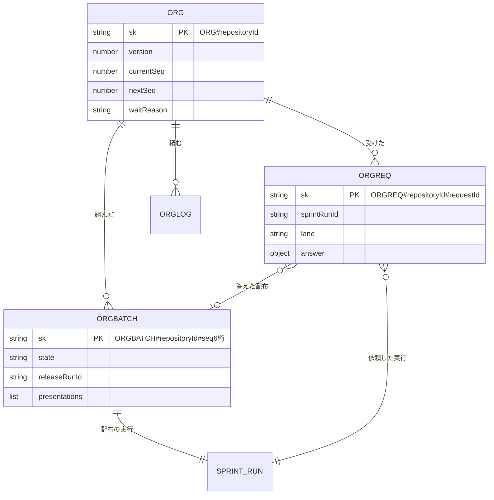

# Factory のオーガナイザーの設計: データ構造と入出力の契約（#2439）

設計文書 [issue-2439-design.md](issue-2439-design.md) から、DynamoDB の行と、API・進捗の事象・ランナーの指示の契約を分けたファイル。不変条件の番号（I56〜I68）は設計文書のものを指す。

## データ構造

### 保存する形

オーガナイザーの進行の行は、今の実行の表（`pk=ACCOUNT#<accountId>`）に置く。まとめた配布と配布の実行を 1 回のトランザクションで書く（I57）ために、同じ表に置く。

### テーブル定義

**根（`sk=ORG#<repositoryId>`）**: 1 リポジトリに 1 行。最初の依頼を受けた `tick` が作る。

| 列 | 型 | 空を許すか | 意味 |
| --- | --- | --- | --- |
| `repositoryId` | 文字列 | 許さない | リポジトリの登録の識別子 |
| `version` | 数値 | 許さない | 楽観的な排他の版（I67）。書くたびに 1 増やす |
| `currentSeq` | 数値 | 許す | 流れているまとめた配布の連番。空は「流れていない」（I56） |
| `nextSeq` | 数値 | 許さない | 次に組むまとめた配布の連番（1 から） |
| `waitReason` | 文字列 | 許す | `external_release_open` / `legacy_run`。空は「待っていない」 |
| `waitDetail` | 文字列 | 許す | 待ちの相手（外の Pull Request の URL・古い版の数）。`waitReason` が空なら空 |
| `gsiOrg` | 文字列 | 許す | 疎な GSI `ORGANIZER_ACTIVE` の鍵。`currentSeq` があるときだけ持つ |

**受けた依頼（`sk=ORGREQ#<repositoryId>#<requestId>`）**: 依頼 1 件に 1 行（I59）。依頼の中身は書き換えない。

| 列 | 型 | 空を許すか | 意味 |
| --- | --- | --- | --- |
| `requestId` | 文字列 | 許さない | NDF が作る依頼の id（#2436 の `<レーン名>-r<乱数 12 桁>`） |
| `sprintRunId` | 文字列 | 許さない | 依頼を出した実行 |
| `loopId` | 文字列 | 許す | 依頼を出した実行のループ。空は手動の実行 |
| `lane` | 文字列 | 許さない | `NDF_ORGANIZER_LANE` の値（`loop-<loopId>` / `run-<sprintRunId>`） |
| `prs`・`issues` | 数値の配列 | 許さない（空の配列は可） | 依頼の Pull Request と課題 |
| `ndfVersion` | 文字列 | 許さない | 依頼した実行の NDF の版 |
| `requestedAt` | 文字列 | 許さない | 依頼のファイルの時刻 |
| `answer` | オブジェクト | 許す | `{seq, result, version, prodPrUrl, reason, at}`。空は「未回答」。1 回だけ書く（I58） |
| `gsiOrg` | 文字列 | 許す | `answer` が空のときだけ持つ（見回りが未回答を引く） |

**まとめた配布（`sk=ORGBATCH#<repositoryId>#<seq を 6 桁で 0 埋め>`）**

| 列 | 型 | 空を許すか | 意味 |
| --- | --- | --- | --- |
| `seq` | 数値 | 許さない | 連番 |
| `state` | 文字列 | 許さない | `composed` / `presented` / `represented` / `confirmed` / `stalled` / `released` / `rejected` |
| `releaseRunId` | 文字列 | 許さない | 配布の実行（I57） |
| `lanes` | 配列 | 許さない | 組んだ時点のレーンの一覧 `{lane, sprintRunId, loopId?, requestIds, issues}`。依頼の無いレーンは `requestIds` が空 |
| `presentations` | 配列 | 許さない（空の配列は可） | 提示 `{k, sha, version, prs, lanes:[{lane, requested}], addedPrs, at}`。2 つまで（I60）。上書きせず足す |
| `confirmedK` | 数値 | 許す | 確定した提示の番号。空は「確定していない」 |
| `mainMerged` | 真偽 | 許さない | `main` へのマージを記録したか（I63）。`release.progress` の `main_merged` か、GitHub で head が `release/v<提示の版>` の `main` 宛の Pull Request がマージ済みなら真。既定は偽 |
| `result` | オブジェクト | 許す | `{version, prodPrUrl, sha, prs}`。空は「配布済みでない」 |
| `stallReason` | 文字列 | 許す | `stalled` の理由（ジョブの失敗の理由）。`stalled` 以外は空 |
| `stalledFrom` | 文字列 | 許す | 止まる前の状態（`composed` / `represented` / `confirmed`）。「続きから流す」でこの状態へ戻す。`stalled` 以外は空 |

**記録（`sk=ORGLOG#<repositoryId>#<ISO 時刻>#<種類>`）**: 追記だけで書き換えない。種類は `waited` / `composed` / `presented` / `represented` / `confirmed` / `stalled` / `resolved` / `released` / `rejected`。中身は種類ごとの値（待ちの相手・提示のコミット・確定の番号・結果）。

**スプリントの実行とジョブ（変更）**: 列を足すだけで既存の列は変えない。

| 行 | 列 | 型 | 空を許すか | 意味 |
| --- | --- | --- | --- | --- |
| 実行 | `purpose` | 文字列 | 許す | `release`。空は今のスプリントの実行（`sprint`） |
| 実行 | `releaseSeq` | 数値 | 許す | 配布の実行のまとめた配布。`purpose` が空なら空 |
| 実行 | `awaitingReason` | 文字列 | 許す | `awaiting_approval` の理由 `release_requested` / `release_stalled`。空は今の承認の依頼の待ち |
| 実行 | `releaseRequestId` | 文字列 | 許す | 手動の実行が待つ依頼の id。`awaitingReason` が `release_requested` のときだけ |
| ジョブ | `start` | 文字列 | 許さない | 今の値に `release` を足す |
| ジョブ | `releaseStep` | 文字列 | 許す | `present` / `represent` / `confirm:1` / `confirm:2` / `continue`。配布の実行のジョブだけ |

### 時系列の扱い

**事象の記録と、追記だけの提示の列を採る。** まとめた配布の `state` は上書きするが、遷移は記録の行に積み、提示は配列に足すだけにする。承認する人が何のコミットを見て答えたかを、出し直しの後も辿れる必要があるためである（非機能の「運用・保守性」）。根の `waitReason` は上書きで、待ちの履歴は記録の行が持つ。

### 機能 × データ

| 機能 | 根 | 受けた依頼 | まとめた配布 | 記録 | 実行・ジョブ |
| --- | --- | --- | --- | --- | --- |
| F1 依頼を出す | — | C（`finalize`） | — | — | U |
| F2 組む | C・U | R | C | C | C（配布の実行） |
| F3 提示する | — | — | U | C | U |
| F4 答えと出し直し | R | — | U | C | U（再開） |
| F5 結果を返す | U | U（答え） | U | C | U（手動の実行の再開） |
| F6 一覧 | R | R | R | R | R |
| F7 止まった配布を解く | U | U（差し戻しの答え） | U | C | U |
| F8 見回り | R | R | R | — | R |

### 移行

既存のデータの移行は無い。根は最初の依頼で作り、実行とジョブの足した列は空を今の意味として読む。

### 検査の手段

`cd factory && npm ci && npm run check`（型検査と vitest。`MemoryRunsTable` に同じ行と条件つきの書き込みを足し、配布のまとめの規則はメモリの表で確かめる）。

## 入出力の契約

### 画面向けの経路（`factory/contracts/openapi/organizer.yaml`。新規）

| 経路 | 入力 | 成功 | 失敗の形 |
| --- | --- | --- | --- |
| `GET /accounts/{accountId}/repositories/{repositoryId}/approval-requests` | — | 200 `{organizer: {currentSeq, waitReason, waitDetail}, items: [...]}`。`items` の 1 件は `{kind, sprintRunId?, loopId?, approvalRequestId?, prUrl?, createdAt, release?}`。`kind` は `gate1` / `gate2` / `decision` / `loop_pending` / `release_stalled`。`release` は配布の実行のゲート 2 と止まった配布だけが持ち `{seq, k, sha, lanes:[{lane, requested, prs}], addedPrs, choices}` | 401・403（アカウントのリポジトリでない）・404 |
| `GET /accounts/{accountId}/repositories/{repositoryId}/releases` | `?limit`（既定 20） | 200 `{items: [{seq, state, releaseRunId, presentations, confirmedK, result, log}]}`（新しい順） | 401・403・404 |
| `POST /accounts/{accountId}/repositories/{repositoryId}/releases/{seq}/resolve` | `{choice: "continue" \| "reject", body?}`。Web のセッションの認証だけ | 202 `{seq, state}` | 401・403（セッションでない呼び出し。I66）・404・409 `not_stalled`・409 `release_after_main`（I63） |

- 一覧の並びは作った時刻の古い順である。承認の依頼の中身（承認資料・答え）は #2173 の経路が持ち、一覧は識別子と要約だけを返す
- 一覧の承認の依頼は「同じリポジトリの `awaiting_approval` の実行」から #2173 の読み出し（未確認のまま残ること）で引き、ループの人の判断待ちはループの行から引く
- 一覧の経路と履歴の経路は読むだけで、答えを確定する経路はこのファイルに無い（I66）。MCP は同じ GET を呼ぶ

### ランナー向けの経路（`factory/contracts/openapi/runs.yaml`。足す）

| 経路 | 入力 | 成功 | 失敗の形 |
| --- | --- | --- | --- |
| `GET /run-jobs/organizer/answers` | 実行ジョブの token | 200 `{answers: [{request_id, result, version, release, reason, at}], ranges: [{seq, sha, version, prs, lanes}]}`。そのジョブの実行のレーン（ループならループのすべての実行）の依頼の答えと、リポジトリの配布済みの範囲 | 401・403 |
| `GET /run-jobs/organizer/batch` | 実行ジョブの token（配布の実行のジョブだけ） | 200 `{seq, step, lanes, presentations, choices}` | 401・403（配布の実行でない）・404 |

答えの形は #2436 の `parallel-request.json` の答え（`answer-<依頼>` の `{result, version, release, reason, at}`）と範囲（`range-<連番>` の `{sha, version, prs, lanes}`）にそろえる。ランナーはこれを置き場のファイルへそのまま書く（[issue-2439-design-ndf.md](issue-2439-design-ndf.md)）。

### 進捗の事象（`factory/contracts/schemas/progress-event.schema.json`。種類を足す）

| 種類 | 出所 | payload | 冪等の鍵 |
| --- | --- | --- | --- |
| `release.requested` | `runner` | `{request_id, lane, prs, issues, ndf_version, requested_at}` | `<request_id>` |
| `release.presented` | `runner` | `{seq, k, sha, version, prs, lanes:[{lane, requested}], added_prs, auto}`。`auto` は MVV 判定が通したとき真 | `<seq>:presented:<k>` |
| `release.progress` | `runner` | `{seq, stage}`。`stage` は `release_branch` / `develop_merged` / `prod_pr_opened` / `main_merged` / `tagged` | `<seq>:progress:<stage>` |
| `release.settled` | `runner` | `{seq, result, version?, prod_pr_url?, sha?, prs, lanes, reason?}`。`result` は `released` / `failed` | `<seq>:settled` |
| `release.answered` | `control` | `{seq, request_id?, result, version?, prod_pr_url?}`。範囲の実行の進捗の記録へ書く（AC 1） | `<seq>:<sprintRunId>` |

`gate.reached` の payload に任意の `choices`（文字列の配列）を足す。配布の実行が `main` のマージの後に判断で止まったときは `["continue"]` だけを載せる（I63）。既存の項目と既存の種類は変えない。

### ジョブの指示（`factory/contracts/schemas/run-job-instruction.schema.json`。足す）

| 項目 | 型 | 意味 |
| --- | --- | --- |
| `START` | 文字列 | 今の値に `release` を足す |
| `RELEASE_SEQ` | 数値 | 配布の実行のまとめた配布の連番 |
| `RELEASE_STEP` | 文字列 | `present` / `represent` / `confirm:1` / `confirm:2` / `continue` |
| `RELEASE_REQUEST_ID` | 文字列 | 手動の実行の再開で、答えの出た依頼の id |

レーンの中身（レーンの一覧と依頼）は RunTask の `overrides` の上限（8192 字）を避けるため指示に載せず、ランナーが `GET /run-jobs/organizer/batch` で読む。

### 実行の制御の関数（変更）

| 関数 | 変えること |
| --- | --- |
| `requestResume({sprintRunId, approvalRequestId?, releaseRequestId?})` | 配布の実行なら `organizer.decide` が `RELEASE_STEP` を決めてから今の書き込みで再開する。`releaseRequestId` は手動の実行の配布の答えの再開に使い、承認の依頼の答えを読まない |
| `finalize` | 上の「止まったときと再開」と I65 の表のとおり。`release.requested` を受けた依頼の行に、`release.settled` を `settle` へ渡す |
| `sweep` | 最後に `organizer.sweep()` を呼ぶ |

### 互換性

- 足すのは経路・事象の種類・payload の任意の項目・指示の項目・行の列だけで、既存の項目の意味は変えない
- 依頼を出さない NDF の版（`NDF_PARALLEL_MIN_VERSION` より古い版）の実行は、今どおり自分で本番の配布を流す。その実行はリポジトリで唯一になり（I48）、その間、配布のまとめは組まない（I62 の `legacy_run`）
- `requestResume` を呼ぶ側（#2173）の引数は変わらない。足した `releaseRequestId` は配布のまとめだけが渡す
- 検査は `npm run check` の契約の lint（`contracts`）と、構造チェック（`scripts/contracts_lib/model.py`）がランナーの翻訳と NDF の契約の例の組を照らす
