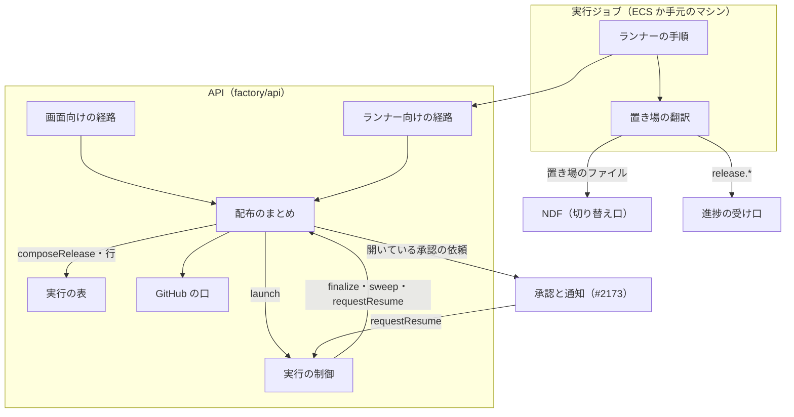
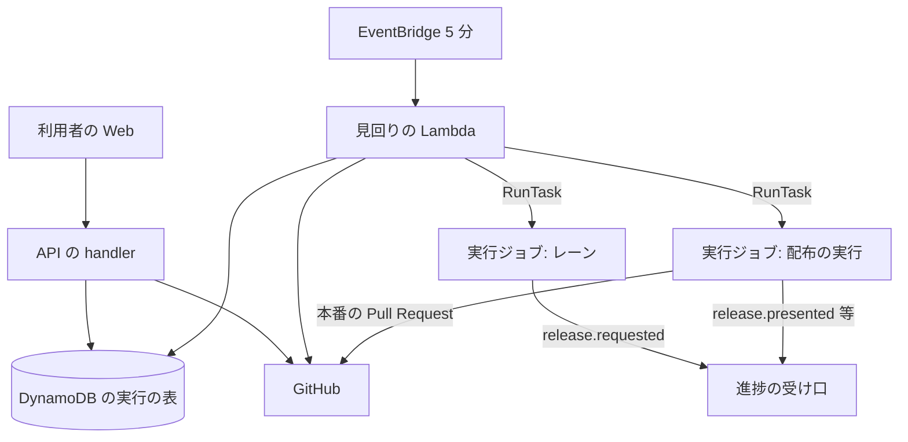
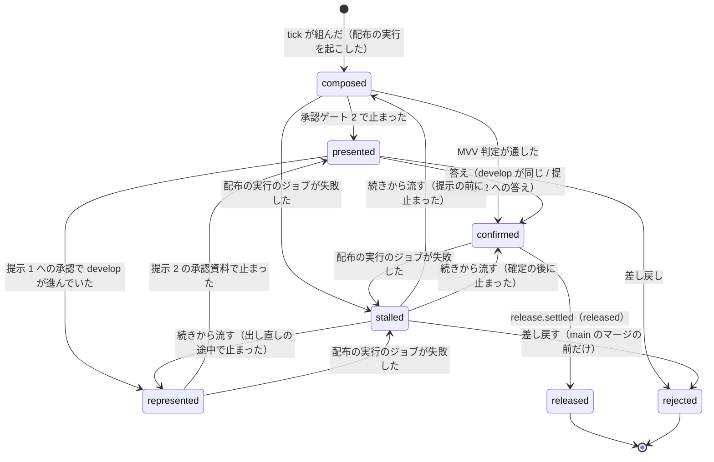
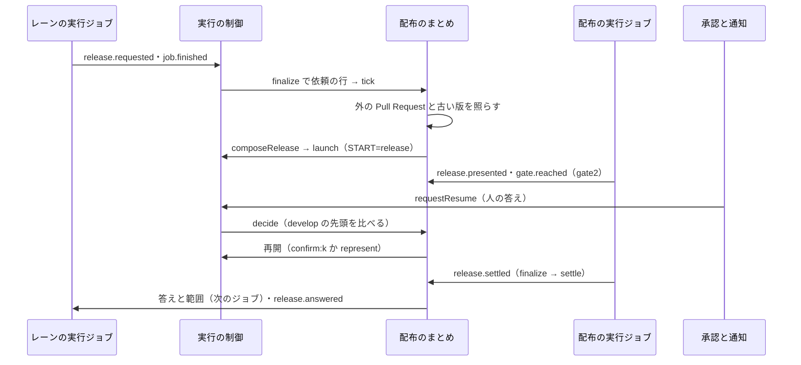

# Factory のオーガナイザー: 同じリポジトリで並行する実行の本番の配布を 1 本にまとめ、承認と問いをリポジトリごとに 1 か所へ集める（#2439）

## 目的

- **今どうなっているか**: Neural Development Factory の実行は、承認ゲート 2 と本番の配布を実行ごとに出す。2026-11-02 に 1 台の tmux で衝突が起きた。ndf v10.27.14 が他の 2 本の変更もまとめて出し、Pull Request https://github.com/devbasex/ai-plugins/pull/2420 を閉じた。同じ衝突が、同じリポジトリの実行ジョブの間でも起きる。#2436 のオーガナイザーは 1 台の SQLite に閉じ、実行ジョブの間をまたげない
- **誰に効くか**: 同じリポジトリで 2 本以上の開発ループかスプリントを Factory で回す利用者
- **変えると何が成り立つか**: 本番の配布は Factory のオーガナイザーが 1 本にまとめ、配布専用の実行ジョブが流す。承認ゲート 2 は 1 回で済み、承認と問いはリポジトリごとの 1 つの一覧に並ぶ。語の衝突 2 つ（手元の受け手・アカウントの契約の種類）が解ける

## 適用範囲

- **働く範囲**: `factory/`（API・ランナー・契約・画面の文言）と、NDF の側の切り替え口（`plugins/ndf/`。Factory を名指ししない）。NDF の切り替え口は、外のオーガナイザーとファイルで依頼と答えをやり取りしたいどのリポジトリでも使える
- **プロジェクトごとに違うもの**: 本番の配布の手段は各リポジトリのリリースのテンプレート（`.ndf/release.json`）のまま。承認ゲート 2 を MVV 判定に任せるかは各リポジトリの `.ndf/pace.json` のまま
- **当たるモード**: `standard`。オーガナイザーはモードを持たない。実行の中のスプリントは今どおりモードを判定する

## あるべき姿の根拠

| 根拠 | 種類 | 何を示すか |
| --- | --- | --- |
| #2439 の「依頼（原文）」（2026-11-02） | 利用者の指示の原文 | Factory にもまとめ役が要る。「上位のオーガナイザー」ではなく、同じ役割を Factory の側で担う実装として定義する |
| Pull Request 2420 を閉じた件 | 実測 | 本番の配布が `develop` の先頭を出すため、先に出した実行が他の実行の変更も出す |
| #2436 の設計（`design/issue-2436` の `issues/issue-2436-design*.md`。決定 13〜15・19・21） | 設計の正本 | 配布の中身を `develop` のコミットの範囲で決める。本番の Pull Request の head は `release/v<版>`。依頼と答えの形は NDF の契約 |
| Factory の確定仕様 [ndf-factory-dev-loops.md](../docs/specifications/ndf-factory-dev-loops.md) の概要 | 設計の正本 | 常駐のプロセスを持たない。実行をまたぐ制御は API の handler と 5 分ごとの見回りに置く |
| `factory/` の調査（2026-11-02） | 実測 | 承認の依頼の保存と一覧（#2173）、手元の受け手の登録の経路（#2189）はまだ無い。本番の配布はランナーの中の NDF が流し、Factory は関わらない |

要求と受け入れ条件は #2439 の本文にある（コピーは [issue-2439-requirements.md](issue-2439-requirements.md)）。この文書は「どう作るか」だけを扱う。部分の設計は次の 3 つに分けた。

| 文書 | 扱う部分 |
| --- | --- |
| [issue-2439-design-data.md](issue-2439-design-data.md) | データ構造と入出力の契約（DynamoDB の行・API・進捗の事象・ランナーの指示） |
| [issue-2439-design-ndf.md](issue-2439-design-ndf.md) | NDF の側の切り替え口（外のオーガナイザーとの置き場の契約）と、語の改名 |
| [issue-2439-design-decisions.md](issue-2439-design-decisions.md) | 決定の記録 |

## ドメインモデル

### コンテキスト

| コンテキスト | 何の語が 1 つの意味に決まるか |
| --- | --- |
| Neural Development Factory（`ndf-factory`） | Factory のオーガナイザー・配布の実行・受けた依頼・まとめた配布・提示・待ちの理由・手元のマシン・料金プラン |
| NDF の開発ワークフロー（`ndf-workflow`） | オーガナイザー・レーン・配布の依頼・承認ゲート 2・承認したコミット |

**Factory のオーガナイザーは、既存の実行の制御・ループの制御と、この課題で足す配布のまとめでできる役割である。** 1 台の中のオーガナイザーの仕事と Factory の担い手は次のとおり対応する。

| 1 台の中のオーガナイザーの仕事（#2436） | Factory の担い手 | この課題で |
| --- | --- | --- |
| レーンを起動・監視・停止する | 実行の制御・ループの制御（周回の開始・停止の後の処理・見回り・取り消し） | 変えない |
| 本番の配布を 1 本にまとめる | 配布のまとめ（`OrganizerControl`） | 新規 |
| 問いを集める | 配布のまとめの一覧（リポジトリごと） | 新規 |
| 答えの後の作業を持ち主のレーンへ返す | `requestResume`・ループの答え・ランナー向けの答えの経路 | 変更 |
| 共有の作業を一時レーンへ渡す | 配布の実行 | 新規 |
| （Factory 固有）実行ジョブの起動・停止・答えでの再開、実行の枠と手元のマシンの枠、ジョブをまたぐ状態の置き場 | 実行の制御・ランナー向けの経路 | 変えない |

`ndf-workflow` は依頼と答えの形を**公開された言語**として持つ。形のファイルは 2 つある。#2436 の `plugins/ndf/contracts/forms/parallel-request.json` と、この課題が足す置き場の契約 `parallel-external.json` である。`ndf-factory` はランナーの翻訳（`factory/runner/src/organizer.ts`）を**腐敗防止層**として置き、ファイルの形を進捗の事象へ写す。API は NDF のファイルを読まない。今の `ndf-next` のブロックと `loop.json` の扱いと同じである。

### 集約

| 集約 | 持ち主（書き換えてよいもの） | 根 | エンティティ | 値オブジェクト |
| --- | --- | --- | --- | --- |
| オーガナイザーの進行 | 配布のまとめ（`OrganizerControl`） | リポジトリのオーガナイザー（`repositoryId`） | 受けた依頼・まとめた配布 | 待ちの理由・提示（コミット・範囲の実行・加わった範囲）・答え・配布の結果・本番の Pull Request |
| スプリントの実行（変更） | 実行の制御（`RunControl`） | スプリントの実行 | 実行ジョブ | 目的（`sprint` / `release`）・属するまとめた配布・待っている依頼 |
| 開発ループ | ループの制御（変えない） | ループ | — | 人の判断待ち・答え |
| 承認の依頼 | 承認と通知（#2173。変えない） | 承認の依頼 | — | 種類・答え |

- オーガナイザーの進行は、ほかの集約を識別子でだけ参照する（実行は `sprintRunId`、ループは `loopId`、承認の依頼は `approvalRequestId`）
- **1 つの処理が書き換える集約は 1 つ**で、例外は 2 つである。まとめた配布を組む処理は、オーガナイザーの進行と配布の実行（実行とジョブ）を 1 つのトランザクションで書く（I57）。停止の後の処理は、ジョブの `release.requested` を受けた依頼の行として同じトランザクションへ入れる（I59）。どちらも、間で止まったときに見回りが 2 本目を起こすか依頼を取りこぼすためである。扱いは既存の 3 集約のトランザクションと同じにする（[ndf-factory-dev-loops.md](../docs/specifications/ndf-factory-dev-loops.md) の「集約」）
- 承認の依頼と開発ループの人の判断待ちは書き換えない。一覧（F6）はそれらを読んで並べるだけである

### 不変条件

番号は Factory の確定仕様の続き（I55 の次）から振る。

| # | 集約 | 条件 | 破れたときの扱い |
| --- | --- | --- | --- |
| I56 | オーガナイザーの進行 | 同じリポジトリで終わりの状態でないまとめた配布は 1 つまで | 組む書き込みは根の `currentSeq` が空で `version` が読んだ値のときだけ通す。落ちたら読み直し、組まない |
| I57 | オーガナイザーの進行 | まとめた配布 1 つに配布の実行は 1 本で、まとめた配布と同じトランザクションで作る | 片方だけを書く経路を持たない。トランザクションが落ちればどちらも無い |
| I58 | オーガナイザーの進行 | 受けた依頼 1 件に答えは 1 回だけ書く | 答えの書き込みは `attribute_not_exists(answer)` を条件にし、落ちたら書かない |
| I59 | オーガナイザーの進行 | 同じ依頼の id は 1 行（ランナーが再送しても増えない） | 停止の後の処理は在る行を読んでから無い行だけを書く。進捗の事象は冪等の鍵 `<依頼の id>` で 1 件になる |
| I60 | オーガナイザーの進行 | 提示は 1 つのまとめた配布に 2 つまで。`develop` の先頭を比べるのは提示 1 への承認のときだけ | 提示 2 への答えでは GitHub を読まない。3 つ目の提示を組む経路を持たない |
| I61 | オーガナイザーの進行 | 答えを返す依頼は、まとめた配布の終わり方で決まる。配布済みでは、確定した範囲に Pull Request が入る依頼へ `released` を返す。差し戻しでは、最後の提示の範囲に Pull Request が入る依頼へ `rejected` を返す。提示の前に止まった配布の差し戻しでは、まとめた配布が受けた依頼すべてへ `rejected` を返す。どの範囲にも入らない依頼は次のまとめた配布へ残る | 配布済みの範囲は、配布の実行が返す `release.settled` の `prs` で照らす。差し戻しはジョブを起こさず `release.settled` も来ないため、まとめた配布に記録した最後の提示の `prs` で照らす。照らせない依頼は答えずに残す |
| I62 | オーガナイザーの進行 | Factory の外の本番の Pull Request（宛先 `main`、head が `release/v` で始まるか `develop`）が開いている間、またはリポジトリに古い NDF の版の実行がある間（`legacyCount` が 1 以上）は、まとめた配布を組まない | 組まずに待ちの理由（`external_release_open` / `legacy_run`）を根と記録の行に書く。次の見回りで照らし直す |
| I63 | オーガナイザーの進行 | `main` へのマージを記録したまとめた配布は差し戻せない | 止まった配布の選択肢は「続きから流す」だけを返し、差し戻しの操作と答えを 409 `release_after_main` で断る |
| I64 | スプリントの実行 | 配布の実行は実行の枠（アカウント・リポジトリ）を持たず、使える量の判定にかけない。トークンと費用は登録したアカウントの利用量へ数える | 配布の実行の作成は枠の行を書かない。`judgeLimits` を呼ばない |
| I65 | スプリントの実行 | 配布の依頼を出したループの実行は `done` で終わる（周回は配布待ちで締まる）。手動の実行は `awaiting_approval`（理由 `release_requested`）で枠を持ったまま答えを待つ。配布の実行は、ジョブが失敗しても差し戻しか配布済みまで終わりの状態にならない（理由 `release_stalled` の `awaiting_approval`） | 停止の後の処理が実行の目的と `job.finished` の結果と理由から決める。表に無い組は今の扱いのまま |
| I66 | 承認の依頼 | 保存した承認の依頼へ答えを書けるのは人だけ。一覧の API と MCP は読むだけで、答えを書く経路を持たない。MVV 判定が承認ゲート 2 を通すときは承認の依頼を作らないため、この条件の対象にならない（E12） | 一覧の経路は GET だけを持つ。止まった配布を解く操作は Web のセッションの認証でだけ受ける |
| I67 | オーガナイザーの進行 | 根の状態を変える書き込みは `version` を条件にする（API の handler と見回りが同時に進めても 1 回だけ通る） | 落ちたら 3 回まで読み直す。状態が変わっていれば何もしない |
| I68 | スプリントの実行 | Factory の実行ジョブでは 1 台の中のオーガナイザーを起動せず、本番の配布は依頼として出す | ランナーが `NDF_FACTORY_RUN=1`・`NDF_ORGANIZER_DIR`・`NDF_ORGANIZER_LANE` を必ず渡す。#2436 の `parallel.py init`・`run` は `NDF_FACTORY_RUN` で断る |

### ドメインイベント

| # | イベント | 発生元 | 受け手 |
| --- | --- | --- | --- |
| E1 | 実行が配布の依頼を出した（`release.requested`） | ランナー（NDF の依頼のファイルの翻訳） | 停止の後の処理（受けた依頼の行）→ 配布のまとめ |
| E2 | 配布の範囲を決めるまとめた配布を組んだ | 配布のまとめ（`tick`） | 実行の制御（配布の実行を起こす） |
| E3 | 承認資料をそろえ、承認ゲート 2 で止まった（`release.presented`・`gate.reached`） | ランナー（配布の実行） | 配布のまとめ（提示の記録）・承認と通知（承認の依頼） |
| E4 | 人が承認ゲート 2 の承認の依頼に答えた | 承認と通知（`requestResume`） | 配布のまとめ（`decide`） |
| E5 | 答えの時点の `develop` が進んでいたので出し直した | 配布のまとめ（`decide`） | 配布の実行（`represent` で再開） |
| E6 | 配布の実行を起こした | 配布のまとめ（`tick`・`decide`） | 実行の制御（`launch`） |
| E7 | 本番の Pull Request を 1 本作ってマージし、版を出した（`release.progress`・`release.settled`） | ランナー（配布の実行） | 配布のまとめ（`settle`） |
| E8 | 範囲のすべての実行へ配布の結果を返した | 配布のまとめ（`settle`） | 実行の進捗の記録（`release.answered`）・次のジョブ（答えの経路）・手動の実行（`requestResume`） |
| E9 | 実行が問いの依頼を出した（承認ゲートの外） | ランナー（今の `gate.reached` の判断・ループの `pending`） | 承認と通知・ループの制御（今のまま） |
| E10 | 問いの答えを持ち主の実行へ返した | 承認と通知（`requestResume`）・ループの制御（答えの保存） | 持ち主の実行か、ループの次の周回（今のまま） |
| E11 | Factory の外の本番の Pull Request が開いていたので待った | 配布のまとめ（`tick`） | 一覧（待ちの理由）・記録の行 |
| E12 | MVV 判定が承認ゲート 2 を通した（`release.presented` の `auto` が真。承認の依頼を作らない） | ランナー（配布の実行） | 配布のまとめ（提示 1 の記録と確定。`decide` を通さない） |

### 用語

| 用語 | 意味 | 用語集への反映 |
| --- | --- | --- |
| Factory のオーガナイザー | 同じリポジトリで並行する Factory の実行をまとめる役割。1 台の中のオーガナイザーの仕事すべて（配布を 1 本にまとめる・問いを集める・答えの後の作業を持ち主へ返す・共有の作業を一時のレーンへ渡す）に、Factory 固有の仕事（実行ジョブの起動・停止・答えでの再開、実行の枠と手元のマシンの枠、ジョブをまたぐ状態の置き場）を足したもの。API の handler と見回りの中で動き、常駐しない。1 台の中のオーガナイザーと同じ層の別の実装で、互いに排他 | 追加（`ndf-factory`） |
| 配布の実行 | Factory のオーガナイザーが、まとめた配布 1 つのために起こすスプリントの実行。範囲のどの実行でもなく、承認資料を作り、本番の配布を流し、結果を返して終わる。同じリポジトリで同時に 1 本まで | 追加（`ndf-factory`） |
| 手元のマシン | 利用者の環境に登録し、同時のジョブの数まで実行ジョブを受け取るマシン。受け取った実行ジョブごとに別のランナーが動く | 追加（`ndf-factory`。廃止した語`手元のランナー`） |
| 手元のマシンの枠 | 1 つの手元のマシンが `running` で持つ `local` の実行ジョブの数を数えた実行の枠の行 | 意味の変更（語を改める。廃止した語`手元のランナーの枠`） |
| 料金プラン | アカウントの契約の種類。Free・個人 Pro・個人 Max・Team の 4 つ | 意味の変更（`ndf-factory` の「プラン」を改める。`ndf-workflow` の「プラン」は変えない） |

配布のまとめ・受けた依頼・まとめた配布・提示・待ちの理由は、この設計の中だけで使う構成要素の名前で、用語集へは足さない。

## 機能一覧

| # | 機能 | 誰が使うか |
| --- | --- | --- |
| F1 | 実行が本番の配布の代わりに配布の依頼を出し、答えを待たずに周回を締める | 実行の中の NDF・ランナー |
| F2 | 配布の依頼を受け、流れている配布が無ければ直ちにまとめた配布を組み、配布の実行を起こす | 配布のまとめ |
| F3 | 承認資料を作って承認ゲート 2 で止まるか、MVV 判定が通せば続けて本番の配布を流す | 配布の実行 |
| F4 | 承認の答えの時点で `develop` が進んでいれば 1 回だけ出し直し、確定した提示の本番の配布を流させる | 配布のまとめ |
| F5 | 配布の結果を範囲の実行へ返し、範囲に入らない依頼で次のまとめた配布を組む | 配布のまとめ |
| F6 | リポジトリごとの承認と問いの一覧と、まとめた配布の履歴を読む | 利用者（Web・API・MCP） |
| F7 | 止まった配布を「続きから流す」か「差し戻す」で解く（`main` へのマージの後は前者だけ） | 利用者（Web） |
| F8 | 途中で止まった配布のまとめの処理を、見回りが記録から続ける | 実行の制御（見回り） |
| F9 | 手元のマシンと料金プランの語へ説明文・用語集・画面の文言を改める | 利用者（読み手） |

## 構成要素

| 要素 | 責務 | 新規 / 変更 |
| --- | --- | --- |
| `factory/api/src/organizer/control.ts`（配布のまとめ。`OrganizerControl`） | `accept`（受けた依頼）・`tick`（待ちの判定・組む・`settle` の続き）・`decide`（承認の答えと出し直し）・`settle`（結果と答え）・`resolve`（止まった配布）・`list`（一覧）・`sweep` | 新規 |
| `factory/api/src/organizer/model.ts` | 根・受けた依頼・まとめた配布・記録の行の型と、状態の遷移の純粋な関数 | 新規 |
| `factory/api/src/runs/table.ts`・`dynamo-table.ts`・`memory-table.ts` | オーガナイザーの進行の行の読み書きと、まとめた配布と配布の実行を 1 回で書くトランザクション（`composeRelease`） | 変更 |
| `factory/api/src/runs/control.ts`（`RunControl`） | `finalize` が `release.*` を読んで受けた依頼の行を同じトランザクションへ入れ、後で `organizer.tick` を呼ぶ。`requestResume` が配布の実行を `organizer.decide` へ回す。`sweep` が `organizer.sweep` を呼ぶ。配布の実行を枠の外で作る | 変更 |
| `factory/api/src/runs/model.ts` | 実行の `purpose`・`releaseSeq`・`releaseRequestId`、ジョブの `start: release`・`releaseStep` | 変更 |
| `factory/api/src/github/port.ts`・`app.ts` | `branchHead(repo, "develop")`・宛先 `main` の開いている Pull Request の head の一覧・head を指定したマージ済みの Pull Request | 変更 |
| `factory/api/src/routes/factory.ts` | 一覧・まとめた配布の履歴・止まった配布を解く操作の 3 経路 | 変更 |
| `factory/api/src/runs/runner-api.ts` | ランナー向けの 2 経路（答えと範囲・まとめた配布の中身） | 変更 |
| `factory/api/src/progress/authorize.ts` | 出所 `runner` が `release.*` の 4 種類を書け、出所 `control` が `release.answered` を書ける | 変更 |
| `factory/runner/src/organizer.ts` | 置き場の翻訳: 依頼・提示・進み・結果のファイル → 進捗の事象。答え・範囲・まとめた配布 → ファイル。未回答の依頼の再送 | 新規 |
| `factory/runner/src/main.ts`・`runtime.ts`・`translate.ts` | `START=release` の手順。環境変数 `NDF_FACTORY_RUN`・`NDF_ORGANIZER_DIR`・`NDF_ORGANIZER_LANE`。配布の依頼で締めた手動の実行の終わり方 | 変更 |
| `factory/contracts/`（`schemas/progress-event.schema.json`・`schemas/run-job-instruction.schema.json`・`openapi/organizer.yaml`・`openapi/runs.yaml`） | 契約（[issue-2439-design-data.md](issue-2439-design-data.md)） | 変更・新規 |
| NDF の切り替え口（`plugins/ndf/`） | 外のオーガナイザーとの置き場の契約と、依頼の書き出し・答えの読み込み・配布の実行の手順（[issue-2439-design-ndf.md](issue-2439-design-ndf.md)） | 変更・新規 |
| 語の改名（用語集・Factory の確定仕様・`factory/` の説明文・`factory/web/src/i18n/ja.json`） | F9（[issue-2439-design-ndf.md](issue-2439-design-ndf.md) の「語の改名」） | 変更 |



画面（`factory/web`）は文言の改名だけで、一覧の画面は #2430 が持つため図に含めない。型の定義（2 つの `model.ts`）・出所の許可（`authorize.ts`）・契約のファイル・語の改名は、上の要素が使う定義と文書で、図に含めない。

### 置き場（パッケージ構成）

```text
factory/
├── api/src/
│   ├── organizer/{control,model}.ts          # 新規
│   ├── organizer/control.test.ts             # 新規（メモリの表）
│   ├── runs/{control,model,table,dynamo-table,memory-table,runner-api}.ts   # 変更
│   ├── github/{port,app}.ts                  # 変更
│   ├── progress/authorize.ts                 # 変更
│   └── routes/factory.ts                     # 変更
├── runner/src/
│   ├── organizer.ts                          # 新規
│   └── {main,runtime,translate}.ts           # 変更
├── contracts/
│   ├── openapi/{organizer.yaml,runs.yaml}    # 新規・変更
│   └── schemas/{progress-event,run-job-instruction}.schema.json   # 変更
└── web/src/i18n/ja.json                      # 変更（文言）
```

### システムの文脈と配置



配布のまとめは新しいプロセスもインフラの部品も持たない。既存の API の Lambda と見回りの Lambda の中で、実行の制御から呼ばれる。足すインフラは DynamoDB の疎な GSI 1 つ（`ORGANIZER_ACTIVE`。private リポジトリの定義）だけである。

## 処理の流れ

### まとめた配布の状態



### 依頼から結果まで



1. **依頼（F1）**: NDF は本番のステージの代わりに依頼のファイルを置き場へ書く（[issue-2439-design-ndf.md](issue-2439-design-ndf.md)）。ランナーは 2 秒ごとの読みで `release.requested` を送る。ループの実行は周回を配布待ちで締めて `done` で、手動の実行は `job.finished`（`gate`・理由 `release_requested`）で終わる（I65）
2. **受ける**: `finalize` は `release.requested` をジョブの冪等の鍵の範囲で読む。受けた依頼の行は、実行の移りと同じトランザクションで書く（I59）。通った後に `organizer.tick(repositoryId)` を呼ぶ（落ちてよい。見回りが続ける）
3. **組む（F2）**: `tick` は根を読み、まとめた配布が流れていなければ、未回答の依頼があるときだけ組む。先に I62 を照らし、当たれば待ちの理由を書いて終える。当たらなければ `composeRelease` で 5 つの行を 1 回で書き、`launch` する。5 つは根（`currentSeq`・`nextSeq`・`version`）・まとめた配布（`composed`）・配布の実行・ジョブ（`START=release`、`releaseStep=present`）・記録の行である。依頼が 1 件でも同じである（S8）
4. **提示（F3）**: 配布の実行は、ランナー向けの経路でまとめた配布の中身（レーンの一覧と依頼）を読み、NDF の配布の手順を流す。MVV 判定が通せば、`release.presented`（`auto` が真）を送って本番の配布まで続ける。このとき承認の依頼は作らず、配布のまとめは `decide` を通さずにまとめた配布を `confirmed`（`confirmedK=1`）にする（E12）。止まれば `release.presented`（提示の番号・コミット・範囲・加わった範囲）と `gate.reached`（`gate2`）を送って終わる。配布の実行は `awaiting_approval` になる。承認の依頼は #2173 が今の経路で作る
5. **答え（F4）**: #2173 が答えを保存して `requestResume` を呼ぶと、実行の制御は配布の実行を `organizer.decide` へ回す。提示 1 への承認では GitHub の口で `develop` の先頭を読み、提示したコミットと比べる。同じなら `confirm:1`、進んでいれば `represent` で再開する。提示 2 への答えは比べずに `confirm:2`（新しい範囲）か `confirm:1`（最初の範囲）で再開する（I60）。差し戻しはジョブを起こさない。まとめた配布を `rejected`、配布の実行を `stopped`（`release_rejected`）にし、最後の提示の範囲の依頼へ `rejected` を返す（I61）。範囲の実行ごとに `release.answered` を書き、手動の実行には `requestResume`（依頼の識別子つき）を呼ぶ。届け方は 6 の配布済みと同じである。続けて `tick` を呼び、範囲に入らない依頼で次のまとめた配布を組む
6. **結果（F5）**: 配布の実行の `finalize` が `release.settled` を読み、`settle` へ渡す。`settle` は根を空け、まとめた配布を `released` にし、範囲に Pull Request が入る依頼へ答えを書く（I58・I61）。範囲の実行ごとに `appendControlEvent` で `release.answered`（冪等の鍵 `<seq>:<sprintRunId>`）を書く。手動の実行には `requestResume`（依頼の識別子つき）を呼ぶ。続けて `tick` を呼び、残った依頼で次のまとめた配布を組む
7. **答えを届ける**: レーンの次のジョブは、ループの次の周回か手動の実行の再開である。その開始で、ランナーは答えと範囲を読んで置き場へ書き、答えの無い依頼のファイルを再送する（I59）。NDF は周回の境で答えを読み、`released` なら残りの工程を流す（#2436 のレーンのループ）

### 止まったときと再開（F7・F8）

| 場面 | 扱い |
| --- | --- |
| `tick` が組む前・組んだ後に止まった | トランザクションの単位で残るか消えるかが決まる。次の `tick`（見回りか次の `finalize`）が根から続ける |
| `composed` のまま `launch` の前に止まった | 見回りは、`composed` のまとめた配布の配布の実行のジョブが `pending` のまま起動の記録が無ければ `launch` し直す（ジョブの冪等は今の `startedBy`） |
| 配布の実行のジョブが失敗した・打ち切られた | `finalize` は配布の実行を終わりの状態にせず `awaiting_approval`（理由 `release_stalled`）へ移す。続く `tick` がまとめた配布を `stalled` にし、`release.progress` に `main_merged` があるか、GitHub で head が `release/v<提示の版>` の `main` 宛の Pull Request がマージ済みなら選択肢を「続きから流す」だけにする（I63）。一覧に止まった配布として並ぶ |
| 止まった配布を「続きから流す」 | `resolve` が同じ配布の実行を `requestResume` と同じ書き込みで再開する（`releaseStep=continue`）。NDF は保存した状態から続ける。配布の実行を作り直さない（I57） |
| 止まった配布を「差し戻す」 | `resolve` が、答え（5）の差し戻しと同じ処理をする。ジョブを起こさず、範囲の依頼へ `rejected` を返す（I61）。提示の前に止まった配布では、まとめた配布が受けた依頼すべてが範囲になる |
| 配布の実行の中の NDF が判断を求めた | 今の経路（`gate.reached` の判断 → 承認の依頼 → `requestResume`）。`decide` は `continue` で再開する。`main` のマージの後は `gate.reached` の `choices` を `continue` だけにする |
| `settle` の後、答えを書き終える前に止まった | 見回りが `released` のまとめた配布で、範囲の依頼のうち答えの無いものを書き直す（I58 で 2 回目は書かれない） |
| 手動の実行の `requestResume` が `sprint_run_busy` | 見回りが、答えのある依頼を待つ `awaiting_approval` の実行へ呼び直す |

見回りは疎な GSI `ORGANIZER_ACTIVE`（未回答の依頼の行と、流れているまとめた配布を持つ根だけが載る）を引き、リポジトリごとに `tick` を呼ぶ。

## 非機能の実現方式

| 大項目 | 条件 | 実現方式 |
| --- | --- | --- |
| 可用性 | 常駐のプロセスを持たない。止まっても次の見回りで続きから再開する | 状態はすべて DynamoDB の行。`tick` は根の状態だけで次の 1 手が決まり、何度呼んでも同じ結果になる（I56・I58・I67） |
| 性能・拡張性 | 依頼から承認の依頼まで見回り 1 回分（5 分）以内 | `finalize` の直後に `tick` を呼ぶ。落ちても見回りが 5 分以内に呼ぶ。承認の依頼は配布の実行が承認資料を作り終えた時点で作られ、その所要は今の本番のプランの承認資料の生成と同じ |
| 運用・保守性 | 範囲・出し直し・待ちの理由・配布の実行の結果が後から辿れる | まとめた配布の行が提示を 2 つまで上書きせずに持ち、記録の行（`ORGLOG`）が待ち・組む・出し直し・確定・結果を積む。まとめた配布の履歴の経路で読める |
| セキュリティ | 承認の確定は人だけ。配布の実行は範囲の実行と同じリポジトリの権限だけを持つ | I66。配布の実行のジョブの token と導入の token は、今の実行と同じく実行のリポジトリ 1 つに絞る |

## 決定の記録

[issue-2439-design-decisions.md](issue-2439-design-decisions.md) に分けた。

## テスト設計

| 受け入れ条件・不変条件 | どの振る舞いで縛るか | どう壊したら落ちるべきか |
| --- | --- | --- |
| 1・I61 | 同じリポジトリの 2 本の実行が依頼を出すと、まとめた配布 1 つ・配布の実行 1 本になり、`settle` の後に 2 本とも同じ版と本番の Pull Request の `release.answered` を持つ | 依頼ごとに組む・範囲に入らない依頼へ答えると落ちる |
| 2 | 依頼 1 件で、他を待たずに `tick` が組む。1 本だけの実行でも承認の依頼 1 件・配布の実行 1 本 | 依頼の数か待ち時間を条件にすると落ちる |
| 3 | まとめた配布の中身の経路が、依頼のあるレーンと無いレーンを印つきで返す。`release.presented` のコミットが提示の行に残る | 依頼の集合で範囲を決めると落ちる |
| 4・I60 | 提示 1 への承認で `develop` が進んでいれば `represent`、同じなら `confirm:1`。提示 2 への答えでは GitHub を読まない | 提示 2 でも比べる・3 つ目の提示を組むと落ちる |
| 5・I56 | 流れている間に届いた依頼は組まずに残り、`settle` の直後の `tick` で次が組まれる。同時の 2 つの `tick` で組まれるのは 1 つ | 根の条件を外すと 2 つ組まれて落ちる |
| 6・I57 | 配布の実行は範囲のどの実行とも別の実行で、まとめた配布と同じトランザクションで作られる。片方の書き込みを失敗させると両方が無い | 2 回の書き込みに分けると落ちる |
| 7・I65 | ループの実行は依頼の後に `done` で終わり、ループは次の周回へ進む。手動の実行は `awaiting_approval`（`release_requested`）で枠を持つ | ループの実行を承認待ちにすると落ちる |
| 8・I62 | 外の `release/v*` か `develop` の head の `main` 宛の Pull Request が開いている間、または `legacyCount` が 1 以上の間は組まず、待ちの理由を書く。閉じた後の最初の `tick` で組む | 照らしを外すと落ちる |
| 9 | 一覧が、同じリポジトリの承認待ちの実行の承認の依頼（ゲート 1・判断・配布の実行のゲート 2）と、ループの人の判断待ちを 1 つの並びで返す。別のリポジトリのものを含まない | 実行やループごとの一覧に戻すと落ちる |
| 10・I68 | ランナーの環境に 3 つの環境変数があり、依頼のファイルが `release.requested` へ写る。契約の例の組をランナーのテストと NDF の構造チェックが読む | 環境変数を落とす・形を変えると落ちる |
| 11・I66 | 一覧とまとめた配布の履歴の経路は GET だけで、答えを書く経路が増えない。止まった配布を解く操作は Web のセッションでない呼び出しを 403 で断る | 書く経路を足すと落ちる |
| 12・I58・I59・I67 | `tick`・`settle` を途中で止めて呼び直しても、答えは 1 回、依頼の行は 1 行、本番の Pull Request を作る配布の実行は 1 本 | 冪等の条件を外すと落ちる |
| 13・I63 | `main_merged` を記録した止まった配布の選択肢は `continue` だけで、差し戻しは 409 `release_after_main` | 選択肢を固定にすると落ちる |
| 14 | 用語集に「手元のマシン」があり、廃止した語`手元のランナー`を `glossary.py check` が拾う。Factory の確定仕様・`factory/` の説明文・`ja.json` に残らない（検索 0 件） | 廃止した語の登録を外すと落ちる |
| 15 | 用語集の `ndf-factory` に「料金プラン」があり、`ndf-workflow` の「プラン」と並ぶ。Factory の確定仕様・`factory/` の説明文・`ja.json` の「プラン」の検索の当たりが、NDF のプランを指す行だけになる | 契約の種類を指す行を 1 つ残すと、検索の当たりを NDF のプランの行と照らす確認で落ちる |
| 16 | 改名の差分にコードの識別子・API の項目名・データの項目名が無く、`npm run check` が変更前と同じく通る | 識別子を変えると型検査かテストが落ちる |
| I64 | 配布の実行の作成は枠の行を増やさず、`judgeLimits` を呼ばない。`usage.recorded` はアカウントの利用量に数えられる | 枠を書くと、枠が埋まったリポジトリで配布が組めず落ちる |

## 設計の結果

| 課題 | 扱い | 取り込み先 | 触るファイル |
| --- | --- | --- | --- |
| #2439 | 実装する | — | `factory/api/src/organizer/`、`factory/api/src/runs/`、`factory/api/src/github/`、`factory/api/src/progress/authorize.ts`、`factory/api/src/routes/factory.ts`、`factory/runner/src/`、`factory/contracts/`、`factory/web/src/i18n/ja.json`、`factory/README.md`、`plugins/ndf/scripts/lib/parallel_lane.py`、`plugins/ndf/scripts/lib/parallel_external.py`、`plugins/ndf/scripts/parallel.py`、`plugins/ndf/contracts/forms/parallel-external.json`、`plugins/ndf/contracts/env/`、`plugins/ndf/skills/development-workflow/references/parallel.md`、`plugins/ndf/scripts/tests/`、`docs/specifications/`、`docs/glossary/glossary.json`、`docs/glossary.md` |

## 未確認のまま残ること

| 項目 | 内容 |
| --- | --- |
| #2173 の承認の依頼の読み方 | 一覧は「実行の識別子から開いている承認の依頼を読む」関数を #2173 に求める。#2173 の保存はまだ無く、関数の形は #2173 の設計で決まる |
| `gate.reached` の `choices` | 承認の依頼が選択肢を持ち、選択肢の外の答えを断るのは #2173 の実装に依る（I63 の二重の守り）。配布のまとめの `decide` と `resolve` は単独でも断る |
| #2436 の側の待ち | 1 台の中のオーガナイザーが、Factory の本番の Pull Request が開いている間に待つかは #2436 の設計に無い。S6 の両側の排他は片側だけになる。範囲外の課題 https://github.com/devbasex/ai-plugins/issues/2441 で扱う |
| レーンの名前の長さ | `NDF_ORGANIZER_LANE` に `loop-<loopId>` / `run-<sprintRunId>` を渡す。識別子の長さが #2436 の名前の形に収まるかは、実装で識別子の生成を読んで確かめる |
| GSI の追加 | `ORGANIZER_ACTIVE` は private リポジトリのインフラの定義に足す。足すまで見回りの続きは働かない（`finalize` の直後の `tick` だけが働く） |
| 配布の実行の NDF の版 | 範囲の依頼の NDF の版のうち最も新しいものを入れる。依頼の版が下限（`NDF_PARALLEL_MIN_VERSION`）より古いことは I62 の `legacy_run` で起きない見込みで、起きたら組まずに待つ |
