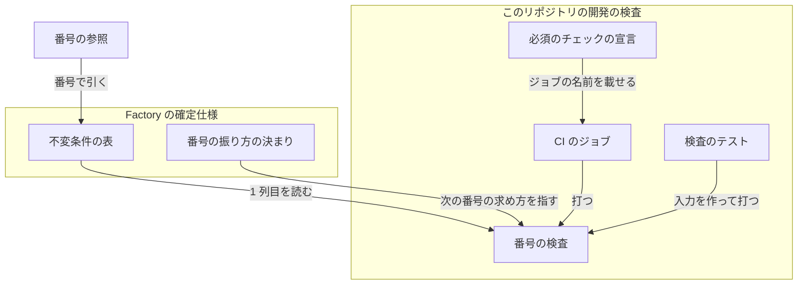
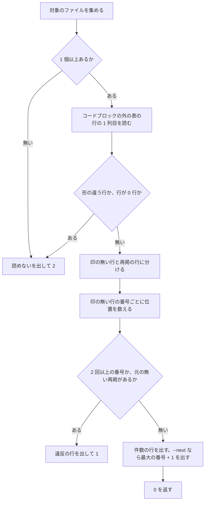

# Factory の確定仕様: 不変条件の番号 1 つが 1 つの条件だけを指し、重なりを CI が落とす（#2445）

## 目的

- **今どうなっているか**: Factory の確定仕様の不変条件の番号（`I<数>`）は通し番号の決まりである。開発ループの仕様が I44〜I50 を、スプリントの画面の仕様が I1〜I14 を、ほかの仕様の別の条件と同じ番号で振っている（21 個）。#2439 の設計は I48 を引くたびにどちらのファイルの条件かを書き分けた
- **誰に効くか**: Factory の設計を書く AI・レビュアー・実装者
- **変えると何が成り立つか**: 番号だけで条件を引ける。確定仕様を足すときの重なりは Pull Request の CI で落ち、マージの前に気づける

## 適用範囲

- **働く範囲**: このリポジトリだけ。検査は `scripts/` に置き、プラグインの配布物（`plugins/`）には入れない
- **プロジェクトごとに違うもの**: 無し（対象は ai-plugins の Factory の確定仕様に限る）
- **当たるモード**: `standard`

## あるべき姿の根拠

| 根拠 | 種類 | 何を示すか |
| --- | --- | --- |
| `docs/specifications/ndf-factory-*.md` の表の 1 列目を集めると、92 行・68 個の番号のうち 21 個が別の条件で 2 回出る（要求の「調べた事実」のコマンド、`e532ac98c`） | 実測 | 書き手の注意だけでは通し番号が守られない。機械で落とす検査が要る |
| 受け口と進捗の仕様 385 行目・アカウントと料金プランの仕様 180 行目・実行とランナーの仕様 368 行目の「〜に続けて番号を振る」 | 実測（今の確定仕様） | 決まりは通し番号で、ファイルごとに書き写されている。書き写した文は 5 か所にあり、後から足したファイルはその文を持たないまま独自に振った |
| `git log --diff-filter=A` で、境界・アカウント・受け口と進捗・起票の依頼の仕様は 2026-10-30〜31、開発ループは 11-02、スプリントの画面は 11-04 に入った | 実測（2026-11-05） | 重なりは後から入った 2 つの仕様が作った。決まりに沿って振ったのは先に入った側である |
| PRD1・PRD2・PRD3 | 外部の一次情報 | 要求の管理の製品は、文書をまたいで一意な識別子を振り、検査で守る |

要求と受け入れ条件は #2445 の本文にある（コピーは `issues/issue-2445-requirements.md`）。この文書は「どう作るか」だけを扱う。

## ドメインモデル

### コンテキスト

| コンテキスト | 何の語が 1 つの意味に決まるか |
| --- | --- |
| Neural Development Factory（`ndf-factory`） | 不変条件・再掲・番号の重なり・再掲の印 |
| このリポジトリの開発の検査（`repo-dev-checks`） | 番号の検査・読めない行 |

`ndf-factory` が上流、`repo-dev-checks` が下流で、**順応者**の関係にある。検査は確定仕様の表の形（1 列目の `I<数>` と再掲の印）をそのまま読み、自分の語へ翻訳しない。表の形を変えるのは確定仕様の側で、検査はそれに合わせる。

### 集約

| 集約 | 持ち主（書き換えてよいもの） | 根 | エンティティ | 値オブジェクト |
| --- | --- | --- | --- | --- |
| 不変条件の番号表 | 確定仕様を直す Pull Request（`plan-to-spec` か手の変更）。番号の検査は読むだけ | 番号表（Factory の確定仕様のすべての行） | 不変条件の行 | 番号（`I<数>`）・再掲の印・行の位置（パスと行番号） |

番号表は 1 つのファイルに閉じず、Factory の確定仕様のすべてにまたがる。番号の一意性はファイルを越えて成り立つ必要があるため、集約の境界をファイルではなく Factory の確定仕様の全体に置く。

### 不変条件

この節の番号はこの設計の中だけの番号で、ほかの文書からは「#2445 の I1」と引く。Factory の確定仕様の番号表には載せない。

| # | 集約 | 条件 | 破れたときの扱い |
| --- | --- | --- | --- |
| I1 | 不変条件の番号表 | 再掲の印の無い行の番号は、Factory の確定仕様のすべての行で 1 回だけ出る（同じファイルの中も含む） | 検査が終了コード 1 で終わり、番号と、出たすべての位置を出す |
| I2 | 不変条件の番号表 | 再掲の印を持つ行の番号は、印の無い行としてどこかに 1 回出る | 検査が終了コード 1 で終わり、番号と再掲の行の位置を出す |
| I3 | 不変条件の番号表 | 1 列目が `I` と数字で始まる表の行は、`I<1 以上の数>` か `I<1 以上の数>（再掲）` の形である。対象のファイルと行は 1 つ以上ある | 検査が終了コード 2 で終わり、読めない行の位置（ファイルか行が無いときはその旨）を出す。重なり無しとして通さない |
| I4 | 不変条件の番号表 | 振り直しは、1 列目の番号と再掲の印、セルの中の振り直した番号の参照だけを変え、条件と破れたときの扱いの文を変えない | 実装の Pull Request の比較のコマンドが差を出したら、その行を直す |

### ドメインイベント

| # | イベント | 発生元 | 受け手 |
| --- | --- | --- | --- |
| E1 | 確定仕様に不変条件の行が足された | 確定仕様を直す Pull Request | 番号の検査（E2） |
| E2 | 継続的統合が番号の重なりを検査した | CI のジョブ `factory-invariant-ids-check` | Pull Request の作者（失敗の出力） |
| E3 | 重なる番号を振り直した | この課題の実装 | 番号の検査（E2）・参照の追随（E4） |
| E4 | 振り直した番号の参照を追随させた | この課題の実装 | 実装の Pull Request の本文の一覧（受け入れ条件 9） |

### 用語

| 用語 | 意味 | 用語集への反映 |
| --- | --- | --- |
| 再掲の印 | 再掲の行であることを示すために、番号のセルの番号の直後に付ける `（再掲）` | 追加（`ndf-factory`） |
| 再掲 | Factory の確定仕様で、別のファイルの不変条件を同じ番号のまま書き直して載せた行。番号のセルに再掲の印を持つ | 意味の変更（`ndf-factory`。印を持つことを足す） |
| 番号の重なり | Factory の確定仕様で、再掲の印の無い 2 つの不変条件の行が同じ番号を持つこと。同じファイルの中の 2 行も含む | 意味の変更（`ndf-factory`。判定を印で行い、同じファイルの中も含める） |

## 外部の調査

| 種類 | 調べるか | 理由 |
| --- | --- | --- |
| 標準・仕様 | 調べる | 要求の仕様の規格（ISO/IEC/IEEE 29148）が、要求の識別子の一意性を定めているかを確かめる |
| 主要な製品 | 調べる | 文書を Markdown などで持つ要求の管理の製品が、識別子を文書ごとに振るか全体で振るか、重複をどう見つけるかを比べる |
| ライブラリとサービス | 調べる | 重なりの検査を既存の製品に任せるか、表を読む部分にライブラリを使うかを決める |

### 標準・仕様

取得できた一次情報は無い（下の「確かめられなかったこと」）。設計の判断には使わない。

### 主要な製品

| # | 製品 | どう解いているか | 設計への反映 | 出典 |
| --- | --- | --- | --- | --- |
| PRD1 | Doorstop | 項目の識別子は「文書の接頭辞 + 区切り + 番号」（例 `REQ-001`）。番号は Doorstop が振るか、明示して指定する。接頭辞・桁数・区切りは文書の設定に持つ | 文書ごとの接頭辞は、文書を 1 つの単位として動かさない前提で成り立つ。Factory の確定仕様は 500 行の上限で節ごとに別のファイルへ移るため、接頭辞を採らない（決定 1） | `gh api repos/doorstop-dev/doorstop/contents/docs/cli/creation.md`（2026-11-05） |
| PRD2 | Sphinx-Needs | 項目の型ごとの接頭辞と長さから識別子を作る。ほかの文書の項目は取り込み（`needimport`）で使い、取り込んだ項目には識別子の形の検査を当てない | 別の文書の項目を書き写す仕組みを持ち、元の識別子のまま扱う。再掲を元と同じ番号のまま残す形に揃える（決定 3） | https://sphinx-needs.readthedocs.io/en/latest/configuration.html （2026-11-05） |
| PRD3 | OpenFastTrace | 項目の識別子は「成果物の種類 ~ 名前 ~ 版」（例 `dsn~validate-authentication-request~1`）で、Markdown の中に書く | 識別子に種類と名前を含め、番号の振り直しが起きない形にしている。Factory の確定仕様は既に番号で 92 行と多くの参照を持つため、識別子の形は変えない（決定 1） | `gh api repos/itsallcode/openfasttrace/contents/doc/user_guide/reference/input_format_support.md`（2026-11-05） |

### ライブラリとサービス

| # | 候補 | 版 | ライセンス | 最後のリリースの日付 | 終了のアナウンス | 要件を満たすか | 出典 |
| --- | --- | --- | --- | --- | --- | --- | --- |
| LIB1 | doorstop | 3.2 | LGPLv3 | 2026-07-10 | 無し | 満たさない。項目を 1 項目 1 ファイルの YAML で持つ前提で、Markdown の表の行を項目として読まない | https://pypi.org/pypi/doorstop/json ・ `gh api repos/doorstop-dev/doorstop`（2026-11-05） |
| LIB2 | sphinx-needs | 9.2.0 | MIT | 2026-11-04 | 無し | 満たさない。Sphinx の指令で書いた項目を読む。確定仕様は Sphinx で組まない | https://pypi.org/pypi/sphinx-needs/json ・ `gh api repos/useblocks/sphinx-needs`（2026-11-05） |
| LIB3 | markdown-it-py | 4.2.0 | MIT | 2026-05-07 | 無し | 満たすが要らない。表の 1 列目を読むだけなら行の正規表現で足り、CI に依存の導入を足すことになる | https://pypi.org/pypi/markdown-it-py/json （2026-11-05） |
| LIB4 | OpenFastTrace | 4.11.0 | GPL-3.0 | 2026-10-18 | 無し | 満たさない。Java で動き、識別子は PRD3 の形を前提にする。番号の表の重なりは見ない | `gh api repos/itsallcode/openfasttrace/releases/latest`（2026-11-05） |

### 確かめられなかったこと

| 対象 | 試した手段 | 結果と理由 |
| --- | --- | --- |
| ISO/IEC/IEEE 29148:2018 が要求の識別子の一意性を定めているか | https://www.iso.org/standard/72089.html | HTTP 403 で取得を拒否された。規格の本文は有料で、ほかの一次情報は試していない |
| Sphinx-Needs が文書をまたぐ識別子の重複を検査するか | https://sphinx-needs.readthedocs.io/en/latest/configuration.html | 原文で読めた範囲の重複の警告（`needs.duplicate_id`）は並列処理の結果を合わせるときのものだけで、文書をまたぐ一般の規則は見つからなかった。ページの後半（約 18 万字）は原文を読んでいない |
| Doorstop と OpenFastTrace の文書の Web 版 | https://doorstop.readthedocs.io/en/latest/cli/creation/ ・ https://github.com/itsallcode/openfasttrace/blob/main/doc/user_guide.md | どちらも HTTP 404。リポジトリの原文を `gh api` で取得して代えた |

調べた量: 候補 7 件・取得の試み 22 回。

## 機能一覧

| # | 機能 | 誰が使うか |
| --- | --- | --- |
| F1 | Factory の確定仕様の番号の重なり・元の無い再掲・読めない行を見つけ、終了コードで知らせる | 確定仕様を直す人と AI（手元）・CI |
| F2 | 次に振る番号を出す | 確定仕様に不変条件を足す人と AI（`plan-to-spec`） |
| F3 | 振り直した番号で、1 つの条件だけを引ける | Factory の設計を書く AI・レビュアー・実装者 |

## 構成要素

| 要素 | 責務 |
| --- | --- |
| 番号の検査（`scripts/check-factory-invariant-ids.py`、新規） | Factory の確定仕様の表の 1 列目を読み、I1〜I3 を判定して終了コードと違反の行を出す。`--next` で次に振る番号を出す。ファイルを書き換えない |
| 検査のテスト（`scripts/tests/test_check_factory_invariant_ids.py`、新規） | 一時ディレクトリに置いた確定仕様の入力で、検査の終了コードと出力を確かめる |
| CI のジョブ `factory-invariant-ids-check`（`.github/workflows/runtime-plugin-validate.yml`） | Pull Request ごとに番号の検査を打つ |
| 必須のチェックの宣言（`scripts/required-checks-allow.json`） | 新しいジョブを、ruleset の必須への追加を待つチェック（`awaiting`）として載せる |
| 番号の振り方の決まり（境界の仕様の「常に成り立つ条件（サービス全体）」の節） | 方式（すべての Factory の確定仕様で通し番号）・次の番号の求め方・再掲の印の形を 1 か所に持つ |
| Factory の確定仕様（`docs/specifications/ndf-factory-*.md`） | 開発ループの仕様とスプリントの画面の仕様の 21 行を振り直し、再掲の 3 行に印を付け、「〜に続けて番号を振る」の 5 か所を決まりへの参照に置き換える |
| 番号の参照（確定仕様・`issues/` 直下の設計文書と要求のコピー・`factory/` のコメントとテストの名前） | 振り直した番号を引く箇所を新しい番号へ直す |



## 確定仕様の書き換え

### 振り直しの対応

先に確定仕様へ入った側を残し、開発ループの仕様とスプリントの画面の仕様を今の最大の番号 I68 の続きへ振り直す（決定 2）。

| 仕様 | 今の番号 | 新しい番号 |
| --- | --- | --- |
| 開発ループ（`ndf-factory-dev-loops.md`） | I44・I45・I46・I47・I48・I49・I50 | I69・I70・I71・I72・I73・I74・I75 |
| スプリントの画面（`ndf-factory-sprint-views.md`） | I1・I2・I3・I4・I5・I6・I7・I8・I9・I10・I11・I12・I13・I14 | I76・I77・I78・I79・I80・I81・I82・I83・I84・I85・I86・I87・I88・I89 |

開発ループの I51〜I55 は重ならないため変えない。振り直しの後は 92 行・89 個の番号・再掲 3 行で、次に振る番号は I90 である。

| 再掲の印を付ける行 | 元の行 |
| --- | --- |
| 実行とランナーの仕様の I8・I9 | 境界の仕様の I8・I9 |
| 受け口と進捗の仕様の I10 | 境界の仕様の I10 |

### 決まりの置き場と参照

境界の仕様の「常に成り立つ条件（サービス全体）」の節の末尾の 1 行を、次の中身を持つ 1 段落に置き換える。今の 1 行は「各課題は自分の設計のテスト設計で、受け持つ条件を 1 条件 1 テストで縛る。」である。境界の仕様は今 500 行で、置き換えで行数は変わらない。

- 番号は、すべての Factory の確定仕様（`docs/specifications/ndf-factory-*.md`）で通し番号にする
- 新しい条件には、今ある最大の番号に 1 を足した番号を振る。`python3 scripts/check-factory-invariant-ids.py --next` が出す
- 別の仕様の条件を書き直して載せる行は、元と同じ番号に再掲の印 `（再掲）` を付ける
- 重なりは CI のジョブ `factory-invariant-ids-check` が落とす
- 各課題は自分の設計のテスト設計で、受け持つ条件を 1 条件 1 テストで縛る（今の文）

「〜に続けて番号を振る」の 5 か所は、決まりへのリンクに置き換える。出所の説明（どの課題がどの番号を足したか）は残す。

| ファイル | 今の文 | 置き換えた後 |
| --- | --- | --- |
| アカウントと料金プランの仕様 | 全体の契約の I1〜I11 に続けて番号を振る。 | 決まりへのリンクの 1 文 |
| 受け口と進捗の仕様 | I10 は全体の契約のもの。#2170 の I24 に続けて番号を振る。I37 は… | I10 は全体の契約の再掲。決まりへのリンク。I37 は…（以下は今のまま） |
| 起票の依頼の仕様 | 受け口の文書の I44・I45・I50 に続き、台帳の条件を置く。 | 決まりへのリンクの 1 文 |
| 実行とランナーの仕様 | 全体の契約の I8・I9 と受け口の仕様の I31 に続けて番号を振る。I37 … | I8・I9 は全体の契約の再掲。決まりへのリンク。I37 …（以下は今のまま） |
| オーガナイザーの仕様 | 番号は Factory の確定仕様の続きである。 | 決まりへのリンクの 1 文 |

### 参照の判定

振り直した番号の参照は、次の検索で集め、1 件ずつ「どの仕様の条件を引いているか」を判定する。古い番号は先に入った側の正しい番号でもあるため、機械では判定しない。

```bash
grep -rnP '\bI(4[4-9]|50|[1-9]|1[0-4])\b' docs/specifications/ndf-factory-*.md issues/*.md factory \
  --exclude-dir=node_modules
```

| 参照の置き場 | 開発ループかスプリントの画面の条件と判定する場合 | 直さない場合 |
| --- | --- | --- |
| 開発ループ・スプリントの画面の仕様と、そこから分けた文書（`ndf-factory-dev-loops-data-and-contracts.md`） | 仕様の名前もリンクも添えない番号（自分の表の行を指す） | ほかの仕様の名前かリンクを添えた番号 |
| ほかの確定仕様 | 開発ループかスプリントの画面の仕様の名前かリンクを添えた番号 | それ以外 |
| `issues/` 直下の設計文書と要求のコピー | 確定仕様の名前かリンクを添え、それが開発ループかスプリントの画面である番号。添えていないときは引用した条件の文がその仕様の行と一致する番号 | 課題の番号を添えた番号・その文書が自分の不変条件の表に振った番号 |
| `factory/` のコメントとテストの名前 | コメントの条件の文がその仕様の行と一致する番号（例: `factory/api/src/views/derive.ts` の I4、`factory/api/src/runs/loops.test.ts` の I44） | 一致する行がほかの仕様にある番号・設計文書の番号 |

どちらとも判定できない参照は直さず、「判定できない」として実装の Pull Request の一覧に理由とともに載せる。

## 入出力の契約

| 項目 | 内容 |
| --- | --- |
| 名前 | `python3 scripts/check-factory-invariant-ids.py` |
| 入力 | `--root <パス>`（任意。既定は `.`）。対象は `<root>/docs/specifications/ndf-factory-*.md` で、glob はスクリプトの定数に持つ。`--next`（任意）。標準ライブラリだけを使う |
| 読み方 | 対象の各ファイルで、コードブロックの外にある、縦線で始まる表の行の 1 列目を読む。1 列目が `I` と数字で始まる行を不変条件の行とする |
| 出力（成功） | 何も違反が無いとき、件数の行（`番号 <個数> 個・行 <数> 行・再掲 <数> 行`）を出して 0。`--next` のときは続けて次の番号（例 `I90`）を 1 行出す |
| 出力（違反） | 違反 1 件 1 行で `重なり: I<数> <パス>:<行> <パス>:<行> …` か `元の無い再掲: I<数> <パス>:<行>`。パスは `--root` からの相対。最後に件数の行 |
| 失敗の形 | 0 = 違反が無い / 1 = 重なりか元の無い再掲が 1 件以上（I1・I2）/ 2 = 読めない（対象のファイルが 0 個・不変条件の行が 0 行・形の違う行。I3）。2 のときは重なりの判定をせず、`読めない: <パス>:<行> <1 列目の値>` か `読めない: 対象のファイルが無い` などを出す。`--next` でも違反があれば同じ終了コードで終わり、次の番号を出さない |
| 互換性 | 新しいコマンドで、既存の呼び出し側は無い |

## 処理の流れ



## 非機能の実現方式

| 大項目 | 条件 | 実現方式 |
| --- | --- | --- |
| 運用・保守性 | 検査の失敗の出力だけで、どの番号をどのファイルで直せばよいかが分かる | 違反 1 件 1 行に番号と、すべての位置（パスと行番号）を出す。直す先の番号は `--next` が出す |

## 決定の記録

### 決定 1: 今の番号のまま引けるように、すべての Factory の確定仕様で通し番号にする

確定仕様・設計文書・`factory/` のコメントとテストの名前は、今の番号で条件を引いている。通し番号にすれば振り直すのは 92 行のうち 21 行で、残りの 71 行とその参照は変わらない。Factory の確定仕様は 500 行の上限で節ごとに別のファイルへ移る。開発ループ・オーガナイザー・実行とランナーの仕様は既に分けた文書を持つ。番号にファイルを含めない方が、移しても番号が変わらない。

ファイルごとの接頭辞（例 `DL-I48`。PRD1 の形）は採らない。すべての番号とその参照を書き換えることになり、ファイルを分けるたびに接頭辞と置き場が食い違う。識別子に名前を含める形（PRD3）も、92 行の参照をすべて書き換えるため採らない。

根拠: Value 7 / Value 8（MVV 版 5）

### 決定 2: 書き換える参照を少なくするため、先に確定仕様へ入った側の番号を残し、開発ループとスプリントの画面の 21 行を I69〜I89 へ振り直す

重なる番号は、先に入った側（境界・アカウントと料金プラン・受け口と進捗・起票の依頼の仕様。2026-10-30〜31）が決まりに沿って振り、後から入った開発ループ（11-02）とスプリントの画面（11-04）が同じ番号を振った。先に入った側の番号は長く引かれてきたため、こちらを残すと書き換える参照が少ない。新しい番号は今の最大 I68 の続きにし、決まり（最大 + 1）と同じ求め方にする。

開発ループの I51〜I55 は重ならないため、連番に揃えるための振り直しをしない。揃えると、重なっていない 5 個の番号の参照まで書き換えることになる。

根拠: Value 7（MVV 版 5）

### 決定 3: 1 列目だけで再掲を読めるよう、再掲の印を番号のセルの `（再掲）` にする

検査は表の 1 列目だけを読む。印を同じセルに置けば、列の数が違う表（2 列・3 列・4 列・5 列が混ざる）でも同じ規則で読める。番号の文字列 `I8` は印の前にそのまま残るため、`I8` で検索すれば元の行と再掲の行の両方に当たる。元と同じ番号を使うのは、別の文書の項目を元の識別子のまま取り込む PRD2 の形に揃えるためである。

印を条件の列の先頭に置く形は採らない。表ごとに条件の列の位置が違い、検査が表の見出しを読み分けることになる。

根拠: Value 5 / Value 8（MVV 版 5）

### 決定 4: CI で依存を入れずに打てるよう、番号の検査を標準ライブラリの Python 1 本で作る

読むのは表の行の 1 列目だけで、行の正規表現で足りる。標準ライブラリだけにすれば、CI のジョブは Python を用意するだけで打てる。境界の検査（`scripts/check-service-boundary.py`）も同じ作りである。

| 候補 | 項目を持つ形 | 採らない理由 |
| --- | --- | --- |
| LIB1 | YAML のファイル | Markdown の表の番号の重なりを見ない |
| LIB2 | Sphinx の指令 | 同じ |
| LIB4 | 種類 ~ 名前 ~ 版の識別子 | 同じ |
| LIB3 | Markdown の解析のライブラリ | 表を正しく読めるが、1 列目を読むだけには依存の導入が見合わない |

- 作り方: 自前で作る
- 比べた候補: LIB1 / LIB2 / LIB3 / LIB4

根拠: Value 5 / Value 6（MVV 版 5）

### 決定 5: 落ちたときにチェックの名前から番号の重なりと読めるよう、新しいジョブ `factory-invariant-ids-check` として足す

既存のジョブ（`doc-line-limit-check` など）に手順として混ぜると、落ちたときにチェックの名前から番号の重なりだと読めない。境界の検査（境界の仕様の決定 11）・エントリポイントの契約の検査と同じく新しいジョブにする。ジョブは、必須のチェックの宣言の `awaiting` に理由とともに載せる。`check-required-checks.py` は、Pull Request で走るジョブが必須の一覧にも宣言にも無いと失敗するためである。

根拠: Value 5 / Value 8（MVV 版 5）

### 決定 6: 決まりを書き写さずに済むよう、番号の振り方を境界の仕様の「サービス全体」の節の 1 か所に置き、次の番号は検査が出す

決まりは今 5 つのファイルに「〜に続けて番号を振る」として書き写されており、その文を持たないファイルが独自に振った。境界の仕様は Factory 全体の契約を持ち、I1〜I11 の元の行もあるため、決まりの置き場にする。次の番号は「最大 + 1」を書き手が数えると数え違えるため、`--next` で検査に出させる。

確定仕様の索引（`docs/specifications/README.md`）には置かない。索引は文書への道案内で、決まりを持たない。

根拠: Value 5 / Value 8（MVV 版 5）

## テスト設計

検査のテストは `scripts/tests/` に置き、一時ディレクトリに作った確定仕様の入力で終了コードと出力を見る。リポジトリの確定仕様の文言は照合しない。

| 受け入れ条件・不変条件 | どの振る舞いで縛るか | どう壊したら落ちるべきか |
| --- | --- | --- |
| 受け入れ条件 1 | 振り直しの後のリポジトリで検査が 0 で終わり、件数の行が `番号 89 個・行 92 行・再掲 3 行` である（実装の Pull Request で打った出力を本文に残す） | 21 行のどれかを古い番号のまま残すと 1 で落ちる |
| 受け入れ条件 2 | `grep -n '続けて番号を振\|に続き、台帳\|確定仕様の続き' docs/specifications/ndf-factory-*.md` が 0 件で、5 か所が決まりへのリンクを持つことを `check-markdown-links.py` が通す（実装の Pull Request で示す） | リンク先の見出しを変えると `check-markdown-links.py` が落ちる |
| 受け入れ条件 3・I4 | 振り直しの前の各行に対応表の置き換えを当てた文字列と、振り直しの後の行が一致することを、実装の Pull Request で 1 回打つ比較のコマンドで示す | 条件か扱いの文を 1 文字でも変えると、比較が差を出す |
| 受け入れ条件 4 | CI のジョブ `factory-invariant-ids-check` が実装の Pull Request で通る | — |
| 受け入れ条件 5 | 元の行と、同じ番号の再掲の印を持つ行が別のファイルにある入力で 0 | 印を読まずに番号だけで数えるように壊すと 1 になって落ちる |
| 受け入れ条件 6・I1 | 印の無い同じ番号の行が 2 つのファイルにある入力で 1 になり、出力の 1 行に番号と 2 つのパスが出る。同じファイルの 2 行でも 1 | ファイルごとに数えるように壊すと、2 つのファイルの重なりで 0 になって落ちる |
| 受け入れ条件 7・I2 | 再掲の印を持ち、印の無い行がどこにも無い番号の入力で 1 | 再掲の行を読み飛ばすように壊すと 0 になって落ちる |
| 受け入れ条件 8 | 重なりを足した一時の Pull Request（`develop` 宛の draft。確かめた後に閉じる）で、ジョブが失敗した実行の URL を実装の Pull Request の本文に残す | ジョブが別のスクリプトを打つと失敗しない |
| 受け入れ条件 9 | 「参照の判定」の検索の結果を、番号ごとに位置・判定・直した先の表として実装の Pull Request の本文に載せる | — |
| 受け入れ条件 10 | `factory-check`・`markdown-link-check`・`doc-line-limit-check` のジョブが実装の Pull Request で通る | テストの名前に番号を含めて照合するテストがあれば、その名前を直し忘れると落ちる |
| I3 | 形の違う 1 列目（`I8(再掲)` の半角の括弧・`I08`）の入力で 2、対象のファイルが無い・不変条件の行が 0 行の入力でも 2。コードブロックの中の行は数えない | 形の違う行を読み飛ばすように壊すと 0 になって落ちる |
| F2 | `--next` が、再掲の行を除いた最大の番号に 1 を足した番号を出す | 再掲の行や行の数から求めるように壊すと、違う番号になって落ちる |

## 設計の結果

| 課題 | 扱い | 取り込み先 | 触るファイル |
| --- | --- | --- | --- |
| #2445 | 実装する | — | `scripts/check-factory-invariant-ids.py`、`scripts/tests/test_check_factory_invariant_ids.py`、`.github/workflows/runtime-plugin-validate.yml`、`scripts/required-checks-allow.json`、`docs/specifications/`、`docs/glossary.md`、`docs/glossary/glossary.json`、`issues/`、`factory/api/src/`、`factory/runner/src/`、`factory/web/src/`、`factory/contracts/tests/` |

## 未確認のまま残ること

| 項目 | 内容 |
| --- | --- |
| 参照の数 | 検索に当たる行は確定仕様 108 行・`issues/` 直下 41 ファイル・`factory/` 56 ファイルある（`grep -c` の件数。2026-11-05）。大半は設計文書が自分で振った番号か先に入った側の番号で、直す数は実装で判定するまで決まらない |
| 判定できない参照 | 番号だけで条件の文も仕様の名前も添えない参照は、どの仕様の条件か決められないことがある。直さずに一覧に載せ、レビュアーが開いて確かめる |
| 設計文書の番号との紛れ | `factory/` のコメントには、確定仕様ではなく設計文書が振った番号を引くものがある（例: 委任の資格情報のモジュール。対応する確定仕様は番号の表を持たない）。この課題の対象外（要求の前提 1）で、確定仕様の番号と同じ形のため読み手が紛れうる |
| ruleset の必須への追加 | 新しいジョブを必須のチェックにするかは、`awaiting` の宣言のとおり承認ゲート 2 で利用者が決める。追加されるまでは、ジョブが落ちてもマージは塞がれない |
