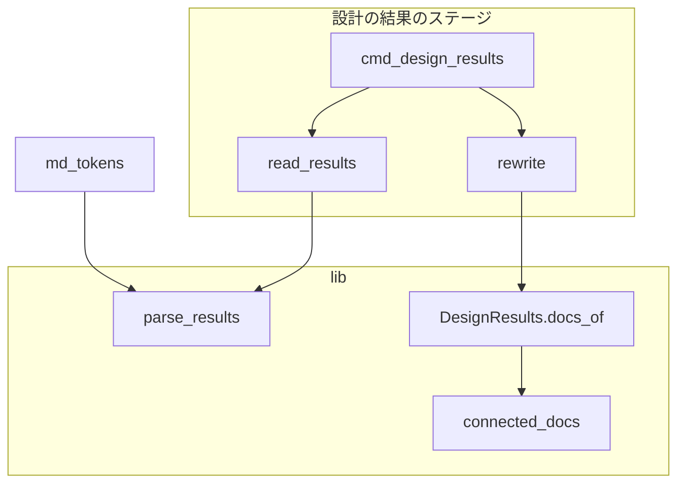
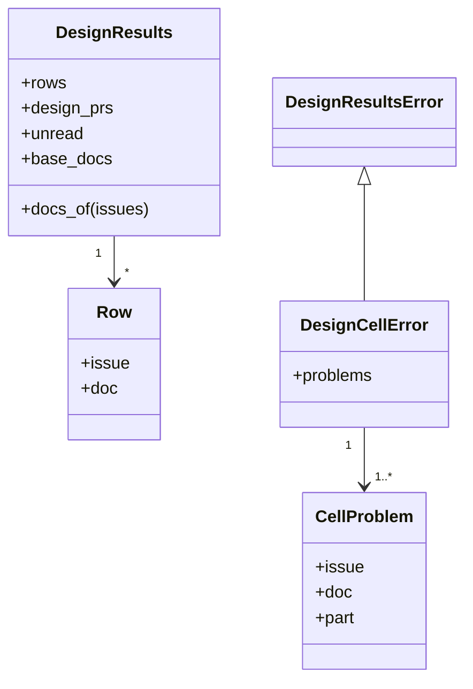
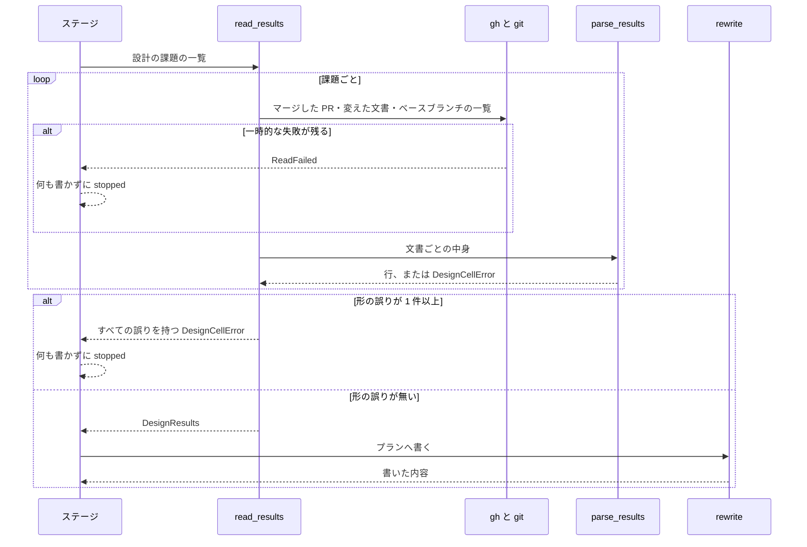

# 設計の結果のステージ: 分割した設計文書の変更が実装から抜けず、触るファイルの書式の外れを実装の前に止める（#2453）

## 目的

- **今どうなっているか**: 実装の指示文の「設計文書:」の行には「設計の結果」の表を持つ文書しか載らず、触るファイルのセルはバッククォートの外を黙って読み飛ばす。`#2436` のスプリントでは 4 本の分割した文書が定める 20 件余りの変更が実装 PR に入らず、スプリントの検査が 4 ラウンドとも同じ 3 件の major を出して収束しなかった
- **誰に効くか**: 分割した設計を流す conductor・実装の worker と、検査の段階で初めて抜けを知る承認者
- **変えると何が成り立つか**: worker は課題の設計文書をすべて受け取る。実装のプランの触るファイルに載らない形で書かれた表は、実装を始める前に止まり、どの文書のどのセルを直すかが結果の要約だけで分かる

## 適用範囲

- **働く範囲**: NDF のリリース対象のスプリントの「設計の結果」のステージ（`supervise.py design-results`）。利用先のリポジトリでも同じに働く
- **プロジェクトごとに違うもの**: ベースブランチは今の引数 `--base` で受ける。設計文書の置き場（`issues/`）と名前の規則は今の取り決めのままで、設定を足さない
- **当たるモード**: `standard`（設計 PR を出し、設計の結果のステージを通るもの）

## あるべき姿の根拠

| 根拠 | 種類 | 何を示すか |
| --- | --- | --- |
| STD1（GFM 仕様の表） | 外部の一次情報 | 表のセルの中身はインラインとして解釈するものであり、コードスパンとリンクの区別はセルの中でも Markdown の規則で決まること |
| LIB1（markdown-it-py 4.2.0） | 外部の一次情報 | 依存に固定済みのパーサーが、セルの字面をコードスパン・文字列・リンクのトークンに分けられること |
| 履歴から消えた設計文書 292 本・今の設計文書の実測（2026-11-06、`origin/develop` 9f40de6a5。`git log --all --diff-filter=D` で得た文書の「実装する」の行を、下の入出力の契約の書式で読んだ） | 実測 | 履歴の 121 行で止まるのは 3 行（`#2436`・`#2086`・`#2216`）、今の `issues/` の 26 行では 0 行。読めるパスが今の読み取りと変わる行は 147 行のうち 0 行であること |

要求と受け入れ条件は #2453 の本文にある（コピーは [issue-2453-requirements.md](issue-2453-requirements.md) ）。この文書は「どう作るか」だけを扱う。

## ドメインモデル

### コンテキスト

| コンテキスト | 何の語が 1 つの意味に決まるか |
| --- | --- |
| NDF の開発ワークフロー（`ndf-workflow`） | 設計の結果・触るファイル・設計文書・分割した文書・セルの形の誤り |

### 集約

| 集約 | 持ち主（書き換えてよいもの） | 根 | エンティティ | 値オブジェクト |
| --- | --- | --- | --- | --- |
| 設計の結果 | 設計の結果のステージ（`supervise_lib/design_stage.py` の `read_results`） | `DesignResults` | 行（`Row`。課題の番号で同一性を持つ） | ベースブランチの設計文書の一覧（`base_docs`）・セルの形の誤り（`CellProblem`） |
| 実装のプラン | 設計の結果のステージ（`design_stage.py` の `rewrite`） | プランの JSON | 実装のステップ | `触るファイル`・`設計文書`・指示文のテンプレートの部分 |

実装のプランは設計の結果を、課題の番号を通して読むだけで書き換えない。

### 不変条件

| # | 集約 | 条件 | 破れたときの扱い |
| --- | --- | --- | --- |
| I1 | 実装のプラン | 表の行を持つ課題の `設計文書` は、行を読んだ文書と、それと番号でつながるベースブランチの設計文書のすべてである | 検査の手前では気づけないため、テストで縛る |
| I2 | 実装のプラン | `設計文書` は表を持つ文書が先頭で、残りはパスの昇順である。同じ入力なら同じ並びで、指示文の「設計文書:」の行は 1 行である | 打ち直すたびに補正の行がテンプレートの行と誤認される。テストで縛る |
| I3 | 実装のプラン | 表を読んだ文書のどれかにセルの形の誤りがあれば、実装のプランと `design-results.json` のどちらも書かれない | `status: stopped`・終了コード 2 で止まり、人へ戻す |
| I4 | 設計の結果 | 行の `files` は、セルの括弧の外のコードスパンの中身だけである | 注記や地の文がパスとして実装のプランへ入る。テストで縛る |
| I5 | 設計の結果 | 「取り込む」「閉じる」の行のセルは読まない | 今の振る舞いのまま。テストで縛る |

### ドメインイベント

| # | イベント | 発生元 | 受け手 |
| --- | --- | --- | --- |
| E1 | 設計 PR がマージされた | 設計承認ゲート | 設計の結果のステージ |
| E2 | 設計の結果のステージが、設計文書をベースブランチから読んだ | `read_results` | セルの形の確認 |
| E3 | 触るファイルのセルの形を確かめた | `parse_results` | `read_results` |
| E4 | 実装のプランと指示文へ、触るファイルとすべての設計文書を書いた | `rewrite` | 実装のステージ |
| E5 | 設計の結果のステージが形の誤りで止まった | `cmd_design_results` | conductor と人 |
| E6 | 人が設計文書を直してステージを打ち直した | 人 | 設計の結果のステージ |
| E7 | worker が載っている設計文書を読んで実装した | 実装のステップ | 実装のステージの検査 |

この文書で「トークン」と書くのは、Markdown パーサーが字面を分けた単位（`code_inline` など）である。

E6 は新しい経路を作らない。読む中身はベースブランチなので、直す PR の種類を問わず、マージの後の打ち直しで E2 へ戻る。

### 用語

| 用語 | 意味 | 用語集への反映 |
| --- | --- | --- |
| 分割した文書 | 1 つの課題の設計を複数ファイルに分けたときの、先頭以外の設計文書（`issue-<番号>-design-<名前>.md`） | 追加 |
| セルの形の誤り | 設計の結果の「実装する」の行の触るファイルのセルが、定めた書式から外れていること | 追加 |

## 外部の調査

| 種類 | 調べるか | 理由 |
| --- | --- | --- |
| 標準・仕様 | 調べる | セルの書式はコードスパンとリンクの解釈に載るため、GFM の定めを確かめる |
| 主要な製品 | 調べない | 触るのは表の 4 列という NDF 固有の書式と、課題番号で文書をまとめる NDF 固有の規則であり、比べる製品の機能が無い |
| ライブラリとサービス | 調べる | セルの読み取りを正規表現で続けるか、Markdown パーサーへ寄せるかを決める |

### 標準・仕様

| # | 標準・仕様 | 何を定めているか | 設計への反映 | 出典 |
| --- | --- | --- | --- | --- |
| STD1 | GitHub Flavored Markdown Spec 0.29-gfm（2019-04-06）の Tables・Code spans | 表のセルはインラインとして解釈する。コードスパンは同じ長さのバッククォートの並びで閉じる | セルの読み取りをインラインのトークンに寄せる。パスに括弧があっても、コードスパンの中は注記として読まない | https://github.github.com/gfm/ （2026-11-06） |

### ライブラリとサービス

| # | 候補 | 版 | ライセンス | 最後のリリースの日付 | 終了のアナウンス | 要件を満たすか | 出典 |
| --- | --- | --- | --- | --- | --- | --- | --- |
| LIB1 | markdown-it-py | 4.2.0 | MIT | 2026-05-07 | 無し | 満たす。`pyproject.toml` の `md` で固定済みで、`lib/md.py` の `md_tokens` がそのまま使える。セルの字面を実際に通し、`code_inline`・`text`・`link_open` に分かれることを確かめた | https://pypi.org/pypi/markdown-it-py/json ・ `gh api repos/executablebooks/markdown-it-py`（2026-11-06） |
| LIB2 | mistune | 3.4.0 | BSD-3-Clause | 2026-10-19 | 無し | 機能は満たすが、依存が 1 つ増える。分類は Beta で、LIB1 の Production/Stable より低い | https://pypi.org/pypi/mistune/json ・ `gh api repos/lepture/mistune`（2026-11-06） |

### 確かめられなかったこと

| 対象 | 試した手段 | 結果と理由 |
| --- | --- | --- |
| 無し | — | 調べた対象はすべて取得できた |

調べた量: 候補 3 件・取得の試み 5 回。

## 機能一覧

| # | 機能 | 誰が使うか |
| --- | --- | --- |
| F1 | 実装のプランと指示文に、課題の設計文書をすべて載せる | 実装の worker |
| F2 | 触るファイルのセルの形の誤りで、実装の前に止まる | conductor と人 |
| F3 | 止まった理由と直し方を、結果の要約だけで読む | conductor と人 |
| F4 | 分割した設計での表の書き方を、設計の手順書で読む | 設計を書く担い手 |

## 構成要素

| 要素 | 責務 |
| --- | --- |
| `plugins/ndf/scripts/lib/design_docs.py` | 文書の名前と番号の規則を持つ。`find_closed` の番号をたどるループを `connected_docs` へ切り出し、パスの一覧にも使えるようにする |
| `plugins/ndf/scripts/lib/design_results.py` | 触るファイルのセルをインラインのトークンで読み、形の誤りを `CellProblem` として返す。`base_docs` を持ち、`docs_of` が先頭の文書と番号でつながる文書を返す |
| `plugins/ndf/scripts/supervise_lib/design_stage.py` | ベースブランチの一覧を `base_docs` へ入れ、すべての文書の形の誤りを集めて止まる |
| `plugins/ndf/skills/design/references/design-template.md` | 「設計の結果の書き方」と「分量」に、分割しても先頭の表へ直に列挙することを書く |
| `plugins/ndf/scripts/tests/test_design_results_rewrite.py` | 受け入れ条件と不変条件のテスト |

変えないもの: `supervise_lib/templates.py` の `impl_prompt` は `design_docs` の一覧を読点で連結済みで、`kept_lines` は書き直しの前後の状態からテンプレートの行を求めるため、一覧の本数が増えても手を入れない。`pr_materials.py` は `design-results.json` の `rows`・`unread`・`design_prs` だけを読むため、キーが増えても影響しない。

図には処理の呼び出しだけを描き、手順書の `design-template.md` とテストのファイルは含めない。

## 構造

`DesignCellError` は既存の `DesignResultsError` の派生である。`cmd_design_results` の既存の `except dr.DesignResultsError` がそのまま受け、`stopped`・終了コード 2 で返す。

## 入出力の契約

### 触るファイルのセルの書式

「実装する」の行のセルを次のとおりに読む。読み取りは `md.md_tokens` の `inline` トークンの子を順に見る。

| 子のトークン | 括弧の外 | 括弧の中 |
| --- | --- | --- |
| コードスパン（`code_inline`） | 中身をパスとして `files` へ入れる | 読まない |
| 文字列（`text`）の全角・半角の丸括弧 | 開きで括弧の中へ入る | 入れ子を数え、閉じで戻る |
| 文字列の読点 `、`・`,`・空白 | 区切りとして読み飛ばす | 読み飛ばす |
| 文字列のそれ以外 | 読めなかった部分 | 注記として読み飛ばす |
| リンク（`link_open`） | 読めなかった部分（リンク先を添える） | 読めなかった部分 |
| その他（`html_inline` など） | 読めなかった部分 | 読み飛ばす |

閉じていない括弧と、開きの無い閉じ括弧も読めなかった部分である。セル全体が空か `—` か `-` のときは `files` を空とし、誤りにしない。

実測の入出力（2026-11-06。試作を `lib/md.py` で実行した出力）:

| セル | `files` | 読めなかった部分 |
| --- | --- | --- |
| `` `a.py`（新設）、`b/` `` | `a.py`・`b/` | 無し |
| `` `app/(g)/p.tsx` `` | `app/(g)/p.tsx` | 無し |
| `` `a.py`（[x](x.md)） `` | `a.py` | `x.md` |
| `` `a.py`, b.py `` | `a.py` | `b.py` |
| `` `a`・`b` `` | `a`・`b` | `・` |

### `supervise.py design-results`

引数と終了コードの意味は変わらない。

| 場面 | 終了コード | `status` | `summary` |
| --- | --- | --- | --- |
| 形の誤りが無い | 0 | `ok` | 今のまま |
| 形の誤りがある | 2 | `stopped` | `設計の結果を書けない: #<番号>（<文書のパス>）の触るファイルのセルを読めない: <読めなかった部分>。パスをバッククォートで囲んで直に列挙し、直した文書をマージしてから打ち直す。人へ戻す` |

読めなかった部分は 1 件あたり先頭の 120 文字までとする。複数のセルは「番号（パス）…: 部分」の並びを `。` でつなぎ、案内は最後に 1 回だけ置く。

### `design-results.json`

キー `base_docs`（文字列の配列）を足す。ベースブランチの `issues/` の直下にある設計文書のパスである。読む側は無いキーを空として扱うため、打ち直す前の JSON も読める。

互換性: 今まで黙って読み飛ばされていたセルは止まるようになる。今の `issues/` の 26 行に該当は無い（根拠の表）。

## 処理の流れ

**`docs_of(issues)` の組み方**

1. `issues` の行の `doc` を課題の順に並べ、重なりを除く（先頭の文書）。行を持つ課題が無ければ空を返す
2. 先頭の文書の名前の番号と、その文書に行を持つすべての課題の番号を種にする
3. `base_docs` のうち種と番号を共有する文書を選び、選んだ文書の名前のほかの番号を種へ足して、増えなくなるまで繰り返す
4. 先頭の文書の後に、残りをパスの昇順で続ける

手順 2 により、`#1` と `#2` の行を持つ表では、どちらのプランも同じ種から同じ一覧になる。行を持たない課題は種にならず、今と同じく `設計文書` は書かれない。

## 非機能の実現方式

| 大項目 | 要求の条件 | 実現方式 | 確かめ方 |
| --- | --- | --- | --- |
| 運用・保守性 | 形の誤りの停止は、ログを開かずにステップの結果の `summary` だけで、どの文書のどのセルを直すかが分かる（受け入れ条件 13） | `summary` へ番号・パス・読めなかった部分・案内を載せ、すべてのセルの誤りを 1 回で並べる | 2 つの文書に誤りを置いて結果の `summary` を見るテスト |

## 決定の記録

### 決定 1: 設計の修正 PR でも抜けないよう、設計文書の一覧をベースブランチの一覧から組む

PR の変更一覧だけを見ると、先頭の文書だけを直した修正 PR で分割した文書が抜ける。`changed_design_docs` はすでにベースブランチの一覧を読んでいるため、その結果を `base_docs` として返す。git の呼び出しは増えない。

`base_docs` は `rewrite` の引数でなく `DesignResults` に持たせる。`rewrite` の入力を 1 つに保ち、書いた `design-results.json` から同じ一覧を再現できるためである。

根拠: Value 7（MVV 版 6）

### 決定 2: 分割した文書を同じ規則で見つけるため、番号のつながりは `design_docs.py` の 1 か所で求める

`find_closed` の番号をたどるループを `connected_docs` へ切り出し、`find_closed` と `docs_of` の両方が呼ぶ。`design-survey.py` のまとまりと同じ結果になる。表の行の課題の番号も種に加え、1 つの表が複数の課題を持つときに同じ一覧を返す。

先頭の文書の番号だけを種にする形は採らない。`issue-1-design.md` の表が `#2` の行を持ち、`issue-2-design.md` もあるとき、`#1` のプランに `#2` の文書が載らず受け入れ条件 7 を満たさない。

根拠: Value 7 / Value 8（MVV 版 6）

### 決定 3: パスの括弧とリンクを取り違えないよう、セルを Markdown パーサーのインラインのトークンで読む

GFM はセルの中身をインラインとして解釈する。リポジトリは `lib/md.py` を唯一のエントリポイントとして markdown-it-py をすでに使っており、依存は増えない。`` `app/(g)/p.tsx` `` のように括弧を含むパスと、括弧の中のリンクの両方を、実測のとおり区別できる。

正規表現の読み取りの延長は採らない。コードスパンを除いてから括弧を見る処理と、リンクの `(…)` を注記と区別する処理を自前で持つことになる。mistune（LIB2）は同じことができるが、依存が増える。

- 作り方: ライブラリやサービスを使う・標準に倣う
- 比べた候補: LIB1 / LIB2 / STD1

根拠: Value 5 / Value 6（MVV 版 6）

### 決定 4: 1 回の直しで済むよう、形の誤りはすべての文書から集めて止まる

直しは文書の PR のマージと打ち直しを伴う。最初の 1 件で止まると、誤りの数だけこの往復が増える。`parse_results` は表の最後まで読んでから `DesignCellError` を出し、`read_results` が課題と文書をまたいで集める。一時的な失敗（`ReadFailed`）が先に起きたときは、それを優先して止まる。

根拠: Value 2（MVV 版 6）

### 決定 5: 無害な注記を止めないよう、括弧の中はリンクだけを止める

履歴の 2 行（「（新設）」「（C7。決定 11。…）」）は注記で、実装のプランから抜けるパスを持たない。括弧の中の語を解釈して委ねているかを判定する規則は持たない。語を見分ける基準が定まらず、無害な注記を承認の後に止めることになるためである。括弧の中の語で委ねる形は未確認のまま残すことへ記す。

括弧の中のコードスパンも読まない。受け入れ条件 15 のとおり、注記を `files` へ載せないためである。

根拠: Value 3（MVV 版 6）

### 決定 6: 手順書の決まりを増やさないよう、分割しても表のセルへ直に列挙する形だけを書く

`design-template.md` の「設計の結果の書き方」の 4 列の説明に、先頭の表へすべてのパスを列挙すること・リンクと語で委ねると止まること・注記は括弧で書けることを足す。分割した文書の「触るファイル」の節に書式を定める形は採らない（要求の S1）。

根拠: Value 5（MVV 版 6）

## テスト設計

実行は `uv run --frozen --project . --all-extras pytest plugins/ndf/scripts/tests/test_design_results_rewrite.py plugins/ndf/scripts/tests/test_sprint_procedures.py -q -n 4`。

| 受け入れ条件・不変条件 | どの振る舞いで縛るか | どう壊したら落ちるべきか |
| --- | --- | --- |
| 1・2・I1 | ベースブランチに 3 本ある課題で、プランの `設計文書` と指示文の「設計文書:」の行に 3 本が載る | `docs_of` が行の文書だけを返すと落ちる |
| 3・I2 | 表を持つ文書が先頭で、残りが昇順である | 全体を昇順にすると、表が `-ndf` にある場面で落ちる |
| 4 | PR が先頭の文書だけを変えても分割した文書が載る | 一覧を PR の変更から組むと落ちる |
| 5 | 表が分割した文書にあるとき、両方が載る | 先頭を `issue-<番号>-design.md` に固定すると落ちる |
| 6 | 要求のコピー・番号を共有しない文書・ベースブランチから消えた文書が載らない | `requirements=True` で読む、番号の照合を外す、一覧を PR の変更と合わせると、それぞれ落ちる |
| 7 | `#1`・`#2` の行を持つ表で両方のプランが同じ一覧になり、取り込むと両方の課題の文書が載る | 種から表の行の番号を外すと落ちる |
| 8 | 分割していない課題の `設計文書` は 1 本で、行を持たない課題には書かれない | 行が無い課題も番号で探すと落ちる |
| 9・I2 | 2 回打っても `設計文書` と指示文が変わらず、補正の行が残り、「設計文書:」の行は 1 行である | 並びを読んだ順にすると落ちる |
| 10・11 | リンク（括弧の中を含む）と括弧の外の語のセルで `stopped`・終了コード 2 になる | 読めなかった部分を捨てると落ちる |
| 12・I3 | 止まったとき、プランのファイルと `design-results.json` が変わらない | 書いてから確かめる順にすると落ちる |
| 13 | 2 つの文書の誤りが 1 つの `summary` に番号・パス・部分・案内つきで載り、文書を直した後の打ち直しが通る | 最初の 1 件で止めると落ちる |
| 14 | `#2436` の実物のセルをテストのデータへコピーして止まることを確かめる（CI の clone が履歴を持つとは限らないため、`git show` に頼らない） | リンクの判定を外すと落ちる |
| 15・I4 | 読点・`,`・注記・空・`—` のセルが止まらず、`files` がコードスパンの中身だけである | 括弧の中のコードスパンを読むと落ちる |
| 16・I5 | 「取り込む」「閉じる」の行のセルに語があっても止まらない | 扱いを問わず読むと落ちる |
| 17 | 差分で見る（`.md` の文言を照合するテストは書かない） | — |

## 設計の結果

| 課題 | 扱い | 取り込み先 | 触るファイル |
| --- | --- | --- | --- |
| #2453 | 実装する | — | `plugins/ndf/scripts/lib/design_docs.py`、`plugins/ndf/scripts/lib/design_results.py`、`plugins/ndf/scripts/supervise_lib/design_stage.py`、`plugins/ndf/scripts/tests/test_design_results_rewrite.py`、`plugins/ndf/skills/design/references/design-template.md` |

## 未確認のまま残ること

| 項目 | 内容 |
| --- | --- |
| 括弧の中の語で委ねる形 | `` `a.py`（残りは別の文書） `` は止まらず、抜けが残る。実測で該当は 0 行である（履歴の注記 2 行はどちらも委ねていない）。出現したら別の課題で判断する |
| 「扱い」の列の外れ | 要求の範囲外で、文書ごと「読めなかった」のまま流れる。別の課題にするかは設計承認ゲートで決める（要求の未決） |
| 表の無い課題の文書 | 「読めなかった」課題には今と同じく `設計文書` が載らない |
| 分割した文書の触るファイルと先頭の表の一致 | 列挙の抜け自体は機械で確かめない。設計 PR のレビューが見る |
| 止まる位置 | 設計承認ゲートの後である。止める側の採用と止まる位置は、要求の未決のとおり設計承認ゲートで利用者が確かめる |
