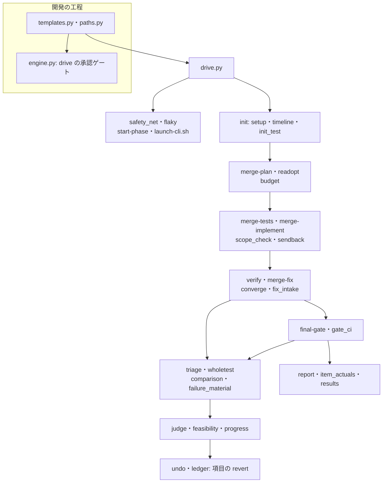
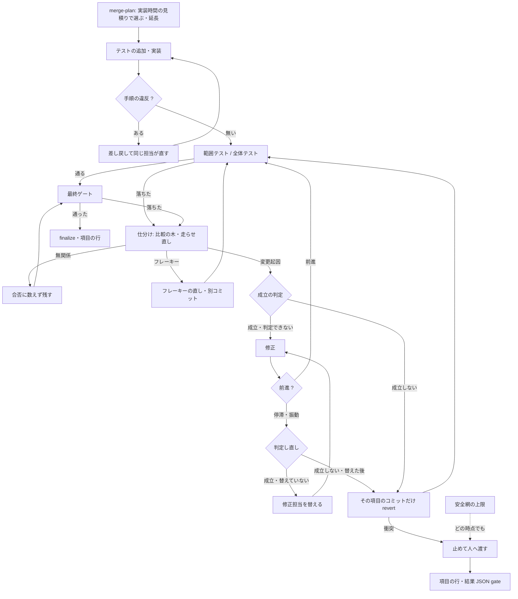
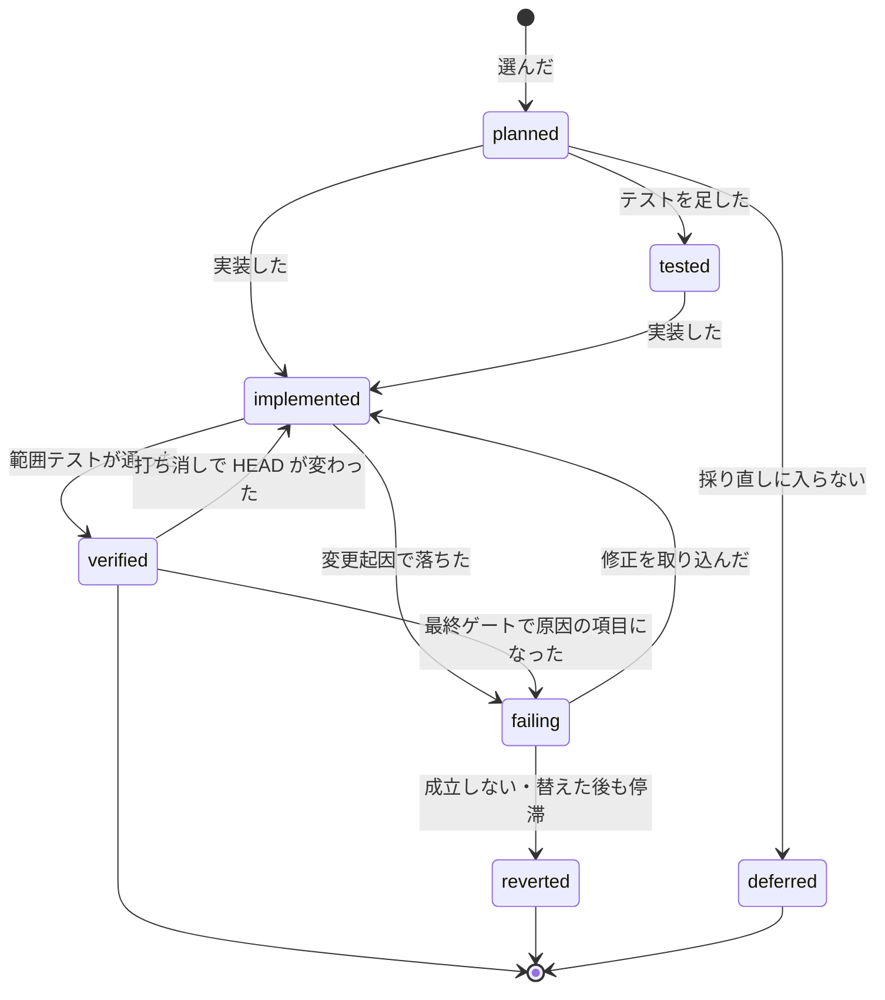

# cross-refactoring: 選んだ改善項目を最後まで入れ切り、予算は選ぶ件数を決めるためだけに使う（#2457）

## 目的

- **今どうなっているか**: `--budget-minutes`（既定 30 分）から、選ぶ件数に加えて手順ごとの上限・修正の打ち切り・最終ゲートの締め切りまでを逆算している。テストの失敗・範囲のはみ出し・記名の欠けは項目を取り消す理由になる。PR https://github.com/devbasex/ai-plugins/pull/2452 では 5 項目を実装して範囲テストも通したが、無関係なテスト 1 件の失敗で採用 0 件・起点の木へ戻して終わった
- **誰に効くか**: cross-refactoring を工程の 1 つ（検査のプラン）か単独で走らせる開発者と conductor
- **変えると何が成り立つか**: 予算は「実装時間の見積りの合計がいくつまでの項目を選ぶか」にだけ使う。選んだ項目は、成立しないと判定したときと安全網の上限に当たったときを除いて取り消さず、直し切って最終ゲートまで進む。項目ごとの見積りと実装時間が実行ごとに残る

## 適用範囲

- **働く範囲**: NDF のリリース対象（`plugins/ndf/skills/cross-refactoring/`・`plugins/ndf/contracts/limits.json`・検査のプランの雛形）である。利用先のリポジトリで cross-refactoring を走らせたときも同じに働く
- **プロジェクトごとに違うもの**: 実装の予算は今どおり `--budget-minutes` か `.ndf/supervise.json` の `refactor_budget_minutes` で受ける。予算の延長と安全網の倍率・停滞と振動の定義は `limits.json` の既定を持ち、安全網の上限だけ引数 `--safety-net-minutes` でも受ける。テストと CI の待ちの上限は今どおり宣言（`.ndf/project.json` の `test`）の所要から決まる
- **当たるモード**: `standard`

## あるべき姿の根拠

| 根拠 | 種類 | 何を示すか |
| --- | --- | --- |
| PR 2452 の完了判定で、範囲テストを通した 5 項目が、ベースブランチの取り込みで落ちた無関係なテスト 1 件のために、すべて起点の木へ戻された（#2457 の本文「起きたこと」・コミット `695946cb1`） | 実測 | 失敗を取り消しの理由にする設計が、通っていた項目を消す |
| 見送り 26 件はすべて `budget`。30 分のうち固定でかかる時間が中央値で約 25 分、実装に回るのは 5 分前後（#2202 の分析） | 実測 | 実装以外の時間を予算に数えると、選ぶ件数がテストと CI の所要で決まる |
| 「制約は案出し・選定のみ、選定した項目はやり通す」（判断 600325f3195d、2026-11-03） | 利用者の指示の原文（AI の記録） | 制約を実装の後へ掛けない |
| エージェントの停滞を「同じ行動と観測の繰り返し」と「交互の繰り返し」で検知し、回数でなく形で止める（STD なし。PRD1） | 外部の一次情報 | 回数の上限を置かず、停滞と振動の形で止める |
| `git revert` は指定したコミットの変更だけを打ち消すコミットを積む（STD1） | 外部の一次情報 | 項目のコミットだけを打ち消せば、取り込んだベースブランチの変更は残る |

要求と受け入れ条件は #2457 の本文にある（コピーは [issue-2457-requirements.md](issue-2457-requirements.md) ）。この文書は「どう作るか」だけを扱う。受け入れ条件の番号はコピーの「受け入れ条件」の 1〜21 を指す。

| 分けた文書 | 持つもの |
| --- | --- |
| [issue-2457-design-constraints.md](issue-2457-design-constraints.md) | 棚卸しの C・D の各行の処置と今の位置 |
| [issue-2457-design-decisions.md](issue-2457-design-decisions.md) | 決定の記録 |

## ドメインモデル

### コンテキスト

| コンテキスト | 何の語が 1 つの意味に決まるか |
| --- | --- |
| cross-refactoring（`ndf-cross-refactoring`） | 実装の予算・実効の予算・実装時間・予算の延長・リファクタリングの成立・判定の担い手・無関係な失敗・停滞・振動・安全網の上限・比較の木・差し戻し・落ちたテストの材料 |
| 開発の工程（`ndf-workflow`） | プラン・ステップ・ステップの延長・承認ゲート・欠け |

関係は公開された言語である。cross-refactoring の駆動（`drive.py`）は 2 つで開発の工程へ伝える。共通の結果 JSON（`lib/step_result.py` の `status`・終了コード・`gaps`）と、ステップの延長のファイルである。開発の工程は cross-refactoring の状態ファイルを読まない。

### 集約

| 集約 | 持ち主（書き換えてよいもの） | 根 | エンティティ | 値オブジェクト |
| --- | --- | --- | --- | --- |
| リファクタリングの実行 | `refactor.py` の各コマンド（`refactor_lib/commands/`） | 状態ファイル（`state.json`） | 改善項目（`items[]`） | 実装の予算（`budget`）・安全網の上限（`safety_net`）・落ちたテストの集合・成立の判定・落ちたテストの材料 |
| 配分の履歴 | `refactor_lib/allocation.py` の書き込み口（`append_row`）だけ。呼ぶ側は行の種類ごとに 1 つに決まる: 実行の行は `refactor.py report`、着手前のテストの行は `refactor.py init`（`init_test.append_init_test`）、項目の行は `item_actuals.write`（`finalize` と止まる出口から呼ぶ）。どの行も追記だけで、書いた行を書き換えない | 履歴のファイル（`cross-refactoring-allocation.jsonl`） | 行（`kind: run` / `init_test` / `item`） | 見積り・実装時間 |
| 駆動の結果 | `cross-refactoring/scripts/drive.py` | 結果 JSON | 項目の状態（`items[0].refactor_items[]`） | 終了コード・件数（`metrics`） |

改善項目はリファクタリングの実行の中のエンティティで、別の集約にしない。取り消しと修正の判定が、同じ実行のほかの項目の状態（同じ範囲テスト・打ち消しの順序）を見るためである。

### 不変条件

| # | 集約 | 条件 | 破れたときの扱い |
| --- | --- | --- | --- |
| I1 | リファクタリングの実行 | 採っていて取り消していない項目（採り直しで採った項目を含む）の見積り（テストの追加と実装の和。検証を含めない）の合計は、実効の予算（延長した後の値）以下である。見積りにテストの実行・CI の待ち・経過時間・実装時間の実績を入れない | 選定の単体テストで落とす |
| I2 | リファクタリングの実行 | 予算を延ばすのは、グレード `high` の候補の見積りの和 S が予算 B を超え、2B 以下のときだけで、延ばした後の値は `ceil(S)` 分である。延ばしたら理由と前後の値を `budget.extension` に残す | 選定の単体テストで落とす |
| I3 | リファクタリングの実行 | 予算を読むのは選定（`merge-plan` と採り直しの `readopt`）だけである。選定の外で予算から導いてよい値は安全網の上限（実効の予算 × 倍率）だけである | 時間の上限の表の単体テストで落とす |
| I4 | リファクタリングの実行 | 項目の `status` を `reverted` にする理由は `infeasible`（成立しないと判定した）か `stalled_after_switch`（修正担当を替えた後も停滞か振動した）の 2 つだけである | 取り消しの経路の単体テストで落とす |
| I5 | リファクタリングの実行 | 打ち消しは、打ち消す項目のコミットだけを新しい順に `git revert` する。`reset --hard` で未公開のコミットを外す・起点の木へ戻すコミットを積む経路は無い | git の一時リポジトリの結合テストで落とす |
| I6 | リファクタリングの実行 | 修正 1 回ごとの落ちたテストの集合 F(n) を、同じ項目の履歴と比べる。F(n) = F(n−1) なら停滞、F(n) が F(0)〜F(n−2) のどれかと等しければ振動、それ以外は前進。前進の間は回数の上限なく修正を続ける | 判定の単体テストで落とす |
| I7 | リファクタリングの実行 | 成立の判定と判定し直しは、実装担当と別のランタイムが行う。修正担当を替えるのは 1 項目に 1 回だけである | 判定の担い手の選び方の単体テストで落とす |
| I8 | リファクタリングの実行 | コーディングの CLI（テストの追加・実装・修正・最終ゲート修正・フレーキーの直し）の起動ごとの秒（監視の開始から終わり）を、各起動 1 回ずつ累計する（決定 5）。累計が安全網の上限に届いたら、項目を取り消さずに止まる。止めた後に新しいコーディングの CLI を起動しない | 駆動の単体テストで落とす |
| I9 | リファクタリングの実行 | 打ち消しが衝突したら、打ち消しの前の HEAD へ戻して止まる。衝突した項目をほかの理由で外さない | git の一時リポジトリの結合テストで落とす |
| I10 | リファクタリングの実行 | 比較の木（HEAD から取り消していない改善項目のコミットをすべて外した木）でも落ちるテストは無関係な失敗で、項目の合否と停滞の判定に数えない | 無関係な失敗の結合テストで落とす |
| I11 | リファクタリングの実行 | 最終ゲートは確かめを省いて `passed` を返さない。木が起点と同じでも確かめを走らせる | 最終ゲートの単体テストで落とす |
| I12 | 配分の履歴 | 改善項目を採った実行は、終わり方（最終ゲートの通過・安全網・中断）を問わず、採った項目ごとに 1 行（`kind: item`）を書く | 記録の単体テストで落とす |
| I13 | リファクタリングの実行 | push はオーケストレーターだけが行い、`--force`・`--no-verify` を使わない。送るコミットは状態ファイルに記録した残すコミットだけである | 今のテスト（`test_publish*`）をそのまま通す |
| I14 | リファクタリングの実行 | フレーキーの直しは改善項目と別のコミット（トレーラー `Flaky-Fix`）で、項目の合否・停滞の判定・項目の実装時間に数えない | 駆動の単体テストで落とす |

### ドメインイベント

| # | イベント | 発生元 | 受け手 |
| --- | --- | --- | --- |
| E1 | 提案を集めた | `refactor.py merge-proposals` | `merge-plan` |
| E2 | 改善項目を選んだ（見積りは実装時間だけ） | `refactor.py merge-plan` | テストの追加・実装の起動（`drive.py`） |
| E3 | 実装の予算を延ばした | `merge-plan`（選定の中） | 結果 JSON・報告・リファクタリング計画のコメント |
| E4 | 改善項目を実装した（実装時間を計った） | `merge-tests` / `merge-implement` | `verify`・差し戻し |
| E5 | テストが落ちた | `verify` / `final-gate` | 仕分け（`triage`） |
| E6 | 落ちたテストを仕分けた | `triage` | フレーキーの直し・成立の判定・修正の起動 |
| E7 | フレーキーなテストを直した | `merge-flaky-fix` | `verify` / `final-gate`（同じ確かめを打ち直す） |
| E8 | 改善項目の成立を判定した | `refactor.py judge` | 修正の起動・打ち切り |
| E9 | 改善項目を修正した | `merge-fix` / `merge-final-fix` | `verify` / `final-gate` |
| E10 | 修正の停滞か振動を検知した | `verify` / `final-gate`（`progress.compare`） | `judge`（判定し直し） |
| E11 | 改善項目を打ち切った（そのコミットだけを打ち消した） | `undo.revert_items` | `verify`（残りの項目の確かめ直し）・報告 |
| E12 | 最終ゲートを通した | `final-gate` | `finalize` |
| E13 | 安全網の上限に当たり、変更を残して人へ渡した | `safety_net.check`（コーディングの起動の前と監視の上限） | `drive.py`（`status: gate`）・実績の記録 |
| E14 | 項目ごとの実績を記録した | `item_actuals.write`（`finalize` と止まる出口） | 配分の履歴・次回の `merge-plan` |

### 用語

| 用語 | 意味 | 用語集への反映 |
| --- | --- | --- |
| 実装の予算 | `--budget-minutes` の値（既定 60 分）。採る項目の見積り（テストの追加と実装の和）の合計の上限で、選定にだけ使う | 意味の変更（既定の値と見積りの内訳を足す） |
| 実効の予算 | 予算の延長を当てた後の実装の予算。延ばさなければ実装の予算と同じ | 追加 |
| 比較の木 | HEAD から、取り消していない改善項目のコミットをすべて外した木。着手の後に取り込んだベースブランチの変更を含む。無関係な失敗の見分けに使う | 追加 |
| 差し戻し | 改善項目の中の手順の違反（記名の欠け・期待値の欠け・文言を固定するテスト・計画に無いコミット）を、項目を取り消さずに担当へ直させること | 追加 |
| 落ちたテストの材料 | 落ちたテストの ID・ログの置き場・走らせ直すコマンドの組。JUnit を読めないときもログから組み、修正と成立の判定へ渡す | 追加 |
| 判定の担い手 | 成立の判定と判定し直しを行うランタイム。参加者のうち実装担当でない者を、ホスト → 参加者の順で選ぶ | 追加 |
| 想定最大時間 | 実行全体の所要の上限。実装の予算に置き換わる | 廃止（実装の Pull Request で、確定仕様の書き換えと同じ差分で用語集から外す） |
| 想定最大時間の下限 | 予算から逆算した締め切りの語。仕組みごと無くなる | 廃止（実装の Pull Request で、確定仕様の書き換えと同じ差分で用語集から外す） |
| 想定最大時間の出所 | 予算から逆算した締め切りの語。仕組みごと無くなる | 廃止（実装の Pull Request で、確定仕様の書き換えと同じ差分で用語集から外す） |
| 手順の枠 | 予算から逆算した締め切りの語。仕組みごと無くなる | 廃止（実装の Pull Request で、確定仕様の書き換えと同じ差分で用語集から外す） |
| 使える時間 | 予算から逆算した締め切りの語。仕組みごと無くなる | 廃止（実装の Pull Request で、確定仕様の書き換えと同じ差分で用語集から外す） |
| 実装の終わり | 予算から逆算した締め切りの語。仕組みごと無くなる | 廃止（実装の Pull Request で、確定仕様の書き換えと同じ差分で用語集から外す） |
| 想定最大時間の終わり | 予算から逆算した締め切りの語。仕組みごと無くなる | 廃止（実装の Pull Request で、確定仕様の書き換えと同じ差分で用語集から外す） |
| 確かめの見込み | 予算から逆算した締め切りの語。仕組みごと無くなる | 廃止（実装の Pull Request で、確定仕様の書き換えと同じ差分で用語集から外す） |
| 確かめの開始の締め切り | 予算から逆算した締め切りの語。仕組みごと無くなる | 廃止（実装の Pull Request で、確定仕様の書き換えと同じ差分で用語集から外す） |
| 打ち切りの後の取り消し | 締め切りか衝突で項目を外す取り消しの語。仕組みごと無くなる | 廃止（実装の Pull Request で、確定仕様の書き換えと同じ差分で用語集から外す） |
| 積み直し | 締め切りか衝突で項目を外す取り消しの語。仕組みごと無くなる | 廃止（実装の Pull Request で、確定仕様の書き換えと同じ差分で用語集から外す） |
| 積み直しの起点 | 締め切りか衝突で項目を外す取り消しの語。仕組みごと無くなる | 廃止（実装の Pull Request で、確定仕様の書き換えと同じ差分で用語集から外す） |
| 外した項目 | 締め切りか衝突で項目を外す取り消しの語。仕組みごと無くなる | 廃止（実装の Pull Request で、確定仕様の書き換えと同じ差分で用語集から外す） |

## 外部の調査

| 種類 | 調べるか | 理由 |
| --- | --- | --- |
| 標準・仕様 | 調べる | 項目のコミットだけを打ち消す操作の仕様（git）を確かめる |
| 主要な製品 | 調べる | コーディングエージェントが停滞・振動をどう検知して止めるか、ビルドツールがフレーキーをどう見分けるかを比べる |
| ライブラリとサービス | 調べる | JUnit の読み取りとフレーキーの走らせ直しを、自前の部品の代わりに既存のライブラリで賄えるかを決める |

### 標準・仕様

| # | 標準・仕様 | 何を定めているか | 設計への反映 | 出典 |
| --- | --- | --- | --- | --- |
| STD1 | git-revert | 指定したコミットの変更を打ち消す新しいコミットを積む。worktree が清潔であることを求める | 打ち消しを `git revert` だけにする（決定 6）。打ち消しの前に未コミットの変更を捨てる | https://git-scm.com/docs/git-revert （2026-11-09） |

### 主要な製品

| # | 製品 | どう解いているか | 設計への反映 | 出典 |
| --- | --- | --- | --- | --- |
| PRD1 | OpenHands Software Agent SDK の停滞検知（`StuckDetector`） | 回数の上限ではなく形で止める。同じ行動と観測の繰り返し（既定 4 回）・同じ行動と誤りの繰り返し（3 回）・交互の繰り返し（6 回）を停滞とみなす | 停滞（同じ集合が続く）と振動（前の集合へ戻る）の 2 つの形で判定し、回数の上限を置かない（決定 4） | https://github.com/OpenHands/software-agent-sdk/blob/main/openhands-sdk/openhands/sdk/conversation/stuck_detector.py と同じリポジトリの `openhands-sdk/openhands/sdk/conversation/types.py`（2026-11-09） |
| PRD2 | Bazel の `--flaky_test_attempts` | 落ちたテストを指定の回数まで走らせ直し、2 回目以降で通ったテストを `FLAKY` と表示する | 今の見分け（落ちたテストだけを走らせ直して通ればフレーキー）を変えない。見分けた後に直すのは #2458 の規則に寄せる | https://bazel.build/reference/command-line-reference （2026-11-09） |

### ライブラリとサービス

| # | 候補 | 版 | ライセンス | 最後のリリースの日付 | 終了のアナウンス | 要件を満たすか | 出典 |
| --- | --- | --- | --- | --- | --- | --- | --- |
| LIB1 | junitparser | 5.0.3 | Apache-2.0 | 2026-09-01 | 無し | 一部。JUnit XML が在るときの読み取りは賄えるが、JUnit を読めないとき（AC13）のログからの材料の組み立ては賄わない。今の読み取り（`lib/test_triage.py`）は既に動いている | `curl -s https://pypi.org/pypi/junitparser/json`（2026-11-09） |
| LIB2 | pytest-rerunfailures | 16.7 | MPL-2.0 | 2026-09-17 | 無し | 満たさない。pytest に限られ、利用先のリポジトリのテストのランナーを問わない今の見分けに置き換えられない | `curl -s https://pypi.org/pypi/pytest-rerunfailures/json`（2026-11-09） |

### 確かめられなかったこと

| 対象 | 試した手段 | 結果と理由 |
| --- | --- | --- |
| OpenHands 本体のリポジトリの停滞検知 | `gh api repos/OpenHands/OpenHands/contents/openhands/controller/stuck.py` | HTTP 404。停滞検知は SDK のリポジトリへ移っており、SDK の側を出典にした |

調べた量: 候補 5 件・取得の試み 17 回。

## 機能一覧

| # | 機能 | 誰が使うか |
| --- | --- | --- |
| F1 | 実装時間の見積りだけで、予算に収まる改善項目を順位の順に選ぶ（既定 60 分） | cross-refactoring を起動する開発者・検査のプラン |
| F2 | 順位の高い候補が境目で切れるとき、2 倍までの範囲で予算を延ばす | 同上 |
| F3 | 実装・修正の中の手順の違反を、取り消さずに差し戻して直させる | 実装担当 |
| F4 | 落ちたテストを無関係・フレーキー・変更起因に分け、無関係な失敗を合否に数えない | 実装担当・修正担当 |
| F5 | 変更起因の失敗が出た項目の成立を、別のランタイムが判定する | 判定の担い手 |
| F6 | 前進する限り修正を続け、停滞か振動で判定し直し、修正担当を 1 回替える | 実装担当・判定の担い手 |
| F7 | 安全網の上限に当たったら、変更を残して人へ渡す | conductor・開発者 |
| F8 | 項目ごとの見積りと実装時間を、終わり方を問わず配分の履歴へ残す | 次回の選定・`/ndf:estimate`・#2205 の集計 |

## 構成要素

パスは `plugins/ndf/skills/cross-refactoring/scripts/` からの相対で、`refactor_lib/` はその下のディレクトリを指す。

| 要素 | 責務 |
| --- | --- |
| `refactor_lib/budget.py`（変える） | 見積り（テストの追加と実装の和）・順位・選定・予算の延長。バッファ・使える時間・実装の終わり・修正の終わりの関数を消す |
| `refactor_lib/timeline.py`・`refactor_lib/init_test.py`・`refactor_lib/commands/setup.py`（変える。`init`） | 時間の上限の表を予算から導かない。テストと CI の待ちの上限は共通ライブラリ `plugins/ndf/scripts/lib/test_strategy.py` の `limits` を予算なし（`budget_minutes=None`。supervise と同じ `3·max(w, m)`・`3·c`・所要が無ければ既定の秒）で呼んで得る。手順の枠・想定最大時間の下限・`SKIP=window` を消す。着手前のテストの上限での打ち切り（`init-timeout`）はハングの検知として残す |
| `refactor_lib/commands/phases.py`（変える。`start-phase`）・`launch-cli.sh`（変える） | 提案・計画・判定の手順の監視の上限は `limits.json` の `monitor.phase.<手順>` の秒、コーディングの手順（テストの追加・実装・修正・最終ゲート修正・フレーキーの直し）は安全網の残りにする。プロンプトへ渡す `RF_END_AT` を消す |
| `refactor_lib/commands/catch_up.py`・`refactor_lib/pause.py`・`refactor_lib/culprit.py`（変える） | 再開で締め切りをずらす処理と、原因の項目を決める走らせ直しの締め切り（`fix_deadline`）を消す。止まっていた時間は安全網の累計に入れない（コーディングの起動の秒だけを数えるため） |
| `refactor_lib/commands/plan.py`（変える。`merge-plan`） | 新しい選定と延長を呼び、`budget` と `safety_net` を状態ファイルへ書く。使える時間 0 分以下で止まる経路を消す |
| `refactor_lib/commands/readopt.py`（変える） | 採り直しを選定の 1 つとして扱い、残りを「実効の予算 − 採っていて取り消していない項目の見積りの和」で数える（I1）。実装時間の実績は使わない |
| `refactor_lib/sendback.py`（新しい） | 差し戻しの材料（違反の種類・コミット・ファイル・直し方の 1 行）を組み、次の起動のプロンプトへ渡す。純粋な処理 |
| `refactor_lib/commands/implement.py`（変える。`merge-tests`・`merge-implement`） | 記名の欠け・期待値の欠け・文言を固定するテスト・計画に無いコミット・今のコードで落ちる足したテストを、取り消しではなく差し戻しにする。範囲の外の変更は記録だけにする |
| `refactor_lib/scope_check.py`（変える） | 範囲の外で変えたファイルを分類して返すだけにし、取り消しの判断を持たない（`outside_scope` として報告とレビューへ引き継ぐ） |
| `refactor_lib/progress.py`（新しい） | 落ちたテストの集合の履歴から前進・停滞・振動を返す。純粋な処理 |
| `refactor_lib/feasibility.py`（新しい）・`refactor_lib/commands/judge.py`（新しい）・`prompts/judge.md`（新しい） | 判定の担い手を選び、読み取り用の作業ディレクトリで CLI を起動し、`{"item", "feasible", "reason", "evidence"}` の答えを読んで項目の `feasibility[]` へ積む |
| `refactor_lib/comparison.py`（新しい） | 比較の木を一時の detach の worktree に作り（取り消していない項目のコミットを新しい順に `git revert --no-commit`）、落ちたテストをそこで走らせて無関係な失敗を見分ける |
| `refactor_lib/failure_material.py`（新しい） | 落ちたテストの材料を組む。ID は JUnit → ログの要約の行（`FAILED` / `ERROR`）の順に取り、置き場はログのパスか CI の run の URL、コマンドは範囲テストのテンプレートか全体テスト |
| `refactor_lib/commands/converge.py`（変える。`verify`） | 締め切りでの取り消し・共有した範囲テストの新しい順の取り消しを消し、仕分け → 成立の判定 → 修正 → 前進の判定の繰り返しに置き換える。危険フラグの全体テストを直した後に走らせ直してよい |
| `refactor_lib/fix_intake.py`（変える。`merge-fix`） | `unfixed` を取り消しでなく「前進なし」に数える。手順を外れたコミットだけを差し戻しにする |
| `refactor_lib/triage.py`・`refactor_lib/wholetest.py`（変える） | 着手前の HEAD との比較を比較の木との比較に替える。JUnit を読めないときは落ちたテストの材料で仕分ける。危険フラグの項目をまとめて取り消す経路を消す |
| `refactor_lib/commands/gate.py`・`refactor_lib/gate_ci.py`（変える。`final-gate`） | 確かめの開始の締め切り・`check_skipped`・単独起動の終了コード 1 を消す。CI の待ちの上限を `max(3·c, 下限)` にする。変更起因を原因の項目へ結べれば項目の修正へ、結べなければ最終ゲート修正へ回し、どちらも前進の判定を通す |
| `refactor_lib/stop_revert.py`（消す） | 打ち切りの後の取り消しと起点への戻しを持っていた。経路ごと無くなる |
| `refactor_lib/undo.py`・`refactor_lib/ledger.py`（変える） | 打ち消しを項目のコミットの `git revert` だけにする。衝突したら打ち消しの前の HEAD へ戻して `UndoConflict` を返す（外す・積み直す経路を消す） |
| `refactor_lib/safety_net.py`（新しい） | コーディングの起動ごとの秒（監視の開始から終わり）を累計し、上限との残りを返す。起動の監視の上限をこの残りで切る |
| `refactor_lib/item_actuals.py`（新しい） | 項目の行（`kind: item`）を配分の履歴へ追記する。`finalize` と止まる出口（安全網・中断）から呼ぶ |
| `refactor_lib/commands/flaky.py`（新しい）・`prompts/flaky-fix.md`（新しい） | フレーキーと見分けたテストの直しを実装担当に 1 回依頼し、`Flaky-Fix` のコミットを残すコミットとして台帳へ記録する |
| `drive.py`（変える） | 判定・フレーキーの直しの手順を駆動の繰り返しへ入れる。安全網で止まったら `status: gate`・終了コード 10 で返す。子プロセスを起動する前に、ステップの延長のファイルへその上限を書く |
| `refactor_lib/results.py`（変える） | 結果 JSON の `metrics` と `items[0].refactor_items[]` を組む（入出力の契約） |
| `prompts/implement.md`・`fix.md`・`final-fix.md`・`add-tests.md`（変える） | 「直せなければ戻して次へ」「振る舞いを変えないと直せないなら終える」「範囲の外を変えない」を、成立しない理由を答えに書く形と差し戻しの節に置き換える |
| `plugins/ndf/contracts/limits.json`（変える） | `cross-refactoring.default-budget` を 3600 秒にする。`cross-refactoring.budget-extension`（`factor: 2`）・`cross-refactoring.safety-net`（`factor: 2`）・`cross-refactoring.fix-progress`（`stagnation_same_sets: 2`・`oscillation_lookback: 0`。0 は「前に見たすべての集合」）・`monitor.phase.judge`・`monitor.phase.flaky-fix` を足す |
| `refactor_lib/commands/report.py`（変える。`finalize`・`report`） | 報告から「想定最大時間との差」「バッファを越えた全体テスト」「最終ゲートの確かめを省いた」の行を消し、延長・判定・差し戻し・範囲の外のファイル・止めた理由の行を足す |
| `plugins/ndf/scripts/supervise_lib/templates.py`・`supervise_lib/paths.py`（変える） | `refactor` のステップの `timeout` を「実効の予算 ×（1 + 安全網の倍率）」の秒に `with_margin` を足した値にし、子プロセスの上限で足りない分は駆動がステップの延長で延ばす（決定 8） |
| `plugins/ndf/scripts/supervise_lib/engine.py`（変える） | 終了コード 10〜19 を承認ゲートとして扱う判定（`is_gate`）を、`run` のステップに加えて `drive` のステップにも当てる。今は `drive` の 10 が `on_fail`（`abort`）へ進み、人へ渡す止まりが失敗として記録される |
| SKILL.md・`docs/01`〜`04`・`references/design-principles.md`・`docs/specifications/cross-refactoring-*.md`・`docs/glossary/glossary.json`（変える） | 変わった振る舞いと語に合わせる |

### 呼び出しの関係

図に含めない要素: プロンプト・`limits.json`・文書（SKILL.md・`docs/`・確定仕様・用語集）は読まれる側で、呼び出しの関係を持たない。`catch_up.py`・`pause.py`・`culprit.py` は締め切りの処理を消すだけで、呼び出しの関係は変わらない。`stop_revert.py` は消す。

## データ構造

状態ファイルの変える部分（版を 3 へ上げる。版 2 の状態ファイルは今どおり「旧い状態ファイル」で止まる）。

| 場所 | 列 | 型 | 空を許すか | 意味 |
| --- | --- | --- | --- | --- |
| `budget` | `minutes` | int | 許さない | 実装の予算（分） |
| `budget` | `source` | `explicit` / `default` | 許さない | 引数か既定か（`floor` は無くなる） |
| `budget` | `effective_minutes` | int | 許さない | 実効の予算 |
| `budget` | `extension` | object | 許す | 空は「延ばしていない」。`{from, to, reason, high_minutes}` |
| `safety_net` | `limit_minutes` / `used_seconds` / `halted_at` | number / number / ISO 時刻 | `halted_at` だけ許す | 上限・累計・止めた時刻。空は「止めていない」 |
| `items[]` | `feasibility[]` | array | 許さない（空の配列） | `{by, feasible, reason, evidence, at, rejudge}` を積む |
| `items[]` | `fix_history[]` | array | 許さない（空の配列） | `{round, by, failing, progress}`。`failing` は落ちたテストの ID の並び（無関係とフレーキーを除く） |
| `items[]` | `fixer` / `fixer_switched` | str / bool | 許さない | 今の修正担当と、替えたかどうか |
| `items[]` | `outside_scope` | array | 許さない（空の配列） | 範囲の外で変えたファイルと分類 |
| `items[]` | `sendbacks[]` | array | 許さない（空の配列） | 差し戻しの種類・コミット・回 |
| `items[]` | `coding_seconds` | object | 許さない | `{test, implement, fix}`。fix は起動の秒を対象の項目の数で等分して足す |
| `flaky_fixes[]` | — | array | 許さない（空の配列） | `{test_id, commit, by, result}` |
| 消す列 | `limits` の締め切りの鍵（`fix_end_at`・`final_end_at`・`gate_seconds`・`final_fix_seconds`）・`plan.reserve`・`window_stopped_at`・`final_gate.check_skipped`・`final_gate.stop_revert`・`drops[].ejected` | — | — | 書かない。版 2 の状態ファイルを読まないため移行は無い |

配分の履歴へ足す行（追記だけ。時系列は事象の記録として積み、書き換えない）。

| 列 | 型 | 空を許すか | 意味 |
| --- | --- | --- | --- |
| `kind` | `"item"` | 許さない | 項目の行 |
| `run_id` / `repo` / `pr` / `at` | str / str / int / ISO 時刻 | 許さない | 実行を識別する |
| `item_id` / `target` / `technique` / `tier` | str | 許さない | `I-001`・`<ファイル>#<シンボル>`・手法・グレード |
| `estimate_minutes` | `{test, implement}` | 許さない | 選定に使った見積り |
| `coding_seconds` | `{test, implement, fix}` | 許さない | 実績。起動しなかった手順は 0 |
| `status` | str | 許さない | 終わったときの表示の状態（採用・取り消し・未確認など） |
| `end` | `final_gate` / `safety_net` / `aborted` | 許さない | 実行の終わり方 |
| `budget_minutes` / `effective_budget_minutes` | int | 許さない | 実行の予算 |

配分テーブルの集計（`allocation.py`）は今どおり実行の行（`kind: run`）だけを読み、項目の行を読まない。項目の行から見積りを作る仕組みは #2022 の範囲である。

## 入出力の契約

### `drive.py` と `refactor.py init` の引数

| 引数 | 変わること | 互換性 |
| --- | --- | --- |
| `--budget-minutes N` | 意味が「実行全体の上限」から「実装の予算」に変わる。既定は `limits.json` の `cross-refactoring.default-budget`（3600 秒 = 60 分）。明示した値はそのまま使い、下限まで上げる経路は無い | 名前は変えない。明示している呼び出し元は、その値が実装の予算として読まれる |
| `--safety-net-minutes N`（新しい） | 安全網の上限（分）。省けば実効の予算 × `cross-refactoring.safety-net` の倍率。止まった実行を、より大きい値で打ち直すと続く | 新しい引数 |

呼び出し元の洗い出しは [issue-2457-design-constraints.md](issue-2457-design-constraints.md) にある（節「`--budget-minutes` の呼び出し元」）。

### 結果 JSON（`drive.py` の最後の行）

| 項目 | 変わること |
| --- | --- |
| `status` / 終了コード | 安全網の上限で止まった・打ち消しが衝突した・判定の担い手が居ないまま停滞した実行は `gate`・終了コード 10（`next` に止めた理由と、打ち直しか打ち切りを決める 1 行）。時間で打ち切る終了コード 1 と `window` の終了コード 6 は無くなる。着手前のテストのハングの検知（`init-timeout`）は終了コード 6 のまま |
| `metrics`（足す） | `budget_minutes`・`effective_budget_minutes`・`budget_extension`（`{from, to, reason}` か `null`）・`safety_net_minutes`・`coding_minutes`・`judged`（判定の回数）・`stalled`（停滞か振動を検知した回数）・`flaky_fixed` |
| `items[0].refactor_items[]`（足す） | 項目ごとに `id`・`target`・`status`・`feasibility[]`・`failing`（落ちているテストの ID）・`fix_history[]`・`outside_scope[]`・`estimate_minutes`・`coding_seconds`。`gate` のときも載る |
| 既存の項目 | 削らない（`items` / `adopted` / `reverted` / `deferred` / `fix_rounds` / `final_gate` / `reassigned` / `review_status` / `unconfirmed` / `unpublished`） |

### 新しいコマンド

| 名前 | 入力 | 出力 | 失敗の形 |
| --- | --- | --- | --- |
| `refactor.py judge <ID> <項目>... [--rejudge]` | 状態ファイル・落ちたテストの材料 | `JUDGE=continue\|infeasible\|no_judge` を 1 行、`feasibility[]` へ積む | 担い手が答えを残さない・JSON を読めない → `no_judge`（判定できない。初回は成立として続け、判定し直しなら人へ渡す） |
| `refactor.py merge-flaky-fix <ID>` | フレーキーの直しの起動の結果 | `FLAKY_FIX=kept\|none` | `Flaky-Fix` 以外のファイルの変更や記名の欠けは差し戻しと同じ材料で 1 回だけ直させ、直らなければ直しのコミットを打ち消して報告へ残す（項目は触らない） |

## 処理の流れ

### 1 回の実行の流れ

### 改善項目の状態

改善項目の状態は今の値（`planned` / `tested` / `implemented` / `failing` / `verified` / `reverted` / `deferred`）を使い、足さない。止めたことは実行の `safety_net.halted_at` と結果 JSON の `status` が持ち、項目の状態は止めた時点のまま残る。

`failing` から `reverted` へは、成立の判定の答えと停滞の判定からしか遷移しない。時間・範囲・記名の欠けから `reverted` への遷移は無い。

## 非機能の実現方式

| 大項目 | 要求の条件 | 実現方式 | 確かめ方 |
| --- | --- | --- | --- |
| 性能・拡張性 | 1 回の実行の所要は実装の予算に縛られない。上限は安全網の上限（既定でコーディングの CLI の起動ごとの秒の累計 120 分。決定 5）だけである | コーディングの CLI の監視の上限を安全網の残りで切る。ほかの子プロセスは予算に依らないハングの検知の上限だけを持つ。検査のプランのステップは、駆動が子プロセスの上限ごとにステップの延長を書いて締め切りを延ばす | 予算 1 分・安全網 10 分の実行で、最終ゲートまで進むことと、ステップの延長のファイルの秒を見る |
| 運用・保守性 | 止まった・打ち切った・延ばした理由が、項目ごとに結果 JSON と報告に残る。人へ渡すときは、人が再開か打ち切りを決められる材料（受け入れ条件 18）がそろう | 結果 JSON の `refactor_items[]` と `metrics`、報告の「止めた理由」の節。打ち直しは `--safety-net-minutes` を大きくして同じコマンド、打ち切りは `git revert` と `plan-comment --scan-reverts`（今のコマンド） | 安全網で止めた結合テストで、結果 JSON に項目の状態・落ちているテスト・修正の履歴があることを見る |
| 移行性 | `--budget-minutes` を明示している呼び出し元は、その値が実装の予算として読まれる。呼び出し元が渡している値を洗い出し、渡し方を揃える | 呼び出し元の一覧（[issue-2457-design-constraints.md](issue-2457-design-constraints.md)）のとおり、検査のプランの雛形の `timeout` だけを直す。状態ファイルは版 3 にし、版 2 の実行の再開は今どおり止める | 雛形の単体テストで `timeout` の秒を見る |

## 決定の記録

決定の記録は [issue-2457-design-decisions.md](issue-2457-design-decisions.md) にある。

## テスト設計

| 受け入れ条件・不変条件 | どの振る舞いで縛るか | どう壊したら落ちるべきか |
| --- | --- | --- |
| 1 | `--budget-minutes` を省いた `init` の後、結果 JSON の `metrics.budget_minutes` が 60 | 既定を 30 分のままにすると落ちる |
| 2・I1 | 同じ候補と配分テーブルで、着手前のテストの秒だけを変えて選定を 2 回走らせ、採る件数が同じ | 見積りに検証か経過を足すと落ちる |
| 3 | 順位の順に入る候補を入れ、入らない候補は `budget` で見送る | 順位を無視するか、見送りの理由を変えると落ちる |
| 3・I1・I3 | 採り直し（`readopt`）を、予算 60 分・採っていて取り消していない項目の見積りの和 60 分・その項目の実装時間の実績 20 分で走らせ、1 件も採らない | 残りを「予算 − 実装時間の実績」で数える式（今の `readopt.py`）を残すと落ちる |
| 3・I1 | 採り直しを、予算 60 分・見積りの和 60 分のうち見積り 20 分の項目を取り消した状態で走らせ、見積りの和が 20 分以内の候補だけを順位の順に採る | 取り消した項目の見積りを残りへ戻さないか、戻す量を実装時間の実績で数えると落ちる |
| 4・I2 | high の和が B と 2B の間なら `ceil(和)` に延ばし理由が残る。2B を超えれば延ばさない | 2 倍を超えて延ばすか、理由を残さないと落ちる |
| 5・I3 | 予算 1 分の実行（偽の CLI）で、予算を超えた後も最終ゲートまで進む | 予算から締め切りを導く式を残すと落ちる |
| 6・7・I4 | 変更起因で落ちた項目に `feasibility[]` が積まれ、成立なら修正へ回り、記名の欠けは差し戻しになる | 失敗か記名の欠けで `reverted` にすると落ちる |
| 8 | 範囲の外の既存ファイルを変えた項目が残り、`outside_scope` と報告に載る | 範囲の判定で取り消すと落ちる |
| 9・12・I5 | 成立しない項目のコミットだけが revert され、着手の後に取り込んだベースブランチのコミットが残る（#2323 の形） | `reset --hard` か起点の木へ戻す経路を使うと落ちる |
| 10・I10 | ベースブランチの取り込みで落ちるテストがある一時リポジトリで、通っていた項目が残り、失敗が無関係と記録される（PR 2452 の形） | 比較を着手前の HEAD のままにすると落ちる |
| 11・I14 | フレーキーと見分けたテストの直しが `Flaky-Fix` のコミットで残り、項目の合否に数えない | 直しのコミットを項目に結ぶか、直しを起動しないと落ちる |
| 13 | JUnit の無い CI の失敗で、修正のプロンプトに ID・ログの置き場・走らせ直すコマンドが入る | JUnit が無いと材料を空にすると落ちる |
| 14・I12 | 最終ゲートの通過・安全網・中断の 3 つの終わり方で、採った項目ごとの `kind: item` の行が書かれる | 通った実行だけに書くと落ちる |
| 15 | 棚卸しの C・D の各行の処置の表（[issue-2457-design-constraints.md](issue-2457-design-constraints.md)）を実装の Pull Request で確かめる | — （文書の表。テストは書かない） |
| 16・I6 | 集合の履歴を入れて前進・停滞・振動を返す。前進の間は回数の上限なく修正へ回る | 回数の上限を置くか、停滞を前進と読むと落ちる |
| 17・I7 | 停滞で判定し直し、担い手が実装担当と違い、成立なら修正担当が 1 回だけ替わる。2 回目の停滞で打ち切る | 同じランタイムで判定するか、2 回替えると落ちる |
| 18・I8 | 累計が上限に届くと `gate`・終了コード 10 で止まり、項目が取り消されず、新しいコーディングの CLI を起動しない。検査のプランでは `drive` のステップが承認ゲートで止まる | 上限で取り消すか、起動を続けるか、`drive` の 10 を `abort` へ進めると落ちる |
| 19・I9 | 打ち消しが衝突した一時リポジトリで、打ち消しの前の HEAD のまま `gate` で止まる | 衝突した項目を外して続けると落ちる |
| 20・I13 | 今の公開のテストがそのまま通る | `--force` か `--no-verify` を足すと落ちる |
| 21・I11 | 木が起点と同じ再開でも、最終ゲートが確かめを走らせる | 確かめを省いて `passed` を返すと落ちる |

## 設計の結果

| 課題 | 扱い | 取り込み先 | 触るファイル |
| --- | --- | --- | --- |
| #2457 | 実装する | — | `plugins/ndf/skills/cross-refactoring/`、`plugins/ndf/contracts/limits.json`、`plugins/ndf/scripts/supervise_lib/templates.py`、`plugins/ndf/scripts/supervise_lib/paths.py`、`plugins/ndf/scripts/supervise_lib/engine.py`、`plugins/ndf/scripts/tests/`、`docs/specifications/`（`cross-refactoring-` で始まるファイル）、`docs/glossary/glossary.json`、`docs/glossary.md` |

## 未確認のまま残ること

| 項目 | 内容 |
| --- | --- |
| フレーキーの直しと #2458 の重なり | #2458 は同じスプリントに入っていない。この変更は cross-refactoring の中だけで直しを依頼する（決定 9）。#2458 が共通の部品を作るときに、`commands/flaky.py` をその部品へ寄せる |
| 改修後の採用の件数と所要 | 「改善の見込み」（1 回の採用 12〜20 件・所要 90〜100 分）は推定のままである。リリース後テストで NDF の外のリポジトリに 1 回走らせ、項目の行で確かめる |
| 差分の大きさ | 採用が増えると Pull Request の差分も増える。上限は前提 5 のとおり別の課題で決める |
| 判定の担い手の答えの質 | 成立の判定を LLM に任せるため、判定の当否はテストでは縛れない。判定の記録（`feasibility[]` の理由と根拠）を報告に載せ、レビューと #2205 の集計で見る |
| 状態ファイルの版 2 の実行 | リリースの時点で走っている実行は、新しい版で再開すると「旧い状態ファイル」で止まる。打ち直しは最初からになる |
