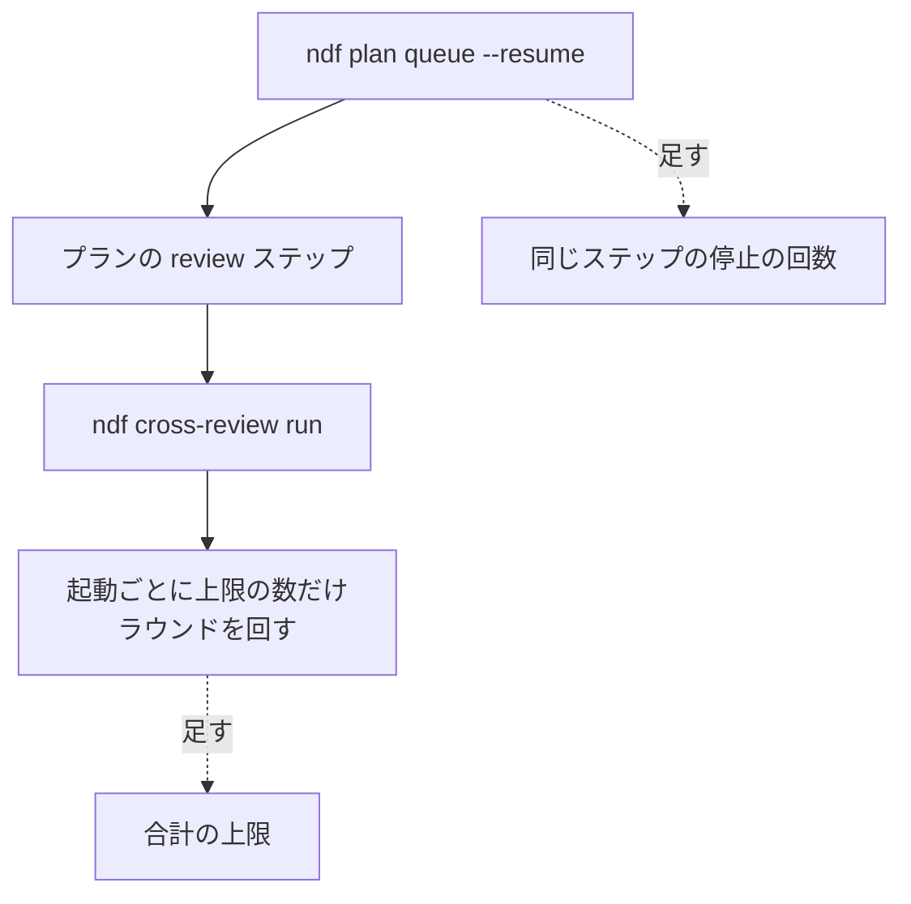
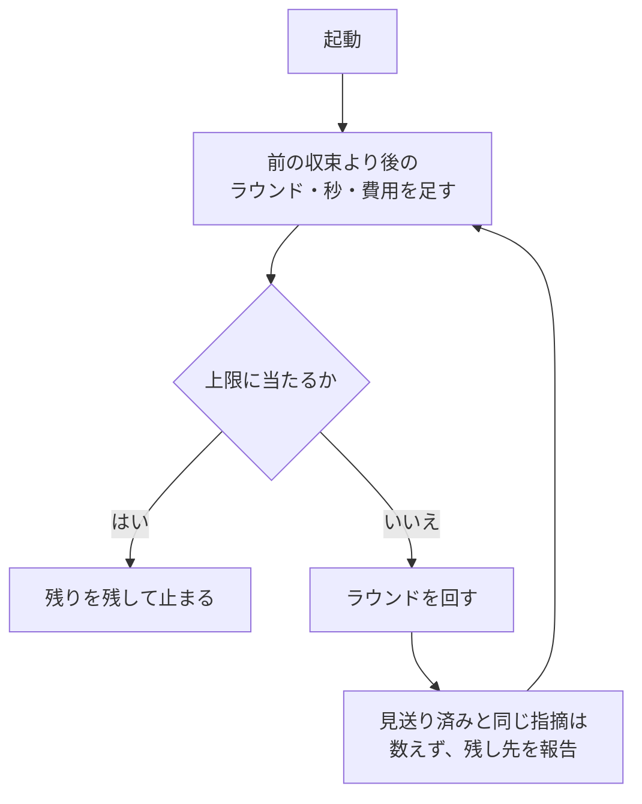
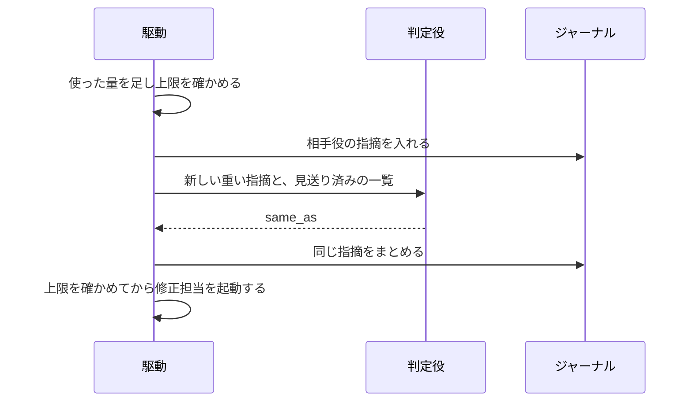

# cross-review: 役に立たない繰り返しを止め、費用と時間に上限を持つ（#2468）

見送った指摘の出直し、打ち直しのたびのラウンドの数え直し、同じ所で止まるプランの流し直しに、時間と AI の利用料がかかった。言い換えた出直しは #4363 の判定役が同じ指摘と見分け、ラウンド・秒・費用は収束していない打ち直しをまたいで合計して上限と比べ、同じステップで 2 回止まったプランは流し直さない。調査と採らなかった案は、決定の記録と末尾の外部の調査にある。

## 今の姿

何が起きたか・目的・受け入れ条件は要求仕様（[issue-2468-requirements.md](./issue-2468-requirements.md)、正は #2468 の本文）にある。この文書は「どう解くか」と「なぜその解き方か」だけを書く。



- 見送った指摘の出直しは、本文の先頭 80 字の一致（`oscillation.finding_key`）で見分ける。言い回しが変わると新しい指摘になる
- 指摘が無いラウンドは収束になる（`drive._verdict`）。条件 2 は今のままで満たす
- ラウンドの上限は `first = len(rounds) + 1` から `max_rounds` 回で、起動ごとに数え直す
- `.ndf/review.json` は `focus` と `fixer_sessions` だけを読む
- キューの記録 `queue.json` はプランごとの最後の結果だけを持ち、止まった回数を持たない

条件 1・3・4 の原因は、繰り返しをまたいで持ち越す記録が無いことである。条件 5 のキューにも同じ欠けがある。どれも「役に立たない繰り返しを止める」という 1 つの要求なので、1 本にまとめる。

## 文脈と制約

- 残し方（起票か記録のコメントか）は #3780 の決まりを使う。指摘の種類の分類と、2 つの指摘が同じかの判定には、#4363 の判定役（指摘を確かめる読むだけの AI）を使う
- 上限を書かない `version: 1` の `.ndf/review.json` はそのまま読める。設定はメインディレクトリから読み、PR の head の値は使わない
- 状態ファイルは同じ保存先（`--state-dir`）の打ち直しで引き継がれる
- claude 以外の相手役（レビューする AI）の費用は読めない（codex はトークン数だけ、kiro は読み取れない）

## 解き方の全体像



- どこでやめるかは、`.ndf/review.json` と既定の数値が決める
- 見送った指摘は言い換えて出直してもラウンドを増やさず、Issue か記録のコメントの URL が報告に載る
- 同じステップで 2 回止まったプランは、`--resume` では流れず、案内が出る

## ドメインモデル

コンテキストは「NDF の cross-review」と「NDF のプランの実行」の 2 つである。関係は顧客と供給者で、プランが cross-review の結果 JSON を受ける。

### 集約

| 集約 | オーナー（書き換えてよいもの） | 根 | エンティティ | 値オブジェクト |
| --- | --- | --- | --- | --- |
| 指摘のジャーナル | `journal.FindingJournal` | ジャーナル | 指摘 | 残し方 |
| ラウンドの記録 | `drive` | 状態ファイル | ラウンド | 使った量（秒・費用）・上限 |
| キューの記録 | `queue_run` | `queue.json` | プランの結果 | 停止の回数 |

### 不変条件

| # | 集約 | 条件 | 破れたときの扱い |
| --- | --- | --- | --- |
| I1 | 指摘のジャーナル | 見送った指摘と同じと判定された指摘は、新しい行にならず、未解決にもならない | 判定できなければ新しい指摘として扱う |
| I2 | ラウンドの記録 | 最後の収束より後のラウンドの数は、起動を何回打っても上限を超えない | 超える起動はラウンドを回さない |
| I3 | ラウンドの記録 | 秒と費用の合計が上限に達した後は、相手役も修正担当も起動しない | 起動中の 1 回は止めない |
| I4 | キューの記録 | 同じステップの停止が 2 回のプランは、`--resume` で起動しない | `--retry` の指定で数え直す |

### ドメインイベント

| # | イベント | 発生元 | 受け手 |
| --- | --- | --- | --- |
| E1 | 見送った指摘が出直した | 判定役・ジャーナル | 残し方の判断 |
| E2 | 見送った指摘を残した | 記録の公開 | 結果 JSON |
| E3 | 上限に当たった | 駆動 | 終わり方の判定 |
| E4 | cross-review が止まり、残りを報告した | 駆動 | 呼び出し元 |
| E5 | 同じステップで 2 回止まったプランの流し直しを止めた | キュー | 呼び出し元 |

## 構成要素

| 要素 | 責務 |
| --- | --- |
| 判定役の判断（`verify_decide.py`） | 見送り済みと直さずに残す指摘の一覧を渡し、同じ指摘の番号（`same_as`）を読む |
| ジャーナル（`journal.py`） | 同じと判定された新しい指摘を元の行へまとめ、出直しのフラグを付ける |
| 残し方（`leftover_decide.py`・`leftover.py`） | 出直した見送りと、上限で残った指摘を、#3780 と同じ分け方で残す |
| 上限の判断（`budget_decide.py`、新設） | 使った量を足し、当たった上限を返す |
| 駆動（`drive.py`） | ラウンドの数を合計で決め、ラウンドと修正の前に上限を確かめ、使った量を記録する |
| 設定（`settings.py`・`criteria_decide.py`・`review.schema.json`・`contracts/limits/`） | `limits` を読み、既定を持つ |
| 終わり方（`finish_decide.py`・`report_decide.py`） | 終わり方 `limit` を足す |
| キュー（`queue_decide.py`・`queue_run.py`・`core/plan/cli.py`） | 停止の回数を持ち、2 回なら起動せずに結果にする |
| 停止の種類（`contracts/causes/repeated_stop.json`、新設） | 同じステップで 2 回止まった停止 |
| 手順書（`skills/cross-review/`） | 打ち直しとラウンドの数え方、上限、終わり方を書き換える |

## データ構造

| 保存先 | キー | 中身 |
| --- | --- | --- |
| 状態ファイルのラウンドの記録 | `spent.seconds` | そのラウンドの開始から終わりまでの秒 |
| 同じ | `spent.usd` | claude の起動（修正担当・埋めたシート・判定役）の `total_cost_usd` の和 |
| 同じ | `spent.unread` | 費用を読めなかった claude の起動の数 |
| 状態ファイルの指摘の行 | `reraised` | 見送った後に出直したラウンドの番号 |
| `queue.json` のプランの行 | `stop.step`・`stop.count` | 続けて止まっているステップと回数 |

- 合計は持たず、ラウンドの記録から毎回足す。数える範囲は、最後の `converged` のラウンドより後である
- `spent` の無いラウンドは、ラウンド数には含めるが、秒と費用は足さない
- 停止の回数は、同じステップで止まれば 1 増え、違うステップなら 1、完了で消える。承認の待ちは数えない。`--resume` を付けない起動は数え直す

## 入出力のコントラクト

### `.ndf/review.json`

`version: 1` に `limits` を足す。どのキーも省ける。

```json
{"version": 1, "focus": [], "limits": {"rounds": 4, "seconds": 3600, "usd": 20}}
```

| キー | 型 | 省いたとき | 数えるもの |
| --- | --- | --- | --- |
| `rounds` | 1 以上の整数 | プロジェクトの上限は無し（`--max-rounds` とその既定だけ） | ラウンド |
| `seconds` | 正の数 | 3600 | ラウンドにかかった秒の和。打ち直しの間の待ちは含めない |
| `usd` | 正の数 | 20 | 読めた claude の費用の和 |

- ラウンドの上限は、`--max-rounds`（省けば #3780 の既定）と `limits.rounds` の小さい方である
- 形の違う値は、今の `focus` の誤りと同じく `invalid` で止まる

### `ndf cross-review run`

| 場面 | 結果 |
| --- | --- |
| `seconds` か `usd` に当たった | 終わり方 `limit`。未解決の重い指摘があれば `incomplete`、無ければ `ok`。要約にどの上限かと使った量を出す |
| 起動の時点で上限を使い切っている | 相手役を起動しない。終わり方は、使い切ったのがラウンド数なら `max_rounds`、秒か費用なら `limit`。警告に、レビューしていないことと続け方（上限を上げて打ち直す）を出す |
| 出直した見送り・上限で残った指摘 | `items` の `finding` に `disposition` と `url` を足す |

`--max-rounds` の意味は「この起動の回数」から「収束していない打ち直しの合計」に変わる。

### `ndf plan queue --resume`

| 条件 | 結果 |
| --- | --- |
| 停止の回数が 2 以上のプラン | 起動せず、`status: stopped`・`cause.kind: repeated_stop`・終了コードは停止の値。詳細にステップの名前と案内を出す |
| 案内の文 | 「同じステップで 2 回止まった。手当てを 2 回重ねる前に、原因を直すか課題を起票する。直した後は `--retry <プラン>` を足して打ち直す」 |
| `--retry <プラン>`（新設・繰り返せる） | そのプランの回数を消して流す |
| そのプランを `needs` に持つプラン | 今と同じく、前提が完了でないので流さない |

打ち直しのコマンド（結果の `next`）に `--retry` は入れない。

## 処理の流れ



| 出直しの形 | 扱い |
| --- | --- |
| 本文の先頭が一致（今の見分け方） | 今と同じく扱わず、`reraised` を付ける |
| 判定役が `same_as` で見送りの行を指した | 新しい行を作らず、元の行に `reraised` を付ける |
| MVV が変わった場合と、必ず人の承認が要る操作に当たると初めて指摘された場合 | 今と同じく判定し直す。まとめない |
| 判定役の回答が無い・指した番号が一覧に無い | 新しい指摘として扱う |

| 残す対象 | 起票するもの |
| --- | --- |
| 出直した見送り（区分が `needs_user` のものと、区分が無いもの） | `track` が空でないもの。ほかは記録のコメント |
| 区分 `filed` の見送り | 起票し直さず、理由にある番号の Issue の URL を載せる |
| 区分 `not_applicable` の見送り | 起票せず記録のコメント（指摘の前提が違うと判断済み） |
| 秒・費用・ラウンドの上限で残った未解決の重い指摘 | `track` が空でないもの。ほかは記録のコメント |

上限を確かめるのは、ラウンドを始める前と修正担当を起動する前である。使った量は、ラウンドの記録を書くときと修正の後に足す。

## 決定の記録

### 決定 1: 言い換えた出直しでラウンドを増やさないため、同じ指摘かは判定役の回答で見分ける

- **質問**: 本文が変わった同じ指摘を、どう見分けるか
- **選んだ案**: 今の先頭の一致を保ち、一致しない新しい重い指摘だけを、#4363 の判定役に見送り済みと残した指摘の一覧と突き合わせさせる。回答に `same_as`（同じ指摘の番号か空）を足す
- 採らなかった案: 文字列の類似度のライブラリを使う（言い換えは文字の並びが大きく変わり、同じ行の別の指摘は似る。閾値の根拠を持てない）
- 採らなかった案: パスと行が同じなら同じ指摘とする（直しで行がずれ、同じ行に別の問題もある）
- **代償**: 判定役が別の指摘をまとめると、その指摘は直されない。まとめた先は記録に残る
- 作り方: 自前で作る
- 比べた候補: LIB1 / PRD1
- 根拠: Value 2 / Value 3（MVV バージョン 11）

### 決定 2: 打ち直しで上限を超えないため、最後の収束より後のラウンドを合計する

- **質問**: どこからどこまでを 1 つの上限で数えるか
- **選んだ案**: 状態ファイルの、最後の `converged` より後のラウンド。誤りや読めない相手役で終わったラウンドも数える。収束した後に差分を足した PR は 0 から数える
- 採らなかった案: PR の全ラウンドを数える（収束の後の打ち直しが回せなくなる）
- 採らなかった案: 修正を送ったラウンドだけを数える（費用はどのラウンドにもかかる）
- **代償**: AI の利用上限などの失敗で終わったラウンドも上限に数えるので、上限を上げて打ち直す場合がある。別の保存先の実行は合計しない
- 根拠: Value 2 / Value 3（MVV バージョン 11）

### 決定 3: 上限を書かないプロジェクトでも止まるため、秒と費用に既定を置く

- **質問**: 秒と費用の上限の既定
- **選んだ案**: 秒 3600、費用 20 ドル。2026-11-27 にこのマシンの状態の保存先 102 件を数えた実測から決めた（秒はラウンドの出力ファイルの時刻からの概算、費用は claude の出力の `total_cost_usd` の和）。秒の最大は 3547 で超えたものは無く、費用は 95 パーセンタイルが約 16 ドル、最大が約 50 ドルで、20 ドルを超えたのは 2 件である。ラウンドは #3780 の既定に任せる
- 採らなかった案: 既定を置かず、書いたプロジェクトだけに効かせる（今回の無駄が起きた状態のままになる）
- **代償**: 大きい PR は途中で止まる。費用は claude の分だけで、全体の費用の上限ではない
- 根拠: Value 2 / Value 13（MVV バージョン 11）

### 決定 4: プロジェクトの上限を引数で超えないため、ラウンドは引数と設定の小さい方にする

- **質問**: `--max-rounds` と `limits.rounds` が食い違うときにどちらを使うか
- **選んだ案**: 小さい方。`--max-rounds` は NDF の既定より優先し、設定はプロジェクト全体の上限とする
- 採らなかった案: `--max-rounds` を設定より優先する（受け入れ条件 4 の「どれかに当たると止まる」が、引数を渡すプランで働かない）
- **代償**: 1 回だけ多く回したいときは、設定を書き換える
- 根拠: Value 2 / Value 1（MVV バージョン 11）

### 決定 5: 読めない費用で止まらないため、費用を読めない起動は数えずに知らせる

- **質問**: 費用を読めないときの扱い
- **選んだ案**: 0 として足し、数を `spent.unread` と警告に出す。秒とラウンドの上限はそのまま働く
- 採らなかった案: 読めなければ止める（費用を返さないランタイムの設定で、レビューが 1 回も終わらない）
- 採らなかった案: claude の `--max-budget-usd` に残りを渡す（起動 1 回ごとの上限で、打ち直しの合計にならない。途中で切れた修正担当は結果を残さない）
- **代償**: 費用は下限の見積りになり、その値で上限を判定する
- 作り方: 自前で作る
- 比べた候補: PRD1
- 根拠: Value 2 / Value 4（MVV バージョン 11）

### 決定 6: 手当てを重ねないため、停止の回数はキューの記録に持ち、`--retry` でだけ数え直す

- **質問**: 同じステップの停止をどこで数え、直した後にどう再開するか
- **選んだ案**: `queue.json` に回数を持つ。2 回なら `--resume` は流さない。原因を直した人が `--retry <プラン>` を足して打つ。停止の理由の種類は分けない
- 採らなかった案: `--from` の指定で流す（打ち直しのコマンドが自動で `--from` を含むので、止まらない）
- 採らなかった案: `--resume` を外すよう案内する（完了したプランも流し直す）
- 採らなかった案: 一時の失敗（利用上限など）を数えない（要求は同じステップの 2 回で、種類の線引きを持たない）
- **代償**: 利用上限で 2 回止まったプランも `--retry` が要る。`ndf plan next` を直に打つ再開は数えない
- 作り方: 自前で作る・標準に倣う
- 比べた候補: PRD2
- 根拠: Value 2 / Value 1（MVV バージョン 11）。PRD2

## 影響と危険

- **働く範囲**: NDF を使うすべてのリポジトリの cross-review と `ndf plan queue`
- **プロジェクトごとに違うもの**: 上限（`.ndf/review.json` の `limits`、`--max-rounds`）
- **当たるモード**: cross-review を通るモードと、キューで流すプラン

互換は残さない。壊れうる箇所と扱いは次のとおりである。

| 箇所 | 扱い |
| --- | --- |
| 収束せずに上限に達した PR は、打ち直しても回らない | 警告に続け方を出し、手順書の「ラウンドを足す」を書き換える |
| ラウンドを回せない起動が `ok` で終わりうる（未解決が無いとき） | 今の上限の終わりと同じ扱いにし、警告にレビューしていないことを出す |
| 前の起動で上限まで回した状態ファイル | 次の起動はラウンドを回さない。`--max-rounds` を上げる |
| 差分のレビュー（別の保存先） | 合計は別に数える |
| #4363・#3780 と同じファイルを変える | 2 つの後に実装する |

### 代表のリポジトリでの振る舞い

| 代表のリポジトリ | 設定の要点 | 直した後に起きること | この種類で扱えなくなること |
| --- | --- | --- | --- |
| Web サービス | 上限を書かない | 秒 3600・費用 20 ドルの既定で止まる | 無し |
| モバイルアプリ | `limits` を大きくする | 書いた値で止まる | 無し |
| 業務文書だけ | 長い文書でラウンドが長い | 秒の既定で止まれば、`limits.seconds` を上げる | 無し |

### このリポジトリだけの事情

| 値 | 設定の場所 | 持つ Issue |
| --- | --- | --- |
| 既定の根拠にした実測は、このリポジトリを開発するマシンの記録である | `contracts/limits/` の既定と、プロジェクトの `.ndf/review.json` | #2468 |

## テスト設計

| 受け入れ条件・不変条件 | どの振る舞いで縛るか | どう壊したら落ちるべきか |
| --- | --- | --- |
| 条件 1・I1 | 見送った指摘が同じ文でも言い換えでも出直したラウンドは収束し、起票か記録の URL が `items` に載る | `same_as` を無視すると落ちる。区分 `filed` を起票し直すと落ちる |
| 条件 2 | 指摘 0 件のラウンドは `converged` になる | 指摘が 0 件でも、相手役の判定の文字を理由に未収束にすると落ちる |
| 条件 3・I2 | 収束せずに終えた後の打ち直しは、残りの回数だけ回る。収束の後は 0 から数える | 起動ごとに数え直すと落ちる |
| 条件 4・I3 | 秒・費用・ラウンドのそれぞれで止まり、残りが残し方のとおり報告に載る。上限の後に起動が無い | 上限の確認を外すと落ちる |
| 条件 5・I4 | 同じステップで 2 回止まったプランの `--resume` は起動せず `repeated_stop`。`--retry` で起動する。違うステップは数え直す | 回数を持たないと落ちる |
| 条件 6 | `limits` の無い `version: 1` が読める。形の違う `limits` は `invalid` | `limits` を必須にすると落ちる |
| 決定 4 | 引数と設定の小さい方で止まる | 引数だけを使うと落ちる |
| 決定 5 | 費用を読めない起動があっても止まらず、数が警告に出る | 読めないことで止めると落ちる |

時間の上限は、時計を差し替えて確かめる。実時間は待たない。

## 設計の結果

| 課題 | 扱い | 統合先 | 触るファイル |
| --- | --- | --- | --- |
| #2468 | 実装する | — | `plugins/ndf/src/ndf/domains/crossreview/verify_decide.py`、`plugins/ndf/src/ndf/domains/crossreview/journal.py`、`plugins/ndf/src/ndf/domains/crossreview/leftover_decide.py`、`plugins/ndf/src/ndf/domains/crossreview/leftover.py`、`plugins/ndf/src/ndf/domains/crossreview/budget_decide.py`（新設）、`plugins/ndf/src/ndf/domains/crossreview/drive.py`、`plugins/ndf/src/ndf/domains/crossreview/settings.py`、`plugins/ndf/src/ndf/domains/crossreview/criteria_decide.py`、`plugins/ndf/src/ndf/domains/crossreview/finish_decide.py`、`plugins/ndf/src/ndf/domains/crossreview/report_decide.py`、`plugins/ndf/src/ndf/core/plan/queue_decide.py`、`plugins/ndf/src/ndf/core/plan/queue_run.py`、`plugins/ndf/src/ndf/core/plan/cli.py`、`plugins/ndf/contracts/data/review-criteria.json`、`plugins/ndf/contracts/schemas/ndf-settings/review.schema.json`、`plugins/ndf/contracts/domains/ndf-files.json`、`plugins/ndf/contracts/limits/cross-review.max-seconds.json`（新設）、`plugins/ndf/contracts/limits/cross-review.max-usd.json`（新設）、`plugins/ndf/contracts/causes/repeated_stop.json`（新設）、`plugins/ndf/skills/cross-review/SKILL.md`、`plugins/ndf/skills/cross-review/docs/01-state-and-review.md`、`plugins/ndf/skills/cross-review/docs/02-fix-and-rotation.md`、`plugins/ndf/tests/domains/crossreview/test_crossreview_limits.py`（新設）、`plugins/ndf/tests/domains/crossreview/test_crossreview_leftover.py`、`plugins/ndf/tests/domains/crossreview/test_crossreview_journal.py`、`plugins/ndf/tests/core/plan/test_queue.py`、`plugins/ndf/tests/core/plan/test_queue_run.py` |

## 未確認のまま残ること

| 項目 | 内容 |
| --- | --- |
| 会話を続けた修正担当の `total_cost_usd` | その起動の分だけか、会話の累計かを確かめていない。実装で実際に打って確かめ、累計なら差を足す |
| 費用の全体 | codex と kiro の費用は足せないので、上限の外にある |
| 既定の値が合うか | 実測は 1 台の記録である。リリース後に上限で止まった件数で分かる |

## 外部の調査

| 種類 | 調べるか | 理由 |
| --- | --- | --- |
| 標準・仕様 | 調べない | 繰り返しの上限と指摘の同一の判定に、従うべき公開の仕様を想定していない |
| 主要な製品 | 調べる | 費用の上限と、再試行の回数の上限の持ち方を比べる |
| ライブラリとサービス | 調べる | 指摘の同一の判定に、文字列の類似度のライブラリを使うかを決める |

### 標準・仕様

調べていない（理由は上の表）。

### 主要な製品

| # | 製品 | どう解いているか | 設計への反映 | 出典 |
| --- | --- | --- | --- | --- |
| PRD1 | Claude Code の CLI | `--max-budget-usd` は 1 回の起動の費用の見積りが達したら止める。会話を続けた場合、前の実行の合計は数えない | 打ち直しの合計には使えないので、記録から足す | https://code.claude.com/docs/en/cli-reference.md （2026-11-27） |
| PRD2 | Temporal | 再試行の方針に最大の試行回数（Maximum Attempts）を持つ | 同じステップの流し直しに回数の上限を持つ | https://docs.temporal.io/encyclopedia/retry-policies （2026-11-27） |

### ライブラリとサービス

| # | 候補 | バージョン | ライセンス | 最後のリリースの日付 | 終了のアナウンス | 要件を満たすか | 出典 |
| --- | --- | --- | --- | --- | --- | --- | --- |
| LIB1 | RapidFuzz | 3.14.6 | MIT | 2026-08-30 | 無し（登録簿の情報に記載なし） | 満たさない。文字の並びの近さを返すもので、言い換えた同じ指摘の判定には使えない | https://pypi.org/pypi/rapidfuzz/json （2026-11-27） |

### 確かめられなかったこと

| 対象 | 試した手段 | 結果と理由 |
| --- | --- | --- |
| codex と kiro の起動 1 回の費用（金額） | `codex exec --help`・`kiro-cli chat --help` と、手元の出力のファイル | codex の標準エラーはトークン数だけを出す。kiro の出力に費用の行は見つからなかった |

調べた量: 候補 3 件・取得の試み 5 回。
