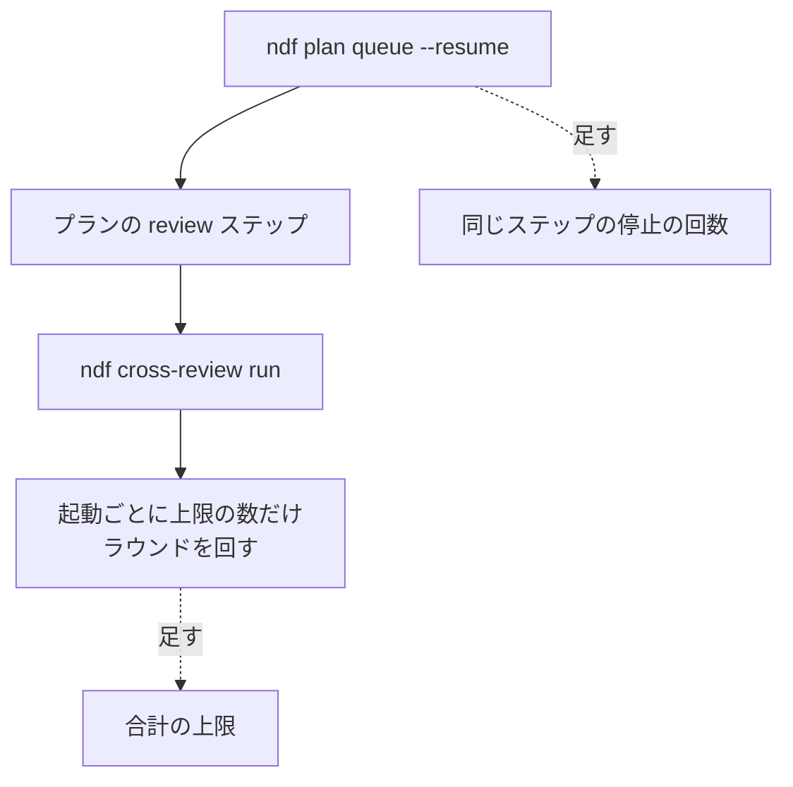
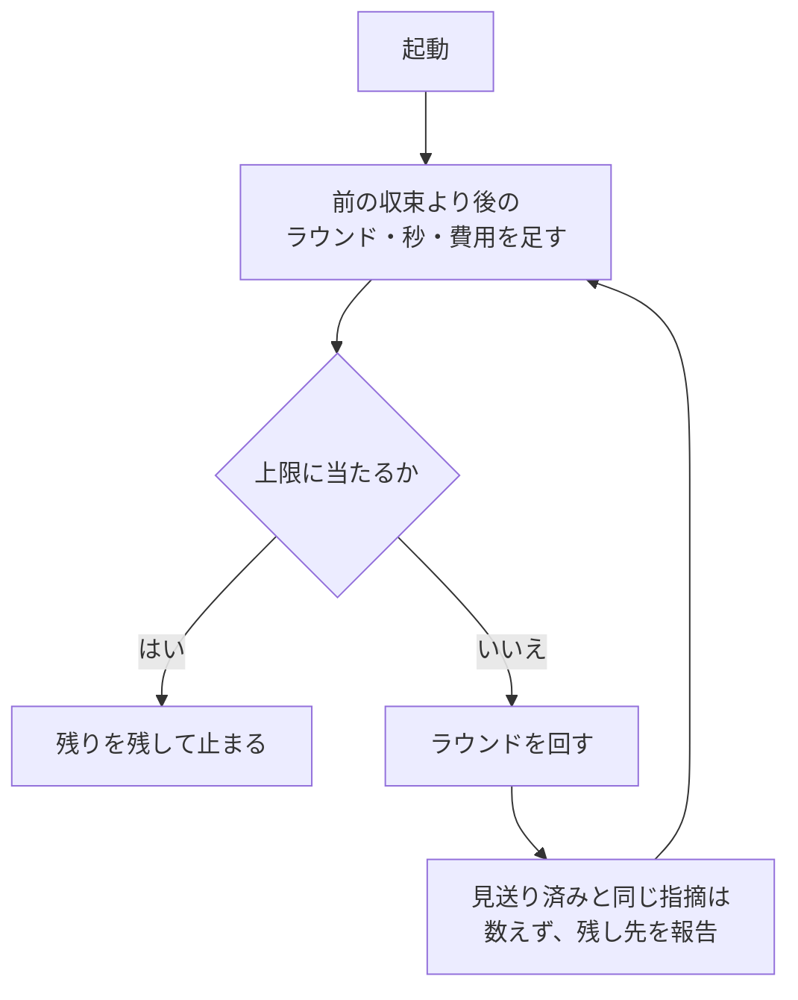
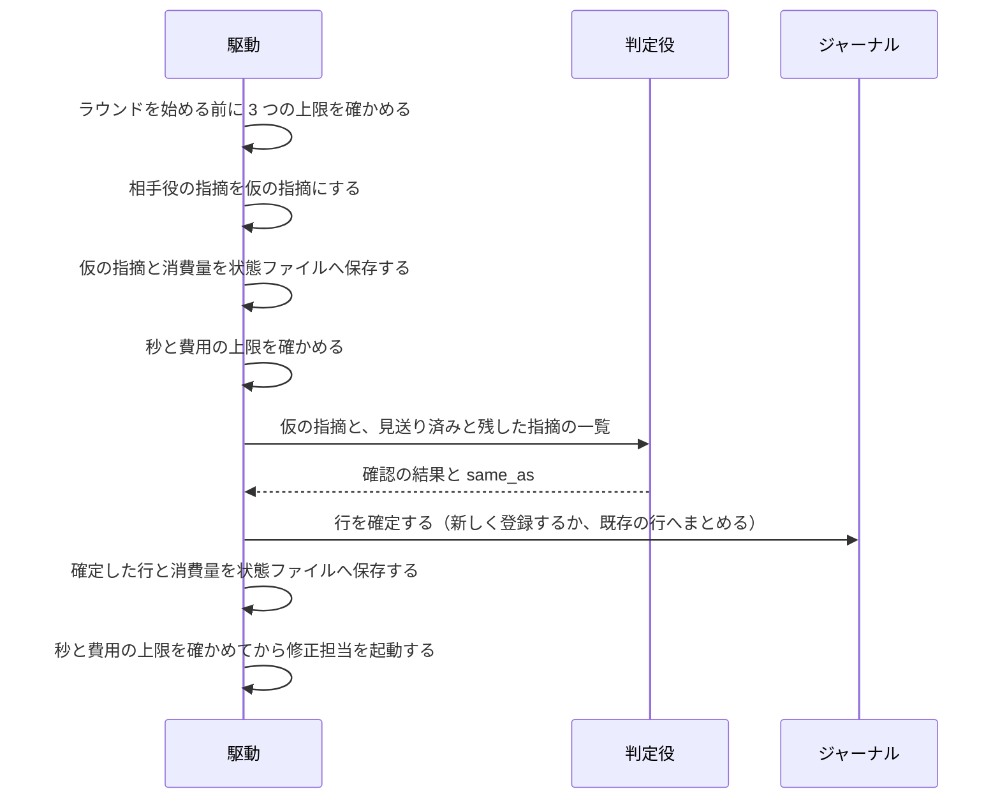

# cross-review: 役に立たない繰り返しを止め、費用と時間に上限を持つ（#2468）

見送った指摘の出直し、打ち直しのたびのラウンドの数え直し、同じ所で止まるプランの流し直しに、時間と AI の利用料がかかった。言い換えた出直しは #4363 の判定役が同じ指摘と見分け、ラウンド・秒・費用は収束していない打ち直しをまたいで合計して上限と比べ、同じステップで 2 回止まったプランは流し直さない。調査と採らなかった案は、決定の記録と末尾の外部の調査にある。

## 今の姿

何が起きたか・目的・受け入れ条件は要求仕様（[issue-2468-requirements.md](./issue-2468-requirements.md)、正は #2468 の本文）にある。この文書は「どう解くか」と「なぜその解き方か」だけを書く。



- 見送った指摘の出直しは、本文の先頭 80 字の一致（`oscillation.finding_key`）で見分ける。言い回しが変わると新しい指摘になる
- 指摘が無いラウンドは収束になる（`drive._verdict`）。条件 2 は今のままで満たす
- ラウンドの上限は `first = len(rounds) + 1` から `max_rounds` 回で、起動ごとに数え直す
- `.ndf/review.json` は `focus` と `fixer_sessions` だけを読む
- キューの記録 `queue.json` はプランごとの最後の結果だけを持ち、止まった回数を持たない

条件 1・3・4 の原因は、繰り返しをまたいで持ち越す記録が無いことである。条件 5 のキューにも同じ欠けがある。どれも「役に立たない繰り返しを止める」という 1 つの要求なので、1 本にまとめる。

## 文脈と制約

- 残し方（直さずに残す指摘を、Issue に起票するか Pull Request の記録のコメントに書くか）は、#3780 の決まりを使う（分け方は下の「処理の流れ」の表）。指摘の種類の分類と、2 つの指摘が同じかの判定には、#4363 の判定役（指摘を確かめる読むだけの AI）を使う
- 上限を書かない `version: 1` の `.ndf/review.json` はそのまま読める。設定はメインディレクトリから読み、PR の head の値は使わない
- 状態ファイルは同じ保存先（`--state-dir`）の打ち直しで引き継がれる
- claude 以外の相手役（レビューする AI）の費用は読めない（codex はトークン数だけ、kiro は読み取れない）

## 解き方の全体像



- どこでやめるかは、`.ndf/review.json` と既定の数値が決める
- 見送った指摘は言い換えて出直してもラウンドを増やさず、Issue か記録のコメントの URL が報告に載る
- 同じステップで 2 回止まったプランは、`--resume` では流れず、案内が出る

## ドメインモデル

コンテキストは「NDF の cross-review」と「NDF のプランの実行」の 2 つである。関係は顧客と供給者で、プランが cross-review の結果 JSON を受ける。

### 集約

| 集約 | オーナー（書き換えてよいもの） | 根 | エンティティ | 値オブジェクト |
| --- | --- | --- | --- | --- |
| 指摘のジャーナル | `journal.FindingJournal` | ジャーナル | 指摘 | 残し方 |
| ラウンドの記録 | `drive` | 状態ファイル | ラウンド | 使った量（秒・費用）・上限 |
| キューの記録 | `queue_run` | `queue.json` | プランの結果 | 停止の回数 |

### 不変条件

| # | 集約 | 条件 | 破れたときの扱い |
| --- | --- | --- | --- |
| I1 | 指摘のジャーナル | 下の「出直しの形」の表でまとめると決めた指摘は、新しい行にならず、未解決にもならない | 判定できなければ新しい指摘として扱う |
| I2 | ラウンドの記録 | 最後の収束より後のラウンドの数が `--max-rounds`（自分の保存先で数える）か `limits.rounds`（同じ PR のレビューの保存先を合わせて数える）以上なら、新しいラウンドを始めない | 超える起動はラウンドを回さない |
| I3 | ラウンドの記録 | 秒か費用の合計が上限以上になった後は、相手役・判定役・修正担当を起動しない | 起動中の 1 回は止めない |
| I4 | キューの記録 | 同じステップの停止が 2 回のプランは、`--resume` で起動しない | `--retry` の指定か、`--resume` を付けない起動で数え直す |

### ドメインイベント

| # | イベント | 発生元 | 受け手 |
| --- | --- | --- | --- |
| E1 | 見送った指摘が出直した | 判定役・ジャーナル | 残し方の判断 |
| E2 | 見送った指摘を残した | 記録の公開 | 結果 JSON |
| E3 | 上限に当たった | 駆動 | 終わり方の判定 |
| E4 | cross-review が止まり、残りを報告した | 駆動 | 呼び出し元 |
| E5 | 同じステップで 2 回止まったプランの流し直しを止めた | キュー | 呼び出し元 |

## 構成要素

| 要素 | 責務 |
| --- | --- |
| 判定役の判断（`verify_decide.py`） | 見送り済みと直さずに残す指摘の一覧を渡し、同じ指摘の番号（`same_as`）を読む |
| ジャーナル（`journal.py`） | 同じと判定された新しい指摘を元の行へまとめ、出直しのフラグを付ける |
| 残し方（`leftover_decide.py`・`leftover.py`） | 出直した見送りと、上限で残った指摘を、#3780 と同じ分け方で残す |
| 上限の判断（`budget_decide.py`、新設） | 使った量を足し、当たった上限を返す |
| 駆動（`drive.py`） | ラウンドの数を合計で決め、ラウンドと修正の前に上限を確かめ、使った量を記録する |
| 設定（`settings.py`・`criteria_decide.py`・`review.schema.json`・`contracts/limits/`） | `limits` を読み、既定を持つ |
| 終わり方（`finish_decide.py`・`report_decide.py`） | 終わり方 `limit` を足す |
| キュー（`queue_decide.py`・`queue_run.py`・`core/plan/cli.py`） | 停止の回数を持ち、2 回なら起動せずに結果にする |
| 停止の種類（`contracts/causes/repeated_stop.json`、新設） | 同じステップで 2 回止まった停止 |
| 手順書（`skills/cross-review/`） | 打ち直しとラウンドの数え方、上限、終わり方を書き換える |

## データ構造

| 保存先 | キー | 中身 |
| --- | --- | --- |
| 状態ファイルのラウンドの記録 | `spent.seconds` | そのラウンドの開始から終わりまでの秒 |
| 同じ | `spent.usd` | そのラウンドで起動した claude の `total_cost_usd` の和。対象は、修正担当、相手役の席に座る claude（名指しした claude と、結果の無い相手役の席を埋める読むだけの claude。起動の入口は `seats.launch_reviewers`）、指摘を確かめる判定役の各起動である |
| 同じ | `spent.unread` | 費用を読めなかった claude の起動の数 |
| 同じ | `spent.ended_at` | `spent` を最後に書いた時刻。保存先をまたいで順に並べるのに使う |
| 同じ | `candidates` | 相手役が返し、まだ指摘の行にしていない指摘（下の「処理の流れ」の仮の指摘）。相手役ごとの報告を、重ねる前の値（`protect`・`mvv`・重要度・1 文・場所）のまま持つ。指摘の行を確定したら消す |
| 同じ | `unread_reviewers` | 結果を返さなかった相手役の名前の並び（全員が返せば空）。`candidates` と同時に保存し、行を確定した後も残す |
| 同じ | `verdict` が `interrupted` | 判定の前に中断し、続きから再開できなかったラウンド。読んだ証跡に使わない |
| 同じ | `stopped_limit` | 上限のために修正担当を起動しなかったときの、到達した上限の名前。`verdict` は書き換えない |
| 同じ | `verdict` が `incomplete_reviewers` | 相手役の一部か全員が結果を返せなかったラウンド。読んだ証跡に使わない |
| 状態ファイルの指摘の行 | `reraised` | 見送った後に出直したラウンドの番号 |
| `queue.json` のプランの行 | `stop.step`・`stop.count` | 続けて止まっているステップと回数 |

- 合計は持たず、ラウンドの記録から毎回足す。数える範囲は、最後の `converged` のラウンドより後である
- プロジェクトの上限（`limits.rounds`・`seconds`・`usd`。省いた秒と費用の既定を含む）は、同じ PR のレビューが保存先を分けても 1 つの量として数える。新しい引数 `--budget-state <保存先>` で渡した状態のラウンドと自分の状態のラウンドを `spent.ended_at` の順に並べ、最後の `converged` より後を足す。渡した保存先に状態が無ければ 0 とする。数えるのは、状態ファイルの対象のリポジトリ（`target_repo`）が今回と同じで、PR の番号（元の番号 `pr` か今の番号 `current_pr`）が今回の PR に当たるものだけである。ほかの PR の記録は、ラウンドにも秒と費用にも、最後の `converged` の判定にも使わない。保存先は実際のパスに解決して重複を除く。同じ保存先を 2 回渡しても、自分の保存先を渡しても、1 回だけ数える。`--max-rounds` は自分の保存先のラウンドだけを数える
- `spent` の無いラウンドは、ラウンド数には含めるが、秒と費用は足さない
- 相手役の全員が結果を返せないと、今はラウンドの記録を作らずに `precondition` で止まる。この場合も、止める前に `verdict: incomplete_reviewers` と `spent` を持つラウンドの記録を保存する。ラウンド数・秒・費用に数え、どの head を読んだ証跡にもしない（範囲の起点と「読んだ head」の判定は、今もこの `verdict` を飛ばす）
- 停止の回数は、同じステップで止まれば 1 増え、違うステップで止まれば 1 になり、完了で消える。承認の待ちと、起動せずに返した結果（`repeated_stop`・前提のプランの未完了）では変えない

停止の回数を消す操作は次のとおりである。

| 起動 | 停止の回数 |
| --- | --- |
| 新しいキュー（保存先に `queue.json` が無い） | 0 から数える |
| 同じキューを `--resume` なしで打つ | 子のプランを起動する前に、`queue.json` の全プランの `stop` を消して保存する。`queue.json` は結果が出たプランの行しか書き換えないので、前の記録を読まないだけでは、前段が止まって起動しなかった後段のプランに前の回数が残る |
| `--resume` | 引き継ぐ |
| `--resume --retry <プラン>` | そのプランだけを 0 にして流す |

## 入出力のコントラクト

### `.ndf/review.json`

`version: 1` に `limits` を足す。どのキーも省ける。

```json
{"version": 1, "focus": [], "limits": {"rounds": 4, "seconds": 3600, "usd": 20}}
```

| キー | 型 | 省いたとき | 数えるもの |
| --- | --- | --- | --- |
| `rounds` | 1 以上の整数 | プロジェクトの上限は無し（`--max-rounds` とその既定だけ） | ラウンド |
| `seconds` | 正の数 | 3600 | ラウンドにかかった秒の和。打ち直しの間の待ちは含めない |
| `usd` | 正の数 | 20 | 読めた claude の費用の和 |

- ラウンドの上限は、`--max-rounds`（省けば #3780 が決める既定。`--purpose design` は 3、ほかは 4。[issue-3780-design.md](./issue-3780-design.md) の決定 6）と `limits.rounds` の 2 つで、先に達した方で止まる
- 形の違う値は、今の `focus` の誤りと同じく `invalid` で止まる

### `ndf cross-review run`

| 場面 | 結果 |
| --- | --- |
| `seconds` か `usd` に当たった | 終わり方 `limit`。要約にどの上限かと使った量を出す。結果は下の表 |
| ラウンド数の上限に当たった | 終わり方 `max_rounds`。結果は下の表 |
| 起動の時点で上限を使い切っている | 相手役を起動しない。終わり方は、使い切ったのがラウンド数なら `max_rounds`、秒か費用なら `limit`。結果は下の表で、head と相手役が同じなら、直前に上限で終わった起動と同じになる |
| 出直した見送り・上限で残った指摘 | `items` の `finding` に `disposition` と `url` を足す |

上限で終わった起動の結果は、今の head（PR に届いた最後のコミット）を相手役が読んだかで決める。

**全員が読めた head** は、次の条件をすべて満たすラウンドの head である。条件は、#3780 が全差分に戻す条件と同じものを使う。

- 状態ファイルで、相手役の全員が結果を返した最後のラウンドである
- 今回の席の全員がそのラウンドを読んでいる（埋めた席は、前回の収束を返す判定と同じく、欠けた相手役の代わりに数える）
- 読んだ PR が今回と同じである
- その head が今の head かその祖先である

今の head を「読んだ」と言えるのは、全員が読めた head が今の head と同じときだけである。相手役を足して打ち直した場合、足した相手役はどのラウンドも読んでいないので、全員が読めた head は無い。最後のラウンドで修正を送った直後に上限で終わる場合、修正のコミットは誰も読んでいないので「読んでいない」に当たる。

欠け（直したとも見送ったとも決まらない重い指摘など。結果の `gaps`）の有無と合わせて、結果は次のようになる。`mvv_unresolved` と `mvv_record_failed` は、今と同じくこの表より優先する。

| 今の head | 欠け | ほかの条件 | 結果 |
| --- | --- | --- | --- |
| 読んだ | 無し | — | `ok`。到達した上限と続け方を警告に出す |
| 読んだ | 有り | — | `incomplete` |
| 読んでいない | 有り | — | `incomplete`。欠けに、読んでいない head を足す |
| 読んでいない | 無し | 全員が読めた head があり、当たったのが `--max-rounds` だけ | `status: stopped`・`cause.kind: unreviewed`（終了コードは前提の欠け）。読んでいない分を差分のレビューで読める |
| 読んでいない | 無し | 全員が読めた head が無いか、プロジェクトの上限に当たった | `status: stopped`・`cause.kind: precondition`。差分のレビューへは進めない |

どの結果でも、要約には到達した上限をすべて並べ、上限ごとに変える値を示す。

| 到達した上限 | 続けるために変える値 |
| --- | --- |
| `--max-rounds`（省いたときの既定を含む） | `--max-rounds` を大きくして打ち直す |
| `limits.rounds`・`limits.seconds`・`limits.usd` | 実行者のメインディレクトリの `.ndf/review.json` の同じキーを大きくする。秒と費用の既定に当たった場合は、そのキーを足す。引数では超えられない |

全員が読めた head が無い場合は、到達した上限を上げて打ち直すと PR の全差分から読むことも示す。

#### 差分のレビューへの引き継ぎ

上限で終わった起動は、ラウンドを回さなかった場合も、全員が読めた head があれば `--reviewed-out` に書く。無ければファイルを作らない。`--reviewed-pr-out` を渡した起動は、その head のラウンドの記録にある PR が今回読んだ PR と同じなら、PR も書く。今は、この起動の head か送ったコミットのときだけ書いている。

実装のプランは次のように変える。

- レビューのステップの `on_cause` に `unreviewed` を足して、次のステップへ進める。次のステップは今の head と読んだ head の違いを見つけ、読んでいない分の差分のレビュー（別の保存先）を回す
- `precondition` には経路を足さない。全員が読めた head が無いときとプロジェクトの上限に当たったときは、レビューのステップで止まる
- レビューと差分のレビューのステップは、互いの保存先を `--budget-state` で渡す。プロジェクトの上限の残りが、差分のレビューへ引き継がれる。差分のレビューが上限で終われば、プランは止まる

単位の実装プランは、レビューの起動を包むスクリプト（`UNIT_REVIEW`）も変える。今は終了コードが 0 と 6（`incomplete`）以外だと `--reviewed-out` のファイルを消すので、`unreviewed` の後に差分のレビューの起点が無くなる。対象の PR を確かめられた起動（`--reviewed-pr-out` の中身が対象の PR と一致する）は、終了コードによらずファイルを残す。確かめられない起動で消す扱いは変えない。

引き継ぐ条件に、差分のレビューの `--max-rounds` の残りは入れない。本レビューは差分の保存先の回数を数えないためである。差分のレビューが `--max-rounds` を使い切っていると、そのステップは相手役を起動せずに上限の結果で止まる（上の結果の表）。要約は、差分のレビューの保存先で `--max-rounds` に達したことと、`--max-rounds` を大きくして打ち直すと差分のレビューが再開することを示す。

設計・点検・cross-review のプランは経路を足さず、`unreviewed` でも `precondition` でも止まって呼び出し元へ返る。

`--max-rounds` の意味は「この起動の回数」から「収束していない打ち直しの合計」に変わる。

### `ndf plan queue --resume`

| 条件 | 結果 |
| --- | --- |
| `--resume` で流そうとしたプランの停止の回数が 2 以上（`--from` で別のステップを指定しても同じ。`--retry` を足した場合を除く） | プランを起動せず、`status: stopped`・`cause.kind: repeated_stop`・終了コードは停止の値。詳細にステップの名前と案内を出す。保存した `stop.step` を結果のステップの欄にも入れ、`next` のコマンドに `--from <プラン>=<ステップ>` が付くようにする（入れないと、`next` は元の起動で指定した開始点を使う） |
| 案内の文 | 「このプランは同じステップで 2 回停止したため、自動では再開しません。停止の原因を確認し、直した後に、結果の `next` のコマンドに `--retry <プラン>` を足して打ってください。すぐに直せない場合は、課題に記録してください」 |
| `--retry <プラン>`（新設・繰り返せる。`--resume` と併せて使う） | そのプランの回数を消して流す |
| そのプランを `needs` に持つプラン | 今と同じく、前提が完了でないので流さない |

打ち直しのコマンド（結果の `next`）に `--retry` は入れない。

停止の回数と、今回の開始点（`--from`）は照らし合わせない。前のステップから流し直しても、同じ停止のステップへ進むためである。

## 処理の流れ

相手役の指摘は、すぐには指摘の行にしない。まず**仮の指摘**（番号を付けた、まだ行にしていない指摘）として持ち、判定役の回答を反映してから行を確定する。#4363 の設計は指摘をジャーナルへ入れてから判定役を呼ぶが、この課題でその順を次のとおりに変える。



今の登録の処理（`journal.enter`）は本文の先頭の一致で行を重ねるので、判定役より前には呼ばない。行を確定するときの重ね方は次のとおりである。

| 仮の指摘と一致する相手 | critical・major の重ね方 |
| --- | --- |
| 見送りの行・直さずに残した行 | 下の「出直しの形」の表で決める |
| 未解決の行・直した行 | 今のまま（本文の先頭の一致） |
| 同じラウンドのほかの仮の指摘 | 本文の全体が一致するものだけを重ねる |

同じラウンドで本文の全体が一致する報告は 1 件の仮の指摘にまとめるが、どれか 1 件の値を代表にしない。判定役へ渡すかも、行の値も、次のとおりすべての報告から決める。

重要度は、まとめる前に報告ごとに決める。今の登録と同じく、各報告に `criteria_decide.effective_severity` を当てる。影響の 1 文（`impact`）が無い critical は、ここで minor に下がる（必ず人の承認が要る操作を挙げた報告は下げない）。別の報告に影響の 1 文があっても、下がった critical は戻らない。

| 値 | まとめ方 |
| --- | --- |
| `protect` | すべての報告の種類を合わせる |
| `mvv`・`redline`（必ず人の承認が要る操作） | 挙げられた MVV の項目をすべて持つ。1 件でも承認の要る操作を挙げていれば `redline` にする（今の `journal._classify` と同じ） |
| 重要度 | 報告ごとに決めた後の値のうち、最も重いもの。MVV の指摘の重要度の固定は、今の `journal._classify` のまま |
| 1 文（`impact`）・場所 | 下の決まりで選んだ 1 件の報告（根拠の報告）の値 |

根拠の報告は、報告の届いた順に左右されないように選ぶ。

1. 重要度が、まとめた後の重要度と同じ報告に絞る。該当が無ければ（MVV の固定で重くなった場合）、すべての報告を対象にする
2. その中に、#3780 の線引きで進むと判定される場所（変えた行など）の報告があれば、それに絞る
3. 残りが複数なら、パス、行、本文の順に並べて最初の 1 件を選ぶ

「変えた行への指摘か」は、この根拠の報告の場所で判断する。

重い指摘が無ければ判定役を起動せずに行を確定する。秒か費用の上限に当たって判定役を起動しない場合も、行は確定して保存する。

別の行にする指摘と先頭が一致する行がすでにあるときは、新しい行のキー（ジャーナルが同じ指摘を引く値）を本文の全体にする。minor・nit は収束を止めないので、今と同じく先頭の一致でまとめる。

本文の先頭の一致だけでは、まとめない。同じ書き出しで別の欠陥（別の権限の確認の漏れなど）を指す指摘が、見送りに吸収されるためである。次の表を上の行から順に当てる。表の「見送りの行」には、#3780 の直さずに残した指摘の行も含める。

| 出直しの形 | 扱い |
| --- | --- |
| MVV が前の見送りから変わった・必ず人の承認が要る操作に当たると初めて指摘された | 前の見送りを適用しない。本文の全体が一致すれば、今と同じく元の行を未解決へ戻す（`journal._revive`）。一致しなければ新しい指摘として登録する。どちらも今の MVV で重要度と人の承認の要否を決め直す |
| 本文の全体（空白と大文字小文字をそろえた値）が見送りの行と一致 | 判定役を待たずに同じ行として扱う。まず今回の `protect` と重要度を行へ反映し、下の「同じ行へ反映した後」の表で修正へ戻すかを決める |
| 判定役が `same_as` で見送りの行を指したが、今回の保護の種類に、指した行の `protect` に無いものがある | まとめず、新しい指摘として登録する。今回の本文と保護の種類が、そのまま修正担当へ渡る |
| 判定役が `same_as` で見送りの行を指した（今回の保護の種類が無いか、すべて指した行の `protect` にある） | 新しい指摘として登録せず、指した行を同じ行として扱う。本文の全体が一致した場合と同じく、今回の `protect`・重要度・位置を行へ反映し、下の「同じ行へ反映した後」の表で修正へ戻すかを決める |
| ほか（先頭だけが一致して `same_as` が空・判定役の回答が無い・指した番号が一覧に無い・判定役が失敗したか上限で起動しなかった） | 新しい指摘として扱う |

直さずに残した行は、保護の種類を持たない（保護の対象は残さない）。そのため、直さずに残した行を `same_as` で指す保護の対象の言い換えは、新しい行になって修正担当へ渡る。

今回の保護の種類は、相手役の `protect` と判定役の `tracks` のうち保護の種類（[#4363 の「回答の形」](./issue-4363-design.md)）に当たるものである。行の `protect` には、見送る前に示された種類が残っている。そのため、見送った保護の対象を言い換えた指摘は、保護の種類が増えなければ同じ行にまとまる。先頭の一致だけで `same_as` が無い指摘は、保護の種類にかかわらず上の表の最後の行に当たる。

**同じ行へ反映した後**（本文の全体が一致した場合と、`same_as` でまとめた場合の両方）は次のとおりである。重要度は判定役の確認（#4363）を反映した今回の値で、「変えた行」は今回の指摘の位置で判断する。

| 行 | 修正へ戻す条件 | 戻さないとき |
| --- | --- | --- |
| #3780 の直さずに残した行（`parked`） | 今回の指摘が、critical・変えた行への major・保護の対象の major のどれかに当たれば `parked` を外す | `reraised` を付けて、残したままにする |
| 見送りの行 | 今回の `protect` で保護の種類が増えるか、重要度が上がれば、未解決へ戻す（`journal._revive`） | `reraised` を付ける |

本文の先頭だけが見送りの行と一致する critical・major は、判定役へ渡す指摘に含める。

MVV が変わった見送りの行は、判定役へ渡す見送り済みの一覧にも入れない。

直さずに残す指摘の分け方は次のとおりである。表の 2 つの欄は、記録する者が違う。

- **見送りの区分**（行の `defer`）: 修正担当が指摘を見送るときに書く。`needs_user` は利用者の判断が要る、`filed` は範囲外として起票し番号を理由に書いた、`not_applicable` は指摘の前提が違うか意図どおり、である
- **指摘の種類**: 行の `protect` と判定役の `tracks` を合わせたものである。`delivered`・`safety`・`secret`・`user_data`・`irreversible`・`approval` のどれかがあれば、起票してよい指摘である（[#3780 の決定 5](./issue-3780-design.md)）。`authz` だけの指摘は起票しない

上の行ほど優先する。見送りの区分が `filed`・`not_applicable` なら、指摘の種類を見ない。

| 残す対象 | 起票か記録のコメントか |
| --- | --- |
| 区分 `filed` の出直した見送り | 起票し直さず、理由にある番号の Issue の URL を載せる |
| 区分 `not_applicable` の出直した見送り | 起票せず記録のコメント（指摘の前提が違うと判断済み） |
| 区分 `needs_user` か区分の無い、出直した見送り | 起票してよい指摘なら起票。ほかは記録のコメント |
| 秒・費用・ラウンドの上限で残った未解決の重い指摘 | 起票してよい指摘なら起票。ほかは記録のコメント |

MVV に反する指摘は、判定役の `tracks` が無いことがある（[#4363 の「処理の流れ」](./issue-4363-design.md)）。その場合の指摘の種類は、行の `protect` だけで決める。

上限は実行を止めるだけで、指摘を直さずに終える決定ではない。2 つの状態の移り方は次のとおりである。

| きっかけ | 指摘の行 | 次の起動 |
| --- | --- | --- |
| #3780 の線引きで残す | `parked` を付ける。修正担当へ渡さない | 出し直されて進む条件に当たるまで、修正へ戻さない |
| 秒・費用・ラウンドの上限で残る | 未解決のままにする。`parked` も見送りも付けない。欠けに数えるので、結果は `ok` にならない | 上限を上げた打ち直しで修正担当へ渡る |

上限で残った指摘の起票と記録のコメントは、追跡のためだけに行う。保護の対象の指摘も、起票したことを理由に修正の対象から外さない。起票済みでも未解決の行は、別の保存先の実行（差分のレビューなど）が未解決の指摘として引き継ぐ。

上限を確かめる時点と、比べる値は次のとおりである。合計がちょうど上限なら、当たったとみなす。

| 時点 | ラウンドの数 | 秒と費用 |
| --- | --- | --- |
| ラウンドを始める前 | 確かめる。収束より後のラウンドの数が上限（I2）以上なら始めない | 終わったラウンドの合計 |
| 判定役を起動する前・修正担当を起動する前 | 確かめない。上限ちょうどの最後のラウンドも修正まで行う | 終わったラウンドの合計に、進行中のラウンドの経過秒と、終わった起動の費用を足す |

#### 消費量の保存と、中断したラウンドの再開

ラウンドの記録は、相手役が結果を返した時点で、`verdict` を持たない形で作って保存する。このときの `spent`、仮の指摘（`candidates`）、結果を返さなかった相手役（`unread_reviewers`）が、中断したときに残る。その後は、判定役が終わった時点と修正担当が終わった時点に、同じ記録を保存し直す。`spent` はそのラウンドの値を上書きし、記録を足し増やさないので、同じ起動分は 2 回数えない。

| 中断した時点 | 次の起動 |
| --- | --- |
| 相手役が結果を返す前 | 今と同じく、そのラウンドの記録は無い |
| 判定役の実行中（記録に `verdict` が無い）で、head・比較基点・相手役・重点・単位の指示・PR・MVV が記録と同じ | 相手役を起動せず、`candidates` を読んで判定役から同じ番号のラウンドを続ける（下の「再開で引き継ぐもの」） |
| 同じ中断で、上の条件のどれかが変わった | そのラウンドを `verdict: interrupted` にして `candidates` を消し、新しいラウンドで読み直す。中断したラウンドは、ラウンド数・秒・費用に数える |
| 修正担当の実行中（指摘の行は確定している） | 今と同じく、修正の結果ファイルがあればマージして続ける |

**再開で引き継ぐもの**は次のとおりである。

- **読了の結果**: `unread_reviewers` が空でなければ、行を確定した後に `verdict: incomplete_reviewers` で終える。仮の指摘があることを、全員が読んだしるしにしない
- **消費量**: 秒と費用は、保存済みの値に再開した後の分を足す
- **上限**: ラウンド数の上限は確かめない。新しいラウンドではないためである。秒と費用の上限は、判定役を起動する前に、保存済みの分を含めて確かめる。起動の時点で使い切っていても、判定役を起動せずに行を確定して保存する

`verdict` の無いラウンドと `interrupted` のラウンドは、どの head を読んだ証跡にも使わない。

秒か費用に当たって修正担当を起動せずに終えるラウンドは、`verdict` を変えずに `stopped_limit` を書く。次の起動は、`stopped_limit` のあるラウンドを修正の記録の欠けとして止めない。`verdict` を別の値に書き換えると、相手役の一部が読めなかった記録（`incomplete_reviewers`）が失われ、その head が読んだ証跡に使われる。

## 決定の記録

### 決定 1: 言い換えた出直しでラウンドを増やさないため、同じ指摘かは判定役の回答で見分ける

- **質問**: 本文が変わった同じ指摘を、どう見分けるか
- **選んだ案**: 本文の全体が一致する指摘は機械でまとめ、一致しない新しい重い指摘と、先頭だけが一致する重い指摘は、#4363 の判定役に見送り済みと残した指摘の一覧と突き合わせさせる。回答に `same_as`（同じ指摘の番号か空）を足す
- 採らなかった案: 文字列の類似度のライブラリを使う（言い換えは文字の並びが大きく変わり、同じ行の別の指摘は似る。閾値の根拠を持てない）
- 採らなかった案: 今の先頭の一致だけでまとめる（書き出しが同じ別の欠陥が、保護の対象かを確かめる前に見送りへ吸収される）
- 採らなかった案: パスと行が同じなら同じ指摘とする（直しで行がずれ、同じ行に別の問題もある）
- **代償**: 判定役が別の指摘をまとめると、その指摘は直されない。まとめた先は記録に残る。先頭だけが一致する指摘があるラウンドは判定役の起動が要り、判定役が失敗すると、同じ指摘の言い換えも新しい指摘として修正へ回る
- 作り方: 自前で作る
- 比べた候補: LIB1
- 根拠: Value 2 / Value 3（MVV バージョン 11）

### 決定 2: 打ち直しで上限を超えないため、最後の収束より後のラウンドを合計する

- **質問**: どこからどこまでを 1 つの上限で数えるか
- **選んだ案**: 状態ファイルの、最後の `converged` より後のラウンド。誤りや読めない相手役で終わったラウンドも数える。収束した後に差分を足した PR は 0 から数える
- 採らなかった案: PR の全ラウンドを数える（収束の後の打ち直しが回せなくなる）
- 採らなかった案: 修正を送ったラウンドだけを数える（費用はどのラウンドにもかかる）
- **代償**: AI の利用上限などの失敗で終わったラウンドも上限に数えるので、到達した上限を上げて打ち直す場合がある。`--budget-state` で渡さない別の保存先の実行は合計しない
- 根拠: Value 2 / Value 3（MVV バージョン 11）

### 決定 3: 上限を書かないプロジェクトでも止まるため、秒と費用に既定を置く

- **質問**: 秒と費用の上限の既定
- **選んだ案**: 秒 3600、費用 20 ドル。2026-11-27 にこのマシンの状態の保存先 102 件を数えた実測から決めた（秒はラウンドの出力ファイルの時刻からの概算、費用は claude の出力の `total_cost_usd` の和）。秒の最大は 3547 で超えたものは無く、費用は 95 パーセンタイルが約 16 ドル、最大が約 50 ドルで、20 ドルを超えたのは 2 件である。ラウンドは #3780 の既定に任せる
- 採らなかった案: 既定を置かず、書いたプロジェクトだけに効かせる（今回の無駄が起きた状態のままになる）
- **代償**: 大きい PR は途中で止まる。費用は claude の分だけで、全体の費用の上限ではない
- 根拠: Value 2 / Value 13（MVV バージョン 11）

### 決定 4: プロジェクトの上限を引数で超えないため、ラウンドは引数と設定の先に達した方で止める

- **質問**: `--max-rounds` と `limits.rounds` が食い違うときにどちらを使うか
- **選んだ案**: 先に達した方で止まる（同じ保存先なら小さい方になる）。`--max-rounds` は NDF の既定より優先し、設定はプロジェクト全体の上限とする。`--max-rounds` は状態の保存先ごとに数え、実装のプランの差分のレビュー（別の保存先）は自分の回数を数える（決定 7。要求仕様の受け入れ条件 3 の例外）。保存先をまたいで合算するのは、プロジェクトの上限だけである
- 採らなかった案: `--max-rounds` を設定より優先する（受け入れ条件 4 の「どれかに当たると止まる」が、引数を渡すプランで働かない）
- **代償**: 1 回だけ多く回したいときは、設定を書き換える
- 根拠: Value 2 / Value 1（MVV バージョン 11）

### 決定 5: 読めない費用で止まらないため、費用を読めない起動は数えずに知らせる

- **質問**: 費用を読めないときの扱い
- **選んだ案**: 0 として足し、数を `spent.unread` と警告に出す。秒とラウンドの上限はそのまま働く
- 採らなかった案: 読めなければ止める（費用を返さないランタイムの設定で、レビューが 1 回も終わらない）
- 採らなかった案: claude の `--max-budget-usd` に残りを渡す（起動 1 回ごとの上限で、打ち直しの合計にならない。途中で切れた修正担当は結果を残さない）
- **代償**: 費用は下限の見積りになり、その値で上限を判定する
- 作り方: 自前で作る
- 比べた候補: PRD1
- 根拠: Value 2 / Value 4（MVV バージョン 11）

### 決定 6: 手当てを重ねないため、停止の回数はキューの記録に持ち、`--resume` では `--retry` でだけ数え直す

- **質問**: 同じステップの停止をどこで数え、直した後にどう再開するか
- **選んだ案**: `queue.json` に回数を持つ。2 回なら `--resume` は流さない。原因を直した人が `--retry <プラン>` を足して打つ。`--resume` を付けない起動は、人がキューを最初から流し直す操作なので数え直す。停止の理由の種類は分けない
- 採らなかった案: `--from` の指定で流す（打ち直しのコマンドが自動で `--from` を含むので、止まらない）
- 採らなかった案: `--resume` を外すよう案内する（完了したプランも流し直す）
- 採らなかった案: 一時の失敗（利用上限など）を数えない（要求は同じステップの 2 回で、種類の線引きを持たない）
- **代償**: 利用上限で 2 回止まったプランも `--retry` が要る。`ndf plan next` を直に打つ再開は数えない
- 作り方: 自前で作る・標準に倣う
- 比べた候補: PRD2
- 根拠: Value 2 / Value 1（MVV バージョン 11）。PRD2

### 決定 7: 確かめていない修正を済んだとしないため、上限で終わった起動の読んでいない head は `unreviewed` にする

- **質問**: 最後のラウンドの修正を送った直後に上限へ達したとき、結果を何にするか
- **選んだ案**: 相手役が実際に読んだ head だけを読んだとみなし、起動したその場でも打ち直しでも同じ結果にする。実装のプランは、`--max-rounds` に当たっただけでプロジェクトの上限が残る場合に、今ある差分のレビューで残りを読む。プロジェクトの上限は差分のレビューと合わせて数える
- 採らなかった案: 修正を送ったコミット（`fix.pushed`）も読んだとみなす（誰も読んでいない修正が、確かめたものとして扱われる）
- 採らなかった案: 打ち直したときだけ `unreviewed` にする（同じ状態で結果が変わる）
- 採らなかった案: 差分のレビューは上限を別に数える（プロジェクトが決めた秒・費用・ラウンドを使い切った後に、同じ PR のレビューが新しい枠で続く）
- 採らなかった案: `--max-rounds` も差分のレビューと合わせて数える（`--max-rounds` に当たった後の差分のレビューが 1 ラウンドも回せず、最後の修正を読む経路が無くなる）
- **代償**: 上限で終わる起動は、最後に修正を送っていれば `ok` にならない。設計・点検・cross-review のプランは呼び出し元へ戻る回数が増える。実装のプランの差分のレビューは、`--max-rounds` の分だけ追加でラウンドを回しうる
- 根拠: Value 13 / Value 3（MVV バージョン 11）

## 影響と危険

- **働く範囲**: NDF を使うすべてのリポジトリの cross-review と `ndf plan queue`
- **プロジェクトごとに違うもの**: 上限（`.ndf/review.json` の `limits`、`--max-rounds`）
- **当たるモード**: cross-review を通るモードと、キューで流すプラン

互換は残さない。壊れうる箇所と扱いは次のとおりである。

| 箇所 | 扱い |
| --- | --- |
| 収束せずに上限に達した PR は、打ち直しても回らない | 到達した上限と変える値を結果に出し、手順書の「ラウンドを足す」を書き換える |
| 上限で終わって、今の head を誰も読んでいない起動（今は欠けが無ければ `ok`） | `unreviewed`・`precondition`・欠けのある `incomplete` のどれかにする。実装のプランは `unreviewed` なら差分のレビューへ進み、ほかは止まる |
| 前の起動で上限まで回した状態ファイル | 次の起動はラウンドを回さない。到達した上限を上げる |
| 差分のレビュー（別の保存先） | `--max-rounds` は保存先ごとに数え、プロジェクトの上限は合わせて数える |
| #4363・#3780 と同じファイルを変える | 2 つの後に実装する |

### 代表のリポジトリでの振る舞い

| 代表のリポジトリ | 設定の要点 | 直した後に起きること | この種類で扱えなくなること |
| --- | --- | --- | --- |
| Web サービス | 上限を書かない | 秒 3600・費用 20 ドルの既定で止まる | 無し |
| モバイルアプリ | `limits` を大きくする | 書いた値で止まる | 無し |
| 業務文書だけ | 長い文書でラウンドが長い | 秒の既定で止まれば、`limits.seconds` を上げる | 無し |

### このリポジトリだけの事情

| 値 | 設定の場所 | 持つ Issue |
| --- | --- | --- |
| 既定の根拠にした実測は、このリポジトリを開発するマシンの記録である | `contracts/limits/` の既定と、プロジェクトの `.ndf/review.json` | #2468 |

## テスト設計

| 受け入れ条件・不変条件 | どの振る舞いで縛るか | どう壊したら落ちるべきか |
| --- | --- | --- |
| 条件 1・I1 | 見送った行の指摘が、同じ文でも言い換えでも、重要度も保護の種類も増えずに出直したラウンドは収束し、起票か記録の URL が `items` に載る。保護の種類が増えれば、言い換えは新しい未解決の行になる。先頭だけが同じで保護の対象の指摘と、判定役が失敗したときの先頭だけが同じ指摘も、新しい未解決の指摘になる。承認の要る操作と初めて指摘されたものはまとめない | `same_as` を無視すると落ちる。先頭の一致だけでまとめると落ちる。保護の種類が増える指摘をまとめると落ちる。保護の種類が増えない言い換えを新しい行にすると落ちる。区分 `filed` を起票し直すと落ちる |
| 条件 2 | 指摘 0 件のラウンドは `converged` になる | 指摘が 0 件でも、相手役の判定の文字を理由に未収束にすると落ちる |
| 条件 3・I2 | 収束せずに終えた後の打ち直しは、残りの回数だけ回る。収束の後は 0 から数える | 起動ごとに数え直すと落ちる |
| 条件 4・I3 | 秒・費用・ラウンドのそれぞれで止まり、残りが残し方のとおり報告に載る。上限ちょうどのラウンドは修正まで行い、秒か費用が上限ちょうどなら判定役も修正担当も起動しない。修正を起動せずに終えた後の打ち直しは続けられる | 上限の確認を外すと落ちる。進行中のラウンドの分を足さないと落ちる |
| 起動の時点の使い切り・決定 7 | 最後のラウンドで修正を送って上限に当たった起動と、その打ち直しは、同じ結果になる。修正が無く head が読まれていれば `ok`。欠けがあれば `incomplete`。相手役を足した打ち直しは、同じ head でも `ok` にならない | `fix.pushed` を読んだ head とみなすと落ちる。head の一致だけで判定すると落ちる |
| 差分のレビューへの引き継ぎ | `--max-rounds` だけに当たれば `unreviewed` で、単位の実装プランでも `--reviewed-out` が残り、差分のレビューへ進む。全員が読めた head が無ければファイルを作らず `precondition`。プロジェクトの上限に当たれば差分のレビューへ進まず、差分のレビューは本レビューの使った量を足して数える | プランの `on_cause` が無いと落ちる。包むスクリプトがファイルを消すと落ちる。`--budget-state` を渡さないと落ちる |
| 到達した上限の案内 | 当たった上限をすべて並べ、引数か `.ndf/review.json` のキーかを示す | 常に `--max-rounds` を案内すると落ちる |
| 修正を起動しないラウンドの記録 | `stopped_limit` が付き `verdict` は変わらない。次の起動は修正の記録の欠けで止まらず、読めない相手役のいた head を読んだとみなさない | `verdict` を書き換えると落ちる |
| 同じ本文の出直し | 今回初めて `user_data` が付いた見送りの行と残した行は、修正へ戻る | 分類を反映する前にまとめると落ちる |
| 上限の後の再開 | 上限で修正を起動せずに終えた指摘は、起票しても未解決のままで、上限を上げた打ち直しと、別の保存先の実行で、修正担当へ渡る。保護の対象の指摘で確かめる | 上限で残った行に `parked` を付けると落ちる。起票済みの行を引き継がないと落ちる |
| 中断と再開 | 判定役の実行中に中断した後の打ち直しは、相手役を起動せずに判定役から続け、相手役の費用と秒を 1 回だけ数える。head が変われば新しいラウンドで読み直し、中断した分も上限に数える。一部の相手役が結果を返さなかったラウンドは、再開後も `incomplete_reviewers` になる。保存済みの秒か費用が上限に達していれば、判定役を起動せずに行を保存する | 相手役の後に保存しないと落ちる。再開で `spent` を足し直すと落ちる。中断したラウンドを読んだ証跡に使うと落ちる。`unread_reviewers` を捨てると落ちる。再開で上限を確かめないと落ちる |
| 仮の指摘 | 見送りの行や、同じラウンドのほかの指摘と、本文の先頭だけが一致する別の重い指摘は、別の行になる。本文の全体が一致する 2 件の報告は、後の報告だけが持つ承認の要否と保護の種類も行に残る。影響の 1 文の無い critical と、1 文のある major は、major になる。場所の違う報告は、届く順を入れ替えても、変えた行を指す報告の場所と 1 文が残る | 判定役より前に先頭の一致で登録すると落ちる。最初の報告だけを残すと落ちる。下げる前の重要度で最大を取ると落ちる。最初の場所を残すと落ちる |
| 直さずに残した行の出直し | 本文の全体が一致する指摘と `same_as` で指す指摘が、critical か変えた行への major なら、`parked` を外して修正へ戻る。保護の対象の major は、本文の全体が一致すれば `parked` を外し、言い換えなら新しい行になり、どちらも修正へ回る。どれにも当たらなければ収束する | `reraised` を付けるだけで終えると落ちる。見送った行と同じように収束させると落ちる |
| ほかの PR の記録 | `--budget-state` の保存先に別のリポジトリや別の PR の記録があっても、合計と収束の境界は変わらない。同じ保存先を 2 回渡しても同じである | 保存先の全記録を足すと落ちる。重複を除かないと落ちる |
| 全員が結果を返せない起動 | ラウンドの記録と `spent` が残り、打ち直しの上限に数える。その head は読んだ head にならない | 記録を作らないと落ちる。読んだ証跡に使うと落ちる |
| 条件 5・I4 | 同じステップで 2 回止まったプランの `--resume` は起動せず `repeated_stop` で、`next` の `--from` は止まったステップになる。`next` に `--retry` を足すと起動する。違うステップは数え直す。`--resume` なしの起動は数え直して起動し、前段が止まって起動しなかった後段のプランの回数も消える。`repeated_stop` を返しても回数は変わらない。`--from` で別のステップを指定しても起動しない | 回数を持たないと落ちる。`--from` の指定で回数の確認を飛ばすと落ちる。起動の前に消した記録を保存しないと落ちる。`next` が元の開始点を使うと落ちる |
| 条件 6 | `limits` の無い `version: 1` が読める。形の違う `limits` は `invalid` | `limits` を必須にすると落ちる |
| 決定 4 | 引数と設定の先に達した方で止まる | 引数だけを使うと落ちる |
| 決定 5 | 費用を読めない起動があっても止まらず、数が警告に出る | 読めないことで止めると落ちる |

時間の上限は、時計を差し替えて確かめる。実時間は待たない。

## 設計の結果

| 課題 | 扱い | 統合先 | 触るファイル |
| --- | --- | --- | --- |
| #2468 | 実装する | — | `plugins/ndf/src/ndf/domains/crossreview/verify_decide.py`、`plugins/ndf/src/ndf/domains/crossreview/journal.py`、`plugins/ndf/src/ndf/domains/crossreview/leftover_decide.py`、`plugins/ndf/src/ndf/domains/crossreview/leftover.py`、`plugins/ndf/src/ndf/domains/crossreview/budget_decide.py`（新設）、`plugins/ndf/src/ndf/domains/crossreview/drive.py`、`plugins/ndf/src/ndf/domains/crossreview/scope_decide.py`、`plugins/ndf/src/ndf/domains/crossreview/settings.py`、`plugins/ndf/src/ndf/domains/crossreview/criteria_decide.py`、`plugins/ndf/src/ndf/domains/crossreview/finish_decide.py`、`plugins/ndf/src/ndf/domains/crossreview/report_decide.py`、`plugins/ndf/src/ndf/core/plan/queue_decide.py`、`plugins/ndf/src/ndf/core/plan/queue_run.py`、`plugins/ndf/src/ndf/core/plan/cli.py`、`plugins/ndf/contracts/data/review-criteria.json`、`plugins/ndf/contracts/schemas/ndf-settings/review.schema.json`、`plugins/ndf/contracts/domains/ndf-files.json`、`plugins/ndf/contracts/limits/cross-review.max-seconds.json`（新設）、`plugins/ndf/contracts/limits/cross-review.max-usd.json`（新設）、`plugins/ndf/contracts/causes/repeated_stop.json`（新設）、`plugins/ndf/contracts/templates/impl.json`、`plugins/ndf/src/ndf/core/route/__init__.py`、`plugins/ndf/src/ndf/domains/crossreview/cli.py`、`plugins/ndf/src/ndf/domains/crossreview/reviewed_pr.py`、`plugins/ndf/contracts/schemas/io/cross-review.args.schema.json`、`plugins/ndf/tests/route/test_templates.py`、`plugins/ndf/tests/route/test_flows.py`、`plugins/ndf/skills/cross-review/SKILL.md`、`plugins/ndf/skills/cross-review/docs/01-state-and-review.md`、`plugins/ndf/skills/cross-review/docs/02-fix-and-rotation.md`、`plugins/ndf/tests/domains/crossreview/test_crossreview_limits.py`（新設）、`plugins/ndf/tests/domains/crossreview/test_crossreview_leftover.py`、`plugins/ndf/tests/domains/crossreview/test_crossreview_journal.py`、`plugins/ndf/tests/core/plan/test_queue.py`、`plugins/ndf/tests/core/plan/test_queue_run.py` |

## 未確認のまま残ること

| 項目 | 内容 |
| --- | --- |
| 会話を続けた修正担当の `total_cost_usd` | その起動の分だけか、会話の累計かを確かめていない。実装で実際に打って確かめ、累計なら差を足す |
| 費用の全体 | codex と kiro の費用は足せないので、上限の外にある |
| 既定の値が合うか | 実測は 1 台の記録である。リリース後に上限で止まった件数で分かる |

## 外部の調査

| 種類 | 調べるか | 理由 |
| --- | --- | --- |
| 標準・仕様 | 調べない | 繰り返しの上限と指摘の同一の判定に、従うべき公開の仕様を想定していない |
| 主要な製品 | 調べる | 費用の上限と、再試行の回数の上限の持ち方を比べる |
| ライブラリとサービス | 調べる | 指摘の同一の判定に、文字列の類似度のライブラリを使うかを決める |

### 標準・仕様

調べていない（理由は上の表）。

### 主要な製品

| # | 製品 | どう解いているか | 設計への反映 | 出典 |
| --- | --- | --- | --- | --- |
| PRD1 | Claude Code の CLI | `--max-budget-usd` は 1 回の起動の費用の見積りが達したら止める。会話を続けた場合、前の実行の合計は数えない | 打ち直しの合計には使えないので、記録から足す | https://code.claude.com/docs/en/cli-reference.md （2026-11-27） |
| PRD2 | Temporal | 再試行の方針に最大の試行回数（Maximum Attempts）を持つ | 同じステップの流し直しに回数の上限を持つ | https://docs.temporal.io/encyclopedia/retry-policies （2026-11-27） |

### ライブラリとサービス

| # | 候補 | バージョン | ライセンス | 最後のリリースの日付 | 終了のアナウンス | 要件を満たすか | 出典 |
| --- | --- | --- | --- | --- | --- | --- | --- |
| LIB1 | RapidFuzz | 3.14.6 | MIT | 2026-08-30 | 無し（登録簿の情報に記載なし） | 満たさない。文字の並びの近さを返すもので、言い換えた同じ指摘の判定には使えない | https://pypi.org/pypi/rapidfuzz/json （2026-11-27） |

### 確かめられなかったこと

| 対象 | 試した手段 | 結果と理由 |
| --- | --- | --- |
| codex と kiro の起動 1 回の費用（金額） | `codex exec --help`・`kiro-cli chat --help` と、手元の出力のファイル | codex の標準エラーはトークン数だけを出す。kiro の出力に費用の行は見つからなかった |

調べた量: 候補 3 件・取得の試み 5 回。
