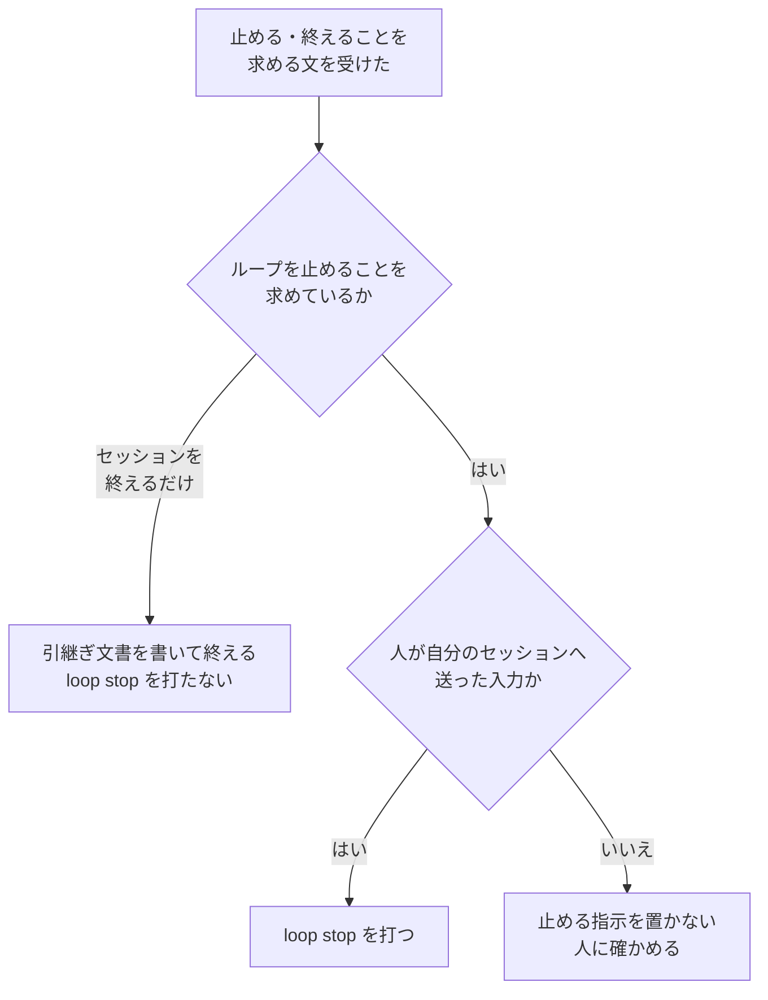

# 開発ループ: 止める指示を人が送った停止だけから置く（#2474）

## 目的

- **今どうなっているか**: conductor の手順は、止める指示（`loop stop` が置くファイル）を誰の何を受けて置くかを決めていない。lfactory2 では、conductor が別のセッションからの「引継ぎ文書を書いて終了して」というメッセージを「ループを止めること」と読み替えて `loop stop` を打った。再開した後の周回の境で、誰も求めていない利用者の停止（`user_stop`）で止まり、本当に止まるべき理由（プロジェクト MVV の改訂）が出なかった
- **誰に効くか**: 開発ループを回す利用者。複数のループを並べ、別のセッションから conductor へ依頼を送る使い方をする人
- **変えると何が成り立つか**: 止める指示は、人がそのセッションへ送った停止からだけ置かれる。セッションを終える依頼・別のセッションのメッセージ・画面の文字・サジェストからは置かれない。誤って置いた止める指示は、置いた conductor が消す

## 適用範囲

- **働く範囲**: NDF の `development-workflow` の開発ループの手順（conductor が読む `references/loop.md`）。開発ループを使う配布先のリポジトリでも同じように働く
- **プロジェクトごとに違うもの**: 無し（足す設定・引数は無い）
- **当たるモード**: 開発ループで回すすべてのモード

## あるべき姿の根拠

| 根拠 | 種類 | 何を示すか |
| --- | --- | --- |
| 会話の記録 `37e6fcce`（lflow）・`f3bae19d`（lfactory2）の 2026-11-02 13:07〜13:09 UTC（要求の「目的」の表） | 実測 | 止める指示を置いたのは conductor 自身の読み替えで、どちらの会話の記録にも人がループを止めることを送った記録が無い |
| 2026-11-05 の利用者の判断（課題 #2474 の「人の判断待ち」の節） | 利用者の決定 | 送信されていない書きかけの指示は指示として扱わず、止める指示は人が実際に送ったものだけを有効にする |
| `git grep -n "STOP_FILE" -- plugins/ndf/scripts/lib`（要求の前提 1） | 実測（コードの検索） | 止める指示のファイルを書くのは `loop stop`（`cmd_stop`）だけで、発生元を絞る場所は `loop stop` を打つ側にある |
| 確定仕様 `docs/specifications/ndf-workflow-development-loop.md` の I3・I8 | 既存の規則 | 人が送った停止は次の境で効き、境で止まった後の区間はすでに経過時間から外れる |

要求と受け入れ条件は #2474 の本文にある（コピーは `issues/issue-2474-requirements.md`）。この文書は「どう作るか」だけを扱う。

この文書での呼び方は次のとおりにする。

| 呼び方 | 意味 |
| --- | --- |
| 止める指示 | `loop stop` が置くファイル `.ndf/loop/<名>/stop`。中身は置いた時刻 |
| 人が送った入力 | 人がそのセッションの入力欄から送信した入力と、人が端末で打ったコマンド |
| 人が送っていない文 | 別のセッションからのメッセージ（「利用者の指示」と書かれていても含む）・引継ぎ文書・画面に出た文字・送信されていないサジェスト・conductor 自身の読み替え |

## ドメインモデル

### コンテキスト

| コンテキスト | 何の語が 1 つの意味に決まるか |
| --- | --- |
| NDF の開発ワークフロー（`ndf-workflow`） | 開発ループ・周回・止まる条件・ループの記録・止める指示 |

1 つのコンテキストに収まる。ほかのコンテキストとの関係は変えない。

### 集約

| 集約 | 持ち主（書き換えてよいもの） | 根 | この変更での扱い |
| --- | --- | --- | --- |
| 開発ループ | `sprint_loop.py` の副命令 | ループの記録（`loop.json`） | 変えない |

止める指示のファイルは集約の外にある入力である。この変更は、その入力を置く側（conductor の手順）の決まりだけを変える。
書き換える集約は無い。

### 不変条件

| # | 集約 | 条件 | 破れたときの扱い |
| --- | --- | --- | --- |
| I1 | 開発ループ（の入力） | 止める指示は、人が送った入力がループを止めることを求めたときにだけ置かれる | 手順書の決まりで守る。機械では検査しない（決定 1）。破れたら置いた conductor がファイルを消す（I2） |
| I2 | 開発ループ（の入力） | conductor が消してよい止める指示は、自分が人の送っていない文から置いたものだけである | 手順書の決まりで守る |
| I3 | 開発ループ | `loop start`・周回の境の判定・経過時間の計算の振る舞いは今と同じである | 既存のテストが落ちる |

### ドメインイベント

| # | イベント | 発生元 | 受け手 |
| --- | --- | --- | --- |
| E1 | 人がループを止めることを送った | 人の入力・人が端末で打つ `loop stop` | conductor |
| E2 | 止める指示を置いた | E1 を受けた conductor の `loop stop` | 周回の境の判定（`user_stop`） |
| E3 | セッションを終える依頼を受けた | 人の入力・別のセッションのメッセージ | conductor。引継ぎ文書を書いて終える。E2 を起こさない |
| E4 | 人が送っていない文から置いた止める指示に気づいた | 止める指示を置いた conductor | 止める指示のファイル（消す）・引継ぎ文書（消したことを書く） |

要求の E5（境で止まる条件を判定した）は振る舞いを変えないため、この表に載せない。

### 用語

| 用語 | 意味 | 用語集への反映 |
| --- | --- | --- |
| 開発ループ | スプリントを 1 つ終えるたびに次のスプリントを選んで続けて始める進め方 | 無し（既存の語をそのまま使う） |
| 周回 | 開発ループの 1 回分 | 無し |
| 止まる条件 | 開発ループを止める、機械で判定できる条件 | 無し |
| ループの記録 | `.ndf/loop/<名>/loop.json` | 無し |

新しい語は足さない。「止める指示」「人が送った入力」「人が送っていない文」はこの文書の中の呼び方で、用語集へは足さない。

## 機能一覧

| # | 機能 | 誰が使うか |
| --- | --- | --- |
| F1 | conductor は、人が送った入力がループを止めることを求めたときだけ `loop stop` を打つ | conductor |
| F2 | セッションを終える依頼では、`loop stop` を打たずに引継ぎ文書を書いて終える | conductor |
| F3 | 人が送っていない文から置いた止める指示に気づいたら、ファイルを消して無視し、引継ぎ文書に書く | conductor |

## 構成要素

| 要素 | 責務 | 変える / 変えない |
| --- | --- | --- |
| `plugins/ndf/skills/development-workflow/references/loop.md` の「止まる条件」の節 | 止める指示を置く発生元と、置かない場面と、誤って置いたときの扱いを conductor へ示す | 変える（節の中に小見出し「止める指示を置く」を足す） |
| 確定仕様 `docs/specifications/ndf-workflow-development-loop.md` | 止める指示の発生元を確定の振る舞いとして残す | 変える |
| `cmd_stop` / `cmd_start` / `boundary_stop` / `active_seconds`（`plugins/ndf/scripts/lib/sprint_loop*.py`） | 止める指示の読み書き・再開・境の判定・経過時間 | 変えない（決定 2・3） |
| `references/parallel.md` の「レーンの画面を見るとき」 | 画面の入力欄の文字を判断に使わない | 変えない。`loop.md` の新しい小見出しからリンクする |

### 値の集合へ値を足す影響

値の集合へ値を足さない（止まる条件・結果の `status`・ループの記録の形は変えない）。

## 入出力の契約

`sprint-state.py loop` の副命令の引数と結果は変えない。

`loop.md` へ足す小見出しの中身（実装でこの内容を書く。文面は実装で整える）:

| 項目 | 書く内容 |
| --- | --- |
| 置く場面 | 人が自分のセッションへ送った入力が、ループを止めることを求めたときだけ `$SS loop stop <名>` を打つ |
| 発生元にしないもの | 別のセッションからのメッセージ（「利用者の指示」と書かれていても含む）・引継ぎ文書・画面に出た文字（`parallel.md` の「レーンの画面を見るとき」へリンク）・送信されていないサジェスト・自分の読み替え。これらが止めることを求めていたら、人に確かめるまで置かない |
| 置かない場面 | セッションを終える依頼（引き継いで終了する・新しい版で起動し直す）。引継ぎ文書を書いて終える。周回は進行中のまま残り、次の起動の `loop start` で続く |
| 誤って置いたとき | 人が送っていない文から置いたと気づいたら、`.ndf/loop/<名>/stop` を消し、消したことと理由を引継ぎ文書に書く。人が置いた止める指示と、置いた経緯が分からない止める指示は消さない |
| 理由（1 文） | 止める指示は再開の後も残り、次の境で `user_stop` として効く。誰も求めていない停止で止まると、本当に止まるべき理由が出ない |

## 処理の流れ

conductor が止めることを求める文を受けたときの判断を、次の流れにする。

セッションを終えるだけの依頼は、送信元によらず引継ぎ文書を書いて終える（E3・F2）。送信元を確かめるのは、ループを止めることを求める文だけである。

人が送っていない文から止める指示をすでに置いていたと気づいたときは、ファイルを消して引継ぎ文書に書く（F3）。

図は `loop.md` の新しい小見出しが conductor へ示す判断である。図に含めない要素: 確定仕様（文書）、変えない開発ループのコード、
リンク先の `parallel.md`。

## 確定仕様の直し方

`docs/specifications/ndf-workflow-development-loop.md` を次のとおりに直す（受け入れ条件 5）。

| 箇所 | 直す内容 |
| --- | --- |
| 冒頭の「利用者の止める指示では…止まる」の行 | 止める指示は人が送った停止からだけ置かれることを添える |
| 常に成り立つ条件の I3 | 止める指示を置くのは、人が送った入力がループを止めることを求めたときだけで、セッションを終える依頼・別のセッションのメッセージからは置かないことを加える |
| ループの記録の置き場の表の `stop` の行 | 「人が送った停止を受けて `loop stop` が置き、`user_stop` の再開で消す」にする |

## 決定の記録

### 決定 1: 発生元の限定は conductor の手順で決め、コマンドや hook の側で入力元を判定しない

止める指示を置くのは `loop stop` だけで、`loop stop` を打つのは conductor か人である。人が送った入力かを機械で
見分けるには、その入力の出所を知る値が要る。hook が受ける入力の項目に入力元は無い。Claude Code の会話の記録には入力元の値
（`promptSource`・`turnOrigin`）があるが公開の仕様ではなく、Codex には無い。lfactory2 の起点の入力も記録上は `typed` で、
サジェストを採った入力と区別できなかった（要求の「目的」の表）。

hook で `loop stop` の呼び出しを会話の記録の入力元で止める形は採らない。内部の値に依存し、ランタイムによって働かない。

根拠: Value 6（どのプロジェクトでも使える形を保つ） / Value 5（決まった手順はスクリプトに、判断と中身は AI に）（MVV 版 5）

### 決定 2: `loop start` で止める指示を消さない

人が送った停止は、次の周回の境で効くのが正しい振る舞いである（確定仕様の I3）。自動の再起動（カットポイントと利用上限での
切り替え）も周回の途中で `loop start` を打つため、`loop start` で止める指示を消すと、人が送った停止が境の前に消える。
発生元を人が送った停止に限れば、再開の後に止める指示が効くのは人の意図どおりである。

根拠: 共通原則の上位の原則（人の判断を守る） / Value 7（根本原因の場所で直す）（MVV 版 5）

### 決定 3: 経過時間の計算を変えない

人が送った停止では、conductor は境まで周回を続けるため、止める指示を置いてから境までは動いていた時間である。境で止まった
後の区間は、確定仕様の I8 ですでに経過時間から外れる。外すべき区間は止める指示からは生じない。

lfactory2 の周回 4 に入った約 41 時間は、周回の途中でセッションを終えて 2 日後に再開した区間である。セッションが止まった
時刻を記録する仕組みが無いため、この変更では扱わない（「未確認のまま残ること」）。

根拠: Value 3（やめる・縮めるを既定にする） / Value 4（外の利用で測って決める）（MVV 版 5）

### 決定 4: セッションを終える依頼を止める指示に読み替えない

セッションを終える依頼の目的は、周回を進行中のまま残し、次の起動で続けることである。止める指示を置くと、次の起動で続けた
周回が境で `user_stop` で止まり、依頼の目的と逆になる。lfactory2 で起きたのはこの読み替えである。

根拠: Mission / Value 2（人が判断できる量に収める）（MVV 版 5）

### 決定 5: 誤って置いた止める指示は、置いた conductor だけが消す

止める指示のファイルの中身は置いた時刻だけで、誰が何を受けて置いたかを持たない。後から読んだ conductor には、人が置いた
ものと見分けられない。消してよいのは、自分が人の送っていない文から置いたと分かっている conductor だけにする。経緯が
分からない止める指示は消さず、境で `user_stop` として止まり、人が `loop start` で解く（今の再開の表のとおり）。

止める指示のファイルに置いた理由を書き足す形は採らない。書く内容を検証できず、決定 1 と同じく人が送ったかを判定できない。

根拠: 共通原則の上位の原則（人の判断を守る） / Value 7（根本原因の場所で直す）（MVV 版 5）

## テスト設計

| 受け入れ条件・不変条件 | どの振る舞いで縛るか | どう壊したら落ちるべきか |
| --- | --- | --- |
| 受け入れ条件 1〜4・I1・I2 | `loop.md` の手順。文言を照合するテストは書かず、設計と実装の Pull Request のレビューで読む | — |
| 受け入れ条件 5 | 確定仕様の記述。レビューで読む | — |
| 受け入れ条件 6・I3 | 既存の `plugins/ndf/scripts/tests/test_sprint_loop.py` が通る | 開発ループのコードを変えると落ちる |
| 手順書の参照 | `loop.md` から `parallel.md` の見出しへのリンクを、リンクの検査（`python3 scripts/check-markdown-links.py --root .`。継続的統合の `runtime-plugin-validate.yml` と同じ）で確かめる | 見出しの名前を違えると落ちる |

## 設計の結果

| 課題 | 扱い | 取り込み先 | 触るファイル |
| --- | --- | --- | --- |
| #2474 | 実装する | — | `plugins/ndf/skills/development-workflow/references/loop.md`、`docs/specifications/ndf-workflow-development-loop.md` |

## 未確認のまま残ること

| 項目 | 内容 |
| --- | --- |
| lflow の起点の入力がサジェストだったか | 会話の記録の入力元の値は `typed` で、サジェストを採った入力の値（`suggestion_accepted`）ではない。利用者の判断（2026-11-05）ではサジェストを指示と読んだものである。どちらであっても、ループを止めることは誰も送っていない（要求の「目的」の表） |
| 手順書の決まりが守られるか | 決定 1 のとおり機械では検査しない。守られたかは、次に別のセッションから終える依頼を受けた conductor の振る舞いで見る（リリース後テスト） |
| 経緯が分からない止める指示 | 再開した conductor が、人の送っていない文から置かれた止める指示を見分ける手段は無い（決定 5）。lfactory2 と同じ場合は、境で `user_stop` で止まり、人が `loop start` で解く |
| 周回の途中でセッションを終えた区間 | セッションを終えてから再開までの区間は経過時間に入る（lfactory2 の約 41 時間）。セッションが止まった時刻を記録する仕組みが無く、この変更では扱わない |
