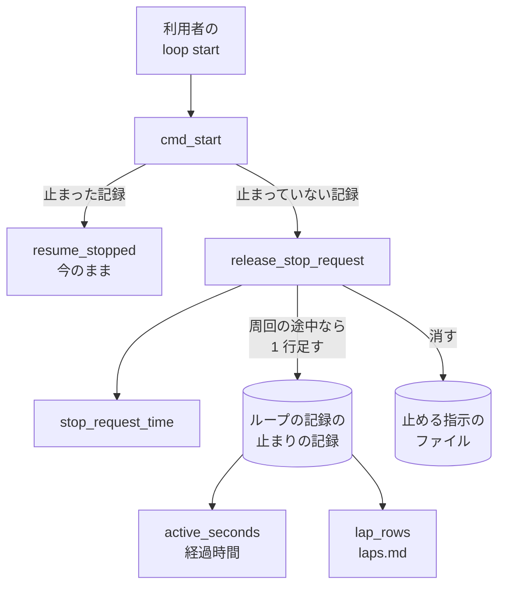
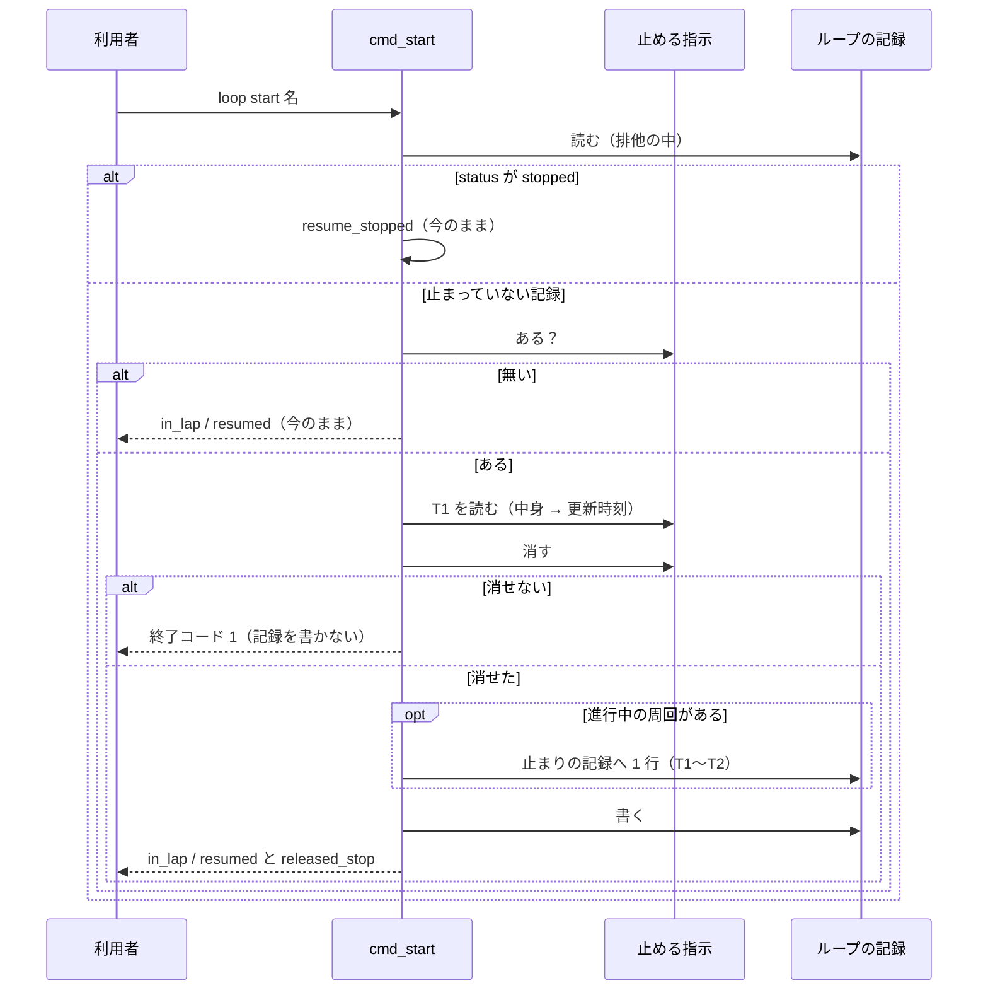

# 開発ループ: 周回の途中に置いた止める指示を再開で解き、止めていた時間を予算の経過時間から外す（#2474）

## 目的

- **今どうなっているか**: 周回の途中で `loop stop` を打ってセッションを切り、後から `loop start` で再開すると、止める指示のファイルが残る。周回を締めた境でそのファイルを読み、利用者が止めたという条件（`user_stop`）で止まり直す。止めていた時間は周回の区間に入ったまま、止まりの記録のどの行にも重ならないため、ループの予算の経過時間に数えられる（lfactory2 の周回 4 で約 41 時間、予算 72 時間の約 6 割）
- **誰に効くか**: 開発ループを使う利用者。周回の途中でループを休ませてセッションを切る使い方をする人
- **変えると何が成り立つか**: `loop start` の再開で止める指示が解ける。休ませた区間は止まりの記録に 1 行残り、経過時間から外れる。再開の後に余分な止まりが挟まらず、予算の残りが休ませる前と同じに保たれる

## 適用範囲

- **働く範囲**: NDF の `sprint-state.py loop` の副命令（`start`・`lap`・`select`）。開発ループを使う配布先のリポジトリでも同じように働く
- **プロジェクトごとに違うもの**: 無し（足す設定・引数は無い。止める指示のファイルの置き場と中身は今のまま）
- **当たるモード**: 開発ループで回すすべてのモード（`pace: auto`）

## あるべき姿の根拠

| 根拠 | 種類 | 何を示すか |
| --- | --- | --- |
| `.ndf/loop/lfactory2/loop.json` の記録（要求の「目的」の表）: 周回 4 の開始 2026-11-02 13:04:20、止める指示 13:08:53、締めた時刻 2026-11-04 06:01:43、消費の hours 6.19 → 47.14、`user_stop` の行は 06:01:43〜06:02:11 | 実測 | 止めていた区間が止まりの記録に無く、経過時間から引かれていない |
| 確定仕様 `docs/specifications/ndf-workflow-development-loop.md` の I8（止まっていた時間は経過時間に入らない）と再開の表（`user_stop` はファイルを消して解ける） | 既存の規則 | 止める指示は再開で解けること、止まっていた区間を経過時間から外すことが、すでに決まった形である |
| `plugins/ndf/scripts/lib/sprint_loop.py` の `cmd_start`（止まっていない記録では `in_lap` / `resumed` を返すだけで、止める指示のファイルを見ない） | 実測（コードの読み） | 止める指示を消すのは、止まった記録の再開（`_resume_user_stop`）の経路だけである |

要求と受け入れ条件は #2474 の本文にある（コピーは `issues/issue-2474-requirements.md`）。この文書は「どう作るか」だけを扱う。

この文書での呼び方は次のとおりにする。

| 呼び方 | 意味 |
| --- | --- |
| 止める指示 | `loop stop` が置くファイル `.ndf/loop/<名>/stop`。中身は置いた時刻 |
| 止まりの記録 | ループの記録（`loop.json`）の `stops`。解けた止まりの一覧（追記だけ） |
| 経過時間 | 確定仕様の I8 の「動いていた時間」。終わった周回の区間の和から、止まりの記録と重なる部分を引いたもの（結果の `consumed.hours`） |
| 止まっていない記録 | ループの記録の `status` が `running` のもの（`stopped` でないもの） |
| 休ませた区間 | 止める指示を置いた時刻 T1 から、`loop start` で再開した時刻 T2 まで |

## ドメインモデル

### コンテキスト

| コンテキスト | 何の語が 1 つの意味に決まるか |
| --- | --- |
| NDF の開発ワークフロー（`ndf-workflow`） | 開発ループ・周回・ループの予算・止まる条件・ループの記録・止める指示 |

1 つのコンテキストに収まる。ほかのコンテキストとの関係は変えない。

### 集約

| 集約 | 持ち主（書き換えてよいもの） | 根 | エンティティ | 値オブジェクト |
| --- | --- | --- | --- | --- |
| 開発ループ | `sprint_loop.py` の副命令（記録の読み書きは `sprint_loop_record.py` の関数を通す） | ループの記録（`loop.json`） | 周回（`laps[]`） | 止まり（`stop` / `stops[]` の 1 行）・予算・消費 |

止める指示のファイルは集約の外にある入力である。置くのは利用者の `loop stop`、消すのは `loop start` だけにする。
この変更で書き換えるのは開発ループの集約だけで、1 回の `loop start` が書き換える集約も 1 つである。

### 不変条件

| # | 集約 | 条件 | 破れたときの扱い |
| --- | --- | --- | --- |
| I1 | 開発ループ | 止まっていない記録の再開と、`user_stop` で止まった記録の再開では、`loop start` が終了コード 0 を返した後に止める指示のファイルが無い | テストが落ちる |
| I2 | 開発ループ | 止まっていない記録で進行中の周回があるときに止める指示を解いたら、止まりの記録に `condition: user_stop`・その周回の番号・`at` = T1・`resumed_at` = T2 の行がちょうど 1 行足される。進行中の周回が無いときは行を足さない | テストが落ちる |
| I3 | 開発ループ | 休ませた区間（T1〜T2）は、その周回の経過時間に入らない。周回の分は (T1 − T0) + (T3 − T2) になる | テストが落ちる |
| I4 | 開発ループ | T1 は T2 を超えない。止める指示の中身が時刻として読めないときは、ファイルの更新時刻を T1 にする | テストが落ちる |
| I5 | 開発ループ | 止める指示を消せなかったら、`loop start` は断り、ループの記録を書き換えない | テストが落ちる |
| I6 | 開発ループ | 止める指示のファイルが無いときの `loop start` の結果とループの記録は、今と同じである | 既存のテストが落ちる |

### ドメインイベント

| # | イベント | 発生元 | 受け手 |
| --- | --- | --- | --- |
| E2 | 止める指示を置いた | 利用者の `loop stop` | `loop start`（E5）・周回の境の判定（E8） |
| E4 | 再開を求めた | 利用者の `loop start` | `cmd_start` |
| E5 | 止める指示を解いた | `cmd_start`（止まっていない記録で止める指示がある） | 結果の `released_stop`・周回の境の判定（`user_stop` に当たらなくなる） |
| E6 | 休ませた区間を記録した | `cmd_start`（E5 で進行中の周回がある） | 経過時間の計算（`active_seconds`）・`laps.md` の描画 |
| E8 | 境で止まる条件を判定した | `loop lap` の後・`loop select` の前（`boundary_stop`） | 止まる条件の判定。E5 が先に起きていれば `user_stop` は当たらない |

要求の E1（周回を始めた）・E3（セッションが終わった）・E7（周回を締めた）は振る舞いを変えないため、この表に載せない。
E3 は記録が残らないため受け手を持たない（要求の前提 1）。

### 用語

| 用語 | 意味 | 用語集への反映 |
| --- | --- | --- |
| 開発ループ | スプリントを 1 つ終えるたびに次のスプリントを選んで続けて始める進め方 | 無し（既存の語をそのまま使う） |
| 周回 | 開発ループの 1 回分 | 無し |
| ループの予算 | 開発ループが使ってよい量の上限。周回の数・費用・経過時間で数える | 無し |
| 止まる条件 | 開発ループを止める、機械で判定できる条件 | 無し |
| ループの記録 | `.ndf/loop/<名>/loop.json` | 無し |

新しい語は足さない。「止める指示」「休ませた区間」はこの文書の中の呼び方で、用語集へは足さない。

## 機能一覧

| # | 機能 | 誰が使うか |
| --- | --- | --- |
| F1 | 周回の途中でループを休ませた後、`loop start` で再開すると止める指示が解ける | 開発ループを回す利用者と conductor |
| F2 | 周回の外（進行中の周回が無い）で置いた止める指示も、`loop start` で解ける | 同上 |
| F3 | 休ませた区間が止まりの記録と `laps.md` に残り、ループの予算の経過時間から外れる | 同上 |

## 構成要素

| 要素 | 責務 | 変える / 変えない |
| --- | --- | --- |
| `cmd_start`（`plugins/ndf/scripts/lib/sprint_loop.py`） | 止まっていない記録の経路で、止める指示があれば解く関数を呼び、結果に `released_stop` を載せる | 変える |
| `release_stop_request`（新設。`sprint_loop.py`） | 止める指示の時刻 T1 を読み、ファイルを消し、進行中の周回があれば止まりの記録へ 1 行足す。消せなければ断る結果を返す | 作る |
| `stop_request_time`（新設。`plugins/ndf/scripts/lib/sprint_loop_record.py`） | 止める指示のファイルから T1 を読む（中身 → 読めなければ更新時刻）。T2 を超えれば T2 に揃える | 作る |
| `lap_rows`（`sprint_loop_record.py`） | `laps.md` の周回の行の「止まった理由」に、その周回の止まりを起きた順にすべて並べる | 変える |
| `active_seconds`（`sprint_loop_record.py`） | 止まりの記録の `at`〜`resumed_at` と周回の区間の重なりを引く | 変えない（足した行をそのまま読む） |
| `boundary_stop`（`sprint_loop_record.py`） | 周回の境で止まる条件を判定する（順も変えない） | 変えない |
| `resume_stopped` / `_resume_user_stop`（`sprint_loop.py`） | 止まった記録の再開 | 変えない（要求の前提 5）。承認ゲート 2 の差し戻し（`gate2_returned`）と周回を組めなかった止まり（`refused`）の再開は、止める指示のファイルを消さない（「未確認のまま残ること」） |
| 確定仕様 `docs/specifications/ndf-workflow-development-loop.md` | 再開の表・I3・I8・`start` の契約・ループの記録の置き場の表を振る舞いに合わせる | 変える |



図に含めない要素: 周回の境の判定（`boundary_stop`。変えず、止める指示が無いことを読むだけ）と確定仕様（文書）。

### 値の集合へ値を足す影響

止まりの記録（`stops`）へ、周回の途中で解いた `user_stop` の行が加わる。行の形（`condition`・`values`・`lap`・`at`・`resumed_at`）は
既存の行と同じである。止まりの記録を読む関数は `grep -rn "stops" plugins/ndf/scripts --include=*.py` で集めた（2026-11-04）。
テストを除いた当たりを 1 つずつ判定した結果が次の表である。`merged_lib/merge.py` と `test_strategy.py` の当たりは
別のオブジェクトの `stops` 属性で、ループの記録を読まない。

| 読む関数 | 新しい行への当てはまり | 扱い |
| --- | --- | --- |
| `active_seconds` | 当てはまる。`at`〜`resumed_at` と周回の区間の重なりを引くのが、この変更の狙いそのものである | 変えない |
| `failure_streak` | 当てはまる。`same_failure` の行だけを区切りに使い、`user_stop` の行は読み飛ばす | 変えない |
| `lap_rows` | 当てはまらない。周回ごとに止まりを 1 つだけ（後の行で上書き）持つため、休ませた後に同じ周回が別の理由で止まると `user_stop` が消える | 変える（決定 4） |
| `resume_record` | 書く側。止まった記録の再開で行を足す | 変えない |

## 入出力の契約

`sprint-state.py loop start` の結果に 1 つ値を足す。既存の値は変えない。

| 場合 | 終了コード | `metrics.status` | 足す値 |
| --- | --- | --- | --- |
| 止まっていない記録・進行中の周回あり・止める指示あり | 0 | `in_lap` | `released_stop: {at, source, lap}`。`summary` に「止める指示を解いた」を足す |
| 止まっていない記録・進行中の周回なし・止める指示あり | 0 | `resumed` | `released_stop: {at, source, lap: null}`。同上 |
| 止める指示が無い | 今のまま | 今のまま | 足さない（キー自体を出さない） |
| 止める指示を消せない | 1 | `refused` | `items` に `{path, reason}`。ループの記録は書かない |
| 止まった記録（`stopped`） | 今のまま | 今のまま | 足さない（要求の前提 5） |

`released_stop` の値:

| キー | 型 | 意味 |
| --- | --- | --- |
| `at` | 文字列（ISO 8601、UTC） | 休ませた区間の始まり T1 |
| `source` | `content` / `mtime` | T1 を止める指示の中身から読んだか、更新時刻から読んだか |
| `lap` | 整数 / `null` | 止まりの記録へ行を足した周回の番号。進行中の周回が無ければ `null` |

止まりの記録へ足す行（形は既存の行と同じ）:

```json
{"condition": "user_stop", "values": {"at": "<止める指示の中身のまま>"}, "lap": 4, "at": "<T1>", "resumed_at": "<T2>"}
```

`values.at` は周回の境の判定（`boundary_stop`）が `user_stop` に書く値と同じく、ファイルの中身をそのまま残す。
中身が読めなかった場合も、空・壊れた中身を `values.at` に残し、`at` に更新時刻を入れる。

## 処理の流れ



`cmd_start` の中の順は、予算の上書き（`apply_budget`）→ 止める指示を解く → 記録を書く、にする。
止める指示を消すのは記録を書く前である（決定 3）。続く `loop lap` の後の境の判定は今のまま `boundary_stop` を通り、
止める指示が無いため `user_stop` に当たらず、`mvv_changed` などの次の条件を見る。

## 決定の記録

### 決定 1: 再開を求めた印を 1 か所で受けるため、止まっていない記録の止める指示を `loop start` で解く

止まった記録の `user_stop` は、すでに `loop start` で解ける。止まっていない記録で止める指示を残すと、同じ利用者の操作
（`loop stop` → `loop start`）が、周回の境の前か後かで違う結果になる。`loop start` を打つこと自体を再開の印として扱い、
どちらの経路でも止める指示を消す。

この決定が揃えるのは、止まっていない記録の再開と `user_stop` で止まった記録の再開の 2 つである。周回の途中で
`gate2_returned`・`refused` で止まった記録の再開は、要求の前提 5 のとおり変えないため、止める指示が残る（「未確認のまま残ること」）。

周回の境の判定（`boundary_stop`）の側で「再開より前に置かれた止める指示を読み飛ばす」形は採らない。再開の時刻を別に
持つ必要があり、止める指示のファイルも残り続けるため、`loop status` と利用者の目に止める指示が残って見える。

根拠: Value 7 / Vision（MVV 版 5）

### 決定 2: 休ませた区間を経過時間から外すため、止まりの記録へ既存と同じ形の行を足す

経過時間の計算（`active_seconds`）は、止まりの記録の `at`〜`resumed_at` と周回の区間の重なりをすでに引く。休ませた区間を
同じ形の 1 行として足せば、計算の側を変えずに I8 が成り立つ。`laps.md` の止まりの欄にも同じ経路で出る。

周回に「休ませた秒」の欄を新しく足す形は採らない。経過時間の計算と `laps.md` の両方に読み手を足すことになり、止まりの
記録と同じ意味の値を 2 か所に持つ。

根拠: Value 7 / Value 8（MVV 版 5）

### 決定 3: 消せなかったときに記録だけが進まないよう、止める指示を消してから記録を書く

止める指示を先に消し、消せなければ記録を書かずに終了コード 1 で断る（要求の E5）。記録を先に書いてから消す順では、
消せなかったときに止まりの記録の行だけが残り、次の境で同じ止める指示が `user_stop` として効き、同じ区間が 2 回扱われる。

消した後に記録の書き込みが失敗した場合は、例外がそのまま上がる（今の `write_record` の失敗と同じ扱い）。このとき
休ませた区間は経過時間から外れないが、止める指示は解けており、再開の後に余分な止まりは挟まらない。

根拠: Value 1（MVV 版 5）

### 決定 4: 休ませた事実が後の止まりで消えないよう、`laps.md` の止まりの欄に周回の止まりをすべて並べる

今の `lap_rows` は周回ごとに止まりを 1 つだけ持ち、後の行で上書きする。休ませた周回が締めた後の境で `mvv_changed` などで
止まると、`user_stop` が欄から消える。止まりの記録の順（起きた順）に、条件を `、` で区切って並べる。止まりが 1 つの周回の
欄は今と同じ文字列になる。

`laps.md` へ休ませた区間だけの別の表を足す形は採らない。周回の一覧の 1 つの欄で足りる。

根拠: Value 8（MVV 版 5）

### 決定 5: 時刻の誤りで経過時間を負に数えないよう、T1 を T2 以下に揃える

止める指示の中身が未来の時刻（手で書いた・時計のずれ）だと、`at` が `resumed_at` より後の行になる。重なりの計算は 0 を
返すが、記録として読めない行が残る。T1 が T2 を超えたら T2 にそろえる（区間の長さは 0）。T1 が周回の開始 T0 より前の
とき（周回を組む前に置いた止める指示）は揃えない。重なりの計算が周回の区間で切るため、引きすぎない。

根拠: Value 1（MVV 版 5）

## テスト設計

置き場は `plugins/ndf/scripts/tests/test_sprint_loop.py`。時刻は `Env.now` の差し替えで進める。

| 受け入れ条件・不変条件 | どの振る舞いで縛るか | どう壊したら落ちるべきか |
| --- | --- | --- |
| 受け入れ条件 1・I1 | 進行中の周回があり止める指示があるとき、`loop start` が 0・`in_lap`・ファイルなし・`released_stop` ありを返す | 止まっていない記録の経路で止める指示を見ないように戻すと落ちる |
| 受け入れ条件 2 | 1 の後に `loop lap`（`--failed` あり・なし）を締めると、境の判定が `user_stop` に当たらない。MVV を改訂しておけば `mvv_changed` で止まる | ファイルを消さずに `released_stop` だけを返すと落ちる |
| 受け入れ条件 3・I2 の後半 | 進行中の周回が無いとき、`loop start` が 0・`resumed`・ファイルなしを返し、止まりの記録に行が増えず、続く `loop select` が `user_stop` で止まらない | 周回が無いときにも行を足すと落ちる |
| 受け入れ条件 4・I3 | T0 < T1 < T2 < T3 の順に時刻を進めると、`consumed.hours` の周回の分が (T1 − T0) + (T3 − T2) になる | 行の `at` に T2 を書く・`resumed_at` を書かないと落ちる |
| 受け入れ条件 5・I2 の前半 | 止まりの記録に `user_stop`・周回の番号・`at` = T1・`resumed_at` = T2 の行がちょうど 1 行あり、`laps.md` の周回の行の止まりの欄に `user_stop` が出る | 行を 2 回足す・周回の番号を書かないと落ちる |
| 決定 4 | 休ませた周回がその後 `mvv_changed` で止まっても、`laps.md` の欄に `user_stop` と `mvv_changed` の両方が出る | 後の止まりで上書きする今の形に戻すと落ちる |
| 受け入れ条件 6・I4 | 止める指示の中身が空・時刻でないとき、ファイルの更新時刻が T1 になり、`source` が `mtime` になる。中身が T2 より後の時刻なら `at` が T2 になる | 中身が読めないときに T2 を使う・揃えずに未来の時刻を残すと落ちる |
| I5 | 止める指示を消せない（消す関数を失敗させる）とき、終了コード 1 で、ループの記録の中身が呼ぶ前と同じ | 記録を先に書いてから消す順にすると落ちる |
| 受け入れ条件 7・I6 | 止める指示が無いとき、`loop start` の結果に `released_stop` が無く、`in_lap` / `resumed` とループの記録が今と同じ | ファイルの有無を見ずに行を足すと落ちる |
| 受け入れ条件 8 | 既存の `test_resume_stopped_*` と `test_stop_file_works_at_the_next_boundary_and_resume_removes_it` が通る | 止まった記録の再開の経路を変えると落ちる |
| 受け入れ条件 9 | 確定仕様の再開の表・I3・I8・`start` の契約が振る舞いを書いている。文言を照合するテストは書かず、コードレビューで読む | — |

## 確定仕様の直し方

`docs/specifications/ndf-workflow-development-loop.md` を次のとおりに直す（受け入れ条件 9）。

| 箇所 | 直す内容 |
| --- | --- |
| 常に成り立つ条件の I3 | 止める指示は周回の境でだけ効く、を残し、「止まっていない記録の `loop start` は止める指示を消し、進行中の周回があれば休ませた区間（止める指示の時刻〜再開）を `stops` へ `user_stop` の行として足す」を加える |
| 常に成り立つ条件の I8 | 引く区間に、周回の途中で解いた止める指示の行（I3）が含まれることを書く |
| 副命令の表の `start` | 出力に `released_stop`（`{at, source, lap}`。止める指示を解いたときだけ）を足す。止める指示を消せないときの 1 を足す |
| 再開の表 | 「止まっていない記録に止める指示がある」の行を足す（ファイルを消し、周回の途中なら区間を `stops` へ足す。`in_lap` / `resumed` のまま） |
| ループの記録の置き場の表 | `stop` の行を「`loop stop` が置き、`loop start` で消す」にする |
| `stop` / `stops` の形の段落 | 周回の途中で解いた行も同じ形であることを書く |
| テストの表 | 受け入れ条件 1〜6 の縛りを 1 行足す |

## 設計の結果

| 課題 | 扱い | 取り込み先 | 触るファイル |
| --- | --- | --- | --- |
| #2474 | 実装する | — | `plugins/ndf/scripts/lib/sprint_loop.py`、`plugins/ndf/scripts/lib/sprint_loop_record.py`、`plugins/ndf/scripts/tests/test_sprint_loop.py`、`docs/specifications/ndf-workflow-development-loop.md` |

## 未確認のまま残ること

| 項目 | 内容 |
| --- | --- |
| 止める指示を置いた後もセッションが周回を進めていた時間 | 要求の前提 1 のとおり、その時間も経過時間から外れる。セッションが止まった時刻を記録する仕組みが無いため、実際に動いていた時間との差は測れない。承認ゲート 1 で利用者が前提 1 を確かめる |
| 消した後の記録の書き込みの失敗 | 決定 3 のとおり、休ませた区間が経過時間に残る。発生の頻度は未確認（今の `write_record` の失敗と同じ扱い） |
| `loop stop` と `loop start` の取り合い | `loop stop` は排他を取らない。`loop start` が止める指示を読んで消す間に別の `loop stop` が書くと、後の指示も消える。同時に打つ使い方は確認していない |
| 周回の途中で止まった記録の再開に残る止める指示 | 周回の途中で `loop stop` を置いた後に、承認ゲート 2 の差し戻し（`gate2_returned`）か周回を組めなかった止まり（`refused`）で止まると、その記録の再開（`resume_stopped`）は止める指示のファイルを消さない。再開の後の周回の境で `user_stop` が出直し、止める指示を置いた時刻 T1 から止まった時刻までが経過時間に残る。#2474 と同じ症状がこの経路に残る。直すには止まった記録の再開を変える必要があり、要求の前提 5 と受け入れ条件 8 に触れるため、この設計では直さない。直すかは課題 #2474 の本文で決める |
| リリース後の実機確認 | 次に開発ループを回すとき、周回の途中で `loop stop` → セッションを切る → `loop start` を通し、`laps.md` の経過時間に休ませた時間が入らないことを見る（要求の検証手段） |
