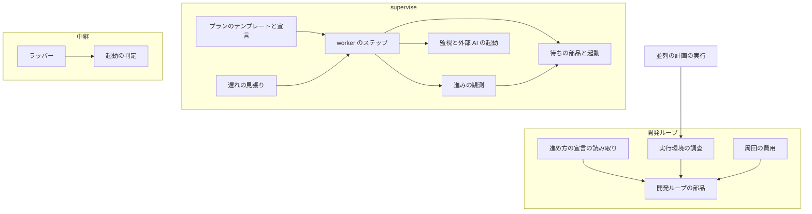
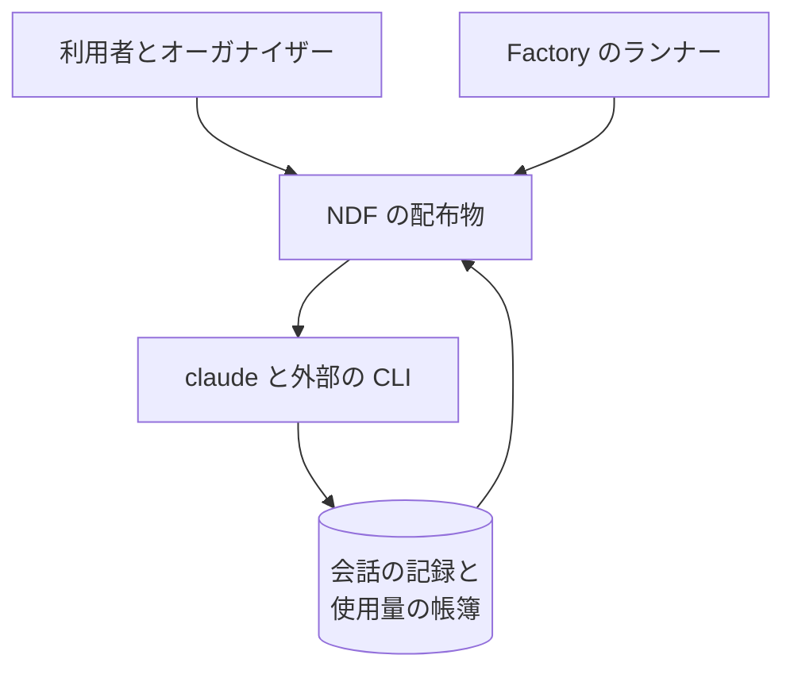
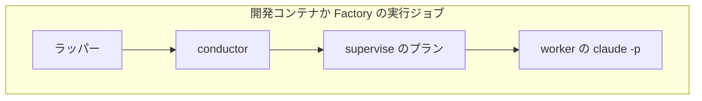
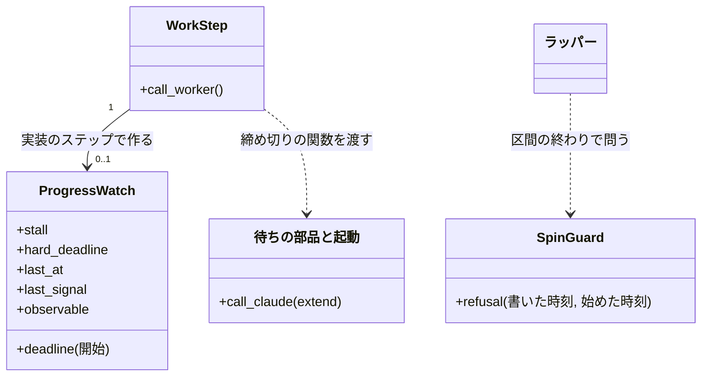
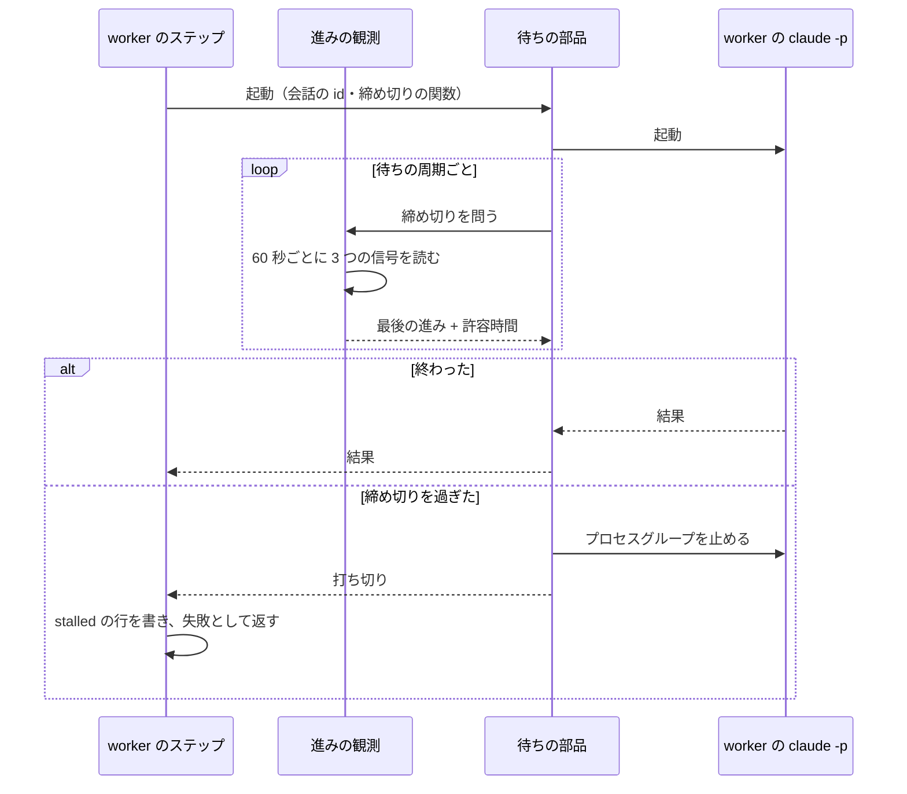
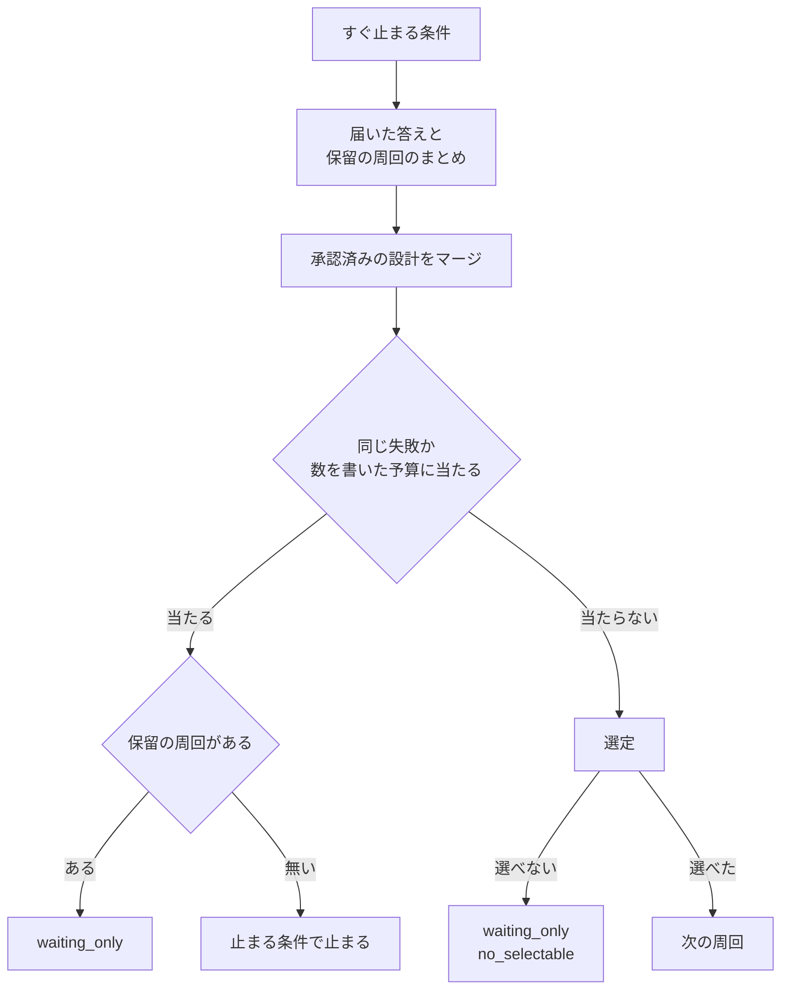

# 開発ループ: レーンを増やしても回数と時間の固定の上限で止まらなくなる（#2505）

## 目的

- **今どうなっているか**: 並列の計画でレーンが増えると、1 日の起動回数（全ラッパーの合計 20 回）と周回の予算が先に尽きる。2026-11-04 にラッパーの上限で 4 回止まり、周回の予算でループが 1 回止まった。実装のステップは 3600 秒の一律の打ち切りで 3 回切られている
- **誰に効くか**: 開発ループと並列の計画を回す利用者とオーガナイザー。手で起こし直す作業と、上限の代わりに大きな数を書く手当てが消える
- **変えると何が成り立つか**: 開発ループが止まる理由は、人の判断が要る状態と、費用・資源の限界と、壊れて回り続ける状態に絞られる。実装のステップは進んでいる間は打ち切られない。1 周回で選ぶ課題の数は、実行環境の調査が出す候補を見て人が決める

## 適用範囲

- **働く範囲**: NDF の配布物（ラッパー・開発ループ・並列の計画・supervise）。配布先のリポジトリでも同じに働く
- **プロジェクトごとに違うもの**: 周回の数・時間・費用の上限は `.ndf/pace.json` の `loop.budget` で受ける。実装の上限と無進捗の許容時間は `.ndf/supervise.json` か `supervise.py new` の引数で受ける。起動の断りを問う回数は環境変数で受ける。ai-plugins の値を既定へ埋め込まない
- **当たるモード**: `standard`

## あるべき姿の根拠

| 根拠 | 種類 | 何を示すか |
| --- | --- | --- |
| 「開発ループを阻害する制限をリストアップし、原則すべて撤廃する」（2026-11-05） | 利用者の指示の原文 | 回数と時間の上限を原則として外すこと |
| 「実装のステップは進み続けている間は打ち切らない」（2026-11-05） | 利用者の指示の原文 | 打ち切りの条件を経過時間から進みへ移すこと |
| 「1 周回で選ぶ課題の数は撤廃しない。環境に合わせて決める」「一時レーンの同時の数（1 本）は撤廃しない」（2026-11-05） | 利用者の指示の原文 | 残すものと、環境で決める値 |
| ラッパーの記録の `stop` は `max-starts` が 5 件・`stop-file` が 1 件。1 日の起動は 2026-11-04 に 30 回、11-05 に 37 回（`~/.local/state/ndf/relay/*/log.jsonl`、2026-11-06 に集計） | 実測 | 固定の 20 回は今の運用の 2 分の 1 に近いこと |
| 実装のステップの呼び出し 77 回のうち 3 回が 3600 秒で打ち切り、4 回が 3000 秒以上（使用量の帳簿の `step` が `impl` の行、2026-11-06 に集計） | 実測 | 長い実装が実際に切られていること |
| `full` のステップの会話の記録 313 本で、記録の間隔の最大は 706 秒、900 秒以上は 0 本（2026-11-06 に集計） | 実測 | 進みが止まったと判定できる許容時間が決められること |
| PRD1（Kubernetes）/ PRD2（Temporal）/ PRD3（AWS Step Functions） | 外部の一次情報 | 長い処理の打ち切りを経過時間でなく進みの途絶で判定する形が、主要な製品の標準の形であること |
| PRD4（systemd） | 外部の一次情報 | 再起動の暴走は 1 日の数でなく「短い時間に何回」で止める形が標準であること |

要求と受け入れ条件は #2505 の本文にある（コピーは [issue-2505-requirements.md](issue-2505-requirements.md) ）。この文書は「どう作るか」だけを扱う。

分けた文書は次の 2 つである。

| 文書 | 内容 |
| --- | --- |
| [issue-2505-design-limits.md](issue-2505-design-limits.md) | 上限の全体の表 60 項目と、種類・扱い |
| [issue-2505-design-decisions.md](issue-2505-design-decisions.md) | 決定の記録 17 件と費用の実測 |

承認ゲート 1 で決めた項目は[「利用者が決めたこと」](#利用者が決めたこと)にある。

## ドメインモデル

### コンテキスト

| コンテキスト | 何の語が 1 つの意味に決まるか |
| --- | --- |
| 開発の工程（`ndf-workflow`） | 周回・ループの予算・保留の周回・実装の上限・無進捗の打ち切り・進みの観測・実行環境の調査 |
| 中継（`ndf-relay`） | ラッパー・区間・再起動ループ |

Factory が顧客、開発の工程が供給者の関係（顧客 / 供給者）。Factory は `--budget-<単位>` の引数でループの予算を渡し、NDF の既定の変更を受け入れる。

### 集約

| 集約 | 持ち主（書き換えてよいもの） | 根 | エンティティ | 値オブジェクト |
| --- | --- | --- | --- | --- |
| ループの記録 | 開発ループの部品（`sprint_loop` と `sprint_loop_record`） | ループ | 周回 | 予算・消費・止まる条件・周回の費用の内訳・実行環境の報告 |
| プランの実行 | supervise のエンジンとステップのハンドラー | 実行の状態 | ステップの結果 | 進みの観測・打ち切りの理由 |
| ラッパーの記録 | ラッパー（`relay_lib`） | ラッパー | 区間 | 再起動ループの判定 |
| 進め方の宣言 | 人。部品は読むだけ | 宣言 | — | ループの節 |

### 不変条件

| # | 集約 | 条件 | 破れたときの扱い |
| --- | --- | --- | --- |
| I1 | 進め方の宣言 | ループの予算の値は `null` か正の数である | `PaceError` でループを断る |
| I2 | ループの記録 | `null` の単位では予算の止まる条件が立たない。数を書いた単位は消費が値以上で立つ | 境の判定と再開の判定は同じ関数で読むので、片方だけ違う結果にならない |
| I3 | ループの記録 | 保留の周回の数は止まる条件にならない。選べる課題があれば選ぶ | 選べなければ `waiting_only`（`no_selectable`）で止まる |
| I4 | ラッパーの記録 | 次の区間の可否は停止シグナルファイルと再起動ループの判定だけで決まる | 再起動ループなら `spin` で止まる |
| I5 | プランの実行 | 実装のステップは、実装の上限を書いていなければ、最後の進みの観測から許容時間を越えるまで打ち切られない | 許容時間を越えたら無進捗の打ち切りになる |
| I6 | プランの実行 | 無進捗の打ち切りは、進捗記録で時間切れと区別できる | `stalled` の行とステップの結果の `stalled` が残る |
| I7 | 進め方の宣言 | 実行環境の調査は宣言を書き換えない | 書く経路を持たない |
| I8 | ループの記録 | 実行環境の調査の失敗で開発ループが止まらない | `unreadable` を記録して進む |
| I9 | ループの記録 | 周回の費用は締めた時点の帳簿の Claude の行の和とスプリントの報告の和の大きい方で、USD の無い起動を足さない | 帳簿を読めなければ報告の和を使う。どちらを採ったかを内訳の `source` に残す |

### ドメインイベント

| # | イベント | 発生元 | 受け手 |
| --- | --- | --- | --- |
| E1 | ラッパーが次の区間を起動してよいと判定した | ラッパー | ラッパーの記録（`start`） |
| E2 | 開発ループが周回の境で止まる条件を判定した | 開発ループの部品 | ループの記録・conductor |
| E3 | 開発ループが保留の周回を抱えたまま次の周回を選んだ | 開発ループの部品 | conductor |
| E4 | 実装のステップの進みを観測した | 進みの観測 | 待ちの締め切り |
| E5 | 実装のステップを無進捗で打ち切った | 進みの観測 | プランの実行の進捗記録・`on_fail` と判定役 |
| E6 | 実行環境を調べた | 実行環境の調査 | ループの記録・conductor・オーガナイザー |
| E7 | 課題の数の候補を人へ示した | `loop start`・`parallel.py start` の結果 | conductor の報告を読む人 |
| E8 | レーンの起動の断りが規定の回数続いて問うた | 並列の計画の実行 | 人 |

要求で未決の E4 と E6 の引き金は次のとおりである。E4 は実装のステップの待ちの中で 60 秒ごと、E6 は `loop start` と `parallel.py start` のたびである。

### 用語

| 用語 | 意味 | 用語集への反映 |
| --- | --- | --- |
| ループの予算 | 開発ループが使ってよい量の上限。周回の数と経過時間は宣言に数を書いたときだけ効く | 意味の変更 |
| 実装の上限 | 実装のステップの経過時間の上限。書いたときだけ効く | 意味の変更 |
| 無進捗の打ち切り | 進みの観測が無進捗の許容時間を越えて途絶えたときだけ打ち切ること | 意味の変更 |
| 無進捗の許容時間 | 最後の進みの観測から無進捗の打ち切りまでに待つ秒 | 追加 |
| 進みの観測 | 会話の記録の伸び・進捗ログの行・コミットの増加のどれかを見つけること | 追加 |
| 周回の費用の内訳 | 周回の費用を、プランの `claude -p`・同じプランの別の起動・USD に換算できない起動に分けた記録 | 追加 |

## 機能一覧

| # | 機能 | 誰が使うか |
| --- | --- | --- |
| F1 | ラッパーが起動回数を数えずに次の区間を起動する | 開発ループを回す利用者 |
| F2 | 周回の数と時間を書かなければ無制限でループが進み、書けばその値で止まる | プロジェクトの管理者 |
| F3 | 保留の周回を抱えたまま次の周回へ進む | オーガナイザー |
| F4 | 実装のステップが無進捗のときだけ打ち切られる | プランを流す conductor |
| F5 | レーンの起動の断りを問う回数を変える | オーガナイザー |
| F6 | 実行環境を調べ、課題の数とプラン・ラッパーの本数の候補を見る | プロジェクトの管理者 |
| F7 | 周回の費用が使用量の帳簿の範囲まで数えた値になる | 予算を決める利用者 |

## 利用者が決めたこと

要求の未決 1〜8 である。2026-11-06 の承認ゲート 1 で利用者が答えた（正本は #2505 の節「設計の承認ゲート 1 での利用者の答え（2026-11-06）」）。設計の案から変わったのは 3 と 7 で、この文書は答えの後の形を書く。理由は決定の記録にある。

| # | 何を決めるか | 決めた形 | 理由 | 答え |
| --- | --- | --- | --- | --- |
| 1 | 同じ失敗の繰り返し（2 回）の既定を外すか | 残す（決定 12） | レーンの数で増えず、止まりの記録は 37 回中 0 回。外すと失敗の費用だけが増える | 残す |
| 2 | merge から取り込みへ戻る回数と配布の入れ直しの回数を無くすか | どちらも残す（決定 13） | 戻りはプランのステップの上限の中にあり、当たった記録は 0 件。配布は回数が尽きると人へ戻すだけで失敗しない | どちらも残す |
| 3 | 費用の予算を残すか。残すなら数え方を直すか | 既定を上限なしにし、書いたときだけ効く。書いたときの数え方は帳簿へ直す。`null` を受ける（決定 11） | 周回の数・時間と同じ規則にそろえる。歯止めは同じ失敗の回数と利用プランの上限である。[費用の実測](issue-2505-design-decisions.md#費用の実測) のとおり、今の記録は分かる支出の半分である | 既定を上限なしにする（案の「残す・既定 60 ドル」から変更） |
| 4 | 「進んでいる」の判定・無進捗の許容時間・観測できないときの扱い・`impl_timeout` の扱い | 3 つの信号。許容時間 1800 秒。観測できなければ行とコミットだけで 7200 秒。`impl_timeout` は書いたときだけ効く（決定 4・6・7） | 記録の間隔の実測の最大は 706 秒。行の間隔の最大は 6479 秒 | 案のまま |
| 5 | プランの本数の合計 6 と同時に動かすラッパーの数 3 も実行環境の調査で決めるか | 候補を同じ出力に載せる。既定は変えない（決定 9・10） | 同じ値から導け、足す手間が無い。反映は環境変数で人が行う | 案のまま |
| 6 | 実行環境の調査の時点と、候補を宣言へ反映する経路 | `loop start` と `parallel.py start` のたび。反映は人が Pull Request で行う（決定 9） | 1 秒未満で LLM を使わず、毎回通せば環境の変化も拾える。自動で書かない（C7） | 案のまま |
| 7 | Factory の区間の上限 20 を同じ扱いにするか | この設計の範囲から外す（決定 14） | `factory/` は volareinc/nd-factory へ移す（#2646） | 移した先で直す（nd-factory の #12） |
| 8 | 耐久ワークフローの止まりの待ち 30 日 | 関数と 30 日を残す（決定 15） | 関数は cross-review と cross-refactoring の駆動が呼ぶ。待ちが上限を過ぎた記録は 0 件 | 案のまま |

## 外部の調査

| 種類 | 調べるか | 理由 |
| --- | --- | --- |
| 標準・仕様 | 調べる | 実行環境の調査が読むコンテナの制限の値に公開の仕様がある |
| 主要な製品 | 調べる | 長い処理の打ち切りと再起動の暴走の止め方は、ジョブ実行の基盤に確立した形がある |
| ライブラリとサービス | 調べる | リトライ・プロセスの情報を既存の依存で賄えるかを確かめる |

### 標準・仕様

| # | 標準・仕様 | 何を定めているか | 設計への反映 | 出典 |
| --- | --- | --- | --- | --- |
| STD1 | Linux cgroup v2 | `cpu.max`（`$MAX $PERIOD`。`max` は無制限）で CPU の帯域、`memory.max` でメモリの上限を表す | 実行環境の調査でコンテナの制限を読む（決定 9） | https://docs.kernel.org/admin-guide/cgroup-v2.html （2026-11-06） |
| STD2 | Python `os.cpu_count` / `os.process_cpu_count` | `cpu_count` はシステム全体の論理 CPU の数、`process_cpu_count` は呼び出したスレッドが使える数を返す。後者は 3.13 で追加された | 3.10 で動くよう `sched_getaffinity` を使う（決定 9） | https://docs.python.org/3/library/os.html （2026-11-06） |

### 主要な製品

| # | 製品 | どう解いているか | 設計への反映 | 出典 |
| --- | --- | --- | --- | --- |
| PRD1 | Kubernetes | Deployment の `progressDeadlineSeconds` は進みの途絶を判定する。Job の `activeDeadlineSeconds` は経過時間の上限で、書いたときだけ効く | 無進捗の判定を既定にし、経過時間の上限は書いたときだけにする（決定 6） | https://kubernetes.io/docs/concepts/workloads/controllers/deployment/ ・ https://kubernetes.io/docs/concepts/workloads/controllers/job/ （2026-11-06） |
| PRD2 | Temporal | 長い Activity は Heartbeat と Heartbeat Timeout で検知する。Heartbeat は進みの情報を持てる | 進みを信号で読み、許容時間を越えたら打ち切る形に倣う（決定 4） | https://docs.temporal.io/encyclopedia/detecting-activity-failures （2026-11-06） |
| PRD3 | AWS Step Functions | `HeartbeatSeconds` を越えて信号が途絶えると `States.Timeout` で失敗する。`TimeoutSeconds` は別にある | 同上。打ち切りの理由を時間切れと分ける点だけ、この変更が記録で足す（決定 5） | https://docs.aws.amazon.com/step-functions/latest/dg/state-task.html （2026-11-06） |
| PRD4 | systemd | `StartLimitIntervalSec` と `StartLimitBurst` は「区間の中の起動の回数」で止める。`WatchdogSec` は keep-alive の途絶で止める | 暴走止めを短い区間の検出に任せ、1 日の数を持たない（決定 1） | https://www.freedesktop.org/software/systemd/man/latest/systemd.unit.html ・ https://www.freedesktop.org/software/systemd/man/latest/systemd.service.html （2026-11-06） |
| PRD5 | GitHub Actions | ジョブの `timeout-minutes` の既定は 360 分で、経過時間の上限を既定で持つ | 経過時間の上限を既定にする形。CI の 1 回に向く形で、長さの読めない実装には採らない | https://docs.github.com/en/actions/reference/workflows-and-actions/workflow-syntax （2026-11-06） |
| PRD6 | Claude Code の CLI | `--session-id` で会話の id を決め、`--no-session-persistence` で保存を止める。`--max-budget-usd` は手元の見積もりで止め、請求とは異なることがある | 実装のステップで会話を残して進みを読む（決定 4）。帳簿の USD は見積もりとして扱う（決定 11） | https://code.claude.com/docs/en/cli-reference （2026-11-06） |

### ライブラリとサービス

| # | 候補 | 版 | ライセンス | 最後のリリースの日付 | 終了のアナウンス | 要件を満たすか | 出典 |
| --- | --- | --- | --- | --- | --- | --- | --- |
| LIB1 | psutil（既存の依存） | 7.2.2 | BSD-3-Clause | 2026-01-28 | 無し | メモリと cgroup の読み取りに使う（`procs` の部品）。子プロセスの CPU 時間も読めるが、進みの判定には使わない（決定 4） | https://pypi.org/pypi/psutil/json （2026-11-06） |
| LIB2 | tenacity | 9.2.1 | Apache-2.0 | 2026-10-07 | 無し | 再試行の部品で、進みの観測と締め切りの移動を持たない。要件を満たさない | https://pypi.org/pypi/tenacity/json （2026-11-06） |
| LIB3 | DBOS（既存の依存。固定の版 3.1.0、最新 3.4.0） | 3.4.0 | MIT | 2026-10-28 | 無し | `DBOS.recv` の `timeout_seconds` は数で、既定 60。上限の無い待ちは文書に無い（決定 15） | https://docs.dbos.dev/python/reference/contexts ・ https://pypi.org/pypi/dbos/json （2026-11-06） |

### 確かめられなかったこと

| 対象 | 試した手段 | 結果と理由 |
| --- | --- | --- |
| 会話の記録が CLI の版をまたいで同じ場所・同じ伸び方を保つこと | https://code.claude.com/docs/en/cli-reference と https://code.claude.com/docs/en/headless の本文を読んだ | 記録の場所と書き込みの時点は公開の文書で確かめられなかった。手元の CLI で実測した。読めないときの扱いを決定 7 に置く |
| Factory の実行ジョブのコンテナの CPU とメモリの制限の実際の値 | 試していない | インフラの定義はこのリポジトリの外にある。部品は cgroup の値を読むだけなので、値が分からなくても設計は変わらない |

調べた量: 候補 11 件・取得の試み 15 回。

## 構成要素

| 要素 | 責務 | 変更 |
| --- | --- | --- |
| 起動の判定（`relay_lib/record.py`） | 再起動ループだけで次の区間の可否を返す | 変える |
| ラッパー（`relay_lib/run.py`・`handover.py`） | 判定を呼び、`count.lock` を持たない | 変える |
| 進め方の宣言の読み取り（`lib/pace.py`） | 予算の `null` を受け、`release_pending_max` を読まない | 変える |
| 開発ループの部品（`lib/sprint_loop*.py`） | 予算の判定を 1 つの関数へ集め、保留の周回の数の判定と `relay_max_starts` を消す | 変える |
| 周回の費用（`lib/lap_cost.py`） | 帳簿の和と報告の和を比べて周回の費用を決め、内訳を導く | 新設 |
| 実行環境の調査（`lib/run_environment.py`） | 環境を読み、候補を返す。書き込まない | 新設 |
| 進みの観測（`supervise_lib/progress_watch.py`） | 信号を 60 秒ごとに読み、無進捗の締め切りを返す | 新設 |
| 待ちの部品と起動（`supervise_lib/claude.py`） | `extend` を `call_claude` へ通す。会話を残す起動を許す | 変える |
| worker のステップ（`supervise_lib/worker_steps.py`） | `stall` のステップへ進みの観測を付け、打ち切りの理由を残す。外部のランタイムの結果の `stalled` を読む | 変える |
| 遅れの見張り（`supervise_lib/slow.py`） | `stall` のステップで打ち切らない | 変える |
| プランのテンプレートと宣言（`supervise_lib/templates.py`・`verify_steps.py`・`decl.py`・`new_args.py`・`plan.py`） | 実装のステップに `stall` を書き、実装の上限は書いたときだけ `timeout` にする | 変える |
| 実績の見込み（`lib/estimate_predict.py`） | 実装の上限の見込みを消す | 変える |
| 監視（`lib/monitor.py`・`monitor_loop.py`）と外部 AI の起動 | `--timeout 0` を「経過時間の上限が無い」として受ける | 変える |
| 並列の計画の実行（`lib/parallel_run.py`・`parallel.py`） | 断りの回数の上書きを読む。開始で計画のレーンの数を渡して実行環境の調査を載せる | 変える |
| 確定仕様・手順書 | 変更後の値へ揃える（下の「文書の対象」） | 変える |

### 構成要素の関係



実績の見込み・確定仕様と手順書は、ほかの要素を呼ばず、呼ばれもしない変更なので図に含めない。

### システムの文脈と配置

システムの文脈は次のとおりである。Claude Code の CLI の会話の記録と使用量の帳簿を読むだけで、書き手は変わらない。



動く場所は変わらない。



### 置き場

```text
plugins/ndf/scripts/
├── lib/
│   ├── lap_cost.py            # 新設: 周回の費用
│   ├── run_environment.py     # 新設: 実行環境の調査
│   ├── pace.py
│   ├── sprint_loop*.py
│   ├── estimate_predict.py
│   ├── monitor.py / monitor_loop.py
│   └── parallel_run.py
├── supervise_lib/
│   ├── progress_watch.py      # 新設: 進みの観測
│   ├── claude.py / worker_steps.py / slow.py
│   └── templates.py / verify_steps.py / decl.py / new_args.py / plan.py
├── relay_lib/
│   └── record.py / run.py / handover.py / common.py
└── parallel.py
```

### 文書の対象

要求の受け入れ条件の文書の行のとおり、次を変更後の値に揃える。

| 種類 | ファイル |
| --- | --- |
| 確定仕様 | `docs/specifications/` の `ndf-workflow-development-loop.md`・`ndf-relay-segment-restart.md`・`ndf-relay-multi-session-supervisor.md`・`ndf-parallel-organizer.md`・`ndf-supervise-step-budgets.md`・`ndf-estimate.md`・`ndf-factory-dev-loops.md`・`ndf-factory-dev-loops-data-and-contracts.md`・`ndf-factory-runs-and-runner.md` |
| 手順書 | `development-workflow` の `references/loop.md`・`relay.md`・`parallel.md`・`pace.md`、`issue-plan-strategy` の `parallel-plan.md`、`estimate` の `rules.md`、`restart` の `SKILL.md` |

## 構造



`SpinGuard` は `StartLimit` の改名である（決定 1）。

## データ構造

JSON のファイルだけで、移行は無い。読む側が新しい値と古い値の両方を受ける。

| ファイル | 項目 | 型 | 空の値 | 変更 |
| --- | --- | --- | --- | --- |
| `.ndf/pace.json` | `loop.budget.laps` / `hours` | 正の数か `null` | `null` と省略は無制限 | 既定が `null` になる |
| `.ndf/pace.json` | `loop.budget.usd` | 正の数か `null` | `null` と省略は無制限 | 省略の既定が無制限になる。`null` を受ける |
| `.ndf/pace.json` | `loop.release_pending_max` | — | — | 読まない。値が何でも断らない |
| `.ndf/supervise.json` | `impl_stall_seconds` | 1 以上の整数か `null` | `null` と省略は 1800。無進捗の打ち切りは外せない | 新設 |
| `.ndf/supervise.json` | `impl_timeout` | 1 以上の整数か `null` | 無ければ経過時間の上限が無い | 意味の変更 |
| ループの記録（`loop.json`） | `budget.<単位>` | 数か `null` | `null` は無制限 | `null` が入る |
| ループの記録 | `release_pending_max` | — | — | 新しい記録に書かない。古い記録の値は読まない |
| ループの記録 | `environments[]` | 実行環境の報告の配列（`at` を持つ） | 無ければ空 | 新設。追記だけで、過去の行を書き換えない |
| ループの記録の周回 | `cost` | 数 | — | 意味の変更（帳簿の和と報告の和の大きい方）。締めた周回の値は変えない |
| ループの記録の周回 | `cost_parts` | `{source, plans, others, unpriced}` | 古い周回には無い | 新設 |
| プランのステップ | `stall` | 秒 | 無ければ今の振る舞い | 新設。動いているプランの古いステップはそのまま動く |
| プランのステップ | `timeout` | 秒 | 実装のステップは実装の上限を書かなければ置かない | 意味の変更 |
| プランのステップ | `estimate` | — | — | 消す |
| 進捗ログ | `{"kind": "stalled", "step", "stall", "last_at", "last_signal"}` | 行 | — | 新設 |
| ステップの結果 | `stalled` | `{seconds, last_signal}` | 時間切れと分けるため無進捗のときだけ | 新設 |

周回の費用の内訳の形は次のとおりである。

| 項目 | 意味 |
| --- | --- |
| `source` | `ledger`（帳簿の和を採った）か `reports`（報告の和が大きい、または帳簿を読めず、スプリントの報告の和を採った） |
| `plans` | `supervise` の起動の和（USD） |
| `others` | cross-review・MVV 判定ほかの Claude の起動の和（USD） |
| `unpriced` | `{"codex": {"calls", "tokens"}, "kiro": {"calls"}}`。USD を持たないため和に足さない |

`plans` と `others` は帳簿の値である。`source` が `reports` のとき、2 つの和は `cost` と一致しない。

## 入出力の契約

| 名前 | 入力 | 出力 | 失敗の形 | 互換性 |
| --- | --- | --- | --- | --- |
| `sprint-state.py loop start` | 今のまま | 結果の `metrics.environment` に実行環境の報告。候補と今の値が違えば `lines` に 1 行 | 調査の失敗では止まらない | 足すだけ |
| `sprint-state.py loop environment [--root] [--json]` | なし | 実行環境の報告 | 読めない項目は `unreadable`。終了コードは 0 | 新設 |
| `parallel.py start` | 今のまま | 結果に実行環境の報告 | 同上 | 足すだけ |
| `sprint-state.py loop start --budget-<単位> default` | 今のまま | 宣言の値へ戻す。宣言が無ければ `null` | 今のまま | 既定の値が変わる |
| `sprint-state.py loop status` | 今のまま | `metrics.relay_max_starts` を出さない | 今のまま | 文書の範囲の項目を消す。読み手は確定仕様のほかに無い（`rg relay_max_starts plugins docs factory` の当たりは出す側と確定仕様の 2 行） |
| `supervise.py new impl` / `new sprint` | `--impl-stall SECONDS` を足す。`--impl-timeout` は書いたときだけ効く | 実装のステップの `stall` と任意の `timeout` | 1 未満は引数の誤り | 足すだけ |
| `external-ai.py run` / `monitor.py` | `--timeout 0` を受ける | 経過時間の上限が無い | 今のまま | 足すだけ |
| 環境変数 `NDF_PARALLEL_SPAWN_REFUSALS` | 1 以上の整数 | 起動の断りを問う回数 | 不正なら既定の 3 | 新設 |
| 環境変数 `NDF_RELAY_MAX_STARTS` | — | 読まない | 設定しても誤りにしない | 効かなくなる |

実行環境の報告の形は次のとおりである。

```json
{
  "at": "2026-11-06T04:00:00Z",
  "place": "container",
  "cpus": 8,
  "memory_gib": 30,
  "lanes": 1,
  "plans": 0,
  "candidates": {"max_issues": 6, "max_plans": 6, "max_named": 3},
  "current": {"max_issues": 3, "max_plans": 6, "max_named": 3},
  "reason": "8 コア・30 GiB からプラン 6 本。レーン 1 本で割って課題 6。承認で読める量は別に見る",
  "unreadable": []
}
```

`place` は `factory`（`NDF_FACTORY_RUN` がある）・`container`（`/.dockerenv` がある、または cgroup の階層がコンテナの形）・`host` のどれかである。`lanes` の読み先は決定 9 にあり、上の例は並列の計画が動いていない `loop start` の値である。

## 処理の流れ

実行環境の調査は `loop start` と `parallel.py start` の中で 1 回通り、失敗しても次へ進む。周回の費用は周回を締めるときに 1 回だけ読む。

### 実装のステップの打ち切り

経過時間の上限を書いていないときは、締め切りは最後の進みに許容時間を足した時刻だけで決まる。



### 周回の境

保留の周回の数の判定が無くなり、予算の判定が `null` を読む。



## 非機能の実現方式

| 大項目 | 要求の条件 | 実現方式 | 確かめ方 |
| --- | --- | --- | --- |
| 運用・保守性 | 開発ループの止まりは、今と同じく `[ndf-loop] stopped` の 1 行と記録に残る。無進捗の打ち切りは、進捗記録で今の時間切れと区別できる | 止まりの経路を変えない。無進捗の打ち切りは `kind: stalled` の行とステップの結果の `stalled` を書く | 短い許容時間の結合テストで行を読む |
| 移行性 | 既存の宣言（`.ndf/pace.json`）とループの記録は書き換えない。切り戻しは版を戻すことで行う | 読む側が古い値を受ける。古いプランのステップは `stall` が無く今のまま動く。`null` が入った記録を古い版が読むと予算の比較で例外になるため、切り戻した後は新しいループを始める | 古い記録のフィクスチャを読むテスト |
| システム環境 | 無進捗の打ち切りと実行環境の調査は、Claude Code・Codex のどちらのプロジェクトでも、NDF の外のリポジトリでも動く。ai-plugins の値を既定へ埋め込まない | Claude は会話の記録、外部のランタイムは監視の無進捗の判定を使う。調査は `procs` と標準ライブラリだけを使い、cgroup が無ければ `/proc` の値を使う | ランタイムごとのテスト。cgroup の無い環境の値を与えるテスト |

## 決定の記録

決定の記録 17 件は [issue-2505-design-decisions.md](issue-2505-design-decisions.md) にある。

## テスト設計

| 受け入れ条件・不変条件 | どの振る舞いで縛るか | どう壊したら落ちるべきか |
| --- | --- | --- |
| 同じ日の起動の記録が 20 件以上でも次の区間を起動し、`max-starts` を書かない | 判定に 20 件の記録を与えて起動を許す | 数えの判定を戻すと落ちる |
| `NDF_RELAY_MAX_STARTS=1` でも可否が変わらない | 変数を設定して同じ結果になる | 変数を読むと落ちる |
| 区間が 3 つ続けて 120 秒未満なら `spin` で止まる（I4） | 再起動ループで起動しない | 判定を消すと落ちる |
| 周回の数と時間を書かない宣言で 4 周・25 時間を越えても止まらない | 消費を与えて境の判定が止まらない | 既定を数へ戻すと落ちる |
| `null` の宣言で開始・境・再開・状態の表示・`laps.md` が例外なく動く（I2） | 5 つの経路を通す | どれか 1 つが `null` を比べると落ちる |
| 周回の数 2 で 2 周の境で `budget_laps` で止まる | 数を書いた予算で止まる | 判定を常に偽にすると落ちる |
| 無制限のループで `--budget-laps 5` は 5 に、`default` は宣言の値へ戻り、履歴に 1 行ずつ残る | 2 回の上書きと履歴 | 履歴を書かないと落ちる |
| 0・負の数・文字列・真偽値の予算を断る（I1） | `PaceError` になる | `null` 以外も通すと落ちる |
| 答えの無い保留の周回が 3 つでも次の周回を選ぶ（I3） | 選定へ進み `release_pending_max` が出ない | 数の判定を戻すと落ちる |
| 選べる課題が無ければ `waiting_only`（`no_selectable`）で止まる | 止まる理由 | 判定を消すと落ちる |
| `loop.release_pending_max` を書いた宣言でも開始できる | 不正な値でも断らない | 検証を戻すと落ちる |
| 3600 秒を越えても進みがあれば打ち切られない（I5） | 短い許容時間で、許容時間の数倍の間信号を出し続けるステップが完走する | 締め切りの移動を消すと落ちる |
| 進みが途絶えると打ち切られ、理由が進捗記録に残る（I6） | 短い許容時間で `stalled` の行を読む | 行を書かないと落ちる |
| 実績の見込みが打ち切りの秒を決めない | 実績があっても実装のステップに `timeout` が付かない | 見込みの経路を戻すと落ちる |
| 実装の上限を書くと進んでいても経過時間で打ち切る | 上限と無進捗の締め切りの早い方で止まる | 上限を無視すると落ちる |
| 会話の記録を読めないときは行とコミットで見て長い許容時間を使う | 記録の無い偽の起動 | 通常の許容時間を使うと落ちる |
| 遅れの見張りが進んでいるステップを打ち切らない | `stall` のステップで判定役を呼ばない | 見張りを動かすと落ちる |
| 外部のランタイムへ許容時間が渡り、上限を渡さない | 起動の引数と `--timeout 0` の監視 | 監視が 0 を即時の打ち切りと読むと落ちる |
| 外部のランタイムの無進捗の打ち切りが時間切れと区別できる（I6） | `items[0].result` が `stalled` の結果を与え、`stalled` の行とステップの結果を読む。`timeout` の結果では書かない | `status` だけを読むと落ちる |
| `impl_stall_seconds` の `null` は省略と同じ 1800 秒になる | `null` の宣言から作ったステップの `stall` | `null` を打ち切り無しと読むと落ちる |
| cross-review と cross-refactoring の駆動が止まりから再開へ進む | 既存のテスト | `pause` を消すと落ちる |
| `KEEP_DAYS` が 30 のまま | 既存のテスト | 値を変えると落ちる |
| 上書きに 5 を渡すと 5 回で問い、渡さなければ 3 回で問う | 断りの回数と問い | 環境変数を読まないと落ちる |
| `loop.max_issues` を書かなければ 3 | 既定の読み取り | 既定を変えると落ちる |
| 調査が 4 項目と候補を理由つきで出す | 与えた CPU・メモリ・cgroup の値から候補を出す | 式を変えると落ちる。`cpu.max` を無視すると落ちる |
| `parallel.py start` の課題の数の候補は計画のレーンの数で割る | プラン 6 本・3 レーンの計画で候補が 2 になる。動いている計画が無い `loop start` では 6 になる | 動いているレーンの数で割ると落ちる |
| 調査の前後で `.ndf/pace.json` の sha256 が同じ（I7） | 開始の経路を通して比べる | 書く経路を足すと落ちる |
| 調査が読めなくても開始が進む（I8） | 読み取りを失敗させる | 例外を伝えると落ちる |
| ラッパーの数 3・一時レーン 1 本・プランの本数 6 が変わらない | 既存のテスト | 既定を変えると落ちる |
| 周回の費用が帳簿の和になり、USD の無い起動を足さない（I9） | 帳簿のフィクスチャで周回を締める | 報告の和のままだと落ちる。Codex を足すと落ちる |
| 帳簿を読めなければ報告の和と `source: reports` | 帳簿の無い環境 | 周回の締めが止まると落ちる |
| 再開をまたぐ周回は報告の和を採る（I9） | 帳簿に再開の後の行だけがあり、報告の和の方が大きいフィクスチャで周回を締め、`source: reports` を読む | 帳簿を読めたら帳簿を採る形だと落ちる |
| 利用者の決定の項目が設計文書と承認資料に載る | この節と[費用の実測](issue-2505-design-decisions.md#費用の実測) を承認資料で見る（文言のテストは書かない） | — |
| 確定仕様・手順書の値が一致し、検索の当たりが撤廃の説明だけ | `rg 'NDF_RELAY_MAX_STARTS\|release_pending_max\|max-starts' plugins/ndf/skills docs/specifications` | 古い値が残ると当たる |
| 全体テストが通る | `uv run --frozen --project . --all-extras pytest . -q -n 4` | — |

## 設計の結果

| 課題 | 扱い | 取り込み先 | 触るファイル |
| --- | --- | --- | --- |
| #2505 | 実装する | — | `plugins/ndf/scripts/relay_lib/`、`plugins/ndf/scripts/lib/`、`plugins/ndf/scripts/supervise_lib/`、`plugins/ndf/scripts/parallel.py`、`plugins/ndf/scripts/sprint-state.py`、`plugins/ndf/skills/external-ai/scripts/external-ai.py`、`plugins/ndf/scripts/tests/`、`plugins/ndf/skills/development-workflow/references/`、`plugins/ndf/skills/issue-plan-strategy/`、`plugins/ndf/skills/estimate/references/rules.md`、`plugins/ndf/skills/restart/SKILL.md`、`docs/specifications/` |

## 未確認のまま残ること

| 項目 | 内容 |
| --- | --- |
| 再起動ループの検出を抜ける暴走 | 区間が 120 秒以上かかる空回りは検出を抜ける。起動回数の上限が無くなると、ループの外のラッパーには止める仕組みが無い。`NDF_RELAY_SPIN=0` の環境も同じである（要求の前提 3）。実際の発生は確かめていない |
| 保留の周回が増えたときの人の読む量 | 保留の周回の上限が無くなると、答えを待つ配布と質問が溜まりうる。課題が尽きるまで増える。人が読める量（Value 2）との関係は、レーンのあるプロジェクトで保留の周回の数を見て確かめる |
| 許容時間の実測の範囲 | 313 本は `full` のステップの値で、実装のステップは会話を残していないため実測が無い。リリース後に実装のステップの記録で確かめる |
| 費用の実測の標本 | 1 周だけで、conductor の 2 本の会話は同じ時間帯の別の作業を含むかもしれない |
| agy の実装のステップ | CLI の `--print-timeout` が残り、工程 `implement` の上限で止まる |
| 古いラッパー | 入れ替えが済むまで起動回数の上限が残る（要求の前提 4） |
| #2343 との重なり | 上限の宣言へ集める変更と同じ定数を触る。この変更は今の定義の場所で直す。後からマージする側が取り込みで揃える |
| Factory の画面 | 空の予算の表示は「リポジトリの既定」のままで、宣言の無いリポジトリでは無制限を指す。文言は変えない。Factory の予算の入力の受け付け（`parseBudget`）は変わらない |
