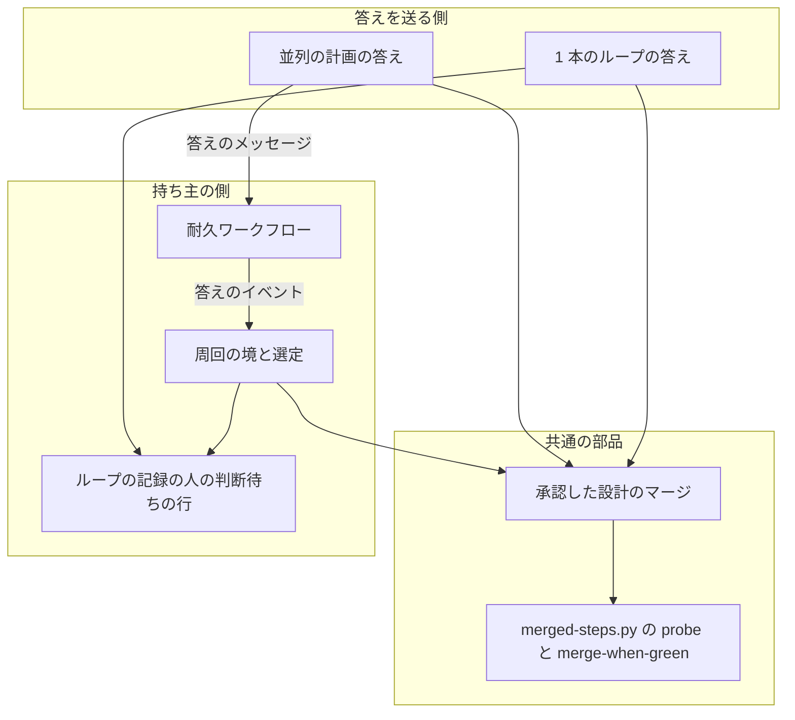
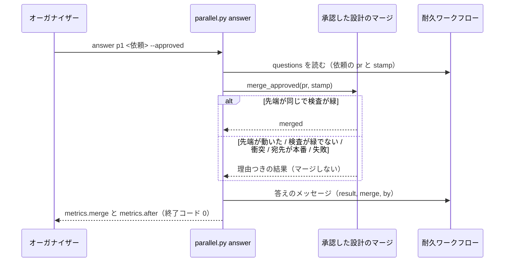
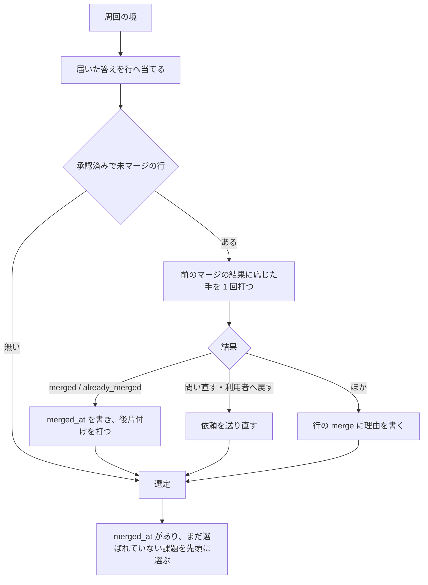

# 開発ループ: 承認した設計 PR を答えと同時に develop へマージし、次の周回で実装に選ぶ（#2507）

## 目的

- **今どうなっているか**: 設計の承認を答えても、設計の Pull Request（以下、設計 PR）を `develop` へマージする担い手がいない。選定は「設計 PR がマージ待ち」でその課題を外し続け、並列の計画 p3 のレーン lroot2 は 8 周すべてを設計だけで使い切った。あわせて、オーガナイザーが 1 つの問いの答えを待つ間に届いた依頼は、答えの後まで表に出ない
- **誰に効くか**: 開発ループと並列の計画を回す利用者。承認した設計がすぐ実装へ進み、答えた後に溜まった依頼がまとめて届く
- **変えると何が成り立つか**: 承認の答えを送るコマンドが、承認した先端のままで検査が緑の設計 PR を `develop` へマージする。マージできなければ理由を記録し、レーン（または 1 本のループ）が次の周回の境でマージし直す。マージ済みの承認した課題は、次の周回で順位によらず先頭に選ばれる。オーガナイザーは答えを送った後、溜まった依頼を整理してまとめて問い直す

## 適用範囲

- **働く範囲**: NDF の開発ループ（`sprint-state.py loop`）と並列の計画（`parallel.py`）。どちらも配布先のリポジトリで同じように働く
- **プロジェクトごとに違うもの**: マージの宛先は設計 PR が持つ宛先（`.ndf/worktree.json` の `base_branch`）をそのまま使う。宛先が本番チャネルに当たるリポジトリでは、マージせずに理由を記録する（承認ゲート 2 を通さない。決定 3）。足す設定・引数は無い
- **当たるモード**: 開発ループが設計 PR を出すモード（`standard`。`legacy-refactor` で設計 PR を出した場合も同じ）

## あるべき姿の根拠

| 根拠 | 種類 | 何を示すか |
| --- | --- | --- |
| 課題 #2507 の本文の「前提: レーンの承認待ちはオーガナイザーが捌く」（利用者の指摘、2026-11-05） | 利用者の決定（起票者の言い換え） | 承認を捌くのはオーガナイザーなので、承認の後のマージもオーガナイザーが持つ |
| 課題 #2507 の本文の「採る形」（利用者の指示、2026-11-05） | 利用者の決定（起票者の言い換え） | 答えが返ったら、溜まった依頼を整理してまとめて問い直す。承認の場所を PR のラベルや Web の画面へ移さない |
| `gh pr view 2481 2480 2500 --json mergedAt`（要求の前提 1） | 実測 | 承認済みの 3 本は 2026-11-04 に手でマージされ、この課題は手でのマージを要さない |
| `lib/sprint_loop_select.py` の `exclusion_reason`（106〜110 行） | 既存の規則（コード） | 承認済みでも設計 PR が `MERGED` になるまで課題を外す。マージする手順はどこからも呼ばれていない |
| `merged-steps.py merge-when-green` の `--expect-head`・`--match-head-commit`（`merged_lib/merge.py` の `_merge_pr`） | 既存の部品 | 先端を照合し、緑を確かめた先端だけをマージする部品が既にある |

要求と受け入れ条件は #2507 の本文にある（コピーは `issues/issue-2507-requirements.md`）。この文書は「どう作るか」だけを扱う。

この文書での呼び方は次のとおりにする。

| 呼び方 | 意味 |
| --- | --- |
| 承認した先端 | 設計の承認を問うた時点の設計 PR の先頭のコミット。人の判断待ちの行と依頼の `stamp` に残る |
| 承認した設計のマージ | 承認した先端のままで検査が緑の設計 PR を、宛先へ待たずにマージする 1 回の試み。結果は「マージの結果」の値の 1 つになる |
| 周回の境 | 周回を締めてから次の周回の選定を終えるまでの区間（`loop select` の中） |
| 答えの後の整理 | オーガナイザーが答えを送った後、待つ間に届いた依頼を取り直し、除くものを除いて残りをまとめて問う手順 |

## ドメインモデル

### コンテキスト

| コンテキスト | 何の語が 1 つの意味に決まるか |
| --- | --- |
| NDF の開発ワークフロー（`ndf-workflow`） | 開発ループ・周回・人の判断待ち・並列の計画・レーン・オーガナイザー・依頼・承認ゲート |

1 つのコンテキストに収まる。GitHub（Pull Request・検査・マージ）は外部の系で、既存の部品 `merged-steps.py` を通して扱う。

### 集約

| 集約 | 持ち主（書き換えてよいもの） | 根 | エンティティ | 値オブジェクト |
| --- | --- | --- | --- | --- |
| 開発ループ | `sprint_loop*.py`（`loop answer`・周回の境） | ループの記録（`.ndf/loop/<名>/loop.json`） | 人の判断待ちの行（`waiting[]`）・周回 | 承認した先端・マージの結果 |
| 並列の進行 | 耐久ワークフロー（`parallel_run.py`） | 耐久の記録 | 依頼（`questions` の 1 件） | 答えのメッセージ（`kind: answer`） |
| 設計 PR | GitHub（外部） | Pull Request | — | 先頭のコミット・検査の状態 |

- **人の判断待ちの行を書き換えるのは開発ループだけである。** オーガナイザー（`parallel.py answer`）は行を書かず、マージの結果を答えのメッセージに載せて送る。行へ写すのは持ち主のレーンが周回の境で行う
- **設計 PR のマージは、開発ループの集約の外への作用である。** 並列の計画の下では `parallel.py answer` が、1 本のループでは `loop answer` が、マージし直しは周回の境が、同じ部品（承認した設計のマージ）を呼ぶ

### 不変条件

| # | 集約 | 条件 | 破れたときの扱い |
| --- | --- | --- | --- |
| I1 | 設計 PR | マージするのは、今の先端が承認した先端と同じときだけである | マージせず、マージの結果を「先端が動いた」にする。持ち主が新しい先端で問い直す |
| I2 | 設計 PR | マージするのは、必須の検査がすべて緑のときだけである。検査を飛ばすために管理者の権限を使わない | マージせず、マージの結果を「検査が緑でない」にする |
| I3 | 設計 PR | 宛先が本番チャネルに当たる設計 PR は、承認した設計のマージではマージしない | マージせず、マージの結果を「宛先が本番」にする |
| I4 | 開発ループ | 承認した設計のマージは、答えを送るコマンドを止めない。マージの成否によらず答えは送られ、終了コードは 0 である | 答えを送らずに返ったら不具合。テストで縛る |
| I5 | 開発ループ | 承認した設計のマージは、検査の完了を待たない | 検査が走っている間は「検査が緑でない」で返す |
| I6 | 開発ループ | 承認済みで未マージの設計 PR は、周回の境ごとに、マージの結果に応じた手を 1 回だけ打つ（「周回の境が結果ごとに打つ手」の表）。時間で解ける結果だけをマージし直し、時間で解けない結果は利用者へ戻す。失敗しても周回は止まらない | 失敗はその課題だけを外す理由になり、ほかの課題で周回を進める |
| I7 | 開発ループ | 承認し、マージが済んだ課題は、その後の最初の周回で順位によらず先頭に選ばれる | 選定の行に「設計 PR がマージ待ち」が出たら不具合 |
| I8 | 開発ループ | 「直して出し直す」と「やらない」の答えでは設計 PR をマージしない | マージしたら不具合 |
| I9 | 並列の進行 | オーガナイザーが MVV 判定で自分で答えてよいのは、`mvv-gate.py check` が「従う」を返した依頼だけである。レッドラインに当たる依頼と、レーンの判定が「従わない」だった依頼は自分で答えない | 利用者へ問う |

### ドメインイベント

要求の番号を引き継ぐ。

| # | イベント | 発生元 | 受け手 |
| --- | --- | --- | --- |
| E1 | レーンが設計の承認の依頼をオーガナイザーへ送った | レーンの周回の締め（`move_to_waiting`） | 耐久ワークフロー（`questions`） |
| E2 | オーガナイザーが利用者へ問いを出した | オーガナイザー | 利用者 |
| E3 | 利用者が設計を承認した | 利用者 | オーガナイザー（`parallel.py answer --approved`）・1 本のループでは `loop answer --approved` |
| E4 | 設計 PR の先端が承認した先端と同じことを確かめた | 承認した設計のマージ | 同じ部品の次の手（E5） |
| E5 | 設計 PR を宛先へマージした（失敗を含む） | 承認した設計のマージ | 答えのメッセージ・人の判断待ちの行（マージの結果） |
| E6 | 答えをレーンへ送った | `parallel.py answer` | 耐久ワークフロー → 持ち主のレーンの周回の境 |
| E7 | 待つ間に届いた依頼を読み直して整理した | オーガナイザー（`answer` の結果の `metrics.after`） | オーガナイザー |
| E8 | 整理で残った依頼をまとめて問い直した | オーガナイザー | 利用者 |
| E9 | 周回の境で、未マージの承認済み設計 PR をマージし直した | 周回の境（`settle_approved_designs`） | 人の判断待ちの行 |
| E10 | 承認とマージが済んだ課題を先頭に選んだ | 選定（`first_issues`） | 周回 |

### 用語

| 用語 | 意味 | 用語集への反映 |
| --- | --- | --- |
| 承認した先端 | 設計の承認を問うた時点の設計 PR の先頭のコミット。マージはこの先端のときだけ行う | 追加 |
| マージの結果 | 承認した設計のマージ 1 回の結果。マージした・マージ済み・先端が動いた・印が無い・検査が緑でない・衝突・宛先が本番・失敗のどれか | 追加 |
| 答えの後の整理 | オーガナイザーが答えを送った後、待つ間に届いた依頼を取り直し、除くものを除いて残りをまとめて問う手順 | 追加 |
| オーガナイザー | `--parallel <計画名>` で起動した conductor の役割。レーンの承認待ちを依頼として受け、利用者へ問うか自分で決め、設計の承認では設計 PR をマージする | 意味の変更（マージを持つ） |

## 機能一覧

| # | 機能 | 誰が使うか |
| --- | --- | --- |
| F1 | 設計の承認を送ると、承認した設計 PR が宛先へマージされる（並列の計画） | オーガナイザー |
| F2 | 1 本のループで設計の承認を答えると、承認した設計 PR が宛先へマージされる | 開発ループを回す利用者 |
| F3 | マージできなかった承認済みの設計 PR を、周回の境でマージし直す | レーン・1 本のループ |
| F4 | 承認とマージが済んだ課題を、次の周回で先頭に選ぶ | レーン・1 本のループ |
| F5 | 答えを送った後、待つ間に届いた依頼を整理して、残りをまとめて問い直す | オーガナイザー |
| F6 | 整理で、MVV 判定で決められる依頼をオーガナイザーが自分で答え、判定の記録を残す | オーガナイザー |

## 構成要素

| 要素 | 責務 | 変更 |
| --- | --- | --- |
| 承認した設計のマージ（`lib/design_pr_merge.py`） | 設計 PR 1 本について、状態・先端・宛先を読み、宛先を `delivery.judge_target` で判定し、必須の検査が登録済みか（検査が無いなら、無いこと）を確かめ、検査の分類を `merged-steps.py probe --act` で読み、緑なら `merged-steps.py merge-when-green --expect-head <承認した先端> --no-cleanup` でマージする（待ちの上限は「非機能の実現方式」）。結果を「マージの結果」の 1 つにして返す。例外を投げず、終了コードを持たない（呼ぶ側が記録する） | 新設 |
| 並列の計画の答え（`parallel.py` の `answer`・`lib/parallel_answer.py`） | `--approved` の答えが `gate1` の依頼に当たるとき、答えを送る前に承認した設計のマージを呼ぶ。結果を `metrics.merge` と答えのメッセージ（`merge`）に載せる。答えの後の今の依頼の一覧を `metrics.after` に載せ、機械で決まる除外の印を付ける | 変更 |
| 答えのメッセージ（`lib/parallel_lane.py` の `send_answer`） | 答えのメッセージに `merge`（マージの結果）と `by`（`user` か `mvv`）を載せる | 変更 |
| 耐久ワークフロー（`lib/parallel_run.py`） | 答えのメッセージから `answer-<依頼>` のイベントを立てるとき、`merge` と `by` も写す | 変更 |
| 1 本のループの答え（`lib/sprint_loop.py` の `cmd_answer`・`apply_answer`・`apply_gate1_answers`） | `loop answer --approved` で承認した設計のマージを呼び、結果を人の判断待ちの行へ書く。レーンの周回の境では答えのイベントの `merge` を行へ写す。`by: mvv` の答えでは承認の記録を書き直さない | 変更 |
| 人の判断待ちへ移す（`lib/sprint_loop_gate.py` の `move_to_waiting`・`lane_gate1`・`regate1`） | 並列の計画の外でも、行へ承認した先端（`stamp`）を書く。先端の照合を 1 本のループの答えにも使う。設計の承認の依頼に、判定の行のレッドライン（`boundary`）を足す | 変更 |
| 周回の境と選定（`lib/sprint_loop_select.py`） | 選定の前に、承認済みで未マージの行ごとに、前のマージの結果に応じた手を 1 回打つ（`settle_approved_designs`。「周回の境が結果ごとに打つ手」）。マージ済みになった設計 PR は後片付け（`merged-steps.py cleanup`）を打つ。承認とマージが済んだ課題を先頭に選ぶ。外す理由にマージの結果を添える | 変更 |
| 手順書（`references/parallel.md`・`references/loop.md`） | オーガナイザーの「問い方」に、答えの後の整理と MVV 判定で自分で答える手順を足す。`answer` がマージすることと、1 本のループの答えがマージすることを書く | 変更 |
| 改訂の兆候の数え方（`lib/project_mvv_signals.py` の `unknown_streak`） | 末尾から続いた「判定できない」の行を、スプリント状態・承認ゲート・PR の組ごとに 1 件と数える。同じ組の行が隣り合っていなくても 1 件にまとめる | 変更 |
| 確定仕様（`docs/specifications/ndf-parallel-organizer.md`） | 不変条件 I18 を「オーガナイザーは設計の承認で設計 PR をマージするほかは作業を持たない」へ書き換える | 変更 |



図には、呼び出しの関係を持つ要素だけを載せる。人の判断待ちへ移す部品は「周回の境と選定」と同じ持ち主の側の記録を書く部品として、
手順書と確定仕様は文書として、図に含めない。答えのメッセージ（`send_answer`）は辺のラベルとして載せる。

### 置き場所

```text
plugins/ndf/scripts/
├── parallel.py                    （answer の変更）
└── lib/
    ├── design_pr_merge.py         （新設）
    ├── parallel_answer.py         （答えの後の一覧と除外の印）
    ├── parallel_lane.py           （send_answer）
    ├── parallel_run.py            （答えのイベントへ写す項目）
    ├── project_mvv_signals.py     （「判定できない」の数え方）
    ├── sprint_loop.py
    ├── sprint_loop_gate.py
    └── sprint_loop_select.py
```

`supervise_lib/design_merge.py`（スプリントのプランの「設計 PR のマージ」のステージ）は別の部品で、この変更では触らない。
名前の衝突を避けるため、新設する部品は `design_pr_merge.py` とする。

## 入出力の契約

### 承認した設計のマージ（関数）

| 項目 | 内容 |
| --- | --- |
| 名前 | `design_pr_merge.merge_approved(root, pr, stamp, run=subprocess.run) -> dict` |
| 入力 | `root`: メインディレクトリ。`pr`: 設計 PR の番号。`stamp`: 承認した先端（空・`0` だけの値は「印が無い」） |
| 出力 | `{"result": <下の値>, "class": <probe の分類。probe を打たなかったときは null>, "reason": <1 行の理由。merged と already_merged は空>, "pr": <番号>, "head": <読んだ先端>, "at": <UTC の時刻>}` |
| 失敗の形 | 例外を投げない。`gh` と `merged-steps.py` の失敗はすべて `result` の値に写す |
| 互換性 | 新設 |

| `result` | 当たるとき | 読んだもの |
| --- | --- | --- |
| `merged` | マージした | `merge-when-green` が 0 |
| `already_merged` | 読んだ時点で `MERGED` | `gh pr view` の `state` |
| `head_moved` | 今の先端が承認した先端と違う | `gh pr view` の `headRefOid`。`merge-when-green` の `items[].result` が `head_moved` のときも |
| `no_stamp` | 承認した先端が記録に無い | 入力の `stamp` |
| `not_green` | 検査が緑でない（走っている・待っている・失敗・取り残し・基盤待ち・未登録） | 検査が未登録（分類 `unregistered`。下の手順 3）。`probe` の `metrics.class` が `passed` と `infra` 以外。`infra` で `merge-when-green` を呼んで緑にならなかったとき。`merge-when-green` が 75 か、待ちの上限で 1 |
| `conflict` | 宛先と衝突している | `merge-when-green` が 4 |
| `production` | 宛先が本番チャネルに当たるか、決められない | `gh pr view` の `baseRefName` を `delivery.judge_target(delivery.load_delivery(root), <宛先>)` で判定し、`stops` が真。`probe` と `merge-when-green` を呼ばないため、承認資料は書かれない。`merge-when-green` が 10 を返したときも（判定の後に宛先が変わった場合） |
| `failed` | 上のどれでもない失敗（権限が無い・PR が閉じている・読めない） | `gh` の非 0・`merge-when-green` の 1・2 |

呼ぶ順は次のとおりで、どこかで結果が決まればそこで返す。

1. `gh pr view <pr> --json state,headRefOid,baseRefName,statusCheckRollup` を 1 回読む（`already_merged`・`no_stamp`・`head_moved`・`failed`）
2. 宛先を `delivery.judge_target` で判定する（`production`）
3. 検査が登録済みかを確かめる。`gh api repos/<repo>/rules/branches/<宛先>` を読み、`ci_workflows.required_contexts` で必須の検査の名前を取る。必須の検査のどれかが 1 の検査の一覧（`statusCheckRollup`）に無ければ、`not_green`（分類 `unregistered`）で返す。検査の一覧が空なら、さらに `gh api repos/<repo>/contents/.github/workflows?ref=<承認した先端>` を読む。必須の検査が無く（`required_contexts` が `None`）、ワークフローのディレクトリも無い（404）ときだけ、検査が無いと確かめたことにして次へ進む。どちらかがある・どちらかを読めないときは `not_green`（分類 `unregistered`）で返す
4. `merged-steps.py probe --pr <pr> --act` で検査を分類する。取り残し（`stale`）のジョブは、この 1 回で再実行される
5. 分類が `passed` なら `merge-when-green` を呼ぶ。分類が基盤待ち（`infra`）なら `--infra-gap 0` を足して呼ぶ。Runner が付かずに取り消されたジョブが最初の読みで再実行され、待ちの上限までに緑になればマージする。ほかの分類は呼ばずに `not_green` で返す。手順 3 を通った後は、検査の一覧が空でないか、検査が無いと確かめたかのどちらかである。検査の一覧は空に戻らないため、`merge-when-green` が検査の載らないまま `no_checks` としてマージするのは、検査が無いと確かめた場合に限られる

### `parallel.py answer`

引数は変えない。結果の JSON に次を足す。

| 項目 | いつ載るか | 中身 |
| --- | --- | --- |
| `metrics.merge` | `--approved` で、依頼の `kind` が `gate1` のとき | 承認した設計のマージの出力 |
| `metrics.after` | いつも | 答えの後に残る依頼の一覧（下）。`metrics.seq` は読んだ `questions` の `seq` |

`metrics.after` の 1 件は `questions` の 1 件に次の 2 つの項目を足したものである。

| 項目 | 値 |
| --- | --- |
| `drop` | `resend`（同じレーンの同じ設計 PR に、より新しい先端の依頼がある）/ `settled`（今送った答えと同じ設計 PR の依頼）/ `null` |
| `mvv` | `{"eligible": true|false, "why": <1 行>}`。`true` は `kind` が `gate1` で、レーンの判定（依頼の `verdict`）が `unknown`（判定できない）か `unreadable`（判定を読めない）で、レッドライン（依頼の `boundary`）が空のときだけ。`not_follow`（従わない）と `machine`（機械のチェックの外れ）は `false` |

終了コードは今と同じ（動いていない計画は 1、指摘ファイルを読めないときは 2、ほかは 0）。マージの結果は終了コードに影響しない（I4）。

`answer` に `--by mvv` を足す。`--approved` と組み、答えのメッセージの `by` を `mvv` にする。省略時は `user`。

### `sprint-state.py loop answer`

引数は変えない。`--approved` のとき次の順で動く。

1. 行の承認した先端（`stamp`）があり、今の先端と違えば、答えを当てずに行の `stamp` を今の先端へ書き換え、`status: regated`（終了コード 0）で返す。`summary` は新しい先端で答え直すことを示す
2. 行に承認した先端が無ければ（この変更の前に作られた行）、今の先端を `stamp` として書き、1 と同じく `regated` で返す
3. 承認した設計のマージを呼び、結果を行の `merge` に書く。`merged`・`already_merged` なら行の `merged_at` を書く
4. 今どおり承認の記録と課題の本文の節を書く

結果の `items[0]`（人の判断待ちの行）に `merge` が載る。`--revise`・`--rejected` は今と同じで、マージを呼ばない（I8）。

### ループの記録の人の判断待ちの行

項目を足す。既存の行の移行は要らない（項目が無い行は今の振る舞い）。

| 項目 | 型 | 中身 |
| --- | --- | --- |
| `stamp` | 文字列 | 承認した先端。並列の計画の外でも書く（今はレーンだけが書く） |
| `merge` | オブジェクト | 最後の承認した設計のマージの出力に、試みた周回の番号 `lap`、同じ `result` と `class` が同じ承認した先端で続いた周回の数 `streak`、同じ承認した先端で基盤待ちのために再実行した回数の累計 `infra_reruns` を足したもの |
| `merged_at` | 文字列 | 既存。マージを確かめた時刻 |
| `by` | 文字列 | `user` か `mvv`。誰が承認したか |

## 処理の流れ

### 並列の計画: 承認の答えとマージ



### 周回の境: マージし直しと選定



周回の境が結果ごとに打つ手は次のとおりである。「前の結果」は行の `merge`（無ければ、まだ試みていない）を指す。

| 前の結果 | 時間で解けるか | 周回の境で打つ手 |
| --- | --- | --- |
| 無い・`not_green`（走っている・待っている・表示だけが待ち・未登録 `unregistered`） | 解ける | 承認した設計のマージを呼ぶ |
| `not_green`（取り残し `stale`） | 再実行すれば解ける | 承認した設計のマージを呼ぶ。中の `probe --act` がジョブを再実行する |
| `not_green`（基盤待ち `infra`）で `merge.infra_reruns` が 3 未満 | 再実行すれば解ける | 承認した設計のマージを呼ぶ。中の `merge-when-green --infra-gap 0` が取り消されたジョブを再実行する。呼んだら `merge.infra_reruns` に 1 を足す |
| `not_green` が同じ分類で 3 周回続いた・`not_green`（再び取り残し `stale_again`）・`not_green`（基盤待ち `infra`）で `merge.infra_reruns` が 3 | 解けない | 利用者へ戻す。基盤待ちでは承認した設計のマージを呼ばない |
| `conflict` | 解けない | 設計の worktree で `merged-steps.py base-sync --pr <pr> --push` を打つ。0 で先端が進めば、新しい先端で問い直す。1（衝突が残る）なら `git merge --abort` で取り込みを閉じて利用者へ戻す。2・3 と、設計の worktree が無いときも利用者へ戻す |
| `failed` | 解けない | 利用者へ戻す |
| `production` | 解けない | マージを呼ばず、承認資料も書かない。`gh pr view <pr> --json state` を 1 回だけ読み、`MERGED`（人が承認ゲート 2 でマージした）なら `already_merged` と同じに扱う。ほかは外す理由を `設計 PR の宛先が本番（承認ゲート 2 で人がマージする）` にする |
| `head_moved`・`no_stamp` | — | 新しい先端で問い直す |

- 問い直しは、レーンなら今の `regate1` と同じく新しい先端で依頼を送り直す。1 本のループでは、行の `stamp` を新しい先端へ書き換え、答えを外して人の判断待ちへ戻す
- 利用者へ戻すは、問い直しと同じ経路で依頼を送り直す。承認した先端は変えず、依頼にマージの結果の理由を載せる。利用者は「直して出し直す」「やらない」か、手を打ってから「承認」を選ぶ。戻した行の `merge.streak` と `merge.infra_reruns` は 0 に戻る
- `merge.infra_reruns` は、`merge.streak` と違って分類が変わっても 0 に戻さない。再実行したジョブが Runner を待つ周回は分類が `running`・`queued` に変わり、`streak` は 0 に戻る。累計で数えないと、GitHub Actions の障害が続く間は基盤待ちと実行中が交互に現れ、CI の再実行が上限なく増える。上限の 3 は `merge-when-green` の `--infra-reruns` の既定と同じ値にする。答えの側（`answer`・`loop answer`）が基盤待ちで呼んだ 1 回も累計に足す。承認した先端が変わったら 0 から数え直す
- `production` は戻さない。宛先は周回を重ねても変わらず、問い直しても同じ結果になるためである。利用者には、答えの時点で `metrics.merge` の理由として伝わる（「オーガナイザー: 答えの後の整理」の 1、1 本のループでは `loop answer` の `summary`）
- 外す理由は `設計 PR がマージ待ち（<マージの結果の理由>）` にする
- 「まだ選ばれていない」は、行の周回より後の周回の選定に、その課題を選んだ行が無いことで見る。選定の理由は `承認した設計` とする

### オーガナイザー: 答えの後の整理

1. 依頼ごとに答えを送る（`parallel.py answer`）。`metrics.merge` が `merged` 以外なら、理由を 1 行で利用者へ伝える（問いにしない。次の周回の境でレーンが結果に応じた手を打つ）。`production` なら、承認ゲート 2 で人がマージするまで実装に選ばれないことを添える
2. 最後の `answer` の `metrics.after` から、`drop` が付いた依頼を除く
3. `mvv.eligible` が `true` の依頼ごとに、依頼の `sprint_state` と `pr` を渡して `mvv-gate.py check` を打つ。打つ形は `mvv-gate.py check --sprint <sprint_state> --gate design --pr <pr>` である。「従う」（終了コード 0）なら `parallel.py answer <依頼> --approved --by mvv` を送る。判定の記録は `mvv-gate.py` が書く（判定・理由・根拠の項目）。打ち直しは 1 つの依頼に 1 回だけで、言語モデルの判定は 1 回（数分）増える。「判定できない」がまた返っても打たない。打ち直しで判定の記録（`mvv-gate.jsonl`）に同じ依頼の行が 2 つ入っても、改訂の兆候（`unknown_streak`）は、末尾から続いた「判定できない」の行をスプリント状態・承認ゲート・PR の組ごとに 1 件と数える。並列のレーンの判定が A、B の順に入り、その後に A の打ち直しが入る（A・B・A の順）ように、同じ組の行が隣り合っていなくても 1 件にまとめる。そのため閾値（既定 3）は、判定できなかった依頼の数で届く
4. 残りがあれば、今の「問い方」の区分の順と 4 件ずつで、まとめて `AskUserQuestion` を出す。残りが無ければ `wait --after <metrics.seq>` を打ち直す

## 非機能の実現方式

| 大項目 | 実現方式 |
| --- | --- |
| 性能・拡張性 | 検査を `probe` で 1 回だけ分類し、`passed` と `infra` のときだけ `merge-when-green` を呼ぶ。`probe` が走っている検査を見たら、`merge-when-green` を呼ばずに `not_green` で返す。`merge-when-green` には `--timeout 10 --interval 5 --recheck 5 --no-checks-after 5` を渡す。`probe` の後に検査が走り始めても、上限の 10 秒を過ぎた最初の読みで切れ、`not_green`（終了コード 1）で返る。緑なら 1 回目の読みから 5 秒後の確かめ直しでマージし、検査が無いと確かめたリポジトリでも 5 秒後の読みでマージする。読み直しの間隔は、読んだ中身が変わらないと 1.5 倍に伸びる（5 秒の次は 7.5 秒）。そのため、1 件の答えでマージが待つ時間は最悪で約 12.5 秒（読み直し 3 回の `gh` の時間とマージの呼び出しを除く）である（I5）。検査の無いリポジトリの待ちを 60 秒から 5 秒へ縮めてよいのは、`merge-when-green` を呼ぶ前に、必須の検査の規則とワークフローのファイルが無いことを読んで確かめているためである。確かめられないときは呼ばずに `not_green` で返す。確かめに足す `gh api` は 1 回の試みで最大 2 回である |
| 可用性 | 承認した設計のマージは例外を投げず、`answer` と `loop answer` は結果を載せて 0 で返る。周回の境のマージし直しの失敗は、その課題を外す理由にとどめる（I4・I6） |
| 運用・保守性 | マージの結果は `answer` の `metrics.merge`、答えのイベント、ループの記録の行の `merge` の 3 か所から読める。行の `merge.lap` で、どの周回で試みたかを辿れる |
| セキュリティ | マージは `merge-when-green --expect-head <承認した先端>` で行い、`gh pr merge --match-head-commit` が承認した先端だけをマージする（I1）。宛先が本番チャネルに当たるか決められない設計 PR は、`merge-when-green` を呼ぶ前に `delivery.judge_target` の判定で `production` として返す（I3）。`merge-when-green` には `--gate-approved` を渡さないため、判定の後に宛先が変わっても承認ゲート 2 で止まる。必須の検査は `merge-when-green` が緑を確かめてからマージする（I2）。必須の検査が検査の一覧にまだ載っていないとき、または検査の一覧が空で検査が無いと確かめられないときは、`merge-when-green` を呼ばずに `not_green` で返す。`merge-when-green` が検査の載らないまま `gh pr merge --admin` を打つのは、検査が無いと確かめた場合だけである（I2） |

## 決定の記録

### 決定 1: 答えのたびに止まらないよう、マージは検査を待たずに 1 回だけ試み、だめなら周回の境でやり直す

`answer` が検査の完了を待つと、オーガナイザーは答えのたびに数分から数十分止まり、溜まった依頼を捌けない（要求の「重なった要因」）。
承認から時間がたった設計 PR は、多くの場合検査が終わっているため、1 回の試みで足りる。試みが外れた設計 PR は、レーンが次の周回の境で
もう一度試みるので、承認は失われない。

GitHub の自動マージの予約（`gh pr merge --auto`）は採らない。予約の後に先端が動いても、予約は新しい先端でマージしうる。承認した先端だけを
マージする条件（I1）を、予約の後に保てない。

根拠: Value 2 / Value 3 / Value 5（MVV 版 5）

### 決定 2: マージの部品を 1 つに保つため、`merged-steps.py` の `probe` と `merge-when-green` を呼ぶ共通の関数を新設する

承認した設計のマージは、並列の計画の答え・1 本のループの答え・周回の境の 3 か所から呼ばれる。手で `gh pr merge` を打つ実装を 3 か所に
置くと、先端の照合と検査の確かめ方が分かれる。既存の `merge-when-green` は先端の照合（`--expect-head`）・緑を確かめた先端だけのマージ・
衝突の判定・本番の宛先の判定を持つ。そのため、それを呼ぶ。待ちの部分は、先に `probe` で分類して `passed`（と基盤待ちの `infra`）のときだけ呼び、`--timeout 10` で上限を切ることで外す。

`merge-when-green` に「待たない」引数を足す形は採らない。待ちの部品（`GreenWatch`）の中に分岐が増え、スプリントのプランの待ちと
答えの待ちが同じ関数の振る舞いを分け合う。

根拠: Value 5 / Value 7（MVV 版 5）

### 決定 3: 承認ゲート 2 を承認ゲート 1 の答えで通さないため、本番チャネルが宛先の設計 PR はマージしない

承認ゲート 1 の答えは設計の承認であり、本番への配布の承認ではない。`merge-when-green` へ `--gate-approved` を渡さない。宛先が本番チャネルに当たるか決められないときは、`merge-when-green` を呼ぶ前に
`delivery.judge_target` の判定で `production` として返すため、承認資料は書かれない。宛先は周回を重ねても変わらないため、周回の境はマージし直さず、
人が承認ゲート 2 でマージしたかだけを読む。開発版のブランチ（`develop`）を持つリポジトリでは、
設計 PR の宛先は `develop` なので当たらない。

根拠: Value 2 / 共通原則の優先順位（MVV 版 5）

### 決定 4: ルールセットのレビューの要件は管理者の権限で通し、必須の検査は飛ばさない

設計の承認の答えが、レビューの承認に当たる。`merge-when-green` は今も `gh pr merge --admin` を打ち、その前に必須の検査が緑であることを
確かめる。`--admin` が外すのはレビューの要件であり、検査は `merge-when-green` 自身が先に確かめる（I2）。権限が無いときは `failed` として
理由を記録する。

根拠: Value 2（MVV 版 5）

### 決定 5: 後片付けを持ち主に残すため、答えの側は `--no-cleanup` でマージし、後片付けは周回の境が打つ

`merge-when-green` の後片付けは、設計のブランチと worktree を消し、メインディレクトリを取り込む。オーガナイザーが打つと、レーンの worktree を
レーンの外から消すことになる。答えの側はマージだけを行い、レーンが周回の境で `merged_at` を書くときに `merged-steps.py cleanup <PR>` を
打つ。1 本のループの `loop answer` も同じく後片付けを周回の境へ回し、メインディレクトリの操作を 1 か所にする。

根拠: Value 7 / I18 の持ち主の分け方（MVV 版 5）

### 決定 6: マージ済みの承認した課題を、直して出し直す課題と同じく先頭に選ぶ

受け入れ条件 5 は、承認とマージが済んだ課題を順位によらず次の周回で選ぶことを求める。選定には「先頭に選ぶ課題」の仕組み
（`first_issues`）が既にあり、直して出し直す課題と配布の直しが使っている。承認した設計をここへ足せば、枠の割り当ても境界の外の扱いも
今の規則のまま働く。

根拠: Value 1 / Value 7（MVV 版 5）

### 決定 7: 答えの後の依頼は `answer` の結果に載せ、機械で決まる除外だけを印で付ける

`wait --after <seq>` は新しい変化を待つため、答えの直後に今ある依頼を返すとは限らない（答えのメッセージの処理を待つ）。`answer` は依頼の
`stamp` と `pr` を読むためにすでに `questions` を読んでいる。その一覧から今答えた依頼を除いたものを `metrics.after` に載せる。
同じ依頼の再送と、答えで要らなくなった依頼は、依頼の項目（レーン・設計 PR・先端）だけで決まるため、スクリプトが印を付ける。
MVV 判定は数分かかるため `answer` の中では打たず、印（`mvv.eligible`）だけを付け、判定はオーガナイザーが手順で打つ。

根拠: Value 5（MVV 版 5）

### 決定 8: オーガナイザーが MVV 判定で自分で答えるのは、レーンの判定が決まらなかった設計の承認だけにする

レーンの設計の承認の依頼は、レーンの `mvv-gate.py check` が「従う」以外を返したときに届く。「従わない」とレッドラインは判定が決まっている
ため、オーガナイザーが判定し直すと、同じ材料で答えを変えることになる。機械のチェックの外れ（MVV の未承認・レッドラインのパス）は、打ち直しても
同じ結果になる。「判定できない」「判定を読めない」は判定が決まっていないため、
`mvv-gate.py check` を同じ材料で打ち直す。`mvv-gate.py` は MVV の承認・ハッシュの一致・進め方の宣言（`.ndf/pace.json`）を機械で
確かめてから判定し、「従う」のときだけ判定の記録を書く。そのため前提 4 と受け入れ条件 9 を満たす。区分つきの問い（`ask`）と承認ゲート 2 の
依頼は、進め方の宣言が MVV 判定に任せる対象に含まないため、自分で答えない。

根拠: 共通原則の「必ず人の承認が要る操作」/ Value 2（MVV 版 5）

### 決定 9: 時間で解けないマージの結果は、周回の境で繰り返さずに利用者へ戻す

周回の境が毎回同じ試みを打つだけだと、衝突・権限の不足・再び取り残された検査のように時間で解けない結果では、承認した設計が周回のたびに
外され続ける。取り残しと基盤待ちは再実行で解けるため、境が `probe --act` と `--infra-gap 0` で再実行する。基盤待ちの再実行は同じ承認した先端で 3 回までとし、周回をまたいで累計で数える。`--infra-reruns` の上限は 1 回の `merge-when-green` の中だけで効くため、周回の境が上限を持たないと、障害が続く間に再実行が増え続ける。衝突は、レーンが持つ設計の
worktree で `base-sync` を打てば解けることがあり、解ければ新しい先端で問い直す。どれでも解けない結果は、同じ依頼の経路で利用者へ戻し、
「直して出し直す」「やらない」を選べるようにする。宛先が本番の設計 PR は、承認ゲート 2 で人がマージするまで実装に選ばない。問い直しても
同じ結果になるため、戻さずに状態だけを読む。

根拠: Value 3 / Value 2（MVV 版 5）

## テスト設計

| 受け入れ条件・不変条件 | どの振る舞いで縛るか | どう壊したら落ちるべきか |
| --- | --- | --- |
| 受け入れ条件 1 / I1 / I2 | `answer --approved` で、先端が同じで検査が緑の `gate1` の依頼なら、`merge-when-green` が `--expect-head <stamp>` と `--no-cleanup` で呼ばれ、`metrics.merge.result` が `merged` | マージを呼ばない・`--expect-head` を落とす・検査が緑でなくても呼ぶ |
| 受け入れ条件 2 / I1 | 先端が違う依頼では `merge-when-green` を呼ばず `head_moved` を返し、答えは送られる。レーンの周回の境で新しい先端の依頼が送り直される | 先端を比べずにマージする |
| 受け入れ条件 3 | `loop answer --approved` で 1・2 と同じ。先端が違えば `regated` で答えを当てず、`stamp` を書き換える | 1 本のループでマージを呼ばない・先端を比べない |
| 受け入れ条件 4 / I4 / I5 | `merge-when-green` が 4・10・1・75 を返す、または `probe` が `running` を返すとき、`answer` は 0 で返り、答えのメッセージが送られ、行の `merge.reason` に理由が残る。`probe` が `running` のとき `merge-when-green` を呼ばない。`merge-when-green` に `--timeout 10 --interval 5 --recheck 5 --no-checks-after 5` を渡す | 失敗で非 0 を返す・答えを送らない・検査が走っている間に待つ・待ちの上限を渡さない |
| 受け入れ条件 5 / I7 | 承認済みで `merged_at` がある行の課題は、順位が最後でも選定の先頭に選ばれ、理由が `承認した設計` になる | `first_issues` に足さない |
| 受け入れ条件 6 / I6 | 承認済みで未マージの行があると、周回の境で前の結果に応じた手が 1 回打たれる。`not_green` では承認した設計のマージが呼ばれ、`stale` では `probe --act`、`infra` では `--infra-gap 0` で呼ばれる。失敗ならその課題だけが理由つきで外れ、ほかの課題が選ばれる。`failed`・同じ分類の `not_green` の 3 周回目・`base-sync` で解けない `conflict` では依頼が送り直される。基盤待ちと実行中が交互に現れても、同じ承認した先端で `--infra-gap 0` の呼び出しは 3 回までで、4 回目の基盤待ちではマージを呼ばずに依頼が送り直される。`production` ではマージを呼ばず、`gh pr view` の `state` だけを読む | 境でマージし直さない・失敗で周回を止める・同じ境で 2 回呼ぶ・`production` でマージし直す・時間で解けない結果を戻さずに繰り返す・分類が変わったときに再実行の累計を 0 に戻す |
| 受け入れ条件 7 | 承認済みでマージ可能な設計 PR があるとき、次の周回の選定にその課題が含まれる | 境のマージし直しを選定の後に置く |
| 受け入れ条件 8 | `metrics.after` から今答えた依頼が除かれ、同じ設計 PR の古い先端の依頼に `drop: resend`、同じ設計 PR の依頼に `drop: settled` が付く | 印を付けない・答えた依頼を残す |
| 受け入れ条件 9 / I9 | `mvv.eligible` は、依頼の `verdict` が `unknown`・`unreadable` で `boundary` が空の `gate1` だけ `true`。`--by mvv` の答えを受けたレーンは承認の記録を `by: user` で書き直さない | 「従わない」やレッドラインに `true` を付ける・`by` を落とす |
| 受け入れ条件 10 / I8 | `--revise`・`--rejected` では、`answer` も `loop answer` も承認した設計のマージを呼ばない | 答えの種類によらずマージを呼ぶ |
| 受け入れ条件 11 | `confirm`・`settle` の既存のテストが通る | 既存のテストが落ちる |
| I2（検査の未登録） | 必須の検査が検査の一覧に無いとき、および検査の一覧が空でワークフローのディレクトリがある・規則を読めないときは、`probe` と `merge-when-green` を呼ばずに `not_green`（分類 `unregistered`）を返す。必須の検査もワークフローのディレクトリも無いときだけ `merge-when-green` を呼ぶ | 検査の一覧が空のまま確かめずに `merge-when-green` を呼ぶ・規則を読めないときにマージへ進む |
| I3 | `delivery.judge_target` が止める宛先では `probe` と `merge-when-green` を呼ばずに `production` を返す。`merge-when-green` が 10 を返しても `production` になり、`--gate-approved` を渡していない | 判定せずに `merge-when-green` を呼ぶ・`--gate-approved` を渡す |
| 「判定できない」の数え方 | 同じスプリント状態・承認ゲート・PR の「判定できない」の行が 2 つ続いても、`unknown_streak` は 1 と数える。組 A・組 B・組 A の順に並んだ「判定できない」の 3 行は 2 と数える | 打ち直しの行を 2 と数える・隣り合わない打ち直しの行を別に数える |
| 承認した設計のマージの結果の値 | `gh` と `merged-steps.py` の終了コードと出力の組ごとに、上の表の `result` へ写る。例外を投げない | 読めない出力で例外が上がる |

`gh` と `merged-steps.py` は偽のコマンドで置き換える（今の `test_sprint_loop.py`・`test_parallel_lane.py` と同じ）。偽のコマンドの組み方は実装で決める。

## 設計の結果

| 課題 | 扱い | 取り込み先 | 触るファイル |
| --- | --- | --- | --- |
| #2507 | 実装する | — | `plugins/ndf/scripts/lib/design_pr_merge.py`、`plugins/ndf/scripts/parallel.py`、`plugins/ndf/scripts/lib/parallel_answer.py`、`plugins/ndf/scripts/lib/parallel_lane.py`、`plugins/ndf/scripts/lib/parallel_run.py`、`plugins/ndf/scripts/lib/project_mvv_signals.py`、`plugins/ndf/scripts/lib/sprint_loop.py`、`plugins/ndf/scripts/lib/sprint_loop_gate.py`、`plugins/ndf/scripts/lib/sprint_loop_select.py`、`plugins/ndf/scripts/tests/`、`plugins/ndf/skills/development-workflow/references/parallel.md`、`plugins/ndf/skills/development-workflow/references/loop.md`、`docs/specifications/ndf-parallel-organizer.md` |

## 未確認のまま残ること

| 項目 | 内容 |
| --- | --- |
| 承認から時間がたった設計 PR の検査の状態 | 承認の時点で検査が終わっていることが多い、という見込みは実測していない。外れても周回の境でマージし直すため、受け入れ条件は満たす。リリース後の手動確認で、1 回目の試みの結果の内訳をループの記録の行の `merge` から数える |
| 検査が無いことの確かめ方 | 必須の検査はルールセットの規則（`rules/branches`）から読む。旧来のブランチ保護だけで、GitHub Actions 以外のアプリの検査を必須にしているリポジトリでは、その検査が未登録のまま「検査が無い」と判定しうる。そうしたリポジトリで走らせて確かめていない。スプリントのプランのマージは 60 秒の待ちのまま変えない |
| 答えの待ちの最悪の時間 | 約 12.5 秒は `GreenWatch` の読み直しの間隔から求めた値で、測っていない。実装のテストで、走っている検査を偽のコマンドで返し続けたときの経過を確かめる |
| 時間で解けない結果の上限 | 同じ分類の `not_green` を 3 周回で利用者へ戻す値は既定で、測っていない。リリース後にループの記録の行の `merge.streak` から内訳を数えて見直す |
| 後片付けを周回の境へ回したときの worktree | 設計の worktree がレーンの周回の境まで残る。次の周回の実装の worktree は別のブランチ名で作るため重ならない見込みだが、走らせて確かめていない。実装のテストで確かめる |
| `mvv-gate.py check` を打ち直す材料 | 依頼の `sprint_state` はレーンの周回のスプリント状態ファイルで、周回が締まった後も残る前提で読む。残らない場合は `mvv.eligible` を `false` にする（実装で確かめる） |
