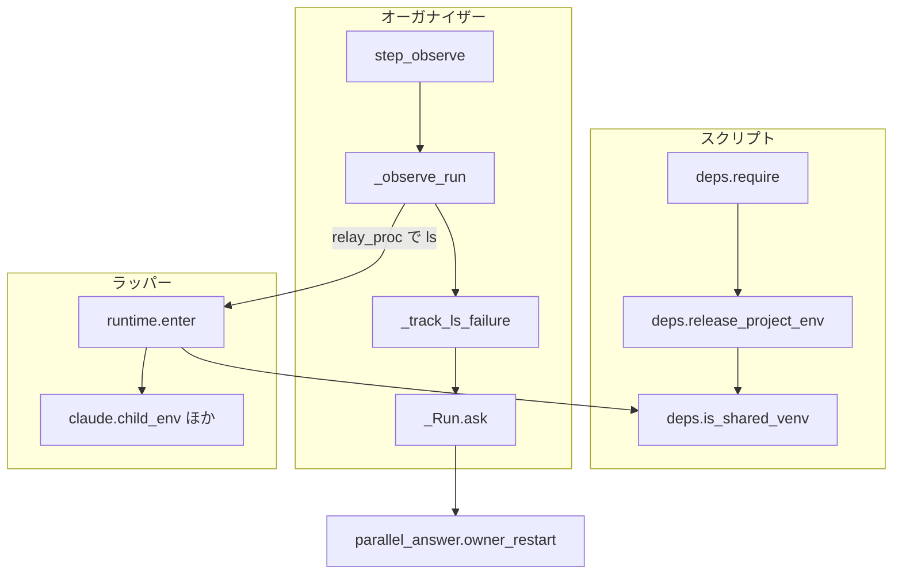
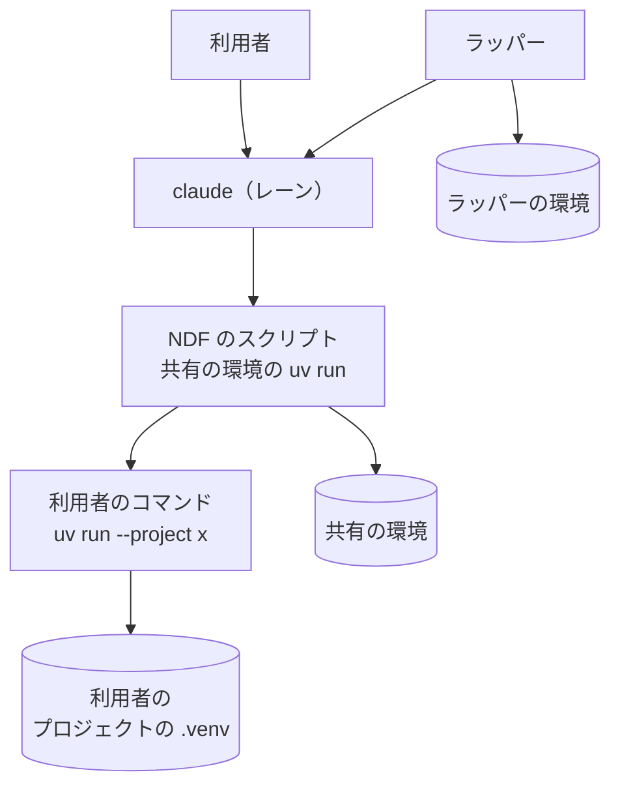
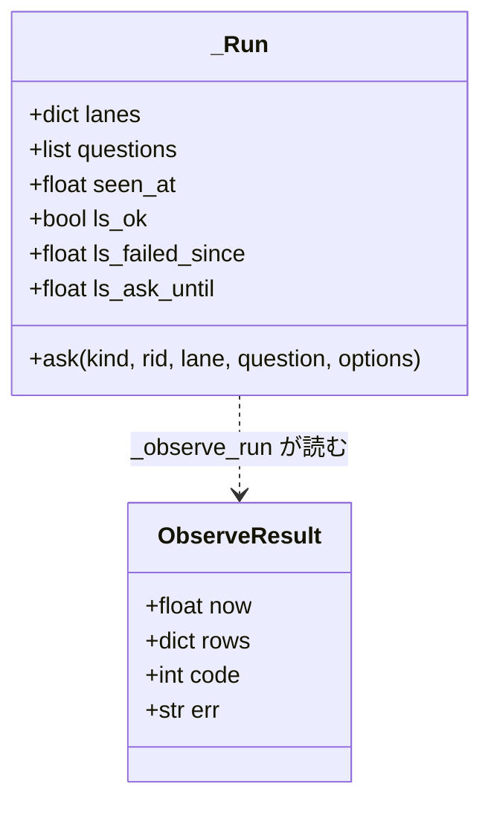
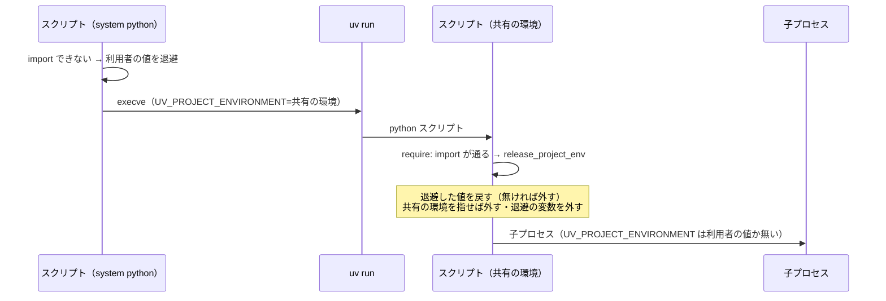
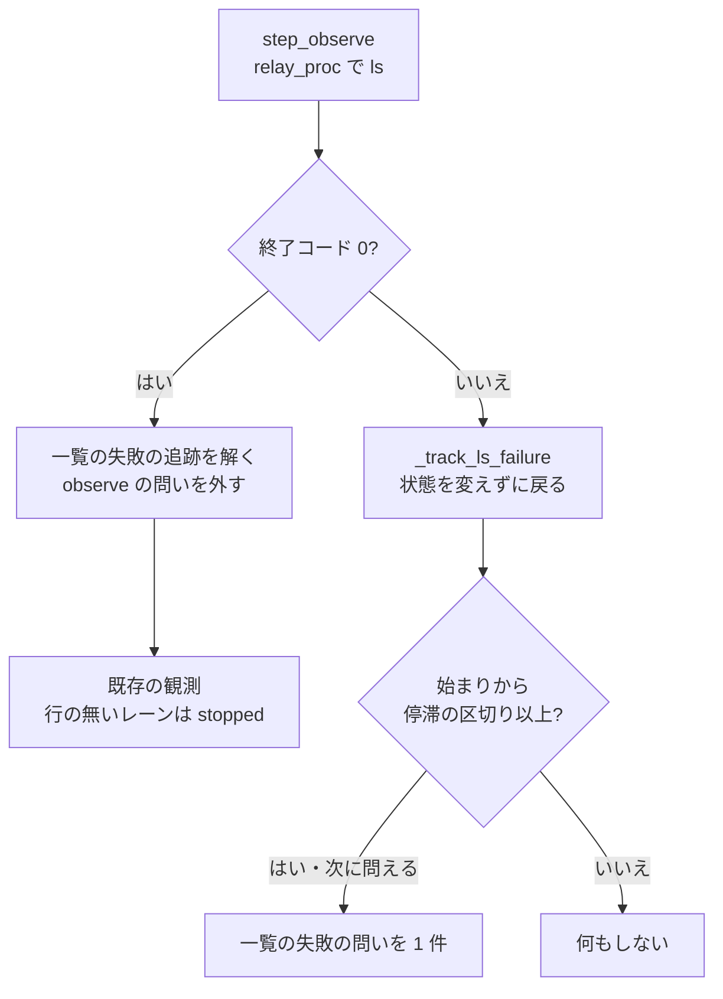
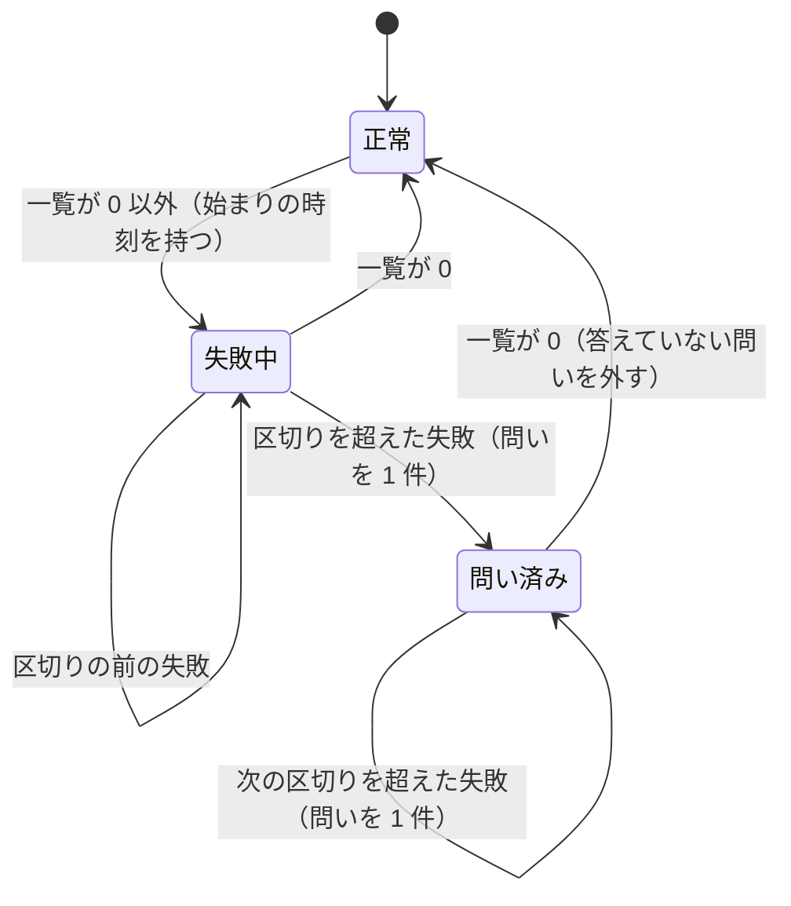

# 並列の計画とスクリプトの子プロセス: 状態の一覧の失敗で計画を終えず、利用者の uv run が共有の環境を作り直さない（#2509）

## 目的

- **今どうなっているか**: NDF のスクリプトが共有の環境へ起動し直すときに設定した `UV_PROJECT_ENVIRONMENT` が、子プロセスへそのまま渡る。レーンのスプリントが利用者のリポジトリで `uv run --project <x>` を打つと、共有の環境がそのプロジェクトの環境として作り直され、ラッパーの extras が消える。続いて状態の一覧（`relay.py ls --json`）が終了コード 3 で失敗する。オーガナイザーはそれを「全レーンが止まった」と読み、取り消せない `finished` で計画を終える（carul の計画 l20261104、2026-11-04）
- **誰に効くか**: 並列の計画を流す利用者と、NDF のスクリプトの下で自分のプロジェクトの `uv run` を打つすべての利用者
- **変えると何が成り立つか**: 状態の一覧の失敗はレーンの状態を変えず、続けば問いとして利用者へ届く。NDF のスクリプトとラッパーの子プロセスには NDF が設定した `UV_PROJECT_ENVIRONMENT` が渡らず、利用者の `uv run` は自分のプロジェクトの環境を使う

## 適用範囲

- **働く範囲**: NDF を使うすべてのリポジトリ。変更は配布物のスクリプトと、並列の計画の手順の参照（`parallel.md`）に置く。スクリプトは `plugins/ndf/scripts/lib/deps.py`・`lib/parallel_run.py`・`lib/parallel_answer.py`・`relay_lib/runtime.py` の 4 つである
- **プロジェクトごとに違うもの**: 無し（失敗が続いたと見なす長さは既存の `NDF_PARALLEL_STALL_MINUTES` を使い、新しい設定値を足さない）
- **当たるモード**: どのモードでも働く（スクリプトの起動とオーガナイザーの観測は、モードに依らない）

## あるべき姿の根拠

| 根拠 | 種類 | 何を示すか |
| --- | --- | --- |
| 課題の本文の具体例（carul の計画 l20261104、2026-11-04 の時刻つきの記録） | 実測 | 共有の環境の作り直し（22:19:46）・状態の一覧の終了コード 3・`finished`（22:19）が同じ分に並び、打ち直しても `resumed: true` の `finished` が返るだけだった |
| 課題の本文の再現手順（`UV_PROJECT_ENVIRONMENT=$T uv run --project infra python -c pass` で `$T` が 3.13 に作り直され、`import psutil` が失敗する） | 実測 | `UV_PROJECT_ENVIRONMENT` を継いだ子の `uv run --project <別のプロジェクト>` が、継いだ置き場をそのプロジェクトの環境として同期し直す |
| 要求の前提 4 の確認（2026-11-05、手元の uv） | 実測 | `VIRTUAL_ENV` だけを継いだ `uv run --project <別のプロジェクト>` は `<別のプロジェクト>/.venv` を使い、共有の環境を変えない。外す対象は `UV_PROJECT_ENVIRONMENT` だけでよい |
| 要求の前提 2（共通原則 C6） | 利用者の指示の原文 | 利用者が自分で設定した `UV_PROJECT_ENVIRONMENT` を NDF が黙って消さない |

要求と受け入れ条件は #2509 の本文にある（コピーは `issues/issue-2509-requirements.md`）。この文書は「どう作るか」だけを扱う。

## ドメインモデル

### コンテキスト

| コンテキスト | 何の語が 1 つの意味に決まるか |
| --- | --- |
| NDF の工程（`ndf-workflow`） | 共有の環境・状態の一覧・オーガナイザー・レーン・停滞の区切り・問い（耐久ワークフローが自分で立てる問い） |
| ラッパー（`ndf-relay`） | ラッパーの環境・子の claude・名前つきのラッパー |

2 つのコンテキストの関係は**顧客 / 供給者**である。ラッパーが供給者で、状態の一覧（`relay.py ls --json` の統一 JSON レポートと終了コード）を提供し、オーガナイザーが顧客としてそれを読む。この変更は供給者の出力の形を変えず、顧客の側が終了コードを読むようにする。共有の環境の置き場の判定（`deps.is_shared_venv`）は、ラッパーが `lib/deps.py` をそのまま使う既存の形に乗る。ラッパーは `deps.venv_dir`・`deps.ensure_uv` を既にこの形で使っている。

### 集約

| 集約 | 持ち主（書き換えてよいもの） | 根 | エンティティ | 値オブジェクト |
| --- | --- | --- | --- | --- |
| 並列の計画の実行 | オーガナイザーの耐久ワークフロー（`lib/parallel_run.py` の `parallel_workflow` と `_Run`） | 計画の実行（`_Run`。耐久の記録から同じ値に戻る） | レーンの状態・問い | 観測の結果（時刻・行・終了コード・標準エラーの末尾 1 行）・一覧の失敗が始まった時刻・次に問うてよい時刻 |
| スクリプトの環境変数 | 起動し直した NDF のスクリプト自身（`deps.require`）と、ラッパー自身（`runtime.enter`） | そのプロセスの `os.environ` | — | `UV_PROJECT_ENVIRONMENT` の値・退避した利用者の値 |

スクリプトの環境変数は、プロセスごとに 1 つの集約である。書き換えるのはそのプロセスのエントリポイント（`require` か `enter`）だけで、子プロセスの起動の箇所（スプリントのステップ・`child_env` など）は読むだけにする（決定 1）。

### 不変条件

| # | 集約 | 条件 | 破れたときの扱い |
| --- | --- | --- | --- |
| I1 | 並列の計画の実行 | 状態の一覧が 0 以外で終わった回の観測は、レーンの状態・最後に観測した時刻・起こし直しの待ち・停滞と一時レーンの問いのどれも変えない | テスト（受け入れ条件 1）が落ちる |
| I2 | 並列の計画の実行 | 計画を `finished` で終えるのは、最後の観測が成功した回だけである（失敗した回の後は全レーンが止まったと読まない） | テスト（受け入れ条件 2）が落ちる |
| I3 | 並列の計画の実行 | 一覧の失敗の問いは、失敗が停滞の区切りより長く続いたときだけ出し、同じ区切りの間に 2 件目を出さない | テスト（受け入れ条件 4）が落ちる |
| I4 | 並列の計画の実行 | 一覧が成功に戻ったら、答えていない一覧の失敗の問いを一覧から外す | テストが落ちる。外さないと、答えを待って計画が終われない |
| I5 | スクリプトの環境変数 | `require()` が import の通る状態で戻った後、起動し直す前の値が利用者の値（I7）なら `UV_PROJECT_ENVIRONMENT` はその値に戻り、無ければ無い。起動し直す前から共有の環境を指していた値は戻さずに外す（I6） | テスト（受け入れ条件 5・8）が落ちる |
| I6 | スクリプトの環境変数 | `require()` から戻った後と、ラッパーの `enter()` を通った後、`UV_PROJECT_ENVIRONMENT` が共有の環境を指していない | テスト（受け入れ条件 5・7）が落ちる |
| I7 | スクリプトの環境変数 | 共有の環境とも、`require()` が向けたリポジトリの根の `.venv` とも違う利用者の値は、変えずに残す | テスト（受け入れ条件 8）が落ちる |

### ドメインイベント

| # | イベント | 発生元 | 受け手 |
| --- | --- | --- | --- |
| E1 | NDF のスクリプトが共有の環境で自分を起動し直した | `deps.require`（起動し直す前の値を退避して `os.execve`） | 起動し直した後の同じスクリプトの `deps.require` |
| E2 | 起動し直したスクリプトが、NDF の設定した `UV_PROJECT_ENVIRONMENT` を外した | `deps.require`（import が通った後） | そのスクリプトが起動する子プロセス |
| E3 | スクリプトが利用者のコマンドかラッパーを子プロセスで起動した | スプリントのステップ・`parallel_run.relay` | 利用者のコマンド・ラッパー |
| E4 | ラッパーが子の claude を起動した | `relay_lib/claude.child_env` ほか（`enter` で外した後の環境をコピーする） | 子の claude とその Bash |
| E5 | オーガナイザーが状態の一覧を観測した | `step_observe` | `_observe_run` |
| E6 | オーガナイザーが失敗した回の観測を捨てた | `_observe_run`（観測の終了コードが 0 以外） | 一覧の失敗の追跡（`_track_ls_failure`） |
| E7 | オーガナイザーが一覧の失敗が続くことを利用者へ問うた | `_track_ls_failure`（`run.ask`） | 利用者（`parallel.py questions` / `answer`） |
| E8 | オーガナイザーが全レーンの停止を見て計画を終えた | `parallel_workflow`（`_run_finished`） | 耐久の記録（`finished`） |

### 用語

| 用語 | 意味 | 用語集への反映 |
| --- | --- | --- |
| 共有の環境 | NDF のスクリプトとラッパーが使う Python の環境。置き場は `~/.cache/ndf/venv/<版>`（`NDF_DEPS_VENV` で変えられる） | 既にある（要求で追加済み） |
| 状態の一覧 | ラッパーの `relay.py ls --json` が返す、名前つきのラッパーごとの状態と最後に動いた時刻の一覧 | 既にある（要求で追加済み） |
| 一覧の失敗の問い | 状態の一覧の失敗が停滞の区切りより長く続いたときに、オーガナイザーの耐久ワークフローが自分で立てる問い（`kind` は `observe`）。一覧の終了コードと標準エラーの末尾 1 行を持ち、一覧が成功に戻れば外れる | 追加 |

## 機能一覧

| # | 機能 | 誰が使うか |
| --- | --- | --- |
| F1 | 状態の一覧が失敗した回の観測を捨て、レーンの状態を保つ | オーガナイザー（並列の計画を流す利用者） |
| F2 | 一覧の失敗が続いたら、終了コードと理由を添えて利用者へ 1 件問う。成功に戻れば問いを外す | 並列の計画を流す利用者 |
| F3 | 起動し直した NDF のスクリプトが、子プロセスへ NDF の設定した `UV_PROJECT_ENVIRONMENT` を渡さない。利用者の値は戻して渡す | NDF のスクリプトの下でコマンドを打つ利用者（スプリントのステップ・テスト） |
| F4 | ラッパーが、子の claude と自分の子プロセスへ共有の環境を指す `UV_PROJECT_ENVIRONMENT` を渡さない | ラッパーの下で claude を使う利用者 |

## 構成要素

| 要素 | 責務 | 変更 |
| --- | --- | --- |
| `lib/deps.py` の `require` | 起動し直すときに利用者の `UV_PROJECT_ENVIRONMENT` を退避の変数（`NDF_DEPS_SAVED_UV_PROJECT_ENVIRONMENT`）へコピーし、無ければ退避の変数を外す。import が通って戻るときに `release_project_env` を呼ぶ | 変える |
| `lib/deps.py` の `release_project_env`（新設） | 自分を起動し直した回なら退避した値を戻す（無ければ外す）。続けて、値が共有の環境を指していれば外す。退避の変数も外す | 足す |
| `lib/deps.py` の `is_shared_venv`（新設） | 渡したパスが共有の環境の置き場か（`NDF_DEPS_VENV` と同じか、親が `~/.cache/ndf/venv`）を返す。標準ライブラリだけで判定する | 足す |
| `relay_lib/runtime.py` の `enter` | 副命令の振り分けの前に、`UV_PROJECT_ENVIRONMENT` が共有の環境を指していれば外す（古い版の NDF のスクリプトから継いだ値を含む） | 変える |
| `lib/parallel_run.py` の `relay` | 統括役の CLI の起動を `relay_proc`（新設。終了コード・標準出力・標準エラーを持つ結果を返す）へ寄せ、戻り値の形 `(終了コード, 統一 JSON レポート)` は保つ | 変える |
| `lib/parallel_run.py` の `step_observe` | 観測の結果に、一覧の終了コード（`code`）と標準エラーの末尾 1 行（`err`）を足す | 変える |
| `lib/parallel_run.py` の `_observe_run` | 終了コードを `ls_ok` に控え、終了コードによらず先に `_track_ls_failure` を呼ぶ。0 以外ならそこで戻り、0 なら既存の観測を通す | 変える |
| `lib/parallel_run.py` の `_run_finished` | `ls_ok` が偽の間は偽を返す（I2） | 変える |
| `lib/parallel_run.py` の `_track_ls_failure`（新設） | 失敗の回は、一覧の失敗が始まった時刻を持ち、停滞の区切りを超えたら区切りごとに 1 回、一覧の失敗の問いを立てる。成功に戻ったら答えていない一覧の失敗の問いを外す | 足す |
| `lib/parallel_run.py` の `_Run` | 最後の観測で一覧が成功したか（`ls_ok`）と、一覧の失敗の追跡の値（`ls_failed_since`・`ls_ask_until`）を持つ。`ask` は `lane` を持たない問い（`attach` を添えない）を受ける | 変える |
| `lib/parallel_answer.py` の `owner_restart` | 自分で立てた問いの種類に `observe` を足し、選んだ答えの `commands` を返す | 変える |
| `skills/development-workflow/references/parallel.md` | 耐久ワークフローが自分で立てる問いの種類の一覧に `observe` を足す | 変える |



`parallel.md` は手順の参照で、図に含めない。

### システムの文脈と配置



変更の後は、利用者のコマンドから共有の環境への辺が無くなる。ラッパーの環境はバージョンディレクトリの `.venv` か共有の環境で、置き場の決め方は変えない。

### パッケージ構成

```
plugins/ndf/
├── scripts/
│   ├── lib/
│   │   ├── deps.py                 # require・release_project_env・is_shared_venv
│   │   ├── parallel_run.py         # relay_proc・step_observe・_observe_run・_track_ls_failure
│   │   └── parallel_answer.py      # owner_restart の問いの種類
│   ├── relay_lib/
│   │   └── runtime.py              # enter
│   └── tests/
│       ├── test_deps.py            # 受け入れ条件 5・6・8・10
│       ├── test_relay.py           # 受け入れ条件 7・8
│       └── test_parallel_run.py    # 受け入れ条件 1〜4
└── skills/development-workflow/references/parallel.md
```

## 構造



観測の結果は耐久の記録に残るステップの戻り値で、`code` と `err` を足す。足す前の版で記録した戻り値は `code` を持たないため、無ければ 0（成功）として読む（決定 5）。`ls_ok`・`ls_failed_since`・`ls_ask_until` は `_Run` の値で、打ち直すと記録からの再生で同じ値に戻る（ほかの値と同じ）。

## 入出力の契約

コマンドの引数・終了コード・統一 JSON レポートの形は変えない。変わるのは、`parallel.py questions` が返す問いに種類が 1 つ増えることだけである。

| 項目 | 値 |
| --- | --- |
| `kind` | `observe` |
| `id` | `<計画名>-observe-<観測の時刻のエポック秒>` |
| `lane` | 無し（キーを持たない）。`attach` も持たない |
| `source` | `ndf-ask:human-action`（耐久ワークフローが自分で立てるほかの問いと同じ） |
| `question` | `レーンの状態の一覧（relay.py ls）が <分> 分続けて失敗している（終了コード <コード>: <標準エラーの末尾 1 行>）` |
| `options` | `ラッパーの環境を作り直す`・`待つ` |
| `commands` | `{"ラッパーの環境を作り直す": "python3 <relay.py> status"}`（`status` は環境が無ければ作り直す副命令） |

答えは既存の `parallel.py answer <計画名> <id> --choice <選んだ答え>` で送る。`ラッパーの環境を作り直す` を選ぶと、`answer` が `metrics.next` に `commands` の 1 行を返す（`owner_restart` の自分で立てた問いの分岐）。耐久ワークフローは答えを受けて問いを外すだけで、ほかの値を変えない（`apply_own` は「止める」を含まない答えを当てない）。

環境変数の契約:

| 変数 | 誰が書くか | 誰が読むか | 値 |
| --- | --- | --- | --- |
| `NDF_DEPS_SAVED_UV_PROJECT_ENVIRONMENT`（新設） | `require` が `os.execve` の直前に | 起動し直した後の `release_project_env` | 起動し直す前の `UV_PROJECT_ENVIRONMENT`。無かったときはこの変数自体を置かない |
| `UV_PROJECT_ENVIRONMENT` | `require` が `uv run` のために設定する（既存） | `uv run` だけ。子プロセスへは渡らない | 共有の環境か `<根>/.venv` |

## 処理の流れ

### 起動し直したスクリプトが環境変数を戻す



`release_project_env` は「自分を起動し直した回か」を `NDF_DEPS_REEXEC` が自分のスクリプトのパスと同じかで決める。この印を外す `require` の既存の処理より前に呼ぶ。起動し直していない回（初めから import が通った）では退避の値を読まず、共有の環境を指す値を外すことだけを行う。

### ラッパーが環境変数を外す

`runtime.enter` の先頭で、`UV_PROJECT_ENVIRONMENT` が `deps.is_shared_venv` に当たれば外す。この後の振り分けは、すべて外した後の `os.environ` をコピーする。振り分けの先は、ラッパーの環境で起動し直す `_reexec`・`status` などのラッパーの環境の作り直し・副命令の本体である。ラッパーの環境の作り直し（`runtime.sync`）は `uv sync` の子にだけ `UV_PROJECT_ENVIRONMENT` を自分で設定する既存の形のままで、影響を受けない。

### オーガナイザーの観測





答えていない一覧の失敗の問いがある間は `run.questions` が空でないため、`_run_finished` は偽を返し、計画は終わらない（既存の条件）。問いを答えた後でも、最後の観測が失敗なら `ls_ok` が偽のため終わらない（I2）。

## 非機能の実現方式

| 大項目 | 条件 | 実現方式 |
| --- | --- | --- |
| 可用性 | 状態の一覧の 1 回の失敗で、並列の計画が取り消せない形で終わらない | 失敗した回の観測を捨て（I1）、計画を終える判定を成功した観測だけに掛ける（I2）。続く失敗は問いにし（I3）、答えを待つ間は計画が終わらない |
| システム環境 | 利用者のプロジェクトの `uv run` は、そのプロジェクトの環境を使う | 子プロセスへ渡る環境変数から、NDF の設定した `UV_PROJECT_ENVIRONMENT` を起点（`require` と `enter`）で外す（I5・I6）。利用者の値は戻す（I7） |

## 決定の記録

### 決定 1: すべての子プロセスに効かせるため、環境変数はプロセスのエントリポイント（`require` と `enter`）で戻し、子を起動する箇所では外さない

子プロセスを起動する箇所は多い。スプリントのステップ・`parallel_run.relay`・ラッパーの `child_env`・`startup_env`・`passthrough`・tmux のセッションなどがあり、1 か所ずつ外すと足し忘れが残る。エントリポイントで `os.environ` を戻せば、その後に起動するすべての子プロセスが同じ値を継ぐ。`NDF_DEPS_REEXEC` を同じエントリポイントで外している既存の形にも揃う。

子を起動する共通の箇所で外す形（要求の S4）は採らない。共通の箇所が 1 つに決まらず、新しい起動の箇所を足すたびに外す処理も足す必要がある。

根拠: Value 7（MVV 版 5）

### 決定 2: 利用者の値を消さないため、起動し直す前の値を退避の変数で渡して戻す

`require` は起動し直すときに `UV_PROJECT_ENVIRONMENT` を上書きするため、起動し直した後の値からは利用者の値が分からない。起動し直す前の値を `NDF_DEPS_SAVED_UV_PROJECT_ENVIRONMENT` へコピーして `os.execve` に渡し、起動し直した後に戻す。無かったときは退避の変数を置かず、「無い」を戻す。

値が共有の環境かどうかだけで外す形は採らない。利用者の値が上書きで失われ、受け入れ条件 8 を満たせない。

根拠: Value 6（MVV 版 5）

### 決定 3: 古い版の NDF から継いだ値も外すため、共有の環境を指す値は退避の有無に依らず外す

古い版の NDF のスクリプトから起動されたプロセス（ラッパーのレーン・tmux のセッション）は、共有の環境を指す `UV_PROJECT_ENVIRONMENT` を、退避の変数を持たずに継ぐ。`release_project_env` と `enter` は、値が `is_shared_venv` に当たれば外す。判定は置き場の親（`~/.cache/ndf/venv`）と `NDF_DEPS_VENV` で行い、版の名前に依らない。ラッパーの複製（バージョンディレクトリ）の `deps.PLUGIN_ROOT` からは版を読めないためである。

利用者が共有の環境を自分で指した値も外れる。受け入れ条件 8 の対象外（共有の環境と違う値）で、共有の環境を利用者のプロジェクトの環境として使う使い方は、この課題の不具合そのものである。

根拠: Value 7（MVV 版 5）

### 決定 4: 一覧の失敗は観測の全体を捨て、成功した観測だけでレーンの状態と時刻を動かす

失敗した回の一覧は行を持たないため、行の無いレーンを止まったと読む規則・停滞の問い・一時レーンの問い・起こし直しの待ちの解除のどれも、誤った入力で動く。失敗した回は `_track_ls_failure` だけを通して戻り、最後に観測した時刻（`seen_at`）も進めない。`seen_at` は答えた後の起こし直しの判定の基準で、成功した観測の時刻でなければ意味を持たない。

失敗した回に前回の行を使い回す形は採らない。前回の行は古く、使い回すと停滞の判定が実際の動きと食い違う。

根拠: Value 7（MVV 版 5）

### 決定 5: 打ち直した計画を壊さないため、観測の結果の `code` が無い記録は成功として読む

観測の結果は耐久の記録に残るステップの戻り値で、打ち直すと記録から再生される。この変更の前に記録した戻り値は `code` を持たない。無いときは 0 として読み、記録の時点の振る舞い（成功として読む）を保つ。記録のテーブルと形は変えない。

根拠: Value 6（MVV 版 5）

### 決定 6: 問いが計画の終わりを止め続けないよう、一覧が成功に戻ったら答えていない一覧の失敗の問いを外す

答えていない問いがあると `_run_finished` が偽になり、計画は終われない。一覧が成功に戻れば問いの前提が無くなるため、外して `questions` のイベントを出し直す。外した後に届いた答えは、既存の `reply` が一覧に無い id として保留し、警告を残す。`id` は観測の時刻を含み、同じ id の問いは立たないため、保留した答えはどの問いにも当たらず、計画の終わりも止めない。

問いを残して利用者の答えを待つ形は採らない。一覧が戻った後の答えは何も変えず、待つ間は計画が終われない。

根拠: Value 2（MVV 版 5）

### 決定 7: 新しい設定値を足さないため、問うまでの長さと問いの間隔に停滞の区切りを使う

`stall_seconds()`（`NDF_PARALLEL_STALL_MINUTES`、既定 60 分）を、失敗が続いたと見なす長さと、次に問うてよいまでの間隔の両方に使う。停滞の問いが「区切りごとに 1 回」としている形と同じである。

根拠: Value 5（MVV 版 5）

### 決定 8: 問いの範囲を観測に限るため、ほかの `relay.py ls` の読み手は変えない

`parallel.py` の起動前の確かめ（`_manual_or_none`）と、答えの後の一時レーンの判定（`parallel_lane.lane_waits`）も状態の一覧を読む。前者は一覧の失敗を「tmux が無い」と読んで手で起動する 1 行を返し、後者は失敗を止まったと読んで起こす 1 行を返す。どちらも耐久の記録に何も残さず、打ち直せば正しく読み直す。取り消せない `finished` を作るのは観測だけなので、この変更は観測に限る。共有の環境が作り直されなくなれば（F3・F4）、一覧の失敗自体が起きにくくなる。

根拠: Value 3（MVV 版 5）

## テスト設計

| 受け入れ条件・不変条件 | どの振る舞いで縛るか | どう壊したら落ちるべきか |
| --- | --- | --- |
| 受け入れ条件 1・I1 | 一覧の差し替え（`NDF_PARALLEL_RELAY`）が 0 以外で終わる観測の後、各レーンの状態・`seen_at`・`revive` が観測の前と同じ | 失敗した回でも行の無いレーンを `stopped` にするよう壊すと落ちる |
| 受け入れ条件 2・I2 | 一覧が失敗し続ける間、`parallel_workflow` が `finished` を返さず、耐久の記録にも `finished` が残らない | `_observe_run` が終了コードを読み捨てるよう壊すと落ちる |
| 受け入れ条件 3 | 一覧が 0 で終わり、起動済みのレーンの行が無いとき、そのレーンを `stopped` と読み、全レーンがそうなら `finished` で終える | 成功した回の行の無いレーンも状態を変えないよう壊すと落ちる |
| 受け入れ条件 4・I3 | 失敗が停滞の区切り（テストでは短い値）より長く続くと問いが 1 件立ち、本文に終了コードと標準エラーの末尾 1 行が入る。同じ区切りの間の次の失敗では増えない | 区切りの判定を外す・問いの本文から終了コードを落とす・毎回問うよう壊すと落ちる |
| I4 | 失敗で問いが立った後、一覧が 0 で終わると問いが一覧から外れる | 成功の回で問いを外さないよう壊すと落ちる |
| 受け入れ条件 5・I5・I6 | 共有の環境へ起動し直したスクリプト（`require` を呼ぶ小さなスクリプト）の子プロセスの `env` の出力に `UV_PROJECT_ENVIRONMENT` が無い | `release_project_env` を呼ばない・退避の値が無いときに外さないよう壊すと落ちる |
| 受け入れ条件 6 | 起動し直したスクリプトの子プロセスとして、`requires-python` が合わない別のプロジェクトで `uv run --project <別のプロジェクト> python -c pass` を打った後も、共有の環境の `pyvenv.cfg` の中身と更新時刻が変わらず、`import psutil` が通る（本物の uv で、一時ディレクトリの共有の環境を使う。用意の仕方は表の下） | 受け入れ条件 5 と同じ壊し方で落ちる |
| 受け入れ条件 7・I6 | 共有の環境を指す `UV_PROJECT_ENVIRONMENT` を親に持たせてラッパーを通しても、子の claude（差し替えの claude が環境を書き出す）の環境に無い | `enter` で外さないよう壊すと落ちる |
| 受け入れ条件 8・I7 | 利用者の値（共有の環境とも `<根>/.venv` とも違う）を持たせると、起動し直したスクリプトの子プロセスとラッパーの子の claude に同じ値が渡る | 退避しない・戻さない・値に依らず外すよう壊すと落ちる |
| 受け入れ条件 9 | 上の各テストが変更前のコードで失敗する | テストの側で確かめる（実装の工程で、変更前のコードに当てて赤を見る） |
| 受け入れ条件 10 | 既存の `test_deps.py` が通る。起動し直した後の子が別のグループを要るとき、子が自分で起動し直す | 子の起動し直しの印を外さないよう壊すと既存のテストが落ちる |

受け入れ条件 6 のテストは、ネットワークから Python とパッケージを取らずに組む。

- **2 つの Python**: runner に既にある 2 つのインタプリタを使う。共有の環境は setup-python の 3.x（テストを動かすインタプリタの元）で `uv venv --python <1 つ目>` で作る。別のプロジェクトは `requires-python` を 2 つ目（`/usr/bin/python3`）の版だけに合う範囲にし、`uv run --python <2 つ目>` で指す。`UV_PYTHON_DOWNLOADS=never` を付ける。2 つがそろわない（どちらかが無い・同じマイナー版）ときは、理由を出して skip する
- **`import psutil`**: テストの前に `UV_PROJECT_ENVIRONMENT=<共有の環境> uv sync --frozen --offline --project plugins/ndf --extra procs` で、uv のキャッシュ（CI では `setup-uv` が `uv.lock` をキーに戻すキャッシュ）から入れる。この同期が失敗したら、理由を出して skip する。起動し直す時の `uv run --frozen --project <プラグインの根> --extra procs` は、入っている psutil をそのまま使い、PyPI へ取りに行かない。共有の環境が作り直されると psutil が消え、`import psutil` が落ちる
- **`.pth` で psutil を見せる組み方を採らない理由**: uv の同期は `.pth` の先のパッケージを入っていると扱わない。起動し直すたびに PyPI から取りに行き、ネットワークの無い所では起動し直す段で落ちる
- **合う Python が無い組み方を採らない理由**: `--python` を指さず、合う Python が無いと、uv は環境に触れずに失敗する。この組み方では変更の前でもテストが通り、受け入れ条件 9 を満たさない

変更前の振る舞い（子へ `UV_PROJECT_ENVIRONMENT` が渡る）でこのテストが赤になることは、2026-11-05 に手元の uv 0.13.5 で確かめた。共有の環境は 3.13、別のプロジェクトは `requires-python = ">=3.14"` と `--python /usr/bin/python3.14` にした。3.13 で作った一時の共有の環境へ上の `uv sync --frozen --offline` で psutil 7.2.2 を入れ、続く `uv run --quiet --frozen --project plugins/ndf --extra procs python -c 'import psutil'` が終了コード 0 で終わり、`pyvenv.cfg` の更新時刻が変わらないことも、同じ日に同じ uv で確かめた。

| 子の環境変数 | `uv run` の終了コード | 共有の環境の `pyvenv.cfg` | `import psutil` |
| --- | --- | --- | --- |
| 共有の環境を指す `UV_PROJECT_ENVIRONMENT` あり（変更前） | 0 | 3.14.4 に作り直された | `ModuleNotFoundError` |
| `UV_PROJECT_ENVIRONMENT` なし（変更後） | 0 | 中身・更新時刻とも変わらない | 通る |
| あり・`--python` なし・合う Python が無い | 2（`No interpreter found`） | 変わらない | — |

## 設計の結果

| 課題 | 扱い | 取り込み先 | 触るファイル |
| --- | --- | --- | --- |
| #2509 | 実装する | — | `plugins/ndf/scripts/lib/deps.py`、`plugins/ndf/scripts/lib/parallel_run.py`、`plugins/ndf/scripts/lib/parallel_answer.py`、`plugins/ndf/scripts/relay_lib/runtime.py`、`plugins/ndf/scripts/tests/`、`plugins/ndf/skills/development-workflow/references/parallel.md` |

## 未確認のまま残ること

| 項目 | 内容 |
| --- | --- |
| ラッパーの中身が見つからないときのパススルー | ランチャー（`relay.py` の `missing`）は `relay_lib` が無いとき `enter` を通らずに本物の claude を起動するため、継いだ値を外さない。ラッパーとして働いていない経路で、レーンはこの経路で動かない。外さないままにする |
| 実験版の起動し直し | `experimental/deps-trial.py`・`hook-trial.py` は自分の置き場（`~/.cache/ndf/venv/trial` など）を `UV_PROJECT_ENVIRONMENT` で渡して起動し直す。実験版は呼んだときだけ働き、既定の振る舞いから参照されないため、この変更の対象にしない。本体へ移すときに同じ形へ揃える |
| `VIRTUAL_ENV` と `PATH` | `uv run` は子へ `VIRTUAL_ENV` と共有の環境の `bin` を先頭にした `PATH` を渡す。要求の前提 4 の確認で、利用者の `uv run --project <x>` が共有の環境を変えないことは確かめた。子が素の `python3` を打つと共有の環境の Python で動くことは変えない（課題の範囲外） |
| リリース後の実機確認 | 並列の計画を 2 レーン以上で流し、レーンのスプリントが利用者のリポジトリで `uv run --project <x>` を打った後も共有の環境の `pyvenv.cfg` の更新時刻が変わらないことは、リリース後テストで見る |
