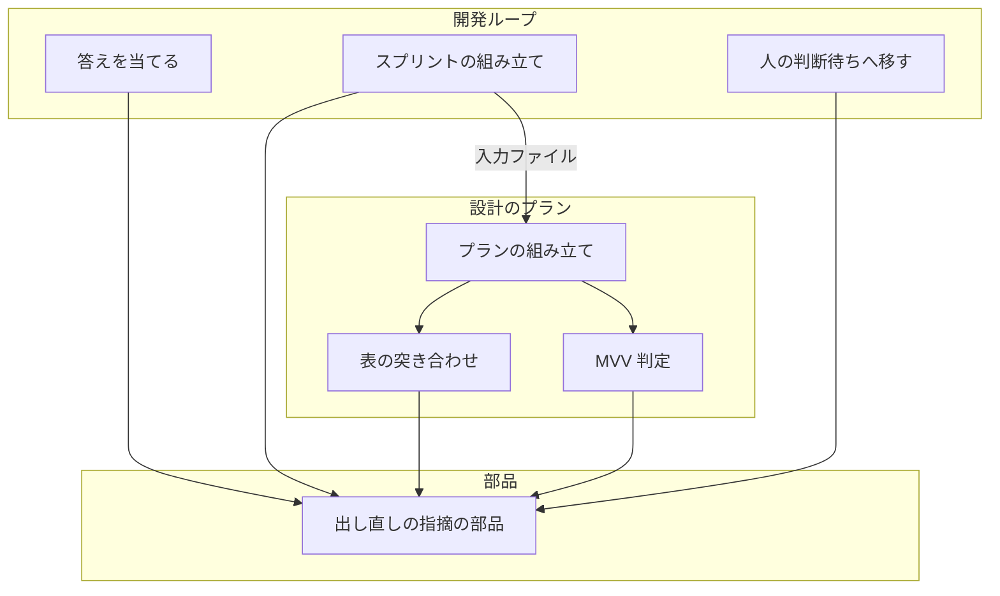
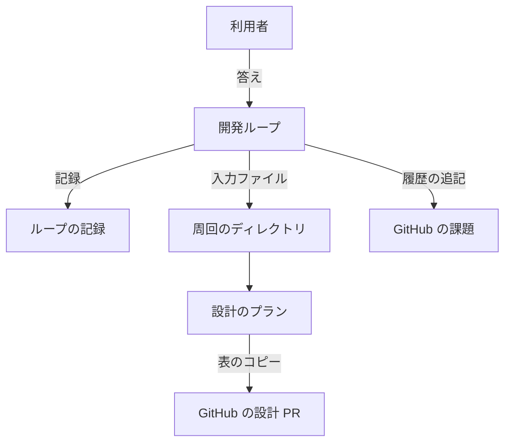
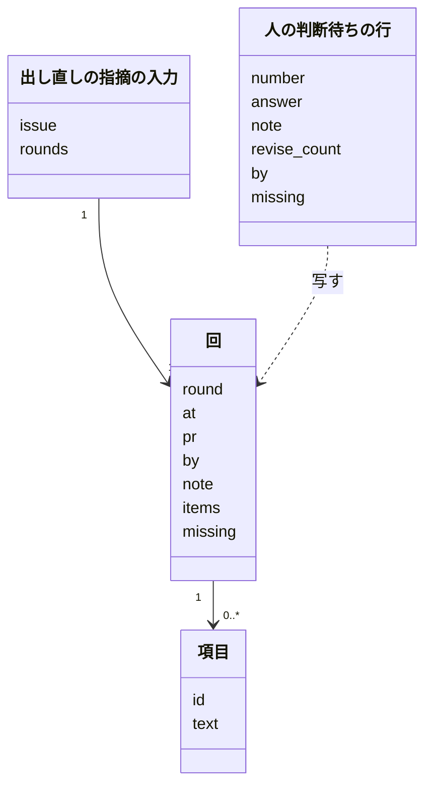
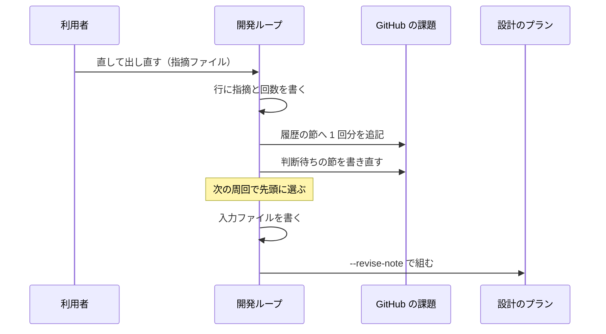
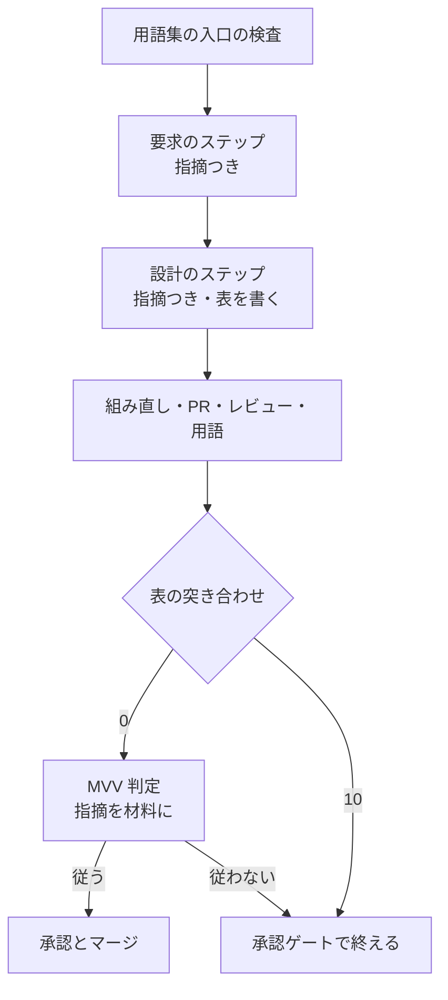
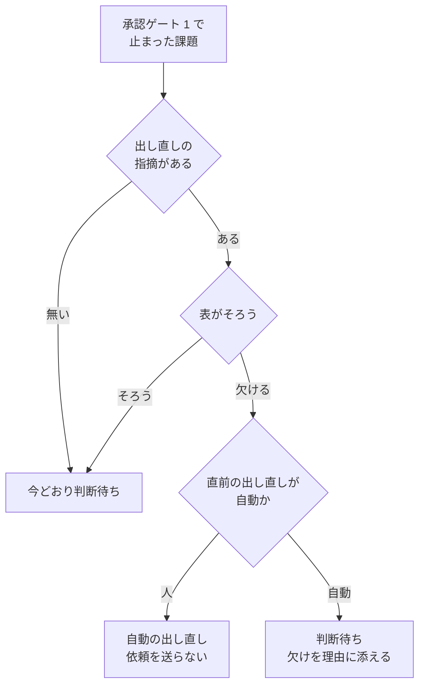

# 開発ループ: 直して出し直すの指摘を次の周回の設計が読み、届いたかを人へ問う前に確かめる（#2510）

## 目的

- **今どうなっているか**: 承認ゲート 1 で人が「直して出し直す」と答えて送った指摘が、次の周回の設計のプランの入力に入らない。課題の本文に書いた指摘も、次に人の判断待ちへ移すときの書き直しで消える。#2344・#2338 では同じ指摘を 2 回送っても設計が変わらなかった
- **誰に効くか**: 開発ループと並列の計画で承認ゲート 1 に答える利用者
- **変えると何が成り立つか**: 次の周回の設計がすべての回の指摘を読み、指摘の項目ごとに直したか・直せない理由を設計 PR の本文に示す。示していない出し直しは、人へ問う前に機械が見つけて 1 回だけ自動で戻す。答えの種類ごとに、読んで動く手順が 1 つに決まる

## 適用範囲

- **働く範囲**: 配布先のリポジトリでも働く。開発ループ（`--loop`）と並列の計画（`--parallel`）のレーンの両方で同じ経路を通る
- **プロジェクトごとに違うもの**: 無し。指摘の項目の数え方と自動で戻す上限（1 回）は固定で、設定を足さない
- **当たるモード**: 開発ループが組む設計のプラン（`pace: auto`）を通るすべてのモード。単発の `/ndf:design` は出し直しの指摘を持たないため、振る舞いは変わらない

## あるべき姿の根拠

| 根拠 | 種類 | 何を示すか |
| --- | --- | --- |
| 周回 9 の設計のプラン（`.ndf/loop/lroot3/lap-9/sprint/1-design-2338.json`）に、指摘の中身（#2059・#2300 に絞る など）が無い | 実測（課題の本文の「原因」） | 指摘は記録に届くが、設計のプランの入力に入っていない |
| #2338 の本文に節として指摘を写しても、3 回目の出し直し（lroot3 周回 11）の範囲が元のままだった | 実測（課題の本文の「今の回避」） | 本文に書くだけでは設計の手順に届かない。プランの起動指示へ入れる必要がある |
| #2494: 出し直しの設計が要求のステップを飛ばし、指摘を反映しないまま MVV 判定「従う」で承認ゲート 1 を通った（ https://github.com/devbasex/ai-plugins/pull/2479 ） | 実測（同じ根を持つ課題） | 仕様のコピーの一致で要求のステップを飛ばす分岐と、MVV 判定の材料に指摘が無いことが、指摘の取りこぼしを人まで届けない |

要求と受け入れ条件は #2510 の本文にある（コピーは [issues/issue-2510-requirements.md](issue-2510-requirements.md) ）。この文書は「どう作るか」だけを扱う。

## ドメインモデル

### コンテキスト

| コンテキスト | 何の語が 1 つの意味に決まるか |
| --- | --- |
| NDF の開発ワークフロー（`ndf-workflow`） | 出し直しの指摘・出し直しの指摘の履歴・指摘への対応の表・設計のプラン・答えの種類・自動の出し直し |

1 つのコンテキストに収まる。開発ループと並列の計画のレーンは同じループの記録を同じ関数で書くため、コンテキストを分けない。

### 集約

| 集約 | 持ち主（書き換えてよいもの） | 根 | エンティティ | 値オブジェクト |
| --- | --- | --- | --- | --- |
| ループの記録 | 開発ループの集約（`lib/sprint_loop.py`・`lib/sprint_loop_gate.py`） | ループ | 人の判断待ちの行 | 出し直しの指摘・届いていない項目の一覧 |
| 出し直しの指摘の入力 | 開発ループの集約が周回ごとに書き出す。読むのは設計のプランの組み立て・MVV 判定・表の突き合わせ | 課題ごとの入力 | 回 | 指摘の項目（識別子 `<回>-<番号>` と本文） |
| 出し直しの指摘の履歴 | 開発ループの集約（答えを当てる経路だけが追記する） | 課題の本文の節 | 回の記載 | — |
| 指摘への対応の表 | 設計のステップの worker が設計文書へ書く。設計 PR の本文へは表の突き合わせのコマンドが写す | 設計文書の節 | 表の行 | 対応（直した / 直せない）・直した箇所か直せない理由 |

出し直しの指摘の入力は、ループの記録から作る読み取り専用のコピーである。正本はループの記録の人の判断待ちの行で、課題の本文の履歴は人が読むためのコピーとする（要求の前提 5）。入力が持つのは、いま回っているループの回だけである。同じ課題を前に別のループで出し直した回は、課題の本文の履歴の節で人が読める形に残るが、入力・表の突き合わせ・MVV 判定には入らない（ループの記録はループごとに別のファイルで、回数もループごとに 1 から数えるため）。

### 不変条件

| # | 集約 | 条件 | 破れたときの扱い |
| --- | --- | --- | --- |
| I1 | 出し直しの指摘の入力 | 課題の入力の回は、いま回っているループの記録（`.ndf/loop/<名>/loop.json`）でその課題の答えが「直して出し直す」の行を、記録の順にすべて持つ（人の回と自動の回の両方）。ほかのループの記録の回は入れない。回数と項目の識別子 `<回>-<番号>` は 1 つのループの中で一意で、入力の中で衝突しない | 入力を書けなければ設計のプランを組まずに止める（周回を `refused` で止める） |
| I2 | 出し直しの指摘の入力 | 指摘の項目は人の回の指摘からだけ数える。箇条書き（`-` / `*`）と番号付きの行を 1 項目とし、どちらも無ければ全文を 1 項目とする。自動の回は項目を足さず、届いていない項目の識別子だけを持つ | — （数え方の関数が 1 つで、ほかの経路が数えない） |
| I3 | 出し直しの指摘の履歴 | 履歴の節は追記だけで、既にある回の記載を消さない・書き換えない。同じ回を 2 度書かない。回はループの名前と回数の組で識別する（回数はループごとに 1 から数えるため、回数だけでは別のループの回と区別できない） | 本文を書けなければ理由を結果に残し、記録の書き込みは止めない（要求の前提 5） |
| I4 | 設計のプラン | 出し直しの指摘を持つ課題では、要求のステップを仕様のコピーの一致によらず流し、要求と設計のステップの起動指示にすべての回の指摘を入れる。持たない課題のプランは今と同じ | — （組み立ての分岐で守る） |
| I5 | 指摘への対応の表 | 設計 PR の本文の表は、設計文書の節を写したものだけである。本文の側で書き足さない | コピーが食い違えば、表の突き合わせのコマンドが設計文書の側で本文を書き直す |
| I6 | ループの記録 | 出し直しの指摘を持つ課題を人の判断待ち（答えがまだの行）へ移すのは、すべての項目に表の行があり、対応と箇所・理由の欄が空でないときか、自動の出し直しの上限に達したときだけである | 項目が欠ければ、人へ問わずに自動の出し直しの行にする |
| I7 | ループの記録 | 自動の出し直しは、人の出し直しの 1 回につき 1 回まで（直前の出し直しの行が自動なら、次は人へ問う） | 上限に達したら、届いていない項目を理由に添えて人へ問う |
| I8 | ループの記録 | 承認とやらないの答えを当てたときの、承認の記録・ラベル・人の判断待ちの節の振る舞いは今と同じ | — （既存のテストで守る） |

### ドメインイベント

| # | イベント | 発生元 | 受け手 |
| --- | --- | --- | --- |
| E1 | 人が直して出し直すの答えを送った | `loop answer --revise --note` / `parallel.py answer --revise --note` | 開発ループの集約（並列でなければその場、レーンなら周回の境） |
| E2 | 答えを人の判断待ちの行へ当てた | 開発ループの集約の答えを当てる関数 | 出し直しの指摘の履歴の追記 |
| E3 | 履歴の節へその回の指摘を追記した | 開発ループの集約 | 課題の本文を読む人 |
| E4 | 次の周回で課題を先頭に選んだ | 周回の選定 | 周回のスプリントの組み立て |
| E5 | 設計のプランへすべての回の指摘を入れた | 周回のスプリントの組み立て（出し直しの指摘の入力を書き、プランの組み立てへ渡す） | 要求・設計のステップの worker |
| E6 | 要求のステップが仕様のコピーの一致によらず流れた | 設計のプラン | 設計のステップ |
| E7 | 設計を直し、設計文書に指摘への対応の表を書いた | 設計のステップの worker | 表の突き合わせのステップ |
| E8 | MVV 判定が出し直しの指摘を材料に含めて判定した | MVV 判定のステップ | 承認ゲート 1 |
| E9 | 指摘と表を突き合わせた | 表の突き合わせのステップ（プランの中）と、人の判断待ちへ移す関数（周回の締め） | 自動の出し直し、または人の判断待ちへ移す処理 |
| E10 | 課題を人の判断待ちへ移し、判断待ちの節を書き直した（履歴の節は残る） | 人の判断待ちへ移す関数 | 承認ゲート 1 に答える利用者・オーガナイザー |

### 用語

| 用語 | 意味 | 用語集への反映 |
| --- | --- | --- |
| 自動の出し直し | 出し直しの設計が指摘の項目を表に示していないとき、人へ問わずに開発ループが自分で付ける「直して出し直す」の答え。届いていない項目を名指しする。人の出し直しの 1 回につき 1 回まで | 追加 |
| 出し直しの指摘の入力 | 開発ループが周回ごとに、そのループでの課題のすべての回の出し直しの指摘をループの記録から書き出したファイル。設計のプラン・MVV 判定・表の突き合わせが読む | 追加 |

## 機能一覧

| # | 機能 | 誰が使うか |
| --- | --- | --- |
| F1 | 出し直しの指摘を持つ課題の設計のプランに、すべての回の指摘を入れ、要求のステップを必ず流す | 開発ループ（要求と設計のステップの worker が読む） |
| F2 | 直して出し直すの答えを当てるたびに、課題の本文の履歴の節へ 1 回分を追記する | 承認ゲート 1 に答える利用者 |
| F3 | 設計文書の指摘への対応の表を、設計 PR の本文へ写して突き合わせる | 承認ゲート 1 に答える利用者・オーガナイザー |
| F4 | 表に欠けがあれば、人へ問わずに自動の出し直しへ戻す（1 回まで） | 開発ループ |
| F5 | MVV 判定の材料に出し直しの指摘を入れ、指摘を満たさない設計を「従う」にしない | 開発ループ（承認ゲート 1 の判定） |
| F6 | 答えの種類ごとに、読んで動く手順を手順書の表で示す | 利用者・オーガナイザー・conductor |

## 構成要素

### 要素ごとの責務

| 要素 | 責務 |
| --- | --- |
| 出し直しの指摘の部品（新規 `lib/revise_note.py`） | 指摘の読み取りと項目の数え方の唯一の実装。課題の回の取り出し・項目の分割・入力ファイルの書き出しと読み込み・起動指示の文面・表の解析と欠けの判定・自動の出し直しの上限の判定・履歴の 1 回分の文面を持つ |
| 表の突き合わせのコマンド（新規 `revise-note.py check`） | 設計文書の「出し直しの指摘への対応」の節を設計 PR の本文へ写し、入力の項目と突き合わせる。そろえば 0、欠ければ 10（承認ゲートで止める）、読めなければ 2 |
| 開発ループの答えを当てる関数（`lib/sprint_loop.py` の `apply_answer`） | 直して出し直すの答えで、記録の行を書いた後に履歴の節へ追記する |
| 周回のスプリントの組み立て（`lib/sprint_loop.py` の `cmd_sprint`・`new_sprint_argv`） | 設計する課題のうち出し直しの指摘を持つものの入力ファイルを周回のディレクトリへ書き、`supervise.py new sprint` へ `--revise-note <課題>=<パス>` で渡す |
| 人の判断待ちへ移す関数（`lib/sprint_loop_gate.py` の `move_to_waiting`） | 出し直しの指摘を持つ課題で、設計 PR の本文の表を突き合わせる。欠けがあり上限内なら自動の出し直しの行にし、オーガナイザーへ設計の承認の依頼を送らない |
| 判断待ちの節の文面（`lib/sprint_loop_gate.py` の `waiting_section`） | 指摘の全文を載せる代わりに、履歴の節の何回目かを指す 1 行を載せる。自動の出し直しなら届いていない項目を載せる |
| 設計のプランの組み立て（`supervise_lib/sprint_waves.py` の `plan_sprint_design`・`plan_mvv_design`） | 出し直しの指摘を持つ課題で、仕様のコピーのチェックを外して要求のステップへ直行させ、要求と設計の起動指示へ指摘を入れ、表の突き合わせのステップを足し、MVV 判定へ入力を渡す |
| `supervise.py new sprint` の引数（`supervise_lib/new_args.py`） | `--revise-note <課題>=<パス>`（繰り返し可）を受ける |
| MVV 判定（`mvv-gate.py`） | `--revise-note <パス>` を受け、指摘を材料の 1 件として足し、承認ゲートの問いへ「指摘の項目を満たさない設計は従うにしない」を足す |
| 手順書（`development-workflow` の `references/loop.md`・`references/parallel.md`） | 答えの種類ごとの読んで動く手順の表を `loop.md` に置き、`parallel.md` の問い方の節から指す |
| `/ndf:pr` の「設計 Pull Request の本文」（`skills/pr/SKILL.md`） | 節「出し直しの指摘への対応」を、手で書かない節として表に足す |

### 要素どうしの呼び出し



図には処理の流れに現れない要素（手順書・`/ndf:pr` の Skill・`supervise.py new sprint` の引数の定義）を含めない。判断待ちの節の文面は「人の判断待ちへ移す」と「答えを当てる」の中で使われる。

### システムの文脈と配置

システムの文脈と配置は次のとおりである。外部の系は GitHub（課題の本文・設計 PR の本文）だけで、すべての処理は利用者の手元のループの実行場所で動く。



パッケージの置き場は次のとおりである。

```text
plugins/ndf/scripts/
├── revise-note.py                 # 新規。表の突き合わせのコマンド
├── mvv-gate.py                    # --revise-note を足す
├── lib/
│   ├── revise_note.py             # 新規。出し直しの指摘の部品
│   ├── sprint_loop.py             # 答えを当てる・スプリントの組み立て
│   └── sprint_loop_gate.py        # 人の判断待ちへ移す・判断待ちの節
└── supervise_lib/
    ├── new_args.py                # --revise-note を足す
    └── sprint_waves.py            # 設計のプランの分岐
```

## 構造

コードは関数と辞書で書かれ、型の定義は無い。変える形は、ループの記録の行と出し直しの指摘の入力の 2 つの辞書である。



## データ構造

### 人の判断待ちの行に足す欄

既存の欄（`note`・`revise_count` ほか）の意味は変えない。足すのは自動の出し直しの 2 欄だけである。

| 欄 | 型 | 空の扱い | 意味 |
| --- | --- | --- | --- |
| `by` | 文字列 | 無ければ人の答え | `auto` のとき自動の出し直し |
| `missing` | 文字列の配列 | 無ければ欠けなし | 自動の出し直しで名指しした、届いていない項目の識別子（`1-2` など） |

自動の出し直しの行は `answer` を `revise`、`note` を空にする。項目は人の回の指摘からだけ数えるため（I2）、自動の回は指摘の本文を持たない。

### 出し直しの指摘の入力（`<周回のディレクトリ>/revise-<課題>.json`）

周回のスプリントを組むたびに、ループの記録から作り直す。手で直さない。

```json
{
  "issue": 2338,
  "rounds": [
    {"round": 1, "at": "2026-11-04T21:09:00Z", "pr": 2497, "by": "user",
     "note": "- #2059 と #2300 に絞る\n- PR は 2 本にする",
     "items": [{"id": "1-1", "text": "#2059 と #2300 に絞る"}, {"id": "1-2", "text": "PR は 2 本にする"}],
     "missing": []},
    {"round": 2, "at": "2026-11-05T10:00:00Z", "pr": 2497, "by": "auto", "note": "", "items": [], "missing": ["1-2"]}
  ]
}
```

### 課題の本文の履歴の節

見出しは `## 出し直しの指摘の履歴` で、ループの名前を入れない（ループを替えても 1 つの節に続けて書く）。1 回分は次の形で末尾へ足す。

```markdown
### 第 2 回（2026-11-05・設計 PR #2497・開発ループ lroot3・自動）

届いていない項目: 1-2
```

人の回は「自動」の代わりに「人」と書き、見出しの下に指摘の全文を置く。見出しのループの名前と回数の組（例: `開発ループ lroot3` の `第 2 回`）が同じ見出しが既にあれば足さない（I3）。回数が同じでもループの名前が違えば別の回として足す。

### 指摘への対応の表（設計文書と設計 PR の本文の `## 出し直しの指摘への対応`）

| 列 | 書くこと |
| --- | --- |
| 項目 | 入力の項目の識別子（`1-1`） |
| 指摘 | 項目の本文の要約 |
| 対応 | `直した` か `直せない` |
| 直した箇所・直せない理由 | 直した節の名前か、直せない理由 |

### CRUD 図

| 機能 | ループの記録の行 | 入力ファイル | 履歴の節 | 設計文書の表 | 設計 PR の本文の表 |
| --- | --- | --- | --- | --- | --- |
| F1 | 読む | 作る | — | — | — |
| F2 | 更新 | — | 作る・追記 | — | — |
| F3 | — | 読む | — | 読む | 作る・更新 |
| F4 | 作る（自動の出し直し） | — | 追記 | — | 読む |
| F5 | — | 読む | — | — | 読む |

## 入出力の契約

| コマンド | 足す引数 | 振る舞い |
| --- | --- | --- |
| `supervise.py new sprint` | `--revise-note <課題>=<パス>`（繰り返し可） | `--design` に含まれる課題の設計のプランだけを変える。ファイルを読めなければ組み立てを断る（終了コード 2） |
| `mvv-gate.py check --gate design` | `--revise-note <パス>` | 材料の先頭へ「出し直しの指摘」の節を足し、承認ゲートの問いへ判定の条件を足す。読めなければ承認ゲートへ戻す（今の材料を取れないときと同じ） |
| `revise-note.py check --pr <番号> --doc <設計文書> --notes <パス>` | 新規 | 終了コード 0（項目がそろった）/ 10（表が無い・行の無い項目・対応か箇所の欄が空の項目がある。届いていない項目を `items` に出す）/ 2（PR・設計文書・入力を読めない） |

`loop answer`・`parallel.py answer` の引数は変えない。

## 処理の流れ

### 答えを当ててから次の設計のプランを組むまで



並列の計画のレーンでは、1 行目の答えがオーガナイザーの `parallel.py answer` から耐久のイベントとして届く。レーンはそれを周回の境（`apply_gate1_answers`）で同じ関数へ渡し、以降は同じである。

### 出し直しの設計のプランの中



出し直しの指摘を持たない課題では、`G` の次が今どおり仕様のコピーのチェックで、`K` は無い（I4）。`K` は用語の送り（`push-glossary`）の直後に入り、送りの元の行き先へ進む。基本形の行き先は Draft を外すステップ、MVV 判定を置く形では MVV 判定である。用語チェックの当たりが残って承認ゲートの判断（`gate`）へ回る経路は `K` を通らないが、周回の締めで同じ突き合わせを通る。

### 周回の締めで人の判断待ちへ移すとき



`T` は設計 PR の本文を読む。読めなければ自動の出し直しにせず、「表を読めなかった」を理由に添えて判断待ちへ移す。自動の出し直しの行は、人の答えと同じく次の周回で先頭に選ばれる（今の選定の振る舞い）。

## 非機能の実現方式

| 大項目 | 実現方式 |
| --- | --- |
| 運用・保守性 | 指摘の読み取り・項目の数え方・表の解析は出し直しの指摘の部品の関数だけが持つ。開発ループ・並列の計画のレーン・設計のプランの組み立て・MVV 判定・表の突き合わせのコマンドは、すべてこの部品を呼ぶ |
| 移行性 | 既存の課題の本文の判断待ちの節に残る指摘は移さない。ループの記録の既存の `note` はそのまま入力の回として読める（`by` の無い行は人の回として扱う） |

## 決定の記録

### 決定 1: 設計のプランの入力の正本を 1 つにするため、ループの記録から周回ごとに入力ファイルを書き出して渡す

設計のプランは `supervise.py new sprint` が組み、ループの記録を読まない。記録から書き出したファイルのパスを引数で渡せば、プランの組み立ては記録の形を知らずに済み、MVV 判定と表の突き合わせも同じファイルを読める。課題の本文の履歴の節は GitHub の書き込みに失敗しうるため、入力にしない（要求の前提 5）。

プランの組み立てが課題の本文を読む形は採らない。本文の節は書き込みの失敗と人の編集で揃わなくなり、#2338 の回避で本文の節が読まれなかった経路と同じ弱さを持つ。

根拠: Value 7 / Value 5（MVV 版 5）

### 決定 2: 表の書き手を 1 つにするため、指摘への対応の表は設計のステップの worker が設計文書へ書き、突き合わせのコマンドが設計 PR の本文へ写す

pr のステップは既にある設計 PR の本文を作り直すため、worker が本文へ直接書いた表は次の pr のステップで消える。設計文書に置けば、レビューの直しでも同じ差分で直り、MVV 判定も設計文書の材料として読む。本文へのコピーは、最後の送りの後の突き合わせのステップが行う。

pr のステップの材料に表を足す形は採らない。pr のステップは設計 PR を出す時点で 1 回しか本文を作らず、レビューの直しで変わった表を拾えない。

根拠: Value 5 / Value 8（MVV 版 5）

### 決定 3: 機械が確かめられる範囲に絞るため、表の突き合わせは項目ごとの行と欄の有無だけを見て、中身が指摘を満たすかは MVV 判定に任せる

行と欄の有無は決まった手順で判定でき、スクリプトが持てる。中身の充足は判断であり、既に承認ゲート 1 の手前にある MVV 判定に指摘の全文と問いを足せば、新しい判定の工程を作らずに済む。MVV 判定が「従わない」を返せば人へ問われる。

中身を判定する AI のステップを別に足す形は採らない。MVV 判定と同じ材料で同じ問いを 2 回問うことになる。

根拠: Value 5 / Value 3（MVV 版 5）

### 決定 4: 表の欠けが MVV 判定で通らないようにするため、プランの中の突き合わせが欠けを見つけたら MVV 判定へ進まず承認ゲートで終える

MVV 判定が「従う」を返すと設計 PR はマージされ、人の判断待ちへ移す関数を通らない。#2494 はこの経路で指摘を反映しないまま通った。プランの中で欠けを見つけて承認ゲートで終えれば、周回の締めの共通の経路（人の判断待ちへ移す関数）が自動の出し直しを決める。自動で戻すかの判断は締めの 1 か所だけに置く。

プランの中で自動の出し直しまで決める形は採らない。上限の判定にループの記録が要り、プランはそれを読まない。

根拠: Value 7（MVV 版 5）

### 決定 5: 指摘を満たす設計を 1 回で揃えやすくするため、要求と設計の起動指示へすべての回の指摘の全文を埋め込む

起動指示にファイルのパスだけを書くと、worker が読まない経路が残る（#2338 の回避で本文の節が読まれなかった）。全文と項目の識別子を起動指示に置き、「この指摘を満たすように直す。満たせない項目は理由を書く」と、設計文書へ表を置く指示を添える。

最新の 1 回だけを渡す形は採らない。前の回で満たした項目を次の回で崩さないため（要求の前提 1）。「すべての回」は、いま回っているループの回を指す（I1）。

根拠: Value 2 / Value 7（MVV 版 5）

### 決定 6: 課題の本文に指摘の全文を 2 か所持たないため、判断待ちの節は履歴の節の回を指す 1 行だけを載せる

判断待ちの節は次に人の判断待ちへ移すときに書き直される。全文を履歴の節へ移し、判断待ちの節は「指摘: 節『出し直しの指摘の履歴』の開発ループ <名前> の第 N 回」と書けば、正本が本文の中でも 1 か所になる。

根拠: Value 8（MVV 版 5）

### 決定 7: 答えの種類ごとの手順の正本を 1 つにするため、表を `loop.md` に置き、`parallel.md` から指す

答えを読んで動くのはどちらの場合もループ（レーンもループである）で、`parallel.md` が持つのは答えを送る側の手順である。正本を読む側に置けば、手順の変更で直す文書が 1 つになる。

根拠: Value 8（MVV 版 5）

## 答えの種類ごとの手順（手順書に書く表の中身）

`loop.md` の「承認ゲート」の節に置く表の中身を決める。

| 答えの種類 | 送るコマンド | 読んで動く手順 |
| --- | --- | --- |
| 承認 | `loop answer --approved` / `parallel.py answer --approved` | 並列でなければ答えの場で承認の記録を書き、次の周回のスプリントで設計済みの課題として扱う。レーンは周回の境で設計 PR の先端を比べ、ラベル `design-approved` と承認の記録を書く。承認の後のマージの持ち主は #2507 が決める |
| 直して出し直す | `loop answer --revise --note` / `parallel.py answer --revise --note` | 答えを当てる関数が記録の行と履歴の節を書き、次の周回で先頭に選ぶ。スプリントの組み立てが入力ファイルを書き、設計のプランが読む（この設計） |
| やらない | `loop answer --rejected` / `parallel.py answer --rejected` | 答えを当てる関数が差し戻しの記録を書き、以後の選定から外す |
| 予算 | `loop start <名>` に `--budget-laps` / `--budget-usd` / `--budget-hours` | ループの開始と再開の起動が予算を上書きし、変更を記録の予算の履歴へ残す。止まる条件の判定は周回の境で新しい予算を読む。レーンでは起こし直しの起動の行に付ける |
| 止める | `loop stop <名>` / `parallel.py stop <計画名>` | 止める指示のファイルを置き、周回の境で止まる条件 `user_stop` として読む。並列の計画は全レーンへ止める指示を打つ |

要求の前提 6 にある `sprint-state.py loop budget` は、今の CLI に無い。`lib/sprint_loop_cli.py` が持つ予算の引数は、`loop start` の `--budget-laps`・`--budget-usd`・`--budget-hours` の 3 つだけである。予算の手順は `loop start --budget-*` だけを書く。

## テスト設計

| 受け入れ条件・不変条件 | どの振る舞いで縛るか | どう壊したら落ちるべきか |
| --- | --- | --- |
| 受け入れ条件 1 / I1 / I4 | 出し直しの行を 2 回持つ課題でスプリントを組むと、要求と設計のステップの起動指示に 2 回分の全文と「満たすように直す。満たせない項目は理由を書く」の旨が入る | 最新の 1 回だけを入れる・自動の回を落とす・起動指示へ入れずにパスだけを書く |
| 受け入れ条件 2 / I4 | 出し直しの指摘を持つ課題のプランでは、仕様のコピーのチェックが一致で 0 を返しても要求のステップが流れる | 仕様のコピーのチェックのステップを残して `next` を設計にする |
| 受け入れ条件 3 / I3 | 直して出し直すを 2 回当て、間に人の判断待ちへ移して判断待ちの節を書き直しても、本文に第 1 回と第 2 回の記載が残る。同じ回を当て直しても記載が 1 つ。別のループで同じ課題の第 1 回を当てると、記載が別に足される | 判断待ちの節の中へ履歴を書く・追記でなく置き換える・回の重複を見ない・回数だけで重複を見る |
| 受け入れ条件 4 / I5 | 突き合わせのコマンドが、設計文書の表を設計 PR の本文の節へ写す。本文に別の表があれば設計文書の側で書き直す | 本文の表を正として設計文書を無視する |
| 受け入れ条件 5 / I6 | 表が無い・行の無い項目がある・対応か箇所の欄が空のとき、突き合わせのコマンドは 10、人の判断待ちへ移す関数は自動の出し直しの行（届いていない項目つき）を作り、オーガナイザーへ依頼を送らない | 欄の空を見ない・自動の出し直しでも依頼を送る |
| 受け入れ条件 5 / I7 | 直前の出し直しが自動なら、欠けがあっても答えのまだの判断待ちの行にし、理由に届いていない項目を載せる | 上限を数えずに自動の出し直しを続ける |
| 受け入れ条件 6 | 出し直しの指摘を持つ課題の MVV 判定の材料と問いに、指摘の全文と「満たさない設計は従うにしない」が入る。判定器を差し替えて材料を見る | `--revise-note` を受けても材料へ足さない |
| 受け入れ条件 8 / I4 | 出し直しの指摘を持たない課題のプランが今と同じ（仕様のコピーのチェックがあり、起動指示に指摘の欄が無く、突き合わせのステップが無い） | 指摘の有無によらず分岐する |
| 受け入れ条件 9 / I8 | 承認・やらないを当てたときの承認の記録・ラベル・判断待ちの節が今と同じ（既存のテストが通る） | 答えを当てる関数の承認とやらないの経路で履歴を書く |
| I2 | 箇条書きと番号付きの行を 1 項目ずつ数え、どちらも無ければ全文を 1 項目にする。コードブロックの中の行は数えない。自動の回は項目を持たない | 段落を項目に数える・自動の回の文面を項目に数える |
| 受け入れ条件 7 | `.md` の文言は照合しない。文書のレビューで、表が `loop.md` にあり `parallel.md` が指していることを見る | — |

## 設計の結果

| 課題 | 扱い | 取り込み先 | 触るファイル |
| --- | --- | --- | --- |
| #2510 | 実装する | — | `plugins/ndf/scripts/lib/revise_note.py`、`plugins/ndf/scripts/revise-note.py`、`plugins/ndf/scripts/lib/sprint_loop.py`、`plugins/ndf/scripts/lib/sprint_loop_gate.py`、`plugins/ndf/scripts/supervise_lib/sprint_waves.py`、`plugins/ndf/scripts/supervise_lib/new_args.py`、`plugins/ndf/scripts/mvv-gate.py`、`plugins/ndf/scripts/tests/`、`plugins/ndf/skills/development-workflow/references/loop.md`、`plugins/ndf/skills/development-workflow/references/parallel.md`、`plugins/ndf/skills/pr/SKILL.md` |

## 未確認のまま残ること

| 項目 | 内容 |
| --- | --- |
| 自動の出し直しの上限（1 回）の妥当性 | 要求の未決。承認ゲート 1 で利用者が決める。変えるときは出し直しの指摘の部品の上限の判定だけを直す |
| `new_args.py` の引数の受け方 | `--revise-note <課題>=<パス>` を既存の引数の定義に合わせて足せるかは、実装（`tdd-cycle`）で走らせて確かめる |
| worker が表の識別子を入力どおりに書くか | 起動指示に識別子つきの項目を並べて書かせる。書き違えは突き合わせのコマンドが欠けとして拾い、自動の出し直しへ戻す。配布の後のリリース後テストで、実際の出し直しで確かめる |
