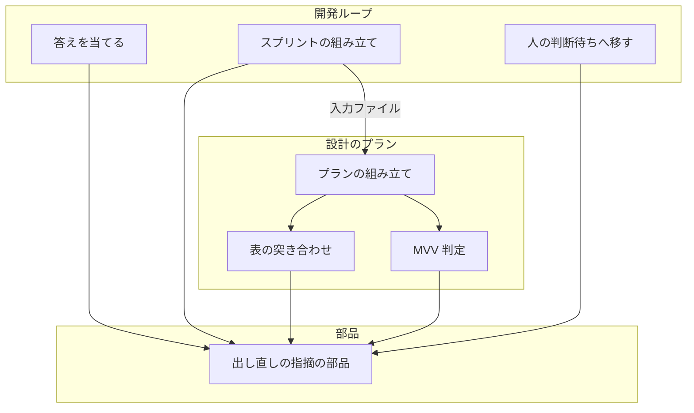
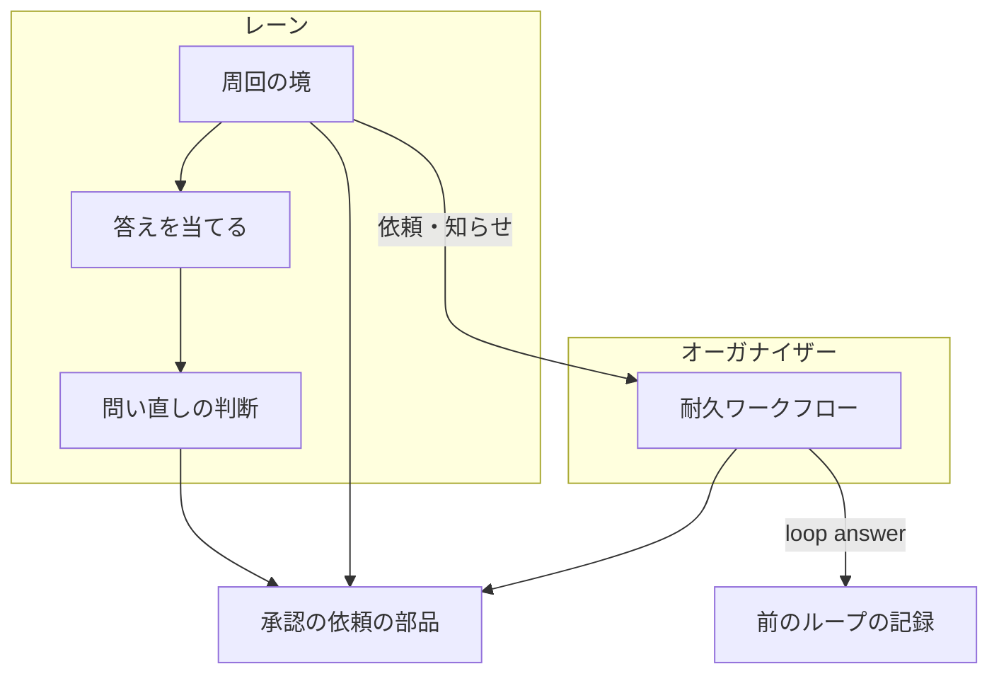
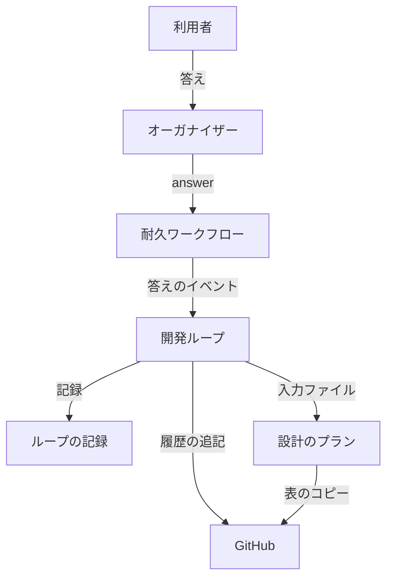
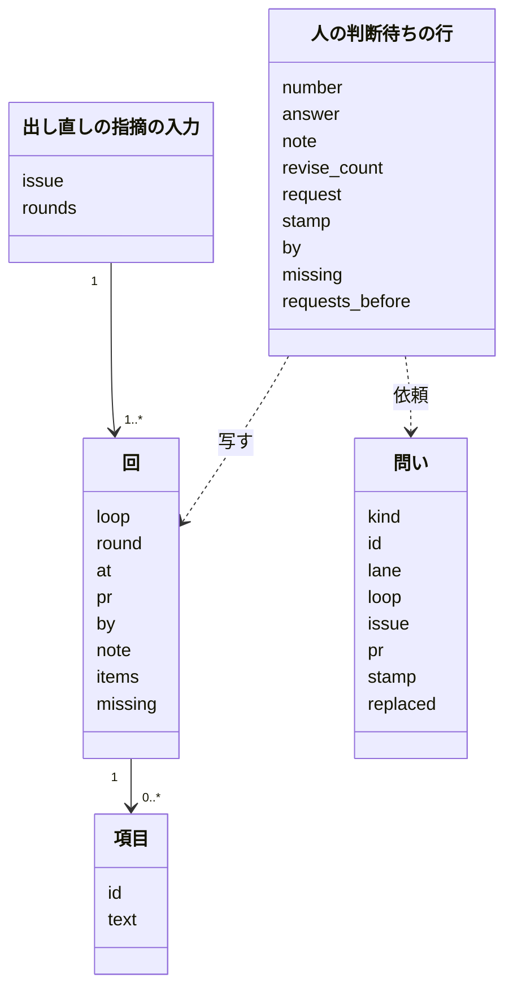
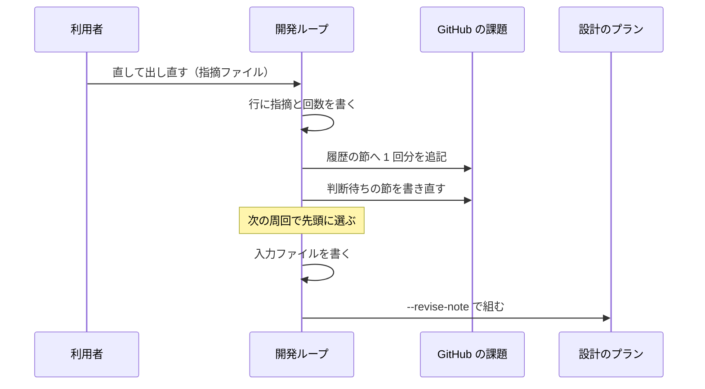
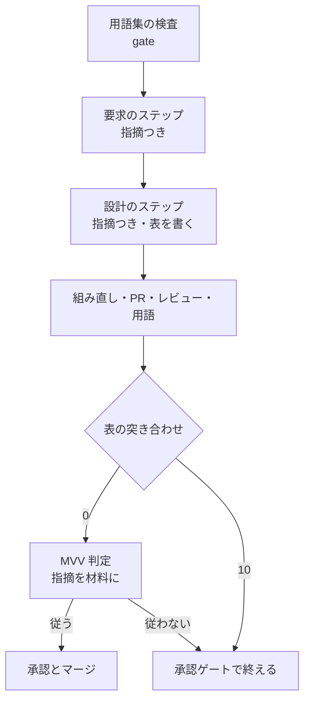
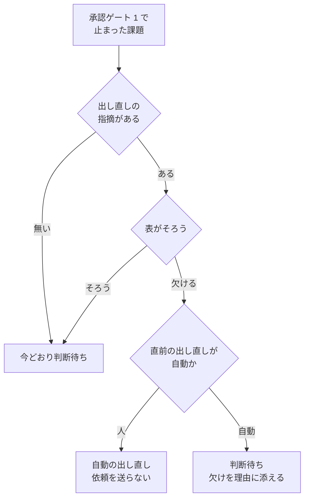
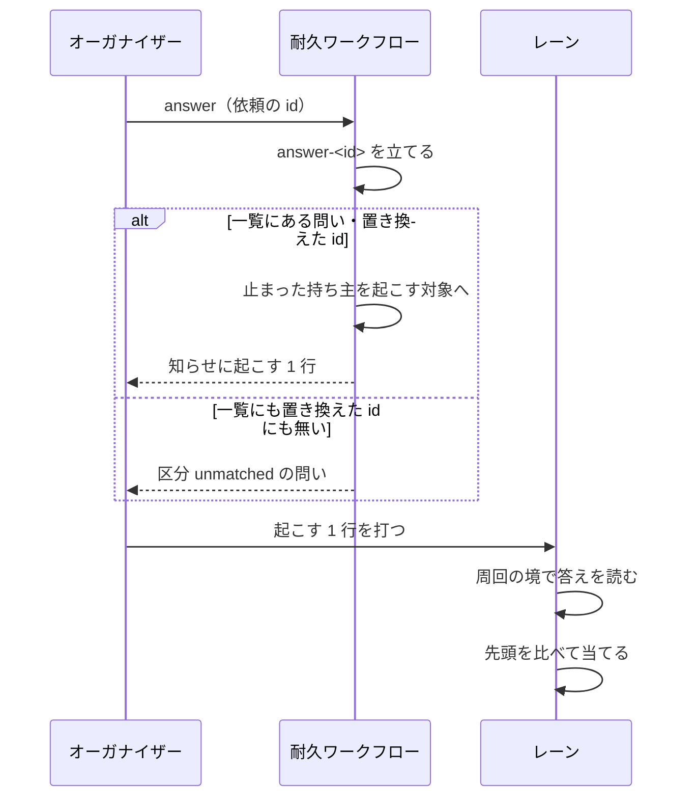
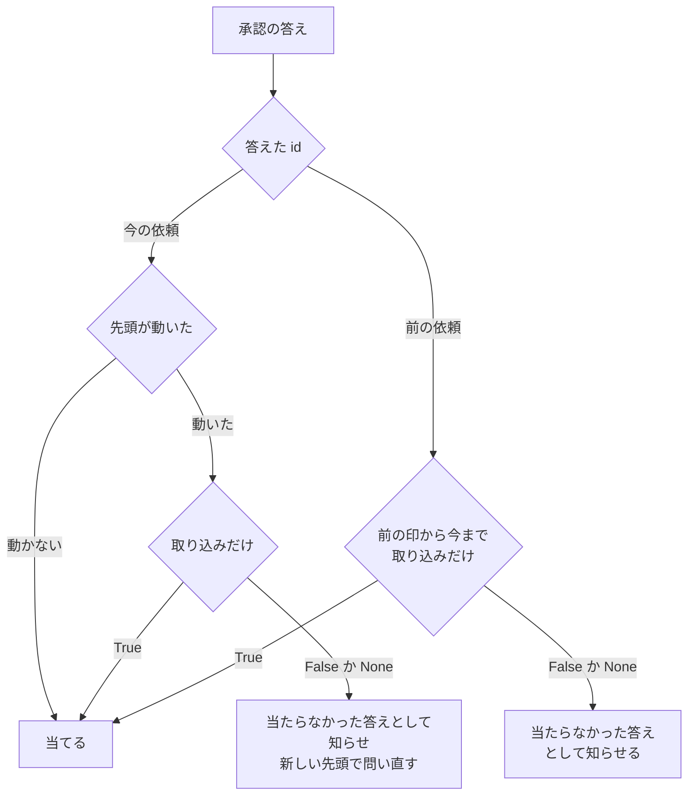
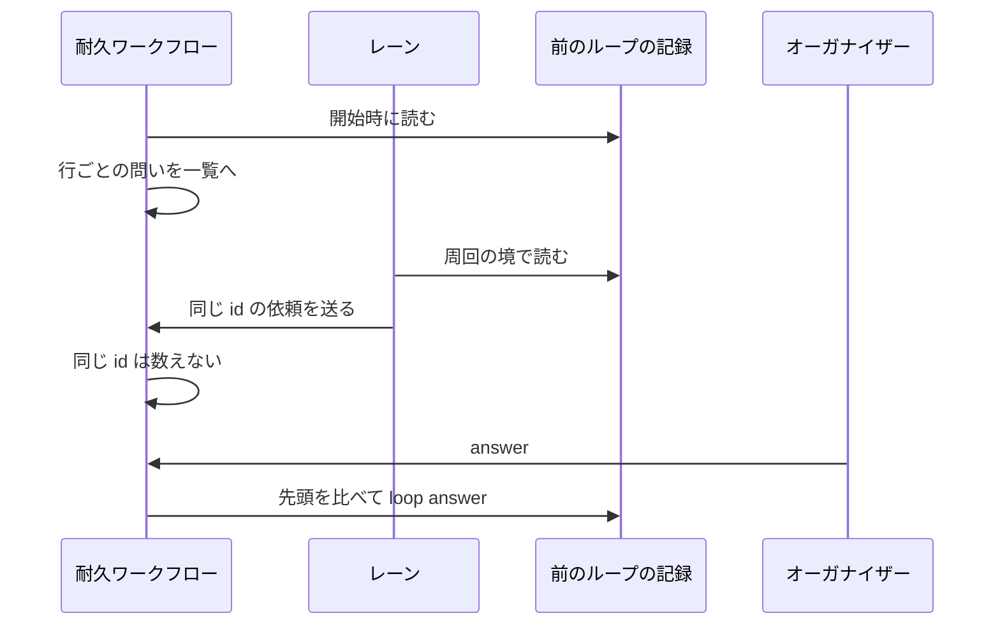

# 開発ループと並列の計画: 人の答え（出し直しの指摘・承認・前のループの待ち）を、読んで動く側へ確実に届ける（#2510）

## 目的

- **今どうなっているか**: 承認ゲート 1 で人が「直して出し直す」と答えて送った指摘が、次の周回の設計のプランの入力に入らない。課題の本文に書いた指摘も、次に人の判断待ちへ移すときの書き直しで消える。#2344・#2338 では同じ指摘を 2 回送っても設計が変わらなかった。並列の計画では、ほかに 3 つの形で答えや待ちが落ちた
  - オーガナイザーが送った承認が、止まっていたレーンのループの記録に当たらなかった（#2474）
  - 起点ブランチを取り込んだだけの設計 PR について、承認の依頼が送り直された（#2526）
  - 計画を始める前のループで承認待ちになった設計 PR 4 本が、問いの一覧に一度も出なかった（ループ lroot2）
- **誰に効くか**: 開発ループと並列の計画で承認ゲート 1 に答える利用者と、並列の計画を回すオーガナイザー
- **変えると何が成り立つか**
  - 次の周回の設計が、すべての回の指摘を読む。指摘の項目ごとに、直したか・直せない理由を設計 PR の本文に示す
  - 示していない出し直しは、人へ問う前に機械が見つけて 1 回だけ自動で戻す
  - 答えの種類ごとに、読んで動く手順が 1 つに決まる
  - オーガナイザーの答えは捨てられず、当たらなければオーガナイザーが知る
  - 取り込みのコミットだけの違いでは問い直さない。前のループの待ちも問いの一覧に出る

## 適用範囲

- **働く範囲**: 配布先のリポジトリでも働く。開発ループ（`--loop`）と並列の計画（`--parallel`）のレーンの両方で同じ経路を通る。承認の届け方・前のループの待ちは、並列の計画を回すときだけ働く
- **プロジェクトごとに違うもの**: 起点ブランチだけで、`.ndf/worktree.json` の `base_branch` から読む（取り込みのコミットの判定）。指摘の項目の数え方と、自動で戻す上限（1 回）は固定で、設定を足さない
- **当たるモード**: 開発ループが組む設計のプラン（`pace: auto`）を通るすべてのモード。単発の `/ndf:design` は出し直しの指摘を持たないため、振る舞いは変わらない

## あるべき姿の根拠

| 根拠 | 種類 | 何を示すか |
| --- | --- | --- |
| 周回 9 の設計のプラン（`.ndf/loop/lroot3/lap-9/sprint/1-design-2338.json`）に、指摘の中身（#2059・#2300 に絞る など）が無い | 実測（課題の本文の「原因」） | 指摘は記録に届くが、設計のプランの入力に入っていない |
| #2338 の本文に節として指摘を写しても、3 回目の出し直し（lroot3 周回 11）の範囲が元のままだった | 実測（課題の本文の「今の回避」） | 本文に書くだけでは設計の手順に届かない。プランの起動指示へ入れる必要がある |
| #2494: 出し直しの設計が要求のステップを飛ばし、指摘を反映しないまま MVV 判定「従う」で承認ゲート 1 を通った（ https://github.com/devbasex/ai-plugins/pull/2479 ） | 実測（同じ根を持つ課題） | 仕様のコピーの一致で要求のステップを飛ばす分岐と、MVV 判定の材料に指摘が無いことが、指摘の取りこぼしを人まで届けない |
| #2474 の承認の答えは耐久の記録に届いていた。レーン lroot2（ループ lroot3）は答えの前に `waiting_only` で止まり、答えの後に一度も動かなかった | 実測（下の「#2474 の承認が当たらなかった原因」） | 答えを当てるのはレーンの周回の境だけで、止まったループのレーンを答えの後に起こす仕組みが無い |
| ループ lroot2 の記録に、#2337 の設計 PR #2412 の待ちが 11/02 から依頼の id を持たずに残っていた | 実測（`.ndf/loop/lroot2/loop.json`） | 計画のレーンでないループの待ちは、どの経路でもオーガナイザーへ送られない |

要求と受け入れ条件は #2510 の本文にある（コピーは [issues/issue-2510-requirements.md](issue-2510-requirements.md) ）。この文書は「どう作るか」だけを扱う。
データ構造と入出力の契約は [issue-2510-design-contracts.md](issue-2510-design-contracts.md) に、決定の記録は [issue-2510-design-decisions.md](issue-2510-design-decisions.md) にある。

### #2474 の承認が当たらなかった原因

要求の前提 9 が設計に委ねた原因を、記録から確かめた。

| 確かめたこと | 結果 |
| --- | --- |
| ループ lroot3 の記録の #2474 の行（周回 12） | 依頼の id は `lroot2-g2501-8c5982fe95ca`、印は `8c5982fe95ca…`、`restamped` は無い。答えは `approved`・答えた時刻 03:11:08Z（オーガナイザーが `loop answer` を直接打った時刻） |
| 計画 p3 の耐久の記録のイベント `answer-lroot2-g2501-8c5982fe95ca` | `{"result": "approved", "at": "2026-11-05T02:09:28Z"}` がある。答えは耐久の記録に届いていた |
| 設計 PR #2501 の先頭 | `8c5982fe95ca…` のまま（02:09:47Z にマージ）。先頭は問いの時点から動いていない |
| ループ lroot3 の止まった記録 | 01:54:52Z に `waiting_only` で止まり、再開の時刻が無い。答えの後に周回の境を一度も通っていない |

**原因**: 答えを行へ当てるのは、持ち主のレーンの周回の境（`loop select` の `apply_gate1_answers`）だけである。止まったレーンを起こすのは、`parallel.py answer` が `metrics.next` に返す 1 行をオーガナイザーが打つことだけに頼っている。耐久ワークフローが起こす対象（`revive`・`wake`）は 1 スプリントのレーンに限られ、ループのレーンを含まない。オーガナイザーが `metrics.next` の 1 行を打たなかったため、答えは当たらないまま残った。

**候補だった依頼の id の打ち直しは、この件の原因ではない。** 行の依頼の id は答えた id と同じで、`restamped` も無い。ただし、打ち直しで古い id への答えが行に当たらなくなる経路は、コードに残っている（`regate1` が行の `request` を新しい id で置き換える）。受け入れ条件 10 はこの経路も含めて直す。

`parallel.py answer` の出力に `metrics.next` があったかは、出力が記録に残っていないため未確認である。

## ドメインモデル

### コンテキスト

| コンテキスト | 何の語が 1 つの意味に決まるか |
| --- | --- |
| NDF の開発ワークフロー（`ndf-workflow`） | 出し直しの指摘・出し直しの指摘の履歴・指摘への対応の表・設計のプラン・答えの種類・自動の出し直し・設計の承認の依頼・取り込みのコミット・前のループ・当たらなかった答え |

1 つのコンテキストに収まる。開発ループと並列の計画のレーンは同じループの記録を同じ関数で書く。並列の計画の耐久ワークフローも、同じ記録の行へ答えを届ける側としてこのコンテキストの語を使う。

### 集約

| 集約 | 持ち主（書き換えてよいもの） | 根 | エンティティ | 値オブジェクト |
| --- | --- | --- | --- | --- |
| ループの記録 | 開発ループの集約（`lib/sprint_loop.py`・`lib/sprint_loop_gate.py`） | ループ | 人の判断待ちの行 | 出し直しの指摘・届いていない項目の一覧・前の依頼の一覧 |
| 出し直しの指摘の入力 | 開発ループの集約が周回ごとに書き出す。読むのは設計のプランの組み立て・MVV 判定・表の突き合わせ | 課題ごとの入力 | 回 | 指摘の項目（識別子 `<ループ>:<回>-<番号>` と本文） |
| 出し直しの指摘の履歴 | 開発ループの集約（答えを当てる経路だけが追記する） | 課題の本文の節 | 回の記載 | — |
| 指摘への対応の表 | 設計のステップの worker が設計文書へ書く。設計 PR の本文へは表の突き合わせのコマンドが写す | 設計文書の節 | 表の行 | 対応（直した / 直せない）・直した箇所か直せない理由 |
| 問いの一覧 | 並列の計画の耐久ワークフロー（`lib/parallel_run.py` の `_Run`） | 計画 | 問い（設計の承認の依頼・前のループの待ち・当たらなかった答え ほか） | 置き換えた依頼の id の一覧 |

出し直しの指摘の入力は、ループの記録から作る読み取り専用のコピーである。正本はループの記録の人の判断待ちの行で、課題の本文の履歴は人が読むためのコピーとする（要求の前提 5）。入力は、同じリポジトリのすべてのループの記録から、その課題の回を集める（要求の前提 1）。

**前のループの記録へ書くのは、答えを当てる `loop answer` だけである。** 前のループの記録は、そのループの集約が持ち主のままである。耐久ワークフローは記録を直接書かず、そのループの `loop answer` を呼ぶ。

### 不変条件

| # | 集約 | 条件 | 破れたときの扱い |
| --- | --- | --- | --- |
| I1 | 出し直しの指摘の入力 | 課題の入力の回は、同じリポジトリのすべてのループの記録（`.ndf/loop/*/loop.json`）で、その課題の答えが「直して出し直す」の行をすべて持つ（人の回と自動の回の両方）。並びは答えた時刻の順である。回はループの名前と、そのループの中の回数の組で識別する。項目の識別子 `<ループ>:<回>-<番号>` は入力の中で衝突しない | いま回っているループの記録を読めなければ、設計のプランを組まずに止める（周回を `refused` で止める）。ほかのループの記録を読めなければ、その記録を飛ばし、飛ばした名前を周回の結果の `items` に出す |
| I2 | 出し直しの指摘の入力 | 指摘の項目は人の回の指摘からだけ数える。箇条書き（`-` / `*`）と番号付きの行を 1 項目とし、どちらも無ければ全文を 1 項目とする。自動の回は項目を足さず、届いていない項目の識別子だけを持つ | — （数え方の関数が 1 つで、ほかの経路が数えない） |
| I3 | 出し直しの指摘の履歴 | 履歴の節は追記だけで、既にある回の記載を消さない・書き換えない。同じ回を 2 度書かない。回はループの名前と回数の組で識別する（回数はループごとに 1 から数える） | 本文を書けなければ理由を結果に残し、記録の書き込みは止めない（要求の前提 5） |
| I4 | 設計のプラン | 出し直しの指摘を持つ課題では、要求のステップを仕様のコピーの一致によらず流し、要求と設計のステップの起動指示にすべての回の指摘を入れる。持たない課題のプランは今と同じ | — （組み立ての分岐で守る） |
| I5 | 指摘への対応の表 | 設計 PR の本文の表は、設計文書の節を写したものだけである。本文の側で書き足さない | コピーが食い違えば、表の突き合わせのコマンドが設計文書の側で本文を書き直す |
| I6 | ループの記録 | 出し直しの指摘を持つ課題を人の判断待ち（答えがまだの行）へ移すのは、すべての項目に表の行があり、対応と箇所・理由の欄が空でないときか、自動の出し直しの上限に達したときだけである | 項目が欠ければ、人へ問わずに自動の出し直しの行にする |
| I7 | ループの記録 | 自動の出し直しは、人の出し直しの 1 回につき 1 回まで（いま回っているループの記録で、その課題の直前の出し直しの行が自動なら、次は人へ問う） | 上限に達したら、届いていない項目を理由に添えて人へ問う |
| I8 | ループの記録 | 承認とやらないの答えを当てたときの、承認の記録・ラベル・人の判断待ちの節の振る舞いは今と同じ | — （既存のテストで守る） |
| I9 | 問いの一覧 | オーガナイザーの答えは捨てない。耐久ワークフローは、答えた依頼の id がどうであれ `answer-<依頼>` を 1 回だけ立てる。行へ当てられない答えは、区分 `unmatched` の問いとして問いの一覧に出す | — （受け取りの分岐で守る） |
| I10 | ループの記録 | 承認の依頼の後に設計 PR の先頭が動いたとき、動いた分が取り込みのコミットだけなら、依頼を送り直さず、元の依頼への答えを当てる。それ以外と判定できないときは、新しい先頭で問い直す | 判定の関数が判定できなければ、問い直す（要求の前提 7） |
| I11 | 問いの一覧 | 前のループの答えがまだの行 1 つにつき、問いは 1 つだけである。依頼の id はループの名前・課題・行の周回から決まり、同じ行を何度送っても同じ id になる。先頭が動いて問い直すときは、古い問いを新しい問いで置き換える | — （id の決め方と受け取りの分岐で守る） |
| I12 | 問いの一覧 | 前のループの待ちの問いは、計画を終えることを止めない。終えたときの要約に、答えのまだの問いを並べる | — |

### ドメインイベント

| # | イベント | 発生元 | 受け手 |
| --- | --- | --- | --- |
| E1 | 人が直して出し直すの答えを送った | `loop answer --revise --note` / `parallel.py answer --revise --note` | 開発ループの集約（並列でなければその場、レーンなら周回の境） |
| E2 | 答えを人の判断待ちの行へ当てた | 開発ループの集約の答えを当てる関数 | 出し直しの指摘の履歴の追記 |
| E3 | 履歴の節へその回の指摘を追記した | 開発ループの集約 | 課題の本文を読む人 |
| E4 | 次の周回で課題を先頭に選んだ | 周回の選定 | 周回のスプリントの組み立て |
| E5 | 設計のプランへすべての回の指摘を入れた | 周回のスプリントの組み立て（出し直しの指摘の入力を書き、プランの組み立てへ渡す） | 要求・設計のステップの worker |
| E6 | 要求のステップが仕様のコピーの一致によらず流れた | 設計のプラン | 設計のステップ |
| E7 | 設計を直し、設計文書に指摘への対応の表を書いた | 設計のステップの worker | 表の突き合わせのステップ |
| E8 | MVV 判定が出し直しの指摘を材料に含めて判定した | MVV 判定のステップ | 承認ゲート 1 |
| E9 | 指摘と表を突き合わせた | 表の突き合わせのステップ（プランの中）と、人の判断待ちへ移す関数（周回の締め） | 自動の出し直し、または人の判断待ちへ移す処理 |
| E10 | 課題を人の判断待ちへ移し、判断待ちの節を書き直した（履歴の節は残る） | 人の判断待ちへ移す関数 | 承認ゲート 1 に答える利用者・オーガナイザー |
| E11 | レーンが設計の承認の依頼を送った | 人の判断待ちへ移す関数（レーンのとき）・周回の境（依頼の無い行の送り直し） | 耐久ワークフローの問いの一覧 |
| E12 | オーガナイザーの答えを受けた | 耐久ワークフローの受け取り | 持ち主のレーン（起こす対象へ入れる）・前のループ（`loop answer`）・問いの一覧（当たらなかった答え） |
| E13 | 設計 PR の先頭が問いの時点から動いたのを見つけた | 答えを当てる前の比べ（レーン・耐久ワークフロー） | 取り込みのコミットの判定 |
| E14 | 動いた分が取り込みのコミットだけかを判定した | 承認の依頼の部品の判定の関数 | 答えを当てる処理か、問い直す処理 |
| E15 | 前のループの待ちを問いの一覧へ送った | 耐久ワークフローの開始・レーンの周回の境 | 耐久ワークフローの問いの一覧 |

### 用語

| 用語 | 意味 | 用語集への反映 |
| --- | --- | --- |
| 自動の出し直し | 出し直しの設計が指摘の項目を表に示していないとき、人へ問わずに開発ループが自分で付ける「直して出し直す」の答え。届いていない項目を名指しする。人の出し直しの 1 回につき 1 回まで | 既にある |
| 出し直しの指摘の入力 | 開発ループが周回ごとに、同じリポジトリのすべてのループの記録から、課題のすべての回の出し直しの指摘を書き出したファイル。設計のプラン・MVV 判定・表の突き合わせが読む | 意味を変える |
| 当たらなかった答え | オーガナイザーの答えのうち、持ち主のループの記録の行へ当てられなかったもの。答えは耐久の記録に残し、区分 `unmatched` の問いとしてオーガナイザーの問いの一覧に出す | 追加 |

## 機能一覧

| # | 機能 | 誰が使うか |
| --- | --- | --- |
| F1 | 出し直しの指摘を持つ課題の設計のプランに、すべての回の指摘を入れ、要求のステップを必ず流す | 開発ループ（要求と設計のステップの worker が読む） |
| F2 | 直して出し直すの答えを当てるたびに、課題の本文の履歴の節へ 1 回分を追記する | 承認ゲート 1 に答える利用者 |
| F3 | 設計文書の指摘への対応の表を、設計 PR の本文へ写して突き合わせる | 承認ゲート 1 に答える利用者・オーガナイザー |
| F4 | 表に欠けがあれば、人へ問わずに自動の出し直しへ戻す（1 回まで） | 開発ループ |
| F5 | MVV 判定の材料に出し直しの指摘を入れ、指摘を満たさない設計を「従う」にしない | 開発ループ（承認ゲート 1 の判定） |
| F6 | 答えの種類ごとに、読んで動く手順を手順書の表で示す | 利用者・オーガナイザー・conductor |
| F7 | 答えを受けたら、`waiting_only` で止まったループのレーンも起こす対象に入れる。当てられない答えは問いの一覧に出す | オーガナイザー |
| F8 | 取り込みのコミットだけで設計 PR の先頭が動いたときは、問い直さずに元の依頼への答えを当てる | レーン・オーガナイザー |
| F9 | 前のループの答えがまだの待ちを問いの一覧へ送り、答えをそのループの記録へ当てる | オーガナイザー |

## 構成要素

### 要素ごとの責務

**出し直しの指摘（F1〜F6）**

| 要素 | 責務 |
| --- | --- |
| 出し直しの指摘の部品（新規 `lib/revise_note.py`） | 指摘の読み取りと項目の数え方の唯一の実装。すべてのループの記録から課題の回を集める・項目の分割・入力ファイルの書き出しと読み込み・起動指示の文面・表の解析と欠けの判定・自動の出し直しの上限の判定・履歴の 1 回分の文面を持つ |
| 表の突き合わせのコマンド（新規 `revise-note.py check`） | 設計文書の「出し直しの指摘への対応」の節を設計 PR の本文へ写し、入力の項目と突き合わせる。そろえば 0、欠ければ 10（承認ゲートで止める）、読めなければ 2 |
| 開発ループの答えを当てる関数（`lib/sprint_loop.py` の `apply_answer`） | 直して出し直すの答えで、記録の行を書いた後に履歴の節へ追記する |
| 周回のスプリントの組み立て（`lib/sprint_loop.py` の `cmd_sprint`・`new_sprint_argv`） | 設計する課題のうち出し直しの指摘を持つものの入力ファイルを周回のディレクトリへ書き、`supervise.py new sprint` へ `--revise-note <課題>=<パス>` で渡す |
| 人の判断待ちへ移す関数（`lib/sprint_loop_gate.py` の `move_to_waiting`） | 出し直しの指摘を持つ課題で、表の突き合わせのコマンドと同じ関数を呼び、設計文書の節を設計 PR の本文へ写してから突き合わせる（用語チェックの当たりで `K` を通らずに承認ゲートへ回った課題も、ここで表が本文へ届く）。欠けがあり上限内なら自動の出し直しの行にし、オーガナイザーへ設計の承認の依頼を送らない |
| 判断待ちの節の文面（`lib/sprint_loop_gate.py` の `waiting_section`） | 指摘の全文を載せる代わりに、履歴の節の何回目かを指す 1 行を載せる。自動の出し直しなら届いていない項目を載せる |
| 設計のプランの組み立て（`supervise_lib/sprint_waves.py` の `plan_sprint_design`・`plan_mvv_design`） | 出し直しの指摘を持つ課題で、仕様のコピーのチェックを外して要求のステップへ直行させ、要求と設計の起動指示へ指摘を入れ、表の突き合わせのステップを足し、MVV 判定へ入力を渡す |
| `supervise.py new sprint` の引数（`supervise_lib/new_args.py`） | `--revise-note <課題>=<パス>`（繰り返し可）を受ける |
| MVV 判定（`mvv-gate.py`） | `--revise-note <パス>` を受け、指摘を材料の 1 件として足し、承認ゲートの問いへ「指摘の項目を満たさない設計は従うにしない」を足す |
| 手順書（`development-workflow` の `references/loop.md`・`references/parallel.md`） | 答えの種類ごとの読んで動く手順の表を `loop.md` に置き、`parallel.md` の問い方の節から指す。`parallel.md` に区分 `unmatched` の問いと前のループの待ちの問い方を足す |
| `/ndf:pr` の「設計 Pull Request の本文」（`skills/pr/SKILL.md`） | 節「出し直しの指摘への対応」を、手で書かない節として表に足す |

**承認と前のループの待ち（F7〜F9）**

| 要素 | 責務 |
| --- | --- |
| 承認の依頼の部品（新規 `lib/gate1_requests.py`） | 設計 PR の先頭の読み取り（`sprint_loop_gate.design_head` を移す）・取り込みのコミットだけかの判定・前のループの待ちの読み出しと依頼の形・依頼の id の決め方を持つ唯一の実装 |
| 問い直しの判断（`lib/sprint_loop_gate.py` の `regate1`） | 先頭が動いたら判定の関数を呼ぶ。取り込みのコミットだけなら送り直さない。送り直すときは、前の依頼の id と印を行の `requests_before` へ移す。今の依頼への答えを読んだうえで問い直すなら、区分 `unmatched` の知らせを 1 回送り、その id は判定済み（`settled: true`）で移す |
| 答えを読む依頼の一覧（`lib/sprint_loop_gate2.py` の `pending_requests`） | 行の `request` に加えて、`requests_before` のうち判定済みでない要素の id も読む |
| 設計の承認の答えを当てる関数（`lib/sprint_loop.py` の `apply_gate1_answers`） | 前の依頼の id への答えは、その印から今の先頭までが取り込みのコミットだけなら当てる。違えば当てずに、当たらなかった答えとしてオーガナイザーへ送る。どちらでも、その要素を判定済みにする |
| 周回の境（`lib/sprint_loop_select.py` の `boundary_then_select`） | レーンなら、答えを当てた後・選定の前に、前のループの待ちを送り、自分の行で依頼の id を持たないもの（送れなかった依頼）を送り直す |
| 選定の外す理由（`lib/sprint_loop_select.py` の `exclusion_reason`） | 前のループに答えのまだの行がある課題を、「人の判断待ち（開発ループ <名>）」で外す。棚卸しの判断待ちより先に見る |
| レーンの送り手（`lib/parallel_lane.py`） | 前のループの待ちの依頼（`kind: gate1` と `loop`）と、当たらなかった答えの知らせ（`kind: unmatched`）を `inbox` へ送る関数を足す |
| 耐久ワークフロー（`lib/parallel_run.py`） | 開始時に前のループの待ちを問いの一覧へ入れる。同じ行の古い問いを置き換える。答えを受けたら、`waiting_only` で止まったループのレーンも起こす対象に入れ（置き換えた id への答えは `replaced` から持ち主を引く）、前のループの問いへの答えをそのループの `loop answer` で当て、当てられない答えを区分 `unmatched` の問いにする。前のループの問いは終わりを止めない |

### 要素どうしの呼び出し

出し直しの指摘の経路は次のとおりである。



承認と前のループの待ちの経路は次のとおりである。



図には処理の流れに現れない要素（手順書・`/ndf:pr` の Skill・`supervise.py new sprint` の引数の定義）を含めない。判断待ちの節の文面は「人の判断待ちへ移す」と「答えを当てる」の中で使われる。答えを読む依頼の一覧は「答えを当てる」の中で、外す理由は「周回の境」の中で、レーンの送り手は「依頼・知らせ」の辺の中で使われる。

### システムの文脈と配置

外部の系は GitHub（課題の本文・設計 PR の本文と先頭）だけで、すべての処理は利用者の手元のループと耐久ワークフローの実行場所で動く。



パッケージの置き場は次のとおりである。

```text
plugins/ndf/scripts/
├── revise-note.py                 # 新規。表の突き合わせのコマンド
├── mvv-gate.py                    # --revise-note を足す
├── lib/
│   ├── revise_note.py             # 新規。出し直しの指摘の部品
│   ├── gate1_requests.py          # 新規。承認の依頼の部品
│   ├── sprint_loop.py             # 答えを当てる・スプリントの組み立て
│   ├── sprint_loop_gate.py        # 人の判断待ちへ移す・問い直しの判断
│   ├── sprint_loop_gate2.py       # 答えを読む依頼の一覧
│   ├── sprint_loop_select.py      # 周回の境・外す理由
│   ├── parallel_lane.py           # 依頼と知らせを送る
│   └── parallel_run.py            # 耐久ワークフロー
└── supervise_lib/
    ├── new_args.py                # --revise-note を足す
    └── sprint_waves.py            # 設計のプランの分岐
```

## 構造

コードは関数と辞書で書かれ、型の定義は無い。変える形は、ループの記録の行・出し直しの指摘の入力・問いの一覧の問いの 3 つの辞書である。



## データ構造

データ構造は [issue-2510-design-contracts.md の「データ構造」](issue-2510-design-contracts.md#データ構造) にある。

## 入出力の契約

入出力の契約は [issue-2510-design-contracts.md の「入出力の契約」](issue-2510-design-contracts.md#入出力の契約) にある。

## 処理の流れ

### 答えを当ててから次の設計のプランを組むまで



並列の計画のレーンでは、1 行目の答えがオーガナイザーの `parallel.py answer` から耐久のイベントとして届く。レーンはそれを周回の境（`apply_gate1_answers`）で同じ関数へ渡し、以降は同じである。

### 出し直しの設計のプランの中



出し直しの指摘を持たない課題では、`G` の次が今どおり仕様のコピーのチェックで、`K` は無い（I4）。`K` は用語の送り（`push-glossary`）の直後に入り、送りの元の行き先へ進む。基本形の行き先は Draft を外すステップ、MVV 判定を置く形では MVV 判定である。用語チェックの当たりが残って承認ゲートの判断（`gate`）へ回る経路は `K` を通らないが、周回の締めで同じ突き合わせ（設計文書の節を本文へ写してから突き合わせる）を通る。pr のステップが本文を作り直すため、この経路では本文に表が無いまま締めに着くが、締めの突き合わせが写すので欠けとは判定されない。

### 周回の締めで人の判断待ちへ移すとき



`T` は `revise-note.py check` と同じ関数で、設計文書の節を設計 PR の本文へ写してから、写した表を入力の項目と突き合わせる。設計 PR・設計文書・入力のどれかを読めなければ（終了コード 2 に当たる）自動の出し直しにせず、「表を読めなかった」を理由に添えて判断待ちへ移す。自動の出し直しの行は、人の答えと同じく次の周回で先頭に選ばれる（今の選定の振る舞い）。

### オーガナイザーが答えを送ってから行へ当たるまで



置き換えた id は、問いの一覧の `replaced` からその id を持つ今の問いを引き、その持ち主へ流す（[問いの一覧に足す問い](issue-2510-design-contracts.md#問いの一覧に足す問い)）。問い直した後に `waiting_only` で止まったレーンも、前の依頼への答えで起こされ、周回の境で前の依頼の経路（下の図の `P`）を通る。起こす対象は、問いの持ち主のレーンのうち止まっているものである。1 スプリントのレーンに加えて、記録が `waiting_only` で答えのまだの行を持つループのレーンを含める（今の `step_waiting_lanes` と同じ判定）。起こす 1 行は、そのレーンが動き出すまで、以後の知らせ（`pause` の `wake`）に添え続ける。

レーンが答えを読んで当てるときの判断は次のとおりである。



先頭を読めないときは、今どおり当てずに次の境で読み直す。`R` では今の依頼への承認が当たらないため、区分 `unmatched` の知らせを 1 回送ってから問い直す。`R` で問い直すときは答えた今の依頼の id を、`P` の判定を終えたときは前の依頼の id を、`requests_before` の判定済みの要素にする（[データ構造](issue-2510-design-contracts.md#人の判断待ちの行に足す欄)）。判定済みの id は次の境から読まないため、同じ答えで区分 `unmatched` の知らせを出し直さない。

### 前のループの待ちを問いの一覧へ出す



読む対象は、`.ndf/loop/*/loop.json` のうち、その計画のループのレーンでないものすべてである。その中の行のうち、答えがまだで設計 PR を持つものを送る。ただし、動いている別の計画の依頼の id を持つ行は除く（その計画の問いの一覧に出ているため）。記録を読めないループは飛ばし、飛ばしたループの名前と理由を、耐久ワークフローでは区分 `unmatched` と同じ形の知らせに、レーンでは周回の結果の `items` に出す。

承認の答えを当てる前に、問いの `stamp` と今の先頭を判定の関数で比べる。取り込みのコミットだけなら `loop answer <ループ> <課題> --approved --pr <設計 PR>` を打つ。違えば当てずに新しい先頭で問いを置き換える。直して出し直すは、指摘を計画の置き場（`.ndf/parallel/<計画>/prior/<id>.md`）へ書いて `--revise --note` で渡し、やらないは `--rejected` で渡す。`loop answer` が 0 以外で終われば、理由を添えて区分 `unmatched` の問いにする。

## 答えの種類ごとの手順（手順書に書く表の中身）

`loop.md` の「承認ゲート」の節に置く表の中身を決める。

| 答えの種類 | 送るコマンド | 読んで動く手順 |
| --- | --- | --- |
| 承認 | `loop answer --approved` / `parallel.py answer --approved` | 並列でなければ答えの場で承認の記録を書き、次の周回のスプリントで設計済みの課題として扱う。レーンは周回の境で設計 PR の先頭を比べ（取り込みのコミットだけの違いなら同じとみなす）、ラベル `design-approved` と承認の記録を書く。止まっているレーンは、起こす 1 行で起こす。前のループの待ちへの承認は、耐久ワークフローがそのループの `loop answer` で当てる。承認の後のマージの持ち主は #2507 が決める |
| 直して出し直す | `loop answer --revise --note` / `parallel.py answer --revise --note` | 答えを当てる関数が記録の行と履歴の節を書き、次の周回で先頭に選ぶ。スプリントの組み立てが入力ファイルを書き、設計のプランが読む |
| やらない | `loop answer --rejected` / `parallel.py answer --rejected` | 答えを当てる関数が差し戻しの記録を書き、以後の選定から外す |
| 予算 | `loop start <名>` に `--budget-laps` / `--budget-usd` / `--budget-hours` | ループの開始と再開の起動が予算を上書きし、変更を記録の予算の履歴へ残す。止まる条件の判定は周回の境で新しい予算を読む。レーンでは起こし直しの起動の行に付ける |
| 止める | `loop stop <名>` / `parallel.py stop <計画名>` | 止める指示のファイルを置き、周回の境で止まる条件 `user_stop` として読む。並列の計画は全レーンへ止める指示を打つ |

要求の前提 6 にある `sprint-state.py loop budget` は、今の CLI に無い。`lib/sprint_loop_cli.py` が持つ予算の引数は、`loop start` の `--budget-laps`・`--budget-usd`・`--budget-hours` の 3 つだけである。予算の手順は `loop start --budget-*` だけを書く。

## 非機能の実現方式

| 大項目 | 実現方式 |
| --- | --- |
| 運用・保守性 | 指摘の読み取り・項目の数え方・表の解析は出し直しの指摘の部品の関数だけが持つ。開発ループ・並列の計画のレーン・設計のプランの組み立て・MVV 判定・表の突き合わせのコマンドは、すべてこの部品を呼ぶ。取り込みのコミットの判定と前のループの待ちの読み出しは承認の依頼の部品だけが持ち、レーンの問い直し・レーンの答えの当て方・耐久ワークフローの前のループへの当て方が同じ関数を呼ぶ |
| 移行性 | 既存の課題の本文の判断待ちの節に残る指摘は移さない。ループの記録の既存の `note` はそのまま入力の回として読める（`by` の無い行は人の回として扱う）。`requests_before` の無い行は、送り直していない行として扱う。既にある前のループの答えがまだの行は、この変更の後に計画を始めたときか、次のレーンの周回の境で問いの一覧に出る |

## 決定の記録

決定 1〜12 は [issue-2510-design-decisions.md](issue-2510-design-decisions.md) にある。

## テスト設計

| 受け入れ条件・不変条件 | どの振る舞いで縛るか | どう壊したら落ちるべきか |
| --- | --- | --- |
| 受け入れ条件 1 / I1 / I4 | 出し直しの行を 2 回持つ課題でスプリントを組むと、要求と設計のステップの起動指示に 2 回分の全文と「満たすように直す。満たせない項目は理由を書く」の旨が入る。別のループの記録に同じ課題の回があれば、その回も別の識別子で入る | 最新の 1 回だけを入れる・自動の回を落とす・起動指示へ入れずにパスだけを書く・ほかのループの回を落とす・識別子を回数だけで作る |
| 受け入れ条件 2 / I4 | 出し直しの指摘を持つ課題のプランでは、仕様のコピーのチェックが一致で 0 を返しても要求のステップが流れる | 仕様のコピーのチェックのステップを残して `next` を設計にする |
| 受け入れ条件 3 / I3 | 直して出し直すを 2 回当て、間に人の判断待ちへ移して判断待ちの節を書き直しても、本文に第 1 回と第 2 回の記載が残る。同じ回を当て直しても記載が 1 つ。別のループで同じ課題の第 1 回を当てると、記載が別に足される | 判断待ちの節の中へ履歴を書く・追記でなく置き換える・回の重複を見ない・回数だけで重複を見る |
| 受け入れ条件 4 / I5 | 突き合わせのコマンドが、設計文書の表を設計 PR の本文の節へ写す。本文に別の表があれば設計文書の側で書き直す | 本文の表を正として設計文書を無視する |
| 受け入れ条件 5 / I6 | 表が無い・行の無い項目がある・対応か箇所の欄が空のとき、突き合わせのコマンドは 10、人の判断待ちへ移す関数は自動の出し直しの行（届いていない項目つき）を作り、オーガナイザーへ依頼を送らない | 欄の空を見ない・自動の出し直しでも依頼を送る |
| 受け入れ条件 5 / I7 | 直前の出し直しが自動なら、欠けがあっても答えのまだの判断待ちの行にし、理由に届いていない項目を載せる | 上限を数えずに自動の出し直しを続ける |
| 受け入れ条件 6 | 出し直しの指摘を持つ課題の MVV 判定の材料と問いに、指摘の全文と「満たさない設計は従うにしない」が入る。判定器を差し替えて材料を見る | `--revise-note` を受けても材料へ足さない |
| 受け入れ条件 8 / I4 | 出し直しの指摘を持たない課題のプランが今と同じ（仕様のコピーのチェックがあり、起動指示に指摘の欄が無く、突き合わせのステップが無い） | 指摘の有無によらず分岐する |
| 受け入れ条件 9 / I8 | 承認・やらないを当てたときの承認の記録・ラベル・判断待ちの節が今と同じ（既存のテストが通る） | 答えを当てる関数の承認とやらないの経路で履歴を書く |
| 受け入れ条件 10 / I9 | 記録が `waiting_only` で止まったループのレーンが持つ問いへ答えると、そのレーンが起こす対象に入り、以後の知らせに起こす 1 行が付く。起こした後の周回の境で承認が行に当たる | 起こす対象を 1 スプリントのレーンに限る |
| 受け入れ条件 10 / I9 | 一覧にも `replaced` にも無い id への答えでも `answer-<id>` が立ち、区分 `unmatched` の問いが一覧に出る。置き換えた id への答えは、`waiting_only` で止まった持ち主のレーンを起こす対象に入れ、前の印から取り込みだけなら起こした後の境で当たる | 一覧に無い id を黙って捨てる・置き換えた id の答えを立てない・置き換えた id の答えで持ち主を起こさない |
| 受け入れ条件 10 / I10 | 今の依頼への答えを読んで問い直した行と、前の依頼への答えを判定した行で、次の境から同じ答えを読み直さず、区分 `unmatched` の知らせが 1 回だけ出る | 判定済みの `requests_before` の id を毎回読み直す |
| 受け入れ条件 10 / I10 | 問い直した行で、前の依頼の id へ答えが届く。前の印から今の先頭まで取り込みのコミットだけなら当たる。そうでなければ当てずに、区分 `unmatched` の知らせが届く | 前の依頼の id を読まない・取り込みでない差分でも当てる |
| 受け入れ条件 11 / I10 | 先頭が起点ブランチの取り込みのマージコミットだけで動いたとき、承認が当たり、依頼を送り直さない。設計文書か要求のコピーを変えるコミットがあるとき・取り込みでないコミットがあるとき・判定できないときは、新しい先頭で送り直し、前の id を `requests_before` に残す | 先頭が違えば常に送り直す・`--first-parent` で絞らずに起点のコミットを数える・判定できないときに当てる |
| 受け入れ条件 12 / I11 | 計画を始めると、前のループの答えがまだの行が、ループの名前・課題・設計 PR つきで問いの一覧に出る。レーンの周回の境で同じ行を送っても問いは 1 つのまま。答えるとそのループの `loop answer` が打たれる。先頭が取り込みでなく動いていれば、古い問いが置き換わる | 開始時だけ・境だけで送る・id を送った時刻や先頭から作る・答えをレーンの記録へ当てる |
| 受け入れ条件 12 / I12 | 前のループの待ちの問いだけが残る状態で全レーンが止まると、計画は終わり、要約の `prior_waits` に並ぶ | 前のループの問いで終わりを止める |
| 受け入れ条件 13 | 前のループに答えのまだの行がある課題は、レーンの選定で「人の判断待ち（開発ループ <名>）」として外れ、同じ境の後に問いの一覧にその行の問いがある。自分の行で依頼の id を持たないものは、境で送り直される | 前のループの行を見ずに棚卸しの判断待ちで外す・送れなかった依頼を送り直さない |
| I2 | 箇条書きと番号付きの行を 1 項目ずつ数え、どちらも無ければ全文を 1 項目にする。コードブロックの中の行は数えない。自動の回は項目を持たない | 段落を項目に数える・自動の回の文面を項目に数える |
| 受け入れ条件 7 | `.md` の文言は照合しない。文書のレビューで、表が `loop.md` にあり `parallel.md` が指していることを見る | — |

## 設計の結果

| 課題 | 扱い | 取り込み先 | 触るファイル |
| --- | --- | --- | --- |
| #2510 | 実装する | — | `plugins/ndf/scripts/lib/revise_note.py`、`plugins/ndf/scripts/lib/gate1_requests.py`、`plugins/ndf/scripts/revise-note.py`、`plugins/ndf/scripts/lib/sprint_loop.py`、`plugins/ndf/scripts/lib/sprint_loop_gate.py`、`plugins/ndf/scripts/lib/sprint_loop_gate2.py`、`plugins/ndf/scripts/lib/sprint_loop_select.py`、`plugins/ndf/scripts/lib/parallel_lane.py`、`plugins/ndf/scripts/lib/parallel_run.py`、`plugins/ndf/scripts/supervise_lib/sprint_waves.py`、`plugins/ndf/scripts/supervise_lib/new_args.py`、`plugins/ndf/scripts/mvv-gate.py`、`plugins/ndf/scripts/tests/`、`plugins/ndf/skills/development-workflow/references/loop.md`、`plugins/ndf/skills/development-workflow/references/parallel.md`、`plugins/ndf/skills/pr/SKILL.md` |

## 未確認のまま残ること

| 項目 | 内容 |
| --- | --- |
| `new_args.py` の引数の受け方 | `--revise-note <課題>=<パス>` を既存の引数の定義に合わせて足せるかは、実装（`tdd-cycle`）で走らせて確かめる |
| worker が表の識別子を入力どおりに書くか | 起動指示に識別子つきの項目を並べて書かせる。書き違えは突き合わせのコマンドが欠けとして拾い、自動の出し直しへ戻す。配布の後のリリース後テストで、実際の出し直しで確かめる |
| #2474 で `parallel.py answer` が起こす 1 行を返したか | 出力が記録に残っていない。決定 9 は、返したかによらず起こす 1 行を以後の知らせに添え続ける |
| 取り込みの判定の `git fetch` の費用 | 判定は先頭が動いたときだけ呼ぶ。1 回の fetch の秒は実装で測る |
| 棚卸しの判断待ち（`needs-decision`）のうち、どのループの記録にも行を持たないもの | 待ちを持つ行が無いため、受け入れ条件 13 の対象外とし、今の外し方のままにする。オーガナイザーへ届かない待ちとして残る |
| 前のループの待ちへの「直して出し直す」の後 | 答えはそのループの記録に当たるが、出し直しの設計は、そのループを再開するまで流れない。前のループの記録をレーンへ移すことは要求の対象範囲の外である |
