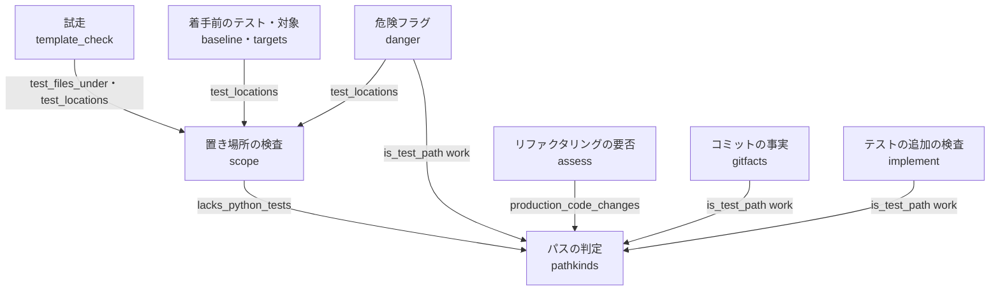
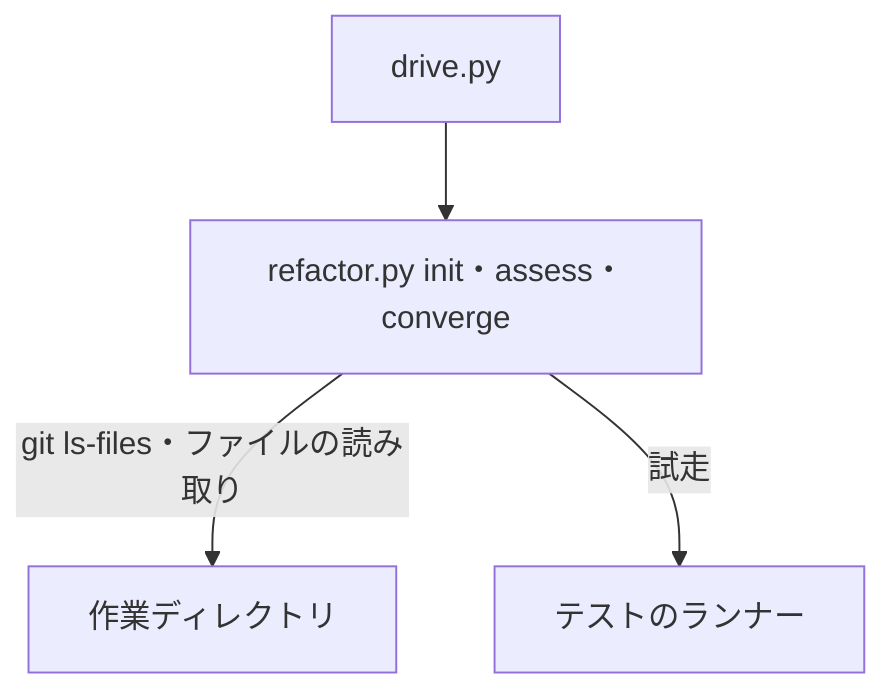
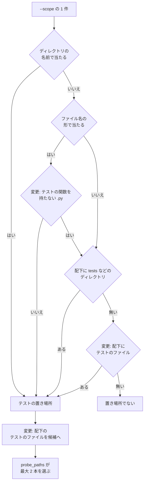

# cross-refactoring: テストの関数を持たない `test_*.py` をプロダクションコードとして扱い、`init` の試走が誤って止まらないようにする（#2516）

## 目的

- **今どうなっているか**: cross-refactoring は、テストのファイルかどうかを名前の形だけで決める。名前が `test_` で始まるプロダクションコードがある（`plugins/ndf/scripts/lib/test_strategy.py` など）。それを変える Pull Request では、`init` がそのファイルを範囲テストのテンプレートの試走に入れる。pytest がテストを 1 件も集めずに終了コード 5 で終わり、正しいテンプレート（`scope_command`）を直す箇所として示して止まる
- **誰に効くか**: 名前が `test_` で始まるプロダクションコードを持つリポジトリで cross-refactoring を使う開発者。このリポジトリでは #2369 の Pull Request https://github.com/devbasex/ai-plugins/pull/2515 が検査のプランを通れない
- **変えると何が成り立つか**: Python のファイルは、名前の形に加えてテストの関数の定義があるときだけテストのファイルになる。試走の候補・テストの置き場所の判定・プロダクションコードの行数と危険フラグの判定が、同じ見分け方で同じ答えを出す

## 適用範囲

- **働く範囲**: cross-refactoring を使うすべてのリポジトリ（配布先を含む）。中身で見分けるのは拡張子 `.py` のファイルだけで、ほかの言語は名前の形とディレクトリの名前で見分ける
- **プロジェクトごとに違うもの**: 無し（設定も引数も足さない。pytest の既定の収集の形だけを見る）
- **当たるモード**: `standard`

## あるべき姿の根拠

| 根拠 | 種類 | 何を示すか |
| --- | --- | --- |
| PR 2515 の試走の記録（`template-check.json`。suite `pytest` の `paths` が `lib/test_strategy.py`・`lib/test_triage.py`、`source: scope`、終了コード 5、判定 `defect`） | 実測 | `--scope` に並んだプロダクションコードのファイルが、名前の形だけでテストの置き場所とみなされ、候補になった |
| PR 2515 の変更ファイルの一覧（`gh pr view 2515 --json files`。`plugins/ndf/scripts/lib/test_strategy.py`・`test_triage.py` を含む） | 実測 | `refactor-scope.py` は変更したファイルそのものを `--scope` に入れる。止まった経路はファイルの名前の判定である |
| このリポジトリの追跡ファイルで名前がテストの形の 547 本（うち `.py` 497 本）を、行の正規表現（`^[ \t]*(?:async[ \t]+)?def[ \t]+test`）で調べた結果。テストの関数の定義が無いのは `lib/test_strategy.py`・`lib/test_triage.py`・`refactor_lib/init_test.py` の 3 本で、構文解析（`ast`）で調べた結果と一致した。所要は正規表現 0.03 秒、構文解析 1.44 秒 | 実測 | 正規表現で構文解析と同じ答えが出て、非機能の条件（1 秒以内の延び）に収まる |
| pytest 9.0.3 の既定の収集の形（このリポジトリの `.venv` の `_pytest/python.py` の `pytest_addoption`。`python_files` が `test_*.py`・`*_test.py`、`python_classes` が `Test`、`python_functions` が `test`。`pyproject.toml` はどれも上書きしていない） | 外部の一次情報（pytest の実装） | テストの関数とは、名前が `test` で始まる関数かメソッドの定義である |

要求と受け入れ条件は #2516 の本文にある（コピーは `issues/issue-2516-requirements.md`）。この文書は「どう作るか」だけを扱う。

## ドメインモデル

### コンテキスト

| コンテキスト | 何の語が 1 つの意味に決まるか |
| --- | --- |
| cross-refactoring（`ndf-cross-refactoring`） | テストのファイル・テストの置き場所・プロダクションコード・試走の候補・危険フラグ |

1 つのコンテキストに収まる。テストの戦略と試走の判定の表（`plugins/ndf/scripts/lib/test_strategy.py`）は変えない。

### 集約

見分け方そのものは、状態を持たない判定（ドメインサービス）である。持ち主は、プロダクションコードとテストのパスの判定（`refactor_lib/pathkinds.py`）である。答えが変わる集約は次の 3 つで、持ち主は変わらない。

| 集約 | 持ち主（書き換えてよいもの） | 根 | エンティティ | 値オブジェクト |
| --- | --- | --- | --- | --- |
| 試走の記録 | 試走（`template_check.check_templates`） | 試走の記録（`template-check.json`） | suite ごとの行 | 候補の選択（`ProbePick`）・判定（`ProbeVerdict`） |
| 項目の危険フラグ | 収束（`commands/converge.py` が `danger.item_flags` を呼ぶ） | 計画の項目 | — | 危険フラグの並び（`D1`〜`D5`）・D3 で当たった語 |
| リファクタリングの要否 | 要否の判定（`commands/assess.py`） | 判定の結果 | — | プロダクションコードの変更の並び（パスと変更行） |

### 不変条件

| # | 集約 | 条件 | 破れたときの扱い |
| --- | --- | --- | --- |
| I1 | 3 つすべて | Python のファイルの中身でテストかどうかを決めるのは、プロダクションコードとテストのパスの判定にある 1 つの関数だけである。試走の候補・テストの置き場所・行数・危険フラグはその関数を呼ぶ | テストで落とす |
| I2 | 3 つすべて | 名前がテストの形の `.py` で、作業ディレクトリで読めて、テストの関数の定義を 1 つも持たないものは、テストのファイルでない（テストの置き場所の根拠にならず、試走の候補に入らず、プロダクションコードとして数える） | テストで落とす |
| I3 | 3 つすべて | `.py` 以外のファイルと、作業ディレクトリで読めない `.py`（削除済み・作業ディレクトリが渡されない）は、名前の形の判定のまま扱う | テストで落とす |
| I4 | 試走の記録 | ディレクトリの名前（`tests/` など）によるテストの置き場所の判定は変わらない。その配下でも、テストの関数を持たない `.py` は試走の候補に入らない | テストで落とす |
| I5 | 試走の記録 | 中身を読むのは、名前がテストの形の `.py` だけである | テストで落とす |

### ドメインイベント

| # | イベント | 発生元 | 受け手 |
| --- | --- | --- | --- |
| E2 | `--scope` のうちテストの置き場所が決まった | テストの置き場所の判定（`scope.test_locations`） | 着手前のテスト（`baseline`）・試走（`template_check`）・対象の組み立て（`targets`）・危険フラグ（`danger`） |
| E4 | 試走の候補のテストのファイルが選ばれた | 試走の候補集め（`template_check._probe_candidates`） | 候補の選択（`test_strategy.probe_paths`） |
| E7 | 差分のプロダクションコードの変更が数えられた | 行数の判定（`pathkinds.production_code_changes`） | リファクタリングの要否（`commands/assess.py`） |
| E8 | 項目の危険フラグが決まった | 危険フラグの判定（`danger.item_flags`） | 収束（`commands/converge.py`） |

E1・E3・E5・E6 は要求のとおりで、振る舞いを変えない。E7・E8 は要求の対象範囲の「行数と危険度の判定」をイベントとして足したものである。

### 用語

| 用語 | 意味 | 用語集への反映 |
| --- | --- | --- |
| テストの関数 | Python のファイルで、名前が `test` で始まる関数かメソッドの定義（`async def` を含む）。pytest が既定で集める形 | 追加 |
| プロダクションコード | コードの拡張子を持ち、テストの置き場所でないファイル。名前がテストの形でもテストの関数を持たない `.py` を含む | 意味の変更 |

## 機能一覧

| # | 機能 | 誰が使うか |
| --- | --- | --- |
| F1 | Python のファイルがテストの関数を持たないかを、作業ディレクトリの中身で見分ける | F2〜F4 |
| F2 | `--scope` の 1 件がテストの置き場所かを決める（ファイル名で当たる場合・配下のファイルで当たる場合に F1 を使う） | `init`（着手前のテスト・試走）・対象の組み立て・危険フラグ |
| F3 | 試走の候補のテストのファイルを集める（F1 で外す） | `init` の試走 |
| F4 | パスがテスト側かプロダクションコードかを決める（作業ディレクトリを受けたときだけ F1 を使う） | リファクタリングの要否・危険フラグ・コミットの事実・テストの追加のコミットの検査 |

## 構成要素

| 要素 | 責務 |
| --- | --- |
| プロダクションコードとテストのパスの判定（`refactor_lib/pathkinds.py`） | **変える。** F1 の関数 `lacks_python_tests(path, work)` を足す。`is_test_path(path, work=None)` は `work` を受けたとき、名前の形で当たった `.py` に F1 を当てる |
| `--scope` とテストの置き場所の検査（`refactor_lib/scope.py`） | **変える。** `test_files_under` は名前の形で当たったファイルから F1 で当たるものを外す。`_matches_by_name` のファイル名の形の判定は、作業ディレクトリで F1 に当たるファイルを置き場所とみなさない。ディレクトリの名前の判定（`TEST_PATH_SEGMENTS`）は変えない |
| 危険フラグ（`refactor_lib/danger.py`） | **変える。** D3 と D4 でテストのファイルを外す箇所で `is_test_path` に `work` を渡す |
| 行数の判定（`pathkinds.production_code_changes`） | **変える。** `is_test_path` に `work` を渡す |
| コミットの事実（`refactor_lib/gitfacts.py` の `commit_touches_tests`・`commit_test_changes`） | **変える。** `is_test_path` に `work` を渡す |
| テストの追加のコミットの検査（`commands/implement.py` の `_test_commit_problem`） | **変える。** `is_test_path` に作業ディレクトリ（`work_dir(state)`）を渡す |
| 試走（`refactor_lib/template_check.py`） | 変えない。`test_files_under` と `test_locations` の答えが変わることで候補が変わる |
| 着手前のテスト・対象の組み立て（`baseline.py`・`targets.py`） | 変えない。`test_locations` の答えが変わることで、置き場所の並びが変わる |
| コードの計測（`codemetrics.path_role`・`codemetrics_read._clone`） | 変えない。作業ディレクトリを受けないため名前の形の判定のまま（決定 3） |



図には変える要素と、答えが変わる呼び出し元だけを置く。変えないコードの計測は置かない。

システムの文脈と配置は変わらない。`refactor.py` は利用者の作業ディレクトリ（cross-refactoring の worktree）で動く。読むのはその中の追跡ファイルだけである。



## 構造

型は変えないため、クラス図は置かない。関数の配置は次のとおりで、ファイルは足さない。

```text
plugins/ndf/skills/cross-refactoring/scripts/refactor_lib/
├── pathkinds.py        # lacks_python_tests を足す。is_test_path(path, work=None)
├── scope.py            # _matches_by_name・test_files_under が lacks_python_tests を呼ぶ
├── danger.py           # is_test_path に work を渡す
├── gitfacts.py         # is_test_path に work を渡す
└── commands/
    └── implement.py    # is_test_path に作業ディレクトリを渡す
```

`lacks_python_tests` は、分けた先のモジュールごとの定義の表の `pathkinds` の行へ足す。表は `tests/test_module_owners.py` の `OWNERS` である。

### 判定の規則

| 入力 | `lacks_python_tests(path, work)` |
| --- | --- |
| 拡張子が `.py` でない | 偽 |
| `work` が無い・`<work>/<path>` が読めない（無い・ディレクトリ・権限） | 偽 |
| 中身に、行頭の空白に続く `def test` か `async def test` の行がある | 偽 |
| 上のどれにも当たらない | 真 |

名前の形は見ない。呼ぶ側が名前の形で当たったファイルにだけ呼ぶ（I5）。

| 判定 | 今 | 変えた後 |
| --- | --- | --- |
| `is_test_path(path)` | ディレクトリの印かファイル名の印があれば真 | 同じ（`work` を渡さない呼び出し元） |
| `is_test_path(path, work)` | — | ディレクトリの印があれば真。ファイル名の印があり、`lacks_python_tests` が偽なら真 |
| `test_files_under(path, work)` | 名前の形で当たる追跡ファイル | 名前の形で当たり、`lacks_python_tests` が偽のもの |
| `_matches_by_name(path, work)` | ディレクトリの名前かファイル名の形で当たれば真 | ディレクトリの名前で当たれば真。ファイル名の形で当たり、`lacks_python_tests` が偽なら真 |

## 処理の流れ

`init` の試走までの流れで、変わるのは「変更」と書いた 3 つの判定である。



「ファイル名の形で当たるが、テストの関数を持たない `.py`」は、置き場所とみなさずに次の判定（配下のディレクトリ・配下のファイル）へ進む。ファイルには配下が無いため、結果は「置き場所でない」になる。

リファクタリングの要否と危険フラグは、差分やコミットのファイルごとに `is_test_path(path, work)` を 1 回呼ぶだけで、順序は変わらない。

## 非機能の実現方式

| 大項目 | 条件 | 実現方式 | 確かめ方 |
| --- | --- | --- | --- |
| 性能・拡張性 | 中身を読むのは名前がテストの形の `.py` だけ。`init` の候補選びの時間が変更前から 1 秒を超えて延びない | 名前の形で当たった `.py` にだけ `lacks_python_tests` を呼ぶ。中身は構文解析せず、行の正規表現で 1 回探す（決定 1）。このリポジトリの `.py` 497 本を読んで 0.03 秒（あるべき姿の根拠） | 実装の後、このリポジトリで `test_files_under(".", work)` の所要を変更の前後で測り、Pull Request の本文に添える |

## 決定の記録

### 決定 1: 非機能の条件に収め、テストのランナーを起動しないため、テストの関数の有無を行の正規表現で見分ける

行頭の空白に続く `def test` か `async def test` の行があれば、テストの関数を持つとみなす。このリポジトリの 497 本で構文解析（`ast`）と同じ 3 本を見分け、所要は 0.03 秒だった。構文解析は 1.44 秒で、非機能の条件（延びが 1 秒以内）を超える。文字列や docstring の中の `def test` で「持つ」と誤る場合は、今の振る舞い（名前の形でテスト）に倒れる。そのため、止まる方向の誤りは増えない。

pytest の収集（`--collect-only`）は採らない。採ると、候補ごとにランナーを起動し（所要は測っていない）、ランナーの語と終了コードを読むことになる。これは試走のコマンドの語を見ない約束（#1334 の I1）から外れる。

根拠: Value 4 / Value 6（MVV 版 5）

### 決定 2: 同じファイルを一方でテスト、もう一方でプロダクションコードと数えないよう、中身の判定をパスの判定の 1 関数に置き、置き場所の検査と `is_test_path` の両方から呼ぶ

テストかどうかの判定はすでに `pathkinds` が持ち主である（`tests/test_module_owners.py`）。中身の判定をそこへ置き、`scope.py` はそれを呼ぶ。`scope.py` に置いて `pathkinds` から呼ぶ形は採らない。`scope.py` は `--scope` の検査である。そこに置くと、行数と危険フラグの判定が検査に依存する向きになる。

根拠: Value 7（MVV 版 5）

### 決定 3: 中身を読む手段を持つ呼び出し元だけが中身で見分けるよう、`is_test_path` は作業ディレクトリを任意の引数で受け、渡されなければ名前の形のまま判定する

作業ディレクトリを持つ呼び出し元（行数の判定・危険フラグ・コミットの事実・テストの追加のコミットの検査）は渡す。コミットの事実もそのコミットの版ではなく作業ディレクトリの中身を読む。項目のコミットは作業ディレクトリの HEAD の祖先にある。1 本のファイルがテストの関数を持つかは、版の間でほぼ変わらない。コードの計測（`codemetrics`）は、計測ツールの出力を読む関数の並びで、作業ディレクトリを受けない。そのため名前の形のまま残す。計測の表示でテスト側に並ぶ誤りは、範囲外の課題 #2557 に置く。

`is_test_path` を必須の引数にして全呼び出し元を変える形は採らない。必須にすると、コードの計測の読み取りの関数へ作業ディレクトリを通す変更が要る。当たる関数は `parse_ruff`・`parse_lizard`・`file_metrics`・`parse_symilar`・`parse_jscpd` である。その変更は、この課題の受け入れ条件（行数と危険度）の外へ広がる。

根拠: Value 3 / Value 7（MVV 版 5）

### 決定 4: 試走の判定の表を変えないため、終了コード 5 を `undecided` に読み替えない

終了コード 5（テストが集まらない）は pytest の約束で、ほかのランナーでは別の意味を持つ。読み替えると、試走がランナーの終了コードの意味を読むことになる。これは #1334 の I1 から外れる。この課題の直し方では、テストの関数を持たないファイルが候補に入らないため、再現の手順の条件で終了コード 5 は起きない。候補にテストが残っていても集まらない場合（pytest の設定で収集の形を変えたリポジトリ）は「未確認のまま残ること」に置く。

根拠: Value 6 / Value 3（MVV 版 5）

### 決定 5: 試走が走らせて意味のあるファイルだけを入れるため、`tests/` の配下でもテストの関数を持たない `.py` は候補から外し、置き場所の判定は変えない

`tests/test_helpers.py` のような補助のファイルを候補に入れると、同じく終了コード 5 で止まる。外すのは候補（`test_files_under`）だけである。`tests/` をテストの置き場所とみなす判定と、`is_test_path` がディレクトリの印でテスト側とする判定は変えない。補助のファイルを変える差分を、行数と危険フラグでプロダクションコードと数えないためである。

根拠: Value 7（MVV 版 5）

### 決定 6: Python 以外の言語の判定を変えないため、2 つの名前の形の並び（`TEST_NAME_PATTERNS` と `TEST_NAME_MARKERS`）はそろえない

2 つの並びは、当たる名前が違う。

| 判定 | 名前の形の並び | 当たり方 |
| --- | --- | --- |
| 置き場所の検査 | `TEST_NAME_PATTERNS` | `fnmatch` の形（`test_*` など） |
| パスの判定 | `TEST_NAME_MARKERS` | 部分一致の印（`test_`・`spec_` など） |

そろえると `spec_helper.rb` などの判定が変わり、受け入れ条件 6 を満たさない。部分一致の印が `latest_version.py` を名前でテストと読む誤りは、範囲外の課題 #2557 に置く。

根拠: Value 3（MVV 版 5）

## テスト設計

| 受け入れ条件・不変条件 | どの振る舞いで縛るか | どう壊したら落ちるべきか |
| --- | --- | --- |
| 受け入れ条件 1 / I2 | テストの関数を持たない `lib/test_x.py` は、`--scope` の置き場所の配下とリポジトリ全体のどちらから集めても試走の候補に入らない | `test_files_under` から `lacks_python_tests` の呼び出しを外すと落ちる |
| 受け入れ条件 2 / I2 | `--scope` に `lib/test_x.py`（ファイル）か `lib`（配下がそのファイルだけ）を渡すと、テストの置き場所とみなされない | `_matches_by_name` のファイル名の判定か `test_files_under` の中身の判定を外すと落ちる |
| 受け入れ条件 3 | 一時の git リポジトリで `lib/test_x.py`（テストの関数なし）と `tests/test_y.py`（テストあり）を置き、`refactor-scope.py` と同じ形の `--scope`（変えたファイルと近くの `tests`）で `init` を打つと、試走の判定が `ok` で止まらない | 置き場所の判定を名前の形だけに戻すと、`defect` で止まって落ちる |
| 受け入れ条件 4 | テストの関数を持つ `tests/test_y.py` と本体と同じ場所の `lib/test_z.py` は、今までどおり候補と置き場所に入る。`async def test` だけを持つファイルとメソッドだけを持つファイルも入る | 判定の正規表現を関数の定義の行だけ・行頭だけに狭めると落ちる |
| 受け入れ条件 5 / I1 | テストの関数を持たない `lib/test_x.py` の変更は、リファクタリングの要否でプロダクションコードの変更として数えられ、危険フラグの D3・D4 の対象に入る | `production_code_changes` か `danger` で `work` を渡さないと落ちる |
| 受け入れ条件 6 / I3 | `*.spec.ts`・`*_test.go`・`tests/` 配下の判定と、作業ディレクトリを渡さない `is_test_path` の答えは変わらない | 既存のテスト（`test_scope_gate.py`・`test_danger.py`・`test_assess.py`・`test_template_check.py`）が変更なしで通る。`.py` 以外にも中身を読むように壊すと落ちる |
| 受け入れ条件 7 | 全体テストが通る | — |
| I1 | 同じファイルについて `test_files_under` と `is_test_path(path, work)` の答えが一致する（置き場所の配下でない場合） | どちらかが中身の判定を独自に持つと、一方だけを壊したときに落ちる |
| I3 | 作業ディレクトリに無い `.py`（削除済み）は名前の形のままテストとみなされる | 読めないファイルを「テストの関数なし」と読むと落ちる |
| I4 | `tests/test_helpers.py`（テストの関数なし）は試走の候補に入らないが、`tests` は置き場所のままで、`is_test_path` は真を返す | ディレクトリの印より先に中身を見るように壊すと落ちる |
| I5 | 名前がテストの形でない `.py` とテストの形の `.ts` では、ファイルを読まない | 名前の判定の前に中身を読むように壊すと落ちる |

## 設計の結果

| 課題 | 扱い | 取り込み先 | 触るファイル |
| --- | --- | --- | --- |
| #2516 | 実装する | — | `plugins/ndf/skills/cross-refactoring/scripts/refactor_lib/pathkinds.py`、`plugins/ndf/skills/cross-refactoring/scripts/refactor_lib/scope.py`、`plugins/ndf/skills/cross-refactoring/scripts/refactor_lib/danger.py`、`plugins/ndf/skills/cross-refactoring/scripts/refactor_lib/gitfacts.py`、`plugins/ndf/skills/cross-refactoring/scripts/refactor_lib/commands/implement.py`、`plugins/ndf/skills/cross-refactoring/tests/` |

## 未確認のまま残ること

| 項目 | 内容 |
| --- | --- |
| pytest の設定で収集の形を変えたリポジトリ | `python_functions` を `check_*` などへ変えたリポジトリでは、テストの関数を持たないと誤って読み、テストのファイルを候補から外す。外れた分は候補 0 本の `undecided` か別の候補で試走する。設定を読む形は、該当するリポジトリが見つかるまで作らない |
| 定義の行を持たないテスト | 代入や import でテストの関数を作るファイル（`test_x = make_case()`）は「持たない」と読む。このリポジトリの 497 本には無かった（あるべき姿の根拠の実測） |
| コミットの版と作業ディレクトリの中身の違い | コミットの事実は作業ディレクトリの中身で見分ける（決定 3）。同じファイルがあるコミットでテストの関数を持ち、作業ディレクトリでは持たない場合の判定は、実装の後も確かめていない |
| コードの計測の表示 | テストの関数を持たない `test_*.py` は、計測の表示ではテスト側に並ぶ（決定 3）。範囲外の課題 #2557 に置く |
| 手元の非機能の実測 | 0.03 秒は設計の時点でこのリポジトリを調べたスクリプトの値で、実装した関数で `init` を通した所要はまだ測っていない |
