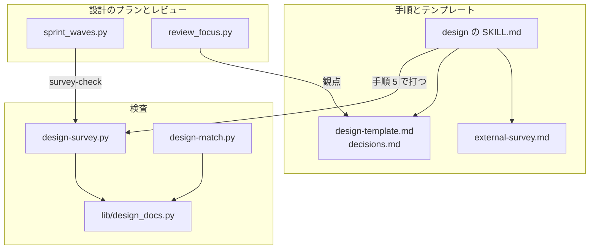
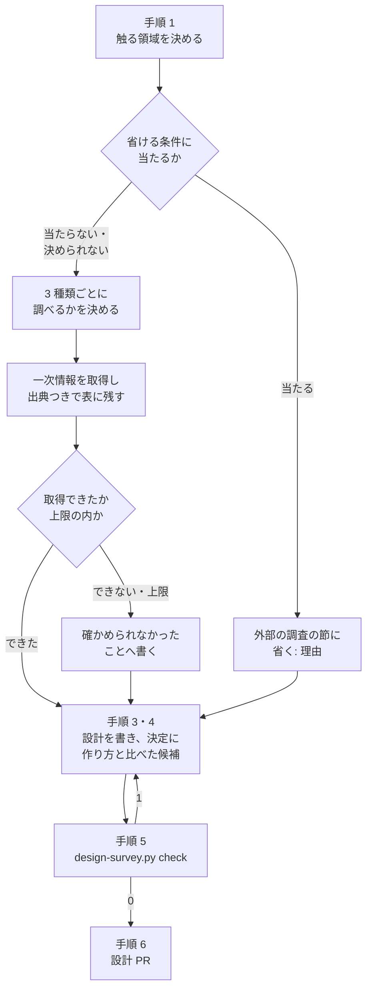
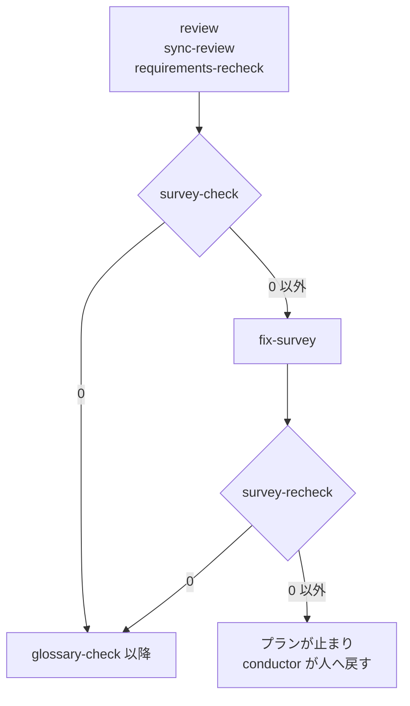

# design: 設計の判断の前に外部の標準・主要な製品・既存のライブラリを調べ、自前で作る決定に比べた候補を残す（#2519）

## 目的

- **今どうなっているか**: `design` には、設計の前に業界の標準・主要な製品の解き方・使える既存のライブラリとサービスを調べる手順が無い。設計は手元のコードと要求の文だけから組み立てられ、比べないまま「自前で作る」「古い形に寄せる」と決まる（carul #102・#117 で、利用者が後から気づいて設計をやり直した）
- **誰に効くか**: `design` を通すすべてのプロジェクトの設計者と、承認ゲート 1 で設計を承認する人
- **変えると何が成り立つか**: 設計文書に、何と比べてこの形にしたかが出典つきで残る。自前で作る決定に比べた候補が無ければ、承認ゲート 1 の前に機械の検査が止める。プロジェクトの MVV に調査の項目が無くても同じに働く

## 適用範囲

- **働く範囲**: NDF を使うすべてのリポジトリ。手順は `design` の Skill、検査はスプリントの設計のプランと `design` の手順から打つスクリプトで、このリポジトリの継続的統合に依らない
- **プロジェクトごとに違うもの**: 無し（調べる対象は触る領域から設計者が決め、領域ごとの標準の一覧を持たない。上限の値は NDF の参照の 1 か所に置く）
- **当たるモード**: `design` を通すすべてのモード（`standard`・`legacy-refactor`・`documentation`、領域に当たった `light`・`operation`）

## あるべき姿の根拠

| 根拠 | 種類 | 何を示すか |
| --- | --- | --- |
| MADR 4.0.0 のテンプレート（ https://adr.github.io/madr/ 、2026-11-05 取得） | 外部の一次情報 | 決定の記録の事実上の標準は、比べた選択肢（Considered Options）と選んだ選択肢（Decision Outcome: `Chosen option: …, because …`）を別の欄に持つ。比べた候補を決定に並べる形はこれに倣う |
| OpenSSF Scorecard の Maintained の検査（ https://github.com/ossf/scorecard/blob/main/docs/checks.md 、2026-11-05 取得） | 外部の一次情報 | 保守の状態は直近 90 日の活動で見て、アーカイブしたリポジトリを最低の評価にする。ライブラリの表の「最後のリリースの日付」と「終了のアナウンス」の 2 列はこの見方に合わせる |
| carul #102・#117（課題の本文の具体例） | 実測 | 比べないまま自前で作ると決めた設計を、利用者の指示で作り直した。2 回目の #102 の設計は、ライブラリの候補 6 つと競合 6 製品を出典つきで比べた |
| マイルストーン「35 開発フローの見直しと大整理」の説明（2026-11-05） | 利用者の指示の原文 | 「設計で問題が出ることが多いため、できるだけ早く着手する」 |

要求と受け入れ条件は #2519 の本文にある（コピーは `issues/issue-2519-requirements.md`）。この文書は「どう作るか」だけを扱う。

## ドメインモデル

### コンテキスト

| コンテキスト | 何の語が 1 つの意味に決まるか |
| --- | --- |
| NDF の工程（`ndf-workflow`） | 設計文書・決定の記録・外部の調査・自前で作る決定・作り方・比べた候補・確かめられなかったこと |

変更は 1 つのコンテキストに収まる。棚卸しのシーズの調査は同じコンテキストの別の手順で、記録を共有しない（決定 8）。

### 集約

| 集約 | 持ち主（書き換えてよいもの） | 根 | エンティティ | 値オブジェクト |
| --- | --- | --- | --- | --- |
| 設計文書 | 設計を書く担い手（`design` の手順を通す worker か利用者）と、指摘を直す修正担当 | 設計文書（同じ課題の `issue-<番号>-design*.md`。`light` は受け入れ条件のファイルの設計の節） | 決定・外部の調査の節 | 作り方・比べた候補・調べた行の出典・確かめられなかったことの行・調べた量 |

検査のスクリプトとレビュー担当は設計文書を読むだけで、書き換えない。

### 不変条件

| # | 集約 | 条件 | 破れたときの扱い |
| --- | --- | --- | --- |
| I1 | 設計文書 | 外部の調査の節は 1 つで、「省く」の 1 行か、調べる対象の表（3 種類の行）のどちらか一方を持つ | 設計 PR のレビューで指摘する |
| I2 | 設計文書 | 調べる対象の表で「調べない」とした種類は、理由を 1 行持つ | 設計 PR のレビューで指摘する |
| I3 | 設計文書 | 調べた結果の行は、出典（URL・パス・コマンドのどれかと取得日）を持つ。出典を持てない対象は確かめられなかったことの行へ移り、推定で埋めない | 設計 PR のレビューで指摘する |
| I4 | 設計文書 | 種類ごとの候補は上限（6 件）以下。上限で止めた対象は、確かめられなかったことへ理由「上限」で載る | 設計 PR のレビューで指摘する |
| I5 | 設計文書 | 作り方に「自前で作る」を含む決定は、比べた候補を 1 つ以上持つ。ただし、同じまとまり（課題の番号の共有をたどって閉じた文書の集まり。分けたファイルと、`issue-7-8-design.md` のように番号を 2 つ以上含む名前の文書を介してつながる文書を含む。入出力の契約の「課題ごとのまとまり」）のどれかの文書で外部の調査を「省く」としたときは、そのまとまりの決定すべてを除く | 検査が終了コード 1 で指摘し、スプリントの設計のプランが承認ゲート 1 の前で止まる |
| I6 | 設計文書 | 比べた候補の番号は、決定の属するまとまり（I5 と同じ範囲）にある外部の調査の表の行の番号のどれかである。例: `issue-7-design.md`・`issue-7-8-design.md`・`issue-8-design.md` は 1 つのまとまりで、7 の決定は 8 の表にだけある番号でも解決する。ほかのまとまりの表では解決しない | I5 と同じ |
| I7 | 設計文書 | 作り方の値は「自前で作る」「ライブラリやサービスを使う」「標準に倣う」のどれか、またはその組み合わせである | I5 と同じ |

### ドメインイベント

| # | イベント | 発生元 | 受け手 |
| --- | --- | --- | --- |
| E1 | 設計で触る領域を決めた | `design` の手順 1 | `design` の手順 2（外部の調査） |
| E2 | 外部の調査を通すか省くかを決めた | `design` の手順 2 | 通すなら手順 2 の続き。省くなら設計文書の外部の調査の節（「省く」の 1 行） |
| E3 | 調べる対象を決めた | `design` の手順 2 | 一次情報の取得 |
| E4 | 一次情報を取得した | 設計を書く担い手（Web 検索・URL の取得・`gh`） | 外部の調査の節の表の行。取得できなければ確かめられなかったことの行 |
| E5 | 調べる量の上限に当たって調査を止めた | `design` の手順 2 | 確かめられなかったことの行（理由「上限」） |
| E6 | 調べた結果を外部の調査の節に残した | 設計を書く担い手 | 決定の記録（`design` の手順 4）・あるべき姿の根拠 |
| E7 | 決定の記録に作り方と比べた候補を書いた | `design` の手順 4 | 検査のスクリプトと設計 PR のレビュー |
| E8 | 自前で作る決定に比べた候補が無い設計文書を指摘した | 検査のスクリプト（`design-survey.py check`）と設計 PR のレビュー | 修正担当（スプリントの設計のプランの `fix-survey`）。直らなければプランが止まり、conductor が人へ戻す |

### 用語

| 用語 | 意味 | 用語集への反映 |
| --- | --- | --- |
| 外部の調査 | 設計の判断の前に、業界の事実上の標準・仕様、主要な製品の解き方、使える既存のライブラリとマネージドサービスを一次情報で調べ、設計文書に残す手順 | 追加（要求の変更で足した語。意味は変えない） |
| 自前で作る決定 | 既存のライブラリ・サービス・標準の実装を使わず、プロジェクトの中で作ると決めた決定の記録。作り方の行に「自前で作る」を含む決定 | 意味の変更（作り方の行で見分けることを足す） |
| 確かめられなかったこと | 外部の調査で、公開の資料が無い・取得できなかった・上限で止めた対象と、試した手段と理由を並べた欄 | 意味の変更（試した手段の列を足す） |
| 作り方 | 決定の記録の中の 1 行。その決定が機能をどう得るか（自前で作る / ライブラリやサービスを使う / 標準に倣う）を書く | 追加 |
| 比べた候補 | 決定の記録の中の 1 行。外部の調査の表で比べた行の番号（`STD<数>` / `PRD<数>` / `LIB<数>`）を並べる | 追加 |

## 外部の調査

| 種類 | 調べるか | 理由 |
| --- | --- | --- |
| 標準・仕様 | 調べる | 決定の記録の書式と、ライブラリの保守の状態の判定に事実上の標準がある |
| 主要な製品 | 調べない | 変えるのは NDF の手順の文と文書の検査で、利用者に見える製品の機能に当たる形が無い |
| ライブラリとサービス | 調べる | 検査は Markdown の見出しと表を読む。読み方を自前で書くか既存の部品を使うかを決める |

### 標準・仕様

| # | 標準・仕様 | 何を定めているか | 設計への反映 | 出典 |
| --- | --- | --- | --- | --- |
| STD1 | MADR 4.0.0 | 決定の記録に Considered Options（比べた選択肢）と Decision Outcome（`Chosen option: …, because …`）を別の欄で持つ | 作り方と比べた候補を決定の中の別の行にする（決定 4） | https://adr.github.io/madr/ （2026-11-05 取得） |
| STD2 | OpenSSF Scorecard の Maintained | 直近 90 日の活動で保守を見る。アーカイブしたリポジトリは最低の評価 | ライブラリの表に最後のリリースの日付と終了のアナウンスの列を置き、アーカイブを終了のアナウンスとして扱う | https://github.com/ossf/scorecard/blob/main/docs/checks.md （2026-11-05 取得） |

### ライブラリとサービス

| # | 候補 | 版 | ライセンス | 最後のリリースの日付 | 終了のアナウンス | 要件を満たすか | 出典 |
| --- | --- | --- | --- | --- | --- | --- | --- |
| LIB1 | markdown-it-py（`lib/md.py` が包む） | 4.2.0 | MIT | 2026-05-07 | 無し（アーカイブされていない。最後の push 2026-11-02） | 満たす（見出しの階層・表・コードブロックの判定を既に持つ） | https://pypi.org/pypi/markdown-it-py/json と https://api.github.com/repos/executablebooks/markdown-it-py （2026-11-05 取得）、`uv.lock` |

### 確かめられなかったこと

| 対象 | 試した手段 | 結果と理由 |
| --- | --- | --- |
| 決定の記録に比べた候補があるかを確かめる既存の検査の Tool | 試していない | 上限の前に止めた。比べる候補を探す検索をしていないため、既存の Tool が無いとは言えない。検査は LIB1 の上に数十行で書ける規模で、Tool を入れる費用（依存の追加・設定の書式）に見合うかは未確認 |

調べた量: 候補 3 件・取得の試み 4 回。

## 機能一覧

| # | 機能 | 誰が使うか |
| --- | --- | --- |
| F1 | 触る領域から、3 種類の調べる対象ごとに調べるか省くかを決め、理由を残す | 設計を書く担い手 |
| F2 | 標準・仕様、主要な製品、ライブラリとサービスを出典つきの表に残し、取得できなかった対象を確かめられなかったことへ残す | 設計を書く担い手、承認する人 |
| F3 | 調べる量の上限に当たったら調査を止める | 設計を書く担い手 |
| F4 | 決定に作り方と比べた候補を書く | 設計を書く担い手 |
| F5 | 自前で作る決定に比べた候補が無い設計文書を、機械の検査で指摘する | スプリントの設計のプラン、設計を書く担い手 |
| F6 | 印の無いまま自前で作る決定と、外部の調査の節の欠けを、設計 PR のレビューで指摘する | cross-review のレビュー担当 |

## 構成要素

### 要素ごとの責務

| 要素 | 責務 |
| --- | --- |
| `plugins/ndf/skills/design/SKILL.md` | 手順 2「外部の調査を通す」を足し、以後の手順の番号を 1 つずつ繰り下げる（決定 1）。「すべての変更」の行に `external-survey.md` を足す。手順 5（突き合わせ）で検査のコマンドを打つ |
| `plugins/ndf/skills/design/references/external-survey.md`（新規） | 外部の調査の手順の正本。3 種類の対象の決め方・省ける条件・上限と「調べた量」の行・取得できないときの書き方（`investigation-rules` の否定的な結論の規則に合わせ、試した URL か検索の語と結果を書く）・決定へのつなぎ方・シーズの調査の記録の引き方 |
| `plugins/ndf/skills/design/references/design-template.md` | テンプレートに `## 外部の調査` の節を「機能一覧」の前に足す。「あるべき姿の根拠」の外部の一次情報は、外部の調査の行の番号を指してよいと書く。「各節が実装計画のどこへつながるか」に行を足す。「`legacy-refactor` の書き方」を 4 節にする（決定 9） |
| `plugins/ndf/skills/design/references/decisions.md` | 決定の書き方に、作り方と比べた候補の 2 行を足す（決定 4） |
| `plugins/ndf/skills/design/references/deliverables.md` | 要否表に「外部の調査」の行（全モード必須）を足す。「成果物ごとの中身」に行を足す。`legacy-refactor` の無条件の成果物の段落を 4 節に合わせる |
| `plugins/ndf/scripts/design-survey.py`（新規） | 検査のエントリポイント。I5〜I7 を読むだけで判定する（決定 6） |
| `plugins/ndf/scripts/lib/design_docs.py`（新規） | 設計文書の名前の規則と、課題の番号から HEAD の文書を読む処理。`design-match.py` から移し、2 つのエントリポイントで共有する |
| `plugins/ndf/scripts/design-match.py` | 設計文書の探し方を `lib/design_docs.py` から読む（振る舞いは変えない） |
| `plugins/ndf/scripts/supervise_lib/paths.py` | 検査のコマンドの定数（`DESIGN_SURVEY_PY`） |
| `plugins/ndf/scripts/supervise_lib/sprint_waves.py` | 設計のプランに `survey-check` / `fix-survey` / `survey-recheck` の 3 ステップを足す（決定 7） |
| `plugins/ndf/skills/cross-review/scripts/review_lib/review_focus.py` | 設計 PR の詳細レビューの観点に 1 項目足す（決定 5） |
| `plugins/ndf/skills/cross-review/docs/04-contracts.md` | 自動レビュー観点の `design` の要約に同じ項目を足す |
| `plugins/ndf/contracts/entrypoints/plugins__ndf__scripts__design-survey.py.json`（新規）と `plugins/ndf/contracts/index.md` | エントリポイントの契約（`check-ndf-contracts.py --draft` で起こし、`--render` で逆引きを作り直す） |
| `plugins/ndf/scripts/tests/test_design_survey.py`（新規） | 検査の振る舞いのテスト |
| `plugins/ndf/scripts/tests/fixtures/supervise-contract/plans/sprint/1-design-16.json` | 設計のプランの期待値に 3 ステップを足す |
| `docs/glossary/glossary.json` / `docs/glossary.md` | 用語の表の 5 語を反映する |

### 呼び出しと参照の関係

図には、呼び出しと参照の関係を持つ要素だけを描く。`deliverables.md`・`paths.py`・`04-contracts.md`・エントリポイントの契約・テストと期待値・用語集は描かない。これらは図の要素の定数・説明・記録で、呼び出しの辺を持たない。

## 入出力の契約

### `design-survey.py check`

| 項目 | 書くこと |
| --- | --- |
| 名前 | `python3 design-survey.py check (--issue N... \| --file PATH...) [--root DIR]` |
| 入力 | `--issue`: 課題の番号（1 つ以上）。HEAD の `issues/` から、名前の番号の並びにその番号を含む `issue-<番号>-design*.md` と `issue-<番号>-requirements.md` を読む。読んだ文書の名前がほかの番号を含むときは、その番号を名前に含む文書も読み足し、新しい番号が出なくなるまで繰り返す（`--issue 8` でも `issue-8-design.md`・`issue-7-8-design.md`・`issue-7-design.md` の 3 ファイルを読む）。`--file`: 読む文書のパス（worktree から読む。`light` の受け入れ条件のファイルや `operation` の実行の記録を渡す）。`--root`: リポジトリの根（既定はカレントの git の根） |
| 出力 | `lib/step_result.py` の形の 1 行の JSON（`tool: "design-survey"`）。`items[]` は 1 指摘 1 件で、`name` は `<パス>:<行> 決定 <N>`、`rule` は `no_candidates` / `unknown_candidate` / `unknown_method`、`text` は当たった行。`metrics` は読んだ文書の数・決定の数・作り方の行を持つ決定の数・自前で作る決定の数・外部の調査を省いた課題の数 |
| 失敗の形 | 0 = 指摘なし（作り方の行が 0 件の文書を含む）/ 1 = 指摘あり / 2 = 文書か git を読めない / 3 = `--issue` で文書が 1 つも見つからない |
| 互換性 | 新しいエントリポイントで、既存の呼び出し側は無い。作り方の行を持たない既存の設計文書は 0 になる（受け入れ条件 10） |

**判定の規則**（コードブロックの中は読まない）:

| 規則 | 読む場所 | 当たる条件 |
| --- | --- | --- |
| 課題ごとのまとまり | 読んだ文書を、ファイル名の番号の並びに含む課題の番号でつなぎ、番号を 1 つでも共有する文書どうしを 1 つのまとまりにする（つながりをたどって閉じる）。1 つの文書は 1 つのまとまりにだけ属する。例: `issue-7-design.md`・`issue-7-8-design.md`・`issue-8-design.md` を読むと、3 ファイルで 1 つのまとまりになる。`--issue` は読む文書をつながりで閉じるため、`--issue 7`・`--issue 8`・`--issue 7 8` のどれでも、この 3 ファイルを読んで同じ 1 つのまとまりになり、判定は渡す番号で変わらない。名前に課題の番号を持たない文書（`--file` で渡す受け入れ条件のファイルや実行の記録）は、1 ファイルで 1 つのまとまりにする。以下の規則は、まとまりごとに閉じて判定する | — |
| 決定 | 見出しの文が `決定 <数字>` で始まる見出しから、同じか上の階層の次の見出しまで | — |
| 外部の調査の節 | 見出しの文が `外部の調査` の見出しから、同じか上の階層の次の見出しまで（小見出しを含む）。同じまとまりの文書の節を合わせ、ほかのまとまりの節とは合わせない | — |
| 省いた課題 | まとまりの外部の調査の節のどれかに `省く:` で始まる行がある | — |
| 候補の番号 | 同じまとまりの外部の調査の節の表の 1 列目が `STD<数>` / `PRD<数>` / `LIB<数>` の行 | — |
| `unknown_method` | 決定の中の `作り方:` の行 | 値を `・` か `/` で分けた語のどれかが 3 つの語に無い |
| `no_candidates` | 作り方に `自前で作る` を含む決定 | `比べた候補:` の行に候補の番号が 1 つも無く、決定の属するまとまりが省いた課題でもない |
| `unknown_candidate` | 決定の中の `比べた候補:` の行 | 並べた番号が、決定の属するまとまりの候補の番号のどれにも無い |

行の頭の `- ` と、`:` の代わりの全角の `：` も受ける。MVV の宣言と本文は読まない（受け入れ条件 9）。

### 設計のプランのステップ

`requirements-recheck` の次、`glossary-check` の前に置く。

| ステップ | 種類 | 中身 | 失敗したとき |
| --- | --- | --- | --- |
| `survey-check` | run | `design-survey.py check --issue <番号>` | `fix-survey` へ |
| `fix-survey` | work（修正） | 指摘の行に作り方・比べた候補を直すか、外部の調査の表へ候補の行を足してコミットする（push しない）。比べずに直せない指摘は直さずに「判断が要る」と報告する | — |
| `survey-recheck` | run | `survey-check` と同じコマンド | 次へ進まずプランが止まる（`on_fail` を置かない） |

push は後の `push-glossary` が行う。

## 処理の流れ

スプリントの設計のプランでは、レビューの後にもう一度検査を通す。

## 決定の記録

### 決定 1: 調べた結果を設計の判断より先に持つため、外部の調査を `design` の手順 2 に置き、以後の手順を繰り下げる

外部の調査は触る領域（手順 1）から対象を決め、その結果が設計文書の中身（手順 3）と決定（手順 4）の材料になる。独立した手順にすると、省くか通すかの判断と上限を 1 か所で読める。手順の番号を参照しているのは `design` の SKILL.md の中の 4 か所だけである。`plugins/` と `docs/specifications/` を「design の手順 + 数字」の正規表現で検索した。ほかの文書からの参照は 1 件（`docs/specifications/ndf-ubiquitous-language.md`）だけで、手順 0 を指す。

手順 1 の中へ足す形は採らない。手順 1 は「どの参照を読むか」を決める手順で、一次情報の取得と表の作成は性質が違う。`1a` の番号で足す形も採らない。番号の参照が SKILL.md の中に閉じているため、繰り下げの費用が小さい。

根拠: Value 7 / Value 8（MVV 版 5）

### 決定 2: 調査が設計の所要を際限なく延ばさないよう、上限を種類ごとの候補 6 件と取得の試み 30 回にし、`external-survey.md` の 1 か所に置く

候補の数は、carul #102 の 2 回目の設計が出典つきで比べ切った量（ライブラリ 6・製品 6）に合わせる。取得の試みは、検索 1 回・URL の取得 1 回をそれぞれ 1 と数える。試みの上限は、3 種類 × 6 件の候補にそれぞれ 1 回余りの取得を足した量で、設計のステップの時間の上限（3,600 秒）の内に収める。外部の調査の節の最後に「調べた量」の 1 行を残し、設計文書を数えれば上限が足りたかを実測できるようにする。値の見直しはこの参照の 1 か所を直す。

時間を上限にする形は採らない。担い手が経過の秒を測る手段がランタイムごとに違い、Claude Code と Codex で同じに働かない。プロジェクトの設定で上限を変える形も採らない。プロジェクトごとに変える理由がまだ実測で示されていない。

根拠: Value 3 / Value 4 / Value 6（MVV 版 5）

### 決定 3: 通したか省いたかを 1 か所で読めるよう、外部の調査の節は通しても省いても必ず作り、省くときは `省く: <理由>` の 1 行だけを置く

省いた理由を仕様の「対象範囲（含まない）」に書く既存の形（`deliverables.md` の「省いた理由の書き先」）は、成果物を書かない理由の置き場である。外部の調査は成果物ではなく手順で、省く判断は設計者が設計の書き先で行う（受け入れ条件 6）。節を必ず作れば、レビューと検査は節を見るだけで、通したか省いたかが分かる。要否表では全モード「必須」とし、省いたときも節が残る。

根拠: Value 2 / Value 8（MVV 版 5）

### 決定 4: 自前で作る決定を機械が見分けられるよう、決定の中に `作り方:` と `比べた候補:` の 2 行を置き、候補を外部の調査の表の番号で指す

2 行は箇条書き（`- 作り方: …` / `- 比べた候補: …`）で、決定の理由の段落の後に置く。`作り方:` の値は「自前で作る」「ライブラリやサービスを使う」「標準に倣う」の 3 語とその組み合わせ（`・` で並べる）に限る。標準を自前で実装する決定は「自前で作る・標準に倣う」と書き、検査の対象になる。比べた候補は `STD<数>` / `PRD<数>` / `LIB<数>` の番号で書き、表の行へ解決できることを検査が確かめる。番号の頭を種類ごとに分けるのは、要求の起票者の推定（`S1`…）・不変条件（`I1`…）・イベント（`E1`…）と取り違えないためである。2 つの欄を分ける形は STD1（MADR）に倣う。

決定の本文の語（「自前で」「独自に」など）から機械で推定する形は採らない。語の揺れで漏れと誤検知が両方出て、既存の設計文書でも当たる（受け入れ条件 10 を満たせない）。作り方の行はすべての決定に求めず、機能をどう得るかを選んだ決定にだけ書く。設計や手順の選び方の決定（この文書の決定 1 など）に書くと、意味の無い行が増える。

根拠: Value 5 / Value 8（MVV 版 5）

### 決定 5: 受け入れ条件 8 の指摘は、機械の検査と設計 PR のレビューの観点の両方で行う

機械の検査は、作り方の行を持つ決定に対して I5〜I7 を確実に見る。作り方の行を書かずに自前で作ると決めた設計と、外部の調査の節の欠け・出典の欠け（I1〜I4）は、文の意味を読まないと分からない。そのため、設計 PR の詳細レビューの観点に 1 項目足す。機械の検査だけにすると、行を書かなければ通る。レビューだけにすると、ラウンドの上限（設計は 3）で指摘が残ったまま承認ゲート 1 へ渡りうる。

足す観点の中身: 外部の調査の節があるか（通すなら 3 種類ごとの採否と調べない理由、省くなら理由 1 行）。調べた行に出典と取得日があるか。取得できなかった対象を推定で埋めていないか。既存のライブラリ・サービス・標準を使わずに作ると決めた決定に、作り方の行と比べた候補があるか。

根拠: Value 5 / Value 1（MVV 版 5）

### 決定 6: 検査は新しいエントリポイント `design-survey.py` にし、設計文書の探し方を `design-match.py` と `lib/design_docs.py` で共有する

`design-match.py` は完了判定で設計と実装を突き合わせる検査で、打つ時期（実装の後）と読み手（`quality-gates`）が違う。副命令として足すと、1 つのエントリポイントが 2 つの工程の契約を持つ。一方、課題の番号から HEAD の設計文書を探す処理は同じ役割なので、`lib/design_docs.py` へ移して 2 つから読む。Markdown の読み方は LIB1 を包む `lib/md.py` を使い、自前で書かない。

- 作り方: ライブラリやサービスを使う
- 比べた候補: LIB1

`glossary.py` や `pr-body-decisions.sh` へ足す形は採らない。前者は語の検査、後者は PR の本文と見出しの突き合わせで、責務が違う。

根拠: Value 7 / Value 5（MVV 版 5）

### 決定 7: 検査はスプリントの設計のプランと `design` の手順 5 から打ち、継続的統合には置かない

設計のプランのステップと Skill の手順は、NDF を使うすべてのリポジトリで同じに通る。継続的統合のワークフローはこのリポジトリにしか効かず、ほかのリポジトリには届かない。このリポジトリの設計 PR も設計のプランを通るため、継続的統合に重ねても新しく捕まえるものが無い。プランでは、レビューの直しで決定が変わった後に確かめるため、`requirements-recheck` の後に置く。直しは 1 回だけ試み（`fix-survey`）、残れば止める。同じ指摘のラウンドを重ねない。

継続的統合の必須のチェックにする形は採らない。ruleset の変更が要り、ほかのリポジトリでは働かない。

根拠: Value 6 / Value 3（MVV 版 5）

### 決定 8: 調査の結果の形は、棚卸しのシーズの調査と出典の項目だけ揃え、記録の置き場と形式は揃えない

揃えるのは、出典を URL・パス・コマンドのどれかと取得日で書くことである（シーズの調査の記録は `url` / `path` / `command` と調べた日時を持つ）。外部の調査はシーズの調査の記録（`.ndf/backlog/research/`）に同じ対象があれば、その記録のパスと調べた日時を出典として引いてよい。設計文書は承認する人が読む Markdown で、シーズの調査は機械が積む JSON であり、読み手が違う。置き場と形式を揃えると、設計の工程が棚卸しの記録の形に縛られる。

根拠: Value 7 / Value 8（MVV 版 5）

### 決定 9: `legacy-refactor` でも外部の調査を通すため、このモードの設計文書を 4 節（現状の構造・変更後の構造・外部の調査・決定の記録）にする

自前の実装をライブラリへ置き換えるリファクタリングは、外部の調査が最も効く変更の 1 つである。`deliverables.md` は「`legacy-refactor` の無条件の成果物は 3 節に収まるものに限る」としている。節を足すと、要否表とテンプレートが食い違う。テンプレートと段落の両方を 4 節に直す。振る舞いを変えないリファクタリングの多くは「既存の形の延長」として省け、そのときの費用は 1 行である。

根拠: Value 6 / Value 7（MVV 版 5）

## テスト設計

| 受け入れ条件・不変条件 | どの振る舞いで縛るか | どう壊したら落ちるべきか |
| --- | --- | --- |
| I5・受け入れ条件 8（指摘する例） | 外部の調査の表を持ち、作り方が「自前で作る」で比べた候補の行が無い決定を持つ文書に、`check` が 1 と `no_candidates` を返す | 作り方の行を読まないように壊すと 0 になり落ちる |
| I5・受け入れ条件 8（指摘しない例） | 比べた候補に表の番号を並べた決定と、`省く:` の行を持つ課題の自前で作る決定に、`check` が 0 を返す。`省く:` の行が `-design.md` にあり自前で作る決定が `-design-decisions.md` にある分けた文書でも 0 を返す。`省く:` の行が `issue-7-design.md` にあり自前で作る決定が `issue-7-8-design.md` にあるときも、`--issue 7`・`--issue 8`・`--issue 7 8` のどれでも 0 を返し、同じ決定の指摘を重ねない | 省いた課題の判定を外すか、ファイルごとに閉じて判定するか、番号を 2 つ含む文書を番号ごとのまとまりへ重ねて入れるか、`--issue 8` で読む文書をつながりで閉じずに `issue-7-design.md` を読まないと 1 になり落ちる |
| I6 | 表に無い番号を並べた決定に `unknown_candidate` を返す。番号が `-design-decisions.md` にあり表が `-design.md` にある分けた文書でも解決する。`--issue A B` で、課題 A の決定が課題 B の表にだけある番号を並べると `unknown_candidate` を返す。`issue-7-8-design.md` の決定が `issue-7-design.md` の表にだけある番号を並べたときと、`issue-7-design.md` の決定が `issue-8-design.md` の表にだけある番号を並べたときは、`--issue 7`・`--issue 8`・`--issue 7 8` のどれでも `unknown_candidate` を返さず、指摘も 1 件も出さない | 節を文書ごとに閉じて読むと分けた文書で当たり、読んだ文書すべての節を合わせるとほかの課題の表で解決して当たらず、番号を 2 つ含む文書を番号ごとのまとまりへ重ねて入れると 8 のまとまりで当たり、`--issue 8` で読む文書をつながりで閉じないと `issue-7-design.md` の表を読まずに当たり、いずれも落ちる |
| I7 | 3 語に無い値（「自前でつくる」）に `unknown_method` を返す。「自前で作る・標準に倣う」は自前で作る決定として扱う | 値を分けずに完全一致で比べると、組み合わせで落ちる |
| コードブロックの扱い | コードブロックの中の `作り方: 自前で作る` には当たらない | コードブロックを読むと、テンプレートの例を含む文書で落ちる |
| 受け入れ条件 10 | このリポジトリの `issues/` にある既存の設計文書と受け入れ条件のファイルすべてに、`check --file` が 0 を返す | 作り方の行が無い文書を違反にすると落ちる |
| 受け入れ条件 9 | `.ndf/` を持たないリポジトリで `check` が同じ結果を返す | MVV の宣言を読むようにすると、宣言の無い場で 2 になり落ちる |
| 終了コード 3 | `--issue` に文書の無い番号を渡すと 3 を返す | 0 を返すと、設計のプランが文書の無いまま通り落ちる |
| `lib/design_docs.py` への移動 | 既存の `design-match.py` のテストが変えずに通る | 探し方の規則を変えると既存のテストが落ちる |
| 設計のプラン（決定 7） | 設計のプランの期待値（`1-design-16.json`）に、3 ステップが `requirements-recheck` と `glossary-check` の間にあり、`survey-recheck` が `on_fail` を持たない | 順序か `on_fail` を変えると契約のテストが落ちる |
| I1〜I4・受け入れ条件 1〜7 | 手順とテンプレートの文。文言のテストは書かない（`AGENTS.md` の DON'T）。設計 PR のレビューの観点（決定 5）と、リリース後の手動確認で見る | — |
| 受け入れ条件 11 | `python3 scripts/check-skill-frontmatter.py`・`claude plugin validate .`・全体テスト・`python3 scripts/check-ndf-contracts.py` が通り、`design-template.md` が 500 行以内 | — |

## 設計の結果

| 課題 | 扱い | 取り込み先 | 触るファイル |
| --- | --- | --- | --- |
| #2519 | 実装する | — | `plugins/ndf/skills/design/`、`plugins/ndf/scripts/design-survey.py`、`plugins/ndf/scripts/lib/design_docs.py`、`plugins/ndf/scripts/design-match.py`、`plugins/ndf/scripts/supervise_lib/paths.py`、`plugins/ndf/scripts/supervise_lib/sprint_waves.py`、`plugins/ndf/scripts/tests/`、`plugins/ndf/skills/cross-review/scripts/review_lib/review_focus.py`、`plugins/ndf/skills/cross-review/docs/04-contracts.md`、`plugins/ndf/contracts/`、`docs/glossary/glossary.json`、`docs/glossary.md` |

## 未確認のまま残ること

| 項目 | 内容 |
| --- | --- |
| 上限の値が足りるか | 候補 6 件・取得の試み 30 回は carul の 1 例から決めた。リリース後に NDF の外のプロジェクトで `design` を通し、設計文書の「調べた量」の行を数えて見直す |
| 作り方の行の書き漏れ | 作り方の行を書かずに自前で作る決定は、検査に掛からずレビューだけが拾う。漏れの件数はリリース後の設計 PR のレビューの指摘で数える |
| 検査の既存の Tool | 外部の調査の「確かめられなかったこと」の 1 行。実装で `lib/md.py` の上に書く規模が数十行を大きく超えるなら、既存の Tool を探し直す |
| 取得の手段がランタイムで違うこと | 手順は Web 検索・URL の取得・`gh` のどれかを使うとだけ書く。Codex で `design` を通したときに取得できる範囲は未確認で、リリース後の手動確認で見る |
