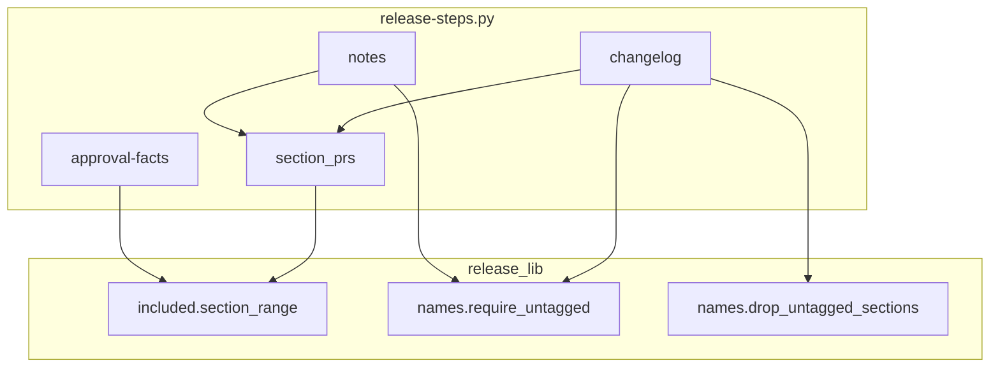
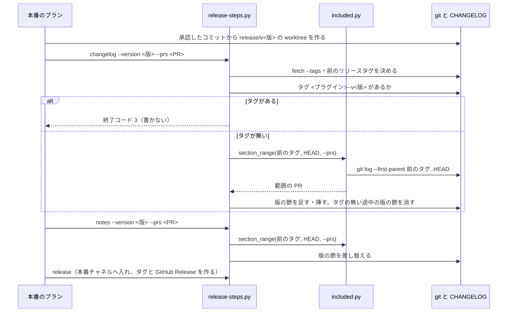

# リリースの工程: 版の節と GitHub Release に、その版のリリースタグに入った PR だけを載せる（#2555）

## 目的

- **今どうなっているか**: 正式版 10.27.21 の版の節と GitHub Release の本文が、タグに入っていない #2542・#2543 の 4 行を載せている。版の節に並べる PR の範囲の終点がベースブランチの最新（`origin/develop`）であり、承認したコミットより後にマージされた PR まで拾うためである。あわせて、リリースタグのある版の節（10.27.2）へ後の開発版が行を足し、正式版を出さなかった版の節（10.27.22・10.27.23）が残っている
- **誰に効くか**: 正式版の利用者（変更点の記載と中身が一致する）と、承認ゲート 2 で版の中身を確かめる人
- **変えると何が成り立つか**: 版の節・承認資料の「含む PR」・GitHub Release の本文が、出す版のコミットに入った PR だけを載せる。リリースタグのある版の節は工程から書き換わらず、正式版を出した時点でタグの無い途中の版の節が残らない

## 適用範囲

- **働く範囲**: NDF を使うすべてのリポジトリのうち、配布の形が `package-plugin` のもの。変わるのは `release-steps.py` の `changelog`・`notes`・`approval-facts` である。既存の食い違いの修正（`CHANGELOG.md` と GitHub Release `ndf--v10.27.21` の本文）は ai-plugins だけ
- **プロジェクトごとに違うもの**: ベースブランチ・本番チャネル・配るプラグインの名前。いずれも今と同じく `.ndf/` の宣言と引数で受け、この変更で増やさない
- **当たるモード**: `standard`

## あるべき姿の根拠

| 根拠 | 種類 | 何を示すか |
| --- | --- | --- |
| `git merge-base --is-ancestor d90cf16ca ndf--v10.27.21` が失敗し、`git show ndf--v10.27.21:CHANGELOG.md` の 10.27.21 の節に #2543 の 4 行がある | 実測（課題 #2555 の本文、2026-11-05） | 範囲の終点を出す版のコミットにしないと、タグの外の PR が版の節に載る |
| PRD1・PRD2・PRD3（git-cliff・release-please・semantic-release） | 外部の一次情報 | リリースノートの生成は「前のリリースタグから、リリースするコミットまで」を範囲にする形が標準である |
| STD1（Keep a Changelog 1.1.0） | 外部の一次情報 | まだ出していない変更は 1 つの未リリースの節に集め、リリース時に版の節へ移す。途中の版の節を残す形は採らない |
| 版 10.27.2-dev.1 の版の上げ（`55f9015cf`、2026-10-31 11:30 UTC）が、リリースタグ `ndf--v10.27.2`（同日 10:56 UTC）の後に 10.27.2 の節へ 5 行を足した | 実測（`git log -1 --format=%ci`、2026-11-05） | リリースタグのある版の節へ書く呼び出しを止めないと、タグの中身と節が食い違う |

要求と受け入れ条件は #2555 の本文にある（コピーは `issues/issue-2555-requirements.md`）。この文書は「どう作るか」だけを扱う。

## ドメインモデル

### コンテキスト

| コンテキスト | 何の語が 1 つの意味に決まるか |
| --- | --- |
| リリース（`ndf-release`） | 版の節・範囲の PR・範囲の終点・リリースタグのある版 |
| 開発の工程（`ndf-workflow`） | 正式版・開発版・承認資料・承認したコミット・リリース差分 |

開発の工程が供給者、リリースが顧客の関係（顧客 / 供給者）。リリースは開発の工程が決めた承認したコミットと、そこから作ったリリースのブランチを受け取り、範囲の終点として使う。承認したコミットを自分で決め直さない。

### 集約

| 集約 | 持ち主（書き換えてよいもの） | 根 | エンティティ | 値オブジェクト |
| --- | --- | --- | --- | --- |
| 変更履歴 | `release-steps.py` の `changelog`・`notes` | `CHANGELOG.md` | 版の節 | 箇条・見出しの版 |
| 範囲の PR | `release_lib/included.py` | 範囲（前のリリースタグ・範囲の終点） | 範囲の PR（`IncludedPr`） | PR の番号・スプリント経由の印 |
| 承認資料 | `release-steps.py` の `approval-facts`・`notes --approval` | 承認資料のファイル | 「含む PR」の行 | 承認したコミット |

変更履歴と承認資料は、範囲の PR を `included.section_range` の戻り値だけから受け取る。範囲を自分で求め直さない。

### 不変条件

| # | 集約 | 条件 | 破れたときの扱い |
| --- | --- | --- | --- |
| I1 | 範囲の PR | 範囲の終点は出す版のコミットである。`changelog`・`notes` では worktree の先頭（リリースのブランチの先頭）、`approval-facts` では承認に出すコミット。範囲の PR は前のリリースタグからその終点までの first-parent のマージと、そこから辿れるスプリント経由の PR に限る | テストが落ちる（受け入れ条件 5・9） |
| I2 | 承認資料 | 「含む PR」と「承認したコミット」は、同じ 1 つのコミットから求める | テストが落ちる（受け入れ条件 5） |
| I3 | 変更履歴 | リリースタグ `<プラグイン>--v<版>` のある版の節を、`changelog` と `notes` は書き換えない。書く呼び出しは書き込む前に止まり、理由を結果に出す | 終了コード 3（前提の不足）で止まる。テストが落ちる（受け入れ条件 6） |
| I4 | 変更履歴 | 正式版の節を書いた後、前のリリースタグの版より新しく出す版より古い版の節は、すべてリリースタグを持つ | テストが落ちる（受け入れ条件 7） |

### ドメインイベント

| # | イベント | 発生元 | 受け手 |
| --- | --- | --- | --- |
| E1 | PR がベースブランチへマージされた | 実装の PR のマージ | 次の範囲の計算 |
| E2 | 開発版の版の節を書いた | 開発版のプランの `changelog`・`notes` | 開発版のリリースの PR |
| E3 | 正式版を出すコミットが承認された | 承認ゲート 2（`approval-facts` が出した承認したコミット） | 本番のプラン |
| E4 | リリースのブランチを承認したコミットから作った | 本番のプランの worktree の用意（計画の「起点のコミット」） | 本番のプランの `changelog`・`notes` |
| E5 | 正式版の版の節を書いた | 本番のプランの `changelog`・`notes`。範囲の終点は E4 のブランチの先頭 | `release` |
| E6 | リリースのブランチを本番チャネルへ入れ、リリースタグを打った | `release` | GitHub Release の作成 |
| E7 | GitHub Release を版の節から作った | `release`（E6 の続き） | 利用者 |
| E8 | 次の開発版の版の節を書いた | 次の開発版の `changelog`・`notes` | E2 と同じ。リリースタグのある版の節には書かない（I3） |

E5 と E1 の順序は保証されない。E4 の後もベースブランチへのマージは続くため、範囲の終点はベースブランチではなく E4 のブランチの先頭から取る。

### 用語

| 用語 | 意味 | 用語集への反映 |
| --- | --- | --- |
| 版の節 | `CHANGELOG.md` の `## [<plugin> <基底の版>]` の見出しから次の `## ` までの節 | 変更なし（用語集の `ndf-release` の語をそのまま使う） |
| 範囲の終点 | 版の節と承認資料の「含む PR」に並べる PR の範囲の、新しい側の端のコミット。出す版のコミットを指す | 追加（`ndf-release`） |
| リリースタグ | 正式版を出したときに本番チャネルのコミットへ打つタグ `<プラグイン>--v<版>`。リリースタグのある版の節は工程から書き換えない | 追加（`ndf-release`） |

## 外部の調査

| 種類 | 調べるか | 理由 |
| --- | --- | --- |
| 標準・仕様 | 調べる | 変更履歴の書き方（未リリースの変更の扱い・リリース済みの節の扱い）に事実上の標準がある |
| 主要な製品 | 調べる | リリースノートを生成する主要な製品が、範囲の終点をどこに置くかを比べる |
| ライブラリとサービス | 調べる | 範囲の計算を既存のツールへ置き換えられるかと、GitHub Release の本文だけを書き換える手段を決める |

### 標準・仕様

| # | 標準・仕様 | 何を定めているか | 設計への反映 | 出典 |
| --- | --- | --- | --- | --- |
| STD1 | Keep a Changelog 1.1.0 | 先頭に `Unreleased` の節を置いて出す前の変更を集め、リリース時にその中身を新しい版の節へ移す。誤りを見つけたら変更履歴を直してよい | 正式版を出すとき、タグの無い途中の版の節を消して正式版の節へ集める（決定 3）。既存の食い違いは develop の `CHANGELOG.md` を直す | https://keepachangelog.com/en/1.1.0/ （2026-11-05） |
| STD2 | GitHub REST API の Update a release（`PATCH /repos/{owner}/{repo}/releases/{release_id}`） | `body` だけを送って本文を書き換えられる。`tag_name` は必須でない | タグに触れずに `ndf--v10.27.21` の本文だけを直す（決定 4） | https://docs.github.com/en/rest/releases/releases#update-a-release （2026-11-05） |

### 主要な製品

| # | 製品 | どう解いているか | 設計への反映 | 出典 |
| --- | --- | --- | --- | --- |
| PRD1 | git-cliff | `--unreleased` はタグに属さないコミット、`--latest` は最新のタグからのコミットを扱う。範囲は `v0.1.0..HEAD` のように git の範囲で渡す | 範囲を「前のリリースタグ..出す版のコミット」の git の範囲で求める（決定 1） | https://git-cliff.org/docs/usage/args （2026-11-05） |
| PRD2 | release-please | 最後のリリースタグ以降のコミットを見てリリースの PR を作り、そのコミットへタグを打ってから GitHub Release を作る | タグを打つコミットと、ノートを組む範囲の終点を同じにする（決定 1） | https://github.com/googleapis/release-please （2026-11-05） |
| PRD3 | semantic-release | 最後のリリースのコミットをタグから求め、リリースするブランチで CI が動いた時点のコミットまでを解析してノートを作る | 同上（決定 1） | https://semantic-release.gitbook.io/semantic-release/ （2026-11-05） |

### ライブラリとサービス

| # | 候補 | 版 | ライセンス | 最後のリリースの日付 | 終了のアナウンス | 要件を満たすか | 出典 |
| --- | --- | --- | --- | --- | --- | --- | --- |
| LIB1 | git-cliff | 2.14.0 | Apache-2.0 / MIT | 確かめられなかった | 無し | 満たさない。コミットの題から節を組み、PR の本文の「利用者向けの変化」とスプリント経由の PR の扱い（`included.py`）を持たない。範囲の計算だけを置き換えても、PR の読み出しと箇条の組み立ては残る | https://git-cliff.org/docs/usage/args 、 https://github.com/orhun/git-cliff （2026-11-05） |
| LIB2 | `gh release edit --notes-file` | 手元の `gh`（このリポジトリの工程が既に依存） | MIT | 確かめていない | 無し | 満たす。タグを指定してノートだけをファイルから書き換える | https://cli.github.com/manual/gh_release_edit （2026-11-05） |

### 確かめられなかったこと

| 対象 | 試した手段 | 結果と理由 |
| --- | --- | --- |
| git-cliff の最後のリリースの日付 | https://github.com/orhun/git-cliff の取得 | リリースの一覧が取得したページに無く、日付を読めなかった |
| semantic-release の現行の文書 | https://semantic-release.gitbook.io/semantic-release/ の取得 | 取得したページは保守を終えた旧サイトで、移った先（semantic-release.org）は試していない |

調べた量: 候補 7 件・取得の試み 7 回。

## 機能一覧

| # | 機能 | 誰が使うか |
| --- | --- | --- |
| F1 | 版の節と承認資料の「含む PR」に、出す版のコミットまでに入った PR だけを並べる | 配布のプラン（開発版・本番）と承認ゲート 2 で読む人 |
| F2 | リリースタグのある版の節へ書く呼び出しを、書き込む前に止める | 開発版のプラン |
| F3 | 正式版の節を書くとき、前のリリースタグより新しくタグの無い版の節を消す | 本番のプラン |
| F4 | develop の `CHANGELOG.md` の既存の食い違い（10.27.2・10.27.21・10.27.22・10.27.23 の節）を直す | 実装の PR（1 回だけ） |
| F5 | GitHub Release `ndf--v10.27.21` の本文から #2542・#2543 の 4 行を外す | 本番の配布の後の操作（1 回だけ） |

## 構成要素

| 要素 | 責務 | 変える内容 |
| --- | --- | --- |
| `release_lib/included.py` の `section_range` | 前のリリースタグと範囲の終点から範囲の PR を求め、`--prs` との和を返す。範囲を求めるのはここだけ | 終点を引数 `to`（コミット）で受ける。中で `origin/<ベースブランチ>` を読まず、`fetch` もしない |
| `release-steps.py` の `section_prs` | `changelog`・`notes`（`--approval` なし）の範囲の PR と前のリリースタグを決める | タグを `fetch` してから前のリリースタグを決め、終点に worktree の先頭（`git rev-parse HEAD`）を渡す |
| `release-steps.py` の `cmd_approval_facts` | 承認に出すコミットを決め、承認資料を書く | 範囲の PR を `section_range` で求め、終点に承認に出すコミット（今のコードの変数 `dev`）を渡す。差分の行数も `origin/<本番チャネル>...<承認に出すコミット>` から数える |
| `release_lib/names.py` に足す `require_untagged` | 版の節を書く前に、その基底の版のリリースタグが無いことを確かめる | 新設。タグがあれば `StepError`（3）を投げる |
| `release_lib/names.py` に足す `drop_untagged_sections` | 前のリリースタグの版と出す正式版の間にある、タグの無い版の節を行の列から消し、消した見出しを返す | 新設 |
| `release-steps.py` の `_update_changelog`・`write_notes` | 版の節を足す・挿す・差し替える | 書く前に `require_untagged` を呼ぶ。`_update_changelog` は正式版（接尾辞の無い版）のときだけ `drop_untagged_sections` を呼ぶ |
| `CHANGELOG.md`（develop） | 変更履歴 | 10.27.2 の節から #2279・#2283・#2290 の 5 行、10.27.21 の節から #2542・#2543 の 4 行を外し、10.27.22・10.27.23 の節を消す |
| GitHub Release `ndf--v10.27.21` | 正式版 10.27.21 の利用者向けの本文 | 本文から #2542・#2543 の 4 行を外す（`gh release edit`） |



システム構成（外部との関係と配置）は変わらない。git と GitHub への読み書きは今と同じく、配布のプランの worktree で動く `release-steps.py` から行う。

## 構造

型を足さず、変えない。範囲の PR の型（`IncludedPr`）と結果 JSON の形は今のままである。変わるのは関数の引数（`section_range` の終点）と、`release_lib/names.py` に足す 2 つの関数だけである。

```text
plugins/ndf/scripts/
├── release-steps.py          # section_prs・cmd_approval_facts・_update_changelog・write_notes を変える
└── release_lib/
    ├── included.py           # section_range の終点を引数にする
    └── names.py              # require_untagged・drop_untagged_sections を足す
```

## 入出力の契約

引数と結果 JSON の形は変わらない。変わるのは次の 2 つである。

| コマンド | 条件 | 結果 |
| --- | --- | --- |
| `changelog`・`notes`（`--approval` なし） | `refs/tags/<プラグイン>--v<基底の版>` がある | 書き込まずに終了コード 3。`summary` は「<版> はリリースタグ <タグ> があるため版の節へ書かない」。`CHANGELOG.md` は変わらない |
| `changelog`（正式版） | 前のリリースタグの版より新しく、出す版より古いタグの無い版の節がある | その節を消す。`items` に `{"kind": "section", "name": "CHANGELOG.md", "result": "removed", "heading": "<見出し>"}` を消した節ごとに足す |

`notes --approval` は `CHANGELOG.md` を書かないため、タグの確かめを通らない。

## 処理の流れ

正式版の本番のプラン（承認ゲート 2 の後）を示す。開発版のプランも `changelog`・`notes` の流れは同じで、worktree の起点がその時点のベースブランチの先頭であることだけが違う。



図に含めない要素は、`approval-facts`（次の段落）と、1 回だけ行う `CHANGELOG.md` の修正と GitHub Release の本文の書き換え（決定 4）である。

`approval-facts` は開発版のプランの最後で、`origin/<ベースブランチ>` を 1 回だけ読んで承認に出すコミットを決める。そのコミットを、`section_range` の終点と「承認したコミット」の両方に使う。

## 決定の記録

### 決定 1: 版の節がタグの中身と一致するよう、範囲の終点を出す版のコミットにして 1 つの関数へ渡す

範囲の終点は、`changelog`・`notes` では worktree の先頭、`approval-facts` では承認に出すコミットとし、どちらも `section_range` に引数で渡す。本番のプランの worktree は承認したコミットから作られ（計画の「起点のコミット」）、版の上げのコミットだけが載る。そのため worktree の先頭までの範囲は、リリースタグを打つコミットに入った PR と一致する。主要な製品も、前のリリースタグからリリースするコミットまでを範囲にしている。承認したコミットとベースブランチの先頭が一致するときは、範囲は今と同じである（受け入れ条件 9）。

範囲の終点を承認資料の「承認したコミット」から読む形は採らない。開発版のプランには承認資料が無く、終点の決め方が 2 通りに分かれる。範囲の計算を git-cliff へ置き換える形も採らない。PR の本文の「利用者向けの変化」とスプリント経由の PR を扱う処理（`included.py`）は残り、置き換わるのは `git log` の 1 行だけである。

- 作り方: 自前で作る・標準に倣う
- 比べた候補: PRD1 / PRD2 / PRD3 / LIB1

根拠: Value 7 / Value 8（MVV 版 5）

### 決定 2: タグの中身と版の節の食い違いを作らないため、リリースタグのある版の節へ書く呼び出しは書き飛ばさずに止める

`changelog` と `notes` は、基底の版のリリースタグがあれば書き込む前に終了コード 3 で止まり、理由を結果に出す。リリースタグのある版を基底にした開発版は、版数の付け方（次に出す正式版の版数へ接尾辞を付ける）から外れており、版の上げの誤りである。書き飛ばして続けると、開発版は出るが誤った版数のまま配られ、誤りが残る。止めれば、配布のプランの judge のステップが、版数を直すか止めるかを決める。

書き込みを飛ばして開発版のリリースを続ける形は採らない。版の節の無い開発版のリリースの PR が作られ、利用者向けの変化の記載が無いまま開発版が配られる。

根拠: Value 2 / Value 7（MVV 版 5）

### 決定 3: 途中の版の節が残らないよう、正式版の `changelog` が前のリリースタグより新しくタグの無い版の節を消す

正式版の節を書く `changelog` が、前のリリースタグの版より新しく出す版より古い、タグの無い版の節を消す。その節の箇条は、前のリリースタグから出す版のコミットまでの範囲に必ず含まれ、同じ実行で正式版の節に並ぶ（要求の前提 4）。Keep a Changelog が未リリースの節をリリース時に版の節へ移すのと同じ結果になる。消すのは `changelog` の 1 か所に置き、`notes` は節の差し替えだけを持つ。

開発版の節を未リリースの 1 つの節（`Unreleased`）にまとめる形は採らない。開発版の版数と版の節の見出しの対応（`changelog_span`・リリースの PR の本文・CI の文書の検査）が変わり、この課題の範囲を超える。

- 作り方: 自前で作る・標準に倣う
- 比べた候補: STD1

根拠: Value 3 / Value 8（MVV 版 5）

### 決定 4: 正式版 10.27.21 の利用者へ届く本文を直すため、GitHub Release の本文だけを `gh release edit` で書き換え、タグには触れない

本文は、`git show ndf--v10.27.21:CHANGELOG.md` の 10.27.21 の節から #2542・#2543 を含む 4 行を外したものとする。書き換えは `gh release edit ndf--v10.27.21 --notes-file <ファイル>` で行う。書き換える前の本文は `gh release view ndf--v10.27.21 --json body` で控え、戻すときは控えを同じコマンドで書き戻す。打つのは承認ゲート 2 の後の本番の配布の後で、手順と控えの置き場は実装の Pull Request の本文の「手動確認」に書く。タグとタグが指すコミットの `CHANGELOG.md` は書き換えない（要求の前提 1）。

GitHub の REST API を直接呼ぶ形は採らない。このリポジトリの工程は既に `gh` に依存しており、同じことを `gh release edit` が 1 行で行う。

- 作り方: ライブラリやサービスを使う
- 比べた候補: LIB2 / STD2

根拠: Value 1 / C4（MVV 版 5）

## テスト設計

受け入れ条件 5〜7・9 と不変条件は、一時の git リポジトリ（origin・ベースブランチ・本番チャネル・リリースタグを持つ）で `release-steps.py` を起動して確かめる。

| 受け入れ条件・不変条件 | どの振る舞いで縛るか | どう壊したら落ちるべきか |
| --- | --- | --- |
| 受け入れ条件 5・I1 | 承認したコミットからリリースのブランチを作り、その後にベースブランチへ PR をマージする。`changelog`・`notes` の版の節に後の PR が無い | `section_prs` の終点を `origin/<ベースブランチ>` へ戻すと落ちる |
| 受け入れ条件 5・I2 | 承認に出すコミットより後にマージされた PR が、`approval-facts` の「含む PR」に無く、「承認したコミット」が範囲の終点と同じ SHA である | `approval-facts` で終点と承認したコミットを別々に `origin/<ベースブランチ>` から読み、その間にマージが入ると落ちる |
| 受け入れ条件 6・I3 | タグ `<プラグイン>--v<版>` がある版を基底にした開発版で `changelog` と `notes` を打つと、終了コード 3 で止まり、`summary` にタグの名前があり、`CHANGELOG.md` の中身が打つ前と同じである | タグの確かめを外す、または書き込みの後に確かめると落ちる |
| 受け入れ条件 7・I4 | 前のリリースタグ 1.0.0、タグの無い 1.0.1・1.0.2 の節があるとき、正式版 1.0.3 の `changelog` の後に 1.0.1・1.0.2 の節が無く、その節にあった PR が 1.0.3 の節にある。`items` に `removed` が 2 件ある | 消す条件の下限を外して前のリリースタグの節まで消す、またはタグのある節を消すと落ちる |
| 受け入れ条件 7（開発版） | 開発版の `changelog` は途中の版の節を消さない | 消す処理を接尾辞の有無で分けないと落ちる |
| 受け入れ条件 9 | 承認したコミットとベースブランチの先頭が一致するとき、版の節に並ぶ PR が終点を `origin/<ベースブランチ>` にしたときと同じである | 範囲の始点か first-parent の扱いを変えると落ちる |
| 受け入れ条件 1〜3・8 | 実装の PR で、develop の `CHANGELOG.md` に対し課題の本文「調べたこと」の手段（節ごとの PR 番号とマージコミットの `git merge-base --is-ancestor`）を打ち、タグの祖先でない組が 0 件。10.27.22・10.27.23 の節が無く、2 つの節の箇条がすべて 10.27.24 の節にある | 手で直すときに節を消し残す、または 10.27.3 の節の #2279 の行まで消すと 0 件にならない |
| 受け入れ条件 4 | リリース後テストで `gh release view ndf--v10.27.21 --json body` の本文に #2542・#2543 が無い | 書き換えを打たないと残る |

## 設計の結果

| 課題 | 扱い | 取り込み先 | 触るファイル |
| --- | --- | --- | --- |
| #2555 | 実装する | — | `plugins/ndf/scripts/release-steps.py`、`plugins/ndf/scripts/release_lib/included.py`、`plugins/ndf/scripts/release_lib/names.py`、`plugins/ndf/scripts/tests/`、`CHANGELOG.md` |

## 未確認のまま残ること

| 項目 | 内容 |
| --- | --- |
| `--prs` で渡した PR | `section_range` は範囲の PR と `--prs` の和を返す。範囲の終点より後にマージされた PR を `--prs` で渡すと版の節に載る。配布のプランが渡すのはスプリントの PR で、承認より前にマージされている。呼び手が渡す番号を範囲で絞るかは決めていない（実装で既存のテストが渡す番号を見て決める） |
| 並べた配布（`parallel_release`）の本番 | worktree の起点は「起点のコミット」に承認したコミットが入る経路を読んで確かめた。並べた配布の実物で `changelog` を打った結果は確かめていない。リリース後テストで、次の正式版の版の節の PR がタグの祖先にあるかを確かめる |
| マージコミットを辿れない 232 組 | 要求の「未確認・残リスク」のとおり、この変更でも確かめない |
| 正式版の利用者の手元 | タグ `ndf--v10.27.21` の `CHANGELOG.md` は 4 行を載せたままで、次の正式版を入れるまで残る |
