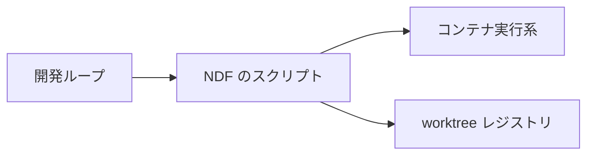
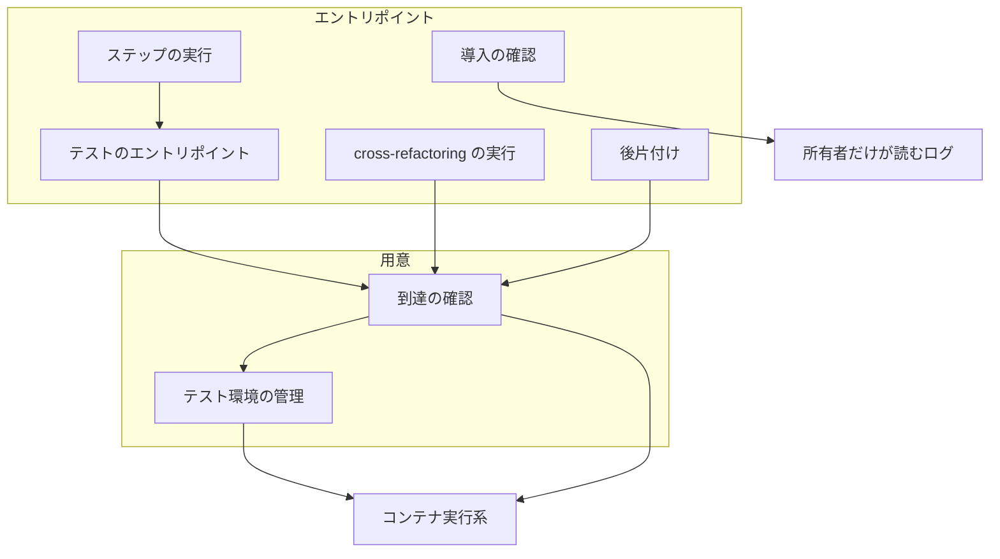
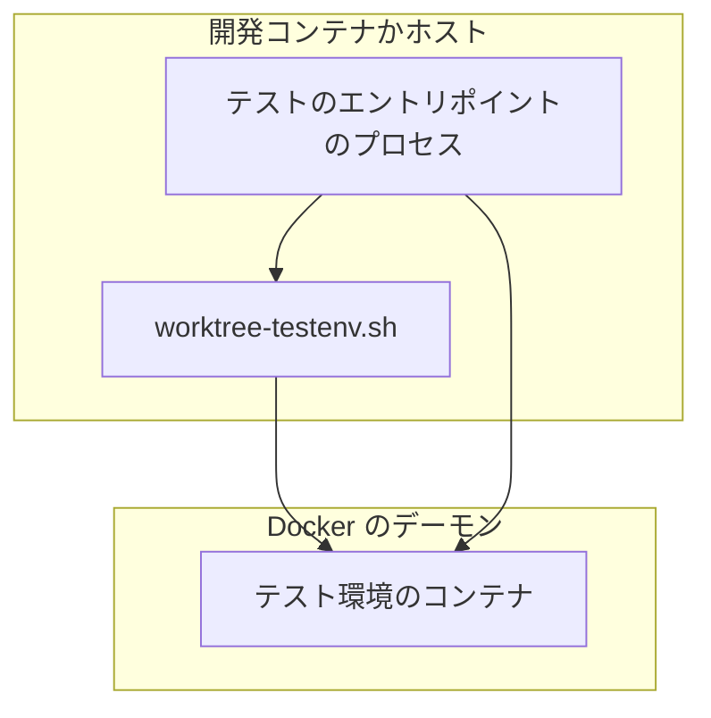
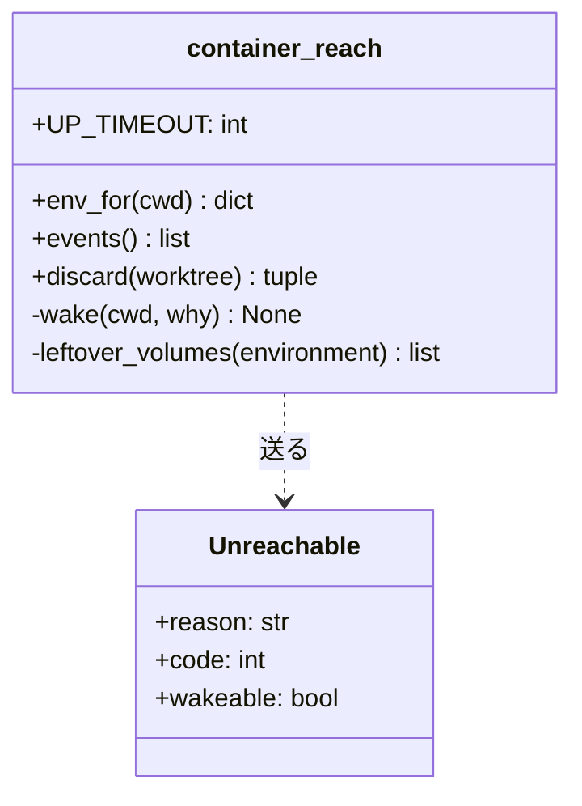
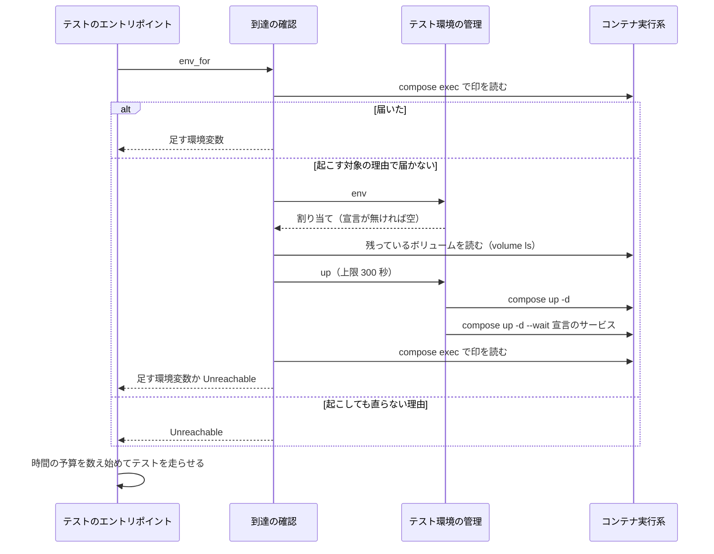
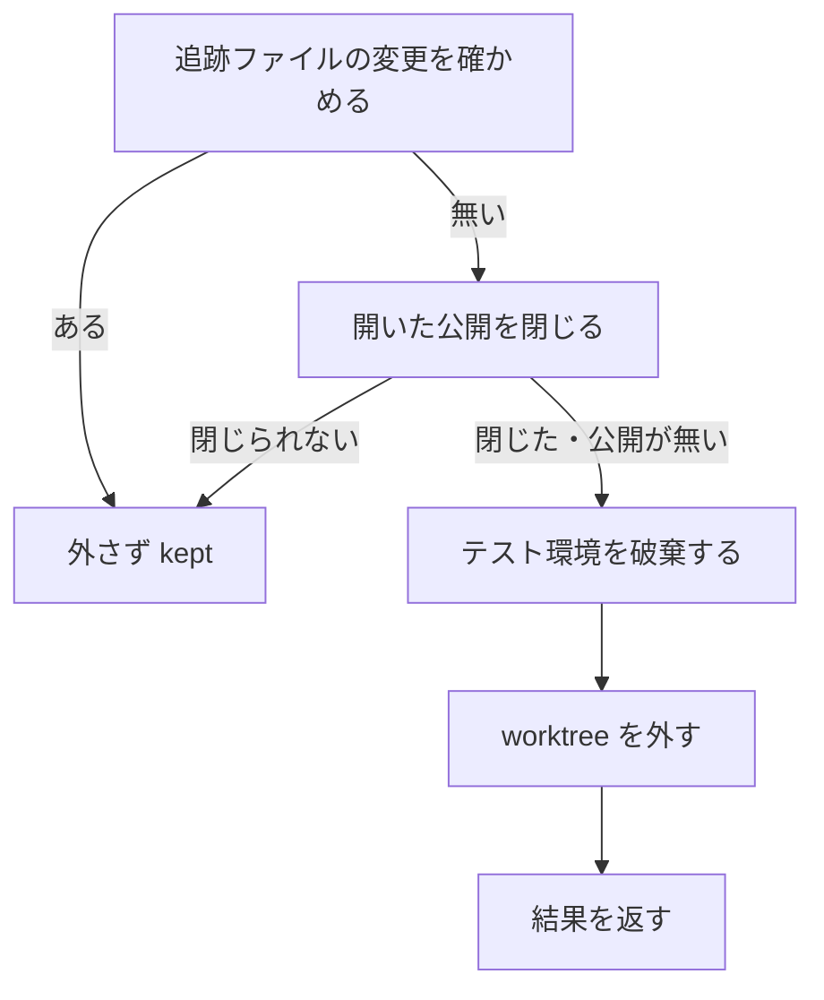

# テストのステップ: テスト環境を自動で起こし、止まったときは原因が読める結果を返す（#2567）

## 目的

- **今どうなっているか**: テストのステップはテスト環境が止まっていると「`worktree-testenv.sh up` で起こす」と返して止まり、人が起こしてプランを流し直すまで開発ループが進まない。全体テストの失敗は落ちたコマンドが分からず、導入の確認は走っている間の出力が見えない
- **誰に効くか**: コンテナでテストを走らせるプロジェクトで開発ループを回す利用者と、止まった結果を読む判定の worker
- **変えると何が成り立つか**: テスト環境の用意のために人を待たず、止まったときは結果の JSON とログから原因を読める

## 適用範囲

- **働く範囲**: 配布先のリポジトリでも働く
- **プロジェクトごとに違うもの**: コンテナのサービスは `.ndf/project.json` の `test.suites[].container` で受ける。起動の定義は `.ndf/worktree.json` の `testenv` と `localenv.compose_files` で受ける。必須の設定は足さない。足すのは任意の `testenv.discard_volumes` の 1 項目だけで、無ければボリュームを消さない（決定 7）
- **当たるモード**: すべてのモード（テストと後片付けを通るとき）

## あるべき姿の根拠

| 根拠 | 種類 | 何を示すか |
| --- | --- | --- |
| 「ひとつづつ直すのではなく根本原因を見つけて対処してください」（2026-11-06） | 利用者の指示の原文 | 止まり方ごとに手当てせず、同じ層で直す |
| carul の 3 回の判定の stop と、人が起こして流し直すと通った記録（#2567） | 実測 | 起こせば通るため、自動で起こす価値がある |
| carul のテスト環境 22 個で、最初のコンテナの作成から api の起動まで 16〜49 秒（2026-11-06、`docker inspect`。作り直しの跡がある 2 個を除く） | 実測 | 起動の待ちは、人の待ちと判定の費用より小さい |
| 導入の確認の打ち切り 4 回が、すべて develop へのマージの 12〜32 秒後に始まった実行である（要求の「調べて分かったこと」） | 実測 | 導入の確認の遅れは、テスト環境の停止とは別の原因である見込みが高い |
| STD1 | 外部の一次情報 | `docker compose up` は既存のコンテナを保ったまま足りないものを起こすため、確かめた後に 1 度打ってよい |
| PRD2 | 外部の一次情報 | テスト用のサービスは使う仕事の範囲で用意し、終わりに破棄する形が定着している |
| 「自動では `down`（`--volumes` 無し）までにして、ボリュームは残す。残ったボリュームは宣言があるときだけ消す形を実装の前に設計へ反映する。戻せない削除を既定にしない」（2026-11-06、[#2567 の節「設計の承認ゲート 1 での利用者の答え」](https://github.com/devbasex/ai-plugins/issues/2567)） | 利用者の答え | 既定の自動の破棄はコンテナまでで、ボリュームの削除は宣言で選ぶ（決定 7） |
| carul のテスト環境のボリューム 99 個で計 18.3 GB、データベース 1 個あたり平均 203 MB。ホストのディスクの空きは 11.9 GB（使用率 96%）。worktree レジストリの 49 の環境名のうち 2 つは解放の後に割り当て直された（2026-11-06、`du`・`df`・`.git/ndf/worktree-registry.json`） | 実測 | 残るボリュームはディスクを圧迫し、同じ環境名の再利用は実際に起きる（決定 7） |

要求と受け入れ条件は #2567 の本文にある（コピーは [issue-2567-requirements.md](issue-2567-requirements.md) ）。この文書は「どう作るか」だけを扱う。

## ドメインモデル

### コンテキスト

| コンテキスト | 何の語が 1 つの意味に決まるか |
| --- | --- |
| NDF の worktree（`ndf-worktree`） | テスト環境・テスト環境の用意・到達の確認 |
| NDF の開発ワークフロー（`ndf-workflow`） | 全体テスト・導入の確認・ステップ |

ワークフローが顧客、worktree が供給者の関係（顧客 / 供給者）。ワークフローは到達の確認の関数を呼び、テスト環境の割り当てへ直接触らない。

### 集約

| 集約 | 持ち主（書き換えてよいもの） | 根 | エンティティ | 値オブジェクト |
| --- | --- | --- | --- | --- |
| テスト環境の割り当て | `worktree-testenv.sh` | 割り当て（worktree のパスで引く） | — | 環境名・スロット・ポート |
| 到達の結果 | 到達の確認（`lib/container_reach.py`）。1 プロセスの中だけで持つ | 作業ディレクトリごとの結果 | — | 足す環境変数・起こした記録 |
| 導入の確認のログ | `release_lib/deploy.py` | ログのファイル | — | — |

Python の側は割り当てを書き換えない。`worktree-testenv.sh` の `env`・`up`・`down` を呼ぶだけである。

### 不変条件

| # | 集約 | 条件 | 破れたときの扱い |
| --- | --- | --- | --- |
| I1 | テスト環境の割り当て | 同じ worktree の環境名とスロットは、HEAD がどのコミットへ動いても変わらない | `env` が同じ値を返さなければ、テストで落とす |
| I2 | テスト環境の割り当て | 同じコミットを開いた別の worktree には、別の環境名と別のスロットが割り当たる | 同上 |
| I3 | 到達の結果 | 到達が確かめられていない worktree では、テストのコマンドを走らせない | `Unreachable` を送り、走らせずに止まる |
| I4 | 到達の結果 | 1 プロセス・1 作業ディレクトリで、起動は 1 度までである | 2 度目は打たず、1 度目の失敗を送り直す |
| I5 | 到達の結果 | 既に届く worktree と、`container` の宣言が無いリポジトリでは、起動しない | 起動のコマンドを打たずに走らせる |
| I6 | テスト環境の割り当て | worktree を消す前に開いた公開を閉じる。閉じた後に破棄を試み、破棄できなければ環境名を結果に残す | 閉じられなければ、破棄せず worktree を残す。破棄の失敗では worktree の削除を続ける |
| I7 | 導入の確認のログ | 確認のコマンドの出力は所有者だけが読めるログへだけ書く。進みの知らせに出力の中身を載せない | ログを書けなければ `StepError` で止まる |
| I8 | テスト環境の割り当て | 自動の破棄がボリュームを消すのは、メインディレクトリの宣言の `testenv.discard_volumes` が真偽値の `true` のときだけである | テストで落とす |
| I9 | テスト環境の割り当て | 行に `golden_tag` が無い割り当てへタグを書くのは、同じプロジェクトのボリュームが無いと確かめられたときだけである | 残っているか確かめられなければ書かずに起こし、`expose` が拒否する |

### ドメインイベント

| # | イベント | 発生元 | 受け手 |
| --- | --- | --- | --- |
| E1 | テストのステップが始まった | `test-run.py`・cross-refactoring の実行 | 到達の確認 |
| E2 | テスト環境へ届かないと分かった | 到達の確認 | テスト環境の用意 |
| E3 | テスト環境の割り当てを取った | `worktree-testenv.sh env` | テスト環境の用意 |
| E4 | テスト環境を起こした | `worktree-testenv.sh up` | 到達の確認 |
| E5 | 到達を確かめ直した | 到達の確認 | テストの実行 |
| E6 | テストを走らせた | `test-run.py`・cross-refactoring の実行 | 結果の JSON |
| E7 | 導入の確認の出力をログへ書いた | 確認のコマンド | 導入の確認の進みの知らせ → 遅れの見張り |
| E8 | テスト環境を破棄した | `/ndf:merged` の後片付け | worktree レジストリ（解放の時刻） |

### 用語

| 用語 | 意味 | 用語集への反映 |
| --- | --- | --- |
| テスト環境 | 1 つの worktree に対応して立ち上げる、テスト実行に必要なサービスの一式 | 変更なし |
| テスト環境の用意 | 到達の確認が通らないときに、テスト環境を起こして到達を確かめ直すこと | 変更なし |
| 到達の確認 | コンテナの中から worktree の探りの印を読み、テストのコンテナが worktree を見ているかを確かめること | 変更なし |
| 導入の確認 | `.ndf/pace.json` の `<節>.verify` に書かれたコマンドを、ベースブランチの先頭で走らせること | 変更なし |
| 全体テスト | リポジトリ全体を範囲にするテストか静的解析 | 変更なし |

## 外部の調査

| 種類 | 調べるか | 理由 |
| --- | --- | --- |
| 標準・仕様 | 調べる | 起動・破棄は Docker Compose の振る舞いに、detached HEAD は git の仕様に、出力の記録はプロセスの標準の手段に従う |
| 主要な製品 | 調べる | テスト用のサービスをいつ起こし、いつ破棄するかと、走っている間の出力をどう残すかの解き方を比べる |
| ライブラリとサービス | 調べる | 起動の管理と、ログの伸びの監視を自前で持つかを決める |

### 標準・仕様

| # | 標準・仕様 | 何を定めているか | 設計への反映 | 出典 |
| --- | --- | --- | --- | --- |
| STD1 | Docker Compose の `up` | 既存のコンテナは設定やイメージが変わったときだけ作り直し、ボリュームを保つ。`--wait` はサービスが動くか健全になるまで待ち、`--wait-timeout` で上限を置く。サービスを指定すると、そのサービスと依存だけを待つ（実測は決定 2） | 確かめた後に `up -d` を 1 度打ち、宣言のサービスだけを `--wait` で待つ（決定 2） | https://docs.docker.com/reference/cli/docker/compose/up/ （2026-11-06）、`docker compose up --help`（v5.6.1） |
| STD2 | Docker Compose の `down` | `down` はコンテナとネットワークを消す。`--volumes` は定義の名前付きボリュームとコンテナに付いた匿名ボリュームも消す。定義外の削除は `--remove-orphans` のときだけ行う（実測は決定 7） | 既定の破棄は `down` を使い、宣言があるときだけ `down --volumes` を使う。定義外を消す指定は付けない | `docker compose down --help`（v5.6.1、2026-11-06） |
| STD3 | git worktree | `--detach` でブランチを持たない worktree を作れる。`git worktree remove` を使わず消した worktree は管理のファイルが残る | ブランチに頼らず、worktree のパスで環境を識別する（決定 4） | https://git-scm.com/docs/git-worktree （2026-11-06） |
| STD4 | POSIX の `tee` | 標準入力を標準出力へ複製し、指定のファイルへも書く | 出力が標準出力へも出るため採らない（決定 6） | https://pubs.opengroup.org/onlinepubs/9799919799/utilities/tee.html （2026-11-06） |
| STD5 | Python の `subprocess` | `stdout` にファイルを渡すと子がそのファイルへ直接書く。`stderr=STDOUT` で 1 本にまとまる。`wait(timeout)` は打ち切り後に再度呼べる | 子の出力をログへ直接渡し、親は `wait(timeout)` のループでログの大きさを見る（決定 6） | https://docs.python.org/3/library/subprocess.html （2026-11-06） |

### 主要な製品

| # | 製品 | どう解いているか | 設計への反映 | 出典 |
| --- | --- | --- | --- | --- |
| PRD1 | Testcontainers の Docker Compose モジュール | テストのコードが compose の定義からサービスを起こす。待ち方と起動の上限を指定でき、手元の `docker compose` を使う形も持つ | 起動の上限を置く形と、手元の `docker compose` を使う形を採る。テストのコードへ組み込む形は言語ごとに分かれるため採らない（決定 1） | https://java.testcontainers.org/modules/docker_compose/ （2026-11-06） |
| PRD2 | GitHub Actions のサービスコンテナ | 仕事ごとに新しいコンテナを作り、仕事が終わると破棄する | 使う単位（worktree）に合わせて起こし、削除に合わせてコンテナを破棄する。ボリュームは手元のホストに残るデータで、利用者の答えにより既定で残す（決定 7） | https://docs.github.com/en/actions/tutorials/use-containerized-services/use-docker-service-containers （2026-11-06） |
| PRD3 | Dev Containers | 起動ごとに走るコマンド（`postStartCommand`）と、接続の前に待つコマンド（`waitFor`）を宣言で持つ | 起動の宣言は既存の `testenv` を使い、起動のための新しい宣言を足さない | https://containers.dev/implementors/json_reference/ （2026-11-06） |
| PRD4 | Supervisor | 常駐プロセスが子を管理し、`stdout_logfile` と `redirect_stderr` で出力を 1 本のログへ書く | ログを 1 本にまとめる形を採る。1 回限りの確認のコマンドに常駐プロセスは要らないため、製品は採らない（決定 6） | https://supervisord.org/configuration.html （2026-11-06） |

### ライブラリとサービス

| # | 候補 | 版 | ライセンス | 最後のリリースの日付 | 終了のアナウンス | 要件を満たすか | 出典 |
| --- | --- | --- | --- | --- | --- | --- | --- |
| LIB1 | testcontainers（Python） | 4.15.0 | Apache-2.0 | 2026-07-24 | 無し（PyPI の取り下げ（yanked）の値は false。リポジトリのアーカイブの有無は未確認） | 満たさない。割り当て・ポートの帯・worktree レジストリは `worktree-testenv.sh` が持ち、compose の起動はそれを通す必要がある | https://pypi.org/pypi/testcontainers/json （2026-11-06） |
| LIB2 | pytest-docker | 3.2.6 | MIT | 2026-10-16 | 無し（同上） | 満たさない。pytest の中で働き、vitest やシェルのコマンドの suite に使えない | https://pypi.org/pypi/pytest-docker/json （2026-11-06） |
| LIB3 | python-on-whales | 0.81.0 | MIT | 2026-03-09 | 無し（同上） | 満たさない。`docker` の CLI の包みで、`WT_DOCKER_COMMAND` の差し替えと既存のシェルの経路を置き換える利点が無い | https://pypi.org/pypi/python-on-whales/json （2026-11-06） |
| LIB4 | watchdog | 7.1.0 | Apache-2.0 | 2026-11-05 | 無し（同上） | 満たさない。ファイルの変更をイベントで受けられるが、親は子の終了を待つループを持ち、ログの大きさは標準ライブラリで読める | https://pypi.org/pypi/watchdog/json （2026-11-06） |
| LIB5 | psutil | 7.2.2 | BSD-3-Clause | 2026-01-28 | 無し（同上） | 満たさない。プロセスの情報を読むライブラリで、見るのはログの大きさである | https://pypi.org/pypi/psutil/json （2026-11-06） |

### 確かめられなかったこと

| 対象 | 試した手段 | 結果と理由 |
| --- | --- | --- |
| testcontainers の Python 版の Compose の文書 | https://testcontainers-python.readthedocs.io/en/latest/modules/compose/README.html | HTTP 404。Java 版の文書（PRD1）で振る舞いを見た |
| LIB1〜LIB5 のリポジトリのアーカイブの有無 | 試していない | PyPI の情報だけを読んだ。5 つとも採らないため、ここで止めた |

調べた量: 候補 14 件・取得の試み 19 回。

## 機能一覧

| # | 機能 | 誰が使うか |
| --- | --- | --- |
| F1 | テストの前にテスト環境を自動で起こす | 開発ループ・cross-refactoring |
| F2 | 起こせなかった理由を結果に載せて止まる | 判定の worker・利用者 |
| F3 | detached HEAD の worktree でテスト環境を使う | cross-refactoring |
| F4 | 導入の確認の出力を走っている間にログへ書き、進みを知らせる | 遅れの見張り・利用者 |
| F5 | 全体テストの落ちたコマンドを報告する | 判定の worker・利用者 |
| F6 | worktree の削除に合わせてテスト環境を破棄する | `/ndf:merged` の利用者 |

## 構成要素

### 変える要素と責務

| 要素 | 責務 |
| --- | --- |
| 到達の確認（`lib/container_reach.py`） | 届かなければ 1 度だけテスト環境を起こして確かめ直す。起こした記録を持つ。公開を閉じて破棄する関数を持ち、worktree を外してよいかを返す |
| テスト環境の管理（`worktree-testenv.sh`、`lib/worktree-registry.sh`） | detached HEAD の worktree にも環境名とスロットを割り当てる。`up` で宣言のサービスの準備完了を待つ。`down` が `testenv.discard_volumes` を読む。行に `golden_tag` が無い割り当ての `up` は、残ったボリュームがあればタグを書かない（決定 7）。割り当ての持ち主であることは変えない |
| 作業用 worktree の置き場（`lib/worktree_base.py`、`lib/worktree-branch.sh`） | コンテナの宣言があるリポジトリの cross-refactoring と cross-review の worktree を、実行系から見える場所へ置く。置き場を git の無視へ登録する（決定 9） |
| 置き場を求める呼び出し（7 箇所） | リポジトリのルートを渡す。`cross-review` の `review_lib/commands/init.py` の 2 箇所・`drive.py`、`cross-refactoring` の `refactor_lib/paths.py`・`refactor_lib/commands/setup.py`、`merged-steps.py` の `cleanup`、`lib/run_state.py` の `review_base`（決定 9） |
| worktree を作る経路（`cross-review` の `review_lib/workspace.py`、`cross-refactoring` の `refactor_lib/commands/setup.py`） | `git worktree add` の前に置き場の登録を呼ぶ（決定 9） |
| テストのエントリポイント（`test-run.py`） | 時間の予算を数え始める前にテスト環境を用意する。起こした記録と落ちたコマンドを結果へ載せる |
| ステップの実行（`supervise_lib/steps.py`） | コンテナの宣言があるとき、テストのステップの `timeout` へ起動の上限を足す |
| 導入の確認（`release_lib/deploy.py`） | 出力をログへ直接書き、伸びたことだけを標準エラーへ知らせる |
| 後片付け（`merged-steps.py`、`lib/run_state.py`） | worktree を消す直前に公開を閉じてテスト環境を破棄する。ボリュームを消すかは `worktree-testenv.sh down` が宣言で決める。閉じられなければ worktree を残し、破棄できなければ環境名を結果に残す |
| 手順書（`worktree/references/test-execution.md`、`worktree/references/declaration.md`、`worktree/SKILL.md`、`merged/SKILL.md`、`cross-review` と `cross-refactoring` の `docs/`、`lib/README.md`） | 自動で起こすこと・破棄の担い手・detached HEAD の環境名・置き場の解決の順を書く。`--volumes` を既定の破棄として書いた 4 か所（`worktree/SKILL.md` のコマンド例と「worktree を消す前に `down --volumes` を実行する」の文、`test-execution.md` の表の「破棄する」の行と同じ文）を書き換える。既定の破棄の例は `down "$WT"` にし、ボリュームを消すのは宣言か明示の指定のときだけと書く。あわせて自動の破棄・残るボリューム・`discard_volumes`・手で消す手順を書く。`test-execution.md` の `expose` の拒否の条件 2 に、残ったボリュームの上の `up` はタグを書かないことと、`down "$WT" --volumes` の後に起こし直す手順を足す |
| 宣言の説明（`worktree/schemas/registry.schema.json`、`worktree/schemas/worktree.schema.json`、`project_lib/model.py`） | 環境名の形と `container` の説明を合わせる。`testenv.discard_volumes` を足す |

cross-refactoring の実行は変えない。`run_with_timeout` が到達の確認の `env_for` を呼んでいるため、用意が働く。cross-refactoring と cross-review で変えるのは、置き場を求める呼び出しへリポジトリのルートを渡すことと、worktree を作る前に置き場を git の無視へ登録することだけである（決定 9）。`worktree-testenv.sh test` も変えない。この経路は `probe` の CLI を呼ぶため、今のまま起こさずに止まる。

### システムの文脈



### 構成要素の関係



図には文書（手順書・宣言の説明）を含めない。

### 配置

どの要素も開発ループと同じコンテナかホストのプロセスで動き、コンテナの起動は `WT_DOCKER_COMMAND`（既定は `docker`）へ渡す。コマンドの経路は、ホストの Docker を共有するコンテナの中（DooD: Docker outside of Docker）でも、ホストの直下でも同じである。

違うのはバインドのパスの解かれ方で、DooD ではコンテナの中のパスではなくデーモンから見たパスで解かれる。テスト環境が worktree を見るには次の 2 つが要る。

| 条件 | 持ち主 |
| --- | --- |
| worktree がデーモンから見える場所にある | NDF（決定 9） |
| compose の定義のバインド元が、デーモンから見たパスになる | プロジェクト（carul は `deps.run` の `scripts/worktree-env.sh` が worktree の `.env` へ書く） |

どちらかが欠けると起動はできても探りの印が読めず、「起こしても届かない」で止まる。



### パッケージ構成

新しいファイルは足さない。

```text
plugins/ndf/
├── scripts/
│   ├── test-run.py
│   ├── merged-steps.py
│   ├── worktree-testenv.sh
│   ├── lib/container_reach.py
│   ├── lib/run_state.py
│   ├── lib/worktree-registry.sh
│   ├── lib/worktree-branch.sh
│   ├── lib/worktree_base.py
│   ├── release_lib/deploy.py
│   └── supervise_lib/steps.py
└── skills/worktree/
    ├── SKILL.md
    ├── references/declaration.md
    ├── references/test-execution.md
    ├── schemas/registry.schema.json
    └── schemas/worktree.schema.json
```

## 構造

`Unreachable` に「起こせば直りうるか」を足す。コンテナが動いていない・別のディレクトリを見ている・答えないは起こす対象で、実行系が無い・テスト環境の値を読めない・探りの印を置けないは起こしても直らない。



- `UP_TIMEOUT` は 300 秒
- `events()` は起こした・起こせなかった記録の一覧を返す
- `leftover_volumes()` は起こす前にプロジェクトのラベルでボリュームを数える。読めなければ空を返し、止めない（決定 7）
- `discard()` は開いた公開を閉じてから破棄し、`(worktree を外してよいか, 理由)` を返す。閉じられなければ破棄せず `(False, 理由)`、破棄できなければ `(True, 理由)`、どちらも済んだか、割り当ても公開も無ければ `(True, None)` を返す
- 「`worktree-testenv.sh up` で起こす」の案内は `probe` の CLI の経路だけへ移す。`env_for` の経路の理由に載せない（受け入れ条件 6）

## データ構造

worktree レジストリの形は変えない。detached HEAD の worktree の行だけ、値が次のようになる。

| 列 | 値 | 例 |
| --- | --- | --- |
| `branch` | 空の文字列 | `""` |
| `environment` | `<リポジトリ>-wt-detached-<worktree のディレクトリ名>-<worktree のパスのハッシュ値 6 桁>` を、ハッシュ値の手前を切って 40 文字に収めたもの | `carul-wt-detached-work-1a2b3c` |

`.branch` を読むコードはシェルの側に無い（`worktree-*.sh`・`lib/worktree-*.sh` を `\.branch\b` で検索して 0 件、2026-11-06）。Python の側は `lib/run_state_kinds.py` がファイルのパスを一覧に持つだけで、`branch` の列を読まない。`worktree-registry` で検索して、当たるのはこの 1 ファイルである（2026-11-06）。

| 機能 | worktree レジストリ |
| --- | --- |
| F1 | 作る（`env` が割り当てを取る）・更新する（`up` が時刻を書く） |
| F3 | 作る |
| F6 | 更新する（解放の時刻を書く）。行は消さない |

## 入出力の契約

### テスト環境の管理のコマンド（`worktree-testenv.sh`）

| コマンド | detached HEAD の worktree | リポジトリの外 |
| --- | --- | --- |
| `env` | 終了コード 0。JSON の `branch` は `""` | 今のまま終了コード 1 と、ブランチを取れない旨の断り |
| `up` / `compose-env` / `down` | 終了コード 0 | 今のまま |

`up` に `--wait-service <サービス>`（複数可）を足す。`up -d` の後に `docker compose up -d --wait <サービス>…` を打ち、0 以外なら `up` の終了コードとして返す。指定が無ければ今のままである。

`up` は `golden_tag` を次のとおり扱う。`compose up` の前に判定する（決定 7）。

| 割り当ての行の `golden_tag` | `docker volume ls --filter label=com.docker.compose.project=<環境名>` | `up` |
| --- | --- | --- |
| ある | 打たない | 今のまま、新しいタグで上書きする |
| 無い | 何も出ない | タグを書く |
| 無い | ボリュームが出る、または 0 以外で終わる | タグを書かずに起こす。理由と `down <worktree> --volumes` の案内を標準エラーへ出す。終了コードは変えない |

`expose` は変えない。`golden_tag` が無ければ今の照合が `public_tag` と一致せず、終了コード 1 で拒否する。

`down` はメインディレクトリの宣言を読み、ボリュームを次のとおり扱う。読むのは `worktree-testenv.sh` の 1 か所で、`discard()` は引数を足さずに `down <worktree>` を打つ。

| `testenv.discard_volumes` | `down <worktree>` | `down <worktree> --volumes` |
| --- | --- | --- |
| 無し・`false`・真偽値以外（文字列の `"true"` を含む） | `compose down`。ボリュームは残る | `compose down --volumes` |
| `true` | `compose down --volumes` | `compose down --volumes` |

### 宣言（`.ndf/worktree.json`）

| 項目 | 型 | 既定 | 意味 |
| --- | --- | --- | --- |
| `testenv.discard_volumes` | 真偽値 | 無し（消さない） | `true` のとき、`worktree-testenv.sh down` がテスト環境のボリュームも消す。消えたデータは戻せない |

### テストの結果（`test-run.py`）

`items` に 2 種類の行を足す。既存の行は変えない。終了コードの意味も変えない。

```json
{"testenv": [{"environment": "carul-wt-feat-x-1a2b3c", "result": "woken", "seconds": 31.2}]}
```

```json
{"failed_commands": [{"command": "uv run pytest", "code": 1, "log": ".ndf/tmp/test-run/whole-2.log", "tail": "（ログの末尾）"}]}
```

| 項目 | 値 |
| --- | --- |
| `testenv[].result` | `woken`（起こして届いた）/ `failed`（起こせなかった、または起こしても届かない） |
| `testenv[].reason` | `failed` のときの理由 |
| `testenv[].reused_volumes` | 起こす前から同じプロジェクト名で残っていたボリュームの名前の一覧。無ければ項目を載せない（決定 7） |
| `tail` | ログの末尾を `secret_redact.redact_output` で通した文字列 |

`testenv` の行は、起こそうとした実行のすべての止まり方に載る。全体テストが落ちたときの `summary` は `全体テスト 4 本のうち 1 本が落ちた（74.6 秒 / 戦略 local-full）` の形にする。全部通ったときの `summary` は変えない。

### テストが止まるときの `summary`

形は `コンテナで走る suite へ worktree が届かない: <理由>` で、終了コードは 2 である。

| 場合 | 理由 |
| --- | --- |
| `testenv` の宣言が無い | `.ndf/worktree.json` に `testenv` の宣言が無いため、サービス <名前> のテスト環境を起こせない |
| `localenv.compose_files` が無い | `.ndf/worktree.json` の `localenv.compose_files` が無いため、テスト環境を起こせない |
| 空きスロットなし | サービス <名前> のテスト環境を起こせない: `worktree-testenv.sh` の標準エラー（空きスロットがありません…） |
| 起動の失敗（準備完了の待ちの失敗を含む） | サービス名・終了コード・`up` の標準エラーの末尾 |
| 上限の超過 | サービス <名前> のテスト環境の起動が 300 秒で終わらなかった |
| 起こしても届かない | 2 度目の到達の確認の理由 |

<名前> は 1 回目の確認で届かなかったサービスで、複数なら `、` で並べる。

### 導入の確認の出力（`release-steps.py verify-facts` / `deploy-facts`）

| 項目 | 契約 |
| --- | --- |
| ログ | `<out>.verify.log`（0600）。確認のコマンドの標準出力と標準エラーを 1 本にまとめ、出た順に書く |
| 標準エラー | ログが伸びたとき、最短 30 秒の間隔で `導入の確認の出力: <バイト数> バイト（<秒> 秒）` を書く。出力の中身は載せない |
| 終了コード・承認資料 | 変えない |

### 後片付けの結果（`/ndf:merged`）

| 場合 | `items[].result` | `items[].reason` |
| --- | --- | --- |
| 破棄した | 今のまま | 今のまま。残るボリュームは載せない（決定 7） |
| 破棄できない | 今のまま（worktree は外れる） | `テスト環境を破棄できない: <環境名>（<理由>）` |
| 公開を閉じられない | `kept` | `テスト環境の公開を閉じられない: <環境名> <URL>（<理由>）。close_command を直して worktree-testenv.sh unexpose <worktree のパス> を打つ` |

公開を閉じられないときは破棄へ進まないため、2 つの理由は同時に出ない。残した worktree は、次の後片付けでも同じ順に試す。

## 処理の流れ

### テストの用意



`env_for` は宣言のすべてのサービスを確かめ、1 つでも届かなければ 1 度だけ `up` を打って全部を確かめ直す。`up` の前に標準エラーへ 1 行書き、遅れの見張りに進みを見せる。

`test-run.py` は、手元で走らせるコマンドがあるときだけ `env_for` を呼ぶ。呼ぶ時点は、`scope` では走らせるものを決めた後、`whole` では `budget_started` を取る前である。CI に任せて手元で走らせるものが無いときは起こさない。`test_triage.run_command` の中の呼び出しは結果を使い回す。

### worktree の削除



最初に `unexpose` を打つ。開いた公開の記録があれば閉じる手段を実行し、記録が無ければ何もせず 0 で終わる（実行系を呼ばない）。公開の記録は割り当てを解放した後にも残るため、割り当ての有無によらず打つ。続けて `compose-env` で割り当ての有無を見て、あれば `down <worktree>` を打つ。ボリュームを消すかは `down` が宣言で決める。割り当てが無ければコンテナ実行系を呼ばない。閉じられなければ `down` へ進まず、worktree も外さない。外す直前に同じ `discard` を呼ぶ箇所は 2 つある。`merged-steps.py` の `remove_worktree` は、最初の `git worktree remove` より前に追跡ファイルの変更を確かめてから呼ぶ。`lib/run_state.py` の `remove_review_worktree` は、状態のディレクトリを消す前に呼ぶ。

## 非機能の実現方式

| 大項目 | 要求の条件 | 実現方式 | 確かめ方 |
| --- | --- | --- | --- |
| 可用性 | 起動は上限つきの 1 回で終わる。上限を超えたら受け入れ条件 5 で止まり、待ち続けない | `up` を 300 秒の上限で打ち、超えたらプロセスグループごと止める（`test_triage.stop_group`）。2 度目を打たない | フェイクの実行系で `up` を止まらせ、上限で止まり起動が 1 回であることを見る |
| 性能・拡張性 | 既に届く worktree では、追加の処理は今の到達の確認 1 回だけである | 1 回目の確認が通れば `env` も `up` も呼ばない | フェイクの実行系の呼び出しの記録を見る |
| 運用・保守性 | 起こしたこと・起こせなかった理由が結果の JSON に残り、判定の worker と人が同じ材料を読める | `testenv` の行を結果へ載せる | 結果の JSON を読むテスト |
| 移行性 | 導入先の宣言の変更は要らない。`testenv` と `container` を宣言済みのリポジトリは、版を上げるだけで自動で起きるようになる | 必須の設定を足さない。`testenv.discard_volumes` は任意で、無ければ今までの宣言のまま動く | 宣言を変えない fixture で受け入れ条件 1 を通す |
| セキュリティ | 確認のコマンドの出力は今と同じく所有者だけが読める権限で書く（出力に秘密が含まれうる）。結果の JSON とログの末尾へ載せるのは全体テストの出力だけで、導入の確認の出力は載せない | ログを 0600 で開いて子へ直接渡す。進みの知らせはバイト数と秒だけにする | ログの権限と、標準エラーに出力の文字列が無いことを見る |
| システム環境 | ホストの Docker を共有するコンテナの中と、ホストの直下の両方で動く。`WT_DOCKER_COMMAND` の差し替えを守る | コンテナの操作は `worktree-testenv.sh` と既存の `docker_command()` だけを通す。作業用 worktree はデーモンから見える場所へ置く（決定 9） | フェイクの実行系のテストと、実物の Docker でのリリース後テスト |

## 決定の記録

### 決定 1: 経路ごとに複製しないため、テスト環境の用意を到達の確認の `env_for` の中に置く

範囲テスト・全体テスト・cross-refactoring はどれも `env_for` を通るため、ここに置けば 1 か所で全部に効く。`worktree-testenv.sh test` は `probe` の CLI を呼ぶ経路なので、要求の「含まない」のとおり影響を受けない。

プランへ起動のステップを足す形は、テンプレートごとに足す必要があり、cross-refactoring の実行に効かないため採らない。テストのコードへ組み込むライブラリは、言語とテストランナーごとに分かれ、割り当ての持ち主を 2 つにするため採らない。

- 作り方: 自前で作る
- 比べた候補: PRD1 / LIB1 / LIB2 / LIB3

根拠: Value 7 / Value 6（MVV 版 6）

### 決定 2: 依存の準備を待ちつつ無関係なサービスの不調で止まらないよう、`up -d` の後に宣言のサービスだけを `--wait` で待つ

テストに要るのは、宣言のサービスが worktree を見ていて、依存のサービスの準備ができていることである。到達の確認だけでは依存を見ないため、起動直後にテストが走って接続で落ちうる。そのため `worktree-testenv.sh up` が宣言のサービスを `--wait-service` で受け、`up -d` の後に `docker compose up -d --wait <サービス>…` を打つ。上限は決定 3 の 300 秒の中に収める。

`up -d` はサービスを絞らずに打つ。人が打って通った形と同じである。待つ対象を絞るのは、全体の `--wait` がテストに関係しないサービスで止まるためである。carul では `web` が unhealthy のままテストが通っている環境がある（`docker ps`、2026-11-06）。

Docker Compose v5.6.1 の実測（2026-11-06、検証用の定義）:

| 操作 | 結果 |
| --- | --- |
| `web` が unhealthy の定義で、全体を `--wait` | 終了コード 1 |
| 同じ定義で `api` を指定して `--wait` | 終了コード 0。`web` は unhealthy のまま |
| `api` の依存 `db` が `condition: service_started` で healthcheck を持つ。`api` を指定して `--wait` | `db` が healthy になる 9 秒後に終了コード 0 |
| 依存が healthcheck を持たない。指定して `--wait` | 動いた時点の 2 秒で終了コード 0 |
| 起動後に終了コード 0 で終わるサービスを指定して `--wait` | 終了コード 1 |

このため、準備完了を担保できるのは依存が healthcheck を持つプロジェクトである。持たないプロジェクトの扱いは「未確認のまま残ること」に置く。宣言のサービスは動き続けるサービスである必要があるが、到達の確認の `compose exec` も同じ前提である。

- 作り方: 標準に倣う
- 比べた候補: STD1

根拠: Value 3（MVV 版 6）

### 決定 3: テストの上限を削らないため、起動の上限を 300 秒の定数にし、テストの予算の外に置く

carul の実測 22 個の最長は 49 秒で、定数 300 秒はその 6 倍である。遅れの見張りの既定の下限（300 秒）と同じ値のため、1 回目の確認の時点で起動が終わっている。上限で止まっても人が `up` を打てば先へ進めるため、設定にしない。

起動の時間をテストの予算へ数えると、テストの上限を削り、全体テストの実測も起動の分だけ伸びる。そのため `test-run.py` は用意の後に予算を数え始める。プランのステップの `timeout` は `fill_test_limit` でコンテナの宣言があるときだけ 300 秒足す。`with_margin` の余裕には重ねない。

根拠: Value 3 / Value 4（MVV 版 6）

### 決定 4: HEAD が動いても同じ環境を指すため、detached HEAD の環境名を worktree のパスから作る

ハッシュ値は worktree の絶対パスから作り、名前の語にディレクトリ名を使う。パスは worktree ごとに一意で、HEAD の移動で変わらない。`wt_env_name` にハッシュ値の元を渡す 3 つ目の引数を足し、ブランチの worktree の名前は変えない。

コミットから作る形は、HEAD の移動で名前が変わり、同じコミットの worktree で衝突するため採らない。

- 作り方: 自前で作る
- 比べた候補: STD3

根拠: Value 6（MVV 版 6）

### 決定 5: 効かない手当てを足さないため、導入の確認の前にテスト環境を用意しない

carul の確認のコマンドは `docker compose run` で自分のコンテナを作り、動いている api を使わない。打ち切りの記録は、検証環境のパイプラインの待ちを示す。テスト環境を用意しても遅れは直らず、メインディレクトリに解放されない割り当てが増え、確認のコマンドの向き先が既定のプロジェクトから変わる。

確認のコマンドが要るコンテナは、コマンド自身が起こす。

根拠: Value 3 / Value 7（MVV 版 6）

### 決定 6: 秘密を見せずに進みを見張れるよう、出力をログへ直接書き、伸びたことだけを標準エラーへ知らせる

確認のコマンドの標準出力と標準エラーをログのファイルへ直接渡す。子が直接書くため、遅れの見張りがプロセスグループごと止めても書いた分が残る。親は 5 秒ごとに `wait` しながらログの大きさを見て、伸びていれば最短 30 秒の間隔で標準エラーへ 1 行書く。遅れの見張りの `probe_output` は標準エラーの伸びを見ているため、見張りの側は変えない。

出力そのものを標準エラーへ流す形は、`run-stderr.log` と判定の LLM へ秘密が渡るため採らない。見張りの調査でログを読む形は、プランごとに `probe` のコマンドが要り、前回の大きさを持つ状態も増えるため採らない。`tee` は出力を標準出力へも複製するため、秘密の扱いが同じ理由で合わない。常駐プロセスで子を管理する製品は、1 回限りのコマンドには要らない。ログの伸びは標準ライブラリで読めるため、ファイル監視とプロセス監視のライブラリは足さない。

- 作り方: 自前で作る・標準に倣う
- 比べた候補: STD4 / STD5 / PRD4 / LIB4 / LIB5

根拠: Value 5 / C1（MVV 版 6）

### 決定 7: 戻せない削除を既定にしないため、自動の破棄はコンテナまでにし、ボリュームは宣言があるときだけ消す

**利用者の答えで案を変えた。** 承認ゲート 1 に出した案は `down --volumes` で、ボリュームも消す形だった。利用者の答えは「コンテナだけ消す。自動では `down`（`--volumes` 無し）までにして、ボリュームは残す。残ったボリュームは宣言があるときだけ消す形を実装の前に設計へ反映する。戻せない削除を既定にしない」である（[#2567 の節](https://github.com/devbasex/ai-plugins/issues/2567)。2026-11-06）。テスト環境のデータが作り直せるかはプロジェクトごとに違い、NDF は確かめられない。受け入れ条件 14・前提 4・S7 は、この答えへ更新済みである。

NDF が起こすようになると、NDF が片付ける必要がある。破棄の持ち主を 1 つにするため、worktree を外す 2 か所の直前に置く。`down` は compose の定義を worktree から読むため、外した後では打てない。追跡ファイルに変更があって外さない worktree では破棄しない。破棄に失敗しても worktree の削除は続ける。後片付けを止める方が失う物が大きい。

破棄の前に開いた公開を `unexpose` で閉じる。閉じる手段は worktree へ `cd` して動くため、worktree を外した後では閉じられない。閉じられないときは `down` も worktree の削除もせず `kept` で残し、環境名・URL・`unexpose` の打ち直しを `items[].reason` に載せる。

破棄の失敗と扱いを分けるのは、失うものが違うためである。スロットを解放すると同じ番号が次の worktree へ渡り（`wt_slot_acquire`）、開いたままの `wt<スロット>.<ドメイン>` が別のテスト環境を指しうる。これは公開の基準タグの確かめを通らない。worktree を消すと `unexpose` が `cd` で止まって公開の記録を閉じられず、以後の `expose` は別の worktree の開いた記録で拒まれ続ける（`expose_record_assignment`）。受け入れ条件 14 の「削除を続ける」は破棄の失敗についての条件で、公開を閉じられない場合はこの決定で定める。

**宣言は `.ndf/worktree.json` の `testenv.discard_volumes`（真偽値、既定は無し＝消さない）にする。** テスト環境の定義が既にここにあり、新しい設定ファイルが要らない。`testenv` の schema は未知の項目を許すため、古い版の NDF は読み飛ばし、消さない側へ倒れる。

読むのは `worktree-testenv.sh` の `do_down` だけにする。宣言は他の値と同じく `wt_declaration` でメインディレクトリから読むため、作業中のブランチの変更では有効にならない。個人設定（`.ndf/worktree.local.json`）の `testenv` も今の規則のとおり重なる。消えるのはその人の機械のボリュームだけで、`expose` のように外へ影響しないため、例外にしない。`discard()` が宣言を読んで `--volumes` を渡す形は、割り当ての持ち主の判断を Python へ分けるため採らない。比べる式は `.testenv.discard_volumes == true` で、文字列の `"true"`・`1`・`null` はどれも偽になる（`jq`、2026-11-06）。戻せない操作なので、真偽値の `true` だけで動かす。人が打つ `--volumes` は今のまま働く。

Docker Compose v5.6.1 の実測（2026-11-06、検証用の定義）:

| 操作 | 結果 |
| --- | --- |
| `down` の後に同じプロジェクト名で `up` | 名前付きボリュームの中身が残っていて読める |
| 同じ操作の匿名ボリューム | 古いものは残り、`up` は新しいものを作る。古いものは読まれない |
| `down` の後に `down --volumes` | 名前付きは消える。匿名は消えない（コンテナが無く結び付きが切れている） |
| `down --volumes` と `external: true` のボリューム | 消えない |
| `docker volume ls --filter label=com.docker.compose.project=<プロジェクト名>` | 名前付きが出る。`down` の後も出る。匿名は出ない（ラベルは `com.docker.volume.anonymous` だけ） |
| 何も無いプロジェクトへの `down --volumes` | 警告を出して終了コード 0 |

**残るボリュームの影響は次のとおりに扱う。**

| 影響 | 確かめたこと | 扱い |
| --- | --- | --- |
| ディスク | carul のボリュームは 99 個で計 18.3 GB、ホストの空きは 11.9 GB。1 環境は `db_data` と `web_node_modules` で約 390 MB で、空きは約 30 環境分である。**この課題で増える。** 今は人が `up` を打った worktree にだけボリュームができるが、これからはテストを走らせる worktree のすべてに自動ででき、detached HEAD の `rf<番号>/work` も加わる。後片付けはコンテナまでなので、できた分は消えない。着手 1 件あたり feature の worktree で約 390 MB、cross-refactoring を通すと `rf<番号>/work` の分を足して約 780 MB である。cross-review の `pr<番号>` はテストを走らせないため増えない。ホストの空きは他の用途がなければ約 15〜30 着手で尽き、尽きると `up` かテストの書き込みが落ちる。コンテナは消えるようになる | `discard_volumes` を宣言して自動で消すか、手で消す。定期的に消す処理は足さない（要求の「含まない」）。空きの知らせと容量の閾値もこの設計では足さず、要否を利用者の判断として「未確認のまま残ること」に残す。手で消す手順は `test-execution.md` に書く（下） |
| 古いデータの読み込み | Compose のプロジェクト名は環境名で（`compose -p`）、環境名はブランチ名か（detached HEAD は）worktree のパスから作る。**スロット番号は環境名に入らないため、スロットの再利用だけでは別の環境のボリュームを読まない。同じブランチ名か同じパスの worktree を作り直すと、同じプロジェクト名になり、古いボリュームを読む。** carul の worktree レジストリの 49 の環境名のうち 2 つは、同じ worktree のパスで解放の後に割り当て直されている。carul の `db` は初期化の定義を `docker-entrypoint-initdb.d` で渡しており、保存先が空でなければ公式イメージはこれを走らせないため、古いデータのままテストが走って偽の失敗になりうる | 消さずに知らせる。起こす前に残っていたボリュームを `testenv[].reused_volumes` へ載せ、判定の worker が原因の候補として読めるようにする。止めない。自分の worktree で `stop` の後に起こしたときも載るが、走りは変わらない。公開は別に塞ぐ（下の「残ったボリュームの上では公開を通さない」） |
| 匿名ボリューム | `down` は匿名を残し、次の `up` は読まず、後の `down --volumes` でも消えない。プロジェクトのラベルも持たない | `discard_volumes: true` なら `down --volumes` が破棄の時点で消す。宣言が無ければ残る。消す手段は `docker volume ls --filter dangling=true` からの手作業で、どの環境の物かは見分けられない。carul の定義は名前付きだけを宣言している（イメージが宣言する分は未確認） |

**残ったボリュームの上では公開を通さない。** 公開してよいのはマスク済みデータで焼いた基準を載せたテスト環境だけで（`test-execution.md`）、`expose` はこれを `golden_tag` と `public_tag` の照合で確かめる。ところが `up` は宣言のファイルから求めたタグを、載っているデータを見ずに書く（`do_up`）。同じ環境名で worktree を作り直すと、古いデータの上に新しいタグが書かれ、照合が通る。既定でボリュームを残すと、この経路が普通の操作で起きる。

そこで、行に `golden_tag` が無い割り当ての `up` は、同じプロジェクトのボリュームが残っていればタグを書かない（I9）。新しい行は `golden_tag` を持たないため（`wt_slot_acquire`）、作り直した worktree はこの条件に当たる。条件を「割り当てを新しく取った `up`」にしないのは、`worktree/SKILL.md` の手順では `env` が割り当てを取り、後の `up` は取らないためである。`volume ls` が失敗したときも書かない。公開の関門は確かめられないときに閉じる側へ倒す。テストは止めない。`reused_volumes` と同じく古いデータでの走りは原因の候補にとどまり、止める理由にならない。

公開したいときは `down <worktree> --volumes` で消してから `up` を打つ。消せばボリュームが無くなり、次の `up` がタグを書く。消す判断はこの操作を打つ人が持つため、戻せない削除を既定にしないという答えは変わらない。

後片付けの結果へは残るボリュームを載せない。すべての worktree の削除に出る行は、読む側が見分けるための情報にならないためである。`reused_volumes` は影響が出る時点で知らせる。

手で消す手順は次のとおりで、`down` は割り当てが無いと何もしないため、worktree を消した後も打てる形にする。

```bash
docker volume ls -q --filter label=com.docker.compose.project=<環境名>  # 残っているものを見る
docker volume ls -q --filter label=com.docker.compose.project=<環境名> | xargs -r docker volume rm
```

動いているコンテナが使うボリュームは `docker volume rm` が断り（`volume is in use`、`xargs` の終了コードは 123）、コンテナを消した後は消せる（実測、2026-11-06）。

定期的に止める処理は、要求の「含まない」のとおり足さない。

- 作り方: 標準に倣う
- 比べた候補: STD2 / PRD2

根拠: 利用者の答え（#2567 の節）/ C3 / C4 / Value 1 / Value 3 / Value 2（MVV 版 6）

### 決定 8: 判定の worker が別の項目を突き合わせずに読めるよう、落ちたコマンドを `summary` と結果の両方に載せる

`summary` は落ちた本数と走らせた本数を出し、`items` はコマンド・終了コード・ログ・末尾を持つ。ログは流し直しで上書きされるため、末尾を結果へ写す。末尾は既存の `secret_redact.redact_output` を通す。範囲テストの報告は受け入れ条件に無いため変えない。

根拠: Value 4 / Value 8（MVV 版 6）

### 決定 9: ホストの Docker を共有する環境でも worktree が届くよう、コンテナの宣言があるリポジトリの作業用 worktree をメインディレクトリの下に置く

cross-refactoring の既定の置き場 `/tmp` はデーモンから見えない。この開発コンテナ（DooD、Docker 29.9.2）で確かめると、`/tmp` の下のディレクトリのバインドは空で、`/work/.ndf-worktrees/volareinc--carul/rf182/work` のデーモンから見たパスのバインドでは `compose.yaml` が見えた（2026-11-06）。起動できても探りの印が読めず、受け入れ条件 4 を満たせない。

`worktree_base.worktree_parent` にリポジトリのルートを渡す引数を足し、解決の順を次にする。引数は既定値を持たない必須の引数にする。省略を許すと、片付けの経路だけが一時ディレクトリを見続けても動いて見えるためである。

1. `NDF_WORKTREE_BASE`（今のまま）
2. コンテナの宣言があれば `<メインディレクトリ>/.worktrees/.ndf`
3. `<システムの一時ディレクトリ>/ndf-worktrees`（今のまま）

渡されたルートが worktree やサブディレクトリでも、メインディレクトリへ解いて `container_reach.container_suites` で宣言を読む（解き方は `wt_main_dir` と同じ）。作る経路と片付ける経路で読む宣言を同じにするためである。git のリポジトリへ解けないルートは 3 へ進む。

呼び出しは 7 箇所ある。`merged-steps.py` の `cleanup` はメインディレクトリを、`lib/run_state.py` の `review_base` は受け取った `root` を渡す。`cross-review` の `init.py` の 2 箇所・`drive.py` と、`cross-refactoring` の `paths.py`・`setup.py` は、リポジトリ名を求めた今のディレクトリを渡す。cross-review も同じ規則を通し、`/ndf:merged` と片付けが見る置き場を 1 つのリポジトリで 1 つに保つ。

compose の定義を置くメインディレクトリは、テスト環境を動かすリポジトリなら実行系から見えている。`.` で始まる語はブランチ名に使えないため、開発 worktree と衝突しない。`wt_dev_worktrees` はこの下を一覧から外す。`NDF_WORKTREE_BASE` を与えている carul の置き場は変わらない。

`.worktrees/` を git の無視へ登録するのは `/ndf:worktree` の経路で、cross-review と cross-refactoring はそこを通らない。未登録のまま作ると、メインディレクトリの `git status` に `?? .worktrees/` が出て、`git add -A` が worktree を拾う（一時のリポジトリで確かめた。2026-11-06）。そのため `worktree_base` に登録の関数を置き、2 の置き場を使うときだけ `git worktree add` の前に呼ぶ。`git check-ignore` で登録が無ければ、共通の git ディレクトリの `info/exclude` へ `.worktrees/` を足す。追跡している `.gitignore` は変えない。足した後は `/ndf:worktree` の確かめも通る。登録できなければ worktree を作らずに止まる。`info/exclude` へ足す処理は到達の確認の `_exclude_evidence` と同じ役割のため、`worktree_base` の 1 つの関数へ寄せる。置き場を読むだけの片付けの経路では登録しない。

`NDF_WORKTREE_BASE` を利用者に与えさせる形は、carul の引き継ぎ文書が queue のコマンドごとに付ける手順として残しており、人を待たない目的に合わないため採らない。全リポジトリの既定を変える形は、コンテナを使わないリポジトリから、コンテナの作り直しで自動で消える利点を除くため採らない。

バインド元のパスをデーモンから見たパスへ直すことは、プロジェクトの compose の定義の持ち物のまま変えない（「配置」の表）。

根拠: Value 6 / Value 7（MVV 版 6）

## テスト設計

| 受け入れ条件・不変条件 | どの振る舞いで縛るか | どう壊したら落ちるべきか |
| --- | --- | --- |
| 受け入れ条件 1 | 届かない worktree の `test-run.py scope` が `up` を打ち、テストを走らせ `status: ok`。`items` に `testenv` の `woken` | `up` を呼ばないと落ちる。`testenv` の行を載せないと落ちる |
| 受け入れ条件 2 | 同じ前提の `whole` が同じ結果になり、全体テストの実測に起動の秒が入らない | 用意を予算の後へ動かすと落ちる |
| 受け入れ条件 3、I5 | 既に届く worktree で `up` が 0 回 | 確かめる前に `up` を打つと落ちる |
| 依存の準備完了（決定 2） | `up -d` の後に宣言のサービスだけへ `--wait` が打たれる。`--wait` が 0 以外なら、テストが 0 回で受け入れ条件 5 の止まり方になる | サービスを絞らずに待つと落ちる。`--wait` の失敗を無視すると落ちる |
| 受け入れ条件 4 | detached HEAD の作業ディレクトリで `run_with_timeout` が起こして走らせる | `reach=True` の経路の `env_for` を外すと落ちる |
| 受け入れ条件 4（決定 9） | コンテナの宣言があると `worktree_parent` が `<メインディレクトリ>/.worktrees/.ndf` を返し、`NDF_WORKTREE_BASE` があればそれを返し、宣言が無ければ一時ディレクトリを返す。worktree やサブディレクトリを渡しても同じ値を返す。`wt_dev_worktrees` にこの下が出ない。テストの共通の設定が与える `NDF_WORKTREE_BASE` を消して走らせる | 宣言を見ずに既定を返すと落ちる。渡されたルートの宣言だけを読むと落ちる |
| 置き場の片付け（決定 9） | `NDF_WORKTREE_BASE` を消し、宣言のある fixture の新しい置き場へ detached の `pr<番号>` と `rf<番号>/work` を作る。`merged-steps.py` の `cleanup` と `run_state.sweep_states` がそれぞれ見つけ、`unexpose` と `down` を外す前に打ち、割り当てを解放する | どちらかの呼び出しへルートを渡さないと落ちる |
| 置き場の登録（決定 9） | `.worktrees/` を無視していない fixture で cross-review と cross-refactoring の経路が worktree を作ると、`info/exclude` に登録が入り、`git status --porcelain` に `.worktrees/` が出ない。`.gitignore` は変わらない。登録済みなら足さない。登録できなければ worktree を作らない | 登録を呼ばないと落ちる。登録の失敗を無視すると落ちる |
| 受け入れ条件 4（実物の Docker） | リリース後テストで、`NDF_WORKTREE_BASE` を与えない DooD の開発コンテナから carul の cross-refactoring の着手前のテストを走らせ、テスト環境が起きてテストが走る | 置き場が `/tmp` のままだと「起こしても届かない」で止まる |
| 受け入れ条件 5、I3 | 起動の失敗・上限の超過・空きなし・起動後も届かないの 4 通りで、テストが 0 回、終了コード 2、`summary` にサービス名と理由 | 失敗を無視して走らせると落ちる |
| 受け入れ条件 5、I4 | 1 プロセスで `env_for` を 2 度呼んでも `up` は 1 回 | 失敗を覚えないと落ちる |
| 受け入れ条件 6 | `testenv` の宣言が無いと `up` を打たず、`summary` が宣言を求め、`up` の案内を含まない | 案内の文を残すと落ちる |
| 受け入れ条件 7 | 実行系が無いと終了コード 2 で、`env` も `up` も呼ばない | `wakeable` を実行系の無い場合にも立てると落ちる |
| 受け入れ条件 8、I5 | `container` の宣言が無いと実行系を呼ばず、足す環境変数が空 | 宣言を見ずに確かめると落ちる |
| 受け入れ条件 9、I1 | 一時のリポジトリの detached worktree で `env`・`up`・`compose-env`・`down` が 0。HEAD を動かしても同じ値 | コミットから名前を作ると落ちる |
| 受け入れ条件 10、I2 | 同じコミットの 2 つの worktree の環境名とスロットが別 | ディレクトリ名だけからハッシュ値を作ると落ちる |
| 受け入れ条件 11、I7 | 確認のコマンドの出力が走っている間にログへ出て、打ち切っても残る。標準エラーにバイト数の行が出て、出力の文字列が無い。ログは 0600 | 終わってからまとめて書くと落ちる。出力を標準エラーへ流すと落ちる |
| 受け入れ条件 12 | 4 本のうち 1 本が落ち JUnit に失敗が無いとき、`summary` が「4 本のうち 1 本」、`failed_commands` が 1 件 | 走らせた本数だけを出すと落ちる |
| 受け入れ条件 13 | 全部通るときの `summary` が今と同じ文字列 | 文の形を共通にして変えると落ちる |
| 受け入れ条件 14（決定 7 の答えの形）、I6 | `/ndf:merged` の後片付けで宣言の無い fixture の `down` が `--volumes` 無しで外す前に打たれ、解放の時刻が入る。破棄の失敗でも worktree が外れ、`reason` に環境名。`rf<番号>` の worktree も同じ | `--volumes` を付けると落ちる。外した後に打つと落ちる。失敗で止めると落ちる |
| I8（決定 7） | `testenv.discard_volumes` が `true` の `worktree-testenv.sh down` だけが `compose down --volumes` を打つ。無し・`false`・文字列の `"true"` は `compose down`。人が打つ `--volumes` はどの値でも働く。作業ブランチの宣言だけを `true` にしても消さない | 値の有無だけで判定すると落ちる。worktree の宣言を読むと落ちる |
| 残ったボリュームの知らせ（決定 7） | 残っているボリュームを偽の実行系が返すと、`woken` の行に `reused_volumes` が載り、テストは走る。`volume ls` が失敗しても止まらず項目を載せない。既に届く worktree では `volume ls` が 0 回 | 古いボリュームを見つけて止めると落ちる。届く worktree で実行系を余分に呼ぶと落ちる |
| 残ったボリュームと公開の関門（I9、決定 7） | 行に `golden_tag` が無く、偽の実行系の `volume ls` がボリュームを返すと、`up` はコンテナを起こして `golden_tag` を書かず、`expose` が終了コード 1 で拒否する。`env` の後に打つ `up` と、`up` が割り当てを取る場合の両方で同じになる。`volume ls` が失敗しても書かない。ボリュームが無ければ書き、`public_tag` と一致すれば `expose` が通る。`golden_tag` のある行の `up` は `volume ls` を打たずに上書きする | 残っていてもタグを書くと落ちる。割り当てを取った `up` だけを見ると落ちる。`volume ls` の失敗を「無い」と読むと落ちる |
| 実物の Docker の振る舞い（決定 7） | リリース後テストで、テスト環境の `down` の後にボリュームが残り、同じ環境名で起こすと `reused_volumes` に載ることを見る | 宣言が無いのにボリュームが消えると落ちる |
| I6（公開） | 公開中の worktree の後片付けで `unexpose` が `down` より前に打たれ、公開の記録が閉じる。閉じる手段が失敗すると `down` を打たず、スロットを解放せず、worktree が残り、`result` が `kept` で `reason` に環境名・URL・`unexpose` の打ち直し。閉じる手段を直した次の後片付けで外れる。`rf<番号>` の worktree も同じ。公開の無い worktree では閉じる手段を打たない | 破棄の後に閉じると落ちる。閉じられないまま `down` か削除へ進むと落ちる |
| 受け入れ条件 15 | 割り当ての無い worktree の削除で実行系を呼ばない | 割り当てを見ずに `down` を打つと落ちる |
| ステップの上限（決定 3） | コンテナの宣言があるときだけ `timeout` が 300 秒増え、`--limit` は変わらない | 宣言を見ずに足すと落ちる |

既存のテストのうち、`env_for` が届かないときに必ず `Unreachable` を送ることを固定した行は、起動をフェイクにして新しい振る舞いへ合わせる。CI は DooD で動かないため、実物の Docker での確認はリリース後テストで行う。

## 設計の結果

| 課題 | 扱い | 取り込み先 | 触るファイル |
| --- | --- | --- | --- |
| #2567 | 実装する | — | `plugins/ndf/scripts/lib/container_reach.py`、`plugins/ndf/scripts/test-run.py`、`plugins/ndf/scripts/worktree-testenv.sh`、`plugins/ndf/scripts/lib/worktree-registry.sh`、`plugins/ndf/scripts/lib/worktree-branch.sh`、`plugins/ndf/scripts/lib/worktree_base.py`、`plugins/ndf/scripts/lib/README.md`、`plugins/ndf/scripts/release_lib/deploy.py`、`plugins/ndf/scripts/merged-steps.py`、`plugins/ndf/scripts/lib/run_state.py`、`plugins/ndf/scripts/supervise_lib/steps.py`、`plugins/ndf/scripts/project_lib/model.py`、`plugins/ndf/contracts/`、`plugins/ndf/skills/worktree/`、`plugins/ndf/skills/merged/SKILL.md`、`plugins/ndf/skills/cross-refactoring/scripts/`、`plugins/ndf/skills/cross-refactoring/docs/`、`plugins/ndf/skills/cross-review/scripts/`、`plugins/ndf/skills/cross-review/docs/`、`plugins/ndf/skills/cross-refactoring/tests/`、`plugins/ndf/scripts/tests/` |

## 未確認のまま残ること

| 項目 | 内容 |
| --- | --- |
| 自動で起こす判断と後片付けの範囲 | 確定した（承認ゲート 1、2026-11-06）。S6 は自動で起こす。S7 はコンテナまでを自動で破棄し、ボリュームは宣言があるときだけ消す（決定 7）。正本は [#2567 の節「設計の承認ゲート 1 での利用者の答え」](https://github.com/devbasex/ai-plugins/issues/2567) |
| 残るボリュームの量 | 自動で消さないため、宣言の無いプロジェクトでは増え続ける。carul の実測は 18.3 GB、ホストの空きは 11.9 GB で、着手 1 件あたり約 390〜780 MB なので、空きは約 15〜30 着手分である（決定 7）。着手の頻度と全プロジェクトの量は測っていない |
| 空きへの手当ての要否（利用者の判断） | 既定でボリュームを残す答えは変えない。そのうえで、ホストの空きが尽きる前に、carul へ `discard_volumes` を宣言するか（carul の側で決める。要求の「含まない」）と、空きが減ったことを NDF が知らせる形を足すかが決まっていない。この設計は知らせを足さない |
| 同じ割り当ての `up` のタグ | 同じ割り当ての 2 度目以降の `up` は、今のまま新しいタグで上書きする。宣言のファイルが変わるとタグだけが変わり、データは前のままになる。この課題で増える経路ではないため変えない（決定 7） |
| 匿名ボリュームを持つプロジェクト | 宣言の無い `down` は匿名を残し、後から消す手がかりも残らない（決定 7）。carul のイメージが宣言する分と、他のプロジェクトの実例は未確認 |
| 導入の確認の遅れの原因 | 打ち切られた実行のログが残っておらず、パイプラインの待ちは記録からの見込みである。受け入れ条件 11 の後、次に遅れたときにログで確定する |
| 全体テストの偽の失敗の原因 | 未確認。受け入れ条件 12 の後、次に起きたときに読める。テスト環境を起こしても再発しうる |
| 起動の上限の妥当性 | 実測 22 個はイメージが作成済みの環境で、ビルドを含む初回の起動は測っていない |
| 実物の Docker での通し | 設計の工程で確かめたのは、バインドの見え方（決定 9）と `--wait` の振る舞い（決定 2）までである。自動で起こす経路の通しは、carul の開発ループを 1 周流して確かめる |
| 依存の準備完了の前提 | 依存が healthcheck を持たないプロジェクトでは、`--wait` は動いた時点で通るため、準備の前にテストが走って落ちることがある。carul は `db` と `cache` が healthcheck を持ち、`condition: service_healthy` で待つ。他のプロジェクトは未確認で、healthcheck の宣言を前提とする |
| compose のバインド元の前提 | DooD でバインド元をデーモンから見たパスへ直さないプロジェクトは、起こしても届かないで止まる。carul 以外の DooD のプロジェクトの実例は未確認 |
| 置き場の移行 | 実行中の cross-refactoring・cross-review の worktree が一時ディレクトリに残っているときに版を上げると、新しい置き場の片付けの対象から外れる。コンテナの作り直しで消えるため手当てはしない。宣言を足した・外したリポジトリの実行中の worktree も同じである。実例は未確認 |
| メインディレクトリで走るテスト | 宣言があるリポジトリでメインディレクトリのテストが届かないとテスト環境が起き、後片付けの対象にならないため 1 スロットが残る。プランのテストは worktree で走る前提で、実例は未確認 |
| CI に任せる全体テストのステップ | `--limit` の印が無いため `timeout` へ起動の上限を足さない。手元の静的解析の前に起こしたときは、ステップの `timeout` で打ち切られることがある。実例は未確認 |
| cross-refactoring の時間の見積り | 起動の秒は想定最大時間の中で消費する。着手前のテストの最初の 1 回で起きるため、見積りの式は変えない |
| 消えた worktree の割り当て | carul で未解放の 40 行のうち 30 行は worktree が無い。#2660 に起票した |
