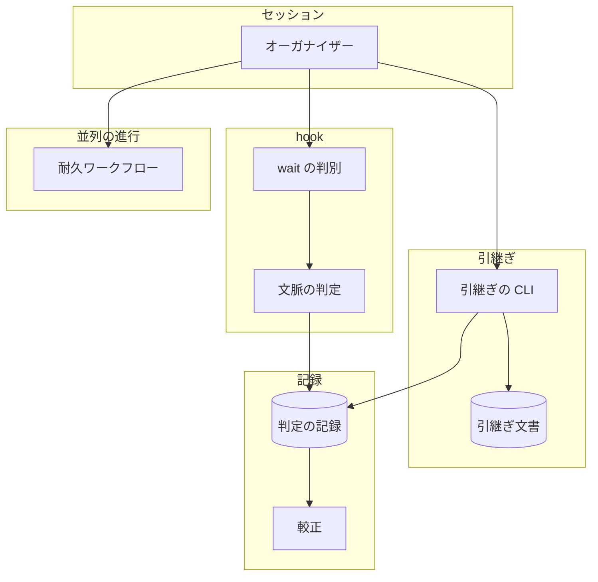
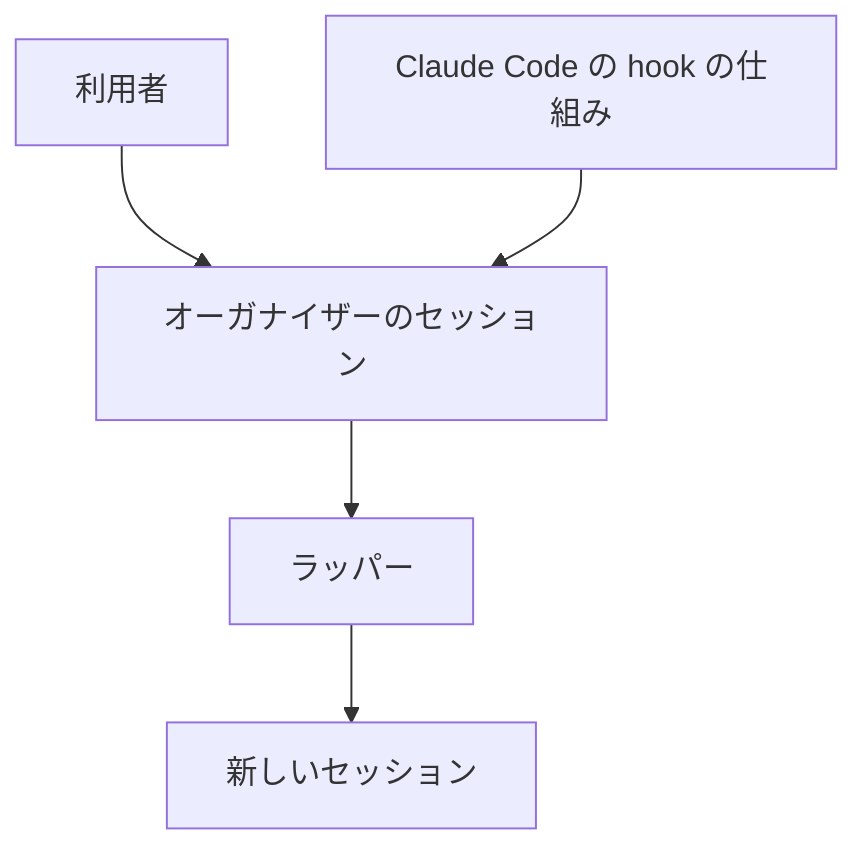
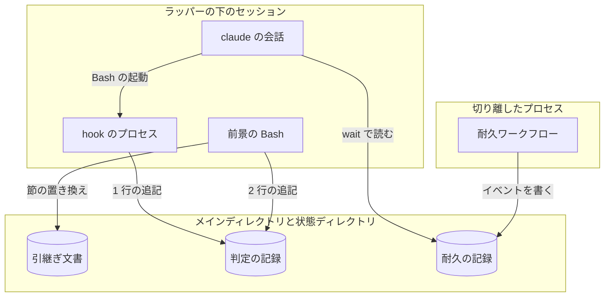
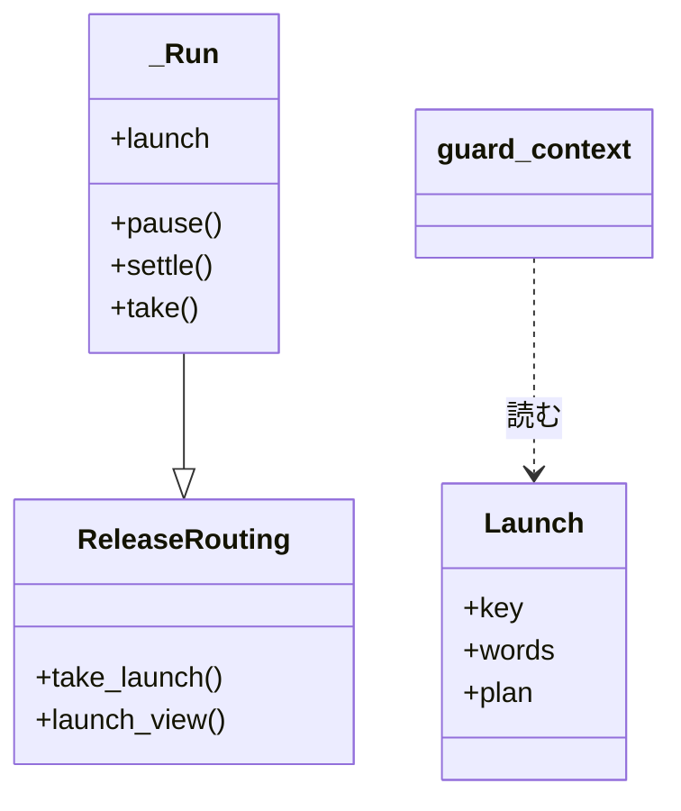
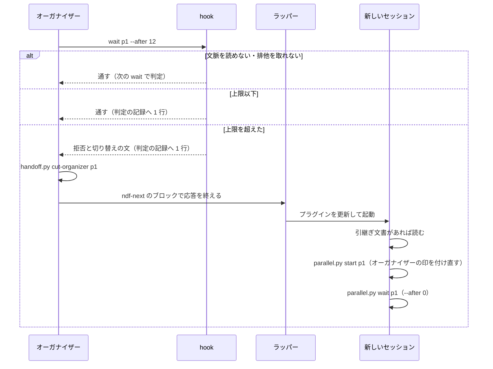
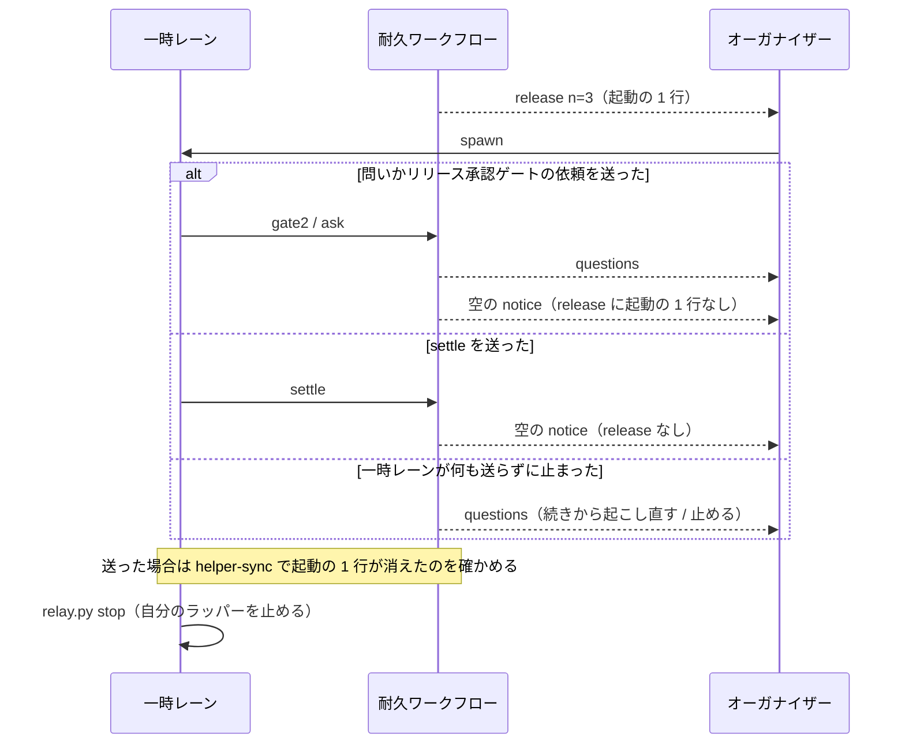
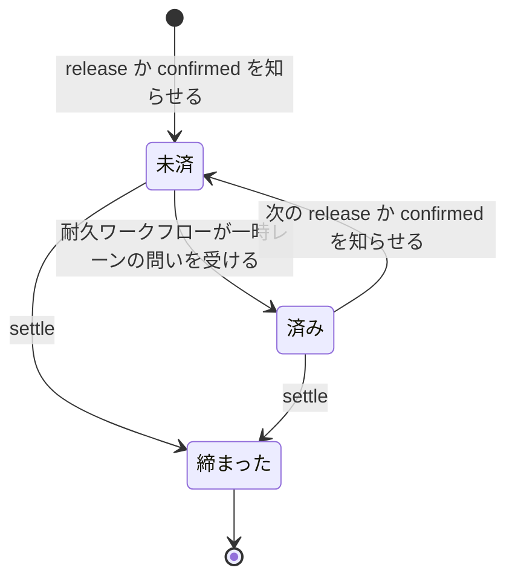

# 並列の計画のオーガナイザー: 文脈の上限で、ほかの conductor と同じに新しいセッションへ切り替える（#2595）

## 目的

- **今どうなっているか**: 文脈の上限の判定は工程の起動でしか働かず、オーガナイザーの 1 手はどれも対象に入らない。2026-11-04 15:00 JST に起動した計画 p3 のオーガナイザーは、判定を起動直後の 1 回しか受けずに文脈が 800k トークンを超えた。切り替えの手順が指す引継ぎ文書 `parallel-p1` は、名の形が違うため `handoff.py` が断る（終了コード 2）。切り替えの後に受けた古い起動の指示は、済んだ起動の指示を流し直す
- **誰に効くか**: 並列の計画を動かす利用者と、そのオーガナイザーの conductor
- **変えると何が成り立つか**: オーガナイザーは `wait` を打ち直す時点で上限の判定を受け、1 回の Bash で引継ぎを済ませて `ndf-next` を出す。新しいセッションは動いている耐久ワークフローをそのまま使い、済んだ作業を流し直さずに続ける

## 適用範囲

- **働く範囲**: NDF を使うすべてのリポジトリの、Claude Code のラッパーの下の並列の計画。Codex には hook もラッパーも無いため対象外である（前提 6）
- **プロジェクトごとに違うもの**: 無し。上限の値と再起動の方針は今の解決（`NDF_CONTEXT_LIMIT`・再起動の方針の設定）をそのまま使い、新しい設定は足さない
- **当たるモード**: `standard`（hook の振る舞いと工程の手順の変更）

## あるべき姿の根拠

| 根拠 | 種類 | 何を示すか |
| --- | --- | --- |
| 「オーガナイザーもconductorの1種である以上、他と同じルールでセッション再起動できるようにissueを起こして修正してください」（ https://github.com/devbasex/ai-plugins/issues/2595 ） | 利用者の指示の原文 | 判定の関数と上限を分けず、同じ規則を当てる |
| 文脈 800k で `parallel.py wait`・`answer`・`relay.py restart` を判定すると、3 件とも起動のキーなし・拒否なし（要求の「今の振る舞いの確認」） | 実測 | 判定に入らないことが原因で、上限の値の問題ではない |
| `handoff.py init parallel-p1 --title x` が終了コード 2、「名が loop-<名>・sprint-<名>・milestone-<番号>・issue-<番号> の形でない」（2026-11-07、一時のリポジトリで実行） | 実測 | 判定を足すだけでは、手順書どおりに切り替えられない |
| STD1 | 外部の一次情報 | 拒否の理由が Claude へ渡り、案内の文を次の 1 手へ使える |
| PRD1 | 外部の一次情報 | 実行が長くなる処理は、受信中の処理が終わった時点で新しい実行へ切り替える |
| PRD2 | 外部の一次情報 | 済んだかどうかは知らせの列でなく今の状態で決める |

要求と受け入れ条件は #2595 の本文にある（コピーは `issues/issue-2595-requirements.md`）。この文書は「どう作るか」だけを扱う。

要求の未決のうち、2（古い起動の指示を見分ける手段）は決定 5、3（記録を出すエントリポイント）は決定 4 で決める。未決 1（今動いている計画の切り替えの時期）はリリース承認ゲートへ残す。

## ドメインモデル

### コンテキスト

| コンテキスト | 何の語が 1 つの意味に決まるか |
| --- | --- |
| NDF の開発ワークフロー（`ndf-workflow`） | オーガナイザー・カットポイント・判定の記録・引継ぎ文書・一時レーン・起動の指示 |
| NDF のラッパー（`ndf-relay`） | `ndf-next`・切り替え・直接の子 |

2 つの関係は共有カーネルとする。どちらも同じリポジトリが持つ。共有するのは、`ndf-next` のブロックを受けてセッションを切り替える約束と、ラッパーの下かどうかの判定（`relay.py notice`）の 2 つである。

### 集約

| 集約 | 持ち主（書き換えてよいもの） | 根 | エンティティ | 値オブジェクト |
| --- | --- | --- | --- | --- |
| 文脈の判定 | 文脈の上限の hook（`hook_lib/token_guard.py`） | 起動 1 回の判定 | — | 起動のキー・計画名・方針の適用値 |
| 判定の記録 | `lib/context_decisions.py` | 記録のファイル | 行 | 工程の列の値・作業の識別子 |
| 並列の進行 | 耐久ワークフロー（`lib/parallel_run.py` の `_Run` と、その基底の `lib/parallel_route.py`） | 計画の 1 実行 | リリース | 起動の指示 |
| 引継ぎ文書 | `handoff.py` | 本体 | 節 | 名・再開コマンド |

`handoff.py cut-organizer` は引継ぎ文書を書き換え、判定の記録へ追記する。記録の行の形は `lib/context_decisions.py` が作る。記録に失敗しても引継ぎを止めないため、2 つの集約は結果整合で揃う（`sprint-state.py next` と同じ形）。

### 不変条件

| # | 集約 | 条件 | 破れたときの扱い |
| --- | --- | --- | --- |
| I1 | 文脈の判定 | 上限を超えた `parallel.py wait` は、ラッパーの下では何度打っても通らない。ラッパーの外では 2 回目の同じ起動を 1 度だけ通す | 拒否を返す |
| I2 | 文脈の判定 | 判定の対象は `parallel.py wait` だけである。`start`・`answer`・`confirm`・`settle`・`await` と `relay.py` の `spawn`・`restart`・`attach` は上限を超えても拒否しない | 拒否しない（答えの途中で切らない） |
| I3 | 文脈の判定 | 文脈の量を読めない・排他を取れない・構文を読めないときは `wait` を通す | 通して次の `wait` で判定する |
| I4 | 判定の記録 | `wait` の判定 1 回につき 1 行が足され、工程の列でオーガナイザーの `wait` を見分けられる。行の列は増えない | 書けなければ判定は変えない |
| I5 | 文脈の判定 | `parallel.py` の語を含まない Bash の起動には、この判定のための構文解析を足さない | 語の照合で先に返す |
| I6 | 文脈の判定 | `wait` の拒否の文は計画の起動の 1 行と `handoff.py cut-organizer` の 1 行を計画名で持ち、`<課題番号>` を持たない | 計画名を読めなければ `<計画名>` のまま出し、補うよう書く |
| I7 | 判定の記録 | 工程の列が `parallel:wait` の行は、工程ごとの費用の見込みの入力に入らない | 較正で読み飛ばす |
| I8 | 判定の記録 | 切り替え 1 回につき「引継ぎ開始」と判定「再起動」が 1 行ずつ残る。スプリントの状態ファイルは要らない | 書けなくても切り替えは止めない |
| I9 | 引継ぎ文書 | `cut-organizer` は引継ぎ文書を書けなくても再開コマンドを返す | 警告を返し、終了コードは 0 |
| I10 | 並列の進行 | 済んだ起動の指示は、`wait` の知らせに起動の 1 行を持たない | 空の知らせで上書きし、添えるときは起動の 1 行を除く |
| I11 | 並列の進行 | 一時レーンが読む流すもの（`helper_task` の `phase`）は、起動の指示が済んでも変わらない | 添える値は `action`・`n`・`k` を保つ |
| I12 | 並列の進行 | 古い記録のリプレイは同じ道を通る。空の知らせは新しい実行だけが出す | `durable.patched` が偽なら出さない |
| I13 | 並列の進行 | 一時レーンは、問い・リリース承認ゲートの依頼・`settle` を送った後、知らせ（`pause`）から自分の起動の 1 行が消えたことを `parallel.py helper-sync` で確かめてから自分のラッパーを止める | 90 秒で確かめられなければ警告を作業の報告へ書いて止まる |

### ドメインイベント

| # | イベント | 発生元 | 受け手 |
| --- | --- | --- | --- |
| E1 | オーガナイザーが知らせへの 1 手と答えの後の整理を終えた | オーガナイザー | 文脈の上限の hook（次の `wait`） |
| E2 | hook が `wait` の起動を受けた | Claude Code | 文脈の上限の hook |
| E3 | hook が文脈の量を読んだ | 文脈の上限の hook | 判定の関数 |
| E4 | 判定を記録した | 文脈の上限の hook | 較正・集計 |
| E5 | 上限を超えた起動を拒否した | 文脈の上限の hook | オーガナイザー |
| E6 | オーガナイザーが引継ぎ文書を更新し、`ndf-next` を出した | オーガナイザー（`handoff.py cut-organizer`） | ラッパー |
| E7 | ラッパーがプラグインを更新し、新しいセッションを起動した | ラッパー | 新しいセッション |
| E8 | 新しいセッションがオーガナイザーの印を付け直した | `parallel.py start` | 統括役 |
| E9 | 新しいセッションが答えていない問いを受け取った | `parallel.py wait` | 新しいセッション |
| E10 | 新しいセッションが古い起動の指示を受けた | `parallel.py wait` | 新しいセッション |
| E11 | 起動の指示が済んだ | 耐久ワークフロー | オーガナイザー（`wait`）と一時レーン（`helper-sync`）。E10 の知らせを上書きし、一時レーンはこの上書きを確かめてから止まる |

### 用語

| 用語 | 意味 | 用語集への反映 |
| --- | --- | --- |
| オーガナイザーのカットポイント | オーガナイザーが知らせへの 1 手と答えの後の整理を終え、`parallel.py wait` を打ち直す時点。文脈の上限の判定はここで行う | 追加（要求の変更で反映済み） |
| 起動の指示 | 耐久ワークフローがオーガナイザーへ一時レーンの起動を求める知らせ（`release`・`confirmed`）。起動の 1 行を持つ。耐久ワークフローが一時レーンの問いを受けるか、リリースが締まると済む | 追加 |
| 引継ぎの対象 | 引継ぎ文書 1 本が受け持つ仕事のまとまり（並列の計画・開発ループ・スプリント・マイルストーン・課題のどれか） | 意味の変更（並列の計画を足す） |
| 作業の識別子 | 複数のセッションを 1 つの作業として結ぶキー。課題番号の組（`#829 #830`）か、並列の計画のオーガナイザーなら `parallel:<計画名>` | 意味の変更（計画の形を足す） |

## 機能一覧

| # | 機能 | 誰が使うか |
| --- | --- | --- |
| F1 | 文脈が上限を超えたら `wait` を止め、切り替え方を案内する | オーガナイザーの conductor |
| F2 | 1 回の Bash で引継ぎ文書・記録・再開コマンドをそろえる | オーガナイザーの conductor |
| F3 | 切り替えの後に済んだ起動を重ねない | 新しいオーガナイザーのセッション |
| F4 | オーガナイザーの判定と再起動を記録から読む | 利用者・再起動の方針の見直し |

## 決定の記録

[issue-2595-design-decisions.md](issue-2595-design-decisions.md) にある。

## 構成要素

### 要素と責務

| 要素 | 責務 |
| --- | --- |
| `wait` の判別（`hook_lib/shell_checks.py` の `parallel_wait`） | コマンドの位置で起動する `parallel.py wait` を見つけ、計画名を返す。`supervise.py` の判別と同じ走査を共有する |
| 文脈の上限の hook（`hook_lib/token_guard.py`） | 起動のキーに `parallel` の種を足し、オーガナイザーの拒否の文を作る。判定の関数と排他は共有する |
| 計画の小さな部品（`lib/parallel_files.py`） | 計画名の形（`PLAN_RE`）と計画の起動の 1 行（`organizer_line`）の唯一の定義。pydantic と DBOS を import しない |
| 判定の記録（`lib/context_decisions.py`） | `stage_of` が `parallel:wait` を返す。引継ぎ開始の印の 1 行を書く `record_mark` を足し、`record_restart` が書き手の名を受ける |
| 較正（`lib/context_calibrate.py`） | 工程の区切りから `parallel:wait` の行を除く |
| 引継ぎの CLI（`handoff.py`） | 名の形に `parallel-<計画名>` を足す。`cut-organizer` を足す。`find` の照合の規則を足す |
| 並列の進行（`lib/parallel_route.py`・`lib/parallel_run.py`） | 起動の指示の済みの印を立て、知らせを今の状態へ合わせる。`step_finish` が引継ぎ文書を消す |
| 一時レーンの確かめ（`parallel.py` の `helper-sync`、`lib/parallel_helper.py`、`hook_lib/ask_guard.py`） | 知らせから起動の 1 行が消えるのを待つ。リリースの手順では `helper` の `metrics.sync`、問いの保留の手順では hook の文がその 1 行を渡す |
| 問いと一時レーンの CLI（`lib/parallel_helper_cli.py`） | `request-ask`・`request-gate2`・`helper`・`helper-sync` の副コマンドの本体。`lib/parallel_external_cli.py` と同じく、結果を出す関数 `reply` を受け取る。`parallel.py` には引数の定義と本体を呼ぶ 2 行だけを残す |
| 手順書（`references/parallel.md`・`context-window.md`・`handoff.md`・`conductor-entrypoints.md`、`restart` の `SKILL.md`、`parallel-plan.md`、`plugins/ndf/README.md` の hook の表） | オーガナイザーのカットポイント、止められたときの 3 手、文書の名と再開コマンドの例外 |
| 一時レーンの終わり方の手順書（`references/parallel.md` の「一時レーン」の手順 4、`references/asking.md` の保留の表） | 手順 4 は `relay.py stop` の前に `metrics.sync` の 1 行を打ち、`stopped` なら警告を作業の報告へ書く。保留の周回は `helper` を打たず `metrics.sync` を持たないので、問いを送っていなければ打たない。保留の表は 1 スプリントのレーンと一時レーンの行を分け、一時レーンの行に、`relay.py stop` の前に保留の手順が返す `helper-sync` の 1 行を打つことを足す |

変えないもの: `parallel.py` の既存の副コマンドの引数と出力の形（足すのは副コマンド `helper-sync` と `helper` の `metrics.sync` だけ）、ラッパー（`relay.py`）、上限の値と再起動の方針の解決。

### 足す値と、当てはまらない既存の規則

当てはまらない規則だけを変える対象として、要素と責務の表へ載せた。

| 足す値 | 当てはまらない既存の規則 | 変える先 |
| --- | --- | --- |
| 起動のキーの種 `parallel` | `stage_of` は知らない種を `plan` と読む | `lib/context_decisions.py` |
| 工程の列 `parallel:wait` | 較正の全工程（`*`）の見込みが、他の conductor の費用の判定へ効く | `lib/context_calibrate.py` |
| 引継ぎ文書の名 `parallel-<計画名>` | `NAME_RE`・名の誤りの文・`handoff.md` の名の表・`parallel-plan.md` の名の形。`match_words` は知らない頭を `sprint-` の規則で読み、入力の `p1` の語だけで一致する | `handoff.py`・手順書 |
| 引継ぎ文書の名 `parallel-<計画名>` | 再開コマンドは文書のパスを含める規則。オーガナイザーの再開コマンドは起動の 1 行である | `handoff.md`・`restart` の `SKILL.md`・`parallel.md` |
| 作業の識別子 `parallel:<計画名>` | `work_id` は数字の並びだけを通す | 文脈の上限の hook が `work_id` を通さずに渡す。`report --work`・`fill_work`・`last_denial`・`works` は文字列の一致なので当てはまる |

### 構成要素の関係



計画の小さな部品は呼ばれる関数だけ、手順書はコードから読まれないので、どちらも図に入れない。ラッパーは変えないので、次のシステムの文脈の図に置く。

### システムの文脈



### 配置

判定は Bash の呼び出しごとに動く hook のプロセスで動く。`cut-organizer` は Bash の前景のプロセスで動く。耐久ワークフローはセッションから切り離した `parallel.py run` のプロセスで動く。セッションをまたぐものは耐久の記録（SQLite）と引継ぎ文書だけである。



### 置き場

```text
plugins/ndf/scripts/
├── handoff.py                    # 名の形・cut-organizer・match_words
├── parallel.py                   # helper-sync の引数の定義。問いと一時レーンの副コマンドの本体を外へ移す
├── hook_lib/
│   ├── ask_guard.py              # 問いの保留の手順へ helper-sync の 1 行を足す
│   ├── shell_checks.py           # parallel_wait
│   └── token_guard.py            # 起動のキー・拒否の文
├── lib/
│   ├── context_calibrate.py      # 工程の区切り
│   ├── context_decisions.py      # stage_of・record_mark・record_restart
│   ├── parallel_files.py         # PLAN_RE を移す・organizer_line を足す
│   ├── parallel_helper.py        # helper の metrics.sync・helper-sync の確かめ
│   ├── parallel_helper_cli.py    # 問いと一時レーンの副コマンドの本体（新規）
│   ├── parallel_plan.py          # PLAN_RE を parallel_files から読む
│   ├── parallel_route.py         # 起動の指示の済みの印
│   └── parallel_run.py           # 呼び出しと step_finish
└── tests/
```

### 検査の手段

```bash
uv run --frozen --project . --all-extras pytest plugins/ndf/scripts/tests/test_token_guard.py plugins/ndf/scripts/tests/test_context_policy_hook.py plugins/ndf/scripts/tests/test_parallel_run.py plugins/ndf/scripts/tests/test_handoff.py -q
python3 scripts/check-script-structure.py
```

`parallel_run.py` は行数の例外に載っているため、起動の指示の処理は基底の `parallel_route.py` に置き、例外の上限を増やさない。

`parallel.py` は 500 行ちょうどで、行数の検査の上限 500 に例外が無い。`helper-sync` を足すと、説明の 1 行・引数の定義の 3 行・本体を呼ぶ 4 行・import の 1 行の計 9 行が増える。`parallel_run.py` と同じく例外を増やさないため、`request-ask`・`request-gate2`・`helper` の本体を `parallel_helper_cli.py` へ移して 20 行を減らし、489 行の見込みとする。`helper` と同じく `parallel_run` と `durable` は関数の中で import し、副コマンドの引数と出力の形は変えない。

## 構造



| 型 | 変更 |
| --- | --- |
| `Launch`（`hook_lib/token_guard.py`。新規の `NamedTuple`） | 起動のキー・課題番号を探す文・計画名の組。計画名がある起動はオーガナイザーの `wait` である |
| `ReleaseRouting`（`lib/parallel_route.py`） | `take_launch`・`launch_view` を足す |
| `_Run`（`lib/parallel_run.py`） | `launch` の辞書に `taken: true` を持てるようにする。列を増やさない |

`_Run.launch` の中に済みの印を持つのは、#2647 の台帳が `launch` を丸ごと保存するためである。新しい属性にすると、台帳の列を足す手間が増える。

## データ構造

**スキーマは変えない。** 判定の記録の列は増えず、次の値が増える。

| 列 | 増える値 | 行 |
| --- | --- | --- |
| `stage` | `parallel:wait` | オーガナイザーの `wait` の判定 |
| `work` | `parallel:<計画名>` | 同じ行と、切り替えの 2 行。計画名を読めないときは空 |
| `source` | `handoff` | 切り替えの 2 行 |

| 機能 | 引継ぎ文書 | 判定の記録 | 耐久の記録 |
| --- | --- | --- | --- |
| F1 | — | C | R |
| F2 | C・R・U | C・R | — |
| F3 | R | — | C（イベントの上書き）・R |
| F4 | — | R | — |

**耐久の記録のイベントの値。** `pause` の `action` は増えない。`spawn` を除いた `release` と、`lanes` が空の `notice` は、次の形で出る。

```json
{"seq": 41, "action": "notice", "lanes": [], "attach": []}
{"seq": 42, "action": "notice", "lanes": ["la"], "attach": ["python3 .../relay.py attach la"],
 "release": {"seq": 38, "action": "confirmed", "n": 3, "k": 1, "plan": ".../release.json", "taken": true}}
```

## 入出力の契約

### `wait` の判定

| 入力 | 判定 |
| --- | --- |
| Bash の `command` に `parallel.py` の語が無い | 構文解析をせず対象外 |
| コマンドの位置の語が、インタプリタ（フラグ可）・`env`・`nohup`・変数の代入を挟んで、最後のパス要素が `parallel.py` の語、続く語が `wait` | 対象。`--after`・`--timeout` とその値を除いた最初の語が計画名 |
| 引用・`echo` の引数・ヒアドキュメントの中 | 対象外 |
| `await`・`start` など他の副命令 | 対象外 |
| 構文を読めない | 対象外（通す） |

計画名の語が `PLAN_RE` に合わない（`$P` など）ときは `<計画名>` を返す。

### 拒否の文（ラッパーの下）

```text
会話の文脈が {total} トークンで、{over}。ラッパーの下なので、上限を超えている限りこの wait を止め続ける。
ここはオーガナイザーのカットポイントで、動いている耐久ワークフローは止めない。次の順で切り替える。
1. python3 {HERE}/handoff.py cut-organizer {plan} を打つ。
2. 計画に無い利用者の指示や保留があれば、引継ぎ文書 .ndf/handoff/parallel-{plan}.md の「進め方」か「次にやること」へ書く。
3. 次の 1 文をそのまま書き: {notice}
4. 情報文字列 ndf-next の囲みのコードブロック 1 つで次の 1 行を出して応答を終える:
/goal /ndf:development-workflow --parallel {plan} -- 終わり: [ndf-parallel] finished {plan} の行を出したとき
{plan} が <計画名> のままなら、動かしている計画の名前を補う。規約: {PARALLEL_DOC}（止めるなら NDF_CONTEXT_GUARD=0、上限は NDF_CONTEXT_LIMIT）
```

実際の文は 1 行で、`{over}` はほかの conductor と同じ `_trial_cause` の解決から作る。ラッパーの外では次の 2 点が変わる。

- 「ラッパーの下なので…」の文の代わりに「このまま続けると利用者が決めたら、同じ起動をもう一度行うと 1 度だけ通る」を置く
- 手順 3 の 1 文を除く

### `handoff.py cut-organizer <計画名> [--reason <理由>]`

計画名の引継ぎ文書 `parallel-<計画名>` を、切り替えの直前の形にする。順に次を行う。

1. 判定の記録へ「引継ぎ開始」を書く（作業の識別子 `parallel:<計画名>`）
2. 本体が無ければ題「並列の計画 <計画名> のオーガナイザー」でテンプレートから作る
3. 「次に実行するコマンド」を計画の起動の 1 行で置き換える
4. `check --trim` と同じ確かめを行う
5. 判定の記録へ判定「再起動」を書く（理由は `--reason`。省けば直前 30 分の同じ作業の拒否の理由を引き継ぐ）

| 結果 | 終了コード | 出力 |
| --- | --- | --- |
| そろった | 0 | `items[0]` に `path`・`block`、`metrics.plan` |
| 手順 2〜4 が失敗した（書けない・`.ndf/` が無い・節の形・行数） | 0 | 同じ `block` と、`metrics.warnings` に理由 |
| 計画名が `PLAN_RE` に合わない | 2 | 理由だけ（`<計画名>` のまま打ったとき） |

### 引継ぎ文書の名

`parallel-<計画名>` を足す。`find` の一致は `--parallel <計画名>` か `parallel-<計画名>`（後ろに英数字と `-` が続かない）の語だけとする。

### `wait` の知らせ（手順書の読み方）

| `wait` が返したもの | 切り替えの後の扱い |
| --- | --- |
| `metrics.release.spawn` が無い `release` | 打つものは無い |
| `lanes` が空の `notice` | `metrics.wake` があれば打ち、`--after <metrics.seq>` で打ち直す |
| `release`・`confirmed`・`held` と `metrics.release.spawn` | 打っていないものとして `spawn` の 1 行を 1 度打つ。断りの `name-taken` は同じ一時レーンが動いているので、打ち直さずに `wait` へ戻る |

### `parallel.py helper-sync <計画名> <連番>`

一時レーンが自分のラッパーを止める直前に打つ。耐久ワークフローの `pause` は、問いや `settle` を受けて `spawn` を除いた値へ上書きされるので、この値を確かめの印に使う。新しいイベントは足さない。

| 状態 | 返すもの | 一時レーンの次の手 |
| --- | --- | --- |
| `pause` の起動の指示（`pause` 自体か、添えた `release`）が別の連番か、`spawn` を持たない | `ok`（0） | 自分のラッパーを止める |
| 耐久ワークフローが終わっている | `ok`（0） | 自分のラッパーを止める |
| 90 秒を過ぎても `spawn` が残る | `stopped`（3）と警告 | 警告を作業の報告へ書き、自分のラッパーを止める |
| 耐久の記録を読めない | `stopped`（2） | 警告を作業の報告へ書き、自分のラッパーを止める |

上限の 90 秒は、受信を待つ最長の約 60 秒（`recv` の 2 回分）に観測の処理の分を足した値で、Bash の既定の上限 120 秒に収まる。止まる前の一時レーンは `name-taken` で重ねて起動されないため、待つ間に新しいセッションが古い `spawn` を打っても流し直しは起きない。古いコードの `run` の下では `spawn` が消えず、上限まで待って今の振る舞いと同じに止まる。

`helper` の出力の `metrics.sync` はこの 1 行を持つ。問いの保留の手順は、hook が一時レーンの名から連番を読んで同じ 1 行を組み、レーンの問いには足さない。保留の周回の一時レーンは `helper` を打たないので `metrics.sync` を持たず、問いを送ったときだけ hook の文の 1 行を打つ。

## 処理の流れ

### 切り替え



背景の作業が残っていれば、ラッパーの Stop hook は切り替えない（今の振る舞い）。`wait` は拒否で起動しないため、切り替えの時点で動く背景の `wait` は無い。

### 起動の指示が済む



### 起動の指示の状態



済みから「未済」へ戻るのは、新しい起動の指示である（同じ指示は戻らない）。

## 非機能の実現方式

| 大項目 | 要求の条件 | 実現方式 | 確かめ方 |
| --- | --- | --- | --- |
| 可用性 | hook の判定が失敗しても `wait` を塞がない。塞ぐのは上限を超えたと判定できたときだけである | 量を読めない・排他を取れない・構文を読めないときは今の経路で `None` を返す | 3 つの場合の単体テスト |
| 性能・拡張性 | `parallel.py` の語を含まない Bash の起動に、構文の解析を足さない | `parallel_wait` の先頭で語の照合を行い、無ければ返す | 解析の関数を呼ぶと失敗する偽物でテストする |
| 運用・保守性 | 判定の記録の増加は `wait` 1 回につき 1 行に収める | 判定 1 回に `append_decision` 1 回の今の経路を通す | 行数を数えるテスト |
| 移行性 | 判定の記録の形を変えない。動いている計画は、リリースの後の次の切り替えから新しい判定を受ける（前提 5） | 列を足さない。`pause` の追加は `durable.patched` で分け、古い記録のリプレイは同じ道を通す | 記録を読むテストと、`patch-` の印の無い記録のリプレイのテスト |

## 設計の結果

| 課題 | 扱い | 取り込み先 | 触るファイル |
| --- | --- | --- | --- |
| #2595 | 実装する | — | `plugins/ndf/scripts/hook_lib/token_guard.py`、`plugins/ndf/scripts/hook_lib/shell_checks.py`、`plugins/ndf/scripts/hook_lib/ask_guard.py`、`plugins/ndf/scripts/handoff.py`、`plugins/ndf/scripts/parallel.py`、`plugins/ndf/scripts/lib/context_decisions.py`、`plugins/ndf/scripts/lib/context_calibrate.py`、`plugins/ndf/scripts/lib/parallel_files.py`、`plugins/ndf/scripts/lib/parallel_helper.py`、`plugins/ndf/scripts/lib/parallel_helper_cli.py`、`plugins/ndf/scripts/lib/parallel_plan.py`、`plugins/ndf/scripts/lib/parallel_route.py`、`plugins/ndf/scripts/lib/parallel_run.py`、`plugins/ndf/scripts/tests/`、`plugins/ndf/skills/development-workflow/references/`、`plugins/ndf/skills/restart/SKILL.md`、`plugins/ndf/skills/issue-plan-strategy/references/parallel-plan.md`、`plugins/ndf/README.md`、`docs/glossary.md`、`docs/glossary/glossary.json` |

## テスト設計

| 受け入れ条件・不変条件 | どの振る舞いで縛るか | どう壊したら落ちるべきか |
| --- | --- | --- |
| 1 / I1 | ラッパーの下で上限を超えた `wait` が `deny` になる | `wait` を起動のキーから外すと落ちる |
| 2 | 上限以下の `wait` は拒否されない | 上限の比べ方を逆にすると落ちる |
| 3 | 背景・`env`・代入・`&&`・`;`・`"$NDF_SCRIPTS/parallel.py"`・`--after` が前の形で同じに判定し、計画名を返す。`echo` の引数と `my-parallel.py` は対象外 | 文字列の部分一致にすると落ちる |
| 4 / I2 | `start`・`answer`・`confirm`・`settle`・`await`・`relay.py` の 3 つは上限を超えても通る | 判定を `parallel.py` の語だけにすると落ちる |
| 5 | ラッパーの下は同じコマンドを打ち直しても拒否、外は 2 回目を 1 度だけ通す | 起動のキーに時刻を混ぜると外で落ち、止め続けを外すと下で落ちる |
| 6 / I3 | 量を読めない・排他を取れない・構文を読めないときに通り、次の `wait` で判定する | 量が無いときに拒否すると落ちる |
| 7 / I4 | 判定 1 回で 1 行増え、`stage` が `parallel:wait`、`work` が `parallel:p1`。その記録で `calibrate` が成功する | `stage_of` の分岐を外すと `plan` になって落ちる |
| I5 | 語の無い Bash では構文解析を呼ばない | 語の照合を消すと落ちる |
| 8 / I6 | 文が起動の 1 行と `parallel-p1` を持ち、`<課題番号>` を持たない。読めない計画名では `<計画名>` になる | ほかの conductor の文を流用すると落ちる |
| 9 | 試行方式の理由の句と `NDF_CONTEXT_LIMIT` の値が文に載る | 上限を固定の文字にすると落ちる |
| 10 | `NDF_CONTEXT_GUARD=0` とサブエージェントの中で判定も記録もしない | 判定を環境変数の検査より前に置くと落ちる |
| I7 | `parallel:wait` の行を足しても `stage_calls` の `*` が変わらない | 除外を外すと落ちる |
| 11 | 動いている耐久ワークフローへ `start` を打つと 2 本目を起動せず今の pid、`metrics.organizer` が true | オーガナイザーの印を付け直さないと落ちる |
| 12 | 答えていない問いが残る状態で `wait --after 0` から `seq` で打ち直し、全件が届く | `wait_from` を最新の 1 件だけ返す形にすると落ちる |
| 13 / I10 | 一時レーンの問い・リリース承認ゲートの依頼・`settle` の後に、知らせへ `spawn` が残らない。一時レーンから何も届いていない指示には `spawn` が残る。`held` の古い 1 行は `loop pending` が `none` で終える | 済みの印を立てないと落ち、起動の前に済みの印を立てると未済の指示を失って落ちる |
| 13 / I13 | `helper-sync` は `spawn` が残る間は返らず、`pause` の上書きか耐久ワークフローの終わりで `ok` を返す。別の連番の起動の指示では待たない。90 秒で `stopped`（3）を返し、`metrics.sync` と問いの保留の手順がこの 1 行を持つ | `spawn` を見ずに返すと落ち、自分の連番と別の連番を区別しないと次のリリースで待ち続けて落ちる |
| I11 | 問いの後の知らせでも `helper_task` が `confirmed` を返す | `release` ごと消すと `present` になって落ちる |
| I12 | `parallel-route` より前の形の記録をリプレイしても `DBOSUnexpectedStepError` にならない | `patched` を外すと落ちる |
| 14 / I8 | スプリントの状態ファイルなしで `cut-organizer` が 2 行を残し、理由を直前の拒否から引き継ぐ | 書き手を `sprint-state` の経路に戻すと落ちる |
| I9 | `.ndf/` が無い・書けないときも 0 で `block` を返す | 文書の失敗を終了コードへ流すと落ちる |
| 15 | `parallel.md` と `context-window.md` のカットポイントの節を、人が読んで問いに答える（文言のテストは書かない） | 完了判定で読み手の確認が通らない |
| 15 / I13 | `parallel.md` の一時レーンの手順 4 と `asking.md` の保留の表を、人が読んで「`relay.py stop` の前に何を打つか」「保留の周回で打つか」に答える（文言のテストは書かない） | 完了判定で読み手の確認が通らない |
| 16 | 使い捨てのラッパーの下で、大きな文脈の記録を渡したオーガナイザーの判定から `ndf-next`・次のセッションの `start`・`wait --after 0` までを 1 回通し、問いが届く | 実装の通し確認。背景の `wait` の拒否もここで見る |
| 17 | リリース後に動いている計画で 1 回切り替わり、判定の記録に複数の判定の行と再起動の行が残り、計画が続く | リリース後テスト（人が記録と `relay.py ls` を見る） |

## 未確認のまま残ること

| 項目 | 内容 |
| --- | --- |
| 今動いている計画の切り替えの時期 | 動いているオーガナイザーのセッションと `run` のプロセスは、リリースの後も古いコードで動く。人が `/ndf:restart` を打つと新しい判定へ移るが、`run` は古いままなので、最初の切り替えの後は古い起動の指示を打つと流し直しが起きうる。時期はリリース承認ゲートで利用者が決める（要求の未決 1） |
| `/ndf:restart` の再開コマンド | `restart` の表に計画の起動の 1 行を足す。実行の確認はリリースの前に受け入れ条件 16 の通し確認で行う |
| 確かめきれない切り替えの競合 | `helper-sync` が 90 秒で確かめられずに一時レーンが止まると、古い `spawn` が残り、次の `wait --after 0` で流し直しが起きうる。`wait` が古い `spawn` を返してからオーガナイザーが打つまでの間に一時レーンが止まった場合も同じである。どちらも起きる頻度は未測定で、測った結果で扱いを決める |
| 空の `notice` の増分 | リリース 1 本につき 2 回、オーガナイザーの 1 手が増える。増える費用は未測定である |
| #2647 との衝突 | #2647 の設計は `_Run` の値を台帳へ保存し、観測を別のモジュールへ移す。済みの印は `launch` の辞書の中なので列は増えない。どちらが先でも、後からマージする側が `parallel_run.py` の差分を取り込み直す |

## 外部の調査

| 種類 | 調べるか | 理由 |
| --- | --- | --- |
| 標準・仕様 | 調べる | hook の拒否の振る舞いは Claude Code の仕様で決まる |
| 主要な製品 | 調べる | 長く動く処理の切り替えと、知らせの再配信の扱いに定着した形がある |
| ライブラリとサービス | 調べる | 耐久ワークフローへ知らせを足すとき、依存している DBOS の版の分岐を使えるかを確かめる |

### 標準・仕様

| # | 標準・仕様 | 何を定めているか | 設計への反映 | 出典 |
| --- | --- | --- | --- | --- |
| STD1 | Claude Code の hooks の PreToolUse | `deny` は呼び出しを止め、`permissionDecisionReason` は Claude に示される。PreToolUse は permission の要否に依らず毎回の呼び出しの前に動く | 案内は拒否の文に載せる。背景の起動（`run_in_background: true`）も Bash の呼び出しとして判定に入る | https://code.claude.com/docs/en/hooks （2026-11-07）。ページ末尾の約 1 万字は読んでいない |

### 主要な製品

| # | 製品 | どう解いているか | 設計への反映 | 出典 |
| --- | --- | --- | --- | --- |
| PRD1 | Temporal の Continue-As-New | 履歴が長くなった実行は、同じ Workflow Id の新しい実行へ切り替える。判断は `is_continue_as_new_suggested()` を実行の中で読む。切り替えは受信の処理が終わるのを待ってから行い、状態は引数で明示して渡す | 切る時点を「知らせの処理が終わり `wait` を打ち直す前」に置く。状態は耐久の記録が持つので、再開コマンドは計画名だけでよい | https://docs.temporal.io/develop/python/continue-as-new （2026-11-07） |
| PRD2 | Kubernetes のコントローラ | コントローラは今の状態を望ましい状態へ近づける。出来事の列でなく状態を見て動く | 古い知らせの処理を受け手の推定に任せず、知らせの値そのものを今の状態へ合わせる | https://kubernetes.io/docs/concepts/architecture/controller/ （2026-11-07。取得は本文の要約で、原文の確認は未） |

### ライブラリとサービス

| # | 候補 | 版 | ライセンス | 最後のリリースの日付 | 終了のアナウンス | 要件を満たすか | 出典 |
| --- | --- | --- | --- | --- | --- | --- | --- |
| LIB1 | DBOS の `patch`（依存にある） | 3.1.0（固定）。最新 3.4.0 | MIT | 3.1.0 は 2026-09-24、3.4.0 は 2026-10-28 | 無し（PyPI の分類は Production/Stable） | 満たす。記録の位置に別の行があれば偽を返して何も足さず、無ければ印を書いて真を返す。`patch-` の印は `parallel_run.py` の `parallel-route` で使っている | https://docs.dbos.dev/python/tutorials/upgrading-workflows ・ https://pypi.org/pypi/dbos/json （2026-11-07）・`dbos/_dbos.py` の `patch`（venv の 3.1.0） |

### 確かめられなかったこと

| 対象 | 試した手段 | 結果と理由 |
| --- | --- | --- |
| 背景の起動が PreToolUse を通ることの文書の明記 | https://code.claude.com/docs/en/hooks | 明記は無い。「すべての Tool の呼び出しの前」からの読みである。今の `guard_sleep` が `tool_input.run_in_background` を読んでいる。受け入れ条件 16 の通し確認で実物を見る |
| `set_event` が DBOS の記録のステップか | 上の DBOS の文書 | 文書に記載が無い。今のコードで `pause` の呼び出しの追加を `patched` で分けているので、結論に依らない形にした |
| Temporal の Idempotency の記述 | https://docs.temporal.io/activity-execution | 取得したページに冪等キーの節が無い。設計はこの記述に依らない |

調べた量: 候補 4 件・取得の試み 6 回。
