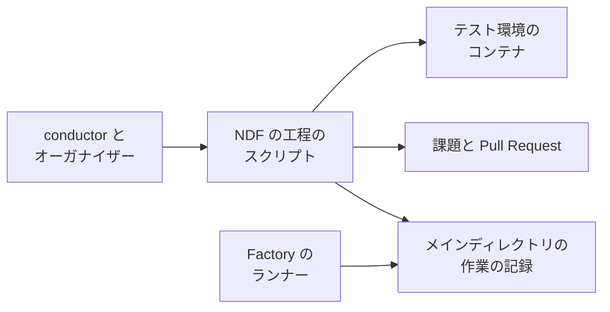
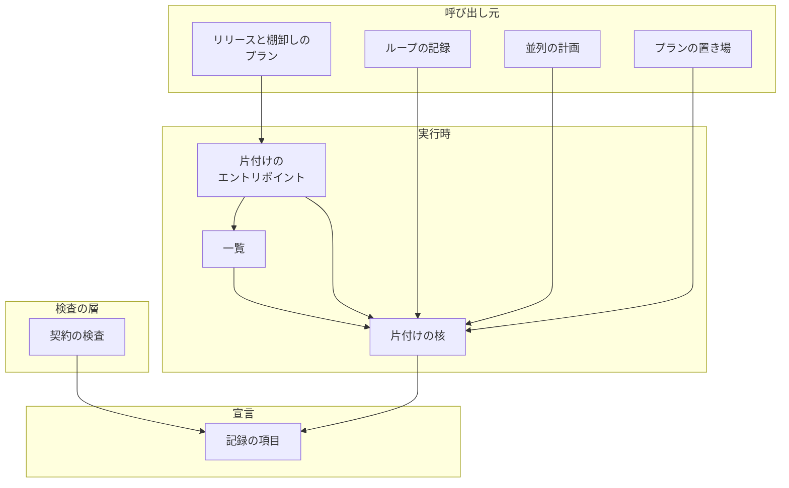
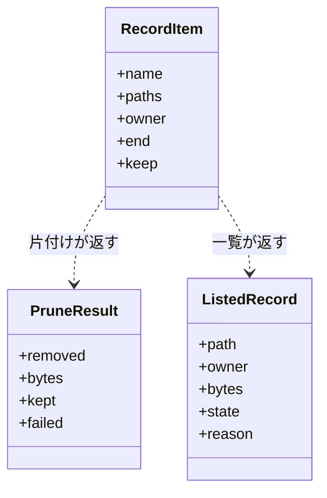
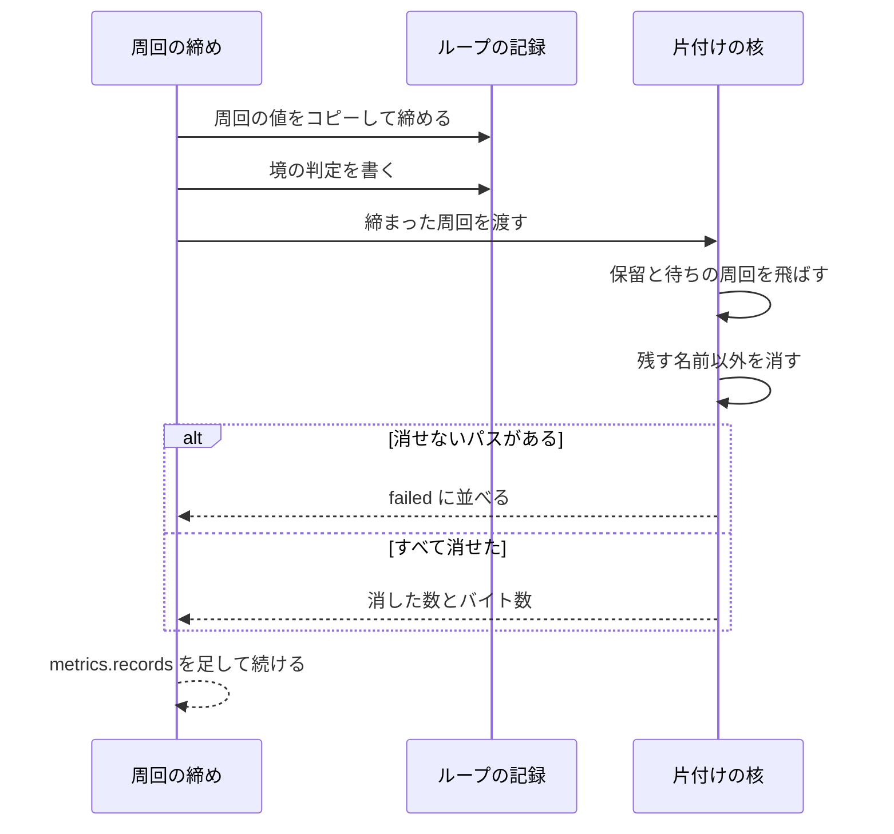
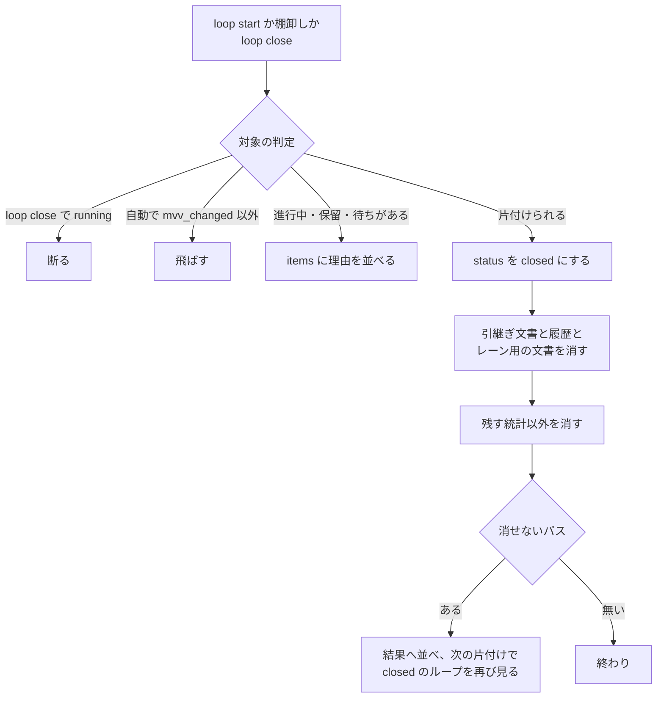
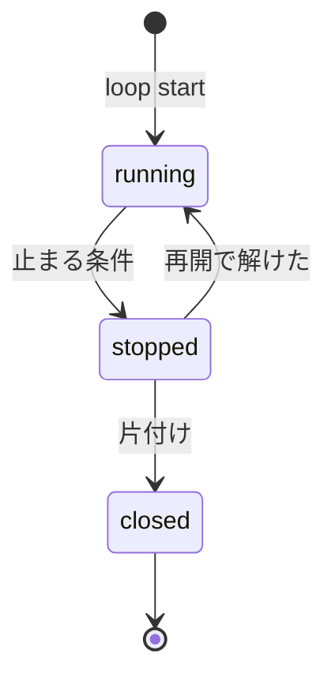

# 作業の記録: 置き場・持ち主・終わりを契約で固定し、スクリプトが片付ける（#2600）

## 目的

- **今どうなっているか**: 工程が書くファイルの多くに持ち主と終わりが定まっておらず、手で 13 MB まで減らした `.ndf/` が翌日に 182 MB へ戻った（2026-11-07 実測）。`--out` の置き場は AI が選び、`handoff.md` の「消す」手順を打つ工程が無い
- **誰に効くか**: 開発ループと並列の計画を回す conductor・オーガナイザーと、ディスク・`git status`・再開の文書探しで影響を受ける利用者
- **変えると何が成り立つか**: 周回・ループ・並列の計画・スプリント・リリースが終わると、統計だけを残して記録が自動で消える。取りこぼしは棚卸しの一覧で拾える。契約に無いパスを使うスクリプトは検査で落ちる

## 適用範囲

- **働く範囲**: `.ndf/` を持つどのリポジトリでも働く。片付けの対象はメインディレクトリの契約に載るパスだけで、`$TMPDIR` の下とリポジトリの外は対象にしない
- **プロジェクトごとに違うもの**: 無い。置き場と終わりは NDF の契約が持ち、ベースブランチやデプロイの手段に依存しない
- **当たるモード**: `standard`。片付けはモードを問わず、スクリプトの中で動く

## あるべき姿の根拠

| 根拠 | 種類 | 何を示すか |
| --- | --- | --- |
| 「すべてについて言えますが、手順書ではなく、スクリプトで固定する方が良いです」 | 利用者の指示の原文 | 決まりの置き場をスクリプトと契約にする |
| 「終ったloopの情報などは統計量以外は不要」 | 利用者の指示の原文 | 消す範囲を統計以外に広げてよい |
| 「特にファイルやvolumeの後片付けは優先して企画設計し、実装する」 | 利用者の指示の原文 | 周回の単位で早く消す |
| `.ndf/loop/lflow3/lap-3/sprint/3-impl-2623-state/work/` が 162 MB（動いているループの 1 プラン） | 実測 | ループの終わりを待つと減らない |
| 20 周回の `lroot3` の残す統計は 900 KB | 実測 | 統計を残しても容量の問題にならない |
| PRD1（終わった Job を消す）・STD1（宣言の表で片付ける） | 外部の一次情報 | 持ち主の終わりで消す形と、宣言の表で持つ形に前例がある |

要求と受け入れ条件は #2600 の本文にある（コピーは [issue-2600-requirements.md](issue-2600-requirements.md)）。この文書は「どう作るか」だけを扱う。

## ドメインモデル

### コンテキスト

| コンテキスト | 何の語が 1 つの意味に決まるか |
| --- | --- |
| 開発ワークフロー（`ndf-workflow`） | 作業の記録・持ち主・終わり・残す統計・閉じたループ |
| 課題の管理（`ndf-issue-upkeep`） | 棚卸しの工程で出す一覧 |
| リリース（`ndf-release`） | 承認資料を消す時点 |

3 つの関係は**公開された言語**とする。契約の項目（`plugins/ndf/contracts/files/`）を文書化された共通の形式とし、各コンテキストと Factory のランナーはこの形式を読むだけで互いに独立して変わる。

### 集約

| 集約 | 持ち主（書き換えてよいもの） | 根 | エンティティ | 値オブジェクト |
| --- | --- | --- | --- | --- |
| 記録の項目 | 契約のファイル（人が編集し、`check-ndf-contracts.py` が検査する） | 項目 | — | パスのパターン・持ち主の種類・終わりの種類・残す名前 |
| ループの記録 | `sprint_loop*.py`（`sprint-state.py loop`） | ループ | 周回・待ちの行 | 止まった条件 |
| 作業の記録の実体 | `work_records.py` だけが消す | 持ち主ごとのディレクトリ | ファイル | 片付けの結果 |

### 不変条件

| # | 集約 | 条件 | 破れたときの扱い |
| --- | --- | --- | --- |
| I1 | 記録の項目 | すべての項目が持ち主と終わりを持つ | `check-ndf-contracts.py` が 0 以外で終わる |
| I2 | 記録の項目 | スクリプトが使う `.ndf/`・`issues/` の下のパスは、契約のパターンか設定のファイルに当たる | 検査が `path-undeclared` で落ちる |
| I3 | 作業の記録の実体 | 片付けは追跡ファイルを消さない | そのパスを消さず、理由を結果へ並べる |
| I4 | 作業の記録の実体 | 片付けの対象はメインディレクトリの契約に載るパスだけで、`..`・絶対パス・シンボリックリンクの先をたどらない | そのパスを消さず、理由を結果へ並べる。リンクはリンク自体だけを消す |
| I5 | 作業の記録の実体 | 進行中・保留の周回と、答えの無い待ちの行か承認済みでマージが済んでいない待ちの行が指す周回の中身は減らない | その周回を飛ばす |
| I6 | ループの記録 | 自動の片付けの対象は `mvv_changed` で止まったループだけである | 対象の判定で飛ばす |
| I7 | ループの記録 | 進行中の周回・保留の周回・答えの無い待ちの行があるループは閉じない。`running` のループは閉じない | `loop close` が 0 以外で断り、`items` に理由を並べる |
| I8 | ループの記録 | 閉じたループは再開しない | `loop start` と周回の副命令が 0 以外で断る |
| I9 | 作業の記録の実体 | 片付けは何度打っても同じ結果になり、失敗はループと並列の計画を止めない | 消せないパスを結果へ並べ、次の片付けで同じパスを対象にする |
| I10 | 記録の項目 | スプリントのプランの置き場は `.ndf/sprints/<名>/` と周回の下に限る。リポジトリの外は通す | `new sprint`・`new close` が何も作らず 0 以外で終わる |
| I11 | 作業の記録の実体 | 実行計画は投稿が成功してから消す | ファイルを残して 0 以外で終わる |
| I12 | 作業の記録の実体 | 動いている並列の計画と、承認を待つ提示がある並列の計画は減らない | その計画を飛ばす |

### ドメインイベント

| # | イベント | 発生元 | 受け手 |
| --- | --- | --- | --- |
| E1 | プランの置き場を決めた | `supervise.py new` | `sprint_out` のパスの検査 |
| E2 | 周回を締めた | `after_close` | 周回の片付け |
| E3 | 周回の残す統計以外を消した | 周回の片付け | 結果の `metrics.records` |
| E4 | ループが終わった | `mvv_changed` の止まり・`loop close` | ループの片付け |
| E5 | ループの記録を片付けた | ループの片付け | 結果の `items`・`laps.md` |
| E6 | 並列の計画が終わった | `_finish_or_hold` の `finished` の経路 | 並列の計画の片付け |
| E7 | 並列の計画の記録を片付けた | 並列の計画の片付け | 計画の終わりの要約（`run.summary`） |
| E8 | 承認資料を消した | リリースのプランの最後のステップ | プランの報告 |
| E9 | 実行計画を PR へ投稿して消した | `records.py close-plan` | conductor |
| E10 | 終わった記録の一覧を出した | 棚卸しのプランのステップ | 棚卸しの AI |

### 用語

| 用語 | 意味 | 用語集への反映 |
| --- | --- | --- |
| 作業の記録 | 工程の実行が書く、追跡しないファイルとディレクトリ。プラン・周回の記録・引継ぎ文書・承認資料を指す | 追加（`ndf-workflow`） |
| 記録の持ち主 | 作業の記録を作り、それを片付ける責任を持つ実行の単位（ループ・並列の計画・スプリント・リリースのプラン・conductor） | 追加（`ndf-workflow`） |
| 記録の終わり | 作業の記録が要らなくなる時点。持ち主の状態で判定できる形で書く | 追加（`ndf-workflow`） |
| 残す統計 | 作業の記録を片付けた後も残すファイル。費用・秒・周回の結果を後から集計するために使う | 追加（`ndf-workflow`） |
| 持ち主不明 | 名の形が契約のどのパターンにも当たらない作業の記録 | 追加（`ndf-workflow`） |
| 閉じたループ | 片付けを済ませ、再開しないと決まった開発ループ。記録の状態は `closed` | 追加（`ndf-workflow`） |

## 機能一覧

| # | 機能 | 誰が使うか |
| --- | --- | --- |
| F1 | 契約の項目に持ち主・終わり・パス・残す名前を持たせ、欠けと契約外のパスを検査で落とす | NDF の開発者 |
| F2 | スプリントのプランの置き場を固定し、外を指す `--out` を断る | conductor |
| F3 | 周回を締めると、その周回の残す統計以外が消える | 開発ループ |
| F4 | `mvv_changed` のループを次の `loop start` と棚卸しが片付ける | 開発ループ・棚卸し |
| F5 | `loop close <名>` で再開で解けるループを閉じる | conductor・利用者 |
| F6 | 並列の計画が `finished` になると記録が片付く | オーガナイザー |
| F7 | ループの外のスプリントのまとめが最後まで通ると記録が片付く | conductor |
| F8 | リリースのプランの最後のステップが承認資料を消す | リリースのプラン |
| F9 | 実行計画を PR へ投稿してから消す | conductor |
| F10 | 棚卸しのプランが終わった記録の一覧を出す | 棚卸しの AI |
| F11 | Factory のランナーが新しい置き場を保存する | Factory |

## 決定の記録

決定の記録は [issue-2600-design-decisions.md](issue-2600-design-decisions.md) にある。

## 外部の調査

| 種類 | 調べるか | 理由 |
| --- | --- | --- |
| 標準・仕様 | 調べる | 一時ファイルの片付けを宣言で持つ形と、状態ファイルの置き場に公開の仕様がある |
| 主要な製品 | 調べる | 終わった実行の記録を消す仕組みは、ワークフローの製品と CI が持つ |
| ライブラリとサービス | 調べる | パスの照合を自前で書くか決める |

### 標準・仕様

| # | 標準・仕様 | 何を定めているか | 設計への反映 | 出典 |
| --- | --- | --- | --- | --- |
| STD1 | systemd の `tmpfiles.d` | パス・持ち主・片付けの経過時間を 1 行に持つ宣言の表で、作成と片付けをまとめて定める | 宣言の表（契約の項目）にパスと持ち主を持たせる形を採る。経過時間の欄は採らない（決定 2） | https://www.freedesktop.org/software/systemd/man/latest/tmpfiles.d.html （2026-11-07） |
| STD2 | XDG Base Directory Specification | `$XDG_STATE_HOME` を利用者ごとの状態ファイルの基底とする | リポジトリの外の置き場は既存の `sv_state_home` のまま変えない | https://specifications.freedesktop.org/basedir-spec/latest/ （2026-11-07） |

### 主要な製品

| # | 製品 | どう解いているか | 設計への反映 | 出典 |
| --- | --- | --- | --- | --- |
| PRD1 | Kubernetes の TTL-after-finished | 終わった Job を、完了か失敗の時点から一定の秒の後に消す。消えるのは持ち主の状態が終わった後である | 持ち主の状態を引き金にする形を採る | https://kubernetes.io/docs/concepts/workloads/controllers/ttlafterfinished/ （2026-11-07） |
| PRD2 | Kubernetes の owner reference とガベージコレクション | 依存するものが持ち主を指し、持ち主が消えると連鎖して消える。持ち主の無いものも回収の対象になる | 持ち主の無いものを「持ち主不明」として一覧へ出す | https://kubernetes.io/docs/concepts/architecture/garbage-collection/ （2026-11-07） |
| PRD3 | Argo Workflows の `ttlStrategy`・`podGC` | 完了から一定の秒の後に実行の記録を消し、Pod はより早く、完了と同時にも消せる | 重い部分（作業の置き場）を先に、記録の本体を後で消す順を採る | https://raw.githubusercontent.com/argoproj/argo-workflows/main/docs/cost-optimisation.md （2026-11-07） |
| PRD4 | Jenkins の `buildDiscarder` | 直近の実行の数で成果物とログを保持し、古いものを捨てる | 件数で切る形は採らない（再開で要る周回が件数で決まらない） | https://www.jenkins.io/doc/book/pipeline/syntax/ （2026-11-07） |
| PRD5 | GitHub Actions の成果物の保持期間 | 成果物に保持期間を持たせ、期限で消す。消した成果物は戻せない | 戻せない削除である点を受け入れ、残す統計を先に決める | https://docs.github.com/en/actions/how-tos/manage-workflow-runs/remove-workflow-artifacts （2026-11-07） |
| PRD6 | Docker の `prune` | 使われていないものを種類ごとの命令で片付ける。ラベルで絞れる | ボリュームの一覧は compose のラベルで絞る | https://docs.docker.com/engine/manage-resources/pruning/ （2026-11-07） |

### ライブラリとサービス

| # | 候補 | 版 | ライセンス | 最後のリリースの日付 | 終了のアナウンス | 要件を満たすか | 出典 |
| --- | --- | --- | --- | --- | --- | --- | --- |
| LIB1 | pathspec | 1.1.1 | MPL-2.0 | 2026-04-27 | 無し | 満たす。gitignore の形の照合で、依存が 1 つ増える | https://pypi.org/pypi/pathspec/json （2026-11-07） |
| LIB2 | wcmatch | 12.0 | MIT | 2026-11-03 | 無し | 満たす。`**` の照合で、依存が 1 つ増える | https://pypi.org/pypi/wcmatch/json （2026-11-07） |
| LIB3 | Python 標準の `fnmatch`・`shutil` | 実行環境の Python | PSF-2.0 | 実行環境に従う | 無し | 満たす。契約の検査が既に `fnmatch` で照合している（`scripts/check-ndf-contracts.py:119`） | `scripts/check-ndf-contracts.py`（2026-11-07） |
| LIB4 | `systemd-tmpfiles` | 実行環境に従う | LGPL-2.1 | 実行環境に従う | 無し | 満たさない。判定が経過時間で、持ち主の状態を見られず、systemd の無いコンテナで動かない | STD1 の出典（2026-11-07） |

### 確かめられなかったこと

| 対象 | 試した手段 | 結果と理由 |
| --- | --- | --- |
| `git gc` の保持期間の形 | https://git-scm.com/docs/git-gc | 取得はできたが設計へ反映する点が無く、候補の表へ載せない |

調べた量: 候補 12 件・取得の試み 13 回。

## 構成要素

| 要素 | 責務 |
| --- | --- |
| 記録の項目（`plugins/ndf/contracts/files/*.json`） | 34 項目へ `owner`・`end` を足す。新しい項目（「新設する記録の項目」の章）を足す |
| 契約の検査（`scripts/contracts_lib/model.py`・`extract_py.py`・`extract_sh.py`・`render.py`、`scripts/check-ndf-contracts.py`） | 欄の欠けを `ContractError` で落とす。`path-undeclared` を足す。一覧へ持ち主・終わり・パスの列を描く |
| 片付けの核（新設 `plugins/ndf/scripts/lib/work_records.py`） | 契約の読み込み、対象の検査（I3・I4）、残す名前で消す、結果の組み立て。消す操作はここだけが持つ |
| 一覧（新設 `plugins/ndf/scripts/lib/work_records_list.py`） | 置き場を走査し、終わりを判定して一覧を作る。読めない項目は「未確認」にする |
| 片付けのエントリポイント（新設 `plugins/ndf/scripts/records.py`） | 副命令 `list`・`drop-approval`・`close-plan` |
| ループの記録（`lib/sprint_loop.py`・`sprint_loop_record.py`・`sprint_loop_gate.py`・`sprint_loop_cli.py`） | `after_close` が周回を片付ける。`loop start` が `mvv_changed` のループを片付ける。`loop close` を足す。`closed` の状態を持つ |
| 並列の計画（`lib/parallel_run.py`） | `_finish_or_hold` の `finished` の経路だけが片付けを呼ぶ。`_handle_stop` は呼ばない |
| 引継ぎ文書（`scripts/handoff.py`・`lib/parallel_plan.py`） | 受ける名を増やし、再開の探索は今の名に限る。ループの文書と履歴とレーン用の文書をまとめて消す関数を持つ |
| プランの置き場（`supervise_lib/procedures.py`・`new_args.py`・`sprint.py`・`queue.py`） | 既定の置き場を返し、`--out` を検査する。まとめのプランへ `片付け` の欄を書き、キューの終わりで片付ける |
| スプリント状態（`scripts/sprint-state.py`） | 名前を決まったパスへ解決し、ファイルが無ければ錠を取る前に断る |
| リリースのプラン（`supervise_lib/release_templates.py`） | `cleanup` の後へ承認資料を消すステップを足す |
| 棚卸しのプラン（`supervise_lib/sprint_close_steps.py`） | `refine-record` の後へ一覧のステップを足す |
| テストの実行（`scripts/test-run.py`） | ログの置き場を `.ndf/test-run/` へ移す |
| 待ち時間の調査（`skills/backlog-refinement/scripts/upkeep_research.py`） | 待ちの終わりの判定へ周回の締めを足す |
| Factory のランナー（`factory/runner/src/state.ts`） | 保存の対象へ `.ndf/sprints` を足す |
| 手順書（`handoff.md`・`loop.md`・`parallel.md`・`parallel-plan.md`・`waiting.md`・`development-workflow/SKILL.md`・`execution-plan.md`・`backlog-refinement/SKILL.md`・`issues/README.md`）と確定仕様（Factory の 3 本） | 置き場と片付けをスクリプトの呼び出しへ書き換える。消す操作の指示を残さない |

### 置き場所

```text
plugins/ndf/
├── contracts/files/          # 既存 34 項目へ欄を足し、項目を新設
├── scripts/
│   ├── records.py            # 新設
│   └── lib/
│       ├── work_records.py       # 新設
│       └── work_records_list.py  # 新設
scripts/contracts_lib/        # 欄の検査と path-undeclared
```

## システムの文脈と配置



GitHub と Docker は変えられない外部の系で、読むだけである（コメントの投稿を除く）。Factory のランナーは同じ変更で保存の対象を変える。

実行の単位は既存のままで、新しいプロセスを増やさない。片付けは `sprint-state.py`・`parallel.py run`・`supervise.py queue`・`records.py` の各プロセスの中で同期で動く。触るのはメインディレクトリのファイルだけである。

## 構成要素の関係



図に含めない要素: 引継ぎ文書・スプリント状態・テストの実行・待ち時間の調査・Factory のランナー・手順書（片付けの核を呼ばないか、呼ぶ関数が 1 つだけで関係が表の記述で足りる）。

## 構造



`RecordItem` は `contracts/files/*.json` を読んだ値で、`work_records.py` の中の不変のデータクラスにする。

**検査の手段**: 欄の欠けと型は `check-ndf-contracts.py`、構造は `check-script-structure.py`。

## データ構造

### 記録の項目（契約の欄）

既存の欄（`name`・`pattern`・`kind`・`place`・`skill_readers`）へ次の 4 つを足す。

| 欄 | 型 | 空を許すか | 意味 |
| --- | --- | --- | --- |
| `owner` | 文字列（列挙） | 許さない | 持ち主の種類: `loop`・`lap`・`parallel`・`sprint`・`plan`・`release`・`conductor`・`receiver`・`backlog`・`test-run`・`organizer`・`run` |
| `end` | 文字列（列挙） | 許さない | 終わりの種類（下の表） |
| `paths` | 文字列の配列 | 省ける | メインディレクトリからの相対の glob。省いた項目は `place` が `main` でないか、親ディレクトリの項目の中にある |
| `keep` | 文字列の配列 | 省ける | 片付けの後も残すファイルのベース名の glob。省くと項目全体を消す |

| `end` | 判定 | 片付ける者 |
| --- | --- | --- |
| `lap-closed` | 周回が保留でなく締まり、答えの無い待ちの行にも、`answer` が `approved` で `pr` があり `merged_at` が無い待ちの行にも指されていない | 周回の片付け |
| `loop-ended` | `status` が `closed`、または `mvv_changed` で止まって I7 に当たらない | ループの片付け |
| `plan-finished` | 耐久の記録の出力が `finished`（`parallel.py wait` と同じものを読む） | 並列の計画の片付け |
| `sprint-closed` | `.ndf/sprints/<名>/` のまとめのプランが完了した。引継ぎ文書 `sprint-<名>.md` は名から同じ置き場を引き、置き場かプランが無ければ判定せず `unverified` にする | 置き場はキューの終わり。引継ぎ文書は一覧で出し、AI が確かめて `handoff.py remove` |
| `released` | 版のタグがある、または同じプラグインのより新しい版の承認資料がある | リリースのプラン |
| `subject-closed` | 課題かマイルストーンが閉じた | 一覧で出し、AI が確かめて `handoff.py remove` |
| `receiver-ended` | 受け手のループが閉じたか終わった | 一覧で出し、AI が確かめて `handoff.py remove` |
| `container` | 親ディレクトリの項目に従う | 親ディレクトリの片付け |
| `temp` | 一時の置き場の掃除に従う（`run_state_kinds.KINDS`） | `run_state.py sweep` |
| `never` | 続けて使う | 片付けない |

既存の 34 項目は `end` を `container`（`place` が `main`・`state-dir`）か `temp`（`place` が `tmp`）にする。`owner` は親ディレクトリの持ち主を書く。

### ループの記録

`status` の値へ `closed` を足し、欄 `closed_at`（UTC の ISO 8601。空は「閉じていない」）を足す。上書きで失うのは周回の中の実行の詳細で、費用・秒・結果・承認ゲートは周回を締めるときに `loop.json` へコピーしてある（`close_lap`）。失ってよい理由は「残す統計」の定義と決定 3 にある。

### 移行

既存の `.ndf/tmp/` は自動で移さず、一覧に持ち主不明で出す。`loop close` と一覧の順に片付ける。

## 新設する記録の項目

この表は受け入れ条件 2 の 6 種を含む。

| 名前 | `paths` | `owner` | `end` | `keep` |
| --- | --- | --- | --- | --- |
| `handoff-conductor` | `.ndf/handoff/issue-*.md`・`milestone-*.md` | `conductor` | `subject-closed` | — |
| `handoff-sprint` | `.ndf/handoff/sprint-*.md` | `conductor` | `sprint-closed` | — |
| `handoff-loop` | `.ndf/handoff/loop-*.md` | `loop` | `loop-ended` | — |
| `handoff-parallel` | `.ndf/handoff/parallel-*.md` | `parallel` | `plan-finished` | — |
| `handoff-notice` | `.ndf/handoff/notice-*.md` | `receiver` | `receiver-ended` | — |
| `loop-dir` | `.ndf/loop/*` | `loop` | `loop-ended` | `loop.json`・`laps.md`・`report.md`・`*.lock` |
| `lap-dir` | `.ndf/loop/*/lap-*` | `lap` | `lap-closed` | `report.md` |
| `sprint-dir` | `.ndf/sprints/*` | `sprint` | `sprint-closed` | `sprint.json`・`sprint-state.json`・`report.md`・`queue-done.json`・`done*.json` |
| `parallel-dir` | `.ndf/parallel/*` | `parallel` | `plan-finished` | `plan.json`・`plan.md` |
| `backlog-records` | `.ndf/backlog/*` | `backlog` | `never` | — |
| `test-run-log` | `.ndf/test-run/*` | `test-run` | `never` | — |
| `organizer-dir` | `.ndf/organizer/*` | `organizer` | `never` | — |
| `approval-doc` | `issues/approval-*.md` | `release` | `released` | — |
| `execution-plan-doc` | `issues/execution-plan-*.md` | `conductor` | `subject-closed` | — |
| `issue-doc` | `issues/issue-*.md` | `conductor` | `subject-closed` | — |

## 機能とデータの対応

| 機能 | 周回 | ループの記録 | 引継ぎ文書 | 並列の計画 | スプリント | 承認資料 | 実行計画 |
| --- | --- | --- | --- | --- | --- | --- | --- |
| F2 プランの置き場 | — | — | — | — | C | — | — |
| F3 周回の片付け | D | R | — | — | — | — | — |
| F4・F5 ループの片付け | D | U | D | R | — | — | — |
| F6 並列の片付け | — | R | D | D | — | — | — |
| F7 スプリントの片付け | — | — | — | — | D | — | — |
| F8 承認資料 | — | — | — | — | — | D | — |
| F9 実行計画 | — | — | — | — | — | — | D |
| F10 一覧 | R | R | R | R | R | R | R |

## 入出力の契約

**検査の手段**: `python3 scripts/check-ndf-contracts.py` が下のエントリポイントの引数と終了コードを項目と突き合わせる。

### `records.py`（新設）

| 副命令 | 入力 | 成功 | 失敗の形 |
| --- | --- | --- | --- |
| `list [--sweep] [--root D]` | `--sweep` は一覧の前に、`mvv_changed` のループと、閉じたループ・`finished` の計画の消し残しを片付ける | 0。`items` は 1 件ずつ `{path, owner, bytes, state, reason}`。`state` は `ended`・`owner_unknown`・`unverified`・`blocked`。`blocked` は片付けを止める理由がある記録で、I7 に当たる `mvv_changed` のループと `stop` で終えた並列の計画を指し、`reason` に理由を書く。動いているループ・計画と、再開で解けるループは並べない。`metrics` は件数とバイト数 | 2 引数・`.ndf/` が無い。読めない項目は 0 のまま `unverified` |
| `drop-approval --path P [--root D]` | 承認資料のパス | 0。無ければ消さず 0。追跡・契約外は消さず `items` に理由を並べて 0（プランを止めない） | 2 引数 |
| `close-plan <キー> --pr N [--root D]` | 実行計画のキーと、最後にマージした PR | 0。`items` にコメントの URL と消したパス | 1 投稿の失敗（ファイルは残す）。2 ファイルが無い |

### `sprint-state.py loop close <名>`（新設）

| 項目 | 内容 |
| --- | --- |
| 成功 | 0。`status: closed`。`metrics.records` に消した数・バイト数・消せなかったパス |
| 失敗の形 | 1 `running`・進行中の周回・保留の周回・答えの無い待ちの行（`items` に `{loop, reason}`）・無いループ |
| 互換性 | 新しい副命令。既存の呼び出しは壊れない |

### 既存のコマンドの変更

| コマンド | 変わる点 | 互換性 |
| --- | --- | --- |
| `supervise.py new sprint`・`new close` | `--out` を省くとメインディレクトリの `.ndf/sprints/<名>/`。リポジトリの中の `.ndf/sprints/*` と `.ndf/loop/*/lap-*/*` の外を断る（`ap.error`、終了コード 2、何も作らない）。リポジトリの外は通す | **互換なし。** リポジトリの中の決まった置き場の外を指す `--out` は動かなくなる。移行は `--out` を省く |
| `sprint-state.py loop start` | `metrics.records` と、片付けられなかったループの `items`（`{loop, reason}`）が増える。閉じたループの名前は 1 で断る | 互換 |
| `sprint-state.py` の周回を締める副命令 | `metrics.records` が増える | 互換 |
| `sprint-state.py <副命令> <状態>` | `/` を含まず `.json` で終わらない引数を `.ndf/sprints/<名>/sprint-state.json` へ解決する。`init` 以外はファイルが無ければ錠を取らずに断る | 互換 |
| `handoff.py` | `path`・`init`・`next`・`check`・`remove` が `parallel-<名>`・`notice-to-<名>`・`notice-version-<名>` を受ける。`find` は `issue-`・`milestone-`・`sprint-`・`loop-` の 4 種に限り、`-lane` を候補にしない | 互換 |
| `test-run.py` | ログの置き場が `<root>/.ndf/test-run/` になり、置き場の中へ `*` の 1 行の `.gitignore` を置く | 結果の JSON の `log` のパスだけが変わる |

## 処理の流れ

### 周回を締める



片付けは `after_close` と `stop_and_report` の書き込みの後に、そのループの締まった周回をすべて見る。消し残しと、答えが入ってマージまで済み、待ちを外れた周回が次の締めで拾われる。周回の締めの結果の終了コードは変えない。

### 並列の計画・スプリント・リリース

- **並列の計画**: `_finish_or_hold` が `step_finish` を呼ぶ時点で、全レーンが止まり、答えの無い提示と問いと保留の周回が無い（`_run_finished`）。片付けは `_finish_or_hold` の中で、`step_finish` の後・`run.summary("finished")` の前に、独立した耐久ステップとして打つ。`step_finish` の中には置かない（`_handle_stop` からも呼ばれるため）。結果と消せなかったパスを終わりの要約へ載せる。例外は要約へ理由を載せて進む。`stop` で終えた計画は片付けず、一覧に `blocked` で出す
- **スプリント**: `new close` が既定の置き場のとき、まとめのプランへ欄 `片付け`（スプリントの置き場）を書く。`supervise.py queue` は `write_done` の直前に、すべての項目が `完了` なら片付ける。先に片付けるのは、`wait` が done を見た時点で最終の状態にするためである。周回の中の `new close` には欄を書かない
- **リリース**: 本番のプランで `cleanup` の `next` を `drop-approval` にする。`on_fail` を置かず、`records.py` は 0 で返る。承認を待つ間はこのステップへ届かない（ステップの順序で満たす）

## ループの片付けの流れ

### ループを片付ける



自動の片付けは他のループの錠を待たずに取り（`locks.try_exclusive`）、取れなければ飛ばす。動いている並列の計画のレーンであるループも飛ばす。

### ループの状態



`running` から `closed` へは移らない。`closed` から他の状態へは移らない。

## 非機能の実現方式

| 大項目 | 要求の条件 | 実現方式 | 確かめ方 |
| --- | --- | --- | --- |
| 性能・拡張性 | 20 周回のループの片付けの後に残る大きさが 2 MB 以下（`lroot3` の実測 1.3 MB、残す統計 900 KB）。片付けはファイル数に比例するだけで、課題の API を呼ばない | 残す名前で走査して消す。`gh` を呼ぶのは一覧と `close-plan` だけにする | 周回を締めるテストで API の呼び出しが 0 回。リリース後にメインディレクトリで実測する |
| 運用・保守性 | 片付けの結果は `lib/step_result.py` の形の JSON で、消したパスの数・バイト数・残した理由を持つ。何度打っても同じ結果になる | `PruneResult` を `metrics.records` と `items` へ写す。消す対象は実体の走査で決め、記録に印を持たない | 同じ片付けを 2 回打ち、2 回目の消した数が 0 |
| 移行性 | 既存の残骸は `loop close` と一覧の順に片付けられる。旧い `.ndf/tmp/` の中身を自動で移さない。Factory の保存済みの状態に含まれる `.ndf/tmp` は復元できる | `.ndf/tmp` を `STATE_PATHS` に残し、在るときだけ保存する。一覧が持ち主不明で出す | Factory のテストで `.ndf/tmp` を含む保存を復元する |
| セキュリティ | 片付けの対象はメインディレクトリの契約に載るパスに限り、`..` と絶対パスを含む名前を断る。シンボリックリンクはリンク自体だけを消し、リンク先をたどらない | 対象の検査を `work_records.py` の 1 か所に置く。ループの名は既存の `loop_dir` の検査を通す。消すときは `os.lstat` で見て、リンクは `unlink` にする | `..` の名・リンク入りのディレクトリのテスト |
| システム環境 | ai-plugins の形に固定しない。ベースブランチやデプロイの手段に依存せず、`.ndf/` を持つどのリポジトリでも同じに動く（Value 6） | 判定に使うのは契約・`loop.json`・`git ls-files`・タグの名だけにする。タグの形は `release_version` の関数を使う | `.ndf/` だけを持つ一時のリポジトリでテストする |

## テスト設計

| 受け入れ条件・不変条件 | どの振る舞いで縛るか | どう壊したら落ちるべきか |
| --- | --- | --- |
| 受け入れ条件 1・I1 | 項目の `owner` か `end` を外すと検査が 0 以外 | 必須の欄の検査を外す |
| 受け入れ条件 2 | 6 種の項目が一覧に載り、全行に持ち主と終わりがある | 描画から列を外す |
| 受け入れ条件 3・I2 | 契約外の `.ndf/` のパスを書く 1 行で `path-undeclared` | 抽出が `Path(".ndf") / "x"` の形を読まない |
| 受け入れ条件 4 | worktree で `--out` なしの `new sprint`・`new close` がメインディレクトリに作る | 既定をカレント相対へ戻す |
| 受け入れ条件 5・I10 | `.ndf/tmp/sprint-x` は断り何も作らない。一時の置き場は通る | 検査を `mkdir` の後へ動かす |
| 受け入れ条件 6 | `path-undeclared` が `.ndf/tmp` を落とし、`test-run.py` のログが `.ndf/test-run/` に出る | `LOG_DIR` を戻す |
| 受け入れ条件 7 | 無い名前で `gate` を打ってもリポジトリ直下に `*.lock` ができない | 錠を存在の確認より先に取る |
| 受け入れ条件 8 | `handoff.py path` が 2 つの名で 0。`find` は `notice-to-*` を返さない | 名の規則を 1 つにまとめる |
| 受け入れ条件 9 | 完了の周回を締めると `report.md` だけが残る | 片付けの呼び出しを外す |
| 受け入れ条件 10・I5 | 保留の周回と、答えの無い待ちが指す周回の中身が減らない。`loop answer` が動く。承認済みでマージが済んでいない待ちの行が指す周回も減らず、問い直しで答えが外れた後の `loop answer` が承認を記録できる | 待ちの行の判定を外す。`merged_at` の判定を外す |
| 受け入れ条件 11 | 別の名の `loop start` で `mvv_changed` のループが残す統計だけになり、引継ぎ文書と履歴とレーン用の文書が消える | 片付けを同じ名だけにする |
| 受け入れ条件 12・I6 | 再開で解ける各条件のループが `loop start` と `list --sweep` で減らない | 判定を `stopped` にする |
| 受け入れ条件 13・I8 | `loop close` で同じ形に片付き、`running` は断る。閉じた名の `loop start` は断る | `closed` の判定を外す |
| 受け入れ条件 14・I7 | 進行中・保留・待ちの 3 つのどれかがあるとファイルが減らず `items` に理由が出る | 3 つのどれかの判定を外す |
| 受け入れ条件 15 | `finished` で残す統計だけになり、並列の引継ぎ文書が消える | `_finish_or_hold` の `finished` の経路から呼び出しを外す |
| 受け入れ条件 16・I12 | 動いている計画と、答えの無い提示がある計画のファイルが減らない。`stop` で終えた計画のファイルも減らない | 提示の判定を外す。片付けの呼び出しを `step_finish` の中へ動かす |
| 受け入れ条件 17 | `new close` が完了すると残す統計だけが残る。周回の中のまとめは片付けない | 欄 `片付け` の条件を外す |
| 受け入れ条件 18 | 本番のプランの最後に `drop-approval` があり、`-parallel-` の資料も消える | `cleanup` の `next` を戻す |
| 受け入れ条件 19 | 承認ゲートで止まったプランで承認資料が残る | ステップを承認の前へ動かす |
| 受け入れ条件 20・I11 | 投稿の後に消える。投稿の失敗で残り 0 以外 | 消す順を入れ替える |
| 受け入れ条件 21 | 棚卸しのプランに一覧のステップがあり、結果にパス・持ち主・大きさ・理由の 4 つの欄が並ぶ。I7 に当たる `mvv_changed` のループと `stop` で終えた計画が `blocked` で理由つきで並ぶ | ステップを外す。`blocked` の判定を外す |
| 受け入れ条件 22 | 2026-11-07 の `.ndf/handoff/` と同じ名前で、終わった・持ち主つき・持ち主不明に分かれる。`sprint-<名>.md` は `.ndf/sprints/<名>/` のまとめのプランの完了で終わったと判定し、置き場が無ければ `unverified` になる | パターンの順を崩す。名から置き場を引く処理を外す |
| 受け入れ条件 23 | 閉じた課題の追跡文書が並ぶ。`gh` が失敗すると `unverified` | 追跡ファイルを走査から外す |
| 受け入れ条件 24 | worktree の消えた割り当てのコンテナとボリュームが並ぶ。接続できないと `unverified` で最後まで出る | 例外で一覧が止まる |
| 受け入れ条件 25・I3 | 追跡ファイルを置いたディレクトリで片付けても消えない | `git ls-files` の確認を外す |
| 受け入れ条件 26・I9 | 消せないパスがあっても周回が進み、結果に並び、次の片付けで消える | 例外を通す |
| 受け入れ条件 27 | 手順書を読んで判定する（`.md` の文言テストは書かない） | — |
| 受け入れ条件 28 | `state.ts` の保存が `.ndf/sprints` を含み、引継ぎ文書が無くても通る | `STATE_PATHS` を戻す |
| I4 | `..` の名を断り、リンクの先のファイルが残る | リンクをたどる消し方へ変える |

## 設計の結果

| 課題 | 扱い | 取り込み先 | 触るファイル |
| --- | --- | --- | --- |
| #2600 | 実装する | — | `plugins/ndf/contracts/`、`scripts/contracts_lib/`、`scripts/check-ndf-contracts.py`、`plugins/ndf/scripts/records.py`、`plugins/ndf/scripts/lib/`、`plugins/ndf/scripts/handoff.py`、`plugins/ndf/scripts/sprint-state.py`、`plugins/ndf/scripts/test-run.py`、`plugins/ndf/scripts/supervise_lib/`、`plugins/ndf/skills/backlog-refinement/`、`plugins/ndf/skills/development-workflow/`、`plugins/ndf/skills/issue-plan-strategy/`、`issues/README.md`、`factory/runner/src/state.ts`、`docs/specifications/` |
| #2009 | 取り込む | #2600 | — |

## 未確認のまま残ること

| 項目 | 内容 |
| --- | --- |
| 自動削除の規則の承認（要求の未決 2） | 作業の記録の削除は追跡外で git では戻せず、共通原則の C4 に当たる扱いにする。決定 2・3・5・6 の規則（持ち主の状態で消す・周回の締めで片付ける・自動の片付けを `mvv_changed` に絞る・答えの無い待ちの行と承認済みで未マージの待ちの行が指す周回を残す）を設計承認ゲートで人が見る。MVV 判定に任せない |
| ボリュームの回収（要求の未決 1） | 一覧に並べるところまでとし、消す手段は #2660（worktree を消した後もテスト環境の割り当てとコンテナが残る）へ寄せる（決定 15）。#2660 の本文へボリュームの語を足すかは設計承認ゲートで決まる |
| スプリントの分け方（要求の未決 3） | `implementation-plan` が案を出す |
| 進行中の周回を持つ `mvv_changed` のループ | 2026-11-07 のメインディレクトリで 9 本のうち 3 本（`lcarul` は進行中の周回、`lcarul2` は待ちの行、`lroot4` はその両方と保留の周回）が I7 に当たり、自動では減らない。`mvv_changed` は再開しないため、進行中の周回を解く手段が要るかは未確認。一覧に理由つきで出して人が判断する |
| 周回の中で読まれるファイルの網羅 | 締めた周回を読む箇所は、周回の欄（`state_path`・`out`・`dir`・`dev_plan`・`prod_plan`・`dones`）の検索で `apply_answer`（`sprint_loop.py:447`）だけと確かめた。文字列を組み立てて読む経路は検索に掛からない。実装のテストで確かめる |
| 失敗の周回の調査 | 失敗で締めた周回も `report.md` だけを残すため、作業の置き場のログは調べられなくなる。実際に困るかは使って確かめる |
| 利用先のリポジトリの無視の設定 | Pull Request 2682 の設定は ai-plugins だけに効く。他のリポジトリで `.ndf/` の記録が `git status` に出る点は、この課題では変えない |
