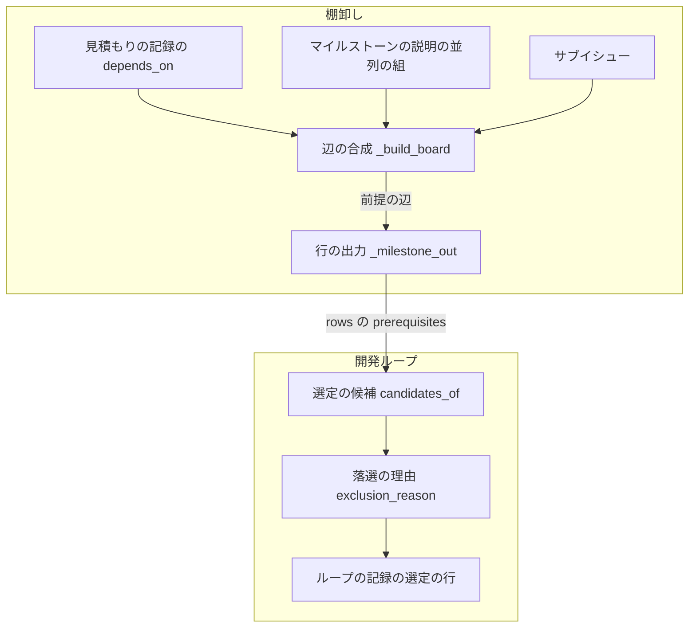
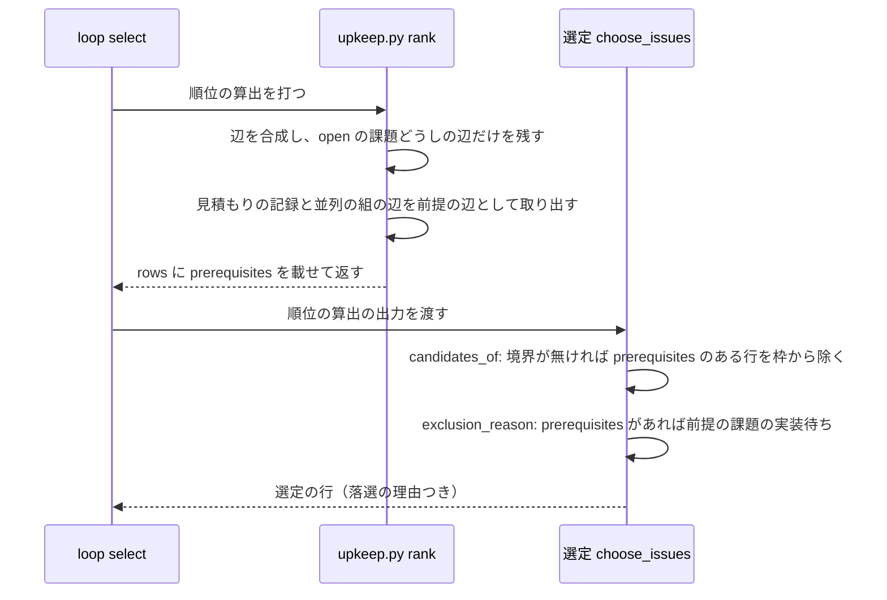

# 開発ループの選定: 閉じていない前提の課題を持つ課題を外し、理由を選定の行に残す（#2604）

## 目的

- **今どうなっているか**: 開発ループの選定は順位だけで課題を選ぶ。前提の課題がまだ実装されていない課題を選んでしまい、実装のステップで失敗する。lroot3 の周回 13 では #2344 を選び、前提の #2337・#2339・#2341・#2342 が develop に無いため失敗した。その後は人が手で `loop exclude` している
- **誰に効くか**: 開発ループを回す利用者と、ループの周回を進める AI
- **変えると何が成り立つか**: 前提の課題が閉じるまで、依存する課題は選ばれない。選ばない理由（`前提の課題の実装待ち（#番号）`）が選定の行に残り、人が手で外さなくて済む

## 適用範囲

- **働く範囲**: NDF を使うすべてのリポジトリの開発ループ（`sprint-state.py loop select` / `loop exclude`）と、棚卸しの順位の算出（`upkeep.py rank`）
- **プロジェクトごとに違うもの**: 無し（依存の取り元は棚卸しの見積もりの記録と、マイルストーンの説明の並列の組で、どのリポジトリでも同じ形である）
- **当たるモード**: `standard`

## あるべき姿の根拠

| 根拠 | 種類 | 何を示すか |
| --- | --- | --- |
| lroot3 の周回 13 で #2344 を選び、前提の課題の実装が無いため失敗した | 実測（課題 #2604 の本文） | 順位だけで選ぶと、前提の無い実装が起きる |
| STD1（GitHub の課題の依存） | 外部の一次情報 | 依存は「ほかの作業の完了を待つ」状態を表し、ブロックされた課題を一覧で区別して示す。待つ課題を着手の候補から区別する形が標準である |
| `grep -rln "depends_on\|cross_milestone_deps" plugins/ndf/scripts/lib plugins/ndf/scripts/*.py` が 0 件 | 実測（2026-11-05） | スプリントの側は依存を読まず、同じ周回に入った課題の実装の順序を依存で決めない。前提の課題と同じ周回に選んでも、前提が先に入る保証が無い |

要求と受け入れ条件は #2604 の本文にある（コピーは `issues/issue-2604-requirements.md`）。この文書は「どう作るか」だけを扱う。

## ドメインモデル

### コンテキスト

| コンテキスト | 何の語が 1 つの意味に決まるか |
| --- | --- |
| 課題の棚卸し（`ndf-issue-upkeep`） | 見積もりの記録・依存の辺・順位・切り出しの境界 |
| 開発の工程（`ndf-workflow`） | 開発ループ・周回・選定・前提の課題・落選の理由 |

棚卸しが供給者、開発ループの選定が顧客の関係（顧客 / 供給者）。選定は順位の算出の出力（JSON）だけを読み、依存の辺を自分で合成しない。供給者の側が、選定の要求する「前提の課題」を行ごとの項目として出す。

### 集約

| 集約 | 持ち主（書き換えてよいもの） | 根 | エンティティ | 値オブジェクト |
| --- | --- | --- | --- | --- |
| 順位の算出の結果 | 順位の算出（`upkeep_rank.py` / `upkeep_rank_cmd.py`） | 算出の結果 | マイルストーンの順位の行 | 前提の課題の番号の並び |
| ループの記録 | 開発ループ（`sprint_loop_*.py`） | ループの記録 | 周回 | 選定の行（番号・採否・理由） |

ループの記録は順位の算出の結果を課題の番号だけで参照する。選定は順位の算出の結果を書き換えない。

### 不変条件

| # | 集約 | 条件 | 破れたときの扱い |
| --- | --- | --- | --- |
| I1 | 順位の算出の結果 | 行の前提の課題は、合成後の依存の辺のうち、見積もりの記録か並列の組が宣言した辺の先にある open の課題だけである。サブイシューの辺だけの先は入れない | テストが落ちる（受け入れ条件 8） |
| I2 | 順位の算出の結果 | 前提の課題が無い行は、前提の課題の項目を持たない（出力と digest が今と同じ） | テストが落ちる（受け入れ条件 9） |
| I3 | ループの記録 | 前提の課題を持つ行は、どの選定でも採られず、理由は `前提の課題の実装待ち（#番号 …）` で、open の前提の課題の番号をすべて昇順で載せる | テストが落ちる（受け入れ条件 1・2・4・5・7） |
| I4 | ループの記録 | 境界が無いマイルストーンで、前提の課題を持つ行は `max_issues` の枠を使わない | テストが落ちる（受け入れ条件 6） |

### ドメインイベント

| # | イベント | 発生元 | 受け手 |
| --- | --- | --- | --- |
| E1 | 棚卸しが課題の依存を見積もりの記録へ書いた | 棚卸しの手順 2A・2B | 順位の算出 |
| E2 | 順位の算出が依存の辺を合成し、行ごとの前提の課題を出した | `upkeep.py rank` | 開発ループの選定 |
| E3 | 選定が前提の課題の閉じていない課題を外した | `loop select` / `loop exclude` | ループの記録（選定の行） |
| E4 | 前提の課題が閉じた | スプリントの締め（`sprint-close.py`） | 次の順位の算出（閉じた課題への辺が消える） |
| E5 | 次の選定が、外していた課題を選べるようにした | 次の `loop select` | ループの記録 |

### 用語

| 用語 | 意味 | 用語集への反映 |
| --- | --- | --- |
| 前提の課題 | ある課題が依存する、別の open の課題。棚卸しが記録した依存と並列の組の依存から順位の算出が合成した辺の先にある。閉じるまで、依存する課題は選定で選ばれない | 追加（`ndf-workflow`。要求の工程で追加済み） |
| 選定 | 開発ループの周回で、実装する課題を棚卸しの順位と記録から選ぶ処理 | 追加（`ndf-workflow`。要求の工程で追加済み） |

## 外部の調査

| 種類 | 調べるか | 理由 |
| --- | --- | --- |
| 標準・仕様 | 調べる | 課題管理での「待つ」依存の表し方と、ブロックが解ける時点の扱いに事実上の形がある |
| 主要な製品 | 調べる | 課題管理の製品が、ブロックの関係と親子の関係を分けているかを比べる |
| ライブラリとサービス | 調べる | 依存の判定に、Python の標準ライブラリ（`graphlib`）か GitHub の課題の依存の API を使えるかを決める |

### 標準・仕様

| # | 標準・仕様 | 何を定めているか | 設計への反映 | 出典 |
| --- | --- | --- | --- | --- |
| STD1 | GitHub の課題の依存（blocked by / blocking） | ほかの作業の完了を待つ課題を「blocked by」で示し、一覧とボードでブロックされた課題に印を付ける。ブロックしている課題が閉じたときの扱いの記述は無い | 待つ課題を候補から区別する。解ける時点は「前提の課題が閉じたとき」とする（要求の前提 2） | https://docs.github.com/en/issues/tracking-your-work-with-issues/using-issues/creating-issue-dependencies （2026-11-05） |

### 主要な製品

| # | 製品 | どう解いているか | 設計への反映 | 出典 |
| --- | --- | --- | --- | --- |
| PRD1 | Jira の課題リンク | リンクの種類にブロックの関係（is blocked by / blocks）と関連（relates to）などを分けて持つ。親子は課題リンクの種類に含まれない | ブロックの関係と親子（サブイシュー）を分け、親子の辺は選定から外す理由にしない（要求の前提 4） | https://support.atlassian.com/jira-software-cloud/docs/link-issues/ （2026-11-05） |

### ライブラリとサービス

| # | 候補 | 版 | ライセンス | 最後のリリースの日付 | 終了のアナウンス | 要件を満たすか | 出典 |
| --- | --- | --- | --- | --- | --- | --- | --- |
| LIB1 | Python 標準ライブラリ `graphlib` | Python 3.13.17 に同梱 | PSF | Python の版と同じ | 無し | 満たさない。並べ替えはできるが、要るのは「辺の先が open か」の 1 段の判定で、並べ替えは順位の算出が既に持つ | `python3 -c "import graphlib,sys;print(sys.version)"`（2026-11-05） |
| LIB2 | GitHub の課題の依存の REST API（`issues/{番号}/dependencies/blocked_by`） | REST API（2026-11-05 時点） | GitHub の利用規約 | — | 無し | 満たさない。#2344 で `[]` を返し、このリポジトリの依存は API に登録されていない。取り元を足すと順位の並びも変わり、要求の範囲（選定以外の判定を変えない）を超える | `gh api repos/devbasex/ai-plugins/issues/2344/dependencies/blocked_by`（2026-11-05） |
| LIB3 | 既存の `merge_edges`（`upkeep_rank.py`） | このリポジトリの現行 | このリポジトリ | — | 無し | 満たす。open の課題どうしの辺だけを残すため、前提の課題が閉じると辺が消える | `plugins/ndf/skills/backlog-refinement/scripts/upkeep_rank.py`（2026-11-05） |

### 確かめられなかったこと

| 対象 | 試した手段 | 結果と理由 |
| --- | --- | --- |
| Jira の「is blocked by」の意味の定義 | PRD1 の URL | 取得できたが、意味を定義した文が無かった。設計はリンクの種類が分かれていることだけを使う |

調べた量: 候補 5 件・取得の試み 4 回。

## 機能一覧

| # | 機能 | 誰が使うか |
| --- | --- | --- |
| F1 | 順位の算出が、行ごとに open の前提の課題を出す | 開発ループの選定 |
| F2 | 選定が、前提の課題を持つ課題を外し、理由を選定の行に残す | 開発ループを回す利用者と AI |
| F3 | 境界が無いマイルストーンで、前提で外れた課題が件数の枠を使わない | 開発ループを回す利用者と AI |

## 構成要素

| 要素 | 責務 |
| --- | --- |
| 辺の合成（`upkeep_rank_cmd.py` の `_build_board`） | 今の合成に加えて、見積もりの記録と並列の組が宣言した辺のうち、合成後に残った辺の集合（前提の辺）を算出の入力（`upkeep_rank.py` の `Board` に足す項目 `prerequisites`）へ渡す |
| 行の出力（`upkeep_rank.py` の `_milestone_out`） | 行の課題から出る前提の辺の先を昇順で `prerequisites` に載せる。空なら項目を出さない |
| 選定の候補（`sprint_loop_select.py` の `candidates_of`） | 境界が無いとき、`prerequisites` を持つ行を `max_issues` の枠から除く |
| 落選の理由（`sprint_loop_select.py` の `exclusion_reason`） | `prerequisites` を持つ行に `前提の課題の実装待ち（#番号 …）` を返す |

## 入出力の契約

| 項目 | 内容 |
| --- | --- |
| 名前 | `upkeep.py rank` の出力（`metrics.milestones[].rows[]`） |
| 入力 | 変わらない |
| 出力 | 行に `prerequisites`（整数の配列、昇順、重複なし）を足す。その行の課題が依存する open の前提の課題の番号。前提の課題が無い行は項目を持たない |
| 失敗の形 | 変わらない（循環は今と同じく `stopped` と終了コード 2 で止まり、選定を推さない） |
| 互換性 | 既存の項目は変えない。前提の課題を持つ行がある算出だけ `digest` の値が変わる。表の描画（`render_rank_table`）は列を名前で読むため影響しない |

| 項目 | 内容 |
| --- | --- |
| 名前 | `sprint-state.py loop select` / `loop exclude` の結果の選定の行 |
| 出力 | 落選の理由に `前提の課題の実装待ち（#B）`、複数なら `前提の課題の実装待ち（#B #C）`（番号の昇順、半角スペース区切り）が加わる |
| 互換性 | 選定の行の形（番号・マイルストーン・順位・採否・理由）は変えない。候補がすべて外れたときの `outside_mvv` の `values.reasons` は、理由の文字列ごとの件数として今と同じ形で数える |

## 処理の流れ

落選の理由（`exclusion_reason`）は、次の順に判定する。

1. 人の判断待ち（棚卸し）
2. 保留の周回
3. 設計の答え待ち・差し戻し・マージ待ち
4. 手の除外（`loop exclude`）
5. **前提の課題の実装待ち**
6. 周回の中で起票
7. 容量（尺度を超える）

## 決定の記録

### 決定 1: 選定が依存の合成を写さないよう、前提の課題を順位の算出の行ごとの項目として出す

選定は順位の算出の出力だけを読む（顧客 / 供給者）。行ごとに番号の並びを持たせると、選定は行を見るだけで外す理由と枠の扱いを決められ、辺の一覧を引き直す処理を持たなくて済む。前提の課題が無い行は項目を出さないため、依存の記録が無いリポジトリの出力と digest は変わらない。

マイルストーンの外に辺の一覧を足す形は採らない。選定の側で辺を行へ引き直す処理が要り、同じ役割の処理が 2 か所に分かれる。

- 作り方: 自前で作る
- 比べた候補: LIB1 / LIB2 / LIB3 / STD1

根拠: Value 7 / Value 5（MVV 版 5）

### 決定 2: 親子の関係で親も子も選べなくならないよう、前提の辺は合成後に残った辺のうち見積もりの記録と並列の組が宣言した辺に限る

合成（`merge_edges`）はサブイシューの辺を最も優先し、逆向きの下位の辺を捨てる。合成の結果の集合と、見積もりの記録と並列の組の辺の和集合との共通部分を前提の辺にすると、並び順と前提の判定が同じ合成の結果に揃い、サブイシューの辺だけの関係は前提にならない。見積もりの記録が同じ向きの辺を明示したときは、サブイシューの辺と重なっても前提に数える。

合成の前に取り元ごとの辺を別に持つ形は採らない。合成で捨てられた逆向きの辺が前提に残り、並び順と食い違う。

根拠: Value 7（MVV 版 5）

### 決定 3: 同じ周回でも前提の無い実装をしないよう、前提の課題が同じ周回に選ばれていても依存する課題を外す

スプリントの側は依存で実装の順序を決めない（あるべき姿の根拠の 3 行目）。前提の課題と同じ周回に入れると、前提が develop に入る前に依存する課題の実装が始まりうる。依存が連なる課題は 1 周回に 1 段ずつ進むが、選ばない期間が延びるだけで、前提の無い実装は起きない。

前提の課題が同じ周回に選ばれたら外さない形は採らない。周回の中の実装の順序を保証する仕組みが要り、要求の範囲を超える。

根拠: Value 2 / Value 3（MVV 版 5）

### 決定 4: 新しい止まり方を足さないよう、前提の課題がどのループからも選ばれない場所にあっても人へ別に知らせない

前提の課題がマイルストーン未設定などで選ばれないとき、依存する課題は外れ続ける。外す理由に前提の課題の番号が載るため、選定の行を読めばどこで止まっているかが分かる。候補がすべて外れれば、今と同じ止まり方（`outside_mvv`）で、理由ごとの件数（`values.reasons`）が出る。知らせる仕組みを足すと、止まる条件と記録の形が増える。

前提の課題がマイルストーン未設定のときに専用の止まる条件を足す形は採らない。棚卸しがマイルストーンを付ければ解け、ループが止まる理由にはならない。

根拠: Value 3 / Value 5（MVV 版 5）

### 決定 5: 人の明示した理由を残すよう、前提の課題の実装待ちは手の除外より後、周回の中の起票と容量より前に判定する

人の判断待ち・保留・設計の答え待ち・手の除外は、人か記録が明示した理由で、外す理由として優先して残す。前提の課題の実装待ちは、周回の中の起票と容量より長く続く理由のため、その前に置いて理由の行が周回ごとに変わらないようにする。この順は前提の課題を持つ行にだけ効き、依存の記録が無い行の理由は今と同じである。

根拠: Value 8（MVV 版 5）

## テスト設計

| 受け入れ条件・不変条件 | どの振る舞いで縛るか | どう壊したら落ちるべきか |
| --- | --- | --- |
| 受け入れ条件 1・I3 | 1 位の A が `prerequisites: [B]` を持つ順位の出力で選定すると、A が落選し理由が `前提の課題の実装待ち（#B）` | 理由の判定を消す・番号を載せない |
| 受け入れ条件 2・I3 | 前提の課題が 2 件 open なら理由に 2 件が昇順で載る | 先頭の 1 件だけを載せる |
| 受け入れ条件 3 | 見積もりの記録が B を指していても、B が閉じていれば A の行に `prerequisites` が無く、選定で順位どおりに選ばれる | 閉じた課題への辺を残す |
| 受け入れ条件 4・I1 | 並列の組の依存だけで B に依存する A の行に `prerequisites: [B]` が出る | 前提の辺から並列の組を落とす |
| 受け入れ条件 5 | B が別のマイルストーンかマイルストーン未設定でも、A の行に `prerequisites: [B]` が出る | 同じマイルストーンの辺だけに絞る |
| 受け入れ条件 6・I4 | 境界が無く `max_issues` が 1 で、1 位が前提で外れると 2 位が選ばれる | 枠の計算から前提の行を除かない |
| 受け入れ条件 7・I3 | 承認とマージが済んだ設計の課題・直して出し直す課題でも、前提があれば落選する | 先頭に選ぶ課題を理由の判定より先に採る |
| 受け入れ条件 8・I1 | サブイシューの辺だけで親に依存する子の行に `prerequisites` が出ない | サブイシューの辺を前提の辺に含める |
| 受け入れ条件 9・I2 | 依存の記録が無い順位の出力の行・digest と、選定の結果が今と同じ | 空の `prerequisites` を出す・判定の順を変える |
| 受け入れ条件 10 | 候補がすべて前提で外れると `outside_mvv` で止まり、`values.reasons` に理由ごとの件数が載る | 前提の落選を候補の件数から除いて `no_issue` にする |

## 設計の結果

| 課題 | 扱い | 取り込み先 | 触るファイル |
| --- | --- | --- | --- |
| #2604 | 実装する | — | `plugins/ndf/skills/backlog-refinement/scripts/upkeep_rank.py`、`plugins/ndf/skills/backlog-refinement/scripts/upkeep_rank_cmd.py`、`plugins/ndf/scripts/lib/sprint_loop_select.py`、`plugins/ndf/scripts/tests/test_sprint_loop.py`、`plugins/ndf/skills/backlog-refinement/tests/` |

## 未確認のまま残ること

| 項目 | 内容 |
| --- | --- |
| 境界があるマイルストーンでの枠 | 切り出しの境界は順位の算出が決め、この変更は変えない（要求の対象範囲）。境界の内の課題が前提で外れても、境界の外の課題は候補に上がらない。前提の課題を持つ課題を境界から除くかは、境界の判定を変える別の変更になる |
| 計画の digest の食い違い | 前提の課題を持つ行が初めて出る算出で `digest` が変わり、前の digest を持つ計画（`plan.rank`）は古いと判定される。1 回の打ち直しで揃う見込みで、実測していない |
| #2344 の解消 | #2344 の見積もりの記録は依存が空で、この変更だけでは外れない（要求の前提 3）。次の棚卸しで記録に依存を書き足した後、リリース後テストで確かめる |
| 依存の連なりの進み方 | 決定 3 により、依存が連なる課題は 1 周回に 1 段ずつ、しかも前提の課題が閉じる（本番への配布の後）まで進まない。周回の数への影響は測っていない |
