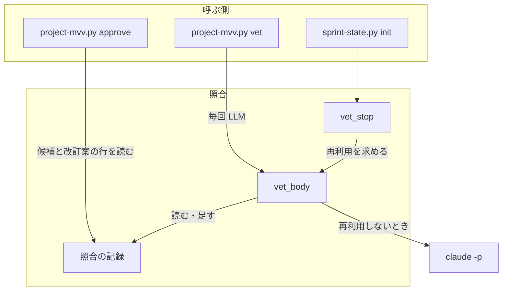
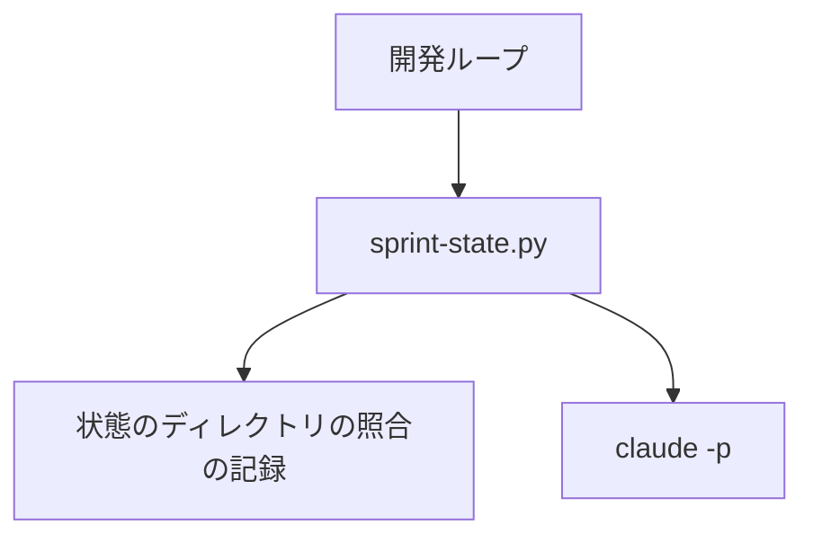
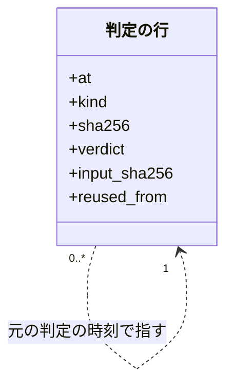
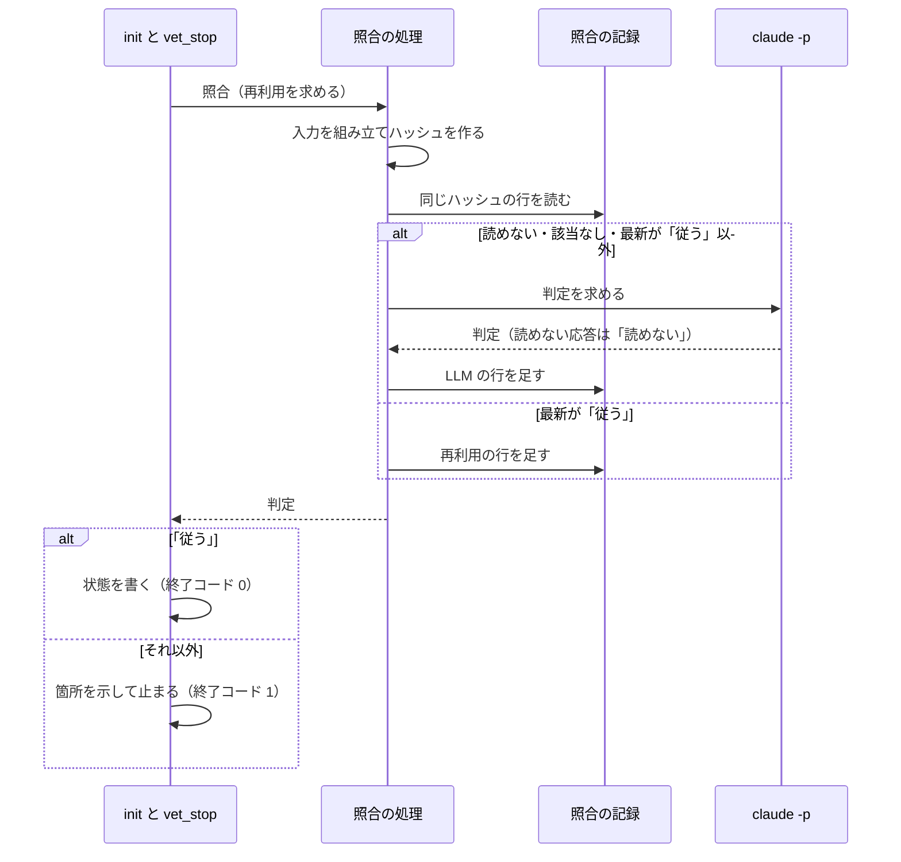

# スプリント MVV の照合: 入力が同じなら「従う」の判定を再利用し、揺れで開発ループを止めない（#2614）

## 目的

- **今どうなっているか**: スプリントの状態を作る `sprint-state.py init` は、スプリント MVV の本文が 1 字も変わっていなくても毎回 LLM で照合する。同じ本文で 17 回「従う」が続いた中に 1 回だけ「反する疑い」が出て、開発ループが `refused` で止まった
- **誰に効くか**: `fast` / `auto` で開発ループを回す利用者（止まる回数）と、LLM の費用を払う利用者
- **変えると何が成り立つか**: 入力が同じ 2 回目以降の照合は LLM を呼ばず、その照合では判定の揺れで止まらない。入力が 1 字でも変われば今までどおり LLM が判定する

## 適用範囲

- **働く範囲**: NDF を導入したすべてのリポジトリの `sprint-state.py init`（`fast` / `auto`・承認済みのプロジェクト MVV・スプリント MVV あり）。再利用に使う記録は機械ごとに持ち、リポジトリをまたいで読む
- **プロジェクトごとに違うもの**: 無い。設定も引数も足さない。プロジェクトごとの違いは照合の入力の中身（プロジェクト MVV とスプリント MVV）に現れる
- **当たるモード**: `standard`。呼び出しの契約は変えず、判定の経路と記録の形を変える

## あるべき姿の根拠

| 根拠 | 種類 | 何を示すか |
| --- | --- | --- |
| 同じ本文 18 回のうち「反する疑い」は 1 回で、4 分後に「従う」へ戻った。入力の変化はプロジェクト MVV の版 4→5 の 1 回だけである（要求の「今の状態（実測）」） | 実測 | 判定の揺れは入力の変化に由来しない |
| 同じ本文の 18 回で 1.43 ドル・167 秒を使った（要求の「今の状態（実測）」） | 実測 | 1 回あたり 0.08 ドル・9 秒が再利用で 0 になる |
| 入力全体のハッシュをキーにし、失敗の結果は保存しない（外部の調査の STD1・PRD1） | 外部の一次情報 | キーを入力全体にする形と、「従う」だけを再利用する形は、実行結果のキャッシュの標準的な形である |

要求と受け入れ条件は #2614 の本文にある（コピーは [issue-2614-requirements.md](issue-2614-requirements.md) ）。この文書は「どう作るか」だけを扱う。

## ドメインモデル

### コンテキスト

| コンテキスト | 何の語が 1 つの意味に決まるか |
| --- | --- |
| 開発の工程（`ndf-workflow`） | 照合・照合の入力・照合の記録 |

### 集約

| 集約 | 持ち主（書き換えてよいもの） | 根 | エンティティ | 値オブジェクト |
| --- | --- | --- | --- | --- |
| 照合の記録 | 照合の処理（`mvv_llm.vet_body`）だけが行を足す | 照合の記録のファイル（`project-mvv.jsonl`） | 判定の行 | 照合の入力のハッシュ・判定・箇所・元の判定の時刻 |

スプリントの状態は別の集約である。`sprint-state.py init` は判定だけを受け取り、照合の記録へ書かない。

### 不変条件

| # | 集約 | 条件 | 破れたときの扱い |
| --- | --- | --- | --- |
| I1 | 照合の記録 | 再利用するのは、同じ照合の入力の行のうち最も後ろの行の判定が「従う」のときだけである | 再利用せず LLM で判定する |
| I2 | 照合の記録 | 照合の入力のハッシュは、判定の指示・共通原則・プロジェクト MVV・判定の決まり・本文の種類の名前・照合する本文の全体から作る。1 字でも違えば別の値になる | 別の入力として LLM で判定する |
| I3 | 照合の記録 | 再利用の行は元の判定の時刻を持ち、費用と秒を持たない。元の判定の時刻は常に LLM が判定した行の時刻を指す | 再利用の行を読む人が LLM の行と切り分けられなくなるため、テストで落とす |
| I4 | 照合の記録 | 既存の行を書き換えない。足すだけである | テストで落とす |
| I5 | 照合の記録 | 記録を読めない・壊れた行があることは、照合を止める理由にならない | 該当する記録なしとして LLM で判定する |
| I6 | 照合の記録 | 再利用は `sprint-state.py init` の経路だけが求める。`project-mvv.py vet` は種類によらず毎回 LLM で判定する | テストで落とす |

### ドメインイベント

| # | イベント | 発生元 | 受け手 |
| --- | --- | --- | --- |
| E1 | スプリント MVV の照合を求めた | `sprint-state.py init` | 照合の処理 |
| E2 | 照合の入力を組み立てた | 照合の処理 | 照合の処理（ハッシュを作る） |
| E3 | 同じ入力の最新の判定を記録から読んだ | 照合の処理 | 照合の処理（再利用か LLM かを決める） |
| E4 | 判定「従う」を再利用した | 照合の処理 | 照合の記録 |
| E5 | LLM で判定した | 照合の処理 | 照合の記録 |
| E6 | 判定を照合の記録へ足した | 照合の処理 | 次回の照合（E3）・利用者（切り分け） |
| E7 | スプリントの状態を書いた、または断った | `sprint-state.py init` | 開発ループ |

### 用語

| 用語 | 意味 | 用語集への反映 |
| --- | --- | --- |
| 照合 | スプリント MVV などの本文が、共通原則とプロジェクト MVV に従うかを LLM に判定させること | 要求の工程で追加済み |
| 照合の入力 | 1 回の照合で LLM へ渡す全体。判定の指示・共通原則・プロジェクト MVV・判定の決まり・本文の種類の名前・照合する本文からなる | 要求の工程で追加済み |
| 照合の記録 | 照合のたびに 1 行を足す JSONL のファイル（`project-mvv.jsonl`）。機械ごとに 1 つある | 追加 |

## 機能一覧

| # | 機能 | 誰が使うか |
| --- | --- | --- |
| F1 | 入力が同じスプリント MVV の照合で、「従う」の判定を再利用して `init` を進める | 開発ループ・`fast` / `auto` の利用者 |
| F2 | 判定を再利用したことと元の判定の時刻を照合の記録から読む | 利用者・振り返りの担当 |
| F3 | 入力が変わった照合、最新の判定が「従う」でない照合を LLM で判定し直す | 開発ループ・`fast` / `auto` の利用者 |

## 構成要素

| 要素 | 責務 | 変更 |
| --- | --- | --- |
| 照合の処理（`project_lib/mvv_llm.py` の `vet_body`） | 照合の入力を組み立て、再利用を求められたら同じ入力の最新の判定を読み、再利用か LLM かを決めて 1 行足す | 引数 `reuse`（既定は偽）を足す。ハッシュの計算と記録の読み取りを小さな関数に置く |
| スプリント MVV の照合の呼び出し（`lib/sprint_mvv.py` の `vet_stop`） | 再利用を求めて照合し、「従う」以外なら止まる理由を返す | `reuse=True` で呼ぶ |
| 明示の照合（`project-mvv.py vet`） | 毎回 LLM で判定する | 照合の振る舞いは変えない。既定のまま呼ぶ（冒頭の説明文は下の行で直す） |
| 承認（`project-mvv.py approve` の `last_vet`） | 候補・改訂案の行だけを読む | 変えない。再利用の行は種類がスプリント MVV だけであり、読む対象に入らない |
| 手順書（`pace.md`・`project-mvv.md`）と説明文（`sprint_mvv.py`・`mvv_llm.py`・`project-mvv.py` の冒頭） | 照合の振る舞いの説明 | 再利用の振る舞いへ合わせる |

`sprint-state.py` の引数・終了コード・結果の形は変えない。

### 呼び出しの関係

図には手順書と説明文を含めない。



### 配置

システムの文脈と配置は変わらない。照合の記録は実行した機械の状態のディレクトリ（`NDF_MVV_STATE_DIR`、既定は `~/.local/state/ndf`）に置き、`claude -p` は同じ機械で起動する。



### モジュールの配置

モジュールの配置は今のままで、ファイルを足さない。

```text
plugins/ndf/scripts/
├── lib/sprint_mvv.py          # vet_stop を変える
├── project_lib/mvv_llm.py     # vet_body を変える
└── tests/test_project_mvv.py  # テストを足す
```

## 決定の記録

### 決定 1: 揺れで出た判定を固定しないため、同じ入力の最新の判定が「従う」のときだけ再利用する

開発ループを止める判定を固定すると、揺れで出た「反する疑い」で止まり続ける。古い「従う」があっても後の判定が「従う」でなければ LLM に戻し、後から出た疑いを隠さない。「最新」は記録の最後の行（追記の順）とし、`project-mvv.py approve` の読み方と揃える。

利用者が明示の照合で「反する疑い」を得たときは、その行が最新になるため再利用が止まる。期限は設けず（要求の前提 1）、再利用を止める手段はこの 1 つにする。

根拠: Value 3 / Value 1（MVV 版 6）

### 決定 2: 判定を変える入力の変化を取りこぼさないため、照合の入力の全体のハッシュをキーにする

キーを本文とプロジェクト MVV の組にすると、共通原則や判定の指示を変えた版でも古い「従う」が使われ続ける。LLM へ渡す文字列そのものをハッシュにすれば、入力へ材料を足したときにキーの側を直し忘れることもない。

本文の sha256 とプロジェクト MVV の sha256 の組は採らない（要求の起票者の推定 S3）。項目ごとにキーを並べる形は、材料が増えるたびに変更が要る。

- 作り方: 標準に倣う
- 比べた候補: STD1 / PRD1 / PRD2 / PRD3

根拠: Value 7 / Value 8（MVV 版 6）

### 決定 3: 記録を二重に持たないため、新しいキャッシュを作らず照合の記録を読む

照合の記録はすでに同じ判定を持ち、判定の順序も持つ。別の保存先を足すと、最新の判定がどちらにあるかを揃える処理が要る。外部のライブラリは「最新の行の判定で決める」規則を表せないか、依存を増やす割に得るものが読み書きの数行だけである。

- 作り方: 自前で作る
- 比べた候補: LIB1 / LIB2 / LIB3

根拠: Value 5 / Value 7（MVV 版 6）

### 決定 4: 開発ループを通らない `init` も救い、改訂後の照合を残すため、承認の記録では照合を外さない

`approve-mvv` で承認した sha256 と一致する本文を照合から外す形は採らない（要求の起票者の推定 S4）。承認の記録はスプリント MVV の本文だけを持つため、承認の後にプロジェクト MVV が改訂されても照合を通らない。承認の記録は開発ループの記録にしか無く、開発ループを通らない `sprint-state.py init` にも効かない。

根拠: Value 7（MVV 版 6）

### 決定 5: 記録だけで切り分けられるよう、再利用も 1 行として残し、元の判定は LLM の行を指す

再利用で行を残さないと、照合が行われたことが記録から読めず、費用の効果も測れない。元の判定の時刻は、再利用の行を元にした再利用でも LLM の行の時刻を引き継ぐ。再利用の行の時刻を指すと、どの LLM の判定に依っているかを読むのに行を辿る必要がある。

根拠: Value 4 / Value 8（MVV 版 6）

### 決定 6: 判定をやり直す手段を残すため、再利用は呼ぶ側が求めたときだけ行う

照合の処理（`vet_body`）の既定は毎回 LLM とし、スプリント MVV の照合の呼び出し（`vet_stop`）だけが再利用を求める。既定を再利用にすると、候補・改訂案・起票する課題の照合と `project-mvv.py vet` へ広がり、要求の範囲を超える。

根拠: Value 6 / Value 3（MVV 版 6）

## 外部の調査

| 種類 | 調べるか | 理由 |
| --- | --- | --- |
| 標準・仕様 | 調べる | 入力から結果を再利用する形には、ビルドのキャッシュの公開仕様がある |
| 主要な製品 | 調べる | LLM の応答の再利用を、評価ツールとフレームワークがどう解いているかを比べる |
| ライブラリとサービス | 調べる | 自前の読み書きの代わりに使えるキャッシュのライブラリがあるかを決める |

### 標準・仕様

| # | 標準・仕様 | 何を定めているか | 設計への反映 | 出典 |
| --- | --- | --- | --- | --- |
| STD1 | Remote Execution API（Bazel） | 実行結果は `Action` の符号化の digest で引く。`Action` はコマンドの digest と入力の root の digest を含む。status が `OK` 以外の結果は "MUST NOT be cached" | キーは入力全体のハッシュにする。「従う」以外を再利用しない | https://raw.githubusercontent.com/bazelbuild/remote-apis/main/build/bazel/remote/execution/v2/remote_execution.proto （2026-11-06） |

### 主要な製品

| # | 製品 | どう解いているか | 設計への反映 | 出典 |
| --- | --- | --- | --- | --- |
| PRD1 | promptfoo | キーはプロバイダの識別子・プロンプトの digest・プロバイダの設定・変数の合成。既定の期限は 14 日。"Error responses are not cached" | 失敗を再利用しない形を倣う。モデルの違いをキーに含めないこと・期限を設けないことは要求の前提 1・2 に従う | https://www.promptfoo.dev/docs/configuration/caching/ （2026-11-06） |
| PRD2 | LangChain | キーはプロンプトと LLM の設定の文字列の組 | 応答そのものの再利用である点は同じ。結果の 1 件を保存の単位にする | https://api.python.langchain.com/en/latest/cache/langchain_community.cache.SQLiteCache.html （2026-11-06。検索の結果の抜粋で確かめた） |
| PRD3 | GitHub Actions のキャッシュ | キーの完全一致でヒットとし、中身を変えたいときは新しいキーを作る。キーに `hashFiles` を使う | 部分一致を持たず、入力が変われば別のキーになる形を倣う | https://docs.github.com/en/actions/using-workflows/caching-dependencies-to-speed-up-workflows （2026-11-06） |

### ライブラリとサービス

| # | 候補 | 版 | ライセンス | 最後のリリースの日付 | 終了のアナウンス | 要件を満たすか | 出典 |
| --- | --- | --- | --- | --- | --- | --- | --- |
| LIB1 | diskcache | 5.6.3 | Apache 2.0 | 2023-08-31 | 無し（リポジトリは archived ではない） | 満たすが、キーと値の別の保存先が増え、照合の記録と二重になる | https://pypi.org/pypi/diskcache/json ・`gh api repos/grantjenks/python-diskcache`（2026-11-06） |
| LIB2 | joblib（`Memory`） | 1.6.0 | BSD-3-Clause | 2026-08-31 | 無し（同上） | 関数の引数でキャッシュするため「最新の判定が従うか」を表せない | https://pypi.org/pypi/joblib/json ・`gh api repos/joblib/joblib`（2026-11-06） |
| LIB3 | langchain-core（キャッシュ） | 1.7.6 | MIT | 2026-11-05 | 無し（同上） | LLM の呼び出しを `claude -p` で行うため、この層に差し込めない | https://pypi.org/pypi/langchain-core/json ・`gh api repos/langchain-ai/langchain`（2026-11-06） |

3 つとも今のリポジトリの環境には入っていない（`importlib.util.find_spec` の結果は 3 つとも見つからず、2026-11-06）。

### 確かめられなかったこと

| 対象 | 試した手段 | 結果と理由 |
| --- | --- | --- |
| LangChain の現行の版の保存の形 | 検索 `LangChain LLM cache SQLiteCache prompt llm_string key documentation` | 公式の参照と古いソースの抜粋だけを読み、現行の版のコードと照合していない。設計の判断にはキーの構成だけを使う |

調べた量: 候補 7 件・取得の試み 17 回。

## 構造

型は足さない。照合の記録の 1 行だけが項目を増やす。



## データ構造

### 保存する形

照合の記録は 1 行 1 判定の JSONL のままで、主キーを持たない。同じ入力の行は何行でも並ぶ。集計の単位は今の項目（種類・本文の sha256・プロジェクト MVV の版）に、照合の入力が加わる。

| 項目 | 型 | 空を許すか | 意味 |
| --- | --- | --- | --- |
| `input_sha256`（足す） | 文字列 | 許す | 照合の入力の sha256。LLM を呼ぶ経路の行と再利用の行が持つ。項目が無い行は、変更前の行か、LLM を呼ばなかった行（形の検査で止めた候補・改訂案）である |
| `reused_from`（足す） | 文字列（`at` と同じ形の時刻） | 許す | 再利用した元の LLM の判定の時刻。項目が無い行は LLM の判定か、機械の検査の判定である。「項目があれば再利用」で切り分ける |
| `cost_usd`・`seconds`（既存） | 数 | 許す | 再利用の行は項目ごと持たない。呼び出しが無いためで、0 と書かない |
| `locations`（既存） | 配列 | 許さない | 再利用の行は元の行の箇所をコピーする |

照合の入力のハッシュは `sha256(判定の指示 + "\0" + プロンプト全体)` である。プロンプトには共通原則・プロジェクト MVV（版の番号を含む）・判定の決まり・本文の種類の名前・本文が入る。種類の名前が入るため、種類の違う行は別の値になり、読む側は種類で絞らない。

### 機能との対応

| 機能 | 照合の記録 | スプリントの状態 |
| --- | --- | --- |
| F1 再利用して進める | 読む・足す | 書く |
| F2 再利用を読み取る | 読む | — |
| F3 LLM で判定し直す | 読む・足す | 書く（「従う」のときだけ） |

### 時系列の扱い

事象の記録（追記のみ）を保つ。最新の判定は状態として別に持たず、記録の後ろから導く。

### 移行

項目を足すだけで、既存の行は書き換えない。`input_sha256` を持たない行は再利用の対象にならず（要求の前提 4）、読んでも落ちない。切り戻しは 1 回の revert で足り、足した項目は読まれないだけである。

### 検査の手段

`uv run --frozen --project . --all-extras pytest plugins/ndf/scripts/tests -q -n 4` のテストで行の形を確かめる。

## 処理の流れ

`--pace fast|auto`・承認済みのプロジェクト MVV・スプリント MVV ありのときの流れである。



記録へ書き込めないときは、今と同じく追記の関数（`append_jsonl`）の例外が上がる。再利用の経路でも同じである。読み取りは壊れた行を飛ばし、読めないファイルは空として扱う既存の関数（`project_mvv_signals.read_jsonl`）を使う。

## 非機能の実現方式

| 大項目 | 要求の条件 | 実現方式 | 確かめ方 |
| --- | --- | --- | --- |
| 性能・拡張性 | 同じ照合の入力の 2 回目以降の `init` は LLM の費用が 0 ドルになる。実測の基準は 1 回あたり 0.08 ドル・9 秒（同じ本文の 18 回の平均） | 再利用の経路は `claude -p` を起動しない。記録の全行を読む費用は、40 行・24 KB（2026-11-06 の実測）で無視できる量である | 偽の LLM の呼び出しの回数が増えないことをテストで確かめる。リリース後に照合の記録の行を見る |
| 運用・保守性 | 照合の記録だけを読んで、どの行が LLM の判定でどの行が再利用かを切り分けられる | `reused_from` の有無で切り分ける。再利用の行は費用と秒を持たない | 再利用の行の形をテストで確かめる |
| 移行性 | 記録へ項目を足すだけで、既存の行は書き換えない。変更前の行を読んでも落ちない。切り戻しは 1 回の revert で足りる（足した項目は読まれないだけである） | 項目の追加だけにし、読む側は項目が無い行を飛ばす | `input_sha256` を持たない行を混ぜたテストで確かめる |

## 設計の結果

| 課題 | 扱い | 取り込み先 | 触るファイル |
| --- | --- | --- | --- |
| #2614 | 実装する | — | `plugins/ndf/scripts/project_lib/mvv_llm.py`、`plugins/ndf/scripts/lib/sprint_mvv.py`、`plugins/ndf/scripts/project-mvv.py`、`plugins/ndf/scripts/tests/test_project_mvv.py`、`plugins/ndf/skills/development-workflow/references/pace.md`、`plugins/ndf/skills/development-workflow/references/project-mvv.md`、`docs/glossary/glossary.json`、`docs/glossary.md` |

## テスト設計

偽の LLM の呼び出しの回数と、照合の記録の行で確かめる。

| 受け入れ条件・不変条件 | どの振る舞いで縛るか | どう壊したら落ちるべきか |
| --- | --- | --- |
| 1 | 最新が「従う」の記録がある `init --pace fast` で、LLM の呼び出しが増えず終了コード 0 で状態が書かれる | 再利用を外す |
| 2 | LLM の応答を「反する疑い」にしたまま `loop sprint` が `refused` にならない | `vet_stop` が再利用を求めないように戻す |
| 3・I3 | 再利用の行が `reused_from` を持ち、`cost_usd`・`seconds` を持たない。2 回続けて再利用しても LLM の行の時刻を指す | 再利用の行に費用を書く。直前の再利用の行の時刻を入れる |
| 4・5・6・7・I2 | 本文・プロジェクト MVV・共通原則・判定の決まり・本文の種類の名前・判定の指示のそれぞれを変えると LLM の呼び出しが 1 回増える | キーからどれか 1 つの材料を外す |
| 8・I1 | 古い「従う」の後に「反する疑い」「判定できない」「読めない」の行があると LLM を 1 回呼ぶ | 最新でなく「従うの行があるか」で判定する |
| 9・I5 | 記録のファイルが無い・壊れた行を含むとき、`init` が LLM の判定で進む | 壊れた行で例外を上げる読み方へ変える |
| 10 | `repo` の値が違う行を再利用する | `repo` で絞る |
| 11 | LLM の「従う」の行が `input_sha256` を持ち、次の `init` が再利用する | LLM の行にハッシュを書かない |
| 12 | 再利用できる記録が無く「反する疑い」のとき、終了コード 1 で状態を書かない（既存の `test_init_fast_stops_when_the_sprint_mvv_contradicts_the_project_mvv`） | 記録の有無によらず進める |
| 13・I6 | 再利用できる記録があっても `project-mvv.py vet --kind sprint` は LLM を 1 回呼ぶ | `vet_body` の既定を再利用にする |
| 14 | `pace: normal` の `init` は照合も LLM の呼び出しもしない（既存の `test_normal_init_copies_the_sprint_mvv_without_vetting_it`） | `normal` でも照合する |
| 15 | スプリント MVV の再利用の行があっても `approve` の結果が変わらない | `last_vet` の種類の絞りを外す |
| I4 | 再利用の前後で既存の行が 1 字も変わらず、1 行だけ増える | 既存の行を更新する |

## 未確認のまま残ること

| 項目 | 内容 |
| --- | --- |
| 起票者の推定 S2〜S4 の扱い | 課題の案の 2 つ目を採らないこと（決定 4）、キーを入力全体へ広げること（決定 2）、再利用を最新の「従う」へ狭めること（決定 1）は、設計承認ゲートで利用者が確かめる |
| 「従う」の判定の誤り | LLM が一度誤って「従う」を返すと、入力が変わるまで再利用される。明示の照合で「反する疑い」が出たときだけ止まる。今の毎回の照合でも 1 回の「従う」で進むため、同じ入力で判定の機会が減ることが差である |
| 記録の改変 | 照合の記録は利用者の権限で書けるファイルであり、書き換えると再利用の判定に効く。`project-mvv.py approve` も同じ記録を信頼しており、新しい境界は増えない |
| リリース後の振る舞い | 同じマイルストーンの 2 周目以降の行が再利用の行になることは、リリース後の開発ループの記録で確かめる（未実施） |
