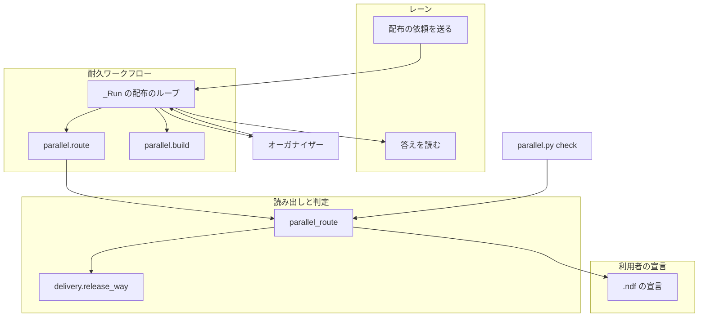
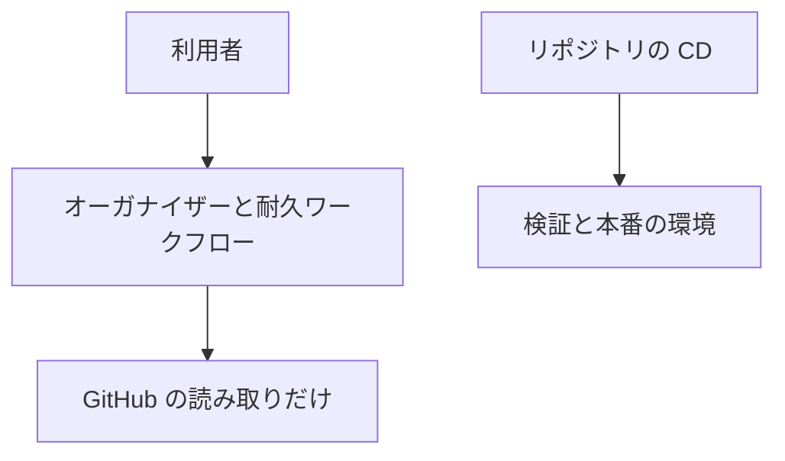
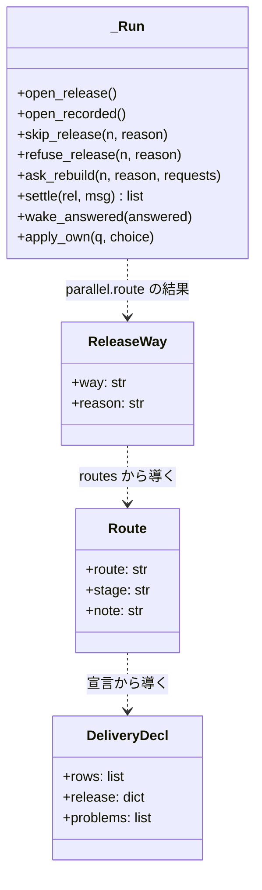
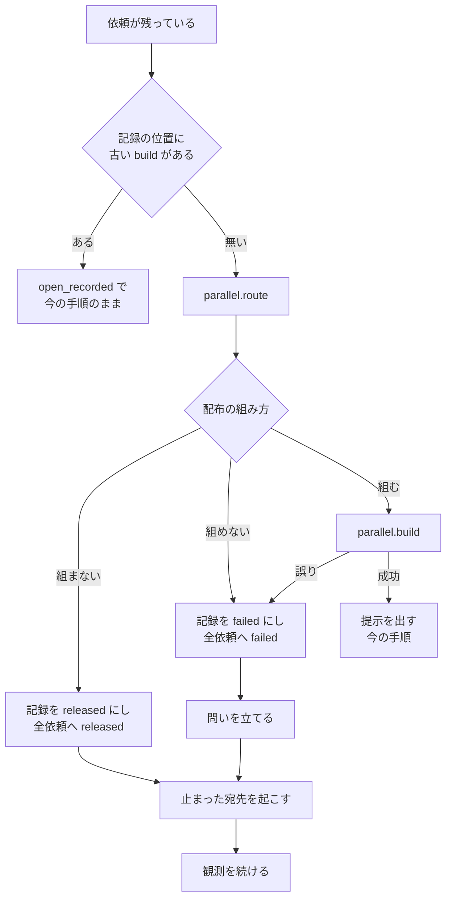
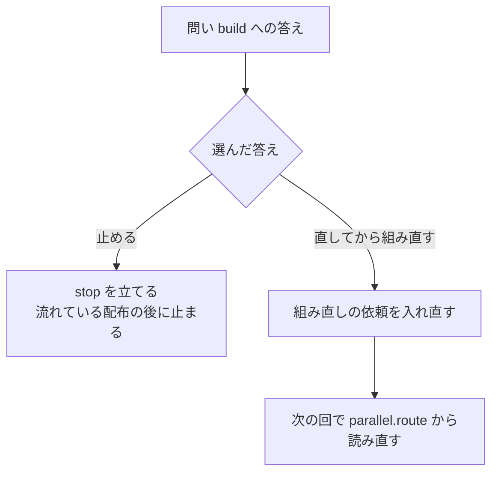
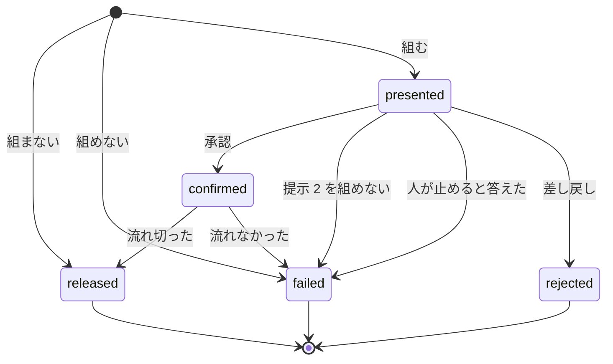

# 並列の計画: 配る形の違うリポジトリでも、配布の依頼で計画全体を止めない（#2616）

## 目的

- **今どうなっているか**: 並列の計画の耐久ワークフローは、配布の依頼を受けるとプラグインの版を読んでまとめた配布を組む。プラグインでないリポジトリでは版を読めず、誤りを受けて計画全体を止める（carul の計画 l20261104 で発生）
- **誰に効くか**: マージで反映する CD を持つリポジトリと、手で配布するリポジトリで、並列の計画を流す利用者
- **変えると何が成り立つか**: リリースの経路を宣言から読み、組む必要が無ければ組まずに答える。組めなければ、その依頼へ失敗と理由を答え、計画を止めるかは人が決める

## 適用範囲

- **働く範囲**: 配布先のリポジトリでも働く。ai-plugins の形（`release.form: package-plugin`）の動きは変えない
- **プロジェクトごとに違うもの**: 引数を足さず、設定で受ける。`.ndf/project.json` の `delivery` と `.ndf/supervise.json` の `release.form` を読む
- **当たるモード**: `standard`

## あるべき姿の根拠

| 根拠 | 種類 | 何を示すか |
| --- | --- | --- |
| 「ひとつづつ直すのではなく根本原因を見つけて対処してください」（2026-11-06） | 利用者の指示の原文 | 例外を足さず、宣言を読まない処理そのものを直す |
| 「本来デプロイ・配布・リリースなどと呼ばれるものはCDで解決すべき課題です」（#2623、2026-11-06） | 利用者の指示の原文 | マージで反映するリポジトリで、オーガナイザーが配布を組まない |
| リポジトリの形ごとの経路の判定の結果（要求の「調べたこと」の 2） | 実測 | 判定に必要な宣言と関数は揃っており、並列の計画だけが読んでいない |
| DBOS 3.1.0 で、記録のある途中の実行へ耐久ステップを足したコードを当てると `DBOSUnexpectedStepError` で落ち、`DBOS.patch` で分けると古い処理のまま続いた（2026-11-06。詳細は決定 2） | 実測 | 途中の記録を新しい版で続ける形は、`DBOS.patch` で成り立つ |
| STD1 | 外部の一次情報 | Continuous Delivery は本番へいつでも出せる状態を指し、変更が本番へ届いたことを意味しない。「配布済み」の答えを本番への到達と読まない根拠になる |

要求と受け入れ条件は #2616 の本文にある（コピーは [issue-2616-requirements.md](issue-2616-requirements.md) ）。この文書は「どう作るか」だけを扱う。

## ドメインモデル

### コンテキスト

| コンテキスト | 何の語が 1 つの意味に決まるか |
| --- | --- |
| 開発ワークフロー（`ndf-workflow`） | まとめた配布・配布の依頼・配布の組み方・組み直しの依頼 |
| リリース（`ndf-release`） | リリースの経路・CD・配布の宣言 |

開発ワークフローが顧客、リリースが供給者の関係（顧客 / 供給者）である。開発ワークフローは経路を自分で判定せず、リリースが返す配布の組み方だけを受ける。

### 集約

| 集約 | 持ち主（書き換えてよいもの） | 根 | エンティティ | 値オブジェクト |
| --- | --- | --- | --- | --- |
| 配布の宣言 | 利用者（`.ndf/` のファイル）。NDF は読むだけ | 宣言 | `delivery` の行 | リリースの経路・配布の組み方 |
| 並列の進行 | 耐久ワークフローの `_Run` | 計画の実行 | 配布の記録・受けている依頼・問い | 依頼への答え |

### 不変条件

| # | 集約 | 条件 | 破れたときの扱い |
| --- | --- | --- | --- |
| I1 | 配布の宣言 | 依頼へ「配布済み」と組まずに答えるのは、宣言を読めて、すべての経路がマージで届くか配布しない形のときだけである | テストで落とす。判定が決まらないときは「組めない」へ倒す |
| I2 | 配布の宣言 | 配布の組み方を決める処理は `lib/delivery.py` の 1 か所にある | レビューで落とす |
| I3 | 並列の進行 | 組まないと決めた依頼に対して、提示のプラン・本番のプラン・一時レーン・本番チャネルへのマージ・承認の記録を 1 つも作らない | テストで落とす |
| I4 | 並列の進行 | 範囲が決まる前に組まない・組めないと決めたときは、その時点で受けている依頼のすべてへそのループの 1 回で 1 回答え、受けている依頼に残さない。提示 2 を組めないときは範囲の依頼だけへ `failed` を答え、範囲に入らない依頼はその配布の答えを受けずに次の配布で扱う（組み立ての失敗が続けば、次の配布の連番で `failed` を受ける） | テストで落とす。範囲が決まる前の依頼を残すと、次の回で組み直しを繰り返す |
| I5 | 並列の進行 | 配布を組めないことでは計画を止めない。止まるのは人が問いへ「止める」と答えたときである | テストで落とす |
| I6 | 並列の進行 | 答えていない「配布を組めない」の問いのうち、同じ理由のものは 1 件である | テストで落とす |
| I7 | 並列の進行 | 記録のある途中の実行を新しい版で続けても、耐久ステップの並びの食い違いで落ちない | テストで落とす |
| I8 | 並列の進行 | `release.form` のテンプレートで組む配布の手順と答えは今と同じである | 既存のテストで落とす |
| I9 | 配布の宣言 | 起動の前の検査は、配布を組めないことを警告にとどめ、起動を断らない | テストで落とす |

### ドメインイベント

| # | イベント | 発生元 | 受け手 |
| --- | --- | --- | --- |
| E1 | レーンが配布の依頼を送った | レーン | 耐久ワークフロー |
| E2 | 耐久ワークフローが依頼を受け付けた | 耐久ワークフロー | 耐久ワークフロー（配布のループ） |
| E3 | 出した範囲で答えられる依頼に答えた | 耐久ワークフロー | レーン |
| E4 | リリースの経路を読んだ | 耐久ステップ `parallel.route` | 耐久ワークフロー |
| E5 | 配布を組まずに `released` と答えた | 耐久ワークフロー | レーン |
| E6 | まとめた配布を組んだ | 耐久ステップ `parallel.build` | オーガナイザー・一時レーン |
| E7 | 配布を失敗として締め、依頼へ `failed` と理由を答えた | 耐久ワークフロー | レーン |
| E8 | オーガナイザーへ問いを立てた | 耐久ワークフロー | オーガナイザー |
| E9 | オーガナイザーが問いへ答えた | オーガナイザー | 耐久ワークフロー |
| E10 | レーンが答えを読み、まとめへ進むか周回を締めた | レーン | 周回の記録 |
| E11 | 起動の前に検査が配布を組めないことを知らせた | `parallel.py check` | オーガナイザー |
| E12 | 組み直しの依頼を入れ直した | 耐久ワークフロー | 耐久ワークフロー（配布のループ） |

E12 は設計で足した。要求の未決 2（「直してから組み直す」の後に Pull Request をどう届けるか）の答えである（決定 5）。

### 用語

| 用語 | 意味 | 用語集への反映 |
| --- | --- | --- |
| 配布の組み方 | 配布の依頼を受けたときに、まとめた配布をどう扱うか。組む・組まない・組めないの 3 つがある。宣言から決まる | 追加（`ndf-workflow`） |
| 組み直しの依頼 | 組めなかった配布の依頼を、人が「直してから組み直す」と答えた後に耐久ワークフローが受けている依頼へ入れ直したもの。元の依頼の答えは変えない | 追加（`ndf-workflow`） |

## 外部の調査

| 種類 | 調べるか | 理由 |
| --- | --- | --- |
| 標準・仕様 | 調べる | 「配布済み」の答えが何を意味するかを、CD の定着した定義に合わせる |
| 主要な製品 | 調べる | 動いているワークフローの定義を変える方法と、1 つの失敗を全体へ波及させない宣言の形を比べる |
| ライブラリとサービス | 調べる | 耐久ワークフローの基盤（DBOS）が、途中の記録の続きに使える仕組みを持つかを確かめる |

### 標準・仕様

| # | 標準・仕様 | 何を定めているか | 設計への反映 | 出典 |
| --- | --- | --- | --- | --- |
| STD1 | Continuous Delivery と Continuous Deployment の定義 | Continuous Delivery は「software can be released to production at any time」で、出さないことも選べる。Continuous Deployment は変更がすべて自動で本番へ出る | `released` の答えは本番への到達を意味しない。到達はリリース後テストが確かめる（要求の前提 2） | https://martinfowler.com/bliki/ContinuousDelivery.html （2026-11-06） |

### 主要な製品

| # | 製品 | どう解いているか | 設計への反映 | 出典 |
| --- | --- | --- | --- | --- |
| PRD1 | Temporal | `workflow.patched()` が履歴へマーカーを入れ、新旧の処理を分ける。古い実行が無くなったら `deprecate_patch` に置き換え、最後に消す。定義を別名で複製する方法は、動いている実行を救えない | 同じ 3 段階の形を DBOS で使う。別名の耐久ワークフローへ切り替える形を採らない | https://docs.temporal.io/develop/python/versioning （2026-11-06） |
| PRD2 | GitHub Actions | `continue-on-error` は 1 つのジョブの失敗で実行全体を失敗にしない。既定の `fail-fast` は行列の他のジョブを取り消す | 1 つの配布の失敗を計画全体へ波及させない形の例として参照する | https://docs.github.com/en/actions/reference/workflows-and-actions/workflow-syntax （2026-11-06。要約を経由して取得した） |

### ライブラリとサービス

| # | 候補 | 版 | ライセンス | 最後のリリースの日付 | 終了のアナウンス | 要件を満たすか | 出典 |
| --- | --- | --- | --- | --- | --- | --- | --- |
| LIB1 | DBOS の `DBOS.patch`（`enable_patching` で有効にする） | 3.1.0（`uv.lock` で固定） | MIT | 3.1.0 は 2026-09-24、最新の 3.4.0 は 2026-10-28 | 無し（調べたページの範囲。下の「確かめられなかったこと」） | 満たす。古い記録は `False`、新しい記録と記録の先は `True` を返す（実測） | https://docs.dbos.dev/python/tutorials/upgrading-workflows ・ https://pypi.org/pypi/dbos/3.1.0/json ・ `.venv/lib/python3.13/site-packages/dbos/_dbos.py` の 3649 行（2026-11-06） |
| LIB2 | DBOS の版による隔離（`application_version`。NDF の `durable.FORMAT`） | 3.1.0 | MIT | LIB1 と同じ | 無し（LIB1 と同じ範囲） | 満たさない。版が違う実行は回復されず、受け付け済みの依頼を持つ実行が続かない | https://docs.dbos.dev/python/tutorials/upgrading-workflows ・ `plugins/ndf/scripts/lib/durable.py` の `resolve`（2026-11-06） |

### 確かめられなかったこと

| 対象 | 試した手段 | 結果と理由 |
| --- | --- | --- |
| Argo Workflows の `continueOn` の動き | https://argo-workflows.readthedocs.io/en/latest/walk-through/continue-on/ | HTTP 404。PRD2 だけで比べた |
| GitHub Actions の該当の節の原文 | PRD2 の URL | ページが長く、要約を経由して読んだ。原文の照合は未確認 |
| `enable_patching` のドキュメントの記述 | LIB1 のドキュメントの URL | ページに語が無い。導入済みのソースで動きを確かめた |
| DBOS の `patch` の終了のアナウンス | LIB1 のドキュメントのページと PyPI の情報を読んだ。変更履歴の全体は試していない | 読んだ範囲に記述は無い。範囲の外は未確認 |

調べた量: 候補 5 件・取得の試み 8 回。

## 機能一覧

| # | 機能 | 誰が使うか |
| --- | --- | --- |
| F1 | 配布の依頼を受けたときに、宣言から配布の組み方を決める | 耐久ワークフロー |
| F2 | 組む必要が無ければ、組まずに配布済みと答えて計画を続ける | CD のリポジトリのレーン |
| F3 | 組めなければ、依頼へ失敗と理由を答えて計画を続ける | レーン |
| F4 | 組めなかったことを問いにし、「直してから組み直す」「止める」を選べる | オーガナイザーと利用者 |
| F5 | 起動の前の検査で、配布を組めないことを知らせる | オーガナイザー |
| F6 | 途中の計画を新しい版で続ける | 計画を流している利用者 |

## 構成要素

| 要素 | 責務 |
| --- | --- |
| 配布の組み方の判定（`lib/delivery.py` の `release_way`）【追加】 | 宣言とリリースの経路から、組む・組まない・組めないと理由を返す。ファイルを読まない純粋な処理 |
| 計画の読み出し（`lib/parallel_route.py`）【新設】 | 宣言を読んで配布の組み方を返す。起動の前の検査の警告を作る。`parallel_run.py` から版の読み出し（`base_tracking_ref`・`release_plugin`・`dev_version`）を移して持つ |
| 一時レーンの組み立て（`lib/parallel_helper.py`）【新設】 | `helper_spawn`・`present_approval`・`helper_task` を `parallel_run.py` から移して持つ。振る舞いは変えない |
| 耐久の記録の包み（`lib/durable.py`）【変更】 | `enable_patching` を有効にし、`patched(名前)` を足す。DBOS を読むのはこのモジュールだけのままである |
| 耐久ワークフロー（`lib/parallel_run.py`）【変更】 | 配布の組み方で分岐する。組まない・組めないの答え、組めないときの問い、組み直しの依頼を持つ |
| 配布の検査（`parallel.py check`）【変更】 | 計画の検査に、配布を組めない警告を足す |
| 計画の描画（`lib/parallel_plan.py` の `render_md`）【変更】 | 配布の表の連番の欄を配布の記録のキー `n` から読む。今は無いキー `seq` を読み、`None` と描く |
| 手順書（`references/parallel.md`・`parallel-plan.md`）【変更】 | 経路ごとの動き、問いの種類、検査の警告を書く |

### 呼び出しの関係

図には呼び出しの関係だけを描き、関係の変わらない要素（一時レーンの組み立て・耐久の記録の包み・計画の描画・手順書）は載せない。



### 文脈と配置

変更はオーガナイザーのマシンのプロセスの中で閉じ、配置は変わらない。外部のシステム（CD の仕組み・本番チャネル）へ何も送らない。



### パッケージ・モジュール構成

```text
plugins/ndf/scripts/
├── parallel.py                  # check に警告を足す
└── lib/
    ├── delivery.py              # release_way を足す
    ├── durable.py               # patched を足す
    ├── parallel_helper.py       # 新設（parallel_run.py から移す）
    ├── parallel_route.py        # 新設（配布の組み方の読み出しと版の読み出し）
    ├── parallel_plan.py         # 配布の表の連番の欄を直す
    ├── parallel_external_cli.py # dev_version の読み先を parallel_route へ
    └── parallel_run.py          # 配布のループの分岐
```

## 構造



`open_recorded` は今の `open_release` の本体で、古い記録を打ち直すときだけ通る（決定 2）。`ReleaseWay` は `delivery.py` の `dataclass` で、耐久ステップの結果へは `{"way", "reason"}` の dict で載せる。

## 入出力の契約

### `delivery.release_way(decl, forms) -> ReleaseWay`

上から順に最初に当たった行で決まる。

| 条件 | `way` | `reason` |
| --- | --- | --- |
| `needs_version(routes(...))` が真（`release.form` にテンプレートがある） | `build` | 空 |
| `decl.problems` がある | `refuse` | 宣言を読めない（内容） |
| `stage` が `manual` の経路が 1 つでもある（行が無い・不明、手動の行、版数を持つ自動の行、宛先の分からない自動の行、テンプレートの無い `release.form`） | `refuse` | その経路の `note` を並べ、`.ndf/project.json` の `delivery` か `.ndf/supervise.json` の `release.form` を直すよう添える |
| 残り（`merged-by-check`・`promote`・`none` だけ） | `skip` | 経路の対象と届き方を並べる（例: `web-app はマージで反映する`） |

### 依頼への答え（`answer-<依頼>`）

`result` の値は増えない。`version` の `null` は `parallel.py request` の「すでに本番チャネルにある」分岐で既に取っている形である。

| 配布の組み方 | `result` | `version` | `release` | `reason` |
| --- | --- | --- | --- | --- |
| 組む | 今のまま | 今のまま | 連番 | 今のまま |
| 組まない | `released` | `null` | 連番 | 組まなかった理由 |
| 組めない | `failed` | `null` | 連番 | 組めない理由 |

`parallel.py await` の終了コードは変わらない（`released` は 0、`failed` は 1）。

### 配布の記録（耐久ワークフローの結果の `releases`）

| 配布の組み方 | キー |
| --- | --- |
| 組まない | `n`・`state: released`・`version: null`・`prs`・`requests`・`reason`・`skipped: true` |
| 組めない | `n`・`state: failed`・`prs`・`requests`・`reason` |

`prs` は受けている依頼の Pull Request の和である。組まない配布に置き場（`releases/<連番>/`）とイベント `range-<連番>` は作らない。`parallel_lane.released_version` は置き場のある連番だけを読むため、版は `null` のまま返る。

### 組めないときの問い（`questions` の 1 件）

| キー | 値 |
| --- | --- |
| `kind` | `build` |
| `id` | `<計画名>-build-<連番>` |
| `lane` | 無し。依存の判定（`_asking_lanes`）で依頼元のレーンの後続を止めないためである |
| `question` | 配布 `<連番>` を組めない: `<理由>` |
| `options` | 「直してから組み直す」「止める」 |
| `reason` | 組めない理由。同じ理由の問いをまとめるキーである |
| `requests` | 組めなかった依頼の並び（組み直しの依頼の元） |

答えは `parallel.py answer <計画名> <id> --choice <選んだ答え>` で送る。`attach` は付けない。

### `parallel.py check` の警告

`items` へ次の形を足し、`metrics.warnings` へ件数を足す。終了コードは 0 のままである。`init` の検査には足さない。

| 条件 | `rule` | `at` | `message` |
| --- | --- | --- | --- |
| 配布の組み方が組めない | `release` | `delivery` | `reason` |
| 配布の組み方が組むで、出す版を読めない | `release` | `release.plugin` | 出す版を決められない理由 |

### `durable.patched(name) -> bool`

耐久ワークフローの中で呼ぶ。この位置に別の記録があれば `False`（古い実行の打ち直し）、それ以外はマーカーを記録して `True` を返す。

## 処理の流れ

### 配布のループ

配布のループで、出した範囲で答えられない依頼が残ったときの流れである。



承認の答えの時点でベースブランチが進むと、提示 2 を組む（`confirm`）。ここで `parallel.build` が誤りを返したら、`settle` で範囲の依頼へ `failed` を答えて配布を締め、同じ問いを立てる。範囲に入らない依頼は今の `settle` のとおり次の配布へ回す。

### 問いへの答えの処理（`apply_own`）



### 配布の記録の状態



## 非機能の実現方式

| 大項目 | 要求の条件 | 実現方式 | 確かめ方 |
| --- | --- | --- | --- |
| 運用・保守性 | 配布を組まなかった理由と組めなかった理由が配布の記録に 1 件ごとに残り、理由だけでどの宣言を直せばよいかが分かる | `reason` に経路の `note` と宣言のファイル名を載せ、配布の記録と答えの両方へ書く | テストが `reason` に宣言の名前が入ることを確かめる |
| 移行性 | 記録のある途中の耐久ワークフローを新しい版で続けても、耐久ステップの並びの食い違いで落ちない | `durable.patched` で新旧の処理を分ける（決定 2）。形式の版 `FORMAT` は上げない | 古い手順で記録を作り、新しいコードで続けるテスト |

## 決定の記録

### 決定 1: 配布の組み方を 1 か所で決めるため、`lib/delivery.py` が 3 値を返す形にする

配布の組み方の判定はリリースの経路の判定と同じ宣言を読むため、並列の計画の側に書くと同じ役割が 2 か所に分かれる。経路の列挙だけでは「組まない」「組めない」を呼び手ごとに解釈することになるので、解釈まで `delivery.py` に置く。

`release.plugin` の有無で判定する形は採らない。`.ndf/supervise.json` を持つのは ai-plugins だけで、手で反映するリポジトリも同じ条件に当たり、届いていない変更へ配布済みと答える。carul が手元で足したステップ（`parallel.has-release-plugin`）を本体へ入れない理由も同じである。

根拠: Value 6 / Value 7（MVV 版 6）

### 決定 2: 途中の計画を新しい版で続けるため、配布のループに `DBOS.patch` の分岐を置く

依頼を受けるたびに宣言を読む耐久ステップ `parallel.route` を足す。読むのを耐久ステップにするのは、耐久ワークフローの分岐を記録された値だけで決めるためである。足すと並びが変わるため、`durable.patched("parallel-route")` で新旧を分ける。`False`（古い実行の打ち直し）は今の手順 `open_recorded` をそのまま通す。古い手順の誤りで止まる途中だった記録が、打ち直しで別の処理を通って落ちないためである。

2026-11-06 に DBOS 3.1.0 で、受信 → 耐久ステップの順に動くワークフローの途中でプロセスを落とし、次の 3 つを確かめた。

| 確かめたこと | 結果 |
| --- | --- |
| 記録のある実行へ、耐久ステップを前に足したコードを当てた | `DBOSUnexpectedStepError`（`p.build was recorded when p.route was expected`） |
| 記録のある実行へ、`DBOS.patch` で分けたコードを当てた | 古い処理のまま続き、後の受信も読めた |
| 新しい記録で `patch` を 3 回通し、2 回目の後に落として打ち直した | 3 回とも `True` で続いた。実行の版は `application_version` の値のままだった |

次の形は採らない。

| 形 | 採らない理由 |
| --- | --- |
| 形式の版 `FORMAT` を上げる | `run_plan` は `resolve` を通らず、版の違う実行は回復されないまま待ち続ける。全種類の記録に効き、受け付け済みの依頼も失う |
| 計画の開始時に一度だけ読む（`parallel.init` の結果へ載せる） | 並びは変わらないが、宣言を直して組み直しても読み直されず、受け入れ条件 15（「直してから組み直す」の後に `parallel.build` が再び呼ばれる）を満たさない |
| レーンが依頼のメッセージへ配布の組み方を載せる | 並びは変わらないが、判定がオーガナイザーからレーンの側へ移り、版の違うレーンの依頼が混ざる |
| `parallel.build` の中で分岐する | 受け入れ条件 1 の「`parallel.build` は呼ばれない」に合わない |

- 作り方: ライブラリやサービスを使う
- 比べた候補: LIB1 / LIB2 / PRD1

根拠: Value 7（MVV 版 6）

### 決定 3: 配布の失敗を計画の失敗にしないため、範囲が決まる前に組めないときは受けている依頼のすべてへその場で `failed` を答える

範囲が決まる前に組めないのだから、依頼を範囲で分けられない。受けている依頼に残すと、次の回でまた組もうとして問いと記録が増え続ける。提示 2 だけは範囲が決まっているので、今の `settle` で締める（範囲の依頼だけ答え、残りは次の配布へ回す）。

`release.form` が無く手動の経路があるリポジトリも同じ扱いにする。手動の経路を自動にしない方針で、配布済みと答えると届いていない変更でレーンの周回が進むためである。

組めない場合の 4 つ（版の読み取り・連番の上限・組み立ての例外・提示 2）は `parallel.build` の結果の `error` に集める。`step_build` の中で例外を受け、耐久ステップから例外を上げない。

根拠: Value 3 / Value 7（MVV 版 6）

### 決定 4: 計画を止めずに問うため、組めないときの問いにレーンを結び付けない

既存の問いは `lane` を持ち、答えるまでそのレーンを保留中として依存の判定から外す。組めないのは配布の問題で、レーンの作業は止まっていない。`lane` を置くと後続のレーンが起動しなくなる。

同じ理由の問いがすでに開いていれば、新しい問いを立てず、開いている問いの `requests` へ足す（不変条件 I6）。問いの同一性は `reason` の文字列の一致で決める。既存の `cause_of` はレーンから届く問いのまとめ方で、番号を伏せて比べる。ここでは自分で作った文字列なので、そのまま比べる。

根拠: Value 2（MVV 版 6）

### 決定 5: 直した変更が届かないまま計画が終わらないよう、「直してから組み直す」で耐久ワークフローが組み直しの依頼を入れ直す

要求の未決 2 の答えである。元の依頼はすでに `failed` と答えており、答えは 1 回だけである。レーンの周回も失敗で締まるので、レーンに送り直す手段が無い。依頼が他に来なければ次の配布が起きず、直しても Pull Request が届かないまま計画が終わる。

そこで、問いの `requests` の各依頼を新しい ID（`<元の ID>-again<連番>`）とフラグ `again: true` で受けている依頼へ入れ直す。配布の中身はコミットの範囲で決まるため、依頼が残れば次の配布の範囲に入る。この依頼の答えのイベントを読むレーンはいない。止まったレーンを起こす処理は `again` の依頼を除く。組み直しの結果は配布の記録に残り、計画が終わる前に流れ切る。

元の依頼の答えを書き換える形は採らない。答えを 1 回だけとする約束が崩れ、周回の記録との整合が取れない。

根拠: Value 2 / Value 3（MVV 版 6）

### 決定 6: 構造の上限を超えないため、`parallel_run.py` の読み出しと一時レーンの組み立てを別のモジュールへ移す

`parallel_run.py` は 776 行で、例外リストの上限 778 行に近い。例外リストの理由欄が分け方を挙げているので、それに従う。移した分だけ例外リストの行数を下げ、上げない。`parallel_run` の名前で読むテストのため、`dev_version`・`git_head`・`helper_task`・`helper_spawn` は `parallel_run` からも読める形を保つ。`parallel_external_cli.py` の `dev_version` の読み先は `parallel_route` へ変え、外のオーガナイザーの処理が `parallel_run` を読まなくする。

根拠: Value 5（MVV 版 6）

## テスト設計

| 受け入れ条件・不変条件 | どの振る舞いで縛るか | どう壊したら落ちるべきか |
| --- | --- | --- |
| 1・I1・I3・9 | 全行 `auto` の宣言でレーンが依頼を送ると、`released`・`version: null` の答えが 1 回立ち、`parallel.build` の記録が無く、提示の置き場も `release`・`confirmed` の通知も無い | 判定を外して常に組むように壊すと落ちる。答えを 2 回立てると落ちる |
| 2 | 配布の記録に `state: released`・`prs`・`reason` があり、`plan.md` の版の欄が `-` で連番の欄が番号である | 理由を書かないと落ちる。連番の読み先を戻すと落ちる |
| 3 | 答えの後も計画が動き、他のレーンの観測を続け、全レーンが止まると `finished` で終わる | 組まないときに `stop` を立てると落ちる |
| 4 | 開発ループのレーンが `version` の無い `released` を読むと、まとめの pipeline が返り、周回の記録に本番の版が無い | `settle_release` が版を必須にすると落ちる |
| 5 | `delivery: []` で 1 と同じ答えになる | 空の行を読めないと扱うと落ちる |
| 6・I1 | `manual` の行が 1 行でもあれば `failed` と手動の経路の理由を答える。自動との混在でも同じである | 自動の行だけを見て組まないと判定すると落ちる |
| 7・I1 | `delivery` が無い・不明・壊れた宣言で `failed` と宣言を読めない理由を答える | 読めないときに `skip` へ倒すと落ちる |
| 8・I8 | `release.form: package-plugin` で `parallel.build` が呼ばれ、提示のプランが書かれる。既存の 62 件が通る | 判定を `build` の前で止めると落ちる |
| 10・I4・I5 | 版を読めないと依頼へ `failed` と理由を答え、計画は動き続け、記録が `failed` になり、受けている依頼が空である | 今の `stop` を残すと落ちる。依頼を残すと落ちる |
| 11 | `build_plans` が例外を上げても耐久ワークフローは動き続け、10 と同じ答えになる | `step_build` の例外の受け取りを外すと落ちる |
| 12 | 連番が上限を超えると 10 と同じ答えになる | 誤りの判定を外すと落ちる |
| 13・I4 | 配布 n の提示 2 を組めないと `KeyError` で落ちず、範囲の依頼へ配布 n の `failed` を答え、問いが立つ。範囲に入らない依頼は配布 n の答えを受けず、次の配布で扱われる。組み立ての失敗が続くときは配布 n+1 の `failed` を受け、理由が同じなら同じ問いの `requests` へ足される | `error` を見ずに `dir` を読むと落ちる。範囲に入らない依頼へ配布 n の答えを返すと落ちる |
| 14・I6 | 組めないと問いが 1 件立つ。同じ理由が続いても 1 件で、`requests` が増える。問いがあっても依存先のレーンが起動する | 問いへ `lane` を持たせると落ちる。まとめないと落ちる |
| 15 | 「止める」で計画が止まる。「直してから組み直す」で計画が続き、組み直しの依頼で `parallel.route` と `parallel.build` が再び呼ばれ、元の依頼の答えは変わらない | 組み直しの依頼を入れないと落ちる。宣言を直した後も古い判定を使うと落ちる |
| 16・I9 | 6・7 の形と版を読めない形で、警告が 1 件増え、終了コードが 0 である | 誤りとして 1 で返すと落ちる |
| 17 | 1 の形と版を読める `package-plugin` の形で、警告が増えない | 組むかどうかを見ずに版を読むと落ちる |
| 18 | 1 と 10 のテストが直す前のコードで失敗する | テストを実装より先に書いて失敗を確かめる（`tdd-cycle`） |
| 19 | `test_char_build_error_fails_release_and_stops` が 10 の振る舞いを確かめる形である | 今の期待値のまま残すと落ちる |
| I2 | `delivery.release_way` の表の各行を単体で確かめ、並列の計画の側のテストは結果の分岐だけを見る | 表の行の順を変えると落ちる |
| I7 | 古い手順で `parallel.build` まで記録した実行を、新しいコードで続けても落ちず、次の依頼は新しい処理を通る。新しい記録は打ち直しで同じ値に戻る | `patched` を外すと `DBOSUnexpectedStepError` で落ちる |

## 設計の結果

| 課題 | 扱い | 取り込み先 | 触るファイル |
| --- | --- | --- | --- |
| #2616 | 実装する | — | `plugins/ndf/scripts/lib/delivery.py`、`plugins/ndf/scripts/lib/durable.py`、`plugins/ndf/scripts/lib/parallel_run.py`、`plugins/ndf/scripts/lib/parallel_route.py`、`plugins/ndf/scripts/lib/parallel_helper.py`、`plugins/ndf/scripts/lib/parallel_plan.py`、`plugins/ndf/scripts/lib/parallel_external_cli.py`、`plugins/ndf/scripts/lib/README.md`、`plugins/ndf/scripts/parallel.py`、`plugins/ndf/scripts/tests/`、`plugins/ndf/skills/development-workflow/references/parallel.md`、`plugins/ndf/skills/issue-plan-strategy/references/parallel-plan.md`、`scripts/script-structure-allow/plugins__ndf__scripts__lib__parallel_run.py--lines.json` |

## 未確認のまま残ること

| 項目 | 内容 |
| --- | --- |
| 要求の未決 1（承認ゲート 1 で利用者が決める） | CD のリポジトリのレーンは今のコードでは配布の依頼を送らず、昇格を直接流す。この設計はその流れを変えない。carul の再現は手で置き換えたプランで起きた形で、配布の依頼へ置き換えて `released` を返すだけだと昇格を行う者がいなくなる。#2623 の受け入れ条件 4 で決めることを勧める |
| 要求の未決 3（承認ゲート 2 で利用者が決める） | この課題を閉じる条件。リリース後テストの手動確認を通した時点で閉じるかを決める |
| リリースの経路のステージが `promote` のときの答え | `released` は「オーガナイザーが組む配布が要らない」ことを指し、本番への到達は含まない（要求の前提 2）。依頼を受けた時点で昇格が済んでいるかは読まない |
| carul のほかの実績 | `delivery` が `auto` の行だけを持つリポジトリで並列の計画を流した実績は未確認である |
| 分岐を外す時期 | 記録は使われなくなって 30 日（`durable.KEEP_DAYS`）で消える。古い処理を外す手順は `deprecate_patch` を入れてから消す 2 段階である（LIB1）。外す時期は未定で、実装の範囲に含めない |
