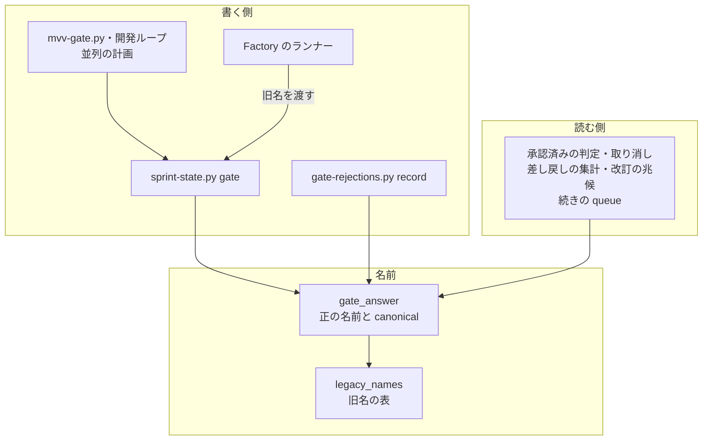
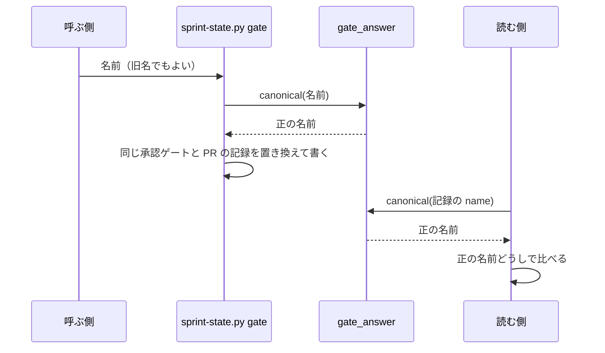

# 承認ゲートの呼び名: 2 つの承認ゲートを「設計承認ゲート」「リリース承認ゲート」と中身の分かる名前で呼ぶ（#2619）

## 目的

- **今どうなっているか**: NDF が人の承認を求める 2 つの点を、番号つきの 3 つの語（「承認ゲート 1・2」「ゲート 1・2」`関門 1・2`）で呼んでいる。承認を求められた人は、番号から設計の承認か本番へのリリースの承認かを思い出す必要がある
- **誰に効くか**: 承認ゲートで問いと承認資料を受け取る利用者、Skill と承認資料を読む AI、Factory の画面で承認の依頼に答える利用者
- **変えると何が成り立つか**: 名前だけでどちらの承認かが分かり、同じ点を指す語が 1 つにそろう。旧い版が書いた記録は、移行の操作なしで新しい版でも同じ意味に読める

## 適用範囲

- **働く範囲**: NDF を入れたすべてのリポジトリ（人へ出す文と、承認ゲートの記録の読み書き）と、このリポジトリの Factory
- **プロジェクトごとに違うもの**: 無し（呼び名はプロジェクトの設定で変えない。用語集はリポジトリごとに持つが、NDF が出す文の語は NDF が決める）
- **当たるモード**: すべてのモード（`light` / `operation` / `legacy-refactor` / `standard` / `documentation`）。documentation モードの「企画承認」「制作物承認」は呼び名を変えない

## あるべき姿の根拠

| 根拠 | 種類 | 何を示すか |
| --- | --- | --- |
| 「承認ゲート1を「設計承認ゲート」、承認ゲート2を「リリース承認ゲート」と名称を変更します」（2026-11-06、課題 #2619 の依頼の原文） | 利用者の指示の原文 | 新しい 2 つの名前 |
| `git grep -F` の件数（要求の「今の使われ方」。`承認ゲート 2` 397 行・`ゲート 2` 472 行・`関門 2` 169 行） | 実測 | 同じ点を 3 つの語で呼んでいる |
| メインディレクトリの `.ndf/` にある承認ゲートの記録の名前（`"name": "関門 1"` 244 件・`"name": "関門 2"` 99 件、要求の「今の使われ方」） | 実測 | 旧名の記録が残り続けるため、読む側の互換が要る |
| 工程の単位の改名（#1407）の旧名の対応表 `plugins/ndf/scripts/lib/legacy_names.py` | 既存の形 | 旧名は 1 つの表にだけ書き、読むときに新しい名前へ寄せ、書くのは常に新しい名前、という形がこのリポジトリにある |

要求と受け入れ条件は課題 #2619 の本文にある（コピーは [issues/issue-2619-requirements.md](issue-2619-requirements.md) ）。この文書は「どう作るか」だけを扱う。

## ドメインモデル

### コンテキスト

| コンテキスト | 何の語が 1 つの意味に決まるか |
| --- | --- |
| NDF の工程（`ndf-workflow`） | 承認ゲート・設計承認ゲート・リリース承認ゲート・承認ゲートの記録・人へ出す文・機械が読む識別子 |
| Factory（`factory`） | 承認の依頼とその種類（`gate1` / `gate2` / `decision`）・画面の表示 |

**Factory は NDF の工程に対して腐敗防止層を置く。** Factory のランナー（`factory/runner/src/translate.ts`）は、Factory の承認の依頼の種類を NDF の承認ゲートの記録の名前へ翻訳する。翻訳した名前で `sprint-state.py gate` を呼ぶ。Factory の種類の値は NDF の呼び名の変更に引きずられず、翻訳の層だけが NDF の名前を知る。

### 集約

| 集約 | 持ち主（書き換えてよいもの） | 根 | エンティティ | 値オブジェクト |
| --- | --- | --- | --- | --- |
| スプリント状態 | `sprint-state.py gate`（`mvv-gate.py`・開発ループ・並列の計画・Factory のランナーは、このコマンドを呼んで書く） | スプリント状態ファイル | 承認ゲートの記録（`gates[]`）・取り消しの記録（`withdrawals[]`） | 承認ゲートの名前 |
| 差し戻しの記録 | `sprint-state.py gate --outcome rejected` と `gate-rejections.py record`（どちらも `lib/gate_rejections.py` の書き込みを使う） | `gate-rejections.jsonl` の 1 行 | — | 承認ゲートの名前 |
| スプリントの目録 | `supervise.py new sprint`（`supervise_lib/sprint.py`） | 目録の `sprint.json` | ステージ（`ステージ[]`） | ステージの名前（承認ゲートのステージは承認ゲートの名前を使う） |

**承認ゲートの名前は値オブジェクトとして扱う。** 正の名前は「設計承認ゲート」「リリース承認ゲート」の 2 つと、MVV の承認の記録の `MVV` である。旧名（`関門 1` / `関門 2`）は読むときに正の名前へ寄せ、正の名前どうしで比べる。

### 不変条件

| # | 集約 | 条件 | 破れたときの扱い |
| --- | --- | --- | --- |
| I1 | スプリント状態・差し戻しの記録・スプリントの目録 | 新しい版は承認ゲートの旧名（`関門 1` / `関門 2`）を書かない。旧名で呼ばれたら、正の名前（「設計承認ゲート」「リリース承認ゲート」）へ寄せて書く。旧名でも正の名前でもない名前（「MVV」を含む）は、今と同じく受けてそのまま書く | テストが落ちる（書いた JSON に旧名が残る、または旧名でない名前が書き換わる） |
| I2 | スプリント状態・差し戻しの記録・スプリントの目録 | 旧名（`関門 1` / `関門 2`）の記録は、正の名前の記録と同じ承認ゲートとして読まれる。承認済みの判定・差し戻しの件数・改訂の兆候の件数・取り消しの判定・続きの queue の組み立てが、名前を正の名前に書き換えた記録と同じ結果になる | 旧い記録で再開したループが承認済みの承認ゲートを未承認と判定して止まる。テストで落とす |
| I3 | スプリント状態 | 同じ承認ゲート・同じ Pull Request の利用者の承認の記録は 1 件に置き換わる。旧名の記録も置き換えの対象になる | 旧名と正の名前の記録が並び、新旧の記録の数が食い違う。テストで落とす |
| I4 | （定数） | NDF のスクリプトの中では、承認ゲートの正の名前は `lib/gate_answer.py` の 1 か所、旧名との対応は `lib/legacy_names.py` の 1 か所にだけ書く。Factory のランナーは NDF を読み込めないため、対応を `factory/runner/src/translate.ts` の 1 か所に持つ（X2） | 別のファイルに同じ文字列の定数があると、片方だけが変わる。テストで落とす |
| I5 | （識別子） | 機械が読む識別子のうち、問いの区分 `ndf-gate:1` / `ndf-gate:2`、Factory の種類 `gate1` / `gate2`、承認ラベル `design-approved`、報告の結果の値 `関門` は値を変えない | hook が問いを拒む・Factory の依頼が表示されない・再開が止まる。既存のテストが落ちる |
| I6 | （識別子） | Factory の承認の依頼は、API・ランナー・画面で同じ種類の値（`gate1` / `gate2` / `decision`）を使う | 依頼が表示されないか、答えが写らない。既存の契約のテストが落ちる |

### ドメインイベント

要求の「ドメインイベント」の番号を引き継ぐ。

| # | イベント | 発生元 | 受け手 |
| --- | --- | --- | --- |
| E1 | 新しい版の NDF が利用者の環境へ入った | 利用者のプラグインの更新 | 以後のすべての読み書き（I1 の書き込みが始まる） |
| E2 | 実行中のループ・並列の計画が、新しい版で再開した | `supervise.py queue --resume`・relay | 承認済みの判定と続きの queue の組み立て（I2） |
| E3 | スクリプトが承認ゲートで止まり、人へ問いと承認資料を出した | 承認ゲートに当たるステップ | conductor の `AskUserQuestion` と hook の区分の検査（I5） |
| E4 | 人が承認ゲートに答え、承認ゲートの記録が書かれた | `sprint-state.py gate` | 承認済みの判定・差し戻しの集計・改訂の兆候の集計（I1・I3） |
| E5 | Factory が承認の依頼を表示し、答えをランナーが NDF の記録へ写した | Factory の API とランナー | `sprint-state.py gate`（I1・I6） |
| E6 | 新旧の版が混ざった環境で、同じ記録を両方の版が読み書きした | 一部のセッションだけ更新済み | 受け手を設けない。旧い版が新しい名前を読むことは互換の対象外とする（決定 4） |

### 用語

| 用語 | 意味 | 用語集への反映 |
| --- | --- | --- |
| 設計承認ゲート | 設計 Pull Request のマージの前に人の承認を求める承認ゲート。documentation モードでは企画承認に当たる | 追加（`ndf-workflow`。廃止した語に「承認ゲート 1」「ゲート 1」`関門 1`） |
| リリース承認ゲート | 本番系へ届く操作（本番へのリリース・operation の実行・自動反映の本番チャネルへのマージ）の前に人の承認を求める承認ゲート。documentation モードでは制作物承認に当たる | 追加（`ndf-workflow`。廃止した語に「承認ゲート 2」「ゲート 2」`関門 2`） |
| 承認ゲート | 人手の承認を求める点。設計承認ゲートとリリース承認ゲートの 2 つだけ | 意味の変更（意味の文の「ゲート 1」「ゲート 2」を新しい 2 語へ） |
| ゲート 1 | — | 廃止（設計承認ゲートの廃止した語へ移す） |
| ゲート 2 | — | 廃止（リリース承認ゲートの廃止した語へ移す） |
| 人へ出す文 | Skill・references・エージェントの定義の本文と、スクリプト・hook が人へ見せる文 | 追加（要求の段階で用語集に載せた） |
| 機械が読む識別子 | スクリプトが値の一致で読む文字列 | 追加（要求の段階で用語集に載せた） |

**新しい 2 語は要求の段階で用語集に載っている。廃止した語の追加・「承認ゲート」の意味の変更・「ゲート 1」「ゲート 2」の削除は実装の中で行う。** 設計のブランチの CI（`.github/workflows/glossary.yml`）は追加した行の廃止した語を検査する。今の段階で廃止した語を足すと、要求のコピーの 12 件が当たって落ちる。要求のコピーは `spec-copy.py write` で作るため、手で直さない。落ちることは、廃止した語を足した用語集で `glossary.py check --diff origin/develop --rules all` を実行して確かめた（2026-11-05）。実装のブランチの CI は用語集の形と文書の一致だけを見る。

## 外部の調査

省く: プロジェクトの中で使う呼び名の変更と、このリポジトリの記録の互換の形で決まり、外部の標準・製品・ライブラリの判断が要らない。旧名の読み方は既存の `lib/legacy_names.py`（#1407）の形に揃える。

## 機能一覧

| # | 機能 | 誰が使うか |
| --- | --- | --- |
| F1 | 承認ゲートの問い・承認資料・報告・案内が、2 つの承認ゲートを新しい名前で呼ぶ | 承認ゲートで答える利用者 |
| F2 | Skill・references・エージェントの定義・確定仕様・リポジトリ知識の文書が、新しい名前で書かれる | NDF を読む AI と人 |
| F3 | 用語集が新しい 2 語を持ち、旧い呼び名を廃止した語として引ける | 文書を書く人と AI、用語チェック |
| F4 | 旧い版が書いた承認ゲートの記録を、新しい版が同じ意味に読む | 実行中のループ・並列の計画を再開する conductor と supervisor |
| F5 | 旧名で `sprint-state.py gate` を呼んでも、新しい名前で記録される | 旧い手順書を読んだ AI、Factory のランナー |
| F6 | Factory の画面が 2 つの承認ゲートを新しい名前で表示する | Factory の利用者 |

## 構成要素

| 要素 | 責務 |
| --- | --- |
| 承認ゲートの名前（`plugins/ndf/scripts/lib/gate_answer.py`） | 正の名前 2 つ（定数 `DESIGN_GATE` / `RELEASE_GATE`）と、名前を正の名前へ寄せる関数 `canonical()` を持つ。`approved()` と `replaces()` は `canonical()` で比べる。今の定数 `GATE_1` / `GATE_2` を置き換える |
| 旧名の対応表（`plugins/ndf/scripts/lib/legacy_names.py`） | 承認ゲートの名前の旧名の表（正の名前 → 旧名の並び）を足す。旧名はこの表にだけ書く。読み取りの種類として扱い、`MODE` に関わらず読む。`sprint-state.py gate` と `gate-rejections.py record` が旧名を受け付けるのも `MODE` に関わらず続け、呼び出しの種類の止め方（`_tell()`。`MODE="refuse"` で終了コード 2）を使わない。Factory のランナーが旧名を渡し続けるため（決定 5）である。案内の文は `rename_notice()` を使わず、期限（`WHEN`）を含まない承認ゲート用の文を置く |
| ループの記録（`lib/sprint_loop_record.py`） | 自分で持つ定数 `GATE_1` / `GATE_2` を消し、`gate_answer` から読む |
| 改訂の兆候（`lib/project_mvv_signals.py`） | `GATE_KEYS` を正の名前の定数から作り、引くときは `canonical()` を通す |
| 差し戻しの集計（`lib/gate_rejections.py`・`gate-rejections.py`） | 記録の有無と件数を `canonical()` で仕分ける。`record --gate` は旧名を受けて正の名前で書く |
| 取り消し（`lib/sprint_mvv.py`） | `withdraw()` と `withdrawn()` を `canonical()` で比べる |
| 開発ループの承認ゲート（`lib/sprint_loop_gate.py`・`lib/sprint_loop_gate2.py`） | 目録のステージの名前・承認の記録・差し戻しの記録を `canonical()` で比べる |
| 並列の計画（`lib/parallel_external.py`・`lib/parallel_run.py`・`lib/parallel_release.py`） | 打つコマンドの承認ゲートの名前を定数から作り、記録を `canonical()` で比べる |
| 記録を書くコマンド（`sprint-state.py gate`） | 受けた名前を `canonical()` で寄せてから書く。旧名で呼ばれたら案内を標準エラーへ 1 行出す |
| 人へ出す文を持つスクリプト（`mvv-gate.py`・`supervise.py`・`supervise_lib/`・`release_lib/`・`relay_lib/`・`lib/ask_policy.py` ほか） | 問い・承認資料・報告・案内・エラーの文と、それを作る定数を新しい名前へ |
| Skill・references・エージェントの定義（`plugins/ndf/skills/`・`plugins/ndf/agents/director.md`） | 本文の呼び名を新しい名前へ。`sprint-state.py gate` のコマンドの例も正の名前で書く |
| 用語集（`docs/glossary/glossary.json`・`docs/glossary.md`・`plugins/ndf/skills/development-workflow/references/glossary.md`） | 用語の表のとおりに直し、`glossary.py render` で作り直す |
| 確定仕様とリポジトリ知識の文書（`docs/specifications/`・`docs/ndf-experiments.md`・`docs/versioning-and-distribution.md`・`AGENTS.md`） | 呼び名を新しい名前へ。判断の中身は変えない |
| Factory のランナー（`factory/runner/src/translate.ts`・`runtime.ts`・`main.ts`） | 種類から `sprint-state.py gate` に渡す名前を作る関数は旧名を渡し続ける（決定 5）。`runtime.ts` の `recordAnswer` は、今 1 つの変数 `gate` を `sprint-state.py gate` の引数と `rejectionDirective()` の両方へ渡している。これを記録用の名前（`answer.gate ?? gateRecordName(answer.kind)`。旧名のまま、X2）と表示用の名前に分ける。表示用の名前は、`translate.ts` に置く関数 `gateDisplayName()` が記録用の名前を正の名前へ寄せて作る（`answer.gate` が来た経路でも記録と表示が食い違わない）。旧名と正の名前の対応は、`gateRecordName()` と同じ種類と旧名の対から作り、`translate.ts` の中の 1 か所にだけ置く。インストールした NDF の `canonical()` は呼ばない（決定 5 のとおり、この変更より前の版の NDF には `canonical()` が無い）。`rejectionDirective()` は表示用の名前を受け、文中の「関門を通さず」も「承認ゲートを通さず」へ直す |
| Factory の画面と契約の説明（`factory/web/src/i18n/ja.json`・`factory/web/src/pages/`・`factory/contracts/openapi/*.yaml`・`factory/contracts/schemas/progress-event.schema.json`・`factory/api/src/organizer/`） | 表示と説明文を新しい名前へ。種類の値は変えない。`factory/contracts/src/generated/` は手で直さず、契約から作り直す |

## データ構造

**スキーマは変えない。値の集合だけを変える。** 既存の記録は書き換えない（要求の「境界」）。

| 記録 | 欄 | 新しい版が書く値 | 新しい版が読む値 |
| --- | --- | --- | --- |
| スプリント状態ファイルの `gates[]` | `name` | `設計承認ゲート` / `リリース承認ゲート` / `MVV` | 書く値に加えて `関門 1` / `関門 2` |
| スプリント状態ファイルの `withdrawals[]` | `name` | 同上 | 同上 |
| `gate-rejections.jsonl` | `gate` | `設計承認ゲート` / `リリース承認ゲート`（ほかの名前は今と同じく受けて `other` に数える） | 書く値に加えて `関門 1` / `関門 2` |
| スプリントの目録 `sprint.json` の `ステージ[]` | `name`（承認ゲートのステージ） | `設計承認ゲート` / `リリース承認ゲート` | 書く値に加えて `関門 1` / `関門 2` |
| `mvv-gate.jsonl` | `gate` | `design` / `release`（変えない） | 同左 |

**旧名として読むのは `関門 1` / `関門 2` だけである。** 既存の記録には `"name": "承認ゲート 2"`（4 件）と `"name": "ゲート 2"`（2 件）もある。これらは今の版でも承認ゲートの記録として読まれていない。`gate_answer.approved()` は `関門 2` との一致だけを見るためである。旧名に加えると判定と件数が変わり、受け入れ条件 4 の「変更の前と同じ判定・件数」が破れる。

## 入出力の契約

| 項目 | `sprint-state.py gate <状態> <名前>` |
| --- | --- |
| 入力 | `<名前>` に `設計承認ゲート` / `リリース承認ゲート` / `MVV` / 旧名 `関門 1` / `関門 2`。ほかの名前は今と同じく受けてそのまま書く |
| 出力 | 結果 JSON の形は変えない。`summary` の名前は正の名前で出す |
| 失敗の形 | 変えない |
| 互換性 | 旧名で呼んだ既存の呼び出し側（旧い手順書を読んだ AI・Factory のランナー）は壊れない。旧名で呼ばれたら、期限を含まない案内（例: `関門 1 は 設計承認ゲート へ改名した。設計承認ゲート で呼ぶ`）を標準エラーへ 1 行出し、正の名前で書く。旧名の受け付けは `legacy_names.MODE` に関わらず続け、終了コード 2 で止めない（決定 2・決定 5） |

`gate-rejections.py record --gate <名前>` と `count` の出力も同じ扱いにする（旧名を受け、正の名前で書き、件数の仕分けは `canonical()` で行う）。

**Factory の契約は、種類の値と形を変えない。** 契約は `factory/contracts/openapi/runs.yaml`・`organizer.yaml`・`progress-event.schema.json` である。 変えるのは説明文の呼び名だけである。`ApprovalAnswer` の説明の `関門 1 / 関門 2 へ写す` は「NDF の承認ゲートの記録の名前へ写す」に直す。契約の検査は既存の `factory/contracts/tests/` が見る。

**画面**（`factory/web/src/i18n/ja.json`）は次の 3 つの表示を直す。キーは変えない。

| キー | 今の表示 | 新しい表示 |
| --- | --- | --- |
| `sprintDetail.gate1` | ゲート 1 | 設計承認ゲート |
| `sprintDetail.gate2` | ゲート 2 | リリース承認ゲート |
| `loopStop.gate2_returned` | 承認ゲート 2 で差し戻された | リリース承認ゲートで差し戻された |

## 処理の流れ

承認ゲートの記録を書くときと読むときの流れ。どちらも `canonical()` を 1 回通す。

**置き換え（I3）は、既存の記録の名前も `canonical()` で寄せてから比べる。** 旧い版が `関門 1` で書いた記録に、新しい版が同じ Pull Request の `設計承認ゲート` の承認を書くと、旧い記録は置き換わる。

人へ出す文の置き換えは実行時の流れを持たない。実装の順序は次のとおりにする。

1. `gate_answer` と `legacy_names` に名前と旧名の表を置き、読む側をすべて `canonical()` へ寄せる（記録の互換を先に固める）
2. スクリプトの定数と人へ出す文を新しい名前へ
3. Skill・references・エージェントの定義・確定仕様・リポジトリ知識の文書を新しい名前へ
4. 用語集を直して `render` する
5. Factory の表示と説明文を直し、生成物を作り直す

## 非機能の実現方式

| 大項目 | 要求の条件 | 実現方式 | 確かめ方 |
| --- | --- | --- | --- |
| 移行性 | 旧い版が書いた記録（承認ゲートの記録の名前・問いの区分・並列の依頼の種類）を、新しい版が移行の操作なしで読める。利用者に記録の書き換えを求めない | 記録の名前は読むときに `canonical()` で正の名前へ寄せる。問いの区分と並列の依頼の種類は値を変えない（決定 2・3） | 旧名と正の名前の両方を入力にしたテスト（テスト設計の I2・I3）。メインディレクトリの `.ndf/loop` と `.ndf/` の既存の記録を、変更の前と後の版の集計に通して件数を比べる |
| 運用・保守性 | 承認ゲートの名前を表す文字列は、スクリプトの中で 1 か所の定数から読む | 正の名前は `gate_answer.py`、旧名は `legacy_names.py` にだけ置く。`sprint_loop_record.py` と `project_mvv_signals.py` の定数は `gate_answer` から作る | テスト設計の I4 |

## 決定の記録

### 決定 1: 名前だけでどちらの承認か分かるよう、承認ゲートの記録の名前を新しい名前へ変える

承認ゲートの記録の名前（`関門 1` / `関門 2`）は機械が読む識別子だが、`sprint-state.py gate <状態> "関門 1"` のように手順書のコマンドに現れ、人と AI が打つ値でもある。名前を残すと、Skill と references のコマンドの例に旧い語が残り続け、受け入れ条件 2 の例外が手順書の全体へ広がる。新しい版は正の名前で書き、旧名は読むときだけ受け付ける。

記録の名前を残して表示だけを変える形は採らない。人が打つコマンドと人が読む文の語が食い違い、1 語 1 意味が崩れる。

根拠: Value 8 / Vision（MVV 版 5）

### 決定 2: 再開が承認済みの承認ゲートで止まらないよう、旧名の記録は読むときに正の名前へ寄せ、書き換えない

旧名と正の名前の対応は `legacy_names.py` の 1 つの表に置き、読む側はすべて `gate_answer.canonical()` を通して比べる。#1407 の工程の単位の改名が同じ形（旧名はこの表にだけ書き、読むのは `MODE` に関わらず、書くのは新しい名前）で運用されており、同じ規則に揃える。既存の記録（`.ndf/` の JSON・JSONL）は書き換えない。書き換えは利用者のデータの変更（C3）に当たり、移行の操作を利用者に求めることにもなる。

旧名の表を消す時期は、旧名の記録を読む必要が無くなったときとする。既存の記録はリポジトリの `.ndf/` に残り続けるため、この設計では期限を置かない。読み取りの表の 1 行は、残しても既定の振る舞いを変えない。

- 作り方: 自前で作る
- 比べた候補: 無し（外部の調査を省いた）

根拠: Value 7 / C3（MVV 版 5）

### 決定 3: hook と Factory の契約を壊さないよう、ASCII の識別子（`ndf-gate:1/2`・`gate1/gate2`・`design-approved`）は値を変えない

問いの区分は `AskUserQuestion` の `metadata.source` に入り、hook（`hook_lib/ask_guard.py`）が値の一致で許す。Factory の種類は API・ランナー・画面と進行のイベントの契約（`progress-event.schema.json`）が共有する。どちらも人へ出す文ではなく、値を変えると旧い区分と旧い種類を読む経路を hook・API・画面の 3 か所に持つことになる。人へ出す説明（`ask_policy.py` の区分の説明、hook の案内の文）だけを新しい名前へ直す。

承認ラベル `design-approved` は既に設計の承認を表す語で、番号を持たない。変える理由が無い。

根拠: Value 3 / Value 6（MVV 版 5）

### 決定 4: 承認ゲートの変更を名前に限るため、報告の結果の値 `関門` は変えず、例外の一覧に載せる

フェーズレポートの `結果: 関門` と、queue の記録の `result: "関門"` は、承認ゲートで止まったことを表す機械が読む識別子である。この値は、`supervise_lib/` の queue・再開・流し直しの判定（`FINISHED`・`RESUMABLE`）と、開発ループと並列の計画が、合わせて 17 ファイルで値の一致で読む。実行中の queue の記録にも保存されている。値を変えると、旧い記録を読む経路をそのすべてに足すことになり、要求が求める範囲（承認ゲートの 2 つの呼び名）を超える。値は残し、値を説明する文（`関門を返した` など）だけを「承認ゲート」へ直す。

E6（旧い版が新しい版の書いた記録を読む）も互換の対象に含めない。旧い版の読む側を新しい版から直す手段が無く、一部のセッションだけ更新した状態は再起動で解ける。`CHANGELOG.md` の新しい版の項に、すべてのセッションを更新してから再開するよう書く。

根拠: Value 3（MVV 版 5）

### 決定 5: Factory がどの版の NDF を入れても承認を記録できるよう、ランナーは `sprint-state.py gate` へ旧名を渡し続ける

Factory のランナーは、ジョブごとに指定された版の NDF を入れる。入れる箇所は `factory/runner/src/main.ts` の `installNdf(instruction.NDF_VERSION)` である。新しい名前を渡すと、この変更より前の版の NDF は承認を読めず、承認済みの承認ゲートで止まり続ける。旧名なら、前の版はそのまま読み、新しい版は `canonical()` で正の名前へ寄せて書く。ランナーの差し戻しの指示の文は人へ出す文である。今の `runtime.ts` は同じ変数を記録と指示の文の両方へ渡しているため、記録用の名前（旧名のまま）と表示用の名前（記録用の名前を正の名前へ寄せたもの）の 2 つの変数に分ける。表示用の名前は種類からではなく記録用の名前から作り、`answer.gate` が来た経路でも記録と同じ承認ゲートを指すようにする。表示用の名前への対応は `translate.ts` の `gateDisplayName()` が持ち、インストールした NDF の `canonical()` は呼ばない。ランナーが入れる NDF の版は Factory の利用者が選ぶため、前の版を入れたジョブでは `canonical()` を呼べない。

旧名を渡すのをやめるのは、Factory がこの変更より前の版の NDF をジョブで入れなくなったときとする。

根拠: Value 6 / Value 1（MVV 版 5）

### 決定 6: 確定仕様を読む人が今の語で読めるよう、`docs/specifications/` の呼び名も新しい名前へ直す

確定仕様は主題ごとの今の仕様で、リリースのたびに段落が移されて書き足される。書いた日の記録（発表資料・記事・アーカイブ・開発履歴）とは扱いが違う。用語チェックも `docs/specifications/*.md` を語の出所として読む（`.ndf/glossary.json` の `source_paths`）。直すのは呼び名だけで、判断の中身・版・課題の番号は変えない。

根拠: Value 8（MVV 版 5）

### 決定 7: 残した旧い呼び名を確かめられるよう、受け入れ条件 1・2 の例外を次の一覧に限る

`git grep -nE '(承認ゲート|ゲート|関門) ?[12]'` と `git grep -n '関門'` を対象範囲に当てたとき、ヒットしてよいのは次の行だけである。ほかのヒットは直す。

| # | 残す箇所 | 理由 |
| --- | --- | --- |
| X1 | `plugins/ndf/scripts/lib/legacy_names.py` の旧名の表 | 旧い記録を読むため（決定 2） |
| X2 | `factory/runner/src/translate.ts` の `sprint-state.py gate` へ渡す名前、`gateDisplayName()` の旧名と正の名前の対応、それらの期待値を持つ `factory/runner/src/runner.test.ts` | どの版の NDF でも承認を記録するため（決定 5） |
| X3 | 報告の結果の値 `関門` を値として書く・比べるコード（`lib/durable.py`・`lib/parallel_external.py`・`lib/sprint_loop.py`・`lib/sprint_loop_gate.py`・`lib/sprint_loop_gate2.py`・`lib/sprint_loop_record.py`・`parallel.py`・`supervise_lib/actuals.py`・`commands.py`・`engine.py`・`flow.py`・`plan.py`・`queue.py`・`queue_fill.py`・`queue_resume.py`・`release_templates.py`・`state.py`）と、値をコードの記法（`` `結果: 関門` ``）で示す Skill と references の行 | 機械が読む識別子のため（決定 4） |
| X4 | 旧名を入力にした互換のテスト（`plugins/ndf/scripts/tests/` の I2・I3 のテスト） | 受け入れ条件 4 |
| X5 | 用語集の廃止した語（`docs/glossary/glossary.json` の `deprecated` と、それを描いた `docs/glossary.md` の行） | 旧い呼び名を引けるようにするため（受け入れ条件 3） |
| X6 | `.ndf/mvv.json` の版の `reason`（MVV の過去の版を承認した理由の記録） | 承認した時点の記録で、書き換えると承認の経緯が変わる |
| X7 | `CHANGELOG.md` のこの変更の版の項で、旧い呼び名を挙げて改名を知らせる行 | 改名のアナウンスに旧い語が要る |

`plugins/ndf/scripts/lib/lock-common.sh` の `関門` はロックの排他の意味で、承認ゲートではない。例外にせず「排他の判定」に言い換え、`関門` の当たりを承認ゲートの例外だけにする。`lib/step_result.py` の `EXIT_GATE` の注釈の `関門` は「承認ゲート」に直す。

根拠: Value 8 / Value 4（MVV 版 5）

## テスト設計

`.md` の文言を照合するテストは書かない（`AGENTS.md` の DON'T）。文書の呼び名は受け入れ条件 1・2 の `git grep` で確かめる。

| 受け入れ条件・不変条件 | どの振る舞いで縛るか | どう壊したら落ちるべきか |
| --- | --- | --- |
| 受け入れ条件 1・2 | 対象範囲の `git grep` のヒットが、決定 7 の X1〜X7 に当たる行だけになる（実装の最後に手で当て、Pull Request の本文に結果を載せる） | 人へ出す文に旧い呼び名を 1 つ残すと、例外に当たらないヒットが出る |
| 受け入れ条件 3 | `glossary.py render` の後の `docs/glossary.md` と `development-workflow/references/glossary.md` の表が、用語の表と同じ語と廃止した語を持つ。`glossary.py check` が用語集の検査で 0 を返す | 「ゲート 1」の独立した語を残すと、廃止した語との重なりで検査が落ちる |
| 受け入れ条件 4・I2 | 旧名の記録を入れたスプリント状態ファイルで、承認済みの判定（`gate_answer.approved()`）・差し戻しの件数（`gate_rejections`）・改訂の兆候の件数（`project_mvv_signals`）・取り消しの判定（`sprint_mvv.withdrawn()`）・続きの queue の組み立て（`sprint_loop_gate.continuation()`）・開発ループのリリース承認ゲートの答え（`sprint_loop_gate2`）・並列の計画の MVV 判定の通過（`parallel_external`）が、名前を正の名前に書き換えた記録と同じ結果を返す | 読む側の 1 つが `canonical()` を通さずに比べると、旧名の側だけ未承認・0 件になる |
| I1 | `sprint-state.py gate` と `gate-rejections.py record` に旧名を渡すと、書いた JSON の名前が正の名前になり、標準エラーに案内が 1 行出る | 受けた名前をそのまま書くと、旧名が記録に残る |
| I3 | 旧名で書かれた同じ PR の承認の記録がある状態で正の名前の承認を書くと、承認の記録は 1 件になる | `replaces()` が既存の名前を寄せずに比べると 2 件になる |
| I4 | スクリプトの中で、承認ゲートの正の名前の文字列が `gate_answer.py` の外に定数として現れず、旧名の文字列が `legacy_names.py` と X2・X3 の外に現れない（`plugins/ndf/scripts/` を走査するテスト） | `sprint_loop_record.py` に定数を残すと落ちる |
| 受け入れ条件 5・I5 | 既存の hook のテスト（`tests/test_ask_guard.py`）が `ndf-gate:1` / `ndf-gate:2` の問いを通す | 区分の値を変えると落ちる |
| 受け入れ条件 6・I6 | 既存の Factory の契約と画面のテストが種類 `gate1` / `gate2` で通り、画面のテストの表示の期待値が新しい名前になる | 種類の値を変えるか、表示のキーを変えると落ちる |
| 受け入れ条件 7 | 全体テスト・Factory のテスト・CI が通る | — |
| 受け入れ条件 8 | 変更した文書に `glossary.py check --file` を当て、廃止した語の当たりが決定 7 の例外だけになる | 本文に「ゲート 2」を残すと当たる |

## 設計の結果

| 課題 | 扱い | 取り込み先 | 触るファイル |
| --- | --- | --- | --- |
| #2619 | 実装する | — | `plugins/ndf/scripts/`、`plugins/ndf/skills/`、`plugins/ndf/agents/director.md`、`docs/specifications/`、`docs/glossary/glossary.json`、`docs/glossary.md`、`docs/ndf-experiments.md`、`docs/versioning-and-distribution.md`、`AGENTS.md`、`factory/runner/src/`、`factory/web/src/`、`factory/api/src/organizer/`、`factory/contracts/` |

## 未確認のまま残ること

| 項目 | 内容 |
| --- | --- |
| #2620 との順序 | #2620（「配布」を「デプロイ」「リリース」に分ける）も「本番への配布の承認」などの同じ行を書き換える。どちらを先にマージするかと、重なった行の書き方は実装計画で決める（要求の未決 4） |
| Factory のジョブが入れる NDF の版 | ランナーが旧名を渡すのをやめる時点（決定 5）は、Factory がジョブで入れる NDF の版の下限を決めたときに決まる。下限の決め方はこの設計では確かめていない |
| 置き換えの規模 | 2026-11-05 の `git grep` で、対象範囲の旧い呼び名は約 1,240 行・約 235 ファイル（`plugins/ndf/scripts/` 680 行・113 ファイル、うちテスト 46 ファイル。`plugins/ndf/skills/` 200 行・48 ファイル、`docs/specifications/` 265 行・49 ファイル、`factory/` 42 行・17 ファイル）。行の機械的な置き換えでは文が崩れる箇所（`関門で止まる` など、番号を持たない言い方）は 1 行ずつ読んで直す |
| 実行中の queue の記録 | 実行中の queue に書かれたプランの `question` などの文は旧い呼び名のまま残る。再開の判定は名前ではなく結果の値で行うため振る舞いは変わらないが、再開した後に人へ出る文に旧い呼び名が混ざることがある |
