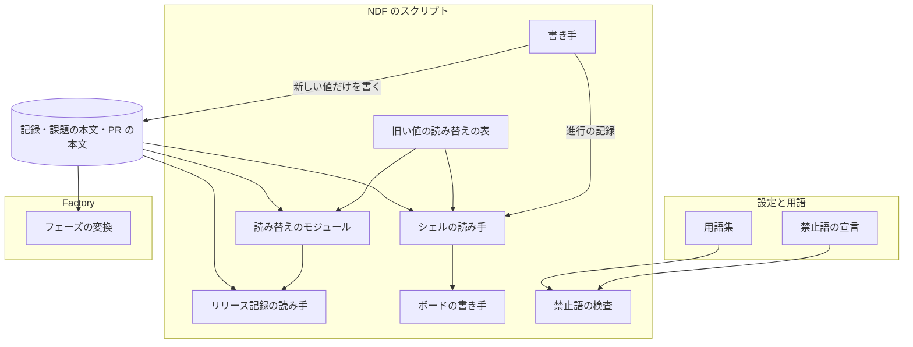
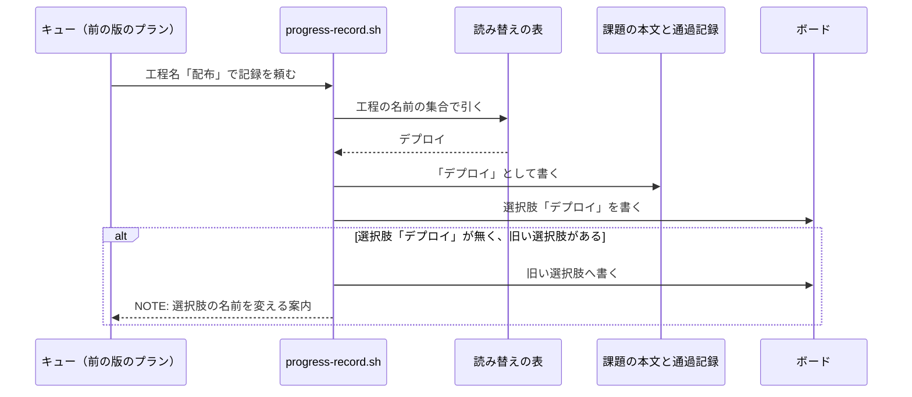

# 語の置き換え: 環境へ届ける操作を「デプロイ」、本番へのデプロイを「リリース」と呼び分ける（#2620）

## 目的

- **今どうなっているか**: 環境へ変更を届ける操作を `配布` と呼び、同じ意味に「検証リリース」「本番の配布」「本番へのリリース」も当たっている。受け入れ条件 1 の検索で 2,000 行（`75fc92737`）が当たり、スクリプトが記録に書く値（工程の名前・周回の結果・フェーズの名前・リリース記録の段階）にも `配布` が入っている
- **誰に効くか**: 承認を求められる利用者と、課題の本文の「進行」・報告・リリース記録を読む利用者と AI
- **変えると何が成り立つか**: 本番へ届く操作だけが「リリース」と書かれ、承認が要るのはどちらかを語から読める。版を上げる前に作られた記録も同じ意味で読み続けられ、`配布` を書き足した変更は継続的統合で落ちる

## 適用範囲

- **働く範囲**: このリポジトリの文書・Skill・スクリプト・Factory と、NDF を使うすべてのリポジトリでスクリプトが書く記録の値（工程の名前・リリース記録・周回の結果・フェーズの名前）。再流入の検査は、用語集の設定に禁止語を書いたリポジトリだけで働く
- **プロジェクトごとに違うもの**: 禁止語と、検査する範囲・外す範囲。用語集の設定（`.ndf/glossary.json`）で受ける
- **当たるモード**: `standard`

## あるべき姿の根拠

| 根拠 | 種類 | 何を示すか |
| --- | --- | --- |
| 「デプロイは開発・本番を問わず環境に変更を届けることを指し、リリースは本番へのデプロイのみをさします」 | 利用者の指示の原文（#2620） | 語の定義そのもの |
| STD1・PRD1 | 外部の一次情報 | 業界ではデプロイを「環境へ入れること」、リリースを「利用者が使える状態にすること」と分けて呼ぶ。利用者の定義はこの区別と矛盾しない（NDF の本番チャネルは利用者が使うチャネルである） |
| 受け入れ条件 1 の検索が 2,000 行・`docs/metrics/` を除いて 1,906 行 | 実測（2026-11-06、`75fc92737`） | 置き換えは文の書き換えが大半で、記録に書く値は 7 つの値の集合に限られる（「データ構造」） |
| 用語集の検査（`glossary.py check --diff`）が、継続的統合のジョブ `glossary-check` で Pull Request ごとに足した行を見ている | 実測（`.github/workflows/glossary.yml`） | 再流入の検査を足す場所が既にある |

要求と受け入れ条件は #2620 の本文にある（コピーは `issues/issue-2620-requirements.md`）。この文書は「どう作るか」だけを扱う。

## ドメインモデル

### コンテキスト

| コンテキスト | 何の語が 1 つの意味に決まるか |
| --- | --- |
| NDF のリリース（`ndf-release`） | デプロイ・リリース・開発版のデプロイ・リリース記録の段階・リリース対象・アーティファクト・導入先のランタイム |
| NDF の開発ワークフロー（`ndf-workflow`） | 工程の名前・フェーズの名前・周回の結果・リリースの依頼・旧い値の読み替え |
| NDF の Factory（`ndf-factory`） | リリースの実行・まとめたリリース |

`ndf-release` と `ndf-workflow` は共有カーネルの関係にある。同じ用語集（`docs/glossary/glossary.json`）と旧い値の読み替えの表を共同で持ち、同じ変更で直す。Factory は NDF の出す値に対して腐敗防止層を置く（`factory/runner/src/translate.ts` が NDF のフェーズの名前を Factory の段の名前へ変換する）。Factory はサービスの境界の規則によって NDF の読み替えの表を参照しないため、自分の層に旧い値を持つ。

### 集約

| 集約 | 持ち主（書き換えてよいもの） | 根 | エンティティ | 値オブジェクト |
| --- | --- | --- | --- | --- |
| 用語集 | `glossary.py`（`render` が文書を作る。語の追加・廃止は用語集の JSON を直す変更） | 用語集 | 語 | 意味・廃止した語・コンテキスト |
| 旧い値の読み替えの表 | NDF のスクリプト（`plugins/ndf/scripts/data/legacy-values.json`） | 表 | 値の集合 | 旧い値 → 新しい値の組 |
| 禁止語の宣言 | 利用者の設定（`.ndf/glossary.json` の `check.banned`） | 宣言 | — | 禁止語・検査する範囲・外す範囲 |
| Factory のフェーズの変換 | Factory のランナー（`factory/runner/src/translate.ts` と、旧い値を持つ `legacy-phases.ts`） | 変換の表 | — | NDF のフェーズの名前 → Factory の段 |

### 不変条件

| # | 集約 | 条件 | 破れたときの扱い |
| --- | --- | --- | --- |
| I1 | 旧い値の読み替えの表 | スクリプトが記録・報告・課題の本文の「進行」へ書く値は、どの値の集合でも新しい値だけである | 全体テストが落ちる（書く側の値を集めて旧い値と照らす） |
| I2 | 旧い値の読み替えの表 | 旧い値を読んだ処理は、対応する新しい値を読んだときと同じ結果を返す | 単体テストが落ちる |
| I3 | 旧い値の読み替えの表 | 1 つの値の集合の中で、旧い値は新しい値の 1 つだけへ変換される。新しい値は旧い値の欄に現れない | 表を読む時点で例外を上げ、読み手は終了コード 2 で止まる |
| I4 | 禁止語の宣言 | 検査する範囲に足した行に禁止語があれば、検査は失敗し、ファイルと行を出す。外す範囲の行では失敗しない | 継続的統合のジョブ `glossary-check` が落ちる |
| I5 | 用語集 | 新しく決めた語は、それぞれ 1 つの意味で用語集に載る。旧い語は廃止した語として、置き換え先の語を引ける | `glossary.py check` の構造の検査が落ちる |
| I6 | — | Skill の名前・スラッシュコマンド・スクリプトの副命令の名前が変わらない | `plugins/ndf/manifests/` と契約の差分の確認で止まる |
| I7 | — | 書いた日の記録に差分が無い | 禁止語の検査の外す範囲と、テスト設計の差分の確認で止まる |

### ドメインイベント

| # | イベント | 発生元 | 受け手 |
| --- | --- | --- | --- |
| E1 | 利用者が「デプロイ」「リリース」の定義を決めた | 利用者 | 用語集 |
| E2 | 用語集にデプロイ・リリースの定義と、旧い語の別名が載った | 用語集の JSON の変更 | `glossary.py render`・`glossary.py check` |
| E3 | 対象範囲の文書・Skill・Factory の文を置き換えた | 実装の変更 | 禁止語の検査 |
| E4 | スクリプトが記録に書く値を新しい語にした | NDF のスクリプト | 記録を読むスクリプト・Factory のランナー |
| E5 | 実行中のループ・並列の計画が、旧い値を持つ既存の記録を読んだ | 版を上げた後の最初の周回 | 旧い値の読み替えの表 |
| E6 | 禁止語を書き足した変更が継続的統合で落ちた | 以後の Pull Request | Pull Request の作成者 |

### 用語

| 用語 | 意味 | 用語集への反映 |
| --- | --- | --- |
| デプロイ | 開発・本番を問わず、環境に変更を届けること。本番へのデプロイだけをリリースと呼ぶ。工程の名前でもある | 追加（`ndf-release`。設計の Pull Request は工程の名前を除いた意味で足し、実装計画の最初の Pull Request が工程の名前を足す） |
| リリース | 本番へのデプロイ。フェーズの名前でもある | 意味の変更（`ndf-workflow`。工程の名前ではなくなる） |
| 開発版のデプロイ | 開発版のチャネルへ版を出すことと、検証の環境への反映。フェーズの名前でもある | 追加（`ndf-release`。「検証リリース」を廃止した語にする） |
| デプロイなし | リリース記録の段階の値。どの環境へも届けずに工程を終えたこと | 追加（`ndf-release`） |
| リリース待ち | リリースの依頼を送り、答えを待たずに締めた周回の結果 | 追加（`ndf-workflow`。旧い語を廃止した語にする） |
| リリースの依頼 | レーンがリリース承認の手前で、リリースをオーガナイザーへ頼むために送る 1 件のメッセージ | 追加（`ndf-workflow`。旧い語を廃止した語にする） |
| リリースの実行 | Factory のオーガナイザーが、まとめたリリース 1 つのために起こすスプリントの実行 | 追加（`ndf-factory`。旧い語を廃止した語にする） |
| まとめたリリース | オーガナイザーが複数のレーンのリリースの依頼をまとめた 1 回のリリース | 追加（`ndf-workflow`） |
| リリース対象 | リリースで利用者へ届くファイルの集まり。ai-plugins では `plugins/` と `.claude-plugin/` | 追加（`ndf-release`） |
| アーティファクト | ビルドや署名で作る、公開操作で届ける生成物（パッケージ・署名したバイナリなど） | 追加（`ndf-release`） |
| 導入先のランタイム | マーケットプレイスのプラグインを導入できる形で届けるランタイム（Claude Code と Codex） | 追加（`ndf-release`。旧い語を廃止した語にする） |
| 利用先のリポジトリ | NDF を導入して使っているリポジトリ | 追加（`ndf-workflow`） |
| 利用者向けの変化なし | Pull Request の本文の `## 利用者向けの変化` が「無し」（「なし」も同じ）だけを持つこと | 追加（`ndf-release`。旧い語を廃止した語にする） |
| 旧い値の読み替え | 版を上げる前に書かれた記録の値を、読む時点で新しい値へ変換すること | 追加（`ndf-workflow`） |
| 禁止語 | 用語集の設定が、検査する範囲で新しく書くことを禁じた語 | 追加（`ndf-workflow`） |

「用語集への反映」の列は、実装を終えた時点の用語集を示す。設計の Pull Request が用語集へ入れるのは「追加」の語だけで、意味の変更（「リリース」）と、「デプロイ」への工程の名前の追記と、旧い語を廃止した語にする対応（「検証リリース」「配布」など）は入れない。実装計画の最初の Pull Request（用語集と読み替えの表と検査）が入れる。設計の Pull Request で旧い語を廃止した語にすると、用語チェック（`glossary.py check --diff`）が、この設計文書の足した行にある旧い語を廃止した語として指摘し、継続的統合が落ちるためである。

## 外部の調査

| 種類 | 調べるか | 理由 |
| --- | --- | --- |
| 標準・仕様 | 調べる | デプロイとリリースの区別に業界で流通した定義があり、利用者の定義と食い違わないかを確かめる |
| 主要な製品 | 調べる | デプロイの製品が、環境と版とリリースをどう呼び分けているかを見る |
| ライブラリとサービス | 調べる | 禁止語の検査を既存の文書の検査ツールで済ませられるかを決める |

### 標準・仕様

| # | 標準・仕様 | 何を定めているか | 設計への反映 | 出典 |
| --- | --- | --- | --- | --- |
| STD1 | Thoughtworks Technology Radar「Decoupling deployment from release」 | デプロイを「アプリケーションの部品か基盤へ変更を入れる行為」、リリースを「機能の変更が業務上の影響を持って利用者へ届くこと」に限って使うよう勧める（2016 年 4 月の版。最新の版には載っていない） | 開発版のチャネル・検証の環境へ入れることはデプロイ、本番チャネルで利用者へ届くことはリリースと呼ぶ（決定 1） | https://www.thoughtworks.com/en-au/radar/techniques/decoupling-deployment-from-release （2026-11-06） |

### 主要な製品

| # | 製品 | どう解いているか | 設計への反映 | 出典 |
| --- | --- | --- | --- | --- |
| PRD1 | Octopus Deploy | デプロイは「ソフトウェアの版を環境へ入れること」、リリースは「利用者が使える状態にすること」と書く。版を「リリースする」と「リリースをリリースする」の言い方を避けるため、版は「ソフトウェアの版」と呼ぶ | 版は「版」のまま呼び、「リリース」を名詞の版の意味に使わない（「リリース済み版」は既存の語のまま） | https://octopus.com/devops/continuous-delivery/deployments-vs-releases/ （2026-11-06） |
| PRD2 | Microsoft Learn「Understand releases and deployments」 | 新しいソフトウェアをデプロイすると同時に利用者へ機能が届く状態を、分けるべき問題として扱う | 承認が要るのは本番へ届く操作だけだと語で分かるよう、工程の名前と段階の値を分けて持つ（決定 2・3） | https://learn.microsoft.com/en-us/training/modules/introduction-to-continuous-delivery/5-understand-releases-deployments （2026-11-06、検索の結果の要約で確かめた） |

### ライブラリとサービス

| # | 候補 | 版 | ライセンス | 最後のリリースの日付 | 終了のアナウンス | 要件を満たすか | 出典 |
| --- | --- | --- | --- | --- | --- | --- | --- |
| LIB1 | Vale（substitution の検査） | 未確認 | MIT | 未確認 | 無し | 一部。`swap` で語と置き換え先を持てるが、Pull Request で足した行だけを見る形と、コードのコメント・文字列の中を見る形は持たない。Go のバイナリを継続的統合へ足す必要がある | https://docs.vale.sh/checks/substitution （2026-11-06） |
| LIB2 | textlint-rule-prh | 6.1.1 | MIT | 2026-10-16（npm の更新日） | 無し | 一部。`expected` と `pattern` の辞書で置き換え先を出せる。Markdown が対象で、Python・TypeScript・シェルのコメントと文字列は見ない。Node の依存と辞書を、用語集と別に持つ | https://github.com/textlint-rule/textlint-rule-prh ・ `npm view textlint-rule-prh version time.modified license`（2026-11-06） |
| LIB3 | `glossary.py check --diff`（このリポジトリが既に持つ） | NDF 10.27.26 | MIT | — | 無し | 一部。足した行だけを見て、廃止した語から置き換え先の語を出す。検査する範囲が用語集の設定の `check.paths`（`issues/` の要求と設計）に限られ、コードはコメントを外して英語の識別子だけを見る | `plugins/ndf/scripts/glossary.py`（2026-11-06） |

### 確かめられなかったこと

| 対象 | 試した手段 | 結果と理由 |
| --- | --- | --- |
| Vale の最新の版と日付 | `curl -s https://api.github.com/repos/errata-ai/vale/releases/latest` | 応答に `tag_name` が無かった（リポジトリの移転か API の制限。理由は確かめていない） |
| Vale の検査がコードのコメントと文字列を見るか | https://docs.vale.sh/checks/substitution | 頁に記述が無い。採らない理由は足した行だけを見る形が無いことで足りるため、追わない |

調べた量: 候補 6 件・取得の試み 9 回。

## 機能一覧

| # | 機能 | 誰が使うか |
| --- | --- | --- |
| F1 | 文書・Skill・Factory の文が、本番へ届く操作をリリース、それ以外の環境へ届く操作をデプロイと書く | 利用者・AI |
| F2 | スクリプトが記録・報告・「進行」へ書く値が新しい語になる | 利用者・AI・記録を読むスクリプト |
| F3 | 版を上げる前の記録を、新しい値と同じに読む | 実行中のループ・並列の計画・閉じる前の確認・見積もり |
| F4 | 用語集が新しい語の定義と、旧い語から置き換え先を引く対応を持つ | 利用者・AI・`glossary.py check` |
| F5 | 禁止語を書き足した Pull Request を継続的統合が落とす | Pull Request の作成者 |

## 構成要素

| 要素 | 責務 |
| --- | --- |
| 用語集（`docs/glossary/glossary.json` と `docs/glossary.md`、`development-workflow` の `references/glossary.md`） | 決定 1・4 の語を載せ、旧い語を廃止した語として持つ。`配布` そのものを「デプロイ」「リリース」の廃止した語にする |
| 旧い値の読み替えの表（`plugins/ndf/scripts/data/legacy-values.json`） | 値の集合ごとに旧い値 → 新しい値を持つ。旧い値を持つ NDF のファイルはこの表だけである |
| 読み替えのモジュール（`plugins/ndf/scripts/lib/legacy_values.py`） | 表を読み、I3 を確かめ、`normalize(<値の集合>, <値>)` を返す。Python の読み手はここだけを呼ぶ |
| シェルの読み手（`development-workflow` の `scripts/lib/workflow-common.sh`・`progress-record.sh`・`projects-sync.sh`） | 工程の名前を受け取った時点と通過記録を読む時点で、表を `jq` で引いて新しい値へ変換する |
| 書き手（`supervise_lib/release_templates.py`・`delivery_templates.py`・`sprint.py`・`parallel_release.py`・`sprint_loop_names.py`・`sprint_loop_gate2.py`・`estimate_records.py`・`sprint-state.py`・`release-steps.py`・`sprint-close.py`・`sprint_close_lib/final_stage.py`・`transcript_agents.py`） | 新しい値だけを書く（I1）。読む箇所は読み替えのモジュールを通す |
| リリース記録の読み手（`lib/dist_record.py`） | 見出し `## リリース記録` と旧い見出しの両方を記録として読み、段階の値を変換する |
| ボードの書き手（`projects-sync.sh`） | 工程のフィールドへ新しい名前の選択肢を書く。新しい選択肢が無く旧い選択肢があれば旧い選択肢へ書き、選択肢の名前を変える案内を `NOTE:` で返す（決定 7） |
| 禁止語の検査（`glossary.py check` の新しい規則 `banned`） | 用語集の設定の `check.banned` を読み、`--diff` で足した行のうち検査する範囲のものを、ファイルの種類を問わず照らす（決定 8） |
| 禁止語の宣言（`.ndf/glossary.json`） | 禁止語 `配布` と、検査する範囲・外す範囲を書く（決定 9） |
| Factory（`factory/api/src/`・`factory/runner/src/`・`factory/contracts/`） | 人へ出す文と OpenAPI・スキーマの説明を置き換える。`translate.ts` は新しいフェーズの名前を持ち、旧い名前は `legacy-phases.ts` に置く |
| 文書（Skill の本文・references・`AGENTS.md`・`CLAUDE.md`・`README.md`・`KIRO.md`・確定仕様・現行の文書・契約の説明） | 決定 1・4 の対応で文を置き換える。見出しを変えたら、その見出しを指すリンクを同じ変更で直す |



文書は図に含めない（どの要素からも読まれず、禁止語の検査だけが見る）。

## データ構造

### 値の集合と新しい値

旧い値の読み替えの表は、次の 7 つの値の集合を持つ。左の 3 列（値の集合・旧い値・新しい値）が表の中身で、書き手はこの表の新しい値だけを書く。

| 値の集合（表の鍵） | 旧い値 | 新しい値 | 書き手 | 読み手 | 記録の寿命 |
| --- | --- | --- | --- | --- | --- |
| 工程の名前（`stage`） | `配布` | `デプロイ` | プランのステップの `stage`・`progress-record.sh`・`sprint-close.py --final-stage` | `workflow-common.sh`・`progress-record.sh`・`stage_skills.py`・`context-policy.py`・`final_stage.py` | 長い（通過記録・判断の記録・課題の本文） |
| リリース記録の見出し（`record_heading`） | `## 配布の記録` | `## リリース記録` | `release-steps.py record`・`release` の手順 | `dist_record.py` | 長い（Pull Request の本文とコメント） |
| リリース記録の段階（`record_stage`） | `配布なし` で始まる値 | `デプロイなし` で始まる値 | `sprint-close.py`・`release` の手順 | `dist_record.py`・`sprint-close.py` | 長い |
| フェーズの名前（`phase`） | `配布（開発版）`・`配布（本番）`・`配布の依頼` | `開発版のデプロイ`・`リリース`・`リリースの依頼` | `release_templates.py`・`parallel_release.py` | `sprint-state.py`・`estimate_records.py`・`sprint_loop_gate.py`・`transcript_agents.py`・Factory の `translate.ts` | 長い（見積もりの記録） |
| 周回の結果（`lap_outcome`） | `配布待ち` | `リリース待ち` | `sprint_loop_names.py` | `sprint_loop_gate.py`・`sprint_loop_gate2.py` | 短い（実行中のループの状態） |
| 失敗の種類（`failure_kind`） | `配布`・`配布の失敗` | `リリース`・`リリースの失敗` | `sprint_loop_gate2.py` | ループの選定と報告 | 短い |
| パイプラインのステージの名前（`pipeline_stage`） | `配布` | `デプロイ` | `supervise_lib/sprint.py` | キューの再開 | 短い（キューの状態） |

リリース記録の段階の残りの値（`検証`・`本番`）は変えない。`検証` は開発版のデプロイまでを終えた記録の値として読む。

### 表の形

```json
{
  "version": 1,
  "sets": {
    "stage": {"配布": "デプロイ"},
    "record_heading": {"## 配布の記録": "## リリース記録"},
    "record_stage_prefix": {"配布なし": "デプロイなし"},
    "phase": {"配布（開発版）": "開発版のデプロイ", "配布（本番）": "リリース", "配布の依頼": "リリースの依頼"},
    "lap_outcome": {"配布待ち": "リリース待ち"},
    "failure_kind": {"配布": "リリース", "配布の失敗": "リリースの失敗"},
    "pipeline_stage": {"配布": "デプロイ"}
  }
}
```

`record_stage_prefix` だけは前方一致で変換する（段階の値は `配布なし（<理由>）` の形で理由を後ろに持つ）。ほかの集合は値全体の一致で変換する。表に無い値はそのまま返す。

### 禁止語の宣言の形

```json
{
  "check": {
    "banned": {
      "words": ["配布"],
      "paths": ["plugins/**", "factory/**", "docs/**", ".github/**", "AGENTS.md", "CLAUDE.md", "README.md", "KIRO.md", ".ndf/**"],
      "exclude": [
        "docs/presentations/**", "docs/articles/**", "docs/archive/**", "docs/development-history/**", "docs/changelog/**",
        "docs/metrics/**", ".ndf/mvv.md", ".ndf/mvv.json",
        "docs/glossary/glossary.json", "docs/glossary.md",
        "plugins/ndf/scripts/data/legacy-values.json", "plugins/ndf/scripts/tests/test_legacy_values.py",
        "factory/runner/src/legacy-phases.ts", "factory/runner/src/legacy-phases.test.ts"
      ]
    }
  }
}
```

`docs/glossary/glossary.json` と `docs/glossary.md` を外すのは、廃止した語の欄が `配布` を持つためである。語の意味の欄への再流入は、`glossary.py check` の構造の検査が、禁止語を含む `meaning` を指摘して止める（廃止した語の欄だけを例外にする）。

## 入出力の契約

### `glossary.py check` の規則 `banned`

| 項目 | 内容 |
| --- | --- |
| 起動 | 既存の `glossary.py check --diff <基点>`（継続的統合のジョブ `glossary-check`）と `--file <パス>`。新しい引数は足さない |
| 対象 | `check.banned.paths` に一致し `exclude` に一致しないファイルの、足した行（`--file` ではすべての行）。ファイルの種類を問わず、コードのコメント・文字列・Markdown のコードブロックとインラインのコードも照らす |
| 一致 | 語の部分一致（`配布物`・`配布先` も当たる） |
| 出力 | 既存の形のまま。標準エラーに `ERROR: <パス>:<行>: banned: <語>`、結果 JSON の `items` に `{"rule": "banned", "path", "line", "term", "detail"}`。`detail` は用語集の廃止した語の対応から置き換え先を出す（`配布` なら「デプロイ / リリース」） |
| 終了コード | 既存の規則と同じ（指摘があれば違反の終了コード） |
| 宣言が無いとき | 規則 `banned` を走らせない。既存の規則の振る舞いは変わらない |
| 宣言の形の誤り | `words` が文字列の配列でない・`paths` が無いときは、宣言を読めない誤りとして既存の形で止まる |

`check.paths`（要求と設計の文書で用語の表を見る範囲）と `check.banned.paths` は別に持つ。`check.paths` の文書へは既存の規則（廃止した語・登録の無い語）が今までどおり当たる。

### スクリプトの引数で受ける値

| 引数 | 新しい値 | 旧い値を渡したとき |
| --- | --- | --- |
| `progress-record.sh <課題> <工程名>`・`projects-sync.sh <課題> stage <工程名>` | `デプロイ` | 新しい値として記録する。知らない工程名にしない |
| `sprint-close.py --final-stage` | `デプロイ`・`リリース後テスト`・`振り返り` | `配布` を `デプロイ` として受ける |

前の版の NDF が組んだプランは、ステップの `stage` に旧い値を持ったまま流れる。キューが流すときに上の引数へ旧い値が渡るため、引数の側で受ける。

## 処理の流れ



ループの周回の選定は、状態を読んだ直後に周回の結果と失敗の種類を変換する。旧い値の周回は、新しい値の周回と同じ分岐（答えを待つ保留の周回）へ入る。リリース記録の読み取りは、見出しを旧い形と新しい形のどちらでも記録の始まりとして扱い、最後の記録 1 つを選ぶ規則は変えない。

## 非機能の実現方式

| 大項目 | 実現方式 |
| --- | --- |
| 移行性 | 旧い記録は書き換えない。読む時点で旧い値の読み替えの表を通す（決定 5）。表は外さずに持ち続ける（決定 6） |
| 運用・保守性 | 再流入は禁止語の検査が継続的統合で止める（決定 8）。旧い値を持つファイルは表・そのテスト・Factory の 1 ファイルと、そのテストに限り、検査の外す範囲と一致させる |

## 決定の記録

### 決定 1: 承認が要るのはどちらかを語で読めるよう、届け先で語を選ぶ規則を 3 つに決める

本番チャネル・本番環境へ届く操作だけを「リリース」と書く。開発版のチャネル・検証の環境だけへ届く操作は「開発版のデプロイ」と書く。開発版と本番の両方にまたがる操作と、届け先を問わない操作は「デプロイ」と書く。利用者の定義ではリリースはデプロイの一部であり、両方にまたがるものをリリースと書くと開発版だけで終わった場合も本番へ届いたと読める。

「検証リリース」は廃止した語にし、置き換え先は「開発版のデプロイ」とする。版は「版」と呼び、名詞の「リリース」を版の意味に使わない（PRD1）。

根拠: Value 8（MVV 版 5）

### 決定 2: 開発版だけで終わった時点を本番へ届いたと読ませないよう、工程の名前を「デプロイ」にする

工程（`release` を起動する行）は開発版のデプロイと本番へのリリースの両方を含み、進め方によって開発版のデプロイまでで記録が付く。工程の名前を「リリース」にすると、本番へ届いていない時点で「進行」に「リリース」の印が付く。名前を「デプロイ」にすれば、決定 1 の規則のまま両方を表せる。フェーズの名前は届け先が 1 つに決まるため、`開発版のデプロイ` と `リリース` に分ける。

工程を 2 つに分ける形は採らない。工程表と承認ゲートの置き場所が変わり、要求の「含まない」（工程を変えない）に当たる。

根拠: Value 8 / Value 2（MVV 版 5）

### 決定 3: 記録の形を保つよう、リリース記録は見出しだけを用語集の語へ合わせ、段階の値は `配布なし` だけを変える

見出しを用語集に既にある語「リリース記録」へ合わせる。記録を書くのは `release` であり、段階 `検証` の記録も同じブロックで持つ。段階の値 `検証`・`本番` は `配布` を含まず、閉じる前の確認が読む値なので変えない。`配布なし` は、どの環境へも届けなかったことを指すため `デプロイなし` にする。

記録の名前を「デプロイの記録」に変える形は採らない。`配布` を含まない既存の語「リリース記録」の言い換えになり、置き換えの範囲が受け入れ条件 1 の外へ広がる。

根拠: Value 8 / Value 3（MVV 版 5）

### 決定 4: デプロイにもリリースにも当たらない意味を 1 語 1 意味にするため、言い換えの語を次のとおり決める

| 今の語 | 意味 | 言い換え |
| --- | --- | --- |
| `配布物`（`plugins/` と `.claude-plugin/`） | リリースで利用者へ届くファイル | リリース対象 |
| `配布物`（パッケージ・署名したバイナリ） | 公開操作で届ける生成物 | アーティファクト |
| `配布物の変化なし` | 本文の利用者向けの変化が「無し」 | 利用者向けの変化なし |
| `配布先のランタイム`・`配布先`（ランタイムを指すとき） | プラグインを導入できる形で届けるランタイム | 導入先のランタイム |
| `配布先のリポジトリ` | NDF を導入して使うリポジトリ | 利用先のリポジトリ |
| `配布元`・`配布元のリポジトリ` | プラグインの取得元 / 上流 | 取得元（マーケットプレイスの登録を指すとき）/ 上流リポジトリ（既存の語） |
| `配布の宣言`・`配布の形`・`配布の経路`・`配布の手順` | `.ndf/` のリリースの設定とその中身 | リリースの設定・リリースの形・リリースの経路（既存の語）・リリースの手順 |
| `配布の依頼`・`配布の実行`・`まとめた配布`・`配布待ち` | 本番へのリリースを頼む・行う・まとめる・待つ | リリースの依頼・リリースの実行・まとめたリリース・リリース待ち |
| `版と配布`（`docs/versioning-and-distribution.md` の題・「版と配布の方針」） | 版の付け方とチャネル | 版とリリース |

表に無い出現は決定 1 の規則で選ぶ。`配る` は禁止語にせず、置き換えも求めない（要求は `配布` の語だけを対象にする）。Skill の説明文の起動の語（`release` の「配布する」）も「デプロイする」に置き換える。

根拠: Value 8（MVV 版 5）

### 決定 5: 旧い値を 1 か所で持つよう、読み替えの表を NDF のデータとして置き、読む境界だけで変換する

7 つの値の集合の旧い値を `plugins/ndf/scripts/data/legacy-values.json` に置く。Python は `lib/legacy_values.py` で、シェルは `jq` で同じ表を引く。読み手は記録を読んだ直後に 1 回変換し、後の処理は新しい値だけを扱う。Factory はサービスの境界の規則によって `plugins/` を読まないため、フェーズの名前の旧い値だけを `factory/runner/src/legacy-phases.ts` に持つ。

既存の記録を書き換える形は採らない。Pull Request と課題の本文、利用者の手元の見積もりの記録と通過記録は利用者のデータで、すべてを書き換える手段も戻す手段も無い（C3）。読み手ごとに旧い値を足す形も採らない。旧い値が 15 か所以上に散り、禁止語の検査の外す範囲を絞れない。

- 作り方: 自前で作る
- 比べた候補: LIB3

根拠: Value 7 / C3（MVV 版 5）

### 決定 6: 外す時点の判断を残さないよう、旧い値の読み替えを外さずに持ち続ける

リリース記録と課題の本文の「進行」・見積もりの記録・判断の記録は消えずに残り、後から読まれる。外す時期を決めると、その版の後に古い記録を読んだ処理が退行する。持ち続ける費用は 1 つの表と 1 つのテストで、検査の外す範囲もその 2 ファイルに限られる。

版を決めて外す形は採らない。外したかどうかを確かめる作業が新しく生まれ、長く残る記録では退行を防げない。

根拠: Value 5 / Value 3（MVV 版 5）

### 決定 7: 利用者のボードを黙って書き換えないよう、工程の選択肢は旧い名前へ書き続けて案内だけを返す

ボードの単一選択のフィールドの選択肢は利用者が作った設定である。新しい名前の選択肢が無いときは、旧い選択肢があればそこへ書き、選択肢の名前を変えるコマンドを `NOTE:` で返す。両方とも無ければ今までどおり「選択肢が無い」と返す。ボードの作り方の手順（`progress-tracking` の `references/board.md`）は新しい名前で書く。

スクリプトが選択肢の名前を自動で変える形は採らない。他の利用者が使うボードの設定を、案内なしに変えることになる。

根拠: Value 6 / 上位の原則（MVV 版 5）

### 決定 8: 再流入の検査を足す場所を増やさないよう、用語集の検査に禁止語の規則を足す

`glossary.py check` は、Pull Request で足した行を見る仕組みと、廃止した語から置き換え先を出す仕組みを既に持つ。継続的統合のジョブ `glossary-check` がこの検査を走らせている。禁止語の規則はこの 2 つを使い、検査する範囲と照らす場所（コードのコメントと文字列も含める）だけを足す。宣言は用語集の設定に置くため、NDF を使うほかのリポジトリでも同じ形で使える。

Vale（LIB1）と textlint-rule-prh（LIB2）は採らない。どちらも足した行だけを見る形を持たず、Python・TypeScript・シェルのコメントと文字列を見ない。継続的統合に新しいランタイム（Go のバイナリか Node の依存）と、用語集とは別の辞書が要る。`scripts/` に専用の検査を新しく作る形も採らない。足した行を集める処理と置き換え先を出す処理が `glossary.py` と重なる。

- 作り方: 自前で作る
- 比べた候補: LIB1 / LIB2 / LIB3

根拠: Value 7 / Value 6（MVV 版 5）

### 決定 9: 承認済みの MVV と書いた日の記録を変えないよう、MVV の 2 ファイルと計測の記録を置き換えと検査から外す

`.ndf/mvv.md` は利用者が承認した本文で、書き換えるとハッシュが合わなくなり、MVV 判定が承認ゲートを省かなくなる。`.ndf/mvv.json` は承認した版の本文の履歴である。MVV の本文の `配布`（5 行）は、利用者が次に MVV を改訂するときに `project-mvv.md` の「改訂」の手順で直す。`docs/metrics/ndf-token-usage/` の 94 ファイルは版ごとの計測の記録で、集計した日の時点の見出しを持つ書いた日の記録である。新しく書く記録の見出しには `配布` を出さない（書き手の文言を置き換える）。

この 2 つは受け入れ条件 1 の検索に当たり続けるため、受け入れ条件 1 の例外に足す（設計承認の答え、2026-11-06）。MVV の語は、次に MVV を改訂するときに直す。

根拠: Value 8 / C7 / P1（MVV 版 5）

## テスト設計

| 受け入れ条件・不変条件 | どの振る舞いで縛るか | どう壊したら落ちるべきか |
| --- | --- | --- |
| 受け入れ条件 1 | 受け入れ条件 1 の `git grep` の結果が、外す範囲のファイルだけになる（完了判定で打つ） | 置き換え漏れの行が 1 行でも残る |
| 受け入れ条件 2・I4 | 禁止語の宣言を置いた一時のリポジトリで、検査する範囲のファイル（Markdown・Python のコメント・TypeScript の文字列）へ禁止語の行を足すと、規則 `banned` がファイルと行を出して失敗する。外す範囲のファイルへ足した行では失敗しない。宣言が無いリポジトリでは走らない | 外す範囲を読まないように壊すと、外す範囲の行で失敗する。コードのコメントを外して照らすように壊すと、コメントの行が通る |
| 受け入れ条件 3・I5 | `glossary.py check --file` が、`配布`・`検証リリース`・`本番の配布`・`開発版の配布` を含む文書で廃止した語を指摘し、置き換え先の語を出す。禁止語を含む `meaning` を構造の検査が指摘する | 廃止した語の対応を外すと、置き換え先が「用語集の語」になる |
| 受け入れ条件 4 | 受け入れ条件 1 の検索と、`git grep -nF 検証リリース` が外す範囲だけになる（完了判定で打つ） | 置き換え漏れが残る |
| 受け入れ条件 5 | 決定 4 の語が用語集に 1 つずつ載り、`glossary.py check` の構造の検査が通る | 同じ語を 2 つのコンテキストに意味を変えて載せると落ちる |
| 受け入れ条件 6・I1 | 書き手（プランのテンプレート・周回の締め・リリース記録・見積もりの行・パイプラインの組み立て）が出す値を集めると、読み替えの表の旧い値を 1 つも含まない | テンプレートの 1 か所を旧い値に戻すと落ちる |
| 受け入れ条件 7・I2 | 値の集合ごとに、旧い値の記録と新しい値の記録を同じ読み手へ渡すと同じ結果になる。旧い値の周回（`配布待ち`）を持つループの状態で次の周回を選ぶと、保留の周回として扱い、選び直さない。旧い見出しのリリース記録を `sprint-close.py` が読み、同じ判定を出す | 読み替えを通さないように壊すと、旧い値の周回が退行する |
| I3 | 表の 1 つの集合で旧い値を 2 つの新しい値へ変換する形、新しい値を旧い値の欄に置く形を読むと、例外で止まる | 確かめを外すと、表の誤りが黙って通る |
| ボード（決定 7） | 新しい選択肢が無く旧い選択肢があるボードへ工程を書くと、旧い選択肢へ書き、`NOTE:` に案内が出る | 旧い選択肢へ書かずに失敗すると落ちる |
| 受け入れ条件 8・I6 | `plugins/ndf/manifests/` と `plugins/ndf/contracts/entrypoints/` の副命令の名前が変更の前後で同じ（差分の確認で打つ） | 副命令の名前を変えると差分が出る |
| 受け入れ条件 9 | `uv run --frozen --project . --all-extras pytest . -q -n 4` が通る | — |
| 受け入れ条件 10・I7 | `git diff --stat origin/develop -- docs/presentations docs/articles docs/archive docs/development-history docs/changelog issues/old docs/metrics .ndf/mvv.md .ndf/mvv.json` が空（差分の確認で打つ） | 書いた日の記録を 1 行でも直すと出る |

## 設計の結果

| 課題 | 扱い | 取り込み先 | 触るファイル |
| --- | --- | --- | --- |
| #2620 | 実装する | — | `plugins/ndf/`、`plugins/playwright-kit/README.md`、`factory/`、`.github/`、`docs/specifications/`、`docs/versioning-and-distribution.md`、`docs/glossary/glossary.json`、`docs/glossary.md`、`AGENTS.md`、`CLAUDE.md`、`README.md`、`KIRO.md`、`.ndf/glossary.json`、`.ndf/pace.json` |

受け入れ条件 1 の検索（`75fc92737`）が当たる 2,000 行の内訳は次のとおりである。

| 置き場 | 行数 |
| --- | ---: |
| スクリプト（うちテスト 257 行） | 611 |
| Skill | 289 |
| 確定仕様 | 655 |
| Factory | 206 |
| 用語集 | 70 |
| その他 | 75 |
| 計測の記録（決定 9 で外す） | 94 |

実装計画は、用語集と読み替えの表と検査 → スクリプト → Skill と現行の文書 → 確定仕様 → Factory の順に Pull Request を分ける。用語集と読み替えの表が先に要る（E2 が E3・E4 の前提）。最初の Pull Request は、用語の表の意味の変更と旧い語の廃止を用語集へ入れる（既存の「リリース」の意味から工程の名前を外し、設計の Pull Request で足した「デプロイ」の意味へ工程の名前を足し、「検証リリース」「配布」などを廃止した語として置き換え先を引ける形にする）。設計の Pull Request の用語集の差分は、追加の語だけである。

## 設計承認での利用者の答え（2026-11-06）

答えの正本は #2620 の本文の節「設計の承認ゲート 1 での利用者の答え（2026-11-06）」にある。この文書へは次の 3 点を反映した。

| 問い | 答え | 反映した箇所 |
| --- | --- | --- |
| 受け入れ条件 1 の例外（`.ndf/mvv.md`・`.ndf/mvv.json`・`docs/metrics/`） | 例外に足す。MVV の語は次に MVV を改訂するときに直す | 決定 9 |
| `.github/` の 8 行（継続的統合の定義と Pull Request・課題のテンプレート） | 範囲に入れる。置き換え、禁止語の検査の対象にもする | 「禁止語の宣言の形」の `paths`、「設計の結果」の触るファイル |
| #2619（承認ゲートの呼び名）との順序 | 1 つのスプリントにまとめ、#2619 と同じスプリントで実装する。重なった行は、後に入る方が先の差分へ合わせ直す | — |

## 未確認のまま残ること

| 項目 | 内容 |
| --- | --- |
| 起動の語の効き | `release` の説明文から「配布する」を外すと、利用者が「配布して」と書いたときに Skill が起動しにくくなるおそれがある。リリース後テストで起動を 1 回確かめる |
| 利用者のボード | 工程の選択肢の名前を変えるまで、ボードは旧い名前を表示し続ける。変えるのは利用者で、案内は `NOTE:` と `board.md` に置く |
