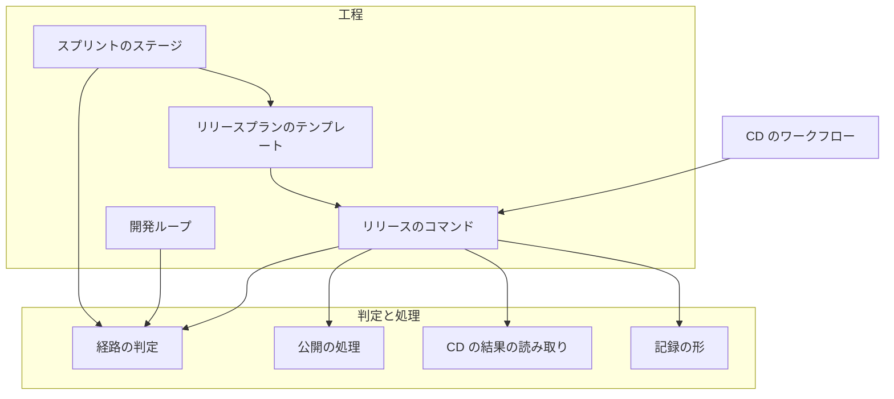
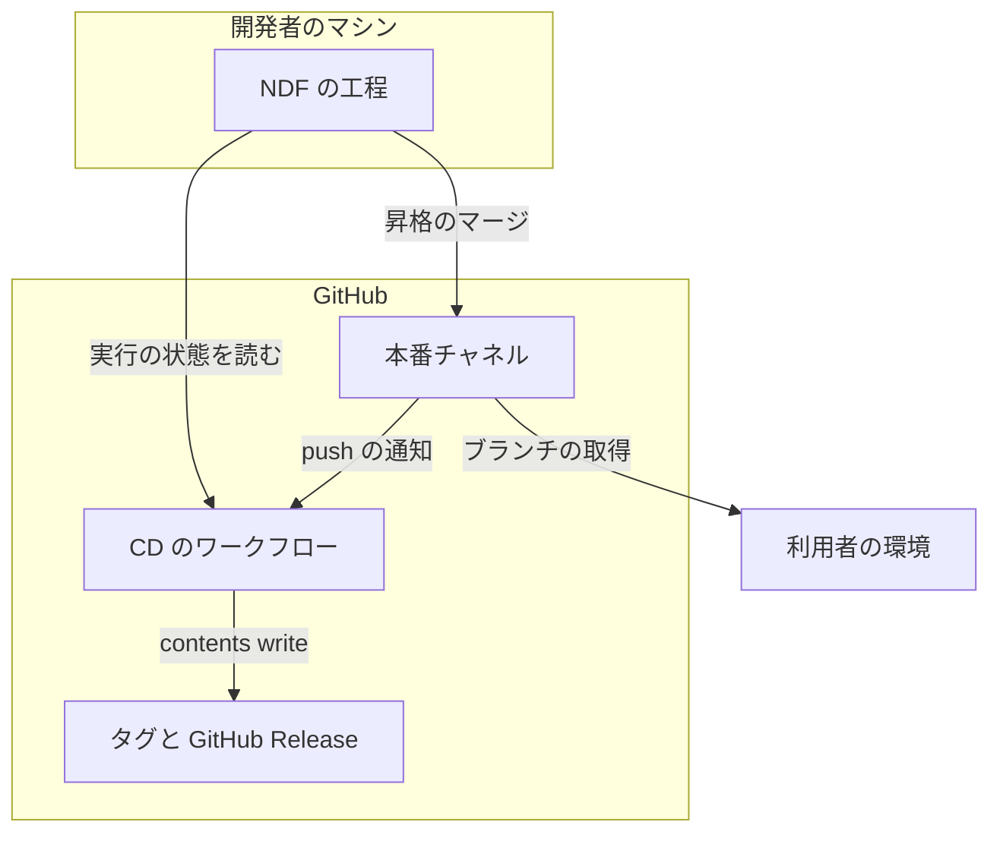
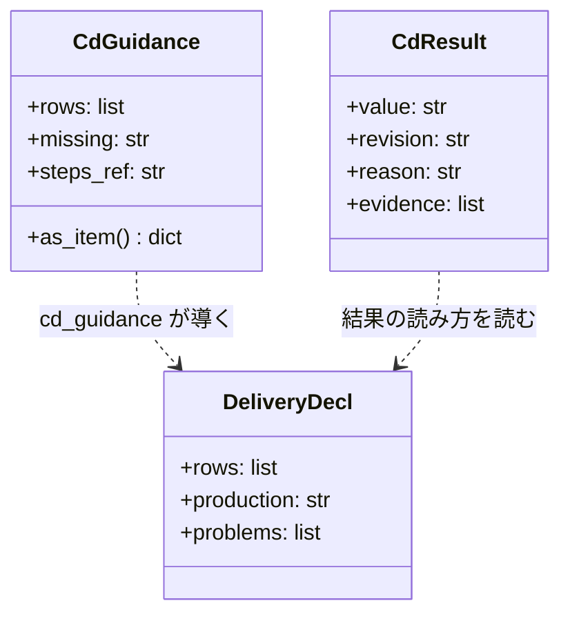
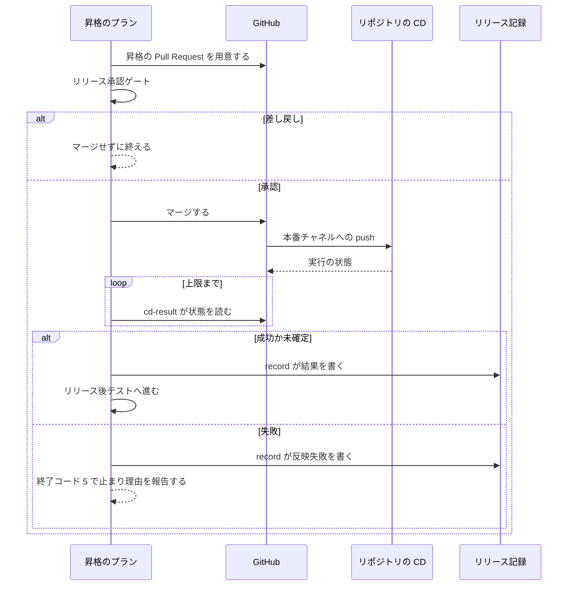
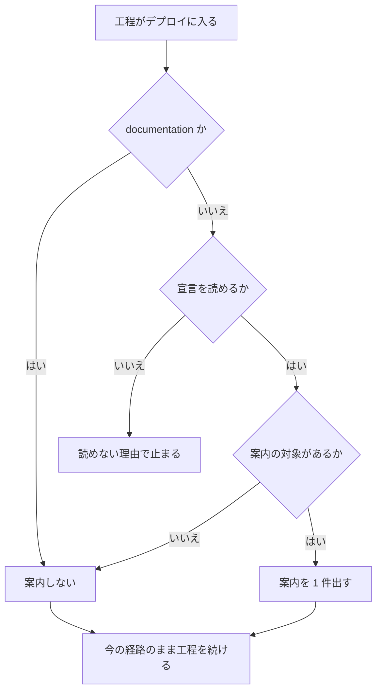
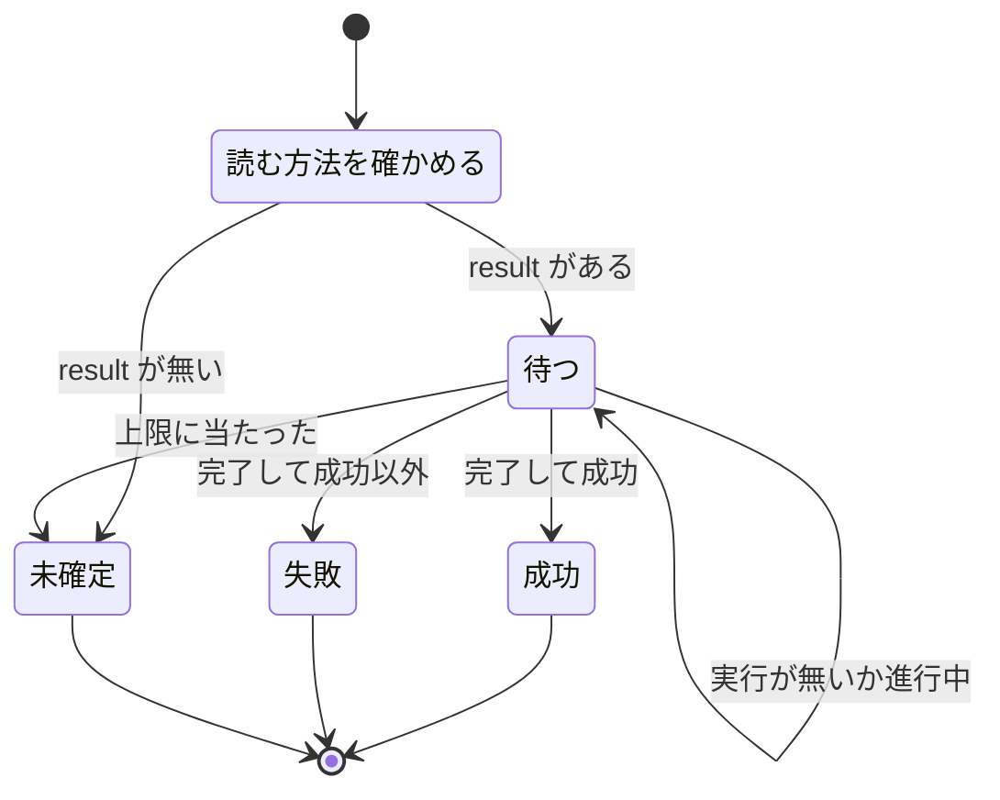

# リリースの工程: 環境へ届ける手順を CD へ移し、NDF はマージ・承認・結果の確かめを受け持つ（#2623）

## 目的

- **今どうなっているか**: NDF はデプロイとリリースを自分の工程で打つ前提で作られ、CD を持つリポジトリを例外として扱う。carul では版のファイルを読めずに並列の計画が止まり（#2616）、ai-plugins 自身にも CD が無い
- **誰に効くか**: CD を持つリポジトリと、CD がまだ無いリポジトリと、あえて CD を置かないリポジトリで NDF を使う利用者。ai-plugins の正式版を出す利用者
- **変えると何が成り立つか**: CD を持つリポジトリでは版上げ・タグ・リリースの Pull Request に入らず、マージ・承認・CD の結果の確かめだけで工程が閉じる。CD が無ければ案内が出て、理由を記録したリポジトリには出ない。ai-plugins のタグと GitHub Release は CD が作る

## 適用範囲

- **働く範囲**: 工程の定義・経路の判定・CD の案内・結果の確かめは利用先のリポジトリでも働く。CD のワークフローと宣言の書き換えは ai-plugins だけで行う
- **プロジェクトごとに違うもの**: 引数を足さず設定で受ける。`.ndf/project.json` の `delivery`（新しい任意の欄 `manual_reason`・`result`）、`.ndf/worktree.json` のブランチ、`.ndf/supervise.json` の `release.form`
- **当たるモード**: `standard`。CD の案内は `documentation` を除くすべてのモードのデプロイの工程で働く

## あるべき姿の根拠

| 根拠 | 種類 | 何を示すか |
| --- | --- | --- |
| 「本来デプロイ・`配布`・リリースなどと呼ばれるものはCDで解決すべき課題です」（2026-11-06） | 利用者の指示の原文 | 環境へ届ける手順を NDF の工程の責務から外す |
| 「`配布`工程が無い場合はCDを設定とその方式の記録を促す」（2026-11-06） | 利用者の指示の原文 | CD が無いときは代わりに打たず、案内する |
| 「carmo-cdkはインフラに関わるため、あえてCDを置いていないプロジェクトですね」（2026-11-06） | 利用者の指示の原文 | 手動の反映を正式な選択肢として記録できる形が要る |
| 手元の 10 リポジトリの `delivery`: 自動の行だけ 3 件、手動の行だけ 5 件、混在 1 件、不明 1 件（要求の「今の形」） | 実測 | 3 つの宣言の形はいずれも現に使われている |
| 同じ 10 リポジトリのうち `release.form` を持つのは ai-plugins だけである（要求の「今の形」） | 実測 | 版を上げて出す処理を残しても、ほかのリポジトリへ当たらない |
| carul の CD は CodePipeline、carmo-screening は CodeBuild、bi-tools は GitHub Actions（各リポジトリの `delivery` の `trigger`） | 実測 | 結果の読み方を GitHub Actions だけに固定できない |
| STD1 | 外部の一次情報 | CD はマージの後の届け方の規律で、本番へ出すかは別の判断として残せる |
| PRD1 | 外部の一次情報 | マージを起点にタグと GitHub Release を作る形は広く使われている |

要求と受け入れ条件は #2623 の本文にある（コピーは [issue-2623-requirements.md](issue-2623-requirements.md) ）。この文書は「どう作るか」だけを扱う。

## ドメインモデル

### コンテキスト

| コンテキスト | 何の語が 1 つの意味に決まるか |
| --- | --- |
| リリース（`ndf-release`） | リリースの経路・CD・CD の案内・CD の結果・公開物・リリース記録 |
| 開発ワークフロー（`ndf-workflow`） | 工程・リリース承認ゲート・スプリントのステージ・開発ループの周回 |

開発ワークフローが顧客、リリースが供給者の関係（顧客 / 供給者）である。開発ワークフローは経路を自分で判定せず、リリースが返す経路・案内・結果だけを受ける。

### 集約

| 集約 | 持ち主（書き換えてよいもの） | 根 | エンティティ | 値オブジェクト |
| --- | --- | --- | --- | --- |
| リリースの宣言 | 利用者（`.ndf/` のファイル）。解析は欄を残す。NDF の工程は読むだけ | 宣言 | `delivery` の行 | リリースの経路・CD の案内・結果の読み方・手動反映の理由 |
| 公開物 | 公開の処理（`release_lib/publish.py`）1 か所。CD か手動の経路がこれを呼ぶ | リリースタグ | GitHub Release | 版・リビジョン |
| リリース記録 | 記録の処理（`release-steps.py record`） | 記録のブロック | — | 段階・版・スプリント・CD の結果 |

### 不変条件

| # | 集約 | 条件 | 破れたときの扱い |
| --- | --- | --- | --- |
| I1 | リリースの宣言 | CD の形のプランに、版上げ・変更履歴・リリースタグ・GitHub Release を打つステップが無い | テストで落とす |
| I2 | リリースの宣言 | 自動反映の本番チャネルへのマージは、リリース承認ゲートの承認の後にだけ行う。承認ゲートの数は 2 つのままである | マージを止める（終了コード 10） |
| I3 | リリースの宣言 | CD の案内の有無で、承認の問いの数・プランのステージの数・終了コードが変わらず、宣言のファイルが書き換わらない | テストで落とす |
| I4 | リリースの宣言 | 宣言を読めないときは案内を出さず、読めない理由で止まる | テストで落とす |
| I5 | リリースの宣言 | CD の案内の対象は、宣言が無い・不明か、手動反映の理由の無い手動の行だけである。`delivery: []`・自動の行・理由のある手動の行は対象にしない | テストで落とす |
| I6 | リリースの宣言 | 解析をやり直しても、`target` が同じ行の手動反映の理由と結果の読み方が残る | テストで落とす |
| I7 | リリースの宣言 | `documentation` モードの提出で CD の案内を出さない | テストで落とす |
| I8 | 公開物 | 同じ名前のリリースタグは 1 つのコミットだけを指し、既存のタグを書き換えない | 公開を拒み、失敗で終える |
| I9 | 公開物 | 版に接尾辞があるコミットには公開物を作らない | 公開を拒み、失敗で終える |
| I10 | 公開物 | 再実行は足りないものだけを作り、そろっていれば何も変えない | テストで落とす |
| I11 | 公開物 | 本番チャネルへ自動で届く版を持つ行が宣言にあれば、NDF の工程はリリースタグと GitHub Release を作らない | テストで落とす |
| I12 | 公開物 | CD の書き込みの権限は公開のジョブだけが持ち、新しい秘密を使わない | テストで落とす |
| I13 | リリース記録 | 「成功」と書くのは CD の状態を読んで成功を確かめたときだけである。読めなければ「未確定」と書く | テストで落とす |
| I14 | リリース記録 | CD の結果が失敗の記録は、スプリントを閉じる条件を満たさない | テストで落とす |

### ドメインイベント

| # | イベント | 発生元 | 受け手 |
| --- | --- | --- | --- |
| E1 | 宣言からリリースの経路を決めた | 経路の判定 | スプリントのステージの組み立て・`release` |
| E2 | CD の案内を出した | 案内の組み立て | conductor・利用者 |
| E3 | CD を宣言したか、手動反映の理由を宣言した | 利用者 | リリースの宣言 |
| E4 | 実装の Pull Request をベースブランチへマージした | マージの工程 | CD |
| E5 | CD が検証の環境へ反映した | 利用者のリポジトリの CD | リリース後テスト |
| E6 | リリース承認ゲートで昇格を承認した | 利用者か MVV 判定 | 昇格のプラン |
| E7 | 昇格の Pull Request を本番チャネルへマージした | 昇格のプラン・リリースのプラン | CD |
| E8 | CD が本番へ反映した。ai-plugins ではタグと GitHub Release を作った | 利用者のリポジトリの CD | 結果の読み取り |
| E9 | CD の結果を読み、リリース記録に残した | 結果の読み取り・記録の処理 | スプリントを閉じる処理・リリース後テスト |
| E10 | リリース後テストで本番を確かめた | `release-verification` | スプリントを閉じる処理 |

### 用語

| 用語 | 意味 | 用語集への反映 |
| --- | --- | --- |
| CD の結果 | 本番チャネルへのマージの後に NDF が読んだ CD の状態。成功・失敗・未確定の 3 つで、リリース記録に残す | 追加（`ndf-release`） |
| 結果の読み方 | CD の結果を読む手段の宣言。`delivery` の行の `result` に書き、GitHub Actions のワークフローの名前かコマンドで指す | 追加（`ndf-release`） |
| 公開物 | 正式版ごとのリリースタグと GitHub Release の組 | 追加（`ndf-release`） |
| 反映失敗 | リリース記録の段階の値の 1 つ。本番チャネルへマージしたが CD の結果が失敗で、スプリントを閉じられない状態 | 追加（`ndf-release`） |
| リリース記録 | release が Pull Request へ残す記録のブロック。段階・版・スプリントの Pull Request に、CD を読んだときは CD の結果を持つ | 意味の変更（`ndf-release`） |

## 外部の調査

| 種類 | 調べるか | 理由 |
| --- | --- | --- |
| 標準・仕様 | 調べる | CD の定義と、GitHub Actions の権限とイベントの規則が公開の仕様である |
| 主要な製品 | 調べる | 版上げ・タグ・リリースをどこまで CI で行うか、CD の結果を外からどう待つかを比べる |
| ライブラリとサービス | 調べる | タグと GitHub Release を作る部品と、実行の状態を読む部品を、自前の処理と比べる |

### 標準・仕様

| # | 標準・仕様 | 何を定めているか | 設計への反映 | 出典 |
| --- | --- | --- | --- | --- |
| STD1 | Continuous Delivery と Continuous Deployment の定義 | Continuous Delivery は頻繁にデプロイできる状態を保ちつつ「may choose not to do it」、Continuous Deployment は変更がすべて自動で本番へ届く | NDF が担うのは「出すかの判断（リリース承認ゲート）」と「結果の確かめ」で、届ける手順は CD が持つ | https://martinfowler.com/bliki/ContinuousDelivery.html （2026-11-06） |
| STD2 | GitHub Actions の `GITHUB_TOKEN` | トークンの権限はリポジトリの範囲に閉じ、このトークンが起こしたイベントは `workflow_dispatch`・`repository_dispatch` を除いて新しい実行を作らない | タグの作成から別のワークフローは動かない。新しい秘密は要らない | https://docs.github.com/en/actions/concepts/security/github_token （2026-11-06） |
| STD3 | GitHub Actions の `push` と `pull_request_target` | `push` の `GITHUB_SHA` は push された先端のコミットで、`pull_request_target` にはセキュリティ上の注意がある | 書き込みの権限を持つジョブは `push` で起こし、Pull Request の head を実行しない | https://docs.github.com/en/actions/reference/workflows-and-actions/events-that-trigger-workflows （2026-11-06。`push` の節は要約を経由して取得した） |

### 主要な製品

| # | 製品 | どう解いているか | 設計への反映 | 出典 |
| --- | --- | --- | --- | --- |
| PRD1 | release-please | CI が版上げの Pull Request を作り、人がマージすると CI がタグと GitHub Release を作る。パッケージの公開は扱わない | 「版の内容は Pull Request で人が見る、タグと GitHub Release はマージを起点に CI が作る」の分担に倣う | https://github.com/googleapis/release-please （2026-11-06） |
| PRD2 | semantic-release | リリースのブランチの CI が版の決定・ノートの生成・タグ・公開をコミットのメッセージから全部行う | 版の大きさは承認資料で人が決める運用のため、版の決定は CI へ移さない | https://semantic-release.gitbook.io/semantic-release/ （2026-11-06。ページに保守の終了の記載がある） |
| PRD3 | Argo CD の `argocd app wait` | CD の状態を外部のコマンドで待ち、`--timeout` で打ち切る | 結果の読み方にコマンドの形を持ち、待ちの上限を別に決める | https://argo-cd.readthedocs.io/en/stable/user-guide/commands/argocd_app_wait/ （2026-11-06） |
| PRD4 | GitHub の Deployments とコミットの状態 | Deployment は `error`・`failure`・`pending`・`in_progress`・`queued`・`success` などの状態を持つ | 製品ごとに値が違うため、NDF の語は成功・失敗・未確定の 3 つに畳む | https://docs.github.com/en/rest/deployments/deployments?apiVersion=2022-11-28 （2026-11-06） |

### ライブラリとサービス

| # | 候補 | 版 | ライセンス | 最後のリリースの日付 | 終了のアナウンス | 要件を満たすか | 出典 |
| --- | --- | --- | --- | --- | --- | --- | --- |
| LIB1 | softprops/action-gh-release | v3.0.4 | MIT | 2026-11-05 | 無し（リポジトリは archived でない） | 一部を満たす。Release は作れるが、タグが別のコミットにあるときに失敗する判定と `-dev` の判定を持たず、手元の切り戻しに使えない | https://github.com/softprops/action-gh-release ・`gh api repos/softprops/action-gh-release/releases/latest`（2026-11-06） |
| LIB2 | GitHub CLI（`gh release create`・`gh run list`） | 2.103.2（手元）。最新は v2.103.3 | MIT | 2026-10-26 | 無し（リポジトリは archived でない） | 満たす。`--commit` と `--workflow` で実行を引け、`status`・`conclusion`・`url` を読める（`lint.yml` で実行して確かめた）。既存の依存である | https://cli.github.com/manual/gh_run_list ・`gh api repos/cli/cli/releases/latest`（2026-11-06） |

### 確かめられなかったこと

| 対象 | 試した手段 | 結果と理由 |
| --- | --- | --- |
| `push` で読むワークフローがどのコミットのファイルか | STD3 の URL | ページが長く、該当の節は要約を経由した。要約に記述が無い。CD を含む版のリリース後テストで確かめる |
| ジョブ単位の `permissions` の原文 | STD2 の URL。workflow-syntax のページは取得していない | STD2 のページにはリンクだけがある。今のワークフローで使っている記法に揃え、CI の検査で読む |
| REST の「List workflow runs for a workflow」の節 | https://docs.github.com/en/rest/actions/workflow-runs?apiVersion=2022-11-28 | 逐語で読めたのはリポジトリ全体の一覧の節だけである。`gh run list` の実行で動きを確かめた |
| semantic-release の後継のサイト | 試していない | PRD2 の判断に要る工程の一覧は読めた |

調べた量: 候補 9 件・取得の試み 16 回。

## 機能一覧

| # | 機能 | 誰が使うか |
| --- | --- | --- |
| F1 | 工程の定義を読むと、環境へ届ける手順は CD が持ち、NDF はマージ・承認・確かめを担うと分かる | 開発者・AI |
| F2 | 宣言の形からリリースの経路を決め、CD の形では版上げとタグのステップを組まない | スプリントの組み立て・`release` |
| F3 | CD の形でリビジョンを記録の値にしてスプリントを閉じる | `release`・スプリントを閉じる処理 |
| F4 | 版の無いリポジトリで開発版の版数なしに開発ループを回す | 開発ループ |
| F5 | CD が無いリポジトリへ CD の案内を出す | conductor・利用者 |
| F6 | 手動反映の理由を宣言し、案内を止める | 利用者 |
| F7 | 本番チャネルへのマージの後に CD の結果を読み、記録する | `release`・リリースプラン |
| F8 | ai-plugins の本番チャネルへのマージでタグと GitHub Release を作る | ai-plugins の CD |
| F9 | CD を外したときも同じ処理でタグと GitHub Release を作る | ai-plugins の利用者（切り戻し） |
| F10 | CD の形のリポジトリの並列の計画でまとめたリリースを組まない | 並列の計画 |

## 構成要素

| 要素 | 責務 |
| --- | --- |
| 経路の判定（`lib/delivery.py`）【変更】 | 版を持つ自動の行を手で行うステージから外す。`manual_reason`・`result` の形を確かめ、`cd_guidance`（案内の組み立て）と `publishes_by_cd`（公開の担い手の判定）を足す。ファイルを読まない純粋な処理のまま |
| 宣言のモデルと解析（`project_lib/model.py`・`project_lib/merge.py`・`project.schema.json`）【変更】 | 2 つの欄を受ける。解析のやり直しで `target` が同じ行の欄を引き継ぐ |
| 公開の処理（`release_lib/publish.py`）【新設】 | `release-steps.py` の公開の処理を移す。版と接尾辞の判定・タグのコミットの照合・足りないものだけの作成を持つ。終了コードで失敗を返す |
| CD の結果の読み取り（`release_lib/cd_result.py`）【新設】 | 行の結果の読み方を上限まで読み、成功・失敗・未確定へ畳んで結果のファイルへ書く |
| リリースのコマンド（`release-steps.py`）【変更】 | 副コマンド `publish`・`cd-result`・`cd-guidance` を足す。`release --channel prod` は `publishes_by_cd` が真なら公開物を作らない。`record` が結果のファイルを読む |
| 記録の形（`lib/dist_record.py`・`release_lib/record.py`）【変更】 | `CD の結果:` の行と段階の値「反映失敗」を組む |
| リリースプランのテンプレート（`supervise_lib/release_templates.py`・`delivery_templates.py`）【変更】 | 本番のマージと記録の間に `cd-result` のステップを置く |
| スプリントのステージ（`supervise_lib/sprint_routes.py`・`sprint.py`）【変更】 | ベースブランチが本番チャネルの CD の形に「CD の結果」のステージを足す。`sprint.json` へ案内を載せる |
| 開発ループ（`lib/sprint_loop.py`・`sprint_loop_cli.py`）【変更】 | `--dev` を任意にし、経路が版数を要するときだけ求める |
| CD のワークフロー（`.github/workflows/release-cd.yml`）【新設】 | `main` への push で公開の処理を呼ぶ |
| ai-plugins の宣言（`.ndf/project.json`）【変更】 | `delivery` を CD の行へ書き換える |
| 工程の手順（`development-workflow`・`release`・`release-verification`・`progress-tracking` の Skill と参照）【変更】 | CD を前提に書き直す。`release/references/cd-setup.md` を新設する。今の値だけを想定した規則として、`pace.md` の経路の表（`versioned: true` を手で行う経路に挙げる行）、`project-analysis.md` の `delivery` の形、`release` の手順 3 の版上げと、`form-service.md`・`form-package-plugin.md` の公開の手順、`progress-tracking` のリリース記録の表を直す |
| 確定仕様と現行の文書（`docs/`・`AGENTS.md`）【変更】 | 新しい定義へ合わせる |

### 構成要素図

図には呼び出しの関係だけを描き、宣言のモデルと解析・ai-plugins の宣言・工程の手順・確定仕様と現行の文書は載せない。



### 文脈と配置

CD は利用者のリポジトリの仕組みで、NDF は外から状態を読むだけである。ai-plugins の CD は GitHub Actions の中で動き、公開の処理は `main` のコミットのコードを実行する。



### パッケージ・モジュール構成

```text
.github/workflows/release-cd.yml        # 新設
.ndf/project.json                       # delivery を CD の行へ
plugins/ndf/scripts/
├── release-steps.py                    # publish / cd-result / cd-guidance を足す
├── release_lib/
│   ├── publish.py                      # 新設（release-steps.py から移す）
│   ├── cd_result.py                    # 新設
│   └── record.py                       # CD の結果の行
├── lib/
│   ├── delivery.py                     # 経路・案内・公開の担い手
│   ├── dist_record.py                  # 記録の行と段階の値
│   ├── sprint_loop.py                  # 版数を任意に
│   └── sprint_loop_cli.py
├── project_lib/{model,merge}.py        # 欄の追加と引き継ぎ
└── supervise_lib/
    ├── delivery_templates.py           # 昇格のプランへ cd-result
    ├── release_templates.py            # 本番のプランへ cd-result
    ├── sprint.py                       # 案内を sprint.json へ
    └── sprint_routes.py                # CD の結果のステージ
plugins/ndf/skills/release/references/cd-setup.md   # 新設
```

配置の検査は `python3 scripts/check-script-structure.py` と `python3 scripts/check-ndf-contracts.py` で確かめる。

## 構造



`Route` の型と経路の値（`template`・`merge`・`manual`・`none`）、ステージの値は増えない。`CdGuidance` は `lib/delivery.py`、`CdResult` は `release_lib/cd_result.py` に置く。

## データ構造

### `delivery` の行に足す欄

どちらも任意で、今の宣言はそのまま読める。形が違うときは宣言を読めない問題として扱い、止める側へ倒す（I4）。

| 欄 | 型 | 空を許すか | 意味 |
| --- | --- | --- | --- |
| `manual_reason` | 文字列 | 許す。空白だけは無いものとして扱う | 手動反映の理由。`kind: manual` の行でだけ読む。無ければ「CD を置かないと決めていない」を表す。手順は今の `trigger` が持つ |
| `result` | オブジェクト | 許す | 結果の読み方。`kind: auto` の行でだけ読む。無ければ結果は未確定になる |
| `result.workflow` | 文字列 | `command` と排他 | GitHub Actions のワークフローのファイル名 |
| `result.command` | 文字列 | `workflow` と排他 | シェルで実行するコマンド。`{revision}` を 40 桁のリビジョンへ置き換える。終了コード 0 は成功、75 は待つ、1 は失敗、それ以外は未確定 |
| `result.timeout_seconds` | 整数 | 許す | 待ちの上限。無ければ 1800 秒 |

### 宣言の例

```json
[
  {"target": "ndf プラグイン（Claude Code・Codex）", "kind": "auto", "channel": "production", "versioned": true,
   "trigger": ".github/workflows/release-cd.yml（main へのマージでタグと GitHub Release を作る）",
   "result": {"workflow": "release-cd.yml"}},
  {"target": "AWS（CDK スタック）", "kind": "manual", "versioned": false, "trigger": "cdk deploy",
   "manual_reason": "インフラの変更は人が差分を確かめてから反映する"}
]
```

### 機能とデータの対応

| 機能 | `delivery` の行 | 結果のファイル | リリース記録 | タグと Release |
| --- | --- | --- | --- | --- |
| F2・F5 | R | — | — | — |
| F6 | C / U（利用者）。解析は R して引き継ぐ | — | — | — |
| F7 | R | C | C | R |
| F8・F9 | R | — | — | C |

結果のファイルは計画の状態ディレクトリの `work/cd-result.json` に置き、作り直してよい作業用の値である。過去の結果はリリース記録のコメントが追記の形で残す。宣言の変更の履歴は git が持つため、上書きで失うものは無い。既存の宣言と記録の移行は無い。形の検査は `project-decl.py` の検証と `check-ndf-contracts.py` が行う。

## 入出力の契約

### リリースの経路（`delivery.routes`）

変わるのは版を持つ自動の行の 2 行だけで、ほかの判定（`judge_target`・`dev_channel`）は変えない。

| 宣言 | 今の経路 | 変更後の経路 |
| --- | --- | --- |
| `kind: auto`・`versioned: true`・本番チャネルの行 | `manual`（手で行うステージ） | `merge`・`promote`。`versioned: false` と同じ規則で決める |
| `kind: auto`・`versioned: true`・ベースブランチの行 | `manual` | `merge`・`merged-by-check` |
| `kind: auto`・ブランチが無いか別のブランチ | `manual` | 変えない |
| `kind: manual` | `manual` | 変えない。`note` は `trigger` を持つ |
| `release.form` がある | `template` | 変えない（`delivery` を読まない） |

### 宣言の形ごとの工程

| 形 | 版上げ・変更履歴 | リリース承認ゲート | タグと Release | 結果の確かめ | CD の案内 |
| --- | --- | --- | --- | --- | --- |
| CD の形 | NDF は打たない | 昇格のマージの前 | NDF は打たない | `cd-result` | 出ない |
| 版を持つ CD の形（`release.form` あり。ai-plugins） | テンプレートが打つ | 本番のプランの先頭 | CD が作る | `cd-result` | 出ない |
| 版を持つ CD の形（`release.form` なし。devbase） | プロジェクトの CD か手順が持つ | 昇格のマージの前 | プロジェクトの CD か手順が持つ | `cd-result` | 出ない |
| 手動の形（理由あり） | `trigger` の手順 | 手で届ける前 | `trigger` の手順 | 手順の結果 | 出ない |
| 手動の形（理由なし）・宣言なし・不明 | 上と同じ | 上と同じ | 上と同じ | 上と同じ | 出る |

### `delivery.cd_guidance(decl) -> CdGuidance | None`

上から順に最初に当たった行で決まる。ファイルを読まず、呼ぶたびに宣言から作る。

| 条件 | 戻り値 |
| --- | --- |
| `decl.problems` がある | `None`（読めない理由は既存の経路の判定が示す） |
| 行が無い・不明 | 案内 1 件。何が無いかは「`delivery` の宣言」 |
| 理由の無い手動の行がある | 案内 1 件。`rows` にその行の `target` だけを並べる |
| 残り（`delivery: []`・自動の行だけ・すべて理由あり） | `None` |

案内の 4 つの中身: 何が無いか・CD の設定の手順の参照先（`release` の `references/cd-setup.md`）・`delivery` への記録の例・手動反映の理由を記録する方法。

### コマンド

| 名前 | 入力 | 出力 | 失敗の形 | 互換性 |
| --- | --- | --- | --- | --- |
| `release-steps.py cd-guidance` | `--root` | 結果 JSON。`items` に `kind: cd-guidance` を 0 か 1 件 | 宣言を読めなければ終了コード 3。案内の有無では常に 0 | 追加 |
| `release-steps.py cd-result` | `--base <本番チャネル>`、`--head <ブランチ>`（任意。無ければ `origin/<本番チャネル>` の先端を読む）、`--out <ファイル>` | 結果のファイルと結果 JSON。`metrics.cd_result` は `success` / `failure` / `undetermined` / `none`（本番チャネルへ自動で届く行が無い） | 値にかかわらず 0。読み取りの失敗は `undetermined` にする | 追加 |
| `release-steps.py publish` | `--root`、`--revision <SHA>` | 結果 JSON。`items` に `tag`・`release` の各 1 件（`created` / `pushed` / `exists`） | 接尾辞あり・別のコミットのタグ・版を読めない・`gh` の失敗は終了コード 1 | 追加 |
| `release-steps.py record` | 今の引数に `--cd-result <ファイル>`（任意）と `--merged`（`--base`・`--prs` と組）を足す | 結果のファイルの値を `CD の結果:` の行へ書く。`--merged` は最後の `--prs` の Pull Request へ書き、版は `<本番チャネル> <短い SHA>` | 値が `failure` なら段階を「反映失敗」で書いた後に終了コード 5。プランは止まる | 引数なしは今と同じ |
| `release-steps.py release --channel prod` | 変わらない | `publishes_by_cd` が真なら公開物を作らず、`metrics.tag` は `null`、`metrics.publisher` は `cd` | 今と同じ | 宣言が手動なら今と同じ |
| `sprint-state.py loop sprint` | `--dev` が任意になる | 経路が版数を要らなければ `lap.versions` は空 | 経路が版数を要るのに `--dev` が無ければ断る | 指定があれば今と同じ |

`publish` の版は `--revision` のコミットの `plugin.json` から、プラグインの名前は `.ndf/supervise.json` の `release.plugin` から読む。題は `<プラグイン> v<版>`、本文は変更履歴の版の節で、`--latest` で作る。

### `publishes_by_cd(decl) -> bool`

本番チャネルへのマージで自動で本番系へ届く行（`reaches_by_merge`）のうち、`versioned: true` の行があるときに真を返す。宣言を読めないときは、呼び出し元の `release_decl` がこの判定より先に止める。

### CD のワークフロー

```yaml
name: Release CD
on:
  push:
    branches: [main]
permissions:
  contents: read
concurrency:
  group: release-cd
  cancel-in-progress: false
jobs:
  publish:
    runs-on: ubuntu-latest
    permissions:
      contents: write
    steps:
      - uses: actions/checkout@v7
        with:
          fetch-depth: 0
          fetch-tags: true
      - uses: actions/setup-python@v7
        with:
          python-version: "3.13"
      - name: Publish the tag and the GitHub Release
        env:
          GH_TOKEN: ${{ github.token }}
          GIT_COMMITTER_NAME: github-actions[bot]
          GIT_COMMITTER_EMAIL: 41898282+github-actions[bot]@users.noreply.github.com
        run: python3 plugins/ndf/scripts/release-steps.py publish --root . --revision "$GITHUB_SHA"
```

### リリース記録

```markdown
## リリース記録

段階: 本番（2026-11-07 10:00 に承認）
版: main 1a2b3c4 → main 5d6e7f8（昇格）
スプリント: PR #2701 / #2702
CD の結果: 成功（リビジョン 5d6e7f8… https://github.com/.../runs/1）
```

`CD の結果:` の行は `成功` / `失敗` / `未確定` で始まる。失敗のときは段階の行を `段階: 反映失敗（<理由>）` にする。この値は `released()` が閉じてよい段階と読まないため、スプリントは開いたまま残る。読む側は最後の記録を使うため、CD を再実行して `cd-result` と `record` を打ち直すと、成功の記録で閉じられる。CD の行が無いリポジトリの記録にこの行は無い。

## 処理の流れ

### 昇格の経路（CD の形）



### 本番のプラン（`release.form` と CD の両方がある ai-plugins）

`bump → 変更履歴 → 説明文 → 消費の記録 → release（昇格のマージまで。公開物を作らない）→ cd-result → record → verify → cleanup` の順に動く。`publishes_by_cd` が偽なら `release` が今と同じく公開物を作り、`cd-result` は `none` を返し、`record` は行を足さない。

CD のワークフローは同じコミットで `publish` を呼ぶ。リリース記録が読むタグと GitHub Release は `cd-result` が成功を読んだ後にそろう。`record` は結果のファイルがあるとき、タグと GitHub Release の存在の照会をその値へ置き換える。

### ベースブランチが本番チャネルの CD の形

実装のマージで本番へ届くため、昇格のプランが無い。`route_waves` が検査の後に「CD の結果」のステージを 1 つ置き、`cd-result --base <本番チャネル>` → `record --merged` を流す。`fast` / `auto` では「導入の確認」のステージの後に置く。

### CD の案内



出す場所は 2 つで、どちらも読むだけである。`release` の Skill は手順の先頭で `cd-guidance` を打つ。`supervise.py new sprint` / `new close` は `sprint.json` の `CD の案内` のキーと結果の `items` へ載せる（`--mode documentation` では載せない）。

### CD の結果の状態遷移



本番チャネルへ自動で届く行が 2 つ以上あるときは行ごとに読み、1 行でも失敗なら失敗、すべて成功なら成功、それ以外は未確定とする。照会の間隔は 15 秒である。待ちの上限は `release` の `references/completion-check.md` の決まりに従う。

## 非機能の実現方式

| 大項目 | 要求の条件 | 実現方式 | 確かめ方 |
| --- | --- | --- | --- |
| 運用・保守性 | CD の結果を確かめた対象と返ってきた値が、リリース記録に 1 回のリリースごとに残る。CD のワークフローの失敗は GitHub の実行の記録で読める | `record` が `CD の結果:` の行にリビジョンと実行の URL を書く。公開の処理は失敗の理由を標準エラーへ書く | 3 つの値でリリース記録の形を確かめる単体テスト。リリース後テストで実行の記録を読む |
| 移行性 | `delivery` の新しい欄は任意とし、今の宣言がそのまま読める。解析をやり直しても手動反映の理由が消えない。手動の行を持つ既存のリポジトリには、理由を書くまで CD の案内が出る（工程は止まらない）。ai-plugins の切り戻しの手順（CD を外してタグと GitHub Release を作る手段）を、CD を含む版の承認資料に書く | 2 つの欄を任意にし、解析の統合で `target` が同じ行から引き継ぐ。切り戻しは、ワークフローを無効にして手元で `release-steps.py publish --revision <SHA>` を打ち、宣言を手動の行へ戻す手順にする。承認資料の「取り消しの手段」へこの手順を書く | 今の 10 リポジトリの宣言の形を読むテスト。解析をやり直すテスト。`publish` を作業用のリポジトリで打つテスト |
| セキュリティ | CD はタグと GitHub Release を作る書き込みの権限だけを持つ。Pull Request の head のコードを書き込みの権限で実行しない | 起点を `push` の `main` だけにし、最上位を `contents: read`、公開のジョブだけを `contents: write` にする。秘密は `GITHUB_TOKEN` だけを使う | ワークフローの YAML を読んで起点と権限を確かめるテスト |
| システム環境 | CD の設定の案内は特定の CI を前提にせず、手順の例として GitHub Actions を示す | `cd-setup.md` を CI に依らない 3 手順（起点・結果の読み方・宣言）で書き、例として GitHub Actions を置く。コマンドの結果の読み方で他の CI を受ける | 別の LLM のセッションへ渡す受け入れ条件 1 の確認に含める |

## 決定の記録

### 決定 1: 版の有無と経路を分けるため、版を持つ自動の行を手で行うステージから外す

`versioned` は版を持つかを表し、誰が届けるかを表さない。今の判定は 2 つを結び付け、CD で届く devbase の行を手で行うステージへ落としていた。経路の判定を `kind` とブランチだけで決める。経路の値を増やさないため、`judge_target`・ステージ・#2616 の判定はそのまま効く。`versioned: true` の新しい経路の値を足す形は、経路が増えて読む側がすべて変わるため採らない。

根拠: Value 7 / Value 6（MVV 版 6）

### 決定 2: 版の大きさを承認の対象に保つため、版上げは NDF の工程に残す

`release.form` を持つ形の版上げ・変更履歴・消費の記録は、今のテンプレートが `release/v<版>` の上で行う。版の大きさはリリース承認ゲートで人が見る対象である。CD の実行環境には消費の記録の元になる手元の記録が無い。CD が `main` へコミットするには保護のルールの迂回と新しい権限が要り、受け入れ条件 20 に合わない。`release.form` を持たず版を持つリポジトリの版上げは、プロジェクトの CD か手順が持ち、NDF は打たない。

CI が版を決める形（PRD2）は、承認の前に版が決まらないため採らない。

- 作り方: 標準に倣う
- 比べた候補: PRD1 / PRD2

根拠: Value 2 / Value 5（MVV 版 6）

### 決定 3: 公開の処理を 1 か所に保つため、タグと GitHub Release の処理を移して CD と手動の経路で共用する

`release-steps.py` の公開の処理を公開の処理のモジュールへ移し、CD のワークフローが副コマンド `publish` で呼ぶ。手動の経路の `release --channel prod` も同じ処理を呼ぶ。再実行の補い・タグの照合・`-dev` の判定を 1 か所のテストで縛れる。切り戻しは同じコマンドを手元で打つだけで、別の手段を持たずに済む。

ワークフローの部品だけで作る形（LIB1）は、失敗の判定を YAML の中へ書くことになり、手元の切り戻しにも使えないため採らない。処理を消して CD のテンプレートへ写す形は、切り戻しの手段を別に持つことになるため採らない。

- 作り方: 自前で作る・ライブラリやサービスを使う
- 比べた候補: LIB1 / LIB2 / PRD1

根拠: Value 5 / Value 7（MVV 版 6）

### 決定 4: 既存の仕組みを 2 重にしないため、テンプレート・昇格・まとめたリリースの処理は残す

`release_templates.py` は版を持つ形だけが通り、`delivery_templates.py` の昇格のプランは CD の形のマージと承認を担うため、どちらも残す。まとめたリリースは #2616 の判定が `release.form` のあるリポジトリでだけ組む。行き先を変えるのは公開の処理だけである。

根拠: Value 3（MVV 版 6）

### 決定 5: 工程を止めずに促すため、CD の案内は読むだけの出力にし、状態を持たない

案内はコマンドの結果の項目で、起票しない。課題を自動で起こすと、案内のたびに新しい作業が既定で始まる。同じ状態なら次のデプロイでも同じ案内が出る。回数を数える記録は持たない。書くと宣言の外に状態ができる。

根拠: Value 2 / Value 3（MVV 版 6）

### 決定 6: 手動の反映を正式な選択肢にするため、`kind` を増やさず `manual_reason` の欄を足す

`kind: manual` は読み手が多く、値を足すと判定をすべて直すことになる。「理由があるか」で「まだ CD が無い」と「あえて置かない」を分ける。手順は今の `trigger` を使う。

根拠: Value 6（MVV 版 6）

### 決定 7: どの CD でも結果を読めるため、結果の読み方をワークフローの名前とコマンドの 2 つにする

手元の 10 リポジトリには GitHub Actions と AWS の CD が両方ある。`workflow` は `gh run list --commit <SHA> --workflow <名前> --json status,conclusion,url` で読み、`command` は終了コードで読む。`status` が `completed` で `conclusion` が `success` なら成功、`completed` でそれ以外なら失敗、実行が無いか進行中なら待つ。待ちの上限の既定は 1800 秒で、行ごとに変えられる。コマンドだけにする形は、GitHub Actions の利用者が同じ変換を毎回書くことになるため採らない。

- 作り方: 標準に倣う・ライブラリやサービスを使う
- 比べた候補: PRD3 / PRD4 / LIB2

根拠: Value 6 / Value 4（MVV 版 6）

### 決定 8: プランの形を宣言に依らず同じにするため、`cd-result` のステップをテンプレートと昇格のプランへ常に置く

判定はステップの実行時に宣言から行い、CD の行が無ければ `none` を返す。`new release` の経路は宣言の `delivery` を持たないため、組み立ての時点の分岐を避ける。結果の失敗を別の分岐にせず、`record` が書いてから終了コード 5 で止める。失敗も記録に残す受け入れ条件 7 と、工程を完了させない受け入れ条件 8 を 1 本の順序で満たす。

根拠: Value 5（MVV 版 6）

### 決定 9: 版を書かずに記録を残すため、ベースブランチが本番チャネルの形に「CD の結果」のステージを足す

このステージが無いと、CD の形でリビジョンの記録を書く主体が無く、スプリントを閉じられない。ステージの数が増えるのは経路の違いによるもので、CD の案内の有無では増えない（I3）。

根拠: Value 1（MVV 版 6）

### 決定 10: 版の無いリポジトリの周回を止めないため、`loop sprint` の `--dev` を任意にする

版数を要るのは経路が `template` のときだけで、判定は `needs_version` が持つ。要らない経路では `lap.versions` を空にし、`--version` を渡さない。

根拠: Value 6（MVV 版 6）

### 決定 11: 本番チャネルへ入った事実を起点にするため、CD の起点を `push` にし、パスで絞らない

`pull_request` の `closed` の起点は head の情報を扱い、書き込みの権限と分けにくい（STD3）。パスで絞ると結果の読み取りが実行を見つけられない経路が増える。`main` へ版を上げずに入った変更は、同じタグが別のコミットにあるためワークフローの失敗として見える。この失敗は版上げの漏れの検知として働く。

- 作り方: 標準に倣う
- 比べた候補: STD2 / STD3

根拠: Value 1 / Value 6（MVV 版 6）

## テスト設計

| 受け入れ条件・不変条件 | どの振る舞いで縛るか | どう壊したら落ちるべきか |
| --- | --- | --- |
| 1 | 別の LLM のセッションへ 2 つの文書だけを渡し、問いの答えを記録する | 手順に NDF が届ける前提が残ると答えが外れる |
| 2・I1 | CD の形で `new sprint` / `new close` のプランに版上げ・変更履歴・タグの語のコマンドが無い | `release.form` の無い経路へ `bump` を足すと落ちる |
| 3 | CD の形で `release/v<版>` なしにリビジョンの記録からスプリントを閉じる | 記録の版を版数だけと読むように壊すと落ちる |
| 4 | `--dev` なしの `loop sprint` が CD の形で周回を始め、`template` の経路では断る | `needs_version` を見ずに必須へ戻すと落ちる |
| 5 | 版を持つ自動の行の経路が `promote` か `merged-by-check` になる | `versioned` の条件を戻すと落ちる |
| 6・I2 | 昇格のマージが承認なしで終了コード 10、承認の後にマージする。ゲートの数が変わらない | `judge_target` の自動の行の判定を外すと落ちる |
| 7・I13 | 3 つの結果の値がリリース記録へ書かれ、リビジョンを持つ | 待ちの上限で成功を書くと落ちる |
| 8・I14 | 失敗で終了コード 5、段階が反映失敗、スプリントが閉じない。読めないときは未確定 | 失敗を 0 で返すと落ちる |
| 9 | 宣言なし・`unknown` で案内が 1 件、4 つの中身を持つ | 中身を 1 つ外すと落ちる |
| 10・I5 | 理由の無い手動の行の `target` だけが案内に載る | 全行を載せると落ちる |
| 11 | 全行に理由があると案内が出ず、手で行うステージへ進む | 理由を見ないと落ちる |
| 12 | `[]`・CD の形で出ず、混在は理由の無い行だけ | 自動の行を案内すると落ちる |
| 13・I3 | 案内の有無の 2 つの宣言で問い・ステージ・終了コードが同じで、宣言のファイルが変わらない | 案内で終了コードを変えると落ちる |
| 14・I4 | 壊れた宣言で案内を出さず、今の止まり方になる。`test_delivery.py` の 30 件が通る | 例外を握りつぶして案内すると落ちる |
| 15 | ai-plugins の宣言が CD の行を持ち、`trigger` がワークフローのファイルを指す | ファイルの名前を変えると落ちる |
| 16 | `publish` が `plugin.json` の版でタグと Release を作り、題・本文・Latest が要件どおり | 版の読み先を HEAD へ変えると落ちる。本番はリリース後テストで見る |
| 17 | ワークフローの起点が `main` の `push` だけである | `develop` を足すと落ちる |
| 18・I10 | タグだけの状態で Release を補い、両方ある状態で何も変えず 0 で終わる | 既存で失敗にすると落ちる |
| 19・I8・I9 | `-dev` と別のコミットのタグで何も作らず 1 で終わる。ワークフローの起点が取得元を変えない | `-f` でタグを動かすと落ちる |
| 20・I11・I12 | ジョブの権限と秘密の不使用を YAML で読み、CD の行があるとき `release` が公開の処理を呼ばない | 公開を両方で打つと落ちる。本番はリリース後テストで見る |
| 21 | CD の形の並列の計画で `parallel.build` が呼ばれず、昇格がゲートを 1 回通る | #2616 の実装の後に確かめる |
| 22 | `kind: manual` の ai-plugins を前提にした記述を検索し、残りが無いことを示す | 検索の語を完了判定の証跡に残す |
| 23・I7 | `documentation` の経路で案内が出ない。`pytest plugins/ndf/scripts/tests -q -n 4 -k "documentation or document_ or mobile" -p no:playwright-kit` の 31 件が通る（7fe20023b） | 案内を提出の工程へ出すと落ちる |
| I6 | 解析をやり直しても `target` が同じ行の 2 つの欄が残る | 行を丸ごと置き換えると落ちる |

## 設計の結果

| 課題 | 扱い | 取り込み先 | 触るファイル |
| --- | --- | --- | --- |
| #2623 | 実装する | — | `.github/workflows/release-cd.yml`、`.ndf/project.json`、`plugins/ndf/scripts/release-steps.py`、`plugins/ndf/scripts/release_lib/`、`plugins/ndf/scripts/lib/`、`plugins/ndf/scripts/project_lib/`、`plugins/ndf/scripts/supervise_lib/`、`plugins/ndf/scripts/tests/`、`plugins/ndf/skills/development-workflow/`、`plugins/ndf/skills/release/`、`plugins/ndf/skills/release-verification/`、`plugins/ndf/skills/progress-tracking/`、`docs/`、`AGENTS.md` |

実装の区切りは、工程の定義と案内・ai-plugins の CD・古い手順の整理の 3 つである。1 つのスプリントで出すか分けるかは `implementation-plan` が決める。

## 未確認のまま残ること

| 項目 | 内容 |
| --- | --- |
| CD のリポジトリのレーンの昇格（要求の未決 5。利用者が設計承認ゲートで決める） | 今のコードのまま直接流すことを勧める。依頼へ置き換えて答えるだけでは昇格を行う者がいなくなる。この設計は直接流す形で書いた |
| `GITHUB_TOKEN` でタグを push できるか | 保護のルールはタグを対象にしていない（要求の「今の形」）。実際の push は未実施で、CD を含む版のリリース後テストで確かめる |
| `push` で読むワークフローのコミット | 外部の調査の「確かめられなかったこと」。CD を含む版の本番リリースで、CD が動かなければ `publish` を手元で打って補う |
| CD を含む版の最初のリリースの順序 | `delivery` はメインディレクトリから読む。メインディレクトリが古いと NDF が公開物を作り、CD は既存として成功で終える（I10）。同時に動くと片方が失敗するが、同じ名前は 2 組できない |
| #2616 の実装との順序 | #2616 の判定の表は「版数を持つ自動の行」を組めない側に挙げている。判定はステージから決まるため、この課題の経路の変更で組まない側へ移る。どちらが先でも整合するが、#2616 の手順書の記述は後の実装が直す |
| `release.form` の無い版を持つリポジトリの版上げ | devbase の運用は未確認である。NDF は打たず、昇格のプランだけを流す |
| 起票者の推定 S1〜S13 | 設計承認ゲートで利用者が確かめるまで、利用者の決定として扱わない |
