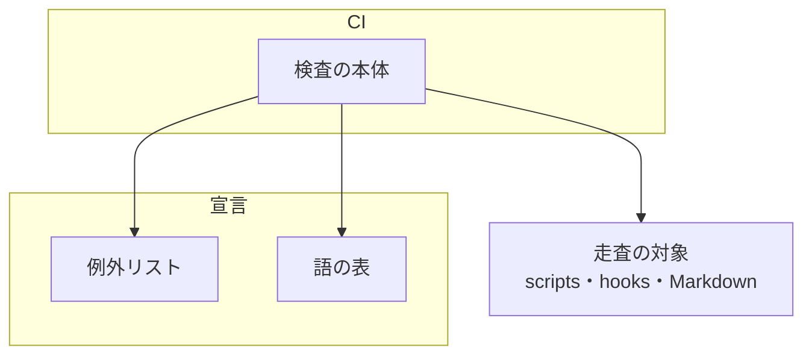
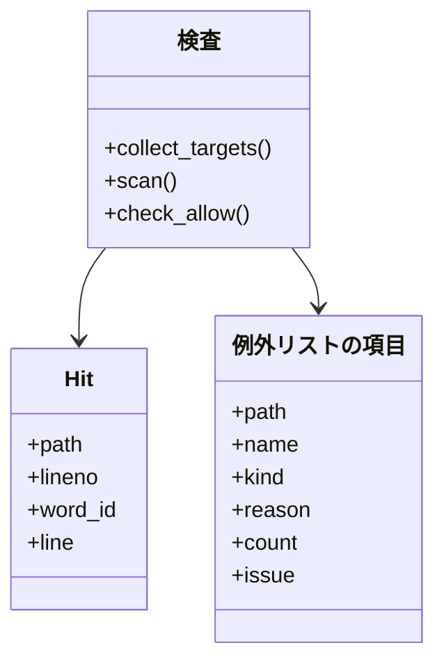
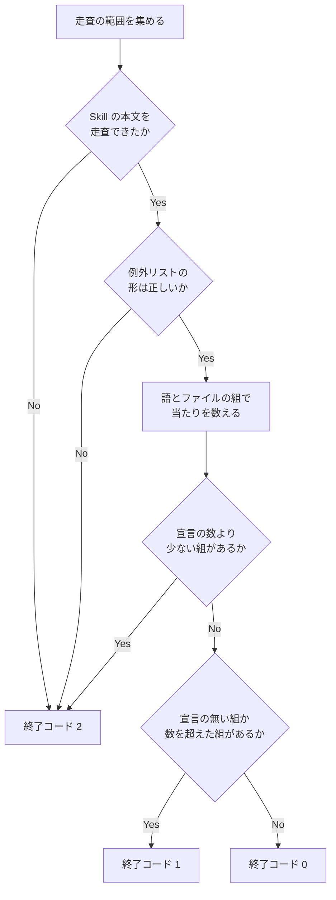
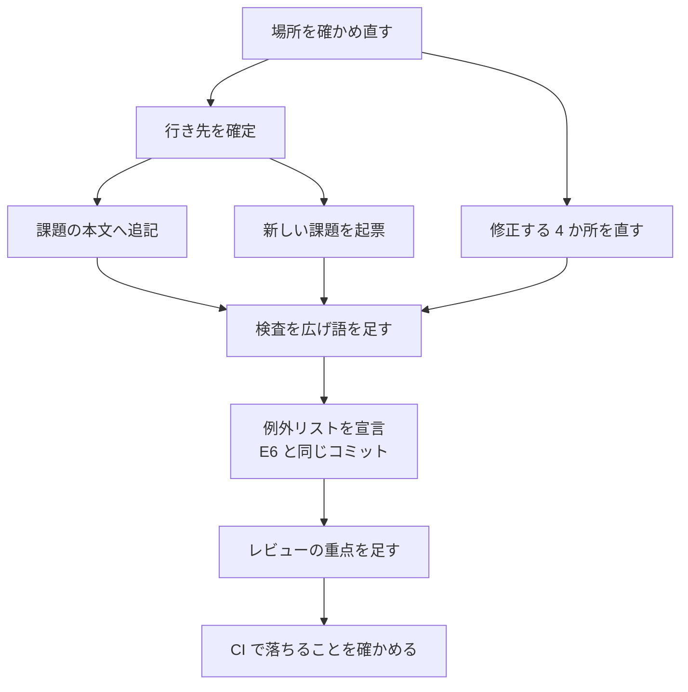

# リポジトリ前提の検査: ai-plugins の値を足す変更を CI で止め、27 件の違反に行き先を持たせる（#2624）

## 目的

- **今どうなっているか**: Value 6（どのプロジェクトでも使える形を保つ）の違反が 27 件あり、一部は行き先の課題が無い。違反を止めるはずの検査（CI のジョブ `skill-repo-assumptions-check`）は `skills/*/scripts/` の 143 本と hook の定義 2 本を走査しない。`"main"` などの語も検知しない
- **誰に効くか**: NDF を ai-plugins 以外のリポジトリで使う開発者と、NDF のスクリプトを変更する開発者
- **変えると何が成り立つか**: 27 件のすべてに直す先があり、同じ形の値を足す変更は Pull Request の時点で CI が落とす。ブランチ名とテストのコマンドを埋め込んだ 4 か所は宣言を読む形になる

## 適用範囲

- **働く範囲**: 検査と例外リストはこのリポジトリの CI だけで働く。修正する 4 か所（コードレビューのエージェント・並列の計画の照会・`pr-steps.py`・`supervise.py example`）はリリース先のリポジトリでも働く
- **プロジェクトごとに違うもの**: ベースブランチと本番のブランチを `.ndf/worktree.json` の `base_branch`・`production_branch` から読む（`--base` の引数が先）。新しい宣言の項目は足さない
- **当たるモード**: `standard`

## あるべき姿の根拠

| 根拠 | 種類 | 何を示すか |
| --- | --- | --- |
| 「そもそも、Vision 6. **どのプロジェクトでも使える形を保つ** に違反している状態です。ほかにも違反がないかどうかチェックしてください」 | 利用者の指示の原文 | 確認の依頼であり、27 件をこの課題で直すことまでは求めていない |
| PRD1・PRD2 | 外部の一次情報 | 語の検査の既存の違反は、ファイルと件数のベースラインで持ち、解消した違反が残ると知らせる形が主要なリンターにある |
| `scripts/check-script-structure.py` の例外リスト（`scripts/script-structure-allow/`）144 項目と `scripts/contract-allow/` 183 項目 | 実測 | このリポジトリの検査の例外は 1 項目 1 ファイルで持ち、並列の計画で衝突しない形がすでに使われている |
| 語を足した検査の実測: 75 組・186 行 | 実測 | 語とファイルの組で宣言できる量であり、76 項目のうち 44 項目は違反でない当たりである（「既知の当たりの内訳」） |

要求と受け入れ条件は #2624 の本文にある（コピーは `issues/issue-2624-requirements.md`）。この文書は「どう作るか」だけを扱う。

## ドメインモデル

### コンテキスト

| コンテキスト | 何の語が 1 つの意味に決まるか |
| --- | --- |
| 開発の検査（`repo-dev-checks`） | リポジトリ前提の検査・既知の当たり・例外リスト |
| 開発の工程（`ndf-workflow`） | ベースブランチ・本番のブランチ・棚卸しの行き先 |

関係は順応者である。検査は工程のスクリプトの字面をそのまま読み、工程の語へ翻訳しない。工程のスクリプトは検査を呼ばず、検査の側だけが変更の結果に従う。

### 集約

| 集約 | 持ち主（書き換えてよいもの） | 根 | エンティティ | 値オブジェクト |
| --- | --- | --- | --- | --- |
| 行き先の表 | #2624 の本文（実装で更新し、`spec-copy.py write` でコピーを作り直す） | 表 | 行（番号 1〜27） | 行き先・扱い |
| 既知の当たり | 例外リスト `scripts/repo-assumptions-allow/` | 項目（語とファイルの組） | — | 語の ID・当たりの数・理由・行き先の課題 |
| 検知する語 | `scripts/check-skill-repo-assumptions.py` の語の表 | 語 | — | 語の ID・正規表現 |
| ベースブランチと本番の解決 | `plugins/ndf/scripts/lib/repo.py` | 解決の関数 | — | ブランチ名・出所 |

### 不変条件

| # | 集約 | 条件 | 破れたときの扱い |
| --- | --- | --- | --- |
| I1 | 既知の当たり | 宣言の無い組の当たりは検査を落とす | 終了コード 1。ファイル・行番号・語を出す |
| I2 | 既知の当たり | 宣言の当たりの数を実際の数が超えると検査を落とす | 終了コード 1。その組の当たりをすべて出す |
| I3 | 既知の当たり | 宣言の当たりの数より実際の数が少ないと検査を落とす（0 を含む） | 終了コード 2。直す値を出す |
| I4 | 既知の当たり | 項目は理由を持ち、違反が残る項目は行き先の課題の番号も持つ | 終了コード 2 |
| I5 | 検知する語 | 走査の範囲は、manifest に載る Skill のディレクトリの下の `*.md` すべて（`SKILL.md`・`references/`・`docs/`・`prompts/`・`templates/`・`assets/`・Skill 直下の番号付き文書を含む）、リリース対象のスクリプト（プラグインの単位である family の `scripts/` と manifest に載る Skill の `scripts/`）、`hooks/*.json` である。`tests/`・`experimental/` は入らない | 範囲の外の検知は誤り。範囲の中の見逃しはテストで落とす |
| I6 | ベースブランチと本番の解決 | 並列の計画の本番の照会の宛先は `repo.production_branch` の結果だけである。決まらなければ照会しない | 決まらないときはリリースが届いた先を `release_branch` までとし、URL を空にする |
| I7 | ベースブランチと本番の解決 | ベースブランチが決まらないとき、`pr-steps.py` は Pull Request を作るコマンドを打たない | `EXIT_PRECONDITION` で止まり、`base_branch` の設定を求める |
| I8 | 行き先の表 | 27 行のすべてに課題の番号・「この課題」・「違反でない」と理由のどれかが入る | 完了判定で止まる |
| I9 | 行き先の表 | 行き先の課題の本文へ足すときは末尾への追記だけで、既存の文を変えない | 追記の後に読み直し、前の本文が先頭に残ることを確かめる。残らないとき、今の本文が自分の書いた本文と完全に一致する場合だけ前の本文へ戻す。一致しない場合は他者の変更として書き込まず、表の行を未完了のまま人へ戻す |

### ドメインイベント

| # | イベント | 発生元 | 受け手 |
| --- | --- | --- | --- |
| E1 | 27 行の場所を確かめ直した | 実装の担当 | 行き先の表 |
| E2 | 行き先を確定した | 実装の担当（未決 1 は設計承認ゲートの答え） | E3・E4 の追記と起票 |
| E3 | 既存の課題の本文へ追記した | 実装の担当 | 行き先の課題 |
| E4 | 新しい課題を起票した | 実装の担当 | 既知の当たりの行き先の課題の番号 |
| E5 | 修正する 4 か所を直した | 実装の担当 | 検査（当たりが減る） |
| E6 | 検査の走査範囲と語を広げた | 検査 | 例外リスト（E7 と同じコミット） |
| E7 | 既知の当たりを行き先つきで宣言した | 例外リスト | 検査 |
| E8 | レビューの重点へ観点を足した | `.ndf/review.json` | cross-review の担当 |
| E9 | CI が新しい違反を落とした | 検査 | Pull Request の作成者 |

### 用語

| 用語 | 意味 | 用語集への反映 |
| --- | --- | --- |
| 例外リスト | 構造チェックとリポジトリ前提の検査が違反として数えない今の外れを 1 項目 1 ファイルで持つ置き場。チェックごとに置く（`scripts/script-structure-allow/`・`scripts/contract-allow/`・`scripts/repo-assumptions-allow/`） | 意味の変更 |
| 既知の当たり | リポジトリ前提の検査に当たるが、NDF 自身の置き場を読むなど違反でない箇所か、行き先の課題が直すまで残す箇所。語とファイルの組ごとに当たりの数を例外リストへ宣言する | 意味の変更 |

## 機能一覧

| # | 機能 | 誰が使うか |
| --- | --- | --- |
| F1 | 27 件の違反の行き先を、表と行き先の課題の本文で読む | 棚卸しをする人・行き先の課題の担当 |
| F2 | リリース対象のスクリプトへ ai-plugins の値を足すと CI で落ちる | NDF を変更する開発者 |
| F3 | 既知の当たりの理由と行き先を、語とファイルの組で読む | 同上 |
| F4 | 違反を直すと、宣言の消し忘れを検査が知らせる | 行き先の課題の担当 |
| F5 | コードレビューのエージェントが宣言のベースブランチと比べる | ベースブランチが `main` でないリポジトリの開発者 |
| F6 | 並列の計画が宣言の本番のブランチでリリースが届いた先を読む | 本番のブランチが `main` でないリポジトリの開発者 |
| F7 | ベースブランチが決まらないとき、Pull Request を作らずに設定を求められる | `main`・`master` の無いリポジトリの開発者 |
| F8 | `supervise.py example` の見本が特定のテストのコマンドを前提にしない | 計画を書く人 |
| F9 | レビューの担当が「宣言を読む経路か」を重点として見る | ai-plugins の cross-review の担当 |

## 決定の記録

### 決定 1: 既知の当たりの読み手を 1 つの形にそろえるため、例外リストを 1 項目 1 ファイルで置き、今の除外の表を廃止する

要求の未決 2 を決める。今の除外の表（検査の本体の定数 `EXCLUSIONS`）はファイルの単位で、広げると 76 項目が本体のスクリプトへ入る。このリポジトリの検査の例外は `scripts/script-structure-allow/` と `scripts/contract-allow/` の形がすでにある。読み込みは `allowlist.py` が持つ。1 項目 1 ファイルなら、並列の計画が別の項目を変えても衝突しない。Skill の本文の除外も同じ形へ移し、ファイル全体の除外を残さない。

今の除外の表を語の単位の入れ子へ広げる形は、項目が本体の行数を押し上げ、並列の変更が同じ辞書でぶつかるため採らない。語の検査を Semgrep へ置き換える形は、Python の標準ライブラリだけで動くジョブへ Tool の導入を足すため採らない。

- 作り方: 自前で作る・標準に倣う
- 比べた候補: LIB1 / LIB2 / PRD1 / PRD2

根拠: Value 5 / Value 7（MVV 版 6）

### 決定 2: 同じファイルの新しい箇所も止めるため、項目に当たりの数を持たせ、実際の数との一致を求める

受け入れ条件 12 は、ファイルを除外から外した後の「新しい箇所」も落とすことを求める。語とファイルの組だけでは、宣言のある組の 2 件目を見分けられない。PHPStan の `count` と同じく数を持ち、超えたら終了コード 1、減ったら終了コード 2 にする。減った場合も落とすので、行き先の課題が直したときに同じ Pull Request で項目を消すことになる。

行の中身まで宣言する形は、行の整形や移動のたびに項目を書き直すため採らない。減った場合を通す形は、数が古いまま残り、次に足した 1 件が通るため採らない。

- 作り方: 自前で作る・標準に倣う
- 比べた候補: PRD1 / PRD2

根拠: Value 3 / Value 5（MVV 版 6）

### 決定 3: ブランチ以外の `main` を避けるため、語は引用符つきの形で照合し、残りは既知の当たりにする

要求の未決 3 を決める。引用符つきに限ると、関数の名前と `__main__` は語の形で外れる。残る `"main"` には、語の形では外せないものがある。HTML のランドマーク（`classify_page_role.py`）・設定の置き場の値（`lib/decl.py`）・コードの区分（`codemetrics*.py`）である。これらは違反でない当たり（`not-a-violation`）として宣言する。

引用符なしの `main` まで見る形は、当たりの大半が別の意味になり、差分を読めなくなるため採らない。

根拠: Value 6（MVV 版 6）

### 決定 4: リリースしないスクリプトを数えないため、Skill のスクリプトは manifest に載る Skill に限る

Skill の Markdown と同じく `manifests/*-skills.txt` の和集合を使う。今の 143 本と playwright-kit の 8 本はすべて manifest に載る Skill にある（語を足した試作で数えた）。family を問わず同じ規則で走査するので、playwright-kit も検査に入る。

根拠: Value 6（MVV 版 6）

### 決定 5: 本番の決め方を 1 か所に保つため、並列の計画の照会は `repo.production_branch` を読む

`lib/parallel_lane.py:154` が同じ関数で本番を読み、宣言をメインディレクトリから読む規則（`lib/decl.py`）もこの関数が持つ。`production_branch` が決まらないときは照会を打たず、ブランチの有無だけを見る。受け入れ条件 7 の既定ブランチの扱いは今の関数のままで、行 12 の「宣言が無いと既定ブランチを本番とみなす」形は #1338 が直す。

根拠: Value 6 / Value 7（MVV 版 6）

### 決定 6: 無いブランチへ Pull Request を作らないため、ベースブランチの最後の既定 `"main"` を消して止まる

`pr-steps.py:116` と `pr_steps_lib/gh_pr.py:122` の `or "main"` を消す。止まる条件と文言は 1 つの部品（`gh_pr.require_base`）へ寄せ、2 か所から呼ぶ。`--base` だけが渡されたときの判定は今と同じで、宣言と既定ブランチの外なら `cherry-pick-pr` へ回す。

根拠: Value 6 / Value 7（MVV 版 6）

### 決定 7: 見本をそのまま使って別のテストを走らせないため、見本のテストのコマンドをプレースホルダーにし、同じ見本の `main` も外す

`"cmd": "<テストのコマンド>"` は `supervise.py expected` の読み込みを通し、書き換えないまま走らせればシェルが失敗するので、誤った成功にならない。プリセットの `sync-check` へ置き換える形は、テストでなく同期とチェックの実行になり、見本の意味が変わるため採らない。`"base": "main"` と docstring の `"base_branch": "main"` は行 15 と同じ見本の埋め込みである。同じ箇所を直すので一緒に外す（要求の対象範囲の行 15 に含めて扱う）。

根拠: Value 6（MVV 版 6）

### 決定 8: エージェントの手順でスクリプトの置き場に依らないため、行 9 は宣言と `origin/HEAD` を読む手順を文で書く

エージェントの本文から `$SCRIPTS` は決まらない。手順は「`.ndf/worktree.json` の `base_branch` を読む。無ければ `git symbolic-ref --short refs/remotes/origin/HEAD` から `origin/` を外す。どちらも無ければ差分を取らずに止まって報告する」とし、`git diff origin/<ベースブランチ>...HEAD` で比べる。読み方の順序は `repo.base_branch` と同じである。

根拠: Value 6（MVV 版 6）

### 決定 9: 他のプロジェクトへ決まりを足さないため、「宣言を読む」の観点はこのリポジトリの重点だけに置く

`.ndf/review.json` の `focus` へ 1 項目足す。新しいコードの形は要らず、今の `review_criteria.py` が基準 3 の文へ載せる。文面は受け入れ条件 16 の語のとおり「リリース対象のスクリプトへ足す経路が、プロジェクトごとに違う値を宣言から読むこと」とする。この変更は C7 に当たり、リリース承認ゲートで人が見る。

根拠: Value 6 / C7（MVV 版 6）

## 外部の調査

| 種類 | 調べるか | 理由 |
| --- | --- | --- |
| 標準・仕様 | 調べる | ベースブランチの解決の根にある `origin/HEAD` の仕様を確かめる |
| 主要な製品 | 調べる | 既存の違反を残したまま新しい違反を止める形が、主要なリンターにある |
| ライブラリとサービス | 調べる | 語の検査を既存の Tool へ置き換えられるかを決める |

### 標準・仕様

| # | 標準・仕様 | 何を定めているか | 設計への反映 | 出典 |
| --- | --- | --- | --- | --- |
| STD1 | git-remote の `set-head` | `refs/remotes/<name>/HEAD` はリモートの既定ブランチを指す symbolic-ref で、`set-head` で設定・削除できる | `origin/HEAD` が無いリポジトリがあり得る前提で、最後の既定を置かずに止まる（決定 6）。設定の無い clone で `git symbolic-ref --short refs/remotes/origin/HEAD` は終了コード 128 で落ちることを一時リポジトリで確かめた | https://git-scm.com/docs/git-remote （2026-11-06） |

### 主要な製品

| # | 製品 | どう解いているか | 設計への反映 | 出典 |
| --- | --- | --- | --- | --- |
| PRD1 | PHPStan の baseline | `ignoreErrors` の各項目が `message`・`count`・`path` を持ち、ファイルごとの出現数を持つ。消えた誤りが残ると知らせ、`--fix` で項目を消すか `count` を下げる | 項目へ当たりの数を持たせる。減った場合も検査で落とす（決定 2） | https://phpstan.org/user-guide/baseline （2026-11-06） |
| PRD2 | ESLint の bulk suppressions | 既存の違反を `eslint-suppressions.json` に持ち、新しいコードには規則を当てる。解消して使われなくなった抑制があると 0 でない終了コードで知らせ、`--prune-suppressions` で消す | 使われない宣言を落とす形を採る。件数の持ち方はページに記述が無かったので根拠にしない（「確かめられなかったこと」） | https://eslint.org/docs/latest/use/suppressions （2026-11-06） |

### ライブラリとサービス

| # | 候補 | 版 | ライセンス | 最後のリリースの日付 | 終了のアナウンス | 要件を満たすか | 出典 |
| --- | --- | --- | --- | --- | --- | --- | --- |
| LIB1 | `scripts/lib/allowlist.py`（このリポジトリの部品） | リポジトリの版 | リポジトリのライセンス | — | 無し | 1 項目 1 ファイルの読み込み・ファイル名の規則・理由の必須を満たす。当たりの数と行き先は `extra_keys`・`validate` で足せる | `scripts/lib/allowlist.py`（2026-11-06） |
| LIB2 | Semgrep | 1.184.0 | LGPL-2.1-or-later | 2026-11-05 | 無し | 語の照合はできるが、今の検査に Python の標準ライブラリしか要らないジョブへ Tool の導入が増える。語とファイルと件数の宣言の形は確かめられなかった | https://github.com/semgrep/semgrep/releases/latest ・ https://pypi.org/project/semgrep/ （2026-11-06） |

### 確かめられなかったこと

| 対象 | 試した手段 | 結果と理由 |
| --- | --- | --- |
| Semgrep のベースラインの形（`--baseline-commit` の意味、ファイルと規則の組の許可） | https://semgrep.dev/docs/ignore-oss-fp | HTTP 301 の転送先 https://docs.semgrep.dev/ignore-oss-fp が HTTP 404。ほかの URL は試していない |
| ESLint の抑制ファイルがファイル・規則・件数を持つか、件数を超えたときの扱い | https://eslint.org/docs/latest/use/suppressions | 取得できたが、該当の記述がページに無い |
| `git clone` が `origin/HEAD` を設定するか | https://git-scm.com/docs/git-remote ・ https://git-scm.com/docs/git-clone | 取得できたが、該当の記述がページに無い。設計は設定の有無のどちらでも成り立つ |

調べた量: 候補 5 件・取得の試み 7 回。

## 構成要素

| 要素 | 責務 |
| --- | --- |
| `scripts/check-skill-repo-assumptions.py` | 語の表を持ち、走査の範囲を集め、当たりを語とファイルの組で数えて例外リストと突き合わせる |
| `scripts/repo-assumptions-allow/`（新規） | 既知の当たりを 1 項目 1 ファイルで持つ例外リスト。今の除外の表を置き換える |
| `scripts/lib/allowlist.py`（変更なし） | 例外リストの読み込み |
| `plugins/ndf/scripts/lib/parallel_external.py` | リリースが届いた先と本番の Pull Request の URL の照会の宛先を宣言から決める（行 10） |
| `plugins/ndf/scripts/pr-steps.py`・`plugins/ndf/scripts/pr_steps_lib/gh_pr.py` | ベースブランチが決まらないときに止まる（行 11） |
| `plugins/ndf/scripts/supervise_lib/plan.py` | プランの見本から `pytest` と `main` の値を外す（行 15） |
| `plugins/ndf/agents/code-reviewer.md` | 差分を取るベースブランチを宣言から決める手順を書く（行 9） |
| `.ndf/review.json` | レビューの重点へ観点を足す |
| `plugins/ndf/skills/AUTHORING.md`・`docs/specifications/out-of-scope-issue-file.md` | 検査の説明を例外リストの形へ直す |
| `docs/glossary/glossary.json`・`docs/glossary.md` | 用語の意味の変更 |



図に含めない要素: `allowlist.py`（例外リストの読み込みの部品）と、検査の説明だけを持つ文書（AUTHORING.md・確定仕様・用語集）。修正する 4 か所は検査の走査の対象の一部で、「実装の順序」の図に現れる。

文脈と配置は変わらない。検査は GitHub Actions のジョブのままで、リリース物の配置も変わらない。

## 構造

```text
scripts/
├── check-skill-repo-assumptions.py
├── lib/allowlist.py
├── repo-assumptions-allow/        # 新規。1 項目 1 ファイル（76 項目の見込み）
│   └── plugins__ndf__scripts__release-steps.py--release-branch--pending.json
└── tests/test_check_skill_repo_assumptions.py
```



`Hit` は語の ID を持つように変える。語の表を語ごとに 1 回ずつ照合し、同じ行に 2 語あっても両方を数える。

## 入出力の契約

### 例外リストの項目（`scripts/repo-assumptions-allow/*.json`）

```json
{
  "path": "plugins/ndf/scripts/release-steps.py",
  "name": "release-branch",
  "kind": "pending",
  "reason": "リリースの形 package-plugin の版上げのブランチ。行 6 の行き先がリリースの形ごとの手順へ分ける",
  "count": 24,
  "issue": 2623
}
```

| キー | 型 | 必須 | 意味 |
| --- | --- | --- | --- |
| `path` | 文字列 | 必須 | 走査の対象のパス（今の除外の表のキーと同じ書き方） |
| `name` | 文字列 | 必須 | 語の ID |
| `kind` | `not-a-violation` / `pending` | 必須 | 違反でない当たりか、行き先の課題が直すまで残す当たりか |
| `reason` | 文字列 | 必須 | 違反でない理由、または残す理由 |
| `count` | 1 以上の整数 | 必須 | その組の一致の数（1 行に 2 回あれば 2） |
| `issue` | 整数 | `pending` だけ必須 | 行き先の課題の番号。`not-a-violation` には書かない |

ファイル名は `allow_file_name()` が決める（`<path の / を __ へ>--<name>--<kind>.json`）。語の ID を `name` に使うのは、語そのものが `/` や `"` を含みファイル名にできないためである。

### 検知する語

Skill の Markdown の 14 語と、スクリプトの今の 8 語は正規表現を変えず、ID を付ける。スクリプトに足す 9 語は次のとおりである。一致の境界は表の例で実行して確かめた。

| ID | 受け入れ条件の語 | 正規表現 | 当たらない例 |
| --- | --- | --- | --- |
| `quoted-main` | `"main"` | `["']main["']` | `"__main__"`・`def main`・`"domain"` |
| `quoted-develop` | `"develop"` | `["']develop["']` | — |
| `base-main` | `--base main` | `--base[ =]main\b` | `--base mainline` |
| `admin-merge` | `--admin` | `--admin\b` | — |
| `tag-form` | `--v` | `--v(?![A-Za-z-])` | `--verbose`・`--version`・`--view` |
| `release-branch` | `release/v` | `release/v(?![a-z])` | `release/verification` |
| `plugin-manifest` | `plugin.json` | `plugin\.json` | — |
| `spec-dir` | `docs/specifications` | `docs/specifications` | — |
| `pytest` | `pytest` | `\bpytest\b` | `PYTEST_ADDOPTS`・`pytest_x` |

スクリプトの語は `plugins/<family>/hooks/*.json` にも掛ける。

### 検査のコマンド

| 項目 | 内容 |
| --- | --- |
| 名前 | `python3 scripts/check-skill-repo-assumptions.py [--skills-dir D] [--allow DIR] [--report]` |
| 入力 | `--allow` は例外リストのディレクトリ（既定は `scripts/repo-assumptions-allow/`）。`--exclusions` を置き換える |
| 出力 | 今の形のまま。`--report` の規模の行にスクリプトの内訳と hook の本数を足す |
| 失敗の形 | 0: 宣言の外に当たりが無く、宣言の数と一致する。1: 宣言の無い組の当たり、または宣言の数を超えた当たり（I1・I2）。2: 例外リストが読めない・形が違う・対象が走査の範囲に無い・語の ID が無い・宣言の数より当たりが少ない（I3・I4）、Skill の本文を走査できない |
| 優先 | 2 を 1 より先に判定する（今の順序を保つ） |
| 互換性 | `--exclusions` を消す。呼ぶのはテストだけである（`grep -rn -- '--exclusions' .github scripts plugins docs` の当たりは検査の本体と `scripts/tests/test_check_skill_repo_assumptions.py` だけ） |

`--skills-dir` で family を 1 つだけ指定したときは、今と同じく指定した family の項目だけを突き合わせる。

### 変える呼び出しの契約

| 名前 | 変更 | 互換性 |
| --- | --- | --- |
| `pr-steps.py plan`・`pr-steps.py create` | ベースブランチが決まらないとき `stopped`（`EXIT_PRECONDITION`）で、`.ndf/worktree.json` の `base_branch` か `--base` を求める | ベースブランチが決まるリポジトリでは変わらない |
| `supervise.py example` | `steps[].cmd` の値を `<テストのコマンド>` にし、`pr` のステップの `base` を消す | キーの並びは変わらない。`base` を省くと `.ndf/worktree.json` を読む（`supervise_lib/pr.py:187`） |
| `parallel_external.stages_of`・`prod_pr_url` | 引数は変えず、照会の `--base` を宣言から決める | 宣言が無く既定ブランチが `main` なら今と同じ |

## 既知の当たりの内訳

HEAD 7db74dfa6 で語を足した試作を走らせた結果である。組の数は 75 組・186 行で、4 か所の修正で 5 組が消え、Skill の Markdown の 6 組を足して 76 項目になる。実装では E7 の時点の数で項目を作る。

| 語 | 扱い | 組 | 対象 |
| --- | --- | ---: | --- |
| `quoted-main` | 違反でない | 7 | HTML のランドマーク・設定の置き場・コードの区分・解析の候補（`fingerprint.py`・`measure_repo.py`） |
| `quoted-main` | #1338 | 1 | `lib/repo.py` の既定ブランチの候補（行 12） |
| `quoted-develop` | 違反でない | 2 | `pr_mode.py` の区分の名前・`fingerprint.py` の解析の候補 |
| `admin-merge` | #1338 | 3 | `merged_lib/merge.py`・`merged-steps.py`・`hook_lib/token_guard.py` の案内（行 18） |
| `tag-form` | #1756 | 5 | `release-steps.py` ほかのタグの形（行 3） |
| `plugin-manifest` | 違反でない | 7 | NDF 自身の版を読む箇所と解析の候補 |
| `plugin-manifest` | #1756 | 5 | リリースの形 package-plugin の版の読み書き（行 3） |
| `plugin-manifest` | #2616 | 3 | `parallel_external.py`・`parallel_repo.py`・`parallel_run.py`（行 1） |
| `release-branch` | #2616 | 2 | `parallel_external.py`・`parallel_release.py`（行 1） |
| `release-branch` | #2623 | 7 | リリースの形 package-plugin のブランチ（行 6） |
| `spec-dir` | 違反でない | 4 | コメントが NDF 自身の確定仕様を指す箇所 |
| `spec-dir` | 新しい課題 | 3 | `lib/repo.py`・`design-match.py`・`plan-to-spec-steps.py`（行 19） |
| `pytest` | 違反でない | 11 | 解析の候補・帳簿の項目名・コメント・playwright-kit のテストの形 |
| `playwright-kit`・`plugins/ndf/`（`release-steps.py`・`step_result.py`） | #1756 | 3 | プラグインの置き場の決め打ち（行 3） |
| `plugins/ndf/`（ほかのスクリプト） | 違反でない | 7 | NDF 自身の宣言の URL・コメント |
| Skill の Markdown の語 | 違反でない | 6 | 形で分岐した参照（`form-package-plugin.md`）と NDF 自身の指定 |

合計は 76 項目で、違反でないものが 44、行き先のあるものが 32（#1338 が 4・#1756 が 13・#2616 が 5・#2623 が 7・新しい課題が 3）である。今の除外の表のうち `projects-tracking.md`・`issue-target.md` は当たりが 0 件（`--report` の一覧に載らない）なので項目を作らない。

## 処理の流れ



## 非機能の実現方式

| 大項目 | 実現方式 |
| --- | --- |
| 性能・拡張性 | 走査はファイルの読み込みと正規表現だけで、ネットワークを使わない。手元の実測で今の検査は 0.27 秒、語を足して Skill のスクリプトまで読む試作は 1.3 秒で、条件の 10 秒に収まる |
| 運用・保守性 | 当たりの出力は今の `ファイル:行: 語 — 行の中身` の形を保つ。数を超えた組は、どの行が新しいかを決められないので、組の当たりをすべて出す。数が減った組は、書き直す値と項目のファイル名を出す |

## 実装の順序

行き先の課題の番号が例外リストの項目に要るので、起票を先に行う。



本文の追記（E3）は次の順で行い、不変条件 I9 を確かめる。

1. `gh issue view <番号> --json body --jq .body` で今の本文を取る
2. 末尾へ `## Value 6 の棚卸しから足す範囲（#2624）` の節を足し、`gh issue edit <番号> --body-file` で書く
3. 読み直して、前の本文が先頭に残ることを比べる
4. 残らないときは、読み直した本文と手順 2 で書いた本文を比べる。完全に一致すれば前の本文へ戻す。一致しなければ書き込まず、表の行を未完了のまま人へ戻す

節には行の中身と場所を書き、行の番号だけで指さない。

## 行き先の確定

27 行の行き先は要求の表のとおりとする。行き先の課題の状態は `gh issue view` で確かめた。

| 状態 | 課題 |
| --- | --- |
| OPEN（19 件） | #2616・#2623・#2554・#1756・#2354・#2601・#2619・#1338・#2082・#2228・#2239・#2013・#2600・#1968・#1707・#2448・#2446・#2653・#2315 |
| CLOSED（1 件） | #479。行 16 の未決 1 が扱う |

| 本文へ足す課題 | 足す行 |
| --- | --- |
| #1756 | 行 3（README とマーケットプレイスの書き換え・タグの形・根の CHANGELOG） |
| #2623 | 行 7・行 8 の承認の外で通すパス |
| #1338 | 行 12・行 13 |

| 新しい課題 | 持つ行 |
| --- | --- |
| Value 6 の残り（他のリポジトリでの観測が無いもの） | 行 17・19・21・22・23 |
| 課題の置き場（未決 1 で「起票する」のとき） | 行 16 |

## テスト設計

| 受け入れ条件・不変条件 | どの振る舞いで縛るか | どう壊したら落ちるべきか |
| --- | --- | --- |
| 受け入れ条件 1・I8 | 行き先の表の 27 行を手動で確かめる | — |
| 受け入れ条件 2 | 行ごとの確かめの結果を表へ添える。消えた行は検索のコマンドと結果を添える | — |
| 受け入れ条件 3・I9 | 課題の本文の差分を手動で確かめる。前の本文が先頭に残る。残らないときに他者の変更を上書きしていない | — |
| 受け入れ条件 4 | 新しい課題の数と本文を手動で確かめる | — |
| 受け入れ条件 5 | `grep -n 'main' plugins/ndf/agents/code-reviewer.md` の当たりが無い | — |
| 受け入れ条件 6・I6 | `production_branch: prod` の宣言で 2 つの照会が `--base prod` を渡す | 宛先を固定に戻すと落ちる |
| 受け入れ条件 7 | 宣言が無く既定ブランチが `main` で `--base main` を渡す | 決まらない扱いへ倒すと落ちる |
| I6 | 本番が決まらないとき Pull Request の照会を打たず、届いた先は `release_branch` までになる | `None` を `--base` へ渡すと落ちる |
| 受け入れ条件 8・I7 | 宣言も既定ブランチも無い一時リポジトリで `plan`・`create` が止まり、`gh pr create` を呼ばない | 既定 `"main"` を戻すと落ちる |
| 受け入れ条件 9 | `example` の出力に `pytest` が無く、`supervise.py expected` が通る | 見本へ `pytest` を戻すと落ちる。キーを壊すと読み込みが落ちる |
| 受け入れ条件 10・I5 | manifest に載る Skill の Markdown・Skill の `scripts/`・`hooks/*.json` に語を置くと終了コード 1。`tests/`・`experimental/`・manifest に無い Skill では 0 | 走査の範囲を戻すと落ちる。実物の本数は `--report` で確かめる |
| 受け入れ条件 11・I1 | 9 語のそれぞれで新しいファイルが終了コード 1 になる。「当たらない例」の語は 0 | 語を表から消すと落ちる |
| 受け入れ条件 12・I2 | 宣言のある組へ 1 件足すと終了コード 1 になり、その組の当たりが出力に載る。実物の 3 本に除外が無い | 数を見ない判定へ戻すと落ちる |
| 受け入れ条件 13・I4 | 理由が空・`pending` に `issue` が無い・`not-a-violation` に `issue` がある項目は終了コード 2 | 形の検査を外すと落ちる |
| 受け入れ条件 14・I3 | 当たりが 0 件または宣言より少ない項目は終了コード 2 で、1 より先に判定する | 減少を見逃すと落ちる |
| 受け入れ条件 15 | 実物のリポジトリで終了コード 0（既存のテストを保つ） | 項目の数がずれると落ちる |
| 受け入れ条件 16 | `review_criteria.py reviewer --root .` の出力に観点が載る | — |
| 受け入れ条件 17 | `git diff develop -- .ndf/` の差分が `review.json` の `focus` の 1 項目だけ | — |
| 既存のテスト 22 件 | `--exclusions` の宣言を例外リストのディレクトリへ置き換えて同じ振る舞いを保つ | — |

## 設計の結果

| 課題 | 扱い | 取り込み先 | 触るファイル |
| --- | --- | --- | --- |
| #2624 | 実装する | — | `scripts/check-skill-repo-assumptions.py`、`scripts/repo-assumptions-allow/`、`scripts/tests/test_check_skill_repo_assumptions.py`、`plugins/ndf/scripts/lib/parallel_external.py`、`plugins/ndf/scripts/pr-steps.py`、`plugins/ndf/scripts/pr_steps_lib/gh_pr.py`、`plugins/ndf/scripts/supervise_lib/plan.py`、`plugins/ndf/scripts/tests/`、`plugins/ndf/agents/code-reviewer.md`、`plugins/ndf/skills/AUTHORING.md`、`docs/specifications/out-of-scope-issue-file.md`、`.ndf/review.json` |

## 未確認のまま残ること

| 項目 | 内容 |
| --- | --- |
| 未決 1（行 16 の行き先） | 設計承認ゲートで利用者が決める。推奨は新しい課題を 1 件起こし、本文から #479 を指す形である。#479 の閉じた記録は子の #480〜#484 を前提にしており、親だけを開き直すと受け入れ条件が閉じた子を指すまま残る。#479 の再検討の条件は「工程が止まったとき」で、carmo-system-console で止まった記録を実装の前に確かめる |
| 他の変更との順序 | 実装中の #2623 などがリリース対象のスクリプトの語を変えると、当たりの数がずれて CI が落ちる。直近 14 日の develop の 247 コミットのうち、対象の語を含む行を変えたものは 11 件（`git log --since=2026-10-23 --first-parent origin/develop -G…`）で、数を直す手間はこの頻度に収まる見込み。項目は 1 ファイルずつなので、衝突は同じ組を変えたときだけである |
| 27 行のうち未確認の行 | 行 1・9・10・11・12・15・18 以外は、受け入れ条件 2 のとおり実装の着手時に確かめる |
| 本文の追記の競合 | 手順 1 で本文を取ってから手順 2 で書くまでの間の他者の変更は、手順 3 では見分けられない。追記は 3 件で、取得と書き込みを続けて行うことでこの間を短く保つ |
| 語で拾えない違反 | 語を含まずに ai-plugins の形を前提にした論理は検査で拾えない。レビューの重点（決定 9）で受ける |
| 検査の外の手順書 | `plugins/ndf/agents/` は検査の走査の範囲に入らない。受け入れ条件 10 の範囲の外で、行 9 の再発は検査では止まらない |
