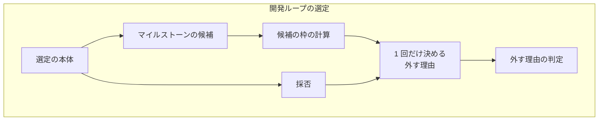
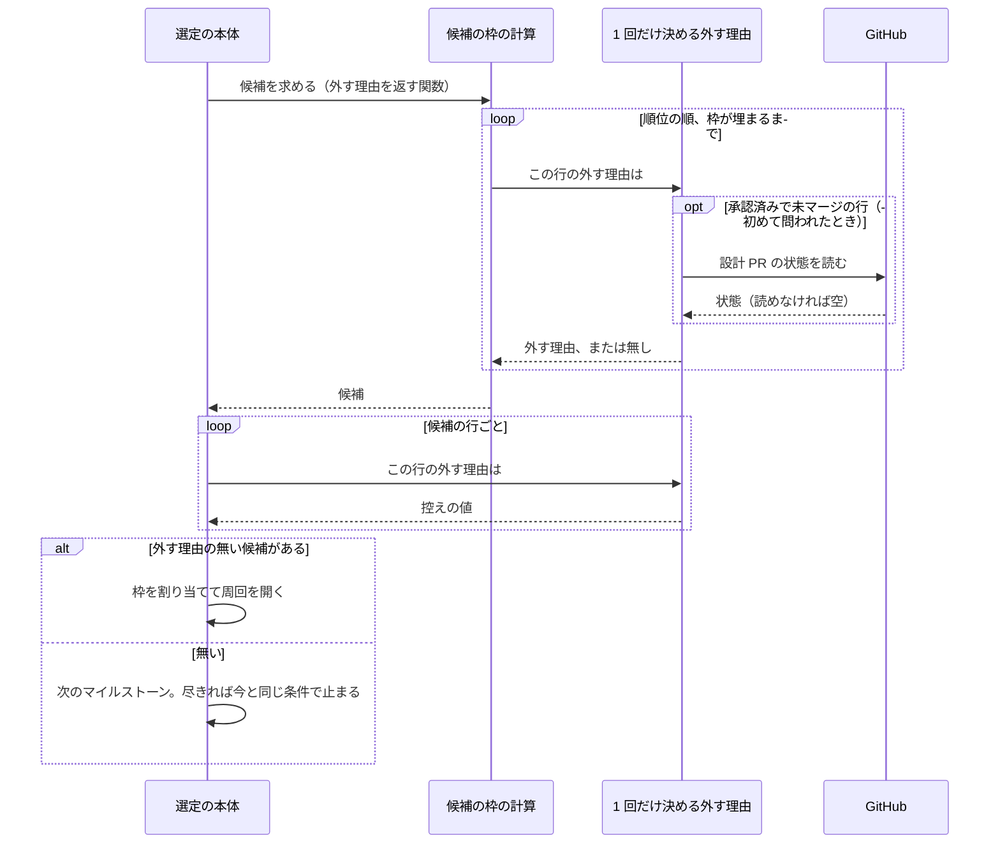

# 開発ループの選定: 外す理由のある課題が候補の枠を使わず、後ろの課題を選べる（#2627）

## 目的

- **今どうなっているか**: 切り出しの境界が無いマイルストーンで、候補の枠を計算するときに除く行が 4 種類に限られ、選定が外す残りの 6 種類の行が枠を使う。順位の先頭の行がすべて外れると、後ろに着手できる課題があっても `outside_mvv` で止まる
- **誰に効くか**: 開発ループを使うプロジェクトの利用者と、周回を見ているオーガナイザー
- **変えると何が成り立つか**: 外す理由のある行は枠を使わない。着手できる課題が残っている限りループは止まらず、選べない課題の分だけ周回の課題が減ることもない

## 適用範囲

- **働く範囲**: このリポジトリと、開発ループを使う利用先のリポジトリの両方
- **プロジェクトごとに違うもの**: 候補の枠の件数は今と同じ設定 `.ndf/pace.json` の `loop.max_issues` で受ける。足す設定は無い
- **当たるモード**: 開発ループが選ぶすべての周回。この課題自体は `standard` で進める

## あるべき姿の根拠

| 根拠 | 種類 | 何を示すか |
| --- | --- | --- |
| 開発ループ lfactory3 の周回 10・12 の止まり方 | 実測 | 順位の先頭の行が外れると、後ろの課題が残っていても候補が尽きて止まる |
| 要求の「何が困るか」の表（10.27.38 の手元で実行） | 実測 | 枠 2 件・順位の順 11〜14 で 11〜13 に当てると、6 種類の理由のどれでも選べる課題が 0 件になる |
| 試作（この設計の形を f1537915d へ当てて実行） | 実測 | 受け入れ条件 1〜8 の場面で期待どおりの組が選ばれる。開発ループのテスト 248 件のうち 247 件が通り、期待値が変わるのは 1 件だけである（「テスト設計」の末尾） |

要求と受け入れ条件は #2627 の本文にある（コピーは [issues/issue-2627-requirements.md](issue-2627-requirements.md) ）。この文書は「どう作るか」だけを扱う。

## ドメインモデル

### コンテキスト

| コンテキスト | 何の語が 1 つの意味に決まるか |
| --- | --- |
| NDF の開発ワークフロー（`ndf-workflow`） | 開発ループ・周回・選定・候補の枠・外す理由 |
| NDF の課題の棚卸し（`ndf-issue-upkeep`） | 順位・切り出しの境界・人の判断待ち |

棚卸しが供給者、開発ループが顧客の関係（顧客 / 供給者）。開発ループは棚卸しの順位の出力を読むだけで、この変更は棚卸しの側を変えない。

### 集約

| 集約 | 持ち主（書き換えてよいもの） | 根 | エンティティ | 値オブジェクト |
| --- | --- | --- | --- | --- |
| ループの記録 | 開発ループの選定（`loop select` / `loop exclude`） | ループの記録 | 周回・人の判断待ちの行 | 選定の行（課題の番号・順位・採否・外す理由）・今の周回の除外 |

順位の行は棚卸しの出力で、選定の中では読むだけの値である。選定の 1 回の実行が書き換えるのはループの記録 1 つだけで、今と変わらない。

### 不変条件

| # | 集約 | 条件 | 破れたときの扱い |
| --- | --- | --- | --- |
| I1 | ループの記録 | 切り出しの境界が無いとき、候補の枠を数えるのは外す理由の無い行だけである | テストが落ちる |
| I2 | ループの記録 | 1 回の選定で、1 つの行の外す理由は 1 回だけ決まり、候補の枠の計算と採否が同じ値を読む | テストが落ちる |
| I3 | ループの記録 | 候補に上がらない行の外す理由は決めない。設計 PR の状態も読まない | テストが落ちる |
| I4 | ループの記録 | 外す理由の無い行が枠より少なければ順位の末尾まで候補にし、どの行も理由つきで選定の記録に残る | テストが落ちる |
| I5 | ループの記録 | 切り出しの境界があるとき、候補は境界までの行で、外す理由で後ろへ広げない | テストが落ちる |

### ドメインイベント

| # | イベント | 発生元 | 受け手 |
| --- | --- | --- | --- |
| E1 | 選定を始めた | `loop select` / `loop exclude` | 開発ループの選定 |
| E2 | 順位の出力とマイルストーンの説明を読んだ | 開発ループの選定 | 開発ループの選定 |
| E3 | 行ごとの外す理由を決めた | 開発ループの選定 | 候補の枠の計算、採否 |
| E4 | 候補の枠を、外す理由の無い行で埋めた | 候補の枠の計算 | 採否 |
| E5 | 選んだ課題で周回を開いた | 開発ループの選定 | ループの記録、オーガナイザー |

E3 と E4 は順位の順に 1 行ずつ交互に起きる。行の外す理由を決めてから、その行を枠に数えるかを決める順序は要求のとおりである。

### 用語

| 用語 | 意味 | 用語集への反映 |
| --- | --- | --- |
| 候補の枠 | 切り出しの境界が無いときに、開発ループの選定が順位の先頭から候補として数える課題の件数の上限。周回の設定 `max_issues` の値で、1 周回に選ぶ課題の上限と同じ値である | 追加（要求の工程で反映済み） |
| 外す理由 | 開発ループの選定が課題を選ばないと決めた理由。周回の選定の記録に行ごとに残る | 追加（要求の工程で反映済み） |

## 外部の調査

省く: 候補の枠の数え方はこのプロジェクトの選定の規則だけで形が決まり、外部の標準・製品・ライブラリの判断が要らないため

## 機能一覧

| # | 機能 | 誰が使うか |
| --- | --- | --- |
| F1 | 外す理由のある課題を飛ばして、周回の課題を枠の件数まで選ぶ | 開発ループの利用者 |
| F2 | 外した課題を理由つきで選定の記録に残す | オーガナイザー |

## 構成要素

| 要素 | 責務 |
| --- | --- |
| 候補の枠の計算（`candidates_of`。変える） | 順位の順に行の外す理由を問い、外す理由の無い行が枠の件数に達した行までを候補にする。境界がある経路は今のまま。除く行の集合を受ける引数をやめ、外す理由を返す関数を受ける |
| マイルストーンの候補（`milestone_candidates`。変える） | 外す理由を返す関数を候補の枠の計算へ渡し、境界の外にある先に選ぶ課題を足す。保留の周回と今の周回の除外を集める処理を消す |
| 選定の本体（`choose_issues`。変える） | マイルストーンごとに外す理由を返す関数を先に決め、候補の枠の計算と採否の両方へ同じものを渡す |
| 1 回だけ決める外す理由（`sprint_loop_select.py` の内部の関数。足す） | 課題の番号ごとに外す理由の判定の結果を控え、2 回目以降は控えを返す |
| 外す理由の判定（`exclusion_reason`。変えない） | 判定の順序と文言の正本。候補の枠を計算するときの除外の条件もこの判定だけが持つ |
| 採否（`_select_candidate_rows`。変えない） | 外す理由の無い候補に枠を割り当て、選定の行を作る |
| 確定仕様（`docs/specifications/ndf-workflow-development-loop.md`。変える） | 「選定」の候補の説明と外す理由の順、テスト観点 |



確定仕様は文書のため、上の図に描かない。

変更の影響が及ぶ外側は、今と同じ 3 つである。


変える範囲の置き場所:

```text
plugins/ndf/scripts/
├── lib/sprint_loop_select.py        変える
└── tests/test_sprint_loop.py        テストを足し、期待値を 1 件直す
docs/specifications/
└── ndf-workflow-development-loop.md 変える
```

確定仕様 `docs/specifications/ndf-loop-select-prerequisites.md` は変えない。前提の課題を持つ行が枠を使わないという記述は、変更の後も成り立つ。

## 処理の流れ

候補の枠の計算は、枠が埋まった行で判定を止める。採否は候補の行の外す理由を問い直すが、同じ行の設計 PR を読み直さない。



設計 PR の状態を読めないときは今と同じく「マージ済みでない」と扱い、その行を外す理由「設計 PR がマージ待ち」で外す。選定の中に新しい失敗の経路は足さない。

スプリント MVV が未承認のマイルストーンは、外す理由を返す関数が設計 PR を読まずに常に「スプリント MVV が未承認」を返す。

## 非機能の実現方式

| 大項目 | 要求の条件 | 実現方式 | 確かめ方 |
| --- | --- | --- | --- |
| 性能・拡張性 | 1 回の選定で、設計 PR の状態を読むのは人の判断待ちの行 1 行につき 1 回までとする。候補の枠の計算のために読み直さない | 課題の番号ごとに外す理由の判定の結果を控え、枠が埋まった行で判定を止める | 人の判断待ちの行を持つ選定で、読んだ設計 PR の番号の並びを確かめるテスト（I2・I3 の行） |

## 決定の記録

### 決定 1: 候補の枠の計算と選定の判定を食い違わせないよう、枠を外す理由の判定そのもので数える

今の食い違いは、枠の計算が除く行の条件を判定とは別に持つことから起きている。枠の計算が外す理由の判定を呼べば、判定へ理由を足したときに枠の計算を直す必要がなくなる。今の周回の除外と保留の周回、人の判断待ち（棚卸し）、前提の課題の実装待ちの 4 種類の条件も枠の計算から消える。

除く行の集合へ 6 種類を足す形は採らない。同じ条件が 2 か所に残り、次に理由を足したときに同じ止まり方が起きる。

根拠: Value 7（MVV 版 6）

### 決定 2: 候補に上がらない行の設計 PR を読まないよう、枠が埋まった行で判定を止める

外す理由の判定は設計 PR の状態を読み、マージ済みならループの記録へマージの時刻を書く。枠の計算は順位の順に 1 行ずつ判定し、外す理由の無い行が枠の件数に達したらそこで止める。候補にならない行の読み取りと記録の書き換えが増えない。

すべての行を先に判定する形は採らない。後ろの行の数だけ設計 PR の読み取りが増え、候補にならない行の記録が書き換わる。

根拠: Mission（MVV 版 6）

### 決定 3: 設計 PR を読み直さないよう、選定の中で外す理由を課題の番号ごとに控える

候補の枠の計算と採否が同じ行の外す理由を問うため、控えが無いと、未マージの行の設計 PR を 2 回読む。控えはマイルストーンごとの選定の中だけに置き、ループの記録には書かない。採否の処理は外す理由を返す関数を候補ごとに 1 回呼ぶ今の形のままにする。

外す理由の判定を設計 PR の読み取りと記録の書き換えから切り離す形は採らない。判定の戻り値を直接確かめる既存のテストの形が変わり、受け入れ条件に対して変更の範囲が広がる。

根拠: Mission / Value 7（MVV 版 6）

### 決定 4: 枠の数え方を 1 通りに保つため、スプリント MVV が未承認のマイルストーンも同じ枠の計算を通す

未承認のマイルストーンでは、どの行にも外す理由「スプリント MVV が未承認」が付く。枠の計算を同じように通すとすべての行が候補になり、選定の記録に載る。`outside_mvv` の値の件数は、枠の件数ではなくマイルストーンの行の数になる。止まる条件の語と判定は変わらず、設計 PR も読まない。

未承認のときだけ今の 4 種類で枠を数える形は採らない。決定 1 で消す条件が別の経路に残る。先頭から枠の件数だけを候補にする形も採らない。人の判断待ちの行の扱いが、承認済みのマイルストーンと分かれる。

根拠: Value 7（MVV 版 6）

## テスト設計

受け入れ条件の場面は要求の前置きのとおり、切り出しの境界が無く、枠 2 件、順位の順 11〜14 とする。

| 受け入れ条件・不変条件 | どの振る舞いで縛るか | どう壊したら落ちるべきか |
| --- | --- | --- |
| 条件 1 | 答えの無い人の判断待ちの 11・12 を飛ばして 13・14 を選び、11・12 が「人の判断待ち」で残る | 枠の計算が外す理由を見ずに先頭から数える |
| 条件 2 | 差し戻しの 11・12 を飛ばして 13・14 を選び、「差し戻し」で残る | 枠の計算が答えの無い行だけを除く |
| 条件 3 | 承認済みで未マージの 11・12 を飛ばして 13・14 を選び、「設計 PR がマージ待ち」で始まる理由で残る | 枠の計算が承認済みの行を外す理由なしと見なす |
| 条件 4 | 宛先が本番の 11・12 を飛ばして 13・14 を選び、本番の理由で残る | 枠の計算がマージの結果を読まない |
| 条件 5 | 大きさの見積が尺度を超える 11・12 を飛ばして 13・14 を選ぶ | 枠の計算が大きさを見ない |
| 条件 6 | `loop exclude` の選び直しで、周回の中で起票された 11・12 を飛ばして 13・14 を選ぶ | 周回の中で起票された課題を枠の計算へ渡さない |
| 条件 7 | 11 だけが判断待ちのとき 12・13 の 2 件を選ぶ | 外した行の数だけ枠を減らす |
| 条件 8 | マージ済みと読めた 11・12 が枠を使い、マージの時刻が書かれる | マージ済みの行を外す行として数える |
| 条件 9〜13 | 要求の前提の確認に挙げた既存のテストが通る | 今の周回の除外を外す・前の周回の除外を効かせる・すべて外れたときに別の条件で止まる・境界を越える |
| 条件 14 | 確定仕様の候補の説明をレビューで読む。外す理由の順に「保留の周回の課題」が載り、10 種類の理由がそろう | テストは書かない |
| I1 | 外す理由の無い行だけで枠が埋まる（条件 1〜7 と同じ場面） | 枠の計算が判定を呼ばず、条件の一覧を持ち直す |
| I2 | 未マージの行を持つ選定で、読んだ設計 PR の番号が 1 行につき 1 回である | 控えを持たずに枠の計算と採否で 2 回読む |
| I3 | 枠が埋まった後ろの未マージの行の設計 PR を読まない。境界の外の行の設計 PR も読まない | すべての行を先に判定する |
| I4 | すべての行に外す理由があるとき、すべての行が記録に載り `outside_mvv` の件数が行の数と等しい（未承認のマイルストーンを含む） | 枠が埋まらないときに途中の行で切る |
| I5 | 境界がある経路で、外す理由で候補が境界の外へ広がらない | 境界がある経路にも飛ばしを入れる |

**既存のテストの期待値を 1 件直す。** `test_a_merge_that_fails_again_only_drops_that_issue` は、マージ待ちの 11 が枠を使う今の振る舞いを `selected == [13]` で固定している。変更の後は `[13, 14]` になる（試作で確かめた）。これは条件 3 が求める振る舞いである。

## 設計の結果

| 課題 | 扱い | 取り込み先 | 触るファイル |
| --- | --- | --- | --- |
| #2627 | 実装する | — | `plugins/ndf/scripts/lib/sprint_loop_select.py`、`plugins/ndf/scripts/tests/test_sprint_loop.py`、`docs/specifications/ndf-workflow-development-loop.md` |

## 未確認のまま残ること

| 項目 | 内容 |
| --- | --- |
| 切り出しの境界がある経路 | 外す理由のある行が境界の内を使い切ると、同じ止まり方が起きる。別の課題にするかは設計承認ゲートで利用者が決める（要求の「未決」） |
| 周回の境の読み取り | 宛先が本番の設計 PR は、選定の前の周回の境でも状態を読む。非機能の条件は選定の中の読み取りを対象にし、周回の境の 1 回は今のまま残す |
| 全体テスト | 試作で実行したのは `test_sprint_loop.py` と `test_lib_loop_drive.py` の 248 件までである。全体テストは 500 秒で打ち切り、結果を見ていない。実装で通す。`grep -rn "candidates_of\|milestone_candidates" plugins factory scripts docs` の当たりのうち、コードの呼び出しは `sprint_loop_select.py` の中だけである。ほかの 4 行は確定仕様の説明 3 行と、Factory のテストが利用者向けの文に内部の語が無いことを確かめる 1 行である |
| 実際のループでの再現 | lfactory3 と同じ記録での確かめは未実施。リリース後テストで、外す理由のある行が先頭にある周回を見て確かめる |
