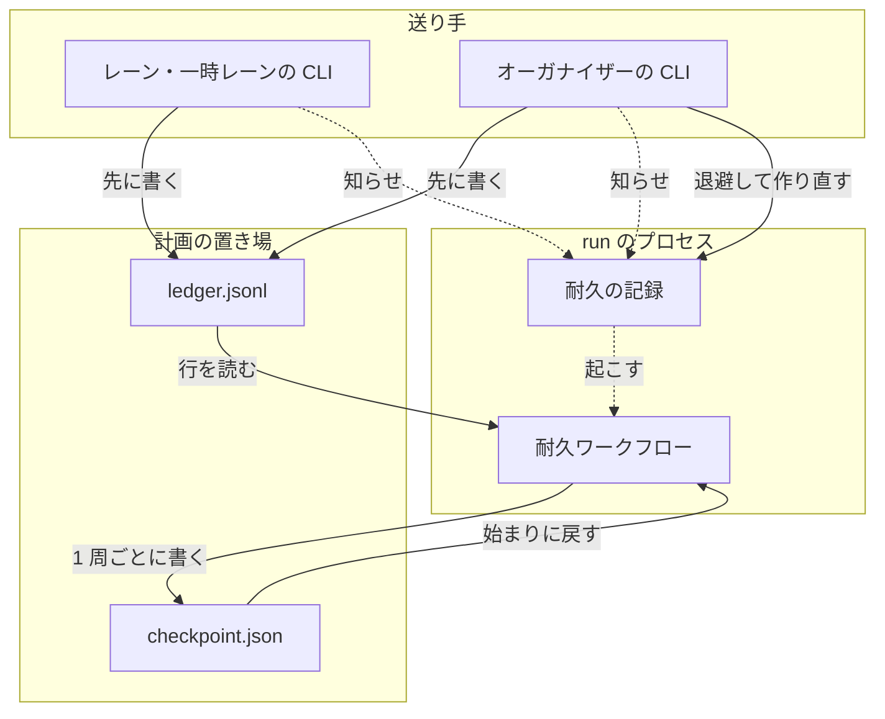
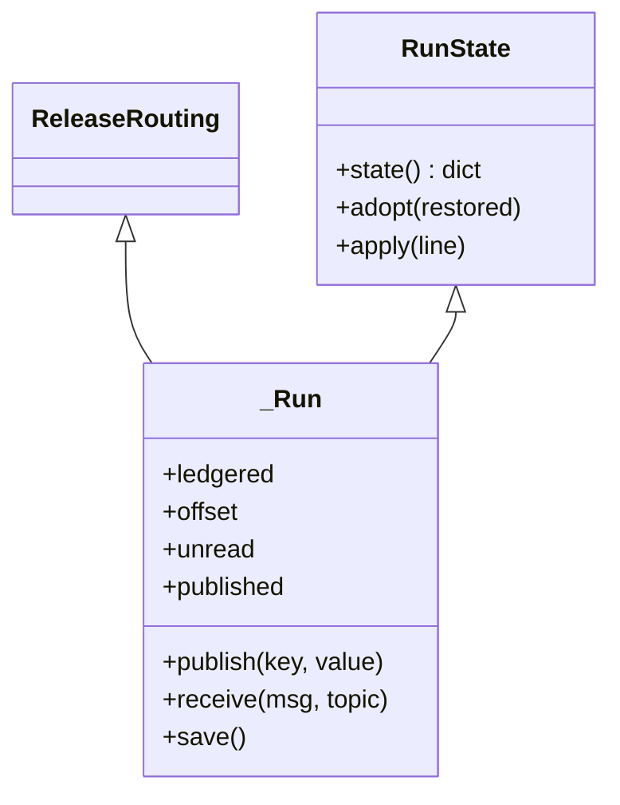
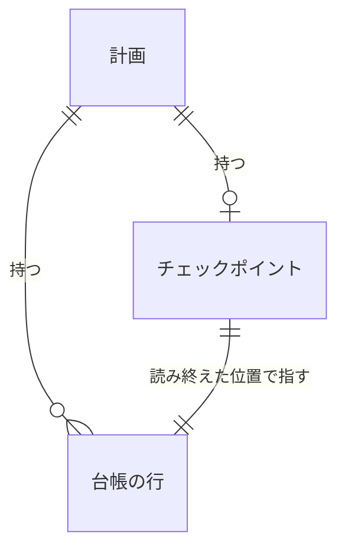
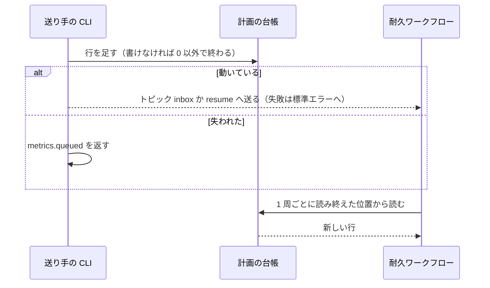
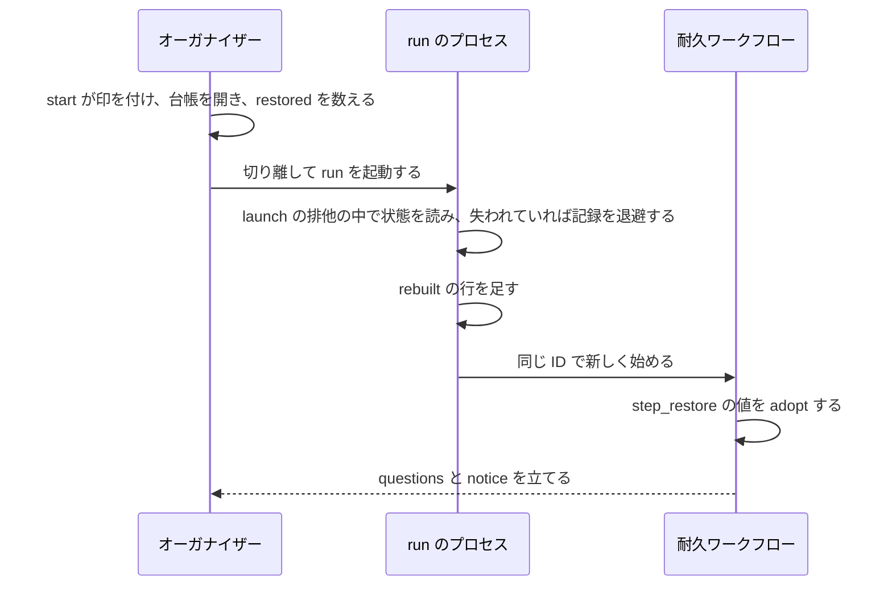
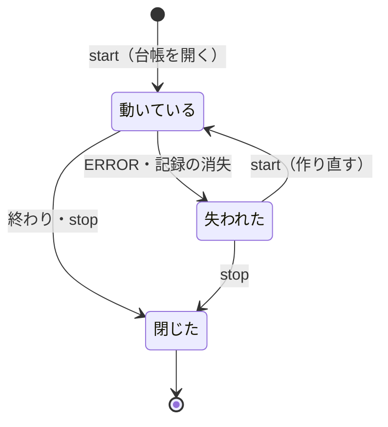

# 並列の計画: 耐久ワークフローや耐久の記録を失っても、計画の台帳から `start` 1 回で続ける（#2647）

## 目的

- **今どうなっているか**: 受けたリリースの依頼・答えていない問い・送った答えは耐久ワークフローのメモリだけにある。耐久ワークフローが ERROR になると続ける手段が無く、作り直すとこれらを失う。carul の計画 l20261104 では 2 時間あまりどのレーンも進まなかった（#2617）。オーガナイザーの印と統括役の使う版も、セッションと版の置き場に結び付いて消える（#2637・#2583）
- **誰に効くか**: 並列の計画を動かすオーガナイザーとレーン。出どころは carul の利用である
- **変えると何が成り立つか**: 状態が計画の置き場に残り、オーガナイザーが `parallel.py start <計画名>` を 1 回打てば計画が続く。ERROR の間にレーンが送った依頼と問い、オーガナイザーの答えも失われない

## 適用範囲

- **働く範囲**: NDF を導入したリポジトリで、ラッパーの下で動く並列の計画。Factory の実行と外のオーガナイザーのレーンは対象外である（要求の前提 4）
- **プロジェクトごとに違うもの**: 無し。置き場は `.ndf/parallel/<計画名>/` に固定する。観測の間隔は既存の環境変数 `NDF_PARALLEL_POLL` のまま使う
- **当たるモード**: `standard`

## あるべき姿の根拠

| 根拠 | 種類 | 何を示すか |
| --- | --- | --- |
| 「根本原因を見つけて対処してください」「保存先の永続化の問題」（#2647 の依頼の原文、2026-11-06） | 利用者の指示の原文 | 1 件ずつ直さず、状態の置き場を直す |
| STD3 と PRD3 | 外部の一次情報 | 追記の記録と、そこから速く戻すスナップショットの組は確立した形である |
| PRD1 | 外部の一次情報 | 同じ ID で新しい実行を始め、状態を引き継いで続ける形は耐久実行の製品に前例がある |
| 手元の実測（`外部の調査` の LIB1 の行） | 実測 | ERROR の耐久ワークフローは同じ記録の中で続けられず、記録を退避すれば同じ ID で新しく始められる |

要求と受け入れ条件は #2647 の本文にある（コピーは [issue-2647-requirements.md](issue-2647-requirements.md) ）。決定の記録は [issue-2647-design-decisions.md](issue-2647-design-decisions.md) に分けた。この文書は「どう作るか」だけを扱う。

## ドメインモデル

### コンテキスト

| コンテキスト | 何の語が 1 つの意味に決まるか |
| --- | --- |
| `ndf-workflow` | 計画の台帳・耐久ワークフローの作り直し・失われた計画・オーガナイザーの印・統括役の使う版 |

変更は 1 つのコンテキストに収まる。

### 集約

| 集約 | 持ち主（書き換えてよいもの） | 根 | エンティティ | 値オブジェクト |
| --- | --- | --- | --- | --- |
| 計画の台帳 | 台帳のモジュール（`parallel_ledger`）。送り手はこのモジュールを通して行を足す | 計画（計画名） | 台帳の行（キーで一意） | メッセージの本体・版・書いた時刻 |
| 台帳のチェックポイント | 耐久ワークフロー。書くのは耐久ステップ 1 か所だけ | 計画（計画名） | リリースの状態（連番）・レーンの状態（名前）・問い（依頼の id） | 読み終えた位置・公開した答え |
| オーガナイザーの印 | 統括役の CLI（`relay.py role`） | ラッパーの作業ディレクトリ | — | 計画名・役割 |
| 統括役の起動の手段 | 統括役（`Hub`） | 統括役の 1 プロセス | — | 使う python のパス |

### 不変条件

| # | 集約 | 条件 | 破れたときの扱い |
| --- | --- | --- | --- |
| I1 | 計画の台帳 | 送り手は台帳へ書いてから知らせる。書けなければ知らせず、0 以外で終わる | 送ったと扱わない |
| I2 | 計画の台帳 | 行は足すだけで、書き換えも消しもしない。同じキーの行は 1 行だけである | 2 度目の追記は何も足さずに成功を返す |
| I3 | 計画の台帳 | 同時に追記しても行が混ざらない。途中で切れた末尾の行は、次の行と 1 行に混ざらない | 切れた行は壊れた行として数える |
| I4 | 計画の台帳 | 壊れた行は外して続け、外した行数を結果へ返す | 計画を止めない |
| I5 | 計画の台帳 | 知らない形の行は状態へ反映せずに残し、件数と id を出す。読める版で作り直せば反映する | 捨てない |
| I6 | チェックポイント | 読み終えた位置より前の行は、チェックポイントの状態へ反映済みである | 読めないチェックポイントは無いものとして全行を読み、警告を返す |
| I7 | チェックポイント | 答えた依頼は作り直しの後に問いの一覧へ戻らず、同じ依頼へ 2 度答えない | — |
| I8 | チェックポイント | イベントの `seq` は作り直しをまたいで増え続ける | — |
| I9 | チェックポイント | リリースの連番を作り直しの後に使い回さない | — |
| I10 | チェックポイント | 起動済みのレーンを作り直しで起動し直さない | — |
| I11 | 計画の台帳 | 閉じた計画は作り直さない。受け付けるのは動いている計画と失われた計画だけである | `start` は耐久ワークフローを始めず、閉じていることを返す |
| I12 | 計画の台帳 | 台帳へ認証情報を書かない | 文字列の値を書く前に伏せる |
| I13 | オーガナイザーの印 | 同じ計画の印は 1 本のラッパーだけが持つ | 新しいセッションへ付けた時点で他の印を消す |
| I14 | 統括役の起動の手段 | 統括役の python の置き場が消えていても、`relay.current` の仮想環境でレーンを起こす | どちらも無ければ `tmux-failed`・1 |

耐久の記録の SQLite は書き換えない。退避はファイルの移動だけで行う（要求の境界）。

### ドメインイベント

| # | イベント | 発生元 | 受け手 |
| --- | --- | --- | --- |
| E1 | 計画の台帳を作った | `parallel.py start`・`run` | 送り手と受け付けの判定（失われた計画かの判定に使う） |
| E2 | レーンが依頼か問いを台帳へ書いた | `request`・`request-ask`・`request-gate2`・設計の承認の依頼 | 耐久ワークフロー |
| E3 | 耐久ワークフローが台帳の行を受け取った | 耐久ワークフロー | オーガナイザー（`wait`） |
| E4 | オーガナイザーが答えを台帳へ書いた | `parallel.py answer` | 耐久ワークフロー |
| E5 | レーンが答えを読んだ | `await`・周回の境 | レーンの周回 |
| E6 | 耐久ワークフローが失われた | 例外で ERROR・耐久の記録の消失 | オーガナイザー（`wait` が `start` の 1 行を返す） |
| E7 | オーガナイザーが作り直しを始めた | `parallel.py start` | `run` のプロセス |
| E8 | 耐久ワークフローが台帳から状態を戻した | 耐久ワークフロー | オーガナイザー（`wait`）・`run.log` |
| E9 | 新しいセッションが役割を引き継いだ | `parallel.py start`・`run` | 統括役の数え方・前のラッパー |
| E10 | ラッパーの更新が古い置き場を片付けた | ラッパーの起動の `ensure` | 統括役 |
| E11 | 統括役がレーンを起こした | `relay.py spawn`・`restart` | 耐久ワークフローの観測 |

### 用語

| 用語 | 意味 | 用語集への反映 |
| --- | --- | --- |
| 計画の台帳 | 1 つの並列の計画を続けるのに要る状態を、計画の置き場に持つ記録。受けた行を足す `ledger.jsonl` と、台帳のチェックポイントからなる | 意味の変更 |
| 台帳のチェックポイント | 耐久ワークフローが自分の状態（答えた依頼・リリースの状態・起動したレーン）と読み終えた位置を書く、計画の置き場の 1 ファイル。書くたびに全体を置き換える | 追加 |
| 失われた計画 | 閉じていないのに、耐久ワークフローが動いていない計画。ERROR か、耐久の記録が無い状態を指す | 追加 |
| 耐久の記録の退避 | 失われた計画の耐久の記録のファイルを、別の名前へ移すこと。同じ計画の新しい記録を同じ置き場で開くために行う | 追加 |
| 耐久ワークフローの作り直し | 失われた計画で、耐久ワークフローを新しく始めて計画の台帳から状態を戻すこと | 意味の変更 |

## 機能一覧

| # | 機能 | 誰が使うか |
| --- | --- | --- |
| F1 | 計画の台帳へ依頼・問い・答えを残す | レーン・一時レーン・オーガナイザー |
| F2 | 失われた計画を `start` 1 回で作り直し、状態を戻す | オーガナイザー |
| F3 | 失われた計画への依頼・問い・答えを受け付ける | レーン・オーガナイザー |
| F4 | 知らせが届かなくても、台帳から依頼を見つける | オーガナイザー |
| F5 | 読めない行・版の違い・台帳に無い待ちを知らせる | オーガナイザー |
| F6 | 新しいセッションへオーガナイザーの役割を移す | オーガナイザー |
| F7 | 版の置き場が消えてもレーンを起こす | 統括役 |

## 構成要素

### 責務

| 要素 | 責務 |
| --- | --- |
| 台帳のモジュール（新規 `lib/parallel_ledger.py`） | 行の追記・読み出し・形の検査・チェックポイントの読み書き・復元の材料の組み立て・報告。DBOS を import しない |
| 状態の出し入れ（`parallel_ledger` の `RunState`） | 耐久ワークフローの値をチェックポイントの形へ出し、戻す。`_Run` が継ぐ |
| 耐久ワークフロー（`lib/parallel_run.py`） | 入力を台帳の行だけから受ける。ループの各周の終わりにチェックポイントを書く。始まりに状態を戻す |
| 観測（新規 `lib/parallel_observe.py`） | `parallel_run.py` の行数の例外を増やさないため、観測の関数を移す。振る舞いは変えない |
| レーンの側（`lib/parallel_lane.py`） | 送る処理を「台帳へ書いて知らせる」1 か所へ集める。受け付けの判定・答えの読み出し・`run` の生死の判定を変える |
| 問いの読み出し（`lib/parallel_answer.py`） | 失われた計画の問いの一覧を台帳から読む |
| 耐久の記録を扱うモジュール（`lib/durable.py`） | `launch` の排他の中で記録を退避する。古い退避のファイルを消す |
| CLI（`parallel.py`・新規 `lib/parallel_cli.py`） | `start`・`run`・`wait` の結果を足す。`parallel.py` は 500 行ちょうどのため、`start` と `wait` の本体を `parallel_external_cli` と同じ形で移す。`build_parser` は契約の検査が静的に読むため動かさない |
| ループの記録の読み出し（`lib/parallel_route.py`） | 台帳に無い待ちを返す関数を足す |
| 統括役の CLI（`relay_lib/hub_client.py`） | `role organizer` が同じ計画の他の印を消す。`role --clear --plan` が計画の印をすべて消す |
| 統括役（`relay_lib/hub.py`・`version_dir.py`） | 起こす python を決める。切り替えを `hub-log.jsonl` へ 1 行残す |
| 契約（`plugins/ndf/contracts/`） | 台帳の行の形（`forms/parallel-ledger.json`）と、2 つのファイルの項目（`files/`） |
| オーガナイザーの手順（`development-workflow` の `references/parallel.md`） | `wait` が返す失敗と `start` の作り直し、新しい `metrics` を書く |

### 構成要素の関係

図は計画の状態の流れだけを描く。状態の出し入れ・観測・問いの読み出し・ループの記録の読み出し・契約・手順書・統括役の CLI・統括役は図に含めない。



### 配置

動く場所は変わらない。`ledger.jsonl` と `checkpoint.json` は `plan.json` と同じメインディレクトリの計画の置き場にある。

```text
plugins/ndf/scripts/
├── parallel.py                 # cmd_start・cmd_wait の本体を lib へ移す
├── lib/
│   ├── parallel_ledger.py      # 新規: 台帳とチェックポイント
│   ├── parallel_cli.py         # 新規: start・wait の本体
│   ├── parallel_observe.py     # 新規: parallel_run.py から移す観測
│   ├── parallel_run.py
│   ├── parallel_lane.py
│   ├── parallel_answer.py
│   ├── parallel_route.py
│   └── durable.py
└── relay_lib/{hub.py,hub_client.py,version_dir.py}
```

## 外部の調査

| 種類 | 調べるか | 理由 |
| --- | --- | --- |
| 標準・仕様 | 調べる | 追記の形式・追記の原子性・状態の復元に確立した形がある |
| 主要な製品 | 調べる | 耐久実行の製品が、失敗した実行をどう続けるかを比べる |
| ライブラリとサービス | 調べる | 依存にある DBOS と filelock で足りるか、台帳の専用の部品があるかを決める |

### 標準・仕様

| # | 標準・仕様 | 何を定めているか | 設計への反映 | 出典 |
| --- | --- | --- | --- | --- |
| STD1 | JSON Lines | UTF-8・1 行 1 値・改行が区切り | `ledger.jsonl` の形。行の単位で壊れた範囲を閉じ込める | https://jsonlines.org/ （2026-11-06） |
| STD2 | POSIX.1-2024 `write()` | `O_APPEND` は書く直前に末尾へ移す。`PIPE_BUF` を超える書き込みが割り込まれないかは定めない | ファイルの排他を併用する。行の長さに上限を置かずに済む | https://pubs.opengroup.org/onlinepubs/9799919799/functions/write.html （2026-11-06） |
| STD3 | Event Sourcing（Microsoft Azure Architecture Center・Martin Fowler） | 事象の記録から状態を導く。N 件ごとのスナップショットを読み、その後の事象だけを流し直す | 台帳の行と台帳のチェックポイントの組 | https://learn.microsoft.com/en-us/azure/architecture/patterns/event-sourcing ・ https://martinfowler.com/eaaDev/EventSourcing.html （2026-11-06） |
| STD4 | Transactional outbox | 業務の更新と同じ記録へ送るメッセージを書き、別の経路が届ける | 送り手が先に台帳へ書き、知らせの失敗を観測が拾う | https://microservices.io/patterns/data/transactional-outbox.html （2026-11-06） |

### 主要な製品

| # | 製品 | どう解いているか | 設計への反映 | 出典 |
| --- | --- | --- | --- | --- |
| PRD1 | Temporal | Continue-As-New: 同じ Workflow Id・新しい Run Id で、状態を引数で渡して履歴を空にして続ける。読み手は同じ ID を使い続ける | 同じ耐久ワークフローの ID で新しく始め、状態を別の経路で渡す | https://docs.temporal.io/develop/python/continue-as-new （2026-11-06） |
| PRD2 | DBOS | fork は新しい ID で指定のステップから始める。resume は最後に終えたステップから続ける | 読み手が固定の ID を使うため fork は合わない。resume は下の LIB1 の実測で ERROR のまま | https://docs.dbos.dev/python/tutorials/workflow-management （2026-11-06） |
| PRD3 | Redis | AOF（全書き込みの追記）と RDB（時点のスナップショット）を併用できる。両方あるときの再起動は AOF から戻す | 追記の記録を正本にし、チェックポイントが無くても全行から戻せるようにする | https://redis.io/docs/latest/operate/oss_and_stack/management/persistence/ （2026-11-06） |
| PRD4 | Kafka Streams | ローカルの状態を changelog へ流し、失ったら流し直して戻す | 状態の置き場を処理の実体より長い寿命の記録へ置く考え方を確かめた | https://docs.confluent.io/platform/current/streams/architecture.html （2026-11-06） |

### ライブラリとサービス

| # | 候補 | 版 | ライセンス | 最後のリリースの日付 | 終了のアナウンス | 要件を満たすか | 出典 |
| --- | --- | --- | --- | --- | --- | --- | --- |
| LIB1 | DBOS（依存にある） | 3.1.0（固定）。最新 3.4.0 | MIT | 2026-10-28 | 無し（PyPI の分類は Production/Stable） | 耐久ワークフローの続きは満たす。ERROR の続きは満たさない: 実測（2026-11-06、`durable.launch` の一時の記録）で `output_of` は `ModuleNotFoundError`、`resume_workflow` の後も ERROR、同じ ID の `start` も ERROR のまま。ファイルを退避すると `status` は None になり、同じ ID で SUCCESS まで流れた。先頭の `patched` は途中の記録で False を返した。`set_event` 1,000 回に 11.1 秒 | https://pypi.org/pypi/dbos/json （2026-11-06）・`pyproject.toml` |
| LIB2 | filelock（依存にある。`locks.append_locked`） | 4.0.3（固定）。最新 4.2.9 | MIT | 2026-11-04 | 無し | 満たす: 4 プロセスから 3 KB あまりの行を 2,000 行足して 0.376 秒、壊れた行 0（2026-11-06 の実測） | https://pypi.org/pypi/filelock/json （2026-11-06） |
| LIB3 | 標準ライブラリの `json`・`jsonio.read_jsonl` | Python 3.13 | PSF | — | 無し | 満たす: 1,000 行の読み出し 0.0035 秒（2026-11-06 の実測） | `plugins/ndf/scripts/lib/jsonio.py` （2026-11-06） |
| LIB4 | eventsourcing | 9.5.6 | BSD | 2026-10-13 | 無し | 満たさない: 集約・マッパーの枠組みを持ち込むが、要るのは 1 ファイルへの追記と読み出しだけである。SQLite の依存も足す形になる | https://pypi.org/pypi/eventsourcing/json （2026-11-06） |
| LIB5 | 標準ライブラリの `sqlite3` を台帳にする | Python 3.13 | Public Domain | — | 無し | 満たすが採らない: 同時の書き込みは解けるが、受け入れ条件 8 の「途中で切れた行」の扱いが成り立たず、人が読めない。残る volume がネットワークのファイルシステムのときの破損の注意がある | https://www.sqlite.org/howtocorrupt.html （2026-11-06） |

### 確かめられなかったこと

| 対象 | 試した手段 | 結果と理由 |
| --- | --- | --- |
| Litestream を台帳の複製に使う案 | https://pypi.org/pypi/litestream/json | HTTP 404。Python のパッケージではない。残らない環境の扱いは #2606 が受け持つため、これ以上調べていない |

調べた量: 候補 13 件・取得の試み 17 回。

## 構造



- `publish` は、答え・次のリリースへ回した知らせ・範囲のイベント（`answer-*`・`defer-*`・`range-*`）を立て、`published` へ控える。`_Run` と `ReleaseRouting` の `durable.set_event` の該当の呼び出しをこれへ置き換える
- `ledgered` は `durable.patched("parallel-ledger")` の結果である。偽なら今までの道を通る（決定 7）

## データ構造

計画の置き場に 2 つのファイルを足す。どちらもコミットしない。スキーマの移行は無い。



### `ledger.jsonl`（台帳の行）

| 項目 | 型 | 空を許すか | 意味 |
| --- | --- | --- | --- |
| `v` | 整数 | 許さない | 行の形の版。今は 1 |
| `key` | 文字列 | 許さない | 重複の判定のキー。`<kind>:<id>` を基本にする（下の表） |
| `kind` | 文字列 | 許さない | 行の種類（下の表） |
| `id` | 文字列 | 許す | 依頼の id。空は依頼に属さない行 |
| `at` | 文字列 | 許さない | 書いた時刻（UTC の ISO 8601） |
| `by` | 文字列 | 許す | 書いた者のレーン名かオーガナイザー。空はラッパーの外 |
| `ver` | 文字列 | 許さない | 書いた者の NDF の版 |
| `msg` | オブジェクト | 許す | 耐久ワークフローへ渡す本体。今のメッセージの形のまま。空は記録だけの行 |

| `kind` | キー | 書き手 | 耐久ワークフローの扱い |
| --- | --- | --- | --- |
| `request` | `request:<id>` | `parallel.py request` | `take` |
| `gate1` / `gate2` / `ask` | `<kind>:<id>` | `request_gate1`・`request-gate2`・`request-ask` | `take` |
| `answer` | `answer:<id>` | `parallel.py answer` | `take` |
| `stop` | `stop` / `stop:force` | `parallel.py stop` | `take` |
| `resume` | `resume:confirm:<連番>:<take>` / `resume:settle:<連番>` | `confirm`・`settle` | `resume` |
| `opened` / `closed` | `opened` / `closed` | `start`・`run` / `step_finish`・失われた計画の `stop` | 反映しない |
| `rebuilt` | `rebuilt:<回>` | `run_plan` | 反映しない。回数を `seq` の基準に使う |
| `role` | `role:<時刻>` | `start`・`run` | 反映しない。持ち主の記録。`id` はラッパーの名前 |

耐久ワークフローが自分で作る組み直しの依頼と問いは行にせず、チェックポイントが持つ。

### `checkpoint.json`（台帳のチェックポイント）

| 項目 | 型 | 空を許すか | 意味 |
| --- | --- | --- | --- |
| `v` | 整数 | 許さない | 形の版。今は 1 |
| `offset` | 整数 | 許さない | 読み終えた `ledger.jsonl` のバイト位置 |
| `unread` | 整数の配列 | 許さない | 知らない形として飛ばした行のバイト位置。読める版で作り直したときに反映する |
| `published` | オブジェクト | 許さない | イベント名 → 値。`answer-*`・`defer-*`・`range-*` |
| `lanes` / `pending` / `questions` / `releases` / `launch` / `held` / `answered` / `received` / `refusals` / `stall_until` / `helper_asked` / `held_spawned` / `wake` / `revive` / `revive_at` / `stop` / `force` | `_Run` と同じ | 許さない | `_Run` の同名の値。`current` は `releases` のうち `presented` か `confirmed` の行から導く |

`seq`・`seen_at`・`ls_ok`・`ls_failed_since`・`ls_ask_until` は持たない。`seq` は決定 5 で導き、ほかは次の観測で決まる。`jsonio.write_atomic` で全体を置き換える。過去を失ってよい理由は決定 1 にある。

### CRUD

| 機能 | `ledger.jsonl` | `checkpoint.json` | 耐久の記録 |
| --- | --- | --- | --- |
| F1 | C | — | 知らせを書く |
| F2 | C（`rebuilt`）・R | R・U | 退避して新しく作る |
| F3 | C | R（問いの一覧） | — |
| F4 | R | U | 起こすだけ |
| F5 | R | R | — |
| F6 | C（`role`） | — | — |
| F7 | — | — | — |

## 入出力の契約

`parallel.py` の副命令の引数は変えない。公開インタフェースの変更は結果の `metrics` の追加と、失われた計画の受け付けである。

| 名前 | 入力 | 出力 | 失敗の形 | 互換性 |
| --- | --- | --- | --- | --- |
| `start <計画名>` | 変えない | `metrics.organizer` をどの経路でも返す。作り直しのとき `rebuilt: true`。`restored: {requests, questions, broken}` | 台帳を書けなければ `run` を起動せず 2 | 項目の追加だけ |
| `run <計画名>` | 変えない | 打ったセッションへ印を付ける。動いている経路も `metrics.organizer` を返す | — | 項目の追加だけ |
| `wait <計画名>` | 変えない | `metrics.versions: {organizer, lanes}`（違うときだけ）・`metrics.unknown`（件数）・`unknown_ids`・`broken`・`orphans`（台帳に無い待ちの依頼の id） | 失われた計画は 1 で `action: error`、`metrics.next` に `start` の 1 行。`run` が動いていて耐久ワークフローがまだ無い間は 3 | 既存の項目は変えない |
| `request`・`request-gate2`・`request-ask`・`answer`・`confirm`・`settle` | 変えない | 失われた計画でも今と同じ終了コードで受け付け、`metrics.queued: true`。要約に「作り直しの後に反映する」と書く | 閉じた計画は今どおり 1。台帳を書けなければ 2 | 失われた計画への 1 が成功に変わる |
| `stop <計画名>` | 変えない | 失われた計画なら `closed` の行を書く。動いていれば今どおり | 今どおり | 振る舞いの追加 |
| `await <計画名>` | 変えない | 答えが耐久の記録に無ければチェックポイントの `published` を読む | 記録が無く答えも無ければ 3 | 例外で落ちていた経路が 3 になる |
| `relay.py role organizer --plan <計画名>` | 変えない | 同じ計画の他の印を消す。`items[0].cleared` に消した数 | 今どおり | 項目の追加だけ |
| `relay.py role --clear [--plan <計画名>]` | `--plan` を足す | 指定があれば計画の印をすべて消す | 今どおり | 指定が無ければ今どおり |

`parallel_ledger` の主な関数:

| 関数 | 入力 | 出力 | 失敗の形 |
| --- | --- | --- | --- |
| `append(main, name, kind, msg, key, by)` | 行の中身 | 足したら True、同じキーがあれば False | 書けなければ `OSError`・`LockTimeout` |
| `read(main, name, offset)` | バイト位置 | 行・次の位置・飛ばした位置・壊れた行数 | 無ければ空を返す |
| `restore(main, name)` | — | チェックポイントの状態・残りの行・`rebuilds`・`broken` | 読めないチェックポイントは空として `warning` を足す |
| `report(main, name)` | — | `wait` へ足す項目 | 読めなければ空 |

行の形は `contracts/forms/parallel-ledger.json` に載せ、`parallel-request.json` と同じく `cases` をテストで縛る。

## 処理の流れ

### 送る

耐久ワークフローは `recv` の後に毎回、耐久ステップ `parallel.ledger-read` で読み終えた位置から行を読み、`take` か `resume` へ渡す。受け取ったメッセージは、知らせとして読みを早めるだけである。台帳に同じキーの行が無ければ（台帳を書かない古い版のレーンから届いたとき）、そのステップが先に足す。



### 作り直す



`adopt` の順序:

1. チェックポイントの値を戻す。`current` を導く
2. 耐久ステップが読んだ `relay.py ls` の行のうち計画のレーンを `started` にする（チェックポイントが無い計画の I10）
3. 計画の置き場の `releases/<連番>/` のうち `releases` に無い連番を、状態 `lost` の記録で埋める（I9）
4. `seq` を決める
5. 読み終えた位置より後の行と `unread` の行を順に `apply` する
6. 問いがあれば `questions` を立てる。流れているリリースがあれば `notice` を立て、最後の起動の指示を添える

### ループの 1 周の終わり

`_observe_run` の後に `run.save()` を打つ。`state()` が前回と違うときだけ耐久ステップ `parallel.checkpoint` で書く。

### 計画の状態



| 耐久ワークフローの状態 | 台帳 | 計画の状態 | `start` |
| --- | --- | --- | --- |
| `PENDING` / `ENQUEUED` | 問わない | 動いている | 印を付ける。`run` が死んでいれば起動して続ける |
| `SUCCESS` | 問わない | 閉じた | 今どおり |
| `ERROR` / `CANCELLED` / `MAX_RECOVERY_ATTEMPTS_EXCEEDED` | 開いている | 失われた | 作り直す |
| 同上 | 無い | 台帳を持たない古い計画 | 作り直す。作り直すまで依頼は受け付けない |
| 同上 | 閉じた | 閉じた | 受け付けない |
| 記録が無い | 開いていて進行の行かチェックポイントがある | 失われた | 作り直す |
| 記録が無い | 無い・`opened` だけ | 未開始 | 新しく始める |
| 記録が無い | 閉じた | 閉じた | 受け付けない |

受け付けの判定（`accepts`）は「動いている」か「失われた」かである。台帳の無い ERROR の記録を受け付けないのは、放棄した古い計画と区別できないためである。`lane_of` は動いている計画を先に探し、見つからないときだけ失われた計画を探す。同じレーン名を持つ放棄した計画より、動いている計画を優先するためである。放棄する計画は `stop` で閉じる。

### 値の集合の変更: 計画の状態に「失われた」を足す

動いているかを `RUNNING` で見る箇所を `plugins/ndf/scripts` から集めた（2026-11-06）。

```bash
grep -rn 'RUNNING\|run_status' plugins/ndf/scripts --include=*.py
```

| 箇所 | 判定 |
| --- | --- |
| `cmd_request`・`cmd_request_gate2`・`cmd_answer`・`cmd_confirm`・`cmd_settle` | 変える。`accepts` にする |
| `cmd_stop` | 変える。失われた計画は `closed` を書く |
| `lane_of`・`sender_of` | 変える。`accepts` にする。確定仕様（`docs/specifications/ndf-parallel-organizer.md`）の不変条件 I12（動いている並列の進行に属さないレーンは依頼を送らない）も同じ語へ直す |
| `cmd_helper` | 変えない。イベント `pause` を読むため、作り直しの後の `notice` で起こし直す |
| `run_environment` のレーンの数 | 変えない。動いている計画の数を見る項目である |

## 非機能の実現方式

| 大項目 | 要求の条件 | 実現方式 | 確かめ方 |
| --- | --- | --- | --- |
| 可用性 | 耐久ワークフローが失われた計画の復旧の操作は `parallel.py start` の 1 回である。台帳と耐久の記録を手で編集しない | `start` が `run` を起動し、`run` が排他の中で退避と作り直しを行う | 耐久の記録を実際に開く結合テストと、リリース後テスト |
| 性能・拡張性 | 依頼 1,000 行の台帳を読む `start` の復元が 1 秒以内に収まる。耐久ワークフローの観測の 1 回に足す秒は 1 秒以内 | 復元はファイルの読み出しだけにする。答えのイベントを立て直さない（`set_event` 1,000 回で 11.1 秒。決定 6）。ループの 1 周の読み出しは読み終えた位置から読む | 1,000 行の台帳でテストが秒を測る。実測の読み出しは 0.0035 秒 |
| 運用・保守性 | 作り直しの回数・戻した依頼と問いの件数・外した行数を `run.log` と `start` の結果に残す。認証情報を台帳へ書かない | `step_restore` が標準エラーへ 1 行出す（`run.log` へ入る）。`start` は `restore` の値を返す。追記の前に文字列の値を `secret_redact` の規則で伏せる | テスト |
| 移行性 | 台帳の無い計画はそのまま動く。切り戻しは前の版へ戻すだけで、台帳は読まれなくなる。動いている計画を止める手順は要らない | 先頭の `patched` で途中の記録は今までの道を通す。トピックのメッセージの形を変えないため、古い版の耐久ワークフローも新しいレーンの依頼を受ける | `test_parallel_run` の途中の記録のテストに足す |
| システム環境 | レーンとオーガナイザーが同時に追記しても行が混ざらない。Linux の同じファイルシステムの上での動作を保証する | `locks.exclusive` の中で、重複のキーと末尾の改行を確かめてから `O_APPEND` で書く | 複数プロセスの追記のテスト |

## 設計の結果

| 課題 | 扱い | 取り込み先 | 触るファイル |
| --- | --- | --- | --- |
| #2647 | 実装する | — | `plugins/ndf/scripts/parallel.py`、`plugins/ndf/scripts/lib/`、`plugins/ndf/scripts/relay_lib/hub.py`、`plugins/ndf/scripts/relay_lib/hub_client.py`、`plugins/ndf/scripts/relay_lib/version_dir.py`、`plugins/ndf/scripts/tests/`、`plugins/ndf/contracts/`、`plugins/ndf/skills/development-workflow/references/parallel.md`、`scripts/script-structure-allow/` |

実装の Pull Request は 3 本に分ける（決定 11）。

| 順 | 主題 | 受け入れ条件 |
| --- | --- | --- |
| 1 | 版の置き場が消えてもレーンを起こす | 17・18 |
| 2 | 役割の引き継ぎ | 15・16 |
| 3 | 計画の台帳と作り直し | 1〜14・19・20 |

条件 21 はリリース後テストで通す。

## テスト設計

| 受け入れ条件・不変条件 | どの振る舞いで縛るか | どう壊したら落ちるべきか |
| --- | --- | --- |
| 条件 1 | ERROR の記録と問い・依頼の行で `start` を打つと、`wait --after 0` に問いとリリースの知らせが出る | 始まりに状態を戻さないように壊す |
| 条件 2 | 記録のファイルを消して同じ結果になる | 記録の有無で作り直しを分岐するように壊す |
| 条件 3・I7 | 作り直しの後に答えを読め、問いが再び出ない | `published` を読まないように壊す |
| 条件 4・I9 | 次の連番が 4 で、既存の置き場を上書きしない。チェックポイントが無くても同じ | 置き場の埋め直しを外す |
| 条件 5 | 流れている途中で作り直しても、`settle` がリリースへ反映される | `current` を導かないように壊す |
| 条件 6・I8 | 作り直しの前の `seq` で打った `wait` が後の知らせを読む | `seq` を 0 から始める |
| 条件 7・I10 | 動いているレーンも止まったレーンも `spawn` が打たれず、未起動のレーンだけ起動する | `lanes` を戻さないように壊す |
| 条件 8・I3・I4 | 切れた行を含む台帳で読める行が戻り、行数が返り、次の追記が混ざらない | 末尾の改行の確かめを外す |
| 条件 9 | ERROR の間の 3 つの副命令が 0 で終わり `queued` を返し、作り直しの後に反映される | `accepts` を `RUNNING` に戻す |
| 条件 10 | 未知の答えが作り直しをまたいで後から届いた問いへ反映される | `held` を戻さないように壊す |
| 条件 11・I1 | 知らせが失敗しても次の観測で `wait` に出る | 観測の読み出しを外す。台帳へ書く前に知らせる順へ変える |
| 条件 12・I5 | 新しい版の行が残り件数と id が出る。読める版の作り直しで反映される | `unread` を捨てる |
| 条件 13 | 版が違うときだけ両方の版が出る | 片方の版を返す |
| 条件 14 | 待ちの id が台帳に無いと `orphans` に出る | ループの記録を読まないように壊す |
| 条件 15 | pid が死んでいる `start`・動いている `run` の経路で印が付く。使い回された pid を動いていると読まない | 起動の引数の確かめを外す |
| 条件 16・I13 | `relay.py ls` の `organizer` が 1 本である。計画の終わりに全部消える | 他の印の消去を外す |
| 条件 17 | 版の更新を 2 回行った後に `restart` が起動する | 使用中の印と切り替えの両方を外す |
| 条件 18・I14 | 置き場を消すと `relay.current` の仮想環境で起動し、記録に 1 行残る | `sys.executable` に固定する |
| 条件 19 | 途中の記録が台帳なしで同じ道を通る | 先頭の `patched` を外す |
| 条件 20 | 契約の検査が通り、`cases` が形の検査と一致する | 形の検査の項目を消す |
| 条件 21 | テストでは縛らない。リリース後に 4 件の再現の手順を通す | — |
| I2 | 同じキーの 2 度目の追記は行を足さない | 重複の確かめを外す |
| I6 | 読み終えた位置より後の行だけが反映される。壊れたチェックポイントでは全行を読む | 位置を保存しない |
| I11 | 閉じた計画への `start` が作り直さず、依頼を断る | `closed` の判定を外す |
| I12 | 認証情報の形の文字列が台帳で伏せられる | 伏せる処理を外す |
| 非機能の性能 | 1,000 行の復元が 1 秒以内で、観測の読み出しが 1 秒以内である | 全件のイベントを立て直す |
| 非機能のシステム環境 | 複数プロセスの追記で壊れた行が 0 である | 排他を外す |

## 未確認のまま残ること

| 項目 | 内容 |
| --- | --- |
| 台帳の無い途中の記録が ERROR になったとき | 台帳は作り直しの時点で空に近く、それまでの依頼と問いは戻らない。レーンの待ちは `orphans` に出る。新しい版のリリースの後に起きた計画でだけ、その時点で確かめる |
| ERROR の頻度 | `set_event` の費用は実測したが、1 つの計画の答えの件数の分布は測っていない。決定 6 は件数によらず成り立つ |
| 古い版のレーンが作り直しの後に答えを読むとき | 古い版の読み手はチェックポイントを読まないため、作り直しの前の答えを読めない。レーンの版の混在がどれだけ残るかは未確認である |
| 別のコンテナで動く統括役 | 条件 17 は模したテストで確かめる。実際の別のコンテナでの確かめはリリース後テストで行う |
| `.ndf/parallel/` のコミット防止 | 2026-11-06 に `git check-ignore -v .ndf/parallel/x/ledger.jsonl` は何も返さなかった。無視の設定は今も無く、台帳はこの扱いを変えない |
