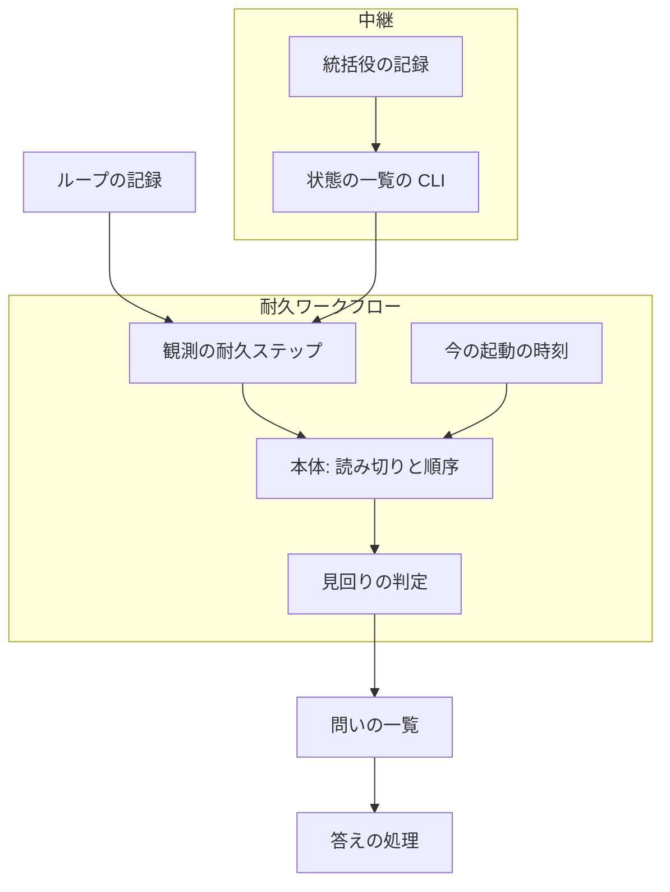
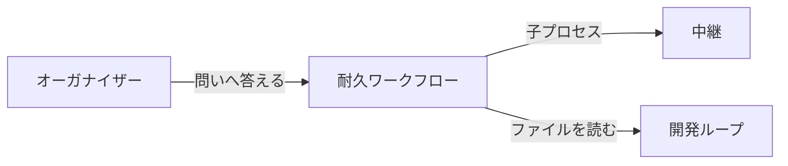
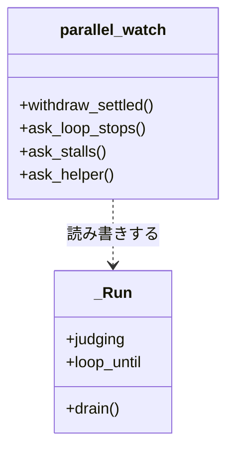
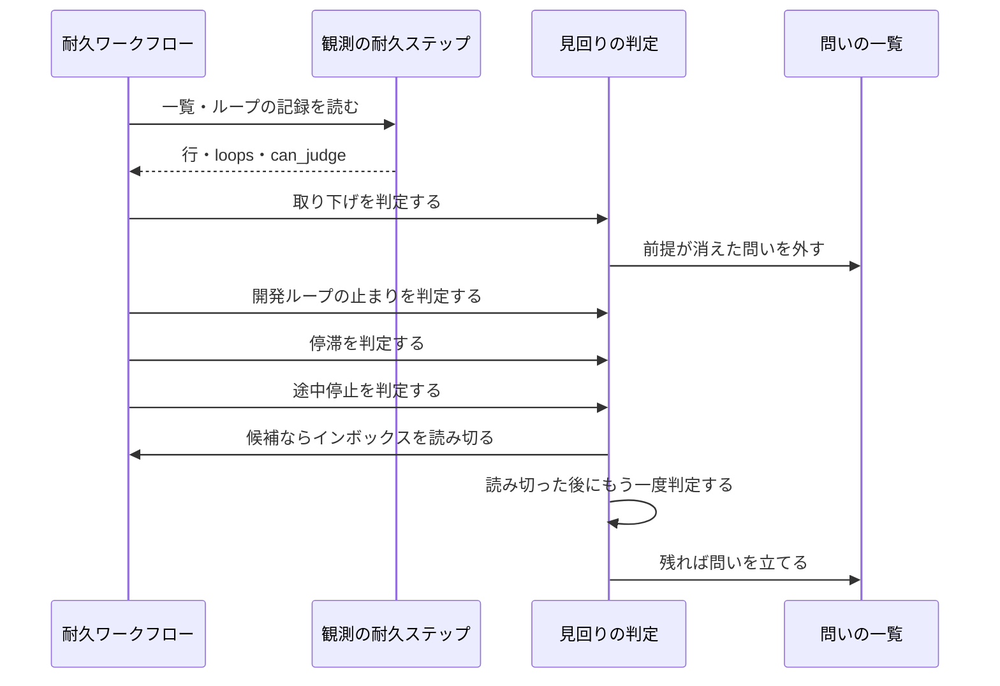
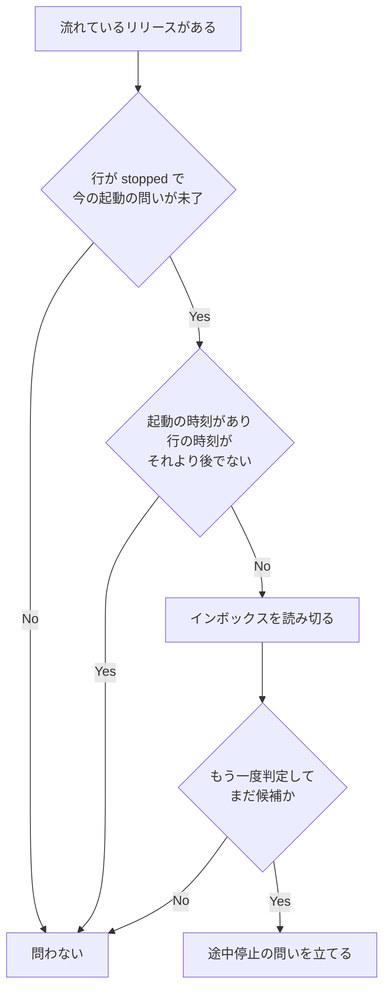
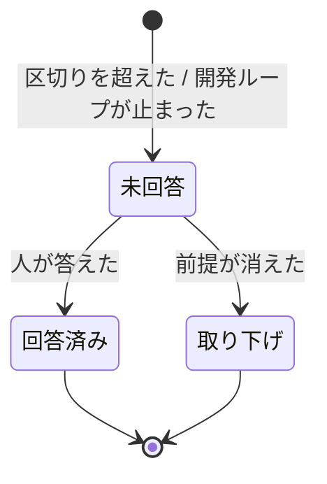

# 並列の計画のレーンの観測: 実際の状態と違う問いを出さず、止まったレーンを見落とさない（#2649）

## 目的

- **今どうなっているか**: オーガナイザーの耐久ワークフローは、レーンの生死を状態の一覧の 1 行（状態と時刻）だけで決める。起動した直後の一時レーンへ「途中で止まった」の誤報が 3 件出た（#2629）。実際より長い「355 分動いていない」が出た（#2585）。開発ループが止まった 3 本のレーンに約 2 時間どの問いも来なかった（#2477）
- **誰に効くか**: 並列の計画を流す利用者とオーガナイザー。誤報に「止める」と答えるとリリースを失敗で締めるため、人の時間だけでなくリリースも守る
- **変えると何が成り立つか**: 問いは今の起動・再起動の試み・開発ループの記録と照らして立ち、前提が消えた問いは答えを待たずに外れる

## 適用範囲

- **働く範囲**: 利用先のリポジトリでも働く。並列の計画を使わない進め方の動きは変わらない
- **プロジェクトごとに違うもの**: 新しい引数と設定を足さない。動かないレーンを問うまでの区切りは既存の `NDF_PARALLEL_STALL_MINUTES` を使い、開発ループの名前は計画の宣言から読む
- **当たるモード**: `standard`

## あるべき姿の根拠

| 根拠 | 種類 | 何を示すか |
| --- | --- | --- |
| 「ひとつづつ直すのではなく根本原因を見つけて対処してください」（2026-11-06） | 利用者の指示の原文 | 5 課題を個別に直さず、1 行だけで生死を決める観測の層を直す |
| DBOS 3.1.0 で、3 件を送った後に `DBOS.recv("inbox", 0)` を繰り返すと 3 件を順に受け取り、4 回目と 5 回目は `None` を返した。読み切りは 0.114 秒で終わり、1 回の受信は記録を 2 件（受信と待ち）作る（2026-11-06） | 実測 | 観測の後にインボックス（`inbox`）を読み切る形が成り立つ |
| 手元の `relay.py ls --json` は 18 行で 0.18 秒、統括役の記録は 5 日で 127 行・11 KB（2026-11-06） | 実測 | 一覧のたびに統括役の記録を読んでも、見回りの間隔に影響しない大きさである |
| `DBOS.patch` は、記録のある位置に別の行があれば False を返し、関数の番号を進めない（`dbos/_sys_db.py` の `patch`。LIB2） | 外部の一次情報 | 見回りのたびに版を分ける印を打たずに、観測の値で分ける形を選ぶ材料になる |
| PRD1・PRD2・PRD3 | 外部の一次情報 | 前提が消えた警報を自動で閉じ、同じ事象を 1 件にまとめる形は、監視の製品に共通している |

要求と受け入れ条件は #2649 の本文にある（コピーは [issue-2649-requirements.md](issue-2649-requirements.md) ）。この文書は「どう作るか」だけを扱う。

## ドメインモデル

### コンテキスト

| コンテキスト | 何の語が 1 つの意味に決まるか |
| --- | --- |
| 開発ワークフロー（`ndf-workflow`） | レーン・一時レーン・開発ループ・ラッパー・統括役・状態の一覧・停滞の問い・途中停止の問い・問いの取り下げ・今の起動・再起動の試み |

1 つのコンテキストに収まる。耐久ワークフローは中継の内部を読まず、`relay.py ls --json` の統一 JSON レポートだけを読む。再起動の試みもこのレポートの項目として受け取る。

### 集約

| 集約 | 持ち主（書き換えてよいもの） | 根 | エンティティ | 値オブジェクト |
| --- | --- | --- | --- | --- |
| 並列の進行 | 耐久ワークフローの `_Run` | 計画の実行 | 問い・リリース記録 | 今の起動の指示・問いを出した時刻・次に問える時刻 |
| 再起動の記録 | 中継（統括役と `relay.py restart`）。追記だけ | 統括役の記録 | 記録の行 | 再起動の試み（時刻と結果） |
| ループの記録 | 開発ループ（`sprint_loop` 系）。この変更は読むだけ | ループの記録 | 周回 | 止まった条件 |

### 不変条件

| # | 集約 | 条件 | 破れたときの扱い |
| --- | --- | --- | --- |
| I1 | 並列の進行 | 今の起動の指示の時刻を持つとき、途中停止の問いは、一時レーンの行の時刻がその時刻より後のときだけ立つ | テストで落とす。行に時刻が無ければ立てない |
| I2 | 並列の進行 | 途中停止の問いを立てる前に、`stopped` を読んだ観測より後でインボックスを読み切っている | テストで落とす |
| I3 | 並列の進行 | 1 回の起動の指示につき、途中停止の問いは 1 件だけ立つ | テストで落とす |
| I4 | 並列の進行 | 停滞の経過は、最後に動いた時刻と最後に成功した再起動の時刻の遅い方から数える | テストで落とす |
| I5 | 並列の進行 | 取り下げた問いは一覧へ戻らず、後から答えが届いてもレーンの状態と計画を変えない | テストで落とす |
| I6 | 並列の進行 | 開発ループの止まりの問いは、記録が `waiting_only` のレーンとスプリントのレーンに立たず、記録が止まった状態の間は一覧の時刻が進んでも外れない | テストで落とす |
| I7 | 並列の進行 | 開発ループの止まりの問いは 1 レーンに同時に 1 件で、答えを受けた観測の時刻から区切り 1 つ分は、答えが区切りより遅れて届いても同じレーンの停滞の問いが立たない | テストで落とす |
| I8 | 並列の進行 | 版の印の無い観測の値を読む見回りは、耐久ワークフローの呼び出し（耐久ステップ・メッセージの受信・イベントの更新）を足さない | テストで落とす。足すと記録の再生が `DBOSUnexpectedStepError` で落ちる |
| I9 | 再起動の記録 | 再起動の試みは成否によらず 1 行残り、過去の行を書き換えない | テストで落とす。記録の失敗は再起動を止めない（既存の扱いと同じ） |

### ドメインイベント

| # | イベント | 発生元 | 受け手 |
| --- | --- | --- | --- |
| E1 | 耐久ワークフローが一時レーンの起動を指示した | 耐久ワークフロー | オーガナイザー |
| E2 | 統括役が一時レーンを起動した | 統括役 | 状態の一覧・統括役の記録 |
| E3 | 一時レーンがリリース承認ゲートの依頼か settle を送った | 一時レーン | 耐久ワークフローのインボックス |
| E4 | 一時レーンが止まった | 一時レーン | 状態の一覧 |
| E5 | オーガナイザーの見回りが状態の一覧を読んだ | 耐久ワークフロー | 耐久ワークフロー |
| E6 | 開発ループが止まり、ラッパーは残った | 開発ループ | ループの記録 |
| E7 | 耐久ワークフローが停滞の問いを出した | 耐久ワークフロー | オーガナイザー |
| E8 | オーガナイザーがレーンを再起動した | オーガナイザー | 統括役の記録 |
| E9 | 耐久ワークフローが停滞の問いを取り下げた | 耐久ワークフロー | オーガナイザー（問いの一覧）・run.log |

E3 と E4 の順序は「送ってから止まる」で決まっている。E5 が `stopped` を読んだ時点で E3 の送信は終わっているか、そもそも送られていない。決定 1 はこの順序に乗せる。

### 用語

| 用語 | 意味 | 用語集への反映 |
| --- | --- | --- |
| 今の起動 | 一時レーンでは耐久ワークフローが最後に指示した起動、通常のレーンではラッパーが最後に起動した回 | 追加（`ndf-workflow`） |
| レーンの再起動 | 止まった、または動かないレーンを `relay.py restart` で起動し直すこと。問いの選択肢の「起こし直す」がこれに当たる | 追加（`ndf-workflow`） |
| 再起動の試み | レーンの再起動を 1 回打ったこと。起動できた回も断られた回も 1 回と数え、統括役の記録に時刻と結果を残す | 追加（`ndf-workflow`） |
| 停滞の問い | 動かないレーンについて耐久ワークフローが立てる問い（`kind: stall`）。一覧の時刻が区切りより前のときと、開発ループが止まったときに立つ | 追加（`ndf-workflow`） |
| 途中停止の問い | リリースの途中で止まった一時レーンについて耐久ワークフローが立てる問い（`kind: helper`） | 追加（`ndf-workflow`） |
| 問いの取り下げ | 耐久ワークフローが、答えを待たずに自分の問いを問いの一覧から外すこと | 追加（`ndf-workflow`） |

## 機能一覧

| # | 機能 | 誰が使うか |
| --- | --- | --- |
| F1 | 一時レーンの前回の起動の行と、届く途中の依頼で、途中停止の問いを出さない | オーガナイザー・利用者 |
| F2 | 停滞の問いに、最後に動いた時刻と再起動の試みの回数・結果を添える | オーガナイザー・利用者 |
| F3 | 再起動の直後のレーンを、区切りが過ぎるまで停滞と数えない | オーガナイザー |
| F4 | レーンが動き出したら停滞の問いを取り下げる | オーガナイザー・利用者 |
| F5 | 開発ループが止まったのに `running` のレーンを、区切りを待たずに問う | オーガナイザー・利用者 |
| F6 | 動いている計画を新しい版でそのまま再開する | オーガナイザー |

## 構成要素

| 要素 | 責務 |
| --- | --- |
| 中継の統括役（`relay_lib/hub.py`。変更） | 統括役の記録の行に起動の種類を足し、再起動の試みを名前ごとに読む関数を持つ |
| 中継の CLI（`relay_lib/hub_client.py`。変更） | `relay.py ls --json` の項目 `restarts` を組み立てる。統括役へ届かなかった `relay.py restart` も試みとして記録する |
| 観測の耐久ステップ（`lib/parallel_run.py` の `step_observe`。変更） | 引数に計画名を足し、一覧の行に `restarts` を足し、止まった開発ループと版の印を同じ値で返す |
| 今の起動の時刻の耐久ステップ（`lib/parallel_run.py` の `step_clock`。新設） | 起動を指示するときの時刻を記録に残す |
| 耐久ワークフローの本体（`lib/parallel_run.py` の `_Run`・`_observe_run`。変更） | 版の印を受け取り、インボックスの読み切り（`drain`）と判定の順序を持つ |
| 見回りの判定（`lib/parallel_watch.py`。新設） | 取り下げ・開発ループの止まり・停滞・途中停止の判定と問いの文面を持つ。`_ask_stalls`・`_ask_helper` をここへ移す |
| 答えの処理（`lib/parallel_answer.py`。変更） | 一覧に無い問いへの警告の文面へ取り下げを足す |
| 確定仕様と手順書（`docs/specifications/ndf-parallel-organizer.md`・`references/parallel.md`。変更） | 変更後の問いの条件を持つ |

### 構成要素の関係

図に含めない要素: 確定仕様と手順書（読む関係だけを描く図のため）。

### 配置

配置は変わらない。耐久ワークフローはオーガナイザーの `parallel.py run` のプロセスで動き、状態の一覧は子プロセスの `relay.py` が読む。

## 決定の記録

### 決定 1: 届く途中の依頼で誤報を出さないよう、途中停止の問いの直前にインボックスを読み切る

一時レーンは依頼か settle を送ってから止まる。`stopped` を読んだ観測より後でインボックスを空になるまで読めば、送られた依頼は必ず手元にあり、時間の前提が要らない。今の見回りは 1 周でインボックスの 1 件しか読まないため、他のレーンの依頼が先に並ぶと後ろの依頼に届かない。読み切りは候補が出たときだけ行い、見回りの通常の周回の記録を増やさない。

見回り 1 回分の猶予は採らない。他のレーンのメッセージが 2 件以上先に並ぶと依頼へ届かないまま問いが出る。猶予の長さを見込みで決めることになる。受け入れ条件 5 の「2 回以内」は、同じ見回りで問うためこの決定で満たす。

- 作り方: ライブラリやサービスを使う・自前で作る
- 比べた候補: LIB1 / PRD1

根拠: Value 7 / Value 1（MVV 版 6）

### 決定 2: 今の起動より前の行を見分けるため、起動を指示する時刻を耐久ステップで記録する

`pause` が起動を指示するとき（`release` / `confirmed`）に耐久ステップで時刻を取り、`run.launch` に持つ。今の起動のラッパーが書いた `stopped` の行の時刻は、この時刻より後になる。等しい値は前回の起動として読む。

最後の観測の時刻を代わりに使う形は採らない。観測と指示の間に前回の一時レーンが止まると、前回の行を今の起動と読み、同じ誤報が残る。一覧へ起動の時刻の項目を足す形も採らない。止まった行の時刻で判定が足り、項目が増えるだけである。

根拠: Value 7（MVV 版 6）

### 決定 3: 再起動の試みを見落とさないよう、統括役の記録を `relay.py ls --json` の項目で読む

要求の未決に対する結論である。再起動はオーガナイザーが `relay.py restart` を打つ操作で、耐久ワークフローを通らないため、耐久の記録には残らない。統括役の記録は成否を書く唯一の場所である。読み手は統一 JSON レポートだけを読む規約（`parallel_run.py` の先頭の説明）に合わせ、項目は一覧の行に足す。項目を足すのは要求の「確認してから行う」に当たるため、設計承認ゲートで見る。

耐久ステップが統括役の記録のファイルを直接読む形は採らない。ファイルの形が中継の内部に留まらなくなる。行に載せるのは最後に動いた時刻より後の試みだけにする。観測の値は見回りのたびに記録へ残るため、全件を載せると記録が増え続ける。

統括役へ届かなかった再起動（統括役が居ない・答えない）は `relay.py restart` が自分で記録に書く。書かないと、失敗の回が 0 回と読まれる。

根拠: Value 7 / Value 8（MVV 版 6）

### 決定 4: 動いている計画の記録を壊さないよう、版の分岐を観測の値の印で行う

観測の値に印 `can_judge` を足し、印のある観測の後だけ新しい呼び出しを行う。`can_ask` と同じ形で、記録の順は値から決まる。耐久ステップ名は変えず、読む量だけを増やす。停滞の判定は行の `restarts` の有無だけで分かれ、新しい呼び出しを持たないため印を見ない。形式の版（`durable.FORMAT`）は上げない。

`durable.patched` は採らない。`parallel-route` のように分岐の位置が 1 か所なら足りるが、ここは見回りの反復の中で分岐し、印を打つ位置が周回ごとに変わる。さらに、古い見回りの値には判定の材料が無く、印で分けても値の不足を別に扱うことになる。

- 作り方: 自前で作る・標準に倣う
- 比べた候補: LIB2 / PRD4

根拠: Value 1 / Value 7（MVV 版 6）

### 決定 5: 前提が消えた問いを人へ残さないよう、取り下げは閉じるだけにして保持の時間を置かない

停滞の問いは問いを出した時刻を持ち、一覧の時刻がそれより進めば次の見回りで外す。外した id は答え済みの集合へ入れ、答えが届いても何も起きない。動いた時刻は区切りを超えない限り問いを作らないため、外した直後に同じ問いが立つことはない。

`keep_firing_for` に当たる保持の時間は採らない。問いの再発は区切りごとに 1 回に抑えられており、flapping の害が小さい。保持の時間を足すと人が古い問いへ答える時間が延びる。

開発ループの止まりの問いは一覧の時刻で外さない。一覧の時刻が入力待ちのまま進む現象（要求の前提 3）で外れると #2477 の見落としへ戻るためである。

- 作り方: 自前で作る・標準に倣う
- 比べた候補: PRD1 / PRD3

根拠: Value 2 / Value 7（MVV 版 6）

### 決定 6: 開発ループの止まりを区切りより先に問えるよう、次に問える時刻を停滞の判定と分ける

一覧の時刻で問うと次の問いまで最大で区切り 1 つ分待つことになるため、開発ループの止まりは `loop_until` で別に数える。ここで問うときは `stall_until` も同じ時刻へ進める。答えていない開発ループの止まりの問いがある間は、次の区切りが来ても、そのレーンにどちらの問いも重ねて立てない。取り下げのときは `loop_until` を消し、記録が再び止まればすぐ問う。

答えを受けたら、`_Run.reply` が選択肢によらず `loop_until` と `stall_until` を「最後の観測の時刻（`seen_at`）＋区切り」へ進める（受け入れ条件 14）。問いを出した時点の期限だけでは、区切りより後に届いた答えの直後に期限が切れており、次の見回りで同じ問いが立つ。「起こし直す」でも、再起動したレーンが動き出す前に同じ問いが立つことを防ぐ。起点を `seen_at` にするのは、記録から再生できる値で、耐久ワークフローの呼び出しを足さないためである（I8）。この更新は `loop_stop` を持つ問いだけに当たる。その問いは版の印のある観測の後にしか立たないため、古い記録の再生を変えない。

1 つの時刻を共用する形は採らない。一覧の時刻で問うた直後に開発ループが止まると、受け入れ条件 13 の「区切りを待たずに」を満たさない。

根拠: Value 2 / Value 7（MVV 版 6）

### 決定 7: 耐久ワークフローの本体を増やさないよう、見回りの判定を別のモジュールへ置く

`parallel_run.py` は 721 行で、行数の例外リストに載っている。判定は `_Run` の値と観測の値だけで決まるため、`parallel_watch.py` へ移す。`_ask_stalls`・`_ask_helper` も移し、本体の行数を減らす。問いの判定を 1 か所に寄せ、同じ観測の値を読む規則を分散させない。

根拠: Value 7（MVV 版 6）

## 外部の調査

| 種類 | 調べるか | 理由 |
| --- | --- | --- |
| 標準・仕様 | 調べない | プロジェクトの中のプロセスの観測で、公開の規格で形を決める領域ではない。形の比較は主要な製品で足りる |
| 主要な製品 | 調べる | 誤報の抑え方・警報の自動の解決・耐久実行の版の分け方は、監視と耐久実行の製品に定着した形がある |
| ライブラリとサービス | 調べる | インボックスの読み切りと記録の版の分け方は、依存している DBOS の機能で足りるかを決める |

### 主要な製品

| # | 製品 | どう解いているか | 設計への反映 | 出典 |
| --- | --- | --- | --- | --- |
| PRD1 | Prometheus アラートルール | `for` は条件を満たし始めてから一定時間 pending で待つ。`keep_firing_for` は条件が消えた後も一定時間 firing を保ち、flapping とデータ欠損による誤った解決を抑える | 問いまでの待ちは既存の区切りで足りるため足さない。取り下げの保持は入れない（決定 5） | https://prometheus.io/docs/prometheus/latest/configuration/alerting_rules/ （2026-11-06） |
| PRD2 | Alertmanager | `repeat_interval` で同じ通知の繰り返しの間隔を決め、新しい発火か解決が無ければ繰り返さない | 同じレーンの問いを区切りごとに 1 件へ抑える形はこの考えと同じである | https://prometheus.io/docs/alerting/latest/configuration/ （2026-11-06） |
| PRD3 | PagerDuty Events API v2 | 同じ `dedup_key` のイベントは開いているアラートへ適用される。`resolve` で閉じ、閉じた後の同じキーの trigger は新しいアラートになる。開いていないキーへの `resolve` は捨てられる | 取り下げは閉じるだけで再開しない。取り下げた問いへの答えは捨てる。同じ事象が続けば別の id で立て直す（決定 5） | https://docs.pagerduty.com/developer/send-alert-event （2026-11-06） |
| PRD4 | Temporal Python SDK | `workflow.patched()` が履歴へ印を入れ、既存の実行は古い分岐を通る。印が履歴と合わないと Workflow Task が失敗する | 記録の順を守る必要は同じである。分ける形は決定 4 で比べる | https://docs.temporal.io/develop/python/versioning （2026-11-06） |

### ライブラリとサービス

| # | 候補 | 版 | ライセンス | 最後のリリースの日付 | 終了のアナウンス | 要件を満たすか | 出典 |
| --- | --- | --- | --- | --- | --- | --- | --- |
| LIB1 | DBOS Transact の `send` / `recv` | 3.1.0（固定。最新は 3.4.0） | MIT | 2026-10-28（3.4.0）。3.1.0 は 2026-09-24 | 無し | 満たす。話題ごとのインボックスを `timeout_seconds=0` で読み切れる。送信が成功すれば受け手が読めることが保証される | https://docs.dbos.dev/python/tutorials/workflow-communication ・ https://pypi.org/pypi/dbos/json （2026-11-06）、手元の実測 |
| LIB2 | DBOS Transact の `patch` | 3.1.0 | MIT | 同上 | 無し | 満たすが、見回りの値の不足を解かない（決定 4）。印のある位置を 1 か所に保つ必要がある | https://docs.dbos.dev/python/tutorials/upgrading-workflows （2026-11-06）、`.venv` の `dbos/_sys_db.py` |

### 確かめられなかったこと

| 対象 | 試した手段 | 結果と理由 |
| --- | --- | --- |
| Kubernetes の `restartCount` / `lastState` の定義と startup probe の猶予 | https://kubernetes.io/docs/concepts/workloads/pods/pod-lifecycle/ ・ https://kubernetes.io/docs/reference/kubernetes-api/workload-resources/pod-v1/ ・ https://kubernetes.io/docs/concepts/workloads/pods/probes/ | いずれも HTTP 200。本文の該当の語は取り出せなかった（目次のみ、または `restartCount` の語が 0 件）。比較の表へ載せない |
| DBOS の `recv` が古い順に受け取ること | https://docs.dbos.dev/python/tutorials/workflow-communication | 文書に順序の明記は無かった。手元の `_sys_db.py` の `recv_consume` は `created_at_epoch_ms` の昇順で読み、実測も送った順に受け取った。読み切る形は順序に依らない |

調べた量: 候補 6 件・取得の試み 17 回。

## 構造

`_Run` へ足す値だけを描く。問いと観測の値の形は「データ構造」の節にある。

`parallel_watch` は `_Run` の属性と `ask`・`publish_questions`・`drain` だけを使い、`parallel_run` を import しない（循環を作らないため）。区切りの秒は `_observe_run` が引数で渡す。

## データ構造

新しいファイルと表は作らない。既存の 4 つの値に項目を足す。

| 値 | 足す項目 | 型 | 無いときの読み方 |
| --- | --- | --- | --- |
| 統括役の記録の行（`hub-log.jsonl`） | `kind` | `"spawn"` / `"restart"` / null | 再起動の試みと数えない（`restarted` の行を除く） |
| 観測の値（耐久ステップの出力） | `can_judge` | 真偽 | 版の印が無い記録として、呼び出しを足さない |
| 観測の値 | `loops` | レーン名 → `{loop, condition}` | 止まった開発ループは無いとして読む |
| 観測の値の行 | `restarts` | `[{at, result}]` / null | 文面に試みを載せず、経過は一覧の時刻だけで数える |
| 問い（`kind: stall`） | `asked_at` | エポック秒 | 時刻では取り下げない |
| 問い（`kind: stall`） | `loop_stop` | `{loop, condition}` | 一覧の時刻で判定する問いとして読む |
| 今の起動の指示（`run.launch`） | `at` | エポック秒 | 今の起動の照合を省く（今までどおり問う） |

`_Run` の `judging`（最後の観測の版の印）と `loop_until`（レーン → 次に開発ループの止まりを問える時刻）は記録の再生で同じ値へ戻る。ファイルへ書かない。

**統括役の記録は追記だけの事象の記録である。** 回数と最後の結果は読むたびに導く。ローテーションは今も無く、読み方も全行を 1 回読むだけにする（実測は「あるべき姿の根拠」）。

| 機能 | 統括役の記録 | ループの記録 | 観測の値 | 問いの一覧 |
| --- | --- | --- | --- | --- |
| F1 | — | — | 作る・読む | 作る |
| F2 | 作る・読む | — | 作る・読む | 作る |
| F3 | 読む | — | 読む | — |
| F4 | — | — | 読む | 更新する |
| F5 | — | 読む | 作る・読む | 作る・更新する |
| F6 | — | — | 読む | — |

## 入出力の契約

### `relay.py ls --json`

| 項目 | 内容 |
| --- | --- |
| 名前 | `relay.py ls --json` の `items[]` |
| 入力 | 変更なし |
| 出力 | 各行に `restarts` を足す。その行の時刻より後の再起動の試みを古い順に並べた配列。行に時刻が無ければ全件。要素は `{"at": "<ISO 8601>", "result": "started" または断りの理由}` |
| 失敗の形 | 変更なし。統括役の記録を読めないときは空の配列を返し、一覧を失敗にしない |
| 互換性 | 既存の項目は変えない。読み手は 3 箇所で（`grep` で確かめた。`parallel.py:125`・`parallel_answer.py:104`・`parallel_run.py:92`）、新しい項目を読むのは観測の `parallel_run.py:92` だけである。文字の表には載せない |

### 問いの本文（`parallel.py wait` の `questions`）

種類（`kind`）・選択肢・`commands` は変えない。

| 場面 | 本文の形 |
| --- | --- |
| 区切りを超えて動かない | `レーン <名> が <分> 分動いていない（最後に動いた時刻: <時刻>。その後の再起動の試み <回> 回<、最後の結果: <結果>>）` |
| 開発ループが止まった | `レーン <名> の開発ループ <ループ名> が止まった（条件: <条件>）。一覧の状態は running のまま` |

分は最後に動いた時刻と最後に成功した再起動の遅い方から数える。結果は `started` を「起動した」、それ以外を「断られた（<理由>）」と書く。

### `parallel.py answer`

取り下げた問いへの答えは、既存の一覧に無い依頼の経路を通る。`warning` を返し、`next` は null である。文面は「依頼 <id> は今の問いの一覧に無い。答えは保留され、その依頼が届いたら当たる（答え済み・取り下げ済みなら何もしない）」とする。

## 処理の流れ

### 見回りの 1 回の順序

`can_judge` の無い観測の値では、取り下げ・開発ループの止まり・読み切り・起動の時刻の処理を通らない。

### 途中停止の判定の手順（`ask_helper`）

読み切りの後にもう一度判定するのは、読み切りで settle か承認の答えを受けると、流れているリリース・今の起動の指示・問いの一覧のどれかが変わるためである。

### 停滞の問いの状態遷移

前提が消えた条件は問いの種類で分かれる。開発ループの止まりの問いは記録が止まった状態でなくなったとき、それ以外は一覧の時刻が問いを出した時刻より進んだときである。取り下げた id は答え済みの集合へ入れ、後から届いた答えを `reply` が無視する。同じレーンがまた動かなくなれば、次の問いは別の id で立つ。

### 値の集合への追加

問いの種類は増やさない（要求の前提 5）。`kind: stall` を読む規則は `owner_restart` の `commands` の読み出しで、開発ループの止まりの問いも同じ `commands` を持つため当てはまる。`_asking_lanes` は `lane` を持つ問いをすべて数え、依存の判定で「止まった」と数えない。開発ループの止まりの問いはレーンが `running` のときだけ立つため、この判定に影響しない。

## 非機能の実現方式

| 大項目 | 要求の条件 | 実現方式 | 確かめ方 |
| --- | --- | --- | --- |
| 運用・保守性 | 止まったレーンの見落としは、開発ループの記録が止まってから見回り 1 回で問いになる。一時レーンの誤報は、人が「止める」と答えてリリースを失敗で締める経路を無くす | 観測の耐久ステップがループの記録を毎回読む。途中停止の問いは今の起動の照合と読み切りの後にだけ立つ。取り下げは run.log へ問いの id と理由を 1 行残す | 受け入れ条件 1〜6・13 のテスト。リリース後テストで一時レーンの起動の前後を見る |
| 移行性 | 動いている計画はそのまま新しい版で続けられる（受け入れ条件 19）。切り戻しは変更の Pull Request の revert で行う | 新しい呼び出しは版の印のある観測の後だけで行う。観測の値の形は足すだけで、切り戻した版は足した項目を読み捨てる | 古い形の観測の値で再生するテスト。実物の DBOS の記録の再生を 1 回通す |

## テスト設計

| 受け入れ条件・不変条件 | どの振る舞いで縛るか | どう壊したら落ちるべきか |
| --- | --- | --- |
| 受け入れ条件 1・I1 | 行の時刻が起動の指示より前の `stopped` で問いが立たない | 時刻の照合を消すと落ちる |
| 受け入れ条件 2 | 時刻の無い `stopped` で問いが立たない | 時刻が無いときに問うようにすると落ちる |
| 受け入れ条件 3・4・I2 | 依頼か settle がインボックスにある状態で `stopped` を読んでも問いが立たない。他のメッセージが 2 件先に並んでも同じ | 読み切りを 1 件にすると落ちる。読み切りの後の再判定を消すと落ちる |
| 受け入れ条件 5 | 今の起動で何も送らずに止まると同じ見回りで 1 件立つ | 候補を常に捨てると落ちる |
| 受け入れ条件 6・I3 | 続けて見回っても 1 件だけ | 問うた印を消すと落ちる |
| 受け入れ条件 7・8 | 本文に時刻・回数・最後の結果が載る。試みが無ければ 0 回と載る | `restarts` を読まないと落ちる。行の時刻より前の試みを数えると落ちる |
| 受け入れ条件 9・I4 | 成功した再起動から区切り未満なら問いが立たず、断られた再起動だけなら立つ | 断られた試みまで経過の起点にすると落ちる |
| 受け入れ条件 10 | 一覧の時刻が問いを出した時刻より進むと一覧から外れ、イベントが更新される | 比較の向きを変えると落ちる |
| 受け入れ条件 11・I5 | 取り下げた id への答えで保留も状態の変更も起きず、`parallel.py answer` は警告を返し `next` が null | 取り下げで答え済みへ入れないと落ちる |
| 受け入れ条件 12 | 動かないレーンに区切りごとに 1 件 | 次に問える時刻を更新しないと落ちる |
| 受け入れ条件 13 | `running` で記録が止まっていると区切りの前に 1 件立ち、本文に条件が載る | 条件を本文へ渡さないと落ちる。`loop_until` を `stall_until` と共用すると落ちる |
| 受け入れ条件 14・I7 | 「待つ」の後、次の区切りまで同じレーンにどちらの問いも立たない。区切りが 3600 秒で t=0 に問い、t=4200 に答えると、t=7799 まで立たず t=7800 に再び問える。未回答の間は重ならない | 問うときの `stall_until` の更新を消すと落ちる。答えたときの両方の時刻の更新を消すと落ちる |
| 受け入れ条件 15・I6 | `waiting_only` とスプリントのレーンと止まっていない記録に立たない | `waiting_only` の除外を消すと落ちる |
| 受け入れ条件 16・I6 | 記録が戻ると外れ、一覧の時刻だけでは外れない | 一覧の時刻で外すと落ちる |
| 受け入れ条件 17・18 | 既存のテストが通過のまま | 既存の確かめを消すと落ちる |
| 受け入れ条件 19・I8 | 印の無い観測の値の再生で呼び出しの列が変わらず、印が付いた観測から新しい判定が動く。実物の DBOS の記録で落ちない | 印の確かめを 1 か所外すと `DBOSUnexpectedStepError` で落ちる |
| 受け入れ条件 20 | テストにしない。実装の最後に各課題の再現の手順を 1 回通し、結果を課題へ書く | — |
| 受け入れ条件 21 | テストにしない（`.md` の文言を照合しない）。コードレビューで突き合わせる | — |
| I9 | 起動できた回・断られた回・統括役へ届かなかった回がそれぞれ `restarts` に 1 件出る。読み切れない行は飛ばす | `refuse` の種類を渡さないと落ちる |

## 設計の結果

| 課題 | 扱い | 取り込み先 | 触るファイル |
| --- | --- | --- | --- |
| #2649 | 実装する | — | `plugins/ndf/scripts/lib/parallel_run.py`、`plugins/ndf/scripts/lib/parallel_watch.py`、`plugins/ndf/scripts/lib/parallel_answer.py`、`plugins/ndf/scripts/lib/README.md`、`plugins/ndf/scripts/relay_lib/hub.py`、`plugins/ndf/scripts/relay_lib/hub_client.py`、`plugins/ndf/scripts/tests/`、`scripts/script-structure-allow/`、`docs/specifications/ndf-parallel-organizer.md`、`plugins/ndf/skills/development-workflow/references/parallel.md` |

## 未確認のまま残ること

| 項目 | 内容 |
| --- | --- |
| 起票者の推定 S1〜S10 | 利用者が設計承認ゲートで確かめる。特に、ラッパーを自分で止めない（S8）・一覧の時刻の更新元を調べない（S9）の 2 件 |
| `relay.py ls --json` の項目 `restarts` の追加 | 要求の「確認してから行う」に当たる。設計承認ゲートで見る |
| 一覧の時刻の更新元 | 特定していない（要求の前提 3）。時刻が入力待ちのまま進むと、一覧の時刻で判定する停滞の問いが外れる。次の区切りで動かなければ再び立つ。開発ループを持たないスプリントのレーンでは #2477 の現象が残り、結果を受け入れ条件 20 で #2477 に書く |
| 起動の指示が実行されない場合 | 指示が打たれない、または起動が断られると、一時レーンの行は古いままで途中停止の問いが出ない。断りは `relay.py spawn` の 0 以外の終了コードがオーガナイザーへ返る（受け入れ条件 17）。オーガナイザーの手順がこの場合に止まらず進めるかは、実装の間に `references/parallel.md` で確かめる |
| コンテナの間の時計のずれ | 一覧の時刻と耐久ワークフローの時刻が別のコンテナで作られ、時計がずれると比較がずれる。既存の `_clear_revived` と同じ前提である。ずれの実測はしていない |
| 取り下げと答えの行き違い | 人が答える間に問いが外れると、答えの前に読んだ `commands` の 1 行が打たれることがある。答えの処理は一覧をその時点で読み直すため、`parallel.py answer` の時点で外れていれば `next` は null である。読み直しの後に外れた場合の再起動は人の判断として扱う |
| 実物の記録の再生 | 手元で確かめたのは `recv` の読み切りまでである。再生の確かめは実装のテストで行う |
