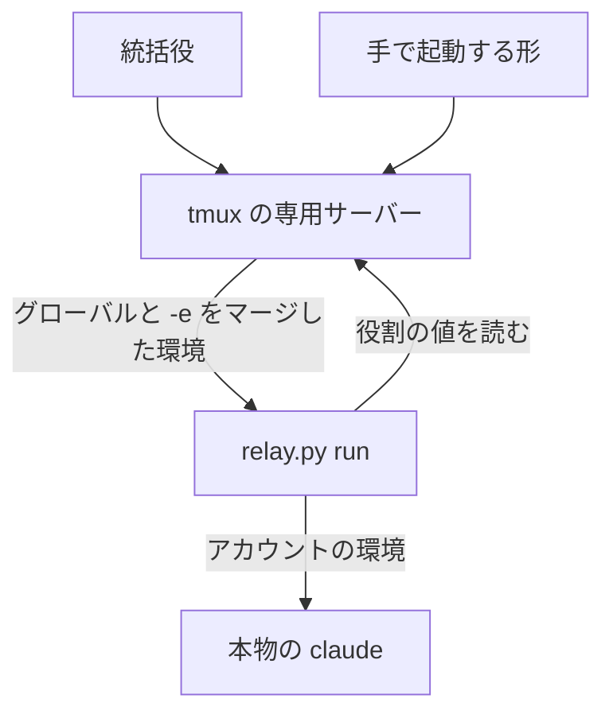
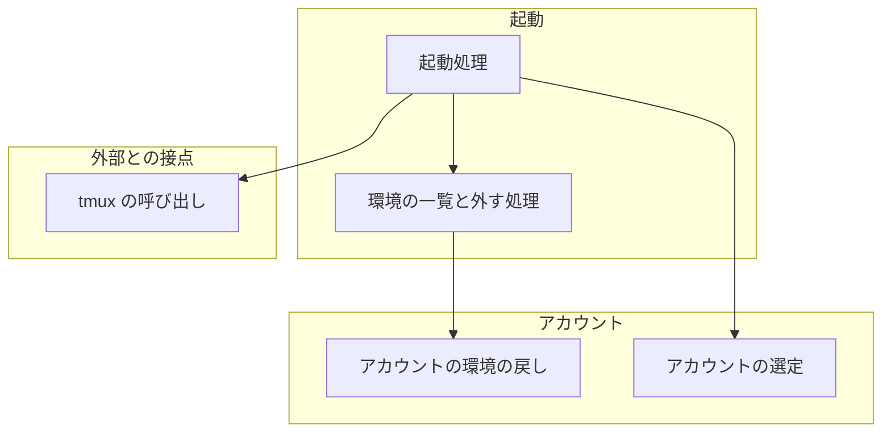
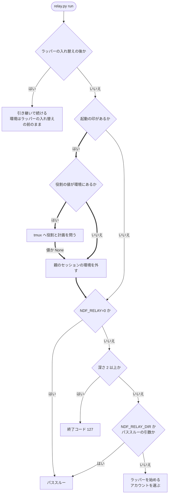
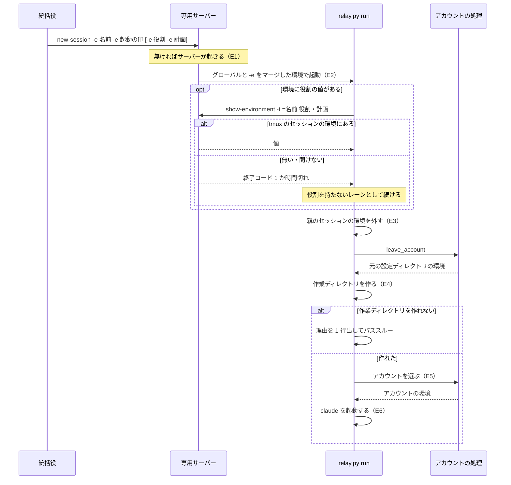

# 中継: 親のセッションの環境を持つ専用サーバーの上でも、レーンがアカウントを選んで起動する（#2656）

## 目的

- **今どうなっているか**: tmux の専用サーバーは、親の claude のセッションの環境（親のセッションの環境）を持ち続ける。その上で起動した `relay.py run` は親のラッパーの中にいると判断してパススルーする。アカウントの選定を通らず、上限に達した `main` のまま claude が起動して止まる
- **誰に効くか**: 統括役、手でレーンと一時レーンを起動する利用者、conductor
- **変えると何が成り立つか**: 専用サーバーのグローバルな環境が何を持っていても、起動の印（`NDF_RELAY_SPAWNED`）を持つ `relay.py run` はラッパーとして始まる。アカウントは指定・残量・上限から選ぶ

## 適用範囲

- **働く範囲**: NDF を導入したすべてのリポジトリのレーンと一時レーン。動くのは `plugins/ndf/scripts/relay_lib/` である
- **プロジェクトごとに違うもの**: 無い。環境変数の一覧はコードが持ち、設定も引数も足さない
- **当たるモード**: `standard`

## あるべき姿の根拠

| 根拠 | 種類 | 何を示すか |
| --- | --- | --- |
| STD1 | 外部の一次情報 | window の環境は tmux のセッションの環境とグローバルな環境をマージしたもので、両方にある変数は tmux のセッションの値を採る。起動の `-e` は tmux のセッションの環境へ入るため、グローバルな環境と区別して読める |
| 実測（tmux 3.6、2026-11-07） | 実測 | `new-session -e R=h` の値は `show-environment -t =<名前> R` で読め、終了コード 0。グローバルな環境だけにある変数は同じ命令で `unknown variable`、終了コード 1。下の「確かめた出力」にある |
| 要求の前提 1・前提 2 | 実測 | 専用サーバーの子はサーバーを起こした側の環境を受け取り、後の `new-session` のクライアントの環境は届かない。パススルーの引き金は `NDF_RELAY_DIR` である |
| PRD3 | 外部の一次情報 | Claude Code の公開文書が、`screen` などから継いだ `CLAUDE_CODE_CHILD_SESSION` が最上位のセッションを入れ子と誤らせる事象を記している。同じ形の誤判定である |

要求と受け入れ条件は #2656 の本文にある（コピーは [issues/issue-2656-requirements.md](issue-2656-requirements.md) ）。この文書は「どう作るか」だけを扱う。

## ドメインモデル

### コンテキスト

| コンテキスト | 何の語が 1 つの意味に決まるか |
| --- | --- |
| NDF のラッパー（`ndf-relay`） | ラッパー・区間・レーン・統括役・アカウントの選定・親のセッションの環境 |

1 つのコンテキストで閉じる。

### 集約

| 集約 | 持ち主（書き換えてよいもの） | 根 | エンティティ | 値オブジェクト |
| --- | --- | --- | --- | --- |
| レーンの起動時の環境 | `relay.py run` の起動処理（`relay_lib/run.py` の `cmd_run`） | プロセスの環境 | — | 無条件に外す変数の一覧（`PARENT_ENV`）・起動で付けた役割と計画（`LANE_ENV`） |
| アカウントの環境 | アカウントの処理（`lib/claude_accounts.py`） | 区間の環境 | — | 元の設定ディレクトリ・共有の設定ディレクトリ・従量の接続の宣言 |

**レーンの起動時の環境の書き換えは、起動処理の 1 か所だけが行う。** アカウントの環境の戻し方はアカウントの処理が持ち、起動処理はそれを呼ぶ。

### 不変条件

| # | 集約 | 条件 | 破れたときの扱い |
| --- | --- | --- | --- |
| I1 | レーンの起動時の環境 | 起動の印を持つ `relay.py run` は、起動時の環境に親のセッションの環境があっても、パススルーにも終了コード 127 にもならず、最初の区間を新しい作業ディレクトリで始める | テストが落ちる。実行時の検出はしない |
| I2 | レーンの起動時の環境 | 親のセッションの環境の 3 つの区分（無条件に外す変数の一覧・役割と計画・アカウントの環境）のどれにも当たらない変数は、外す処理の前後で値が変わらない。利用者の設定と認証の宣言はこれに当たる。親が従量の接続のときの宣言のキーはアカウントの環境に当たり、I5 が扱う | テストが落ちる |
| I3 | レーンの起動時の環境 | 役割と計画は、この tmux のセッションの起動で付けたものだけが残る。グローバルな環境から来た値は残らない | 読めないときは役割を持たないレーンとして起動する |
| I4 | レーンの起動時の環境 | 起動の印を持たない `relay.py run` の判定は変わらない | テストが落ちる |
| I5 | アカウントの環境 | 親のアカウントの環境を外した後の `CLAUDE_CONFIG_DIR` は、元の値である。元に無ければ変数を持たない。親が従量の接続なら、宣言のキーも残らない | テストが落ちる |
| I6 | レーンの起動時の環境 | 外した変数の値は、画面にも記録にも出ない | 外す処理は値を読み出して出力しない |

### ドメインイベント

| # | イベント | 発生元 | 受け手 |
| --- | --- | --- | --- |
| E1 | 専用サーバーが起きた | 統括役の `new-session`、または手で打った `new-session` | 専用サーバーのグローバルな環境。受け手のプロセスは E2 で起動する `relay.py run` |
| E2 | レーンの起動を頼まれた | `relay.py spawn`・`restart`・起動のブロック・手で起動する形 | `relay.py run` |
| E3 | `relay.py run` が起動時の環境からセッションごとの値を外した | `relay.py run` の起動処理 | ラッパーを始める手順 |
| E4 | ラッパーが新しい作業ディレクトリを作り、区間 1 を始めた | ラッパーを始める手順 | アカウントの選定 |
| E5 | アカウントの選定を通り、アカウントを決めた | アカウントの選定 | 区間の起動 |
| E6 | 決めたアカウントの環境で claude が起動した | 区間の起動 | 上限と切り替えの監視 |

### 用語

| 用語 | 意味 | 用語集への反映 |
| --- | --- | --- |
| tmux の専用サーバー | 中継のレーンを動かす tmux サーバー（`tmux -L ndf-relay`） | 追加（要求の工程で足した。`ndf-relay`） |
| 親のセッションの環境 | 動いている claude のセッションとそのラッパーに固有の環境変数 | 追加（要求の工程で足した。`ndf-relay`） |
| アカウントの選定 | ラッパーが区間を起動するときに、指定・残量・上限から使うアカウントを決める手順 | 追加（要求の工程で足した。`ndf-relay`） |

「グローバルな環境」「tmux のセッションの環境」は tmux の語である（STD1）。この文書ではその意味で使い、用語集へ足さない。

## 機能一覧

| # | 機能 | 誰が使うか |
| --- | --- | --- |
| F1 | 親のセッションの環境を持つ専用サーバーの上で、`spawn`・`restart`・起動のブロックがアカウントを選んでレーンを起動する | conductor・統括役 |
| F2 | 同じサーバーの上で、手で打つ `new-session` がアカウントを選んでレーンを起動する | 利用者・conductor |
| F3 | グローバルな環境に役割の値があっても、役割を付けていないレーンは役割を持たない | 並列の計画の実行 |
| F4 | レーンの中で元の設定ディレクトリと共有の設定ディレクトリが、親のアカウントでなく元の値に戻る | ラッパーとアカウントの処理 |

## 構成要素

| 要素 | 責務 | 変更 |
| --- | --- | --- |
| 起動処理（`relay_lib/run.py` の `cmd_run`） | 起動の印があれば、判定より先に親のセッションの環境を外す | 変える |
| 環境の一覧と外す処理（`relay_lib/claude.py`） | 無条件に外す変数の一覧と、役割と計画の一覧を 1 か所に持ち、`drop_parent_env` で外す | 変える |
| アカウントの環境の戻し（`lib/claude_accounts.py`） | `leave_account` が親のアカウントの環境を外して元の値へ戻す。従量の接続の環境も同じ戻しを使う | 変える |
| tmux の呼び出し（`relay_lib/tmux.py`） | `session_value` がこの tmux のセッションの環境の値を 1 つ読む | 変える |
| 役割の書き込み（`relay_lib/hub_client.py` の `write_name`） | 今と同じく環境の役割と計画を読む | 変えない |
| 統括役の起動（`relay_lib/hub.py` の `launch`） | 今と同じく `-e` で名前・起動の印・役割を渡す | 変えない |
| ランチャー（`scripts/relay.py` の `missing`） | 中身（`relay_lib`）が無いときの退避。今の振る舞いのまま（決定 6） | 変えない |
| 環境変数の契約（`plugins/ndf/contracts/env/NDF_RELAY_SPAWNED.json`） | 起動の印の説明へ、親のセッションの環境を外すことを足す | 変える |
| 確定仕様（`docs/specifications/ndf-relay-multi-session-supervisor.md`） | 統括役の環境の記述・tmux の操作の数・起動の印の説明を整える | 変える |

### 文脈

変えられない外部は tmux と Claude Code である。起動の経路はどれも tmux の window の中の `relay.py run` へ合流する。



### 構成要素の関係

図には上の表のうち、変えるコードの要素とアカウントの選定だけを描く。



### 置き場所

```text
plugins/ndf/
├── contracts/env/NDF_RELAY_SPAWNED.json   説明を足す
└── scripts/
    ├── lib/claude_accounts.py             leave_account を足し、従量の環境の戻しと共有する
    ├── relay_lib/
    │   ├── claude.py                      DROP_ENV へ足し、PARENT_ENV と drop_parent_env を足す
    │   ├── run.py                         cmd_run の先頭で呼ぶ
    │   └── tmux.py                        session_value を足す
    └── tests/
        ├── test_relay.py                  環境の分け方の単体テスト
        └── test_relay_hub.py              使い捨ての tmux の起動経路のテスト
docs/specifications/ndf-relay-multi-session-supervisor.md
```

新しいファイルは作らない。

## 決定の記録

### 決定 1: 起動のどの経路でも同じ結果にするため、親のセッションの環境を `relay.py run` の先頭で外す

統括役の起動も手で起動する形も、最後は tmux の window の中の `relay.py run` を通る。受け取る側の 1 か所で外せば、経路ごとの対応が要らず、動いている専用サーバーのグローバルな環境も変えない。

統括役の `tmux.new_session` で外す形は、手で起動する形が NDF を通らないため受け入れ条件 3 を満たさない。サーバーのグローバルな環境を `set-environment -gu` で消す形は、動いているレーンのあるサーバーの状態を変え、手で起こしたサーバーに効かない。libtmux へ置き換える形は、環境の受け取り方の課題を解かない。

- 作り方: 自前で作る
- 比べた候補: STD1 / LIB1

根拠: Value 7 / Value 6（MVV 版 6）

### 決定 2: 親が動いていても誤らないため、入れ子の判定を起動の印で分ける

起動の印は `child_env` が子へ渡さないため、起動の印を持つプロセスはラッパーの子の claude ではない。この事実だけで「新しいレーンである」と決まり、親のプロセスを調べる必要がない。

親のプロセスの生死で判定する形は、親が動いている受け入れ条件 4 を満たさない。

根拠: Value 7（MVV 版 6）

### 決定 3: 利用者の設定と認証の宣言を残すため、親のセッションの環境を名前で列挙して外す

`CLAUDE_CODE_*` には利用者が設定する変数が多数あり、公開文書だけで 468 個を載せる。前方一致で外すと、受け入れ条件 10 の認証の宣言を巻き込む。残す変数だけを列挙する形（`env -i`・`env_reset`）は、`PATH`・`AWS_*`・`NDF_ACCOUNT_SWITCH_AT` など利用者の環境を列挙し続けることになる。

一覧は `DROP_ENV` を土台に `PARENT_ENV` へ広げ、二重に持たない。列挙の弱点は、Claude Code が将来足すセッションごとの値が一覧に載るまで継がれることである（未確認のまま残ること）。

- 作り方: 自前で作る・標準に倣う
- 比べた候補: STD2 / PRD1 / PRD2 / PRD3

根拠: Value 7 / Value 6（MVV 版 6）

### 決定 4: グローバルな環境の役割と起動で付けた役割を分けるため、役割の出所を tmux のセッションの環境で確かめる

window の中の `NDF_RELAY_ROLE` は、`-e` の値でもグローバルな環境の値でも同じに見える。tmux のセッションの環境には `-e` の値だけが入るため、そこに値があるかで出所が分かる。環境に役割の値があるときだけ問うため、通常のレーンの起動に tmux の呼び出しは増えない。読めないときは役割を持たないレーンとして起動する（I3）。

統括役が別の名前の変数で役割を渡す形は、新しい版のランチャーへ入れ替わった後も動き続ける古い版の統括役が起動した一時レーンの役割を失う。`-e` の形を変えなければ版の組み合わせを問わない。

- 作り方: 自前で作る・標準に倣う
- 比べた候補: STD1

根拠: Value 7（MVV 版 6）

### 決定 5: 親のアカウントの痕跡を残さないため、アカウントの環境の戻しをアカウントの処理の 1 か所へ集める

元の設定ディレクトリへ戻す規則は、従量の接続の環境を作る処理がすでに持つ。`leave_account` へ切り出して両方から使う。親が従量の接続のときは `NDF_CLAUDE_ACCOUNT=metered` を外す前に宣言のキーも外す。先に名前だけを外すと、アカウントの環境を重ねる処理が宣言のキーを外す条件に当たらなくなり、親の宣言が別のアカウントの区間へ残るためである。

`relay_lib` の側で同じ規則を持つ形は、規則が 2 か所に分かれる。

この決定は認証の変数の扱いに当たるため、設計承認ゲートで人が見る。外す条件と対象は、アカウントの環境を重ねる処理の今の規則と同じである。

根拠: Value 7 / C2（MVV 版 6）

### 決定 6: 中身が見つからないときの退避は今の振る舞いのまま残す

`scripts/relay.py` の `missing` は、中身が読めないときに動く。アカウントの選定を通せないため、親のセッションの環境を持つサーバーの上では今と同じく終了コード 127 と導入し直す案内で止まる。上限に達したアカウントのまま起動するより、案内を見て直せる。

`missing` でも親のセッションの環境を外す形は、標準ライブラリだけで動くランチャーへ親のセッションの環境の一覧の複製を置くことになる。

根拠: Value 3 / Value 7（MVV 版 6）

## 外部の調査

| 種類 | 調べるか | 理由 |
| --- | --- | --- |
| 標準・仕様 | 調べる | tmux の環境の受け渡しの規則が設計の前提になる |
| 主要な製品 | 調べる | 継いだ環境を子へ渡す範囲の決め方に、確立した形がある |
| ライブラリとサービス | 調べる | tmux の呼び出しを既存のライブラリへ置き換えられるかを決める |

### 標準・仕様

| # | 標準・仕様 | 何を定めているか | 設計への反映 | 出典 |
| --- | --- | --- | --- | --- |
| STD1 | tmux(1) の GLOBAL AND SESSION ENVIRONMENT | サーバーは起動時の環境をグローバルな環境へコピーする。window を作るときに tmux のセッションの環境とマージし、両方にある変数は tmux のセッションの値を採る。`show-environment` はそのどちらかを表示する | 起動の `-e` は tmux のセッションの環境だけにあるため、役割の出所を判別できる（決定 4）。グローバルな環境は親の値を持ち続けるので、受け取る側で外す（決定 1） | https://man.openbsd.org/tmux.1 （2026-11-07） |
| STD2 | POSIX `env -i` | 継いだ環境をすべて捨て、指定した値だけで起動する | 継ぐものを列挙する形として比べた。利用者の設定を残せないため採らない（決定 3） | https://pubs.opengroup.org/onlinepubs/9799919799/utilities/env.html （2026-11-07） |

### 主要な製品

| # | 製品 | どう解いているか | 設計への反映 | 出典 |
| --- | --- | --- | --- | --- |
| PRD1 | sudo の `env_reset` | 既定は最小の環境で起動し、`env_keep` の変数だけを残す。無効にすると `env_delete` の一覧を外す形になり、文書は危険な変数をすべて塞げないとして `env_reset` を勧める | 列挙して外す形の弱点（新しい変数が通る）を未確認の項目へ残す（決定 3） | https://www.sudo.ws/docs/man/sudoers.man/ （2026-11-07） |
| PRD2 | systemd の `UnsetEnvironment=` | サービスの実行環境から指定した変数を外す | 既定を継ぎ、名前を指定して外す形の前例である（決定 3） | https://www.freedesktop.org/software/systemd/man/latest/systemd.exec.html （2026-11-07） |
| PRD3 | Claude Code の環境変数の文書 | 468 個の `CLAUDE_CODE_*` を載せる。`CLAUDECODE`・`CLAUDE_CODE_SESSION_ID`・`CLAUDE_CODE_CHILD_SESSION`・`CLAUDE_CODE_BRIDGE_SESSION_ID`・`CLAUDE_CODE_MESSAGING_SOCKET`・`CLAUDE_CODE_MESSAGING_TOKEN`・`CLAUDE_EFFORT`・`CLAUDE_PID` は Claude Code が子へ設定すると記す。継いだ値による誤判定の回避に `CLAUDE_CODE_FORCE_SESSION_PERSISTENCE` がある | 前方一致で外すと利用者の設定を巻き込むため、Claude Code のセッションごとの値を名前で列挙する（決定 3）。回避の変数は 1 つの症状だけを抑えるため採らない | https://code.claude.com/docs/en/env-vars （2026-11-07） |

### ライブラリとサービス

| # | 候補 | 版 | ライセンス | 最後のリリースの日付 | 終了のアナウンス | 要件を満たすか | 出典 |
| --- | --- | --- | --- | --- | --- | --- | --- |
| LIB1 | libtmux | 0.62.0 | MIT | 2026-07-12 | 無し | 満たさない部分がある。tmux の操作は包めるが、課題は tmux の呼び出しでなく受け取った環境の扱いにあり、`relay_lib/tmux.py` の `subprocess` の呼び出しを置き換える利点が無い（決定 1） | https://pypi.org/pypi/libtmux/json （2026-11-07）、`gh api repos/tmux-python/libtmux`（`archived: false`、2026-11-07） |

### 確かめられなかったこと

| 対象 | 試した手段 | 結果と理由 |
| --- | --- | --- |
| `CLAUDE_CODE_ENTRYPOINT`・`CLAUDE_CODE_EXECPATH`・`CLAUDE_CODE_SESSION_ATTENDED` の公開の定義 | https://code.claude.com/docs/en/env-vars を変数名で検索 | 3 つとも 0 件。Claude Code の子のプロセスの `env` に現れることだけを確かめた（2026-11-07） |

調べた量: 候補 6 件・取得の試み 9 回。

## 入出力の契約

`relay.py` の副命令と出力の形は変わらない。変わるのは、起動の印を持つ `relay.py run` が起動時の環境をどう読むかである。

### 変数ごとの扱い

親のセッションの環境は 3 つの区分に分かれる。無条件に外す変数の一覧（`PARENT_ENV`）、起動で付いた値だけを残す役割と計画（`LANE_ENV`）、アカウントの処理（`leave_account`）が戻すアカウントの環境である。下の表の「起動で付ける値」と「利用者の設定と認証の宣言」の行は、親のセッションの環境に当たらない。

| 変数 | 区分 | 起動の印を持つ `relay.py run` での扱い |
| --- | --- | --- |
| `CLAUDECODE`・`CLAUDE_CODE_SESSION_ID`・`CLAUDE_CODE_ENTRYPOINT` | Claude Code のセッションの値（`DROP_ENV` の今の値） | 外す |
| `CLAUDE_CODE_BRIDGE_SESSION_ID`・`CLAUDE_CODE_CHILD_SESSION`・`CLAUDE_CODE_EXECPATH`・`CLAUDE_CODE_MESSAGING_SOCKET`・`CLAUDE_CODE_MESSAGING_TOKEN`・`CLAUDE_CODE_SESSION_ATTENDED`・`CLAUDE_EFFORT`・`CLAUDE_PID` | Claude Code のセッションの値（`DROP_ENV` へ足す 8 個） | 外す |
| `NDF_RELAY_DIR`・`NDF_RELAY_DEPTH` | ラッパーの値 | 外す |
| `NDF_USAGE_SOURCE`・`NDF_USAGE_KIND`・`NDF_USAGE_PLAN`・`NDF_USAGE_STEP` | 費用の記録先 | 外す |
| `NDF_RELAY_ROLE`・`NDF_RELAY_PLAN` | 役割 | この tmux のセッションの環境に値があれば残す。無ければ外す |
| `NDF_CLAUDE_ACCOUNT`・`NDF_SHARED_CONFIG_DIR` | アカウントの環境。アカウントの子の環境を作る処理が必ず一緒に足す | `leave_account` が外す |
| `CLAUDE_CONFIG_DIR` | アカウントの環境 | `NDF_SHARED_CONFIG_DIR` があるときだけ元の値へ戻す。元の値が空なら外す。無ければ利用者の値として残す |
| `CLAUDE_CODE_PLUGIN_CACHE_DIR` | アカウントの環境 | NDF が足した値（共有の設定ディレクトリの `plugins`）と同じときだけ外す |
| 従量の接続の宣言のキー | アカウントの環境 | 親が `NDF_CLAUDE_ACCOUNT=metered` のときだけ外す（決定 5） |
| `NDF_RELAY_NAME`・`NDF_RELAY_SPAWNED` | 起動で付ける値 | そのまま読む。`-e` の値がグローバルな環境の値に勝つ |
| 上のどれにも当たらない変数（`CLAUDE_CODE_OAUTH_TOKEN`・`CLAUDE_CODE_USE_BEDROCK`・`NDF_ACCOUNT_SWITCH_AT` など。親の従量の接続の宣言のキーであれば、「従量の接続の宣言のキー」の行が先に当たる） | 利用者の設定と認証の宣言 | 変えない |

### 関数の形

```python
# relay_lib/claude.py
DROP_ENV = (...)  # Claude Code のセッションの値 11 個
PARENT_ENV = (*DROP_ENV, "NDF_RELAY_DIR", "NDF_RELAY_DEPTH", "NDF_USAGE_SOURCE", "NDF_USAGE_KIND", "NDF_USAGE_PLAN", "NDF_USAGE_STEP")
LANE_ENV = ("NDF_RELAY_ROLE", "NDF_RELAY_PLAN")  # 親のセッションの環境の値。起動の -e で付いた値だけを残す

def drop_parent_env(own: dict[str, str]) -> None: ...
    # os.environ から PARENT_ENV を外し、ca.leave_account を呼び、LANE_ENV は own の値へ置き換える（own に無ければ外す）

# lib/claude_accounts.py
def leave_account(env: dict) -> None: ...
    # env をその場で書き換える。読めない宣言は無いものとして扱い、例外を出さない

# relay_lib/tmux.py
def session_value(name: str, key: str) -> str | None: ...
    # `show-environment -t =<name> <key>` の値。無い・tmux に聞けないときは None
```

### 確かめた出力

使い捨ての tmux 3.6（2026-11-07）。`-e NDF_ROLE=helper` を付けた tmux のセッション `a` と、付けていない tmux のセッション `b` を同じサーバーに作り、サーバーの起動時の環境に `FOO_G=glob` を置いた。

```text
$ tmux -L x show-environment -t =a NDF_ROLE   → NDF_ROLE=helper       終了コード 0
$ tmux -L x show-environment -t =b NDF_ROLE   → unknown variable: NDF_ROLE   終了コード 1
$ tmux -L x show-environment -t =a FOO_G      → unknown variable: FOO_G      終了コード 1
$ tmux -L x show-environment -g FOO_G         → FOO_G=glob            終了コード 0
$ tmux -L x show-environment -t =zz NDF_ROLE  → no such session: =zz  終了コード 1
$ （-e EMP= のセッション）show-environment EMP → EMP=                  終了コード 0
```

### 値の集合への追加

`DROP_ENV` へ 8 個を足す。今の読み手 4 か所を判定した。

| 読み手 | 用途 | 足した値が当てはまるか |
| --- | --- | --- |
| `relay_lib/claude.py` の `child_env` | 区間の子の環境 | 当てはまる。どれも子の claude が自分で設定する値である |
| `relay_lib/claude.py` の `plugin_cli` | `claude plugin` の環境 | 当てはまる |
| `relay_lib/handover.py` の `startup_env` | ラッパーの入れ替えの `startup` の環境 | 当てはまる |
| `relay_lib/login.py` | ログインの子の環境 | 当てはまる |

NDF の中にこれらを読むコードは無い。`tests` を除く `.py`・`.sh` で次の検索は 0 件である。

```bash
rg 'CLAUDE_PID|CLAUDE_EFFORT|CLAUDE_CODE_CHILD_SESSION|CLAUDE_CODE_MESSAGING|CLAUDE_CODE_EXECPATH|SESSION_ATTENDED' plugins/ndf/scripts
```

## 処理の流れ

### `relay.py run` の判定の順序

太い枝が足す判定である。起動の印を持たないときは今と同じ順序を通る。



**外した後は深さが 0 で `NDF_RELAY_DIR` も無いため、起動の印を持つレーンは深さと作業ディレクトリの判定に当たらない。** 擬似端末が無い・`ndf` のプラグインを読めないときのパススルーは今のまま残る。このとき claude は親のセッションの環境を外した状態で起動する。

**ラッパーの入れ替えの後の経路で外さないのは、起動の印を持つラッパーはすでに外した環境で `os.execve` するためである。** 新しい版へ入れ替わる前から動いているラッパーは止めず、今の環境のまま続ける。

### 統括役の起動

手で起動する形は、統括役の依頼と `new-session` の組み立てが無いだけで、`relay.py run` から先は同じである。



## 非機能の実現方式

| 大項目 | 要求の条件 | 実現方式 | 確かめ方 |
| --- | --- | --- | --- |
| 移行性 | 効くのはラッパーを新しい版で起動した後である。動いているレーンは止めない。専用サーバーを起こし直さなくても受け入れ条件 1〜10 が満たされる | 受け取る `relay.py run` の側で外すため、サーバーのグローバルな環境を変えない。入れ替えの経路は外さない。`-e` の形を変えないため、古い版の統括役が起動した役割も読める | 親のセッションの環境を持つサーバーを作ったまま受け入れ条件 1〜10 のテストを通す |
| セキュリティ | 外した変数の値を、画面にも記録（`log.jsonl`・`hub-log.jsonl`）にも出さない。認証の変数を新しい経路で渡さない | 外す処理は出力も記録も持たない。tmux へは役割と計画の 2 つの変数名だけを問い、認証の変数を読まない。新しい受け渡しのファイルを作らない | 親のセッションの環境の値に目印の文字列を入れて起動し、画面と記録にその文字列が無いことを確かめる |

## 設計の結果

| 課題 | 扱い | 取り込み先 | 触るファイル |
| --- | --- | --- | --- |
| #2656 | 実装する | — | `plugins/ndf/scripts/relay_lib/run.py`、`plugins/ndf/scripts/relay_lib/claude.py`、`plugins/ndf/scripts/relay_lib/tmux.py`、`plugins/ndf/scripts/lib/claude_accounts.py`、`plugins/ndf/scripts/tests/test_relay.py`、`plugins/ndf/scripts/tests/test_relay_hub.py`、`plugins/ndf/contracts/env/NDF_RELAY_SPAWNED.json`、`docs/specifications/ndf-relay-multi-session-supervisor.md` |

## テスト設計

| 受け入れ条件・不変条件 | どの振る舞いで縛るか | どう壊したら落ちるべきか |
| --- | --- | --- |
| 受け入れ条件 1 | 親のセッションの環境を持つサーバーの上の `spawn` が、新しい作業ディレクトリ・区間 1・指定のアカウントの子を作る | `cmd_run` の外す処理を消すと落ちる |
| 受け入れ条件 2 | 同じサーバーの上の `restart` が同じ結果になる | 同上 |
| 受け入れ条件 3 | 手で打つ `new-session` の形が同じ結果になる | 同上。外す処理を統括役の起動へ移しても落ちる |
| 受け入れ条件 4 | `NDF_RELAY_DIR` が動いているラッパーを指しても結果が変わらない | 判定を親の生死へ置き換えると落ちる |
| 受け入れ条件 5 | グローバルな深さが 2 でも終了コード 127 にならない | 深さの判定より後ろへ外す処理を動かすと落ちる |
| 受け入れ条件 6 | 指定の `main` が上限で `gmail` が使えると、子のアカウントが `gmail` になる | `cmd_run` の外す処理を消すと落ちる |
| 受け入れ条件 7 | すべて上限のとき、親のセッションの環境の有無で選ばれる結果が同じである | `NDF_CLAUDE_ACCOUNT` を残すと落ちる |
| 受け入れ条件 8 | グローバルな環境の `NDF_RELAY_ROLE`・`NDF_RELAY_PLAN`・`NDF_USAGE_PLAN`・`NDF_USAGE_STEP` がレーンの子へ残らず、役割のファイルが無い | `LANE_ENV` を外さないと落ちる |
| 受け入れ条件 9 | `NDF_SHARED_CONFIG_DIR` の値で共有の設定ディレクトリが決まり、空なら `~/.claude` になる | 元の値へ戻す処理を消すと落ちる |
| 受け入れ条件 10 | アカウントを登録していない構成で、`NDF_ACCOUNT_SWITCH_AT`・`CLAUDE_CODE_OAUTH_TOKEN`・`CLAUDE_CODE_USE_BEDROCK` が子へ届く | `CLAUDE_CODE_` の前方一致で外すと落ちる |
| 受け入れ条件 11 | 起動の印を持たないラッパーの子の中の `claude` がパススルーのままである | 起動の印の条件を外して常に外すと落ちる |
| 受け入れ条件 12 | 起動の印が無く深さ 2 の `relay.py run` が終了コード 127 で止まる | 同上 |
| 受け入れ条件 13 | 受け入れ条件 1〜10 を実物の tmux と偽の claude で通す | `cmd_run` の外す処理を消すと受け入れ条件 1・3・6 のテストが落ちる |
| I1 | 親のセッションの環境の組み合わせごとに、起動の印を持つ `run` が区間 1 を始める | 受け入れ条件 1・4・5 の壊し方で落ちる |
| I2 | 3 つの区分のどれにも当たらない変数の値が、外す処理の前後で同じである。親が従量の接続でも、宣言のキーでない `NDF_ACCOUNT_SWITCH_AT` は残る | 無条件に外す変数の一覧へ無関係な変数を足すと落ちる |
| I3 | `-e` で付けた役割は役割のファイルに書かれ、グローバルな環境の役割は書かれない | `session_value` の呼び出しをやめて環境の値を残すと落ちる |
| I4 | 起動の印が無いと `os.environ` が変わらない | 受け入れ条件 11 の壊し方で落ちる |
| I5 | `leave_account` が元の値・空・変数なしの 3 通りで元の環境へ戻す。親が従量の接続なら宣言のキーも外す | 宣言のキーを外す処理を消すと落ちる |
| I6 | 目印の文字列を親のセッションの環境へ入れて起動し、画面と記録に文字列が現れない | 外す変数の値を記録へ書くと落ちる |

## 未確認のまま残ること

| 項目 | 内容 |
| --- | --- |
| 受け入れ条件 10 の読み方 | アカウントを選ぶ区間では、今の規則どおり `CLAUDE_CODE_OAUTH_TOKEN` と `CLAUDE_CODE_USE_BEDROCK` を子から外す（#1576）。この設計は外す処理の前後で値を保つことまでを持ち、テストはアカウントを登録していない構成で確かめる。この読み方でよいかは設計承認ゲートで決まる |
| Claude Code が将来足すセッションごとの値 | 一覧に載るまでレーンへ継がれる。変数名は Claude Code の版ごとに変わりうる。見つけたときに一覧へ足す |
| `CLAUDE_CODE_EXECPATH`・`CLAUDE_CODE_SESSION_ATTENDED` の意味 | 公開の定義を確かめられなかった。子のプロセスの `env` に現れる値として Claude Code のセッションの値に分類した。誤っていても、子の claude が自分で設定する限り影響は無い。実装のテストでは確かめられず、実機の動作で確かめる |
| 環境変数の契約の検査の反応 | 名前の一覧を回して外す処理を `scripts/check-ndf-contracts.py` がどう数えるかは未確認。実装で実行して、宣言が要れば同じ変更で足す |
| 実サーバーでの確認 | 開発版を入れた後に、親のセッションの環境が残る専用サーバーでレーンを起動する機会が要る。手動確認は conductor が行う |
| #2563 の原因 | この変更の範囲外で、未確認のまま残る（要求の前提 6） |
