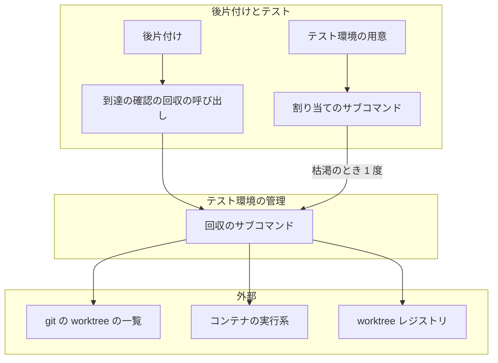
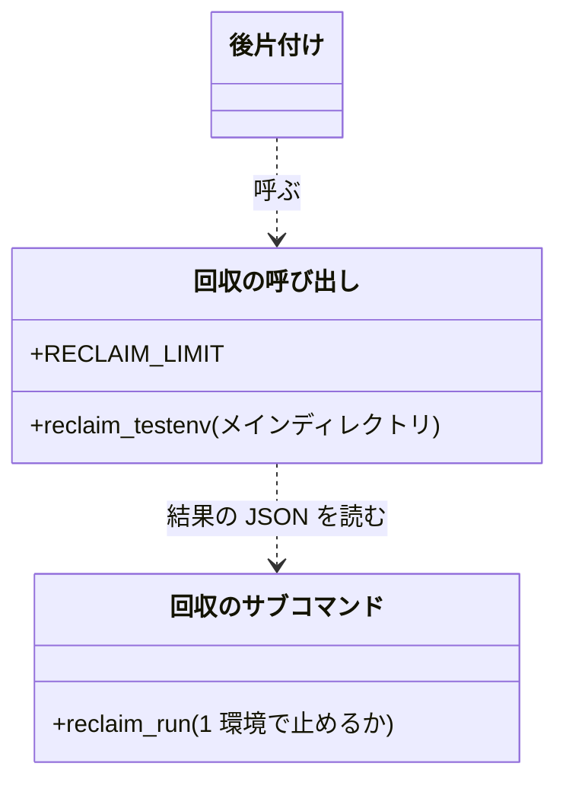
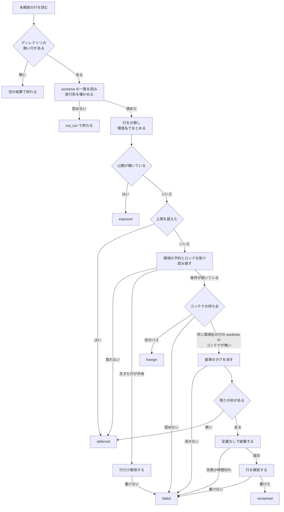
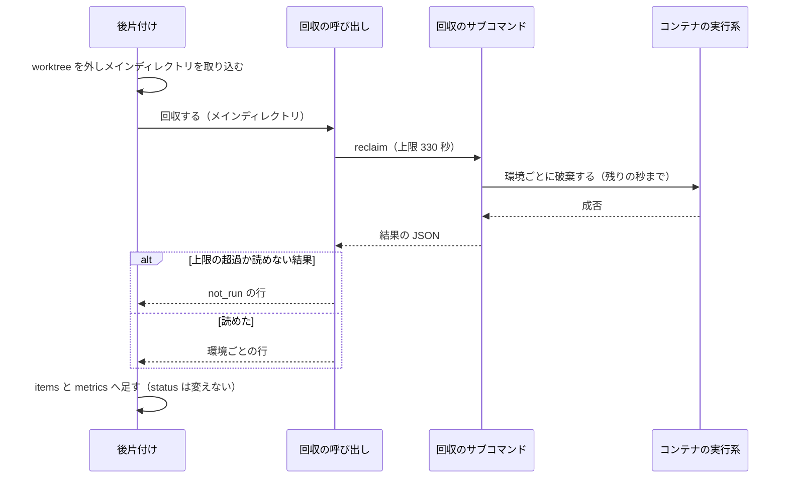
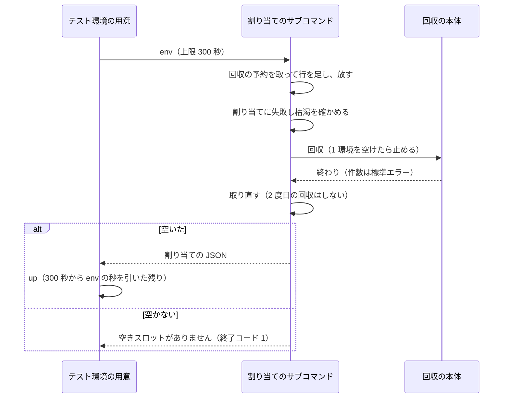

# テスト環境の回収: 消えた worktree の割り当てとコンテナを人の操作なしに片付ける（#2660）

## 目的

- **今どうなっているか**: worktree が消えた後も、テスト環境の割り当てが未解放のまま残り、コンテナも動き続ける。carul では未解放 56 行のうち 41 行の worktree が無く、スロットの空きは 64 のうち 8 である（2026-11-07）
- **誰に効くか**: テスト環境を使うプロジェクトで開発ループを回す利用者と、同じホストのメモリとディスクを使う人
- **変えると何が成り立つか**: スロットの空きが残った割り当てで減らず、テストのステップが「空きスロットがありません」で止まらず、消えた worktree のコンテナがメモリとディスクを使い続けない

## 適用範囲

- **働く範囲**: 利用先のリポジトリでも働く。`.ndf/worktree.json` に `testenv` を宣言したリポジトリだけが対象で、宣言の無いリポジトリでは何もしない
- **プロジェクトごとに違うもの**: 宣言の `testenv.discard_volumes` で受ける（#2567 で足した項目）。新しい設定と引数は足さない
- **当たるモード**: すべてのモード（`/ndf:merged` の後片付けと、テスト環境のスロットの割り当てを通るとき）

## あるべき姿の根拠

| 根拠 | 種類 | 何を示すか |
| --- | --- | --- |
| carul の未解放 56 行のうち 41 行の worktree が無く、コンテナはテスト環境 6 個の 40 個、ボリュームは 12 個が残る（要求の「調べて分かったこと」、2026-11-07） | 実測 | 後片付けの経路ごとに破棄を足すだけでは、すでに消えた worktree の分が残る |
| 定義なしの `docker compose -p <環境名> down --volumes` は、コンテナ 3 個とネットワークとボリュームを 12 秒で消した。コンテナが無くボリュームとネットワークだけが残ったプロジェクトも、消すものの無いプロジェクトも終了コード 0 で終わる（Docker Compose v5.6.1 の使い捨てのプロジェクト、2026-11-07） | 実測 | worktree が無くても環境名だけで破棄でき、やり直しても失敗しない |
| STD3 | 外部の一次情報 | ディレクトリが無いことを回収の条件にし、`git worktree lock` で対象から外す形は git の `prune` と同じである |
| PRD1 | 外部の一次情報 | 持ち主のいなくなった資源を、経路ごとの呼び出しでなく、1 か所が見つけて消す形が定着している |
| 「これは無理そうです。ボリュームは消す方向で」（2026-11-06、[#2567 の節「利用者の答えの変更」](https://github.com/devbasex/ai-plugins/issues/2567)） | 利用者の答え | worktree の削除に合わせた破棄はボリュームも消す。消えた worktree へ広げるかは設計承認ゲートで確かめる（決定 9） |

要求と受け入れ条件は #2660 の本文にある（コピーは [issue-2660-requirements.md](issue-2660-requirements.md) ）。この文書は「どう作るか」だけを扱う。

## ドメインモデル

### コンテキスト

| コンテキスト | 何の語が 1 つの意味に決まるか |
| --- | --- |
| NDF の worktree（`ndf-worktree`） | テスト環境の割り当て・残った割り当て・テスト環境の回収 |
| NDF の開発ワークフロー（`ndf-workflow`） | 後片付け・テストのステップ |

ワークフローが顧客、worktree が供給者の関係（顧客 / 供給者）。ワークフローは回収のサブコマンドを呼んで結果の JSON を読むだけで、割り当てへ直接触らず、残った割り当ての判定を持たない。

### 集約

| 集約 | 持ち主（書き換えてよいもの） | 根 | エンティティ | 値オブジェクト |
| --- | --- | --- | --- | --- |
| テスト環境の割り当て | `worktree-testenv.sh`（新しいライブラリ `lib/worktree-testenv-sweep.sh` を含む） | 割り当て（worktree のパスで引く） | — | 環境名・スロット・公開の記録 |
| 回収の結果 | 回収のサブコマンド。1 回の実行の中だけで持つ | 結果の JSON | テスト環境ごとの行 | 結果の値・理由 |

Python の側は割り当てを書き換えない。`worktree-testenv.sh reclaim` を呼ぶだけである。

### 不変条件

| # | 集約 | 条件 | 破れたときの扱い |
| --- | --- | --- | --- |
| I1 | テスト環境の割り当て | worktree のディレクトリがある行と、`git worktree lock` された行は、回収しない | 破棄のコマンドを打たず、解放の時刻も書かない |
| I2 | テスト環境の割り当て | 生きた行（残った割り当て以外の未解放の行）と環境名を共有する残った割り当ては、破棄せず行だけを解放する | 破棄のコマンドを打たない |
| I3 | テスト環境の割り当て | 破棄が成功したと確かめられないテスト環境の行は解放しない（スロットを別の worktree へ渡さない） | 行を残し、結果に環境名と理由を載せる |
| I4 | テスト環境の割り当て | worktree レジストリ・worktree の一覧・コンテナの実行系のどれかを読めなければ、1 行も回収しない | 回収しなかった理由を結果に載せる |
| I5 | テスト環境の割り当て | 開いた公開の記録を持つテスト環境は、破棄も解放もしない | 結果に環境名と URL を載せる |
| I6 | テスト環境の割り当て | 破棄の対象は行の環境名に完全に一致する compose のプロジェクトだけである。名前のパターンで探さず、定義に無いコンテナを削除する指定を付けない。プロジェクトのコンテナがすべて、同じ環境名の行のどれかの worktree から起動されたと確かめられないときは破棄しない（決定 11） | 破棄も解放もせず、結果に環境名と理由を載せる |
| I7 | テスト環境の割り当て | 回収の破棄は compose の定義と `COMPOSE_FILE` を読まない | テストで落とす |
| I8 | テスト環境の割り当て | ボリュームを消すかはメインディレクトリの宣言の `testenv.discard_volumes` で決め、読めない値は残す | テストで落とす |
| I9 | テスト環境の割り当て | 行の基準のタグは破棄の前に消す。消せなければ破棄しない（#2567 の I9 を回収でも守る） | 結果に環境名と理由を載せる |
| I10 | テスト環境の割り当て | 見えない位置の割り当ては、残った割り当てとして判定しない。メインディレクトリの外の行は、親のディレクトリがメインディレクトリと同じファイルシステムにあると確かめられたときだけ判定する（決定 3） | 破棄も解放もせず、結果に載せる |
| I11 | 回収の結果 | 1 回の回収は上限の 300 秒を超えて次のテスト環境へ進まない。残したテスト環境は次の回収の対象になる | 残したテスト環境を結果に載せる |
| I12 | 回収の結果 | 回収の失敗で、後片付けの `status` と終了コードは変わらない | テストで落とす |
| I13 | テスト環境の割り当て | 環境名の共有を確かめてから破棄と解放が終わるまで、同じ環境名の割り当ての追加と既存の割り当ての使い始めは、回収の予約を待つか拒否される。別のコンテナの持つ予約も、持ち続ける上限の時刻までは捨てない（決定 4） | 割り当てず、起動せず、終了コード 1 で理由を返す |
| I14 | テスト環境の割り当て | 破棄のプロセスは、呼び出しの経路とホストのコマンドの有無によらず、回収の予約の上限の時刻より前に終わる。回収のシェルが消えたら、破棄も残さない（決定 7） | 破棄を打たず `deferred` にする。打った破棄は止めて `failed` にする |

### ドメインイベント

| # | イベント | 発生元 | 受け手 |
| --- | --- | --- | --- |
| E1 | worktree が消えた | 後片付けの破棄の失敗の後の削除、手での削除 | 次の回収（worktree レジストリの行を読む） |
| E2 | 残った割り当てを見つけた | 回収のサブコマンド | 環境名の共有の確認 |
| E3 | 環境名の共有を確かめた | 回収のサブコマンド | テスト環境の破棄、または解放の記録 |
| E4 | テスト環境を破棄した | 回収のサブコマンド | 解放の記録 |
| E5 | 割り当てに解放の時刻を書いた | worktree レジストリの更新 | テスト環境のスロットの割り当て |
| E6 | 回収の結果を報告した | 回収のサブコマンド | 後片付けの結果（`merged-steps.py`）、人 |

### 用語

| 用語 | 意味 | 用語集への反映 |
| --- | --- | --- |
| テスト環境のスロット | テスト環境へ割り当てる 0〜63 の番号。worktree ごとのポートの計算に使う | 追加（要求の工程で反映済み） |
| テスト環境の割り当て | worktree とテスト環境の環境名・スロット・ポートの対応。worktree レジストリの 1 行で、解放の時刻が空の間は有効である | 追加（要求の工程で反映済み） |
| 残った割り当て | 解放の時刻が空で、worktree のディレクトリが無く、`git worktree lock` もされていない割り当て | 追加（要求の工程で反映済み） |
| テスト環境の回収 | 残った割り当てのテスト環境を compose の定義なしで破棄し、解放の時刻を書くこと | 追加（要求の工程で反映済み） |
| 見えない位置の割り当て | worktree のパスがメインディレクトリの下に無く、親のディレクトリが無いか、親のディレクトリがメインディレクトリと別のファイルシステムにある割り当て。回収を打った位置から存在を確かめられないため、残った割り当てとして判定しない | 追加 |
| 回収の予約 | 環境名ごとのロック（`<環境名>.reclaim.d`）。回収が環境名の共有を確かめてから解放を終えるまで持ち、割り当ての追加と使い始めが短く取って通る | 追加 |

この文書で「環境」と単独で書くときはテスト環境を指す。環境変数と環境名は複合語で意味が決まる。

## 機能一覧

| # | 機能 | 誰が使うか |
| --- | --- | --- |
| F1 | 残った割り当てを 1 度で回収するサブコマンド | 人、後片付け、スロットの割り当て |
| F2 | `/ndf:merged` の後片付けでの自動の回収 | 開発ループ、人 |
| F3 | テスト環境のスロットが尽きたときの回収の 1 回の試行 | テストのステップ |
| F4 | 手順書の「後片付け」の案内 | 人 |

## 決定の記録

### 決定 1: 経路ごとに破棄を足さないため、残った割り当ての判定と破棄をテスト環境の管理の 1 か所に置く

割り当ての持ち主は `worktree-testenv.sh` で、スロットの枯渇のときはシェルの中で回収を試す必要がある。そのため判定と破棄をシェルに置き、Python は呼んで結果を読むだけにする。判定は git の `prune` と同じくディレクトリの有無と `locked` の属性で行う（STD3）。`prunable` の属性は `locked` の行に出ないが、ディレクトリの有無で同じことが判定でき、属性の文言に依らない。

moby-ryuk は接続が切れたことをきっかけに動くため、worktree が消えたことを判定できず、常駐のコンテナも要るので採らない。ラベルや名前で Docker の側を探す形は、開発コンテナを巻き込むため要求の「行わない」に当たる。

- 作り方: 自前で作る・標準に倣う
- 比べた候補: STD3 / PRD1 / PRD2 / LIB1 / LIB2

根拠: Value 7（MVV 版 6）

### 決定 2: 定義の読み込みに結果を左右されないよう、破棄を `/` から `COMPOSE_FILE` を外して打つ

打つコマンドは `cd / && env -u COMPOSE_FILE -u COMPOSE_PROFILES <実行系> compose -p <環境名> down [--volumes]` である。

Compose は定義を作業ディレクトリと親から探し、`COMPOSE_FILE` は `-f` と同じ意味である（STD2）。メインディレクトリには定義と `.env` があるため、そこから打つと別の定義を読む。v5.6.1 では別の定義の下から打っても、親に定義がある位置から打っても、`COMPOSE_FILE` があっても同じ結果だった（2026-11-07 の実測）。ただしこの一致は版に依るうえ、`.env` を読めずに落ちた報告がある（[docker/compose #8509](https://github.com/docker/compose/issues/8509)）。定義の無い位置に固定すれば、版と導入先の定義に左右されない。`COMPOSE_PROFILES` も同じ理由で外す。

使い捨ての空のディレクトリを作る形は、片付けの処理が増えるため採らない。`--remove-orphans` は要求の「行わない」のとおり付けない。定義なしの `down` はプロジェクトのコンテナをすべて消すため要らない（STD1 の説明と違う実測で、[未確認のまま残ること](#未確認のまま残ること) に置く）。

- 作り方: ライブラリやサービスを使う
- 比べた候補: STD1 / STD2 / LIB1

根拠: Value 6（MVV 版 6）

### 決定 3: 別の位置から打って生きたデータを消さないため、置き場を確かめられない割り当てを判定しない

メインディレクトリの下に無い行は、親のディレクトリがメインディレクトリと同じファイルシステムにあると確かめられたときだけ判定する。親のディレクトリが無い行、親のファイルシステムが別の行、確かめられない行は `unseen` で報告する。要求が worktree の見えない位置からの回収の誤判定を残りリスクとして「`design` で見直す」としたため、この条件を足す。ボリュームは戻せないため、見えないものを無いと判定しない。

同じ Docker を使う開発コンテナは、`/work` を 1 つの Docker ボリュームで共有し、`/tmp` はコンテナごとに別である（`/work` は `devbase_work_1` のボリューム、`/tmp` はコンテナの overlay。2026-11-07 の `/proc/self/mountinfo` と `docker ps`）。worktree の既定の置き場は `<システムの tmpdir>/ndf-worktrees` のため、1 つのコンテナの `/tmp` にある生きた worktree は、別のコンテナからは「親の `/tmp` はあるがディレクトリが無い」と見える。親の有無だけではこの行を残った割り当てと判定し、後片付けが生きたテスト環境のボリュームまで消す。ファイルシステムの番号なら区別できる（`stat -c %d` の値は `/work/carul` と `/work/.ndf-worktrees` がともに 66305、`/tmp/ndf-worktrees` が 89。2026-11-07 の実測）。番号は GNU の `stat -c %d`、BSD の `stat -f %d` の順で読む。

carul の worktree が無い 41 行はすべてメインディレクトリの下にあり、この条件で外れない（`/work/carul/.worktrees/`、2026-11-07）。メインディレクトリの外の 9 行（`/work/.ndf-worktrees/`）はディレクトリがあり、消えた後もメインディレクトリと同じファイルシステムのため回収される。`/tmp` に置いた worktree の行は、消えた後も回収されず `unseen` に残る。結果に載るため人が見つけられ、宣言で置き場をメインディレクトリと同じファイルシステムにすれば起きない。

git の worktree の一覧に載っているかで見分ける形は採らない。後片付けが回収の前に `git worktree prune` を打つため（`merged-steps.py` の `cleanup`）、別のコンテナの生きた worktree も一覧から消える。全行のうち生きた行が 0 件なら止める形は、worktree を全部消した正常な状態でも止まるため採らない。行にメインディレクトリのパスやファイルシステムの番号を足す形は、要求の「worktree レジストリの形は変えない」に当たるため採らない。

根拠: C4 / Value 1（MVV 版 6）

### 決定 4: 全体を止めずに同時の回収を成り立たせるため、環境ごとの予約とロックを取ってから読み直す

回収は環境ごとに 2 つのロックを、読み直しから解放の記録まで持つ。

| ロック | 位置 | 誰が取るか | 何を防ぐか |
| --- | --- | --- | --- |
| 回収の予約 | `<環境名>.reclaim.d`（新設。`inuse_lock` と同じディレクトリ） | 回収が持ち続ける。`env` の行の追加と `ensure_assignment` の使い始めは、短く取って通る | 共有の確認の後に同じ環境名の割り当てが増え、破棄がその環境へ当たること |
| 実行中のロック | `inuse_lock`（今は `test` と `reap` が使う） | 回収が持ち続ける。`test` は実行の間持つ | 作り直した worktree のテストと破棄が重なること |

2 つとも取った後に、行が未解放で、ディレクトリが無く、生きた行と共有していないことを読み直す。回収の側がどちらかを取れなければ別の回収かテストが処理中とみなし、待たずに `deferred` にする。同じ環境へ `down` を 2 本打つとコンテナの削除がぶつかって失敗しうるが、この形なら 1 本しか打たない。2 本目は次の環境へ進むため、受け入れ条件 11 の「どちらも異常終了せず、対象の行はすべて解放される」が、両方の終了の時点で成り立つ。

`env` は回収の予約を取ってから行を足し、足したら放す（`wt_slot_acquire` の前後だけ）。`ensure_assignment` は行を読んだ後に予約を取って放し、行を読み直す。回収が先に予約を取っていれば、待ちの上限 5 秒の後に「同じ環境名のテスト環境を回収しています」で終了コード 1 になる。実測の破棄 12 秒より短い待ちで止めるのは、この競合が回収の窓の中でしか起きず、打ち直せば通るためである。予約より先に行を足していれば、回収の読み直しが生きた行として見つけ、破棄しない。どちらの順でも、共有の確認の後に割り当てが入らない。

`env` が枯渇で回収を走らせるときは、予約を放してから走らせる。`inuse_lock` を割り当てに使わないのは、`test` が実行の間持つため、テスト中の `env` と `up` が待ちの上限で落ちるためである。

回収全体のロックは採らない。後から来た回収が最大 300 秒待つか、何もせず終わることになり、スロットの枯渇の試行が空きを得られない。

予約は worktree レジストリと同じ git の共通ディレクトリにあるため、別の複製の割り当ては止めない。複製の間は決定 11 で守る。

同じ複製を使う別のコンテナの間でも、予約が成り立つようにする。今のロックは持ち主の番号へ `kill -0` を打って生死を読み、失敗すると待たずに捨てる（`lib/lock-common.sh`）。git の共通ディレクトリは `/work` のボリュームでコンテナの間で共有され（決定 3）、PID 名前空間はコンテナごとに別である（このコンテナは `pid:[4026533101]`、`docker run` の使い捨てのコンテナは `pid:[4026534284]`。2026-11-07 の実測）。そのため別のコンテナの `env` と `up` は、動いている回収の予約を捨てて通り、破棄とボリュームの削除が新しい環境へ当たる。番号の見えない持ち主のロックが待たずに取れることも、`ndf_lock_acquire` で確かめた（終了コード 0。2026-11-07 の実測）。

そこで `ndf_lock_acquire` に 3 つ目の引数として「持ち続ける上限の秒」を足す。

| 位置 | 変わること |
| --- | --- |
| 取る側 | 引数があれば、持ち主の PID 名前空間（`readlink /proc/self/ns/pid`。読めないホストではホスト名）と上限の時刻をロックの中のファイル `owner_scope` へ書く。`pid` より先に書く。逆の順では、書き終わるまでの間に別のコンテナが持ち主の消えたロックと読むためである |
| 判定する側（`_ndf_lock_is_stale`） | `owner_scope` が無いか、PID 名前空間が自分と同じなら、今のとおり `kill -0` で読む。別なら上限の時刻までは生きているものとして扱い、過ぎたら捨ててよい |
| 引数を渡す呼び出し | 回収の予約を取る 3 か所（回収・`env`・`ensure_assignment`）と、回収が取る実行中のロックである。値はどれも 330 秒で、回収の外の上限 `RECLAIM_LIMIT`（決定 7）と同じ値である |

回収の全体の上限 300 秒は回収の開始から測り、環境ごとの予約はそれより後に取る。そのため予約の上限の時刻は開始から 330 秒より後で、破棄は開始から 305 秒までに止まる（決定 7）。生きた持ち主のロックが先に切れない。持ち主が落ちたときは、別のコンテナの `env` と `up` が上限の時刻まで終了コード 1 で止まるが、打ち直せば通る。同じコンテナからは今のとおり `kill -0` で読むため待たない。時刻はコンテナの間で同じホストの時計を読む。

判定は持ち主の番号が通じる範囲そのものである PID 名前空間で行い、ホスト名を既定にしない。compose の `hostname:` で同じ名前を付けられるためである。引数を渡さないロック（worktree レジストリの排他・工程の通過記録・`test` の実行中のロック）の動きは変えない。worktree レジストリの排他へ広げると、持ち主が落ちたときに全行の更新が上限まで止まるためである。

上限の秒を足す形は、カーネルのロック（STD4 の `flock`、LIB3 の `filelock`）と比べて採る。カーネルのロックは排他としては足りる。同じボリュームを付けた 2 つのコンテナで、片方の `flock` が持つ間はもう片方の `flock -n` が終了コード 1 で、持ち主の終了で 0 へ変わった。持ち主のシェルを SIGKILL で止めても、記述子を受け継いだ子が動く間は解けなかった（どちらも 2026-11-07 の実測）。上限の値も、持ち主が落ちた後の待ちも要らない。

採らない理由は、導入先のホストで同じ仕組みを保てないことである。

- `flock` コマンドは macOS に標準で無く（`ensure-retention.sh` の分岐）、要求はホストの直下も対象にする。無いホストだけ別の排他へ分けると、同じ資源に 2 つの仕組みが動いて互いを見落とす。共通のロックが `flock` を使わない理由と同じである（`lib/lock-common.sh`）
- `filelock` は同じカーネルのロックを Python から使うライブラリで、任意の依存（`locks`）である。`worktree-testenv.sh` の割り当てと起動の経路は Python を起動しないため、`env` と `up` のたびに Python の起動が増え、依存の無いホストでは止まる

この選択の費用は、持ち主が落ちた後に別のコンテナの `env` と `up` が最大 330 秒止まることである。回収のシェルが異常終了し、別のコンテナが同じ環境名を使うときにだけ起きる。頻度は未測定で、[未確認のまま残ること](#未確認のまま残ること) に置く。

- 作り方: 自前で作る
- 比べた候補: STD4 / LIB3

根拠: C3 / C4 / Value 1 / Value 3 / Value 5 / Value 6（MVV 版 6）

### 決定 5: スロットの枯渇の回収が起動の上限と重ならないよう、1 環境を空けたら止め、`env` と `up` で 300 秒を分け合う

要求の未決である。テストのステップの `timeout` は起動の分として 300 秒だけを足す（#2567 の決定 3）。回収に 300 秒を別に許すと、2 つ続いたときにステップの上限を超える。

スロットが尽きたときに要るのは 1 個である。そのため `reclaim_run` に「1 環境を空けたら止める」の指定を持たせ、`env` の経路だけがこれを使う。実測の破棄 12 秒なら起動の上限をほとんど減らさない。残りは次の後片付けが回収する。`_wake` は `env` を `UP_TIMEOUT` の上限で打ち、`up` へ残りの秒を渡す。上限の値は増やさず、余裕も足さない。全部を回収してから取り直す形は、起動の上限を回収が使い切るため採らない。起動の上限を別に足す形は、同じ分だけステップの上限を伸ばすことになるため採らない。

`env` の時間切れは新しい理由として「テスト環境の割り当てが 300 秒で終わらなかった」を返す。

根拠: Value 3（MVV 版 6）

### 決定 6: 人と判定の worker が同じ材料を読むよう、回収の結果を共通の結果の形で出す

`projects-sync.sh` と同じく、シェルからも `tool`・`status`・`summary`・`items`・`metrics` の形で出す。後片付けは `items` をそのまま足せるため、読み替えを持たない。`worktree-testenv.sh` の終了コードの約束（0 完了 / 1 処理できなかった）はそのまま守り、`status` の `stopped` と対応させる。

根拠: Value 5 / Value 8（MVV 版 6）

### 決定 7: 上限の後でも結果が残り、予約より先に破棄が止まるよう、打ち切りを環境ごとにシェルの中で行い、外の上限を別に持つ

外の上限（`_testenv` の timeout）だけで止めると、結果の JSON が失われ、受け入れ条件 14 の「残した件数が結果に載る」を満たせない。そのためシェルが環境ごとの破棄を残りの秒で打ち切り、まだ処理していない環境を `deferred` にして JSON を出す。打ち切った環境は `failed` で、理由に時間切れを書く。実測では打ち切った後の打ち直しも成功する（2026-11-07）。

打ち切りは `timeout` コマンドに頼らず、新しい `lib/run-limited.sh` が行う。決定 4 の予約の上限は、破棄がそれより前に終わることを前提にする。人がシェルから打つ `reclaim` には外の上限が無く、`timeout` も `gtimeout` も無いホストでは、この前提を支えるものが無くなる。コマンドの有無で経路を分けると片方の経路が導入先でしか動かないため、どのホストでも同じ処理を通す。

| 項目 | 振る舞い |
| --- | --- |
| 起動 | `run-limited.sh <秒> <猶予の秒> <回収のシェルの番号> <コマンド…>` を、`set -m` を張った部分シェルから背景で起動して `wait` する。起動した番号がそのままプロセスグループの番号になる（`launch-cli.sh` と同じ形。`setsid` は macOS に標準で無い）。標準入力は `/dev/null` にする |
| 期限 | 秒が尽きたらグループへ SIGTERM を送り、猶予 5 秒の後に SIGKILL を送る。監視も同じグループにいて一緒に止まる。呼び出し側は終了コード 137 を時間切れと読む。それ以外の終了コードはコマンドの値をそのまま返す |
| 回収のシェルが消えたとき | 0.1 秒ごとに番号を見て、消えていれば猶予なしでグループへ SIGKILL を送る。外の上限の停止（`_stop_group`）は回収のプロセスグループへ送られ、別のグループの破棄へ届かない。同じコンテナからは持ち主の消えた予約がすぐ捨てられるため、破棄を残さない |
| 破棄の直前の確認 | 残りの秒を読み直し、0 以下なら破棄を打たず `deferred` にする。持ち主の確認や基準のタグの削除が遅れたときに、予約の切れ目へ破棄が入らないようにする |

試作で次を確かめた（Linux の bash 5.3、`timeout` を呼ばない形。2026-11-07）。SIGTERM を無視するコマンドと子プロセスは、上限 2 秒・猶予 2 秒で 4 秒後に両方消え、終了コードは 137 だった。成功と失敗の終了コードはそのまま返った。親を新しいセッションで起動して `killpg` で止めると、上限が 30 秒残っていても、破棄の代わりのプロセスは親の消えた確認の後 0.1 秒で消えた。

外の上限 `RECLAIM_LIMIT` は 330 秒で、内側の 300 秒に打ち切りの猶予 5 秒と worktree レジストリの排他の待ちを足した値である。破棄の無応答は内側で止まるため、外の上限は `git` の無応答などの保険で、通常は当たらない。

根拠: C3 / C4 / Value 3（MVV 版 6）

### 決定 8: 並列のレーンを止めず、ステップの上限にも当たらないよう、回収をメインディレクトリの排他の外で走らせ、マージのステップの上限へ足す

回収は `git pull` の後、`main_dir_lock` の外で走らせる。排他の中に置くと、並列のレーンの後片付けが最大 300 秒待つ。取り込みの失敗は結果の `status` へ返すだけで処理を止めないため、失敗しても回収は走る。

`merge` のステップの `timeout` は `with_margin(ci_wait)` で、余裕は `ci_wait` の 10% か 30 秒である。CI の待ちが上限に近いと、回収の間にステップが止まり、マージの後の報告が失われる。そのため `timeout` へ `RECLAIM_LIMIT` を足す。宣言の無いリポジトリでも足す。プランを作る時点で宣言を読まずに済み、上限が長くなるだけで動きは変わらないためである。回収を背景で走らせる形は、結果が後片付けの報告に載らず受け入れ条件 12 を満たせないため採らない。

根拠: Value 3 / Value 6（MVV 版 6）

### 決定 9: 受け入れ条件 1 のとおり、残った割り当てのボリュームも宣言に従って消す

**この決定は要求の未決（S3）で、データの削除（C4）に当たる。** #2567 の答えは worktree の削除に合わせた破棄についてのもので、消えた worktree へ広げる判断を含まない。設計承認ゲートで利用者が確かめるまで、利用者の決定として扱わない。消さない答えのときは、`discard_volumes` を読まず `--volumes` を付けない形にし、受け入れ条件 1 の結果を改める。

`down` と同じく `wt_discards_volumes` で決める。無し・`null`・`true` で消し、`false` と読めない値で残す。テスト環境のデータは worktree が無ければ使われず（前提 3）、残すと #2567 の答えの理由だったディスクの圧迫が続く。carul の宣言は `false` でないため、最初の後片付けでボリューム 12 個が消える。

根拠: C4 / Value 1（MVV 版 6）

### 決定 10: 接続できない Docker で行を解放しないため、破棄の前に実行系を `docker compose ls -q` で 1 度確かめる

`do_down` は実行系が無いと破棄せず解放するが、回収で同じことをするとコンテナが残ったままスロットが渡る。`docker compose ls -q` は Compose のプラグインと接続の両方を 1 回で確かめられる（繋がると 0、繋がらないと 1。2026-11-07 の実測）。確かめるのは残った割り当てがあるときだけなので、受け入れ条件 16 の「実行系を呼ばない」を守る。接続が途中で切れたときは環境ごとの破棄が失敗し、`failed` になって解放されない。

根拠: Value 1（MVV 版 6）

### 決定 11: 別の複製のテスト環境を消さないため、コンテナの作業ディレクトリのラベルで持ち主を確かめてから破棄する

環境名はディレクトリ名とブランチ名から作り、worktree レジストリは複製ごとにある。そのため別の親にある同じ名前の複製が同じブランチを使うと環境名が重なり、片方の回収が、自分の worktree レジストリに載らないもう片方の環境を破棄できる。

破棄の前に、環境名に完全に一致するコンテナの作業ディレクトリを読む。照合先は 1 行のパスでなく、同じ環境名の行のパスすべてである。環境名の要約値はブランチ名から作るため（`wt_env_name`）、同じブランチを別のパスで作り直すと環境名が同じ行が 2 つでき、コンテナのラベルはどちらか一方のパスしか持たない。1 行だけと照合すると、別の複製が無いのに自分の環境が `foreign` になる。解放済みの行を含めるのは、一方の行が先に解放された後にもう一方の行を回収するときに、先の行から起動されたコンテナが残るためである。

打つコマンドは次のとおりである。

```bash
<実行系> ps -a --filter label=com.docker.compose.project=<環境名> --format '{{.Label "com.docker.compose.project.working_dir"}}'
```

| 読めた内容 | 扱い | 結果 |
| --- | --- | --- |
| コンテナがあり、すべての値が、同じ環境名の行（解放済みの行も含む）のどれかの worktree のパスか、その下である | 宣言に従って破棄し、解放する | `reclaimed` |
| 別のパスか空の値が 1 つでもある | 破棄も解放もしない。相手の環境が消えた後の回収で解放される | `foreign` |
| コンテナが無い | ボリュームを消さずに `down` を打ち、解放する。ボリュームのラベルには作業ディレクトリが無く、持ち主を確かめられないためである。`--volumes` の指定と宣言より優先する | `reclaimed`（`volumes` は `kept`） |
| `ps` が失敗する | 破棄も解放もしない | `failed` |

ラベルの値は compose が起動時に書き、carul の worktree の環境 12 個で worktree のパスに一致する（例: `carul-wt-design-issue-147-c867e3` の 5 個すべてが `/work/carul/.worktrees/design/issue-147`）。ボリュームのラベルに作業ディレクトリは無い。呼び出しは 0.08 秒だった（いずれも 2026-11-07 の実測）。carul の残りの 35 環境はコンテナもボリュームも無く（要求の「調べて分かったこと」）、コンテナが無い環境のボリュームを残す扱いの対象は 0 件である。

要求の「ラベルや名前のパターンで探さない」は破棄の対象を探す話で、対象は今も行の環境名だけである。ラベルは対象から外すためにだけ読む。環境名の作り方へメインディレクトリのパスを足す形は採らない。動いている環境の名前が行と食い違い、すでに動いている環境も守れないためである。

根拠: C3 / C4 / Value 1（MVV 版 6）

## 構成要素

| 要素 | 責務 |
| --- | --- |
| 片付けのライブラリ（`lib/worktree-testenv-sweep.sh`。新設） | `reap` の 2 関数を移し、回収の本体を持つ。行を読んで分類し、環境ごとに予約とロックを取って読み直し、持ち主を確かめて破棄と解放を行い、結果の JSON を作る |
| ロックの共通処理（`lib/lock-common.sh`、`lib/worktree-registry.sh` の `wt_lock_acquire`） | 持ち続ける上限の秒を受け、別の PID 名前空間の持ち主のロックをその時刻まで捨てない（決定 4） |
| 打ち切りの包み（`lib/run-limited.sh`。新設） | 破棄を別のプロセスグループで起動し、期限か回収のシェルの消失で止める（決定 7） |
| テスト環境の管理（`worktree-testenv.sh`） | `reclaim` のエントリポイント。`env` がスロットの枯渇のときに回収を 1 度試す。`env` と `ensure_assignment` が回収の予約を通る。基準のタグを消す処理を `do_down` と回収で共有する。割り当ての持ち主であることは変えない |
| 到達の確認（`lib/container_reach.py`） | 回収を呼んで結果を読む関数 `reclaim_testenv` を足す。`_wake` は `env` と `up` の 2 つの呼び出しで 1 つの上限 300 秒を分け合う（決定 5） |
| 後片付け（`merged-steps.py`） | メインディレクトリの取り込みの後に回収を呼び、結果を `items` と `metrics` へ足す。判定は持たない |
| マージのステップ（`supervise_lib/verify_steps.py`） | `merge` のステップの `timeout` に回収の上限を足す（決定 8） |
| 手順書（`worktree/references/test-execution.md`、`worktree/SKILL.md`、`merged/SKILL.md`、`lib/README.md`） | 回収の目的・コマンド・残るものを書く。「`down` は割り当てが無いと何もしないため、worktree を消した後も打てる形にする」の文を回収の案内へ書き換える |
| 用語集（`docs/glossary/glossary.json`、`docs/glossary.md`） | 「見えない位置の割り当て」と「回収の予約」を足す |

### つながり



### 文脈と配置

**文脈。** 変えられない外部の系は、コンテナの実行系（Docker と Compose）と git である。同じ Docker を別のリポジトリと開発コンテナが共有する。

**配置。** 実行の単位は今と同じで、1 回の `merged-steps.py` か `worktree-testenv.sh` のプロセスである。回収は常駐しない。境界を越えるのは、コンテナの実行系への環境名と、worktree レジストリへの解放の時刻だけである。

```text
plugins/ndf/scripts/
├── worktree-testenv.sh               # reclaim のエントリポイント、env の枯渇の試行。reap の 2 関数を移す
├── merged-steps.py                   # 回収の呼び出し
├── lib/
│   ├── worktree-testenv-sweep.sh     # 新設: reap の 2 関数と回収の本体
│   ├── run-limited.sh                # 新設: 破棄の打ち切り
│   ├── lock-common.sh                # 持ち続ける上限の秒と PID 名前空間の判定
│   ├── worktree-registry.sh          # wt_lock_acquire が上限の秒を渡す
│   └── container_reach.py            # reclaim_testenv、_wake の上限の分け合い
└── supervise_lib/verify_steps.py     # merge のステップの timeout
```

図には動く要素だけを描き、手順書・用語集・マージのステップの上限は載せない。

検査の手段は `python3 scripts/check-script-structure.py` である。`worktree-testenv.sh` は例外の上限 748 行の中に収める。

## 構造



`reclaim_run` はシェルの関数で、サブシェルの中で呼ぶ。`do_reap` と同じように `TARGET` などの変数を書き換えるため、`do_env` の値を壊さないようにする。

## 入出力の契約

### `worktree-testenv.sh reclaim`

| 項目 | 書くこと |
| --- | --- |
| 名前 | `worktree-testenv.sh reclaim [リポジトリの中のパス]` |
| 入力 | パスは省略可で、既定は今のディレクトリである。後片付けはメインディレクトリを渡す。`--volumes` は `down` と同じく宣言より優先して消す |
| 出力 | 標準出力に結果の JSON を 1 行で出す。形は共通の結果（`tool`・`status`・`summary`・`items`・`metrics`） |
| 上限 | 300 秒。テストだけが環境変数 `WT_RECLAIM_SECONDS` で短くする |
| 宣言が無いとき | 何も出力せず終了コード 0。ほかのサブコマンドと同じである |
| 互換性 | サブコマンドが増えるだけで、既存の呼び出し側は変わらない |

```json
{
  "tool": "testenv-reclaim",
  "status": "ok",
  "summary": "テスト環境 1 件を回収した（失敗 0 件・残した 0 件）",
  "items": [
    {"kind": "testenv", "name": "carul-wt-a-1f2e3d", "result": "reclaimed", "worktree": "/work/carul/.worktrees/a", "volumes": "discarded"}
  ],
  "metrics": {"reclaimed": 1, "released": 0, "failed": 0, "deferred": 0, "exposed": 0, "unseen": 0, "foreign": 0}
}
```

`items[].result` の値:

| 値 | 意味 | 追加の項目 | 終了コードへの影響 |
| --- | --- | --- | --- |
| `reclaimed` | 破棄して解放した | `worktree`・`volumes`（`discarded` / `kept`）。コンテナが無く持ち主を確かめられずにボリュームを残したときは `reason` | なし |
| `released` | 生きた行と環境名を共有するため、行だけを解放した | `worktree` | なし |
| `failed` | 破棄か解放ができなかった。行は残る | `worktree`・`reason` | 1 |
| `foreign` | 別の位置から起動されたコンテナがあるため残した。行も残る（決定 11） | `worktree`・`reason` | なし |
| `exposed` | 公開が開いているため残した | `worktree`・`url` | なし |
| `deferred` | 上限を超えたか、別の回収が同じ環境を処理している。次の回収の対象である | `worktree`・`reason` | なし |
| `unseen` | 見えない位置の割り当てである | `worktree`・`reason` | なし |

| 場合 | `status` | 終了コード | `items` |
| --- | --- | --- | --- |
| 残った割り当てが無い | `ok` | 0 | 空 |
| すべて処理した | `ok` | 0 | 上の表の行 |
| `failed` の行がある | `stopped` | 1 | 上の表の行 |
| 実行系が無い・繋がらない・worktree の一覧を読めない | `stopped` | 1 | `kind` が `testenv-reclaim`、`name` がメインディレクトリ、`result` が `not_run`、`reason` が理由の 1 行だけ |

`deferred`・`exposed`・`foreign` を失敗にしないのは、公開を閉じるまで回収の終了コードが 1 のままになり、人が確かめる失敗と区別できなくなるためである。

### `worktree-testenv.sh env`

スロットの空きが無いとき、残った割り当ての回収を 1 度試して割り当てを取り直す。標準出力は今と同じ割り当ての JSON だけで、回収の結果は標準出力へ出さない。標準エラーへ「残った割り当てを回収しました: N 件」の 1 行を出す。空かなければ今と同じ「空きスロットがありません（上限 64）」で終了コード 1 である。

worktree レジストリの排他を取れずに割り当てに失敗したときは、回収を試さない。未解放の行の数が 64 以上のときだけを枯渇とする。

同じ環境名を回収している間は、回収の予約を 5 秒待ち、取れなければ割り当てず「同じ環境名のテスト環境を回収しています」で終了コード 1 である。割り当てを持つ worktree の `up` と `test` も、`ensure_assignment` で同じように止まる。

### `merged-steps.py cleanup` / `merge-when-green`

| 項目 | 変わること |
| --- | --- |
| `items` | 回収の `items` をそのまま足す。残った割り当てが無ければ何も足さない |
| `metrics` | `reclaimed_testenvs`・`reclaim_failed`・`reclaim_deferred` を足す（無いときは 0） |
| `summary` | 回収か失敗か残した環境があるときだけ、末尾に「テスト環境 N 件を回収した（失敗 M 件・残した K 件）」を足す |
| `status`・終了コード | 変わらない |

`items[].result` の値は `removed`・`kept` などと重ならず、`_cleanup_result` の数え方に入らない。呼び出しの結果を読めないときは、`kind` が `testenv-reclaim`、`result` が `not_run` の行を 1 つ足す。読めないときとは、上限の超過・JSON の誤り・終了コードが 0 と 1 以外の 3 つである。この行の `reason` は `secret_redact` で伏せてから載せ、結果の `reason` も同じように伏せ直す。

## 処理の流れ

### 回収の本体



### 行の分類

| 順 | 条件 | 分類 |
| --- | --- | --- |
| 1 | ディレクトリがある | 生きた行 |
| 2 | worktree の一覧で `locked` の属性を持つ | 生きた行 |
| 3 | パスがメインディレクトリの下に無く、親のディレクトリが無いか、親のファイルシステムがメインディレクトリと別か、確かめられない | 見えない位置の割り当て（環境名の共有の判定では生きた行に数える） |
| 4 | それ以外 | 残った割り当て |

同じ環境名の残った割り当てが 2 行あれば、破棄は 1 度にして 2 行を解放する。解放の時刻が入った行でも、公開の記録が開いていれば `exposed` に数える（`unexpose` は解放の後にも閉じられるため、破棄すると公開の先が消える）。

### 後片付けからの呼び出し



### スロットの枯渇からの回収



## 非機能の実現方式

| 大項目 | 要求の条件 | 実現方式 | 確かめ方 |
| --- | --- | --- | --- |
| 性能・拡張性 | 残った割り当てが無いときの追加の処理は worktree レジストリの読み取り 1 回である。1 回の回収は全体で 300 秒まで（受け入れ条件 14） | ディレクトリの有無を読む間は git とコンテナの実行系を呼ばない。環境ごとに持ち主の確認を 1 回打つ（実測 0.08 秒）。環境の破棄ごとに残りの秒を `run-limited.sh` へ渡し、次の環境へ進む前に上限を見る。1 環境を打ち切る猶予は 5 秒である。carul の初回の 41 行は、破棄の 12 秒の実測 ×6 環境と、消すものの無い破棄の 0.6 秒の実測 ×35 環境で約 93 秒の見込みである | 偽の実行系で呼び出しの記録を見る。`WT_RECLAIM_SECONDS` と遅い破棄で打ち切りを見る。実数はリリース後テストで測る |
| 運用・保守性 | 回収した・残した・失敗した環境名と理由が結果の JSON に残り、人と判定の worker が同じ材料を読める | 結果の JSON を共通の形で出し、後片付けは `items` をそのまま足す | 受け入れ条件 6・7・12 のテストで見る |
| 移行性 | 宣言の変更は要らない。既存の残った割り当ては、版を上げた後の最初の後片付けで回収される。carul では 41 行が対象で、コンテナ 40 個とボリューム 12 個が消える（2026-11-07 の値）。行の解放は取り消せるが、ボリュームは戻せない | 必須の設定を足さない。残すプロジェクトは `testenv.discard_volumes` に `false` を宣言する。CHANGELOG に書く | 宣言を変えない fixture で受け入れ条件 1 を通す。carul はリリース後テストで見る |
| セキュリティ | 同じ Docker を複数のリポジトリと開発コンテナが共有する。破棄の対象は worktree レジストリの行の環境名に限り、ラベルや名前のパターンで探さない | `-p <環境名>` だけを渡し、破棄の対象を探す検索を置かない。`docker ps` は行の環境名に完全一致するコンテナの持ち主を確かめるためにだけ打ち、結果で対象を減らす（決定 11）。`reason` は呼び出しの側で伏せ字にする | 受け入れ条件 8 と決定 11 のテストで打たれたコマンドを見る |
| システム環境 | ホストの Docker を共有するコンテナの中と、ホストの直下の両方で動く。`WT_DOCKER_COMMAND` の差し替えを守る | `docker_command` を通す。環境ごとの打ち切りは `timeout` と `gtimeout` の有無によらず `run-limited.sh` で行う（決定 7）。別のマウントの位置から打つ場合は決定 3 で守る | 偽の実行系で通す。実物の Docker は手動確認で見る |

## テスト設計

| 受け入れ条件・不変条件 | どの振る舞いで縛るか | どう壊したら落ちるべきか |
| --- | --- | --- |
| 受け入れ条件 1 | 残った割り当てへの `reclaim` が `compose -p <環境名> down --volumes` を 1 回打ち、行に解放の時刻が入り、結果に環境名が載り、終了コード 0 で終わる。実物の Docker は手動確認で見る | 破棄を打たずに解放すると落ちる |
| 受け入れ条件 2・I8 | `false` の宣言で `--volumes` が付かない。文字列の `"false"` でも付かない | 宣言を読まないと落ちる。`//` で既定を当てると落ちる |
| 受け入れ条件 3 | 破棄の実行系が消すものなしで 0 を返すと解放される | 消すものの有無を別に確かめて解放を飛ばすと落ちる |
| 受け入れ条件 4・I1 | ディレクトリのある行と `locked` の行で破棄が打たれず、解放の時刻が空のままである | `locked` を読まないと落ちる。一覧を読めないときに続けると落ちる |
| 受け入れ条件 5・I2 | 生きた行と同じ環境名の残った割り当てで破棄が打たれず、残った行だけが解放される。残った行が 2 行なら破棄は 1 回である | 環境名の共有を見ないと落ちる。行ごとに破棄すると落ちる |
| 受け入れ条件 6・I3 | 破棄が失敗すると行が残り、`failed` に環境名と理由が載り、ほかの環境は続き、終了コード 1 で終わる。直った後の `reclaim` で回収される | 失敗で止まると落ちる。失敗でも解放すると落ちる |
| 受け入れ条件 7・I5 | 公開の開いた行で破棄も解放もされず、結果に環境名と URL が載り、終了コード 0 である。解放済みの行の公開が開いていても同じである | 公開を見ないと落ちる。未解放の行だけを見ると落ちる |
| 受け入れ条件 8・I6 | 打たれた破棄の `-p` の値が環境名に完全に一致し、`--remove-orphans` が無い。環境名を前方に含む別の環境の呼び出しが無い。実物の確認は手動で行う | 名前で探すと落ちる |
| 受け入れ条件 9・I4 | 実行系が無いときと `compose ls` が失敗するときに、どの行も解放されず `not_run` と理由が載り、終了コード 1 である | `do_down` と同じく実行系が無いときに解放すると落ちる |
| 受け入れ条件 10 | 宣言の無いリポジトリの `reclaim` が何も出さず終了コード 0 で、実行系を呼ばない | 宣言を見る前に出力すると落ちる |
| 受け入れ条件 11 | `reclaim` を 2 本同時に打つと、どちらも終了コード 0 で、同じ環境への破棄は 1 回で、対象の行がすべて解放される | ロックを取らないと落ちる。読み直さないと落ちる |
| I13（決定 4） | 偽の実行系の破棄を止めている間に、同じ環境名の `env` と、同じ worktree の行を持つ `up` を打つと、どちらも割り当てと起動をせず理由付きで終了コード 1 になる。テストの実行中の `env` と `up` は待たずに通る。先に行が足された環境には破棄が打たれない。予約へ別の PID 名前空間と未来の上限の時刻を書き、持ち主の番号を見えない値にすると、`env` と `up` はその予約を捨てず終了コード 1 になる。回収どうしでも `deferred` になり破棄は打たれない。上限の時刻を過ぎると捨てて通る。PID 名前空間が同じなら今のとおり待たずに捨てる。引数を渡さないロックに `owner_scope` は書かれない | 割り当てが予約を通らないと落ちる。`inuse_lock` を割り当てに使うと落ちる。`owner_scope` を読まず `kill -0` だけで判定すると落ちる。上限の時刻を見ないと落ちる |
| I14（決定 7） | `timeout` と `gtimeout` の無い `PATH` で、Python を介さず `reclaim` を打つ。SIGTERM を無視し子プロセスを持つ偽の実行系で破棄を止めると、残りの秒と猶予の後に親も子も消え、`failed` に時間切れが載り、予約の上限の時刻より前に回収が終わる。回収をプロセスグループごと止めると、破棄のプロセスが 1 秒以内に消える。残りの秒が 0 以下なら破棄が打たれず `deferred` になる。コマンドの終了コードはそのまま返る | `timeout` に頼ると落ちる。グループでなく親だけへ送ると子が残って落ちる。回収のシェルの番号を見ないと落ちる。破棄の直前に秒を読み直さないと落ちる |
| I6（決定 11） | 別のパスのコンテナがある環境で破棄が打たれず、行が残り、`foreign` に理由が載り、終了コード 0 である。空の値でも同じである。worktree の下のパスなら回収される。同じ環境名の残った割り当てが 2 行あり、コンテナのラベルが一方のパスだけのとき、破棄は 1 回で 2 行とも解放される。一方の行が解放済みで、コンテナのラベルがその行のパスのときも回収される。コンテナが無くボリュームがある環境に `--volumes` が付かず、解放される。`reclaim --volumes` でも付かない。`ps` が失敗すると `failed` である。別の親にある同じ名前の 2 つの複製で片方の worktree を消すと、もう片方の環境への破棄が 0 回である | 持ち主を見ないと落ちる。空の値を一致と扱うと落ちる。照合先を 1 行のパスにすると落ちる。解放済みの行を外すと落ちる。コンテナが無いときに宣言どおり消すと落ちる |
| 受け入れ条件 12 | 残った割り当てのあるリポジトリの `cleanup` で、環境名が `items` に、件数が `metrics` に載る。`merge-when-green` の経路でも載る | `cleanup` の外で呼ぶと落ちる |
| 受け入れ条件 13・I12 | 回収の失敗・時間切れ・読めない結果で、`status`・終了コードが変わらず、worktree とブランチが片付き、環境名か理由が `items` に載る | 例外を上げると落ちる |
| 受け入れ条件 14・I11 | 上限を短くし破棄を遅くすると、まだ処理していない環境が `deferred` になって破棄が打たれず、件数が結果に載る。次の `reclaim` で回収される | 上限を見ないと落ちる |
| 受け入れ条件 15 | 枯渇の `env` が 1 環境を回収して番号を返し、標準出力が割り当ての JSON だけである。空かなければ今の文で終了コード 1 で、回収は 1 度である。割り当ての 1 環境だけが破棄される。排他の失敗では回収しない | JSON が混ざると落ちる。取り直しを繰り返すと落ちる。`TARGET` を壊すと別の worktree へ割り当たって落ちる |
| 受け入れ条件 16 | 残った割り当てが無い `cleanup` の `items` と `summary` が今と同じで、回収からの実行系と `git worktree list` の呼び出しが無い（実装の前に今の値を固定する） | 先に実行系を確かめると落ちる |
| 受け入れ条件 17 | 確かめない。`.md` の文言を照合するテストを書かないため、レビューで見る | — |
| I7（決定 2） | 破棄の呼び出しの記録で、作業ディレクトリが `/` で、`COMPOSE_FILE` が渡らず、`-f` が付かない | メインディレクトリから打つと落ちる。環境変数をそのまま渡すと落ちる |
| I9 | 破棄の時点で行の基準のタグが消えている。消せないときに破棄を打たず `failed` になる | 破棄の後に消すと落ちる |
| I10（決定 3） | メインディレクトリの外で親が無い行と、親のファイルシステムが別の行が `unseen` になり、破棄も解放もされない。別のファイルシステムの親は `/dev/shm` に置いて作る。番号を読めないときも `unseen` である。同じ環境名の残った割り当ては共有として扱う。メインディレクトリの下の行と、親が同じファイルシステムにあるメインディレクトリの外の行は回収される | 親の有無だけを見ると落ちる。親だけを見ると `.worktrees/` の深い行が残って落ちる |
| `_wake` の上限（決定 5） | `env` に掛かった秒が `up` の上限から引かれる。`env` の時間切れで理由が載る | `up` へ `UP_TIMEOUT` をそのまま渡すと落ちる |
| マージのステップの上限（決定 8） | `merge` と `merge-approved` の `timeout` が `with_margin(ci_wait) + RECLAIM_LIMIT` である | 足し忘れると落ちる |

既存の `test_no_free_slot_stops_with_the_service_and_the_reason` は変えずに通る。パスが `/w/<番号>` の 64 行を使い、すべて見えない位置の割り当てになるためである。

## 設計の結果

| 課題 | 扱い | 取り込み先 | 触るファイル |
| --- | --- | --- | --- |
| #2660 | 実装する | — | `plugins/ndf/scripts/worktree-testenv.sh`、`plugins/ndf/scripts/lib/worktree-testenv-sweep.sh`、`plugins/ndf/scripts/lib/lock-common.sh`、`plugins/ndf/scripts/lib/run-limited.sh`、`plugins/ndf/scripts/lib/worktree-registry.sh`、`plugins/ndf/scripts/lib/container_reach.py`、`plugins/ndf/scripts/merged-steps.py`、`plugins/ndf/scripts/supervise_lib/verify_steps.py`、`plugins/ndf/scripts/lib/README.md`、`plugins/ndf/skills/worktree/`、`plugins/ndf/skills/merged/SKILL.md`、`plugins/ndf/scripts/tests/`、`docs/glossary/`、`docs/glossary.md` |

## 未確認のまま残ること

| 項目 | 内容 |
| --- | --- |
| 残った割り当てのボリュームを既定で消すか（S3） | 利用者が設計承認ゲートで決める（決定 9）。データの削除（C4）で、carul では最初の後片付けでボリューム 12 個が消える |
| Docker Compose の版 | 定義なしの破棄は v5.6.1 だけで確かめた。より古い版では、テスト環境が消えずに終了コード 0 で返り、行だけが解放される恐れがある。公式の記述も見つからない（外部の調査）。リリース後テストで carul の Docker を見る |
| 定義なしの `down` と文書の差 | 公式の文書は定義に無いサービスのコンテナを `--remove-orphans` の対象と書くが、定義なしでも別の定義の下でも、プロジェクトのコンテナ 3 個がすべて消えた（v5.6.1）。消え残りは手動確認の「0 件」で見る |
| 匿名ボリューム | コンテナが先に消えた環境の匿名ボリュームは、プロジェクト名のラベルを持たず回収できない。コンテナを残した破棄では消えることを確かめた。消えた後の残りは手で消す（`test-execution.md` の今の記述のとおり） |
| 同じ名前のリポジトリの 2 つの複製 | 決定 11 は、起動の位置が違う複製を守る。同じ位置に見える別の複製（コンテナごとに別のボリュームを `/work/<名前>` へ付ける形）は作業ディレクトリのラベルが一致し、片方の回収がもう片方の環境を破棄する。今の Docker の carul のテスト環境のバインドマウント 76 個はすべて `devbase_work_1` で、2 つのユーザーの開発コンテナも同じボリュームを使うため、この構成は見つかっていない（2026-11-07）。持ち主の確認と破棄の間に相手の複製が起動した環境も破棄に当たる。複製の間の排他は無く、頻度は未測定である。環境名の重なりで `up` が混ざる問題は今も残る |
| 同じファイルシステムの別のマウント | 決定 3 はファイルシステムの番号で見分けるため、同じファイルシステムの別のディレクトリを別々にマウントした形は区別できない。今の構成では該当していない（`/work` は 1 つのマウント。2026-11-07） |
| 別のコンテナの `test` の実行中のロック | `test` は実行の長さに上限が無いため、持ち続ける上限の秒を渡さず、別のコンテナの回収からは持ち主の消えたロックに見える。ディレクトリが無いと確かめられた行でだけ問題になり、その worktree のテストはすでに続けられない。同じ PID 名前空間で別のユーザーの持ち主も `kill -0` が失敗して同じ扱いになる。頻度は未測定である |
| 持ち主が落ちた後の待ち | 別のコンテナの `env` と `up` が最大 330 秒止まる（決定 4）。頻度は未測定である。リリース後テストで回収の予約による終了コード 1 の件数を数え、運用で問題になる件数なら、カーネルのロックへの置き換えを別の課題で検討する |
| 破棄を止めた後のデーモンの処理 | SIGKILL はクライアントの `docker compose` を止めるだけで、Docker デーモンが受け付け済みの 1 回の呼び出しは続きうる。破棄の停止の期限 305 秒と予約の上限 330 秒の間に 25 秒あるが、受け付け済みの呼び出しがこの間に終わることは実測していない（STD1 のページに `--timeout` の既定値の記載は無い）。回収のシェルが消えたときは、予約が捨てられてから破棄が止まるまで最大 0.1 秒の刻みの間も重なる。これも実測していない |
| `run-limited.sh` の macOS での動き | 試作は Linux の bash 5.3 だけで確かめた。`set -m` は bash 3.2 にもあり、`launch-cli.sh` が同じ形で使う。macOS の実機では未確認である |
| 見えない位置の割り当ての解放 | `unseen` の行を解放する自動の手段は無い。`/tmp` に置いた worktree が消えた行はスロットを占め続ける。件数はリリース後テストで見る |
| 周回の境の後片付け | `sprint_loop_select` の `cleanup` の呼び出しに上限があるかは確かめていない。計画の工程で読み、上限があれば同じく足す |
| 回収の実際の秒 | 約 93 秒は実測からの見込みで、carul の実数はリリース後テストで測る |

## 外部の調査

| 種類 | 調べるか | 理由 |
| --- | --- | --- |
| 標準・仕様 | 調べる | 定義なしの破棄は Docker Compose の仕様に左右され、消えた worktree の扱いには git の定めがあり、コンテナをまたぐ排他はカーネルのロックの仕様に左右される |
| 主要な製品 | 調べる | 持ち主のいなくなった資源の回収は、コンテナ基盤に定着した形がある |
| ライブラリとサービス | 調べる | 回収の仕組みを自前で書くか、既存の部品を使うかを決める |

### 標準・仕様

| # | 標準・仕様 | 何を定めているか | 設計への反映 | 出典 |
| --- | --- | --- | --- | --- |
| STD1 | `docker compose down` | 既定で消すのはサービスのコンテナとネットワークで、external は消さない。`--volumes` は名前付きボリュームと匿名ボリュームを消す。`--remove-orphans` は定義に無いコンテナを消す | 宣言に従って `--volumes` だけを付け、`--remove-orphans` を付けない（決定 2・決定 9） | https://docs.docker.com/reference/cli/docker/compose/down/ （2026-11-07） |
| STD2 | `docker compose` の定義の探し方 | `-f` が無ければ作業ディレクトリと親を探す。`COMPOSE_FILE` は `-f` と同じ意味である。プロジェクト名は `-p` が最優先である。`-p` だけで `down` を打てるという記述は `ps` と `logs` の例のほかに無い | 定義の無い位置から打ち、`COMPOSE_FILE` を外す（決定 2）。定義なしの破棄は実測を根拠にし、版を未確認に残す | https://docs.docker.com/reference/cli/docker/compose/ ・ https://docs.docker.com/compose/how-tos/project-name/ （2026-11-07） |
| STD3 | `git worktree` | `prune` は worktree の無い管理情報を消す。`lock` は常にマウントされない置き場の worktree を `prune` から守る。`list --porcelain` は `locked` と `prunable` の属性を出す | ディレクトリの有無と `locked` の属性で判定する（決定 1）。`prunable` は使わない（`locked` が付いた行には出ない。実測） | https://git-scm.com/docs/git-worktree （2026-11-07）、`git worktree list --porcelain` の実測 |
| STD4 | `flock(2)`（Linux のカーネルのロック） | ロックは開いたファイル記述に紐づき、`fork` や `dup` の記述子が同じロックを指す。明示の解除か、重複した記述子がすべて閉じたときに解ける。NFS と CIFS では扱いが変わる | 排他の機能は足りるが、`flock` コマンドの無いホストで同じ仕組みを保てないため採らない（決定 4） | https://man7.org/linux/man-pages/man2/flock.2.html （2026-11-07）、2 つのコンテナの実測 |

### 主要な製品

| # | 製品 | どう解いているか | 設計への反映 | 出典 |
| --- | --- | --- | --- | --- |
| PRD1 | Kubernetes のガベージコレクション | 持ち主への参照を従属オブジェクトが持ち、持ち主が消えた従属を 1 か所の制御部が後から消す | 経路ごとに破棄を足さず、残った割り当てを 1 か所が見つけて回収する（決定 1）。本文の後半は要約でしか読めていない | https://kubernetes.io/docs/concepts/architecture/garbage-collection/ （2026-11-07） |
| PRD2 | Ryuk（Testcontainers の資源の回収） | 実行のセッションのラベルで資源をまとめ、接続が切れて猶予を過ぎたら消す。後から作られた資源があれば消し直す | 回収の前に読み直して条件を確かめる形に倣う（決定 4）。資源の特定はラベルでなく worktree レジストリの行で行う | https://github.com/testcontainers/moby-ryuk （2026-11-07） |

### ライブラリとサービス

| # | 候補 | 版 | ライセンス | 最後のリリースの日付 | 終了のアナウンス | 要件を満たすか | 出典 |
| --- | --- | --- | --- | --- | --- | --- | --- |
| LIB1 | `docker compose`（今の依存） | v5.7.0（手元は v5.6.1） | Apache-2.0 | 2026-11-02 | 無し | 満たす。破棄の本体に使う | `gh api repos/docker/compose`（2026-11-07） |
| LIB2 | moby-ryuk | 0.14.0 | MIT | 2025-09-26 | 無し | 満たさない。実行中のセッションの接続が切れたことをきっかけに動くため、worktree が消えたことを判定できず、常駐のコンテナも要る | `gh api repos/testcontainers/moby-ryuk`（2026-11-07） |
| LIB3 | `filelock`（今の任意の依存 `locks`） | 4.2.9（リポジトリの固定は 4.0.3） | MIT | 2026-11-04 | 無し（リポジトリは archived でない） | 満たさない。Unix では `fcntl.flock` を使い、持ち主が落ちると解ける点は足りるが、Python を起動しないシェルの割り当ての経路へ Python と任意の依存を足すことになる | https://py-filelock.readthedocs.io/en/latest/ ・ `gh api repos/tox-dev/filelock`（2026-11-07） |

### 確かめられなかったこと

| 対象 | 試した手段 | 結果と理由 |
| --- | --- | --- |
| 定義なしの `docker compose -p <名前> down` を保証する公式の記述 | 上の Docker の 3 ページ。検索語 `docker compose down project name without compose file -p labels docker/compose issue` | 見つからなかった。近い記述は `-p ... ps` と `logs` の例だけである。第三者の [compose-workflow #101](https://github.com/owine/compose-workflow/pull/101) が同じ形を `/` から打っている |
| v5.6.1 より古い版と、新しい v5.7.0 での振る舞い | 試していない | 手元の版だけを実測した。導入先の版は [未確認のまま残ること](#未確認のまま残ること) に置く |
| Kubernetes のページの後半の原文 | 同じ URL を 2 回取得した | 取得の本文が途中で切れ、要約でしか読めなかった |

調べた量: 候補 9 件・取得の試み 18 回。
