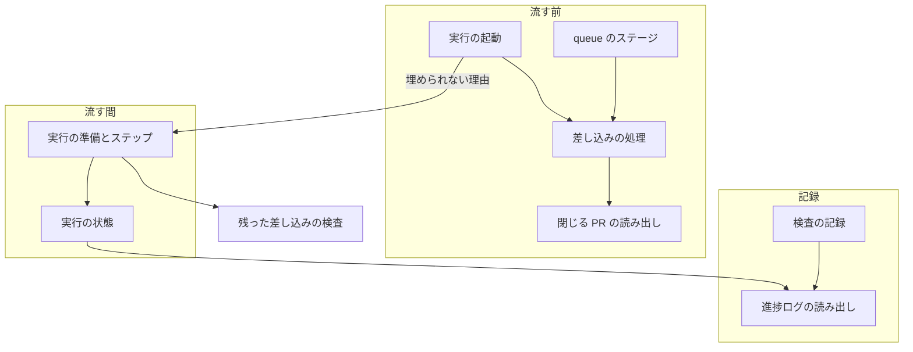
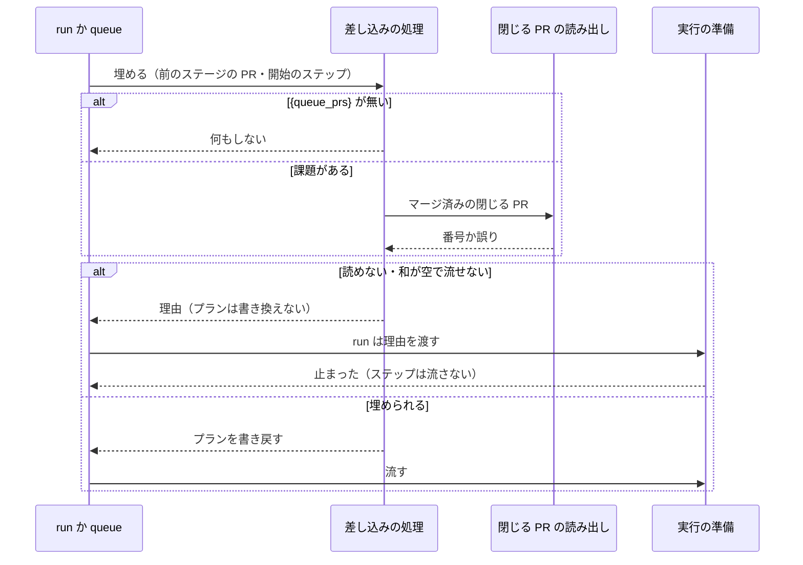
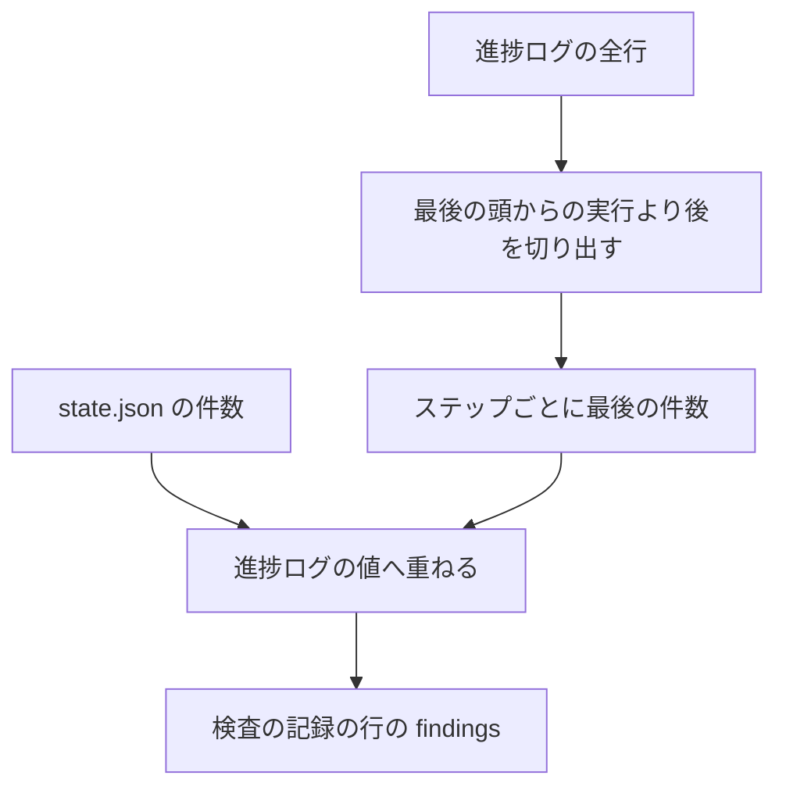

# 差し込みの値と検査の件数: 昇格だけの周回と途中からの流し直しでも、記録が欠けずに残る（#2663）

## 目的

- **今どうなっているか**: `{queue_prs}` は今の queue の前のステージからしか埋まらない。昇格だけの周回では record のステップが文字列のまま落ち、まとめのプランが流れない（#2568）。検査の件数は最後の実行の `state.json` からしか写らないので、途中から流し直すと記録の `findings` が null になる（#2569）
- **誰に効くか**: 開発ループを回す conductor と、開発対象リポジトリの利用者。`pace: fast` のトリガーの閾値を見直す担当者
- **変えると何が成り立つか**: 昇格だけの周回でも、人の手当て無しでリリース記録が残り、まとめのプランが流れる。流し直した検査の行に指摘の件数が残る

## 適用範囲

- **働く範囲**: NDF を導入したすべてのリポジトリ。`supervise.py queue`・`supervise.py run`・`check-trigger.py record` で働く
- **プロジェクトごとに違うもの**: 無い。リポジトリと課題はプランの `リポジトリ`・`課題` の欄から読み、設定を足さない
- **当たるモード**: `standard`・`light`・`operation` のプランのうち、`{queue_prs}` を持つプランと検査のプラン

## あるべき姿の根拠

| 根拠 | 種類 | 何を示すか |
| --- | --- | --- |
| STD1 | 外部の一次情報 | 課題のタイムラインの参照元の Pull Request から、マージの日時まで読める。追加の問い合わせ無しにマージ済みだけへ絞れる |
| PRD2 | 外部の一次情報 | Airflow のタスク間の値は再試行で消え、再試行をまたぐ状態の保持に使えない。実行の中の値に頼ると流し直しで消える、という本課題と同じ現象を文書が明記している |
| carul の周回 3 の記録（`lap-3/sprint/5-promote-state/run-stderr.log`・`lap-3/done-2.json`） | 実測 | 昇格のプランは `run --from` で流れ、`{queue_prs}` が残って終了コード 2 で落ちた。計画の課題を閉じる PR #143 は GitHub から届く |
| 「阻害要因になっている上限の撤廃、保存先の永続化の問題、周回の問題が大きい」「根本原因を見つけて対処」（#2648 の依頼。2026-11-06） | 利用者の指示の原文 | 周回をまたいで値が届かないことを、課題ごとの手当てでなく原因の層で直す |

要求と受け入れ条件は #2663 の本文にある（コピーは [issue-2663-requirements.md](issue-2663-requirements.md) ）。この文書は「どう作るか」だけを扱う。

## ドメインモデル

### コンテキスト

| コンテキスト | 何の語が 1 つの意味に決まるか |
| --- | --- |
| NDF の工程（`ndf-workflow`） | プラン・実行・差し込み・進捗ログ・検査の記録 |
| NDF のリリース（`ndf-release`） | リリース記録と、それを探す手順で使う「課題を閉じる PR」 |

リリースが供給者、工程が顧客の関係（顧客 / 供給者）。工程の差し込みは、リリースの側の部品（`sprint_close_lib/record_find.py`）が返す「課題を閉じる PR」を受ける。リリースの側は工程の語を読まない。

### 集約

| 集約 | 持ち主（書き換えてよいもの） | 根 | エンティティ | 値オブジェクト |
| --- | --- | --- | --- | --- |
| プラン | queue の差し込みの処理（`supervise_lib/queue.py`・`queue_fill.py`） | プランのファイル | ステップ | `{queue_prs}` の目印・課題の並び・実行条件 |
| 進捗ログ | 実行の状態（`supervise_lib/state.py` の `RunState`） | 状態ディレクトリの `progress.jsonl` | 実行の始まりの行・ステップの行 | ステップの件数 |
| 検査の記録の行 | 検査の記録（`check-trigger.py`） | 記録の 1 行 | — | 件数のコピー（`findings`） |

進捗ログは検査の記録の行から状態ディレクトリのパスで参照する。件数の読み出しは検査の記録の側が読むだけで、進捗ログを書き換えない。

### 不変条件

| # | 集約 | 条件 | 破れたときの扱い |
| --- | --- | --- | --- |
| I1 | プラン | `{queue_prs}` を埋める値は、前のステージの PR とマージ済みの課題を閉じる PR の和で、重ねず番号の昇順である | 埋める処理の単体テストで落とす |
| I2 | プラン | GitHub を読めないときは、前のステージの PR があってもプランを書き換えない | プランを流さず、理由に「GitHub を読めない」と課題の番号を残す |
| I3 | プラン | 和が空のときに流すのは、実行条件を評価する経路だけである。開始のステップを持つ実行（`run --from` と `queue --resume --from`）は条件を評価しないため流さない | プランを流さず、理由に「閉じる PR が無い」と課題の番号を残す |
| I4 | プラン | `{queue_prs}` が残ったコマンドは実行しない | run と queue のどちらも、そのステップを実行せずに `止まった` で終わる |
| I5 | プラン | GitHub を読むのは、`{queue_prs}` と課題の両方を持つプランを埋めるときだけである | 読み出しの回数のテストで落とす |
| I6 | 進捗ログ | 件数を読む範囲は、`--from` の無い最後の実行の始まりより後である | 頭から流し直した実行は、それより前の件数を読まない |
| I7 | 進捗ログ | 同じステップの件数が複数の実行にあれば、足さずに最後の実行の値を採る | 足すと二重に数えるため、足さない |
| I8 | 進捗ログ | 進捗ログが無い・壊れた行があるときも読み出しは落ちない。進捗ログが無ければ今と同じ `state.json` の値を返す。壊れた行があれば、その行だけを飛ばし、読めた行の件数に `state.json` の件数を重ねる（決定 6） | 読めない行だけを飛ばす。読めた行の件数は捨てない |
| I9 | 検査の記録の行 | 書いた行と進捗ログの過去の行を書き換えない。足したキーが無い行は読み飛ばす | 過去の行の件数は null のままにする |

### ドメインイベント

| # | イベント | 発生元 | 受け手 |
| --- | --- | --- | --- |
| E1 | 検査のプランがスプリントの PR をマージした | 検査のプラン | 差し込みの処理（GitHub の履歴の参照から読む） |
| E2 | 周回が本番のプランを `run --from` か queue で流し始めた | 開発ループ | 差し込みの処理 |
| E3 | 本番のプランの `{queue_prs}` が解決された | 差し込みの処理 | プランの record のステップ |
| E4 | record のステップがリリース記録を書いた | record のステップ | まとめのプランの `{queue_record}` |
| E5 | まとめのプランの記録の PR が解決した | 差し込みの処理 | まとめのプラン |
| E6 | 検査のステップが件数を記録した | 実行の状態 | 進捗ログ |
| E7 | 検査のプランを途中から流し直した | 利用者か conductor | 実行の状態（`--from` のある実行の始まりの行） |
| E8 | record が件数を検査の記録の行へ書いた | 検査の記録 | `check-trigger.py stats` |

### 用語

| 用語 | 意味 | 用語集への反映 |
| --- | --- | --- |
| 差し込み | プランの文字列に置いた `{queue_prs}` などの目印を、プランを流す前に値へ置き換える仕組み | 追加済み（`ndf-workflow`。要求の工程で足した） |
| 昇格だけの周回 | 課題の検査が前の周回で済み、本番のプランから始まる開発ループの周回 | 追加済み（`ndf-workflow`） |
| 課題を閉じる PR | 本文の closing keywords か閉じる予定の参照が、その課題を指す Pull Request | 追加済み（`ndf-workflow`）。マージ済みに絞るのは差し込みの規則で、語の意味は変えない |

## 機能一覧

| # | 機能 | 誰が使うか |
| --- | --- | --- |
| F1 | 昇格だけの周回で `{queue_prs}` がスプリントの PR で埋まる（queue の先頭のステージと `run`） | 開発ループ・conductor |
| F2 | 埋められないプランが、理由を残して流れずに止まる | conductor |
| F3 | 残った `{queue_prs}` のコマンドが実行されない | conductor |
| F4 | 流し直した検査の行に、ステップごとの最後の件数が残る | トリガーの閾値を見直す担当者 |

## 構成要素

### 変える要素と責務

| 要素 | 責務 | 変更 |
| --- | --- | --- |
| 閉じる PR の読み出し（`sprint_close_lib/record_find.py`） | 課題ごとの閉じる PR を探す。マージ済みに絞って読む関数を公開する | 変更。公開関数 `merged_closers` を足し、`_referencing_prs` が `merged` を返す |
| 差し込みの処理（`supervise_lib/queue.py`・`queue_fill.py`） | `{queue_prs}` の和を作って埋めるか、理由を返す。先頭のステージでも埋める | 変更 |
| 実行の起動（`supervise_lib/commands.py` の `cmd_run`） | 耐久の記録を開く前に差し込みを埋める。`--from` の値を差し込みの処理へ渡す | 変更 |
| キューの実行（`supervise_lib/flow.py` の `queue_workflow`・`fill_step`） | プランごとの開始のステップ（`starts`）を差し込みの処理へ渡す | 変更 |
| 実行の準備（`supervise_lib/engine.py` の `Engine.setup`） | 埋められなかった理由を受け、ステップを 1 つも流さず `止まった` で終える | 変更 |
| 残った差し込みの検査（`supervise_lib/plan.py` の `QUEUE_NAMED`） | `{queue_prs}` も検出する | 変更 |
| 実行の状態（`supervise_lib/state.py` の `step_line`・`prior_rows`） | ステップの行に件数を足す。読む範囲の切り分けを共有の関数へ渡す | 変更 |
| 進捗ログの読み出し（`lib/progress_rows.py`） | 読む範囲の切り分けと、ステップごとの最後の件数を返す | 新設 |
| 検査の記録（`check-trigger.py` の `findings_of`） | 進捗ログの件数に `state.json` の件数を重ねて読む | 変更 |

### 要素のつながり



### 変える範囲の置き場所

```text
plugins/ndf/scripts/
├── check-trigger.py
├── lib/
│   └── progress_rows.py          （新設）
├── sprint_close_lib/
│   └── record_find.py
└── supervise_lib/
    ├── commands.py
    ├── engine.py
    ├── flow.py
    ├── plan.py
    ├── queue.py
    ├── queue_fill.py
    └── state.py
```

## 外部の調査

| 種類 | 調べるか | 理由 |
| --- | --- | --- |
| 標準・仕様 | 調べる | 課題から閉じる PR へたどる手段が GitHub の API の形で決まる |
| 主要な製品 | 調べる | 流し直しをまたいで前の実行の値をどう残すかに、ワークフローの製品の解き方がある |
| ライブラリとサービス | 調べる | 耐久の実行に使っている DBOS と、GitHub の閉じる参照の機能で足りるかを決める |

### 標準・仕様

| # | 標準・仕様 | 何を定めているか | 設計への反映 | 出典 |
| --- | --- | --- | --- | --- |
| STD1 | GitHub REST API のタイムライン | `cross-referenced` のイベントの `source.issue` は課題のオブジェクトで、`pull_request.merged_at`（日時か null）を持つ | 追加の問い合わせをせず、タイムラインの 1 回の読み出しでマージ済みへ絞る | https://docs.github.com/en/rest/issues/timeline 、`gh api repos/devbasex/ai-plugins/issues/2620/timeline` で #2645 の `merged_at` を実測（2026-11-06） |

### 主要な製品

| # | 製品 | どう解いているか | 設計への反映 | 出典 |
| --- | --- | --- | --- | --- |
| PRD1 | GitHub Actions の再実行 | 失敗したジョブだけを再実行でき、前の試行は画面から選んで参照できる。試行を消さず積む形である（前の出力の引き継ぎの仕様はこのページに無い） | 進捗ログを実行の試行の積み上げとして読む | https://docs.github.com/en/actions/how-tos/manage-workflow-runs/re-run-workflows-and-jobs （2026-11-06） |
| PRD2 | Airflow の XCom | 失敗後の再試行では値を消す。文書は、再試行をまたぐ状態の保持に使えないと書く | 件数を実行の中の値へ置かず、追記の記録へ置く | https://airflow.apache.org/docs/apache-airflow/stable/core-concepts/xcoms.html （2026-11-06） |

### ライブラリとサービス

| # | 候補 | 版 | ライセンス | 最後のリリースの日付 | 終了のアナウンス | 要件を満たすか | 出典 |
| --- | --- | --- | --- | --- | --- | --- | --- |
| LIB1 | DBOS の `fork_workflow`（選んだステップより前の結果をコピーして新しい実行を作る） | 依存は 3.1.0、最新は 3.4.0 | MIT | 2026-10-28 | 未確認 | 満たさない。`--from` は開始のステップごとに別の耐久ワークフロー（`flow.prefix_of`）で、前の実行の値を読む経路が無い。実行の作りを変える範囲はプランの参照（#2344）より広い | https://docs.dbos.dev/python/tutorials/workflow-management 、`pyproject.toml:33`、https://pypi.org/pypi/dbos/json （2026-11-06） |
| LIB2 | GitHub GraphQL の `closingIssuesReferences` | — | — | — | 未確認 | 満たさない。宛先が既定ブランチでない PR は空になる。このリポジトリの開発の PR の宛先は `develop` である | `plugins/ndf/scripts/lib/closing.py:3-4`（2026-11-06） |

### 確かめられなかったこと

| 対象 | 試した手段 | 結果と理由 |
| --- | --- | --- |
| Dagster の失敗の位置からの再実行で、親の実行のステップ出力をどう使うか | https://docs.dagster.io/guides/operate/re-execution | 転送先 `dagster.io/docs/guides/operate/re-execution` が HTTP 404。`.../build/jobs/job-execution` は取得できたが該当の記述が無い |
| GitHub Actions の再実行で、前の試行の出力を次の試行が読めるか | 上の再実行のページ | ページに記述が無い。他のページは試していない |
| DBOS 3.1.0 が `fork_workflow` を持つか、終了のアナウンスの有無 | PyPI の JSON と文書の入門のページ | リファレンスと 3.1.0 の文書は試していない。採らない候補のため止めた |

調べた量: 候補 5 件・取得の試み 11 回。

## 決定の記録

### 決定 1: 周回をまたいで値が届くよう、`{queue_prs}` を前のステージの PR とマージ済みの課題を閉じる PR の和で埋める

取り先を GitHub の履歴の参照にすると、周回・プラン・状態ディレクトリに依らず、同じ課題から同じ値が得られる。carul の周回 3 のスプリント状態は PR の値が空で、状態ファイルからは #143 に届かない。

マージ済みに絞るのは、`--prs` が `スプリント:` の行と CHANGELOG の中身になるためである。閉じた PR やマージ前の PR が本文に閉じる指定を持つと、配布されていない PR を記録へ載せる。絞らない案は、`find_record` が記録の側で絞れるのと違い、記録を書く値そのものになるため採らない。スプリントの記録から読む案は、上の実測で値が空のため採らない。GitHub の `closingIssuesReferences`（LIB2）は宛先が既定ブランチでない PR で空になるため採らない。

- 作り方: 自前で作る・標準に倣う
- 比べた候補: STD1 / LIB2

根拠: Value 7 / Value 1（MVV 版 6）

### 決定 2: 落ちた後の再実行が同じ耐久ワークフローへ戻るよう、`run` の差し込みは耐久の記録を開く前に `cmd_run` で埋める

実行の鍵はプランの本文から決まる。`Engine.setup` や `prepare` の中で埋めると、再実行のときに本文が変わって別の耐久ワークフローになり、済んだステップを流し直す。埋められないときは `Engine` へ理由を渡し、`setup` が `止まった` を返す。こうすると報告（`report.md`）は通常の止まりと同じ形で残る。`cmd_run` がその場で終了する案は、報告が残らず開発ループが理由を読めないため採らない。

根拠: Value 5 / Value 3（MVV 版 6）

### 決定 3: 誤った `スプリント:` を残さないよう、GitHub を読めなければ前のステージの PR があっても止める

読めないまま前のステージの PR だけで流すと、記録の `スプリント:` が課題を閉じる PR を欠き、まとめのプランの `find_record` が後から止まる。配布の途中より、流す前に止まる方が戻す手間が少ない。受け入れ条件 4 の「GitHub を読めないとき」を、前のステージの PR の有無に依らない条件として読む。

根拠: Value 2 / Value 1（MVV 版 6）

### 決定 4: 条件が評価されない経路で空のコマンドを実行しないよう、`--from` では和が空なら実行条件があっても止める

`実行の条件` は `--from` で評価されない（`Engine.prepare`）。受け入れ条件 7 の「条件に判断を任せる」は条件が評価される経路でだけ成り立つ。`--from` で空にして流すと `--prs` が値を持たず終了コード 2 で落ち、#2568 と同じ形になる。

同じ止まり方を `run --from` と `queue --resume --from <プラン>=<ステップ>` の両方へ届けるため、`fill_queue_prs` は開始のステップを受け、値があれば実行条件の有無を見ずに止める。`cmd_run` は `--from` の値を渡す。queue は `queue_workflow` の `starts`（プランごとの開始のステップ）を `fill_step` → `fill_stage` → `fill_queue_prs` の順に渡す。`starts` は `queue_workflow` が今も持つ値で、`admit_step` へは渡しているが差し込みの処理へは届いていない。

根拠: Value 7（MVV 版 6）

### 決定 5: 閉じる PR の判定を 1 か所に保つため、`record_find.py` に公開関数を足して差し込みから呼ぶ

`find_record` の手順 1〜2（履歴の参照を読み、閉じる指定で絞る）をそのまま使う。`queue_fill.py` に同じ読み出しを書く案は、判定が 2 か所に分かれるため採らない。`find_record` の探し方は変えない。絞りは `merged_closers` だけに掛け、未マージの閉じる PR を候補に含む `find_record` の結果を変えない。受け入れ条件 3 は、マージ済みの閉じる PR が `スプリント:` にあれば成り立つ。

根拠: Value 7（MVV 版 6）

### 決定 6: 流し直しで件数を失わないよう、件数を進捗ログのステップの行へ足す

進捗ログは実行をまたいで追記される唯一の記録で、実行の始まりの行が読む範囲の区切りも持つ。別のファイルを足す案は、同じ区切りをもう 1 つ持つことになるため採らない。`.out` の番号付きのファイルは実行ごとに上書きされるため採らない。DBOS の fork（LIB1）は `--from` の作りを変える必要があり、この課題の範囲を超える。実行の中の値に頼らない点は PRD2 の注意書きと同じで、試行を積む形は PRD1 に倣う。

`state.json` の件数を進捗ログの値へ重ねて読むのは、この変更より前に始まった実行が状態ディレクトリに残るためである。`state.json` は最後の実行の値だけを持つので、重ねても受け入れ条件 9 の結果は変わらない。

- 作り方: 自前で作る
- 比べた候補: PRD1 / PRD2 / LIB1

根拠: Value 7 / Value 4（MVV 版 6）

### 決定 7: 件数を足すと二重に数えるため、読む範囲は `--from` の無い最後の実行より後にし、同じステップは最後の値を採る

cross-review と cross-refactoring の件数は PR ごとの状態ファイルから数えるため、同じ状態を読む 2 回の実行を足すと重なる。範囲の切り分けは `RunState.prior_rows` と同じ規則である。`check-trigger.py` は `supervise_lib` を読み込まないため、切り分けを `lib/progress_rows.py` へ移し、両方から呼ぶ。

根拠: Value 7（MVV 版 6）

### 決定 8: プランの参照の設計（#2344）が今の規則を前提に残らないよう、同じ実装で `QUEUE_PRS` の読み替え先の定義を 3 か所直す

#2344 の設計は `QUEUE_PRS` の読み替え先の参照（`plan_result` の `plans: "earlier"`）の値を「キューの前のステージのプランから引く」と書く。この課題の後は課題を閉じる PR も集合に入り、止める条件も増えるため、移すときに規則が欠ける。

| 直す場所 | 中身 |
| --- | --- |
| `issues/issue-2344-design-decisions.md` の決定 9 | 前のステージ全体の PR を引く 1 文へ、課題を閉じるマージ済みの PR の和を足す |
| `issues/issue-2344-design.md` の参照の種類の表（`plan_result` の行） | `plans: "earlier"` の値を、前のステージの PR とマージ済みの課題を閉じる PR の和（重ねず番号の昇順）とする。失敗の条件に「GitHub を読めない」と「和が空」を足す |
| `issues/issue-2344-design.md` の前のプランの結果を読む規則（`plans: "earlier"` の引き方） | 前のステージのプランから引く PR に、課題を閉じるマージ済みの PR を足す |

#2344 の後は開始のステップによらず実行条件を先に評価し、実行条件で飛ぶプランは参照の解決に来ない（#2344 の不変条件 I3）。解決できない参照は空で埋めない（#2344 の不変条件 I4）。そのため、参照の失敗の条件はこの課題の「`--from` では止める」のように経路で分けず、解決に来た時点で和が空なら失敗にする。#2344 の不変条件と番号が重なるため、#2344 の設計へはこの課題の不変条件の番号を持ち込まず、条件を文で書く。

#2344 の範囲は広げず、読み替え先の値と止める条件の定義だけを直す。#2344 の部品の先行実装はしない。

根拠: Value 8（MVV 版 6）

## データ構造

進捗ログ（`<状態ディレクトリ>/progress.jsonl`）の `kind: step` の行へ、任意のキー `counts` を 1 つ足す。ほかの行と、ほかのキーは変えない。時系列は事象の記録で持つ（追記するだけで、過去の行を書き換えない）。

| キー | 型 | 空を許すか | 意味 |
| --- | --- | --- | --- |
| `counts` | オブジェクト | キーごと省く | そのステップの結果の件数。`state.json` の `log` の `counts` と同じ中身（`cur["counts"]`）。無いのは「件数を返さないステップ」か「この変更より前の行」であり、0 件ではない |

| 機能 | プランのファイル | 進捗ログ | 検査の記録の行 |
| --- | --- | --- | --- |
| F1 `{queue_prs}` を埋める | U | — | — |
| F2 埋められずに止まる | R | — | — |
| F3 残った差し込みを止める | R | C（ステップの行） | — |
| F4 件数を残す | — | C・R | C |

移行は無い。`counts` の無い行は読み飛ばし、`state.json` が件数を持つ（I8・I9）。検査の手段は `check-trigger.py stats` の `findings` と、受け入れ条件 8〜12 のテストである。

## 入出力の契約

`{queue_prs}` の記法・`check-trigger.py record` の引数・検査の記録の行の形は変えない。変わるのは値の取り先と、止まる条件である。

| 場面 | 今 | 変更後 |
| --- | --- | --- |
| 埋める値 | 前のすべてのステージの PR | 前のすべてのステージの PR と、計画の `課題` のマージ済みの閉じる PR の和（I1） |
| queue の先頭のステージ | 埋めずに流す | 埋める |
| `run` | 埋めずに流す | 埋める。`--from` でも同じ |
| GitHub を読めない | — | queue: `流さなかった`・`unfilled: true`・理由。run: `結果: 止まった`・理由、終了コード 3 |
| 和が空 | 後続のステージでは止める（条件のあるプランは流す） | 同じ規則を先頭のステージと `run` へ広げる。`run --from` と `queue --resume --from` は止める（I3） |
| `{queue_prs}` が残ったコマンド | 文字列のまま実行する | 実行せずに `止まった` |

止まった理由の文（運用・保守性の要求。課題の番号と、空か読めないかの区別が出る）:

```text
差し込みを埋められない: {queue_prs}（課題 #110 #114 の閉じる PR を読めない: GitHub を読めない: <gh の誤り>）
差し込みを埋められない: {queue_prs}（課題 #110 #114 を閉じるマージ済みの PR が無く、前のステージの PR も無い）
```

`record_find.py` に足す公開関数:

```python
@dataclass(frozen=True)
class ClosingPrs:
    prs: tuple[int, ...] = ()  # マージ済みの閉じる PR（番号の昇順）
    error: str = ""            # GitHub を読めなかったときの理由

def merged_closers(root, repo: str | None, issues) -> ClosingPrs: ...
```

## 処理の流れ

### `{queue_prs}` の解決

queue は `fill_stage` から、`run` は `cmd_run` から、同じ `fill_queue_prs` を呼ぶ。どちらの経路も、前のステージの PR と開始のステップを渡す。



`cmd_run` は `Engine` を作る前に埋める。実行の鍵（`flow.prefix_of`）はプランの本文から決まるため、埋めた後の本文で鍵が決まり、落ちた後の再実行が同じ耐久ワークフローへ戻る。

### 検査の件数

ステップが終わるたびに `step_line` が件数を進捗ログへ書き、`findings_of` が読む。



落ちたステップの判定（`failed_at`）は今と同じく `state.json` の `log` から読む。

## 非機能の実現方式

| 大項目 | 要求の条件 | 実現方式 | 確かめ方 |
| --- | --- | --- | --- |
| 性能・拡張性 | GitHub の読み出しは、`{queue_prs}` を持つプランを埋めるときだけ行う。`{queue_prs}` を持たないプランのステージでは呼ばない | `fill_queue_prs` が目印の有無を先に見て、無ければ `record_find` を読み込まずに返す | 目印の無いプランで読み出しを差し替えた関数が呼ばれないことをテストで見る |
| 運用・保守性 | 差し込みで止まったときの理由に、計画の課題の番号と、空か読めないかの区別が出る | 上の 2 つの理由の文を返す | 空と読めないの 2 通りで、理由の文を単体テストで見る |

## 設計の結果

| 課題 | 扱い | 取り込み先 | 触るファイル |
| --- | --- | --- | --- |
| #2663 | 実装する | — | `plugins/ndf/scripts/check-trigger.py`、`plugins/ndf/scripts/lib/progress_rows.py`、`plugins/ndf/scripts/sprint_close_lib/record_find.py`、`plugins/ndf/scripts/supervise_lib/commands.py`、`plugins/ndf/scripts/supervise_lib/engine.py`、`plugins/ndf/scripts/supervise_lib/flow.py`、`plugins/ndf/scripts/supervise_lib/plan.py`、`plugins/ndf/scripts/supervise_lib/queue.py`、`plugins/ndf/scripts/supervise_lib/queue_fill.py`、`plugins/ndf/scripts/supervise_lib/state.py`、`plugins/ndf/scripts/tests/`、`docs/specifications/ndf-production-release-record.md`、`issues/issue-2344-design-decisions.md`、`issues/issue-2344-design.md` |

## テスト設計

| 受け入れ条件・不変条件 | どの振る舞いで縛るか | どう壊したら落ちるべきか |
| --- | --- | --- |
| 1 | `{queue_prs}` を持つ昇格のプランだけのステージを queue で流すと、record のコマンドが `--prs 143` になる | `fill_stage` の先頭のステージの埋めを外す |
| 2 | 同じ前提で `run --from verify` が `--prs 143` で流れる | `cmd_run` の埋めを外す |
| 3 | 1 か 2 の後、まとめのプランの `{queue_record}` が記録の PR で埋まる | 集合から閉じる PR を外し、前のステージの PR だけにする |
| 4 | 空・読めないの 2 通りで、queue は `流さなかった`・`unfilled: true`、run は最初のステップを実行せずに `止まった`。理由が 2 通りで違う | 読めないときに空として扱う |
| 5 | 前のステージ #140・#143 と閉じる PR #143 で `140 143` になる | 和を作らず連結する。番号を文字列の順で並べる |
| 6 | `{queue_prs}` が残ったコマンドを run でも queue でも実行しない | `QUEUE_NAMED` から外す |
| 7 | `実行の条件` を持つプランは和が空でも流し、条件が判断する（`--from` は決定 4 のとおり止まる） | 条件の分岐を消す |
| 8 | 1 回目の review が件数を持って 6 で終わり、`--from base-sync` で record まで終えると `rounds` 4・`fixed` 8 | `step_line` の件数を外す |
| 9 | 2 回の実行で `fixed` 3・5 なら 5 | 足し合わせる。最初の値を採る |
| 10 | 頭からの実行で review が件数を持たなければ `fixed` が無い | 読む範囲の切り分けを外す |
| 11 | 進捗ログが無い・壊れた行を含むとき record は落ちず、読めない項目は null | 壊れた行で例外を上げる |
| 12 | 1 回の実行だけの行が今と同じ。`findings_of` の既存のテストが実装の前後で通る | 値の重ねる順を逆にする |
| 13 | この表の 1〜12 の行がそれぞれのテストに対応する | — |
| 14 | #2568・#2569 の再現の手順を 1 回ずつ通し、結果を課題へ書く（リリース後テスト） | — |
| I1 | 条件 5 と同じ | 同上 |
| I2 | 前のステージの PR があるプランで読み出しを失敗させると、プランのファイルが変わらず `unfilled` になる | 読めないときに前のステージの PR だけで埋める |
| I3（`run` の経路） | `run --from` で和が空のとき、条件のあるプランも流れない | `--from` を見ずに条件のあるプランを流す |
| I3（queue の経路） | `queue --resume --from <プラン>=<ステップ>` で和が空のとき、条件のあるプランも流れず `流さなかった`・`unfilled: true` になる | `queue_workflow` から `fill_step` へ `starts` を渡すのを外す |
| I4 | 条件 6 と同じ | 同上 |
| I5 | 目印の無いプランと、課題が空のプランで GitHub の読み出しが呼ばれない | 目印の確認より先に読む |
| I6 | 条件 10 と同じ | 同上 |
| I7 | 条件 9 と同じ | 同上 |
| I8 | 条件 11 に加えて、壊れた行を挟むログでも、その前の行にある review の件数が `findings` に残る | 壊れた行があるときにログ全体を捨てて `state.json` の値だけを返す |
| I9 | `counts` の無い過去の行を含むログで読み出しが落ちず、記録の行とログが書き換わらない | 読むときにログを書き直す |
| マージ済みの絞り（決定 1） | `merged_at` が null の閉じる PR が集合に入らない | `merged` の判定を外す |
| 実行の鍵（決定 2） | 埋めた後の再実行が同じ耐久ワークフローの記録から続く | `Engine` を作った後に埋める |

## 未確認のまま残ること

| 項目 | 内容 |
| --- | --- |
| 明示の PR と和の重なり | `release_templates.py:351` は `--prs 1052 {queue_prs}` の形を作る。明示の番号と和が重なると `--prs 1052 1052` になる。前のステージの PR でも同じ形が起きうる。受け手の `スプリント:` の行が重なって載るかは未確認で、実装の開始時に `release-steps.py record` を 1 度通して確かめる |
| 同じ課題を閉じた過去の PR | 再び開いた課題では、前のスプリントのマージ済みの PR も和に入る。`スプリント:` の行が増えるだけか、`find_record` の 2 通りの判定へ影響するかは未確認。該当の記録を持つ実例は確かめていない |
| 複数の Pull Request に分けたスプリント | 実装の PR が閉じる指定を持つと、スプリントの PR に加えて和に入る。`approval-facts` の「含む PR」と `notes` の確認は同じ `{queue_prs}` を受けるため食い違わない見込みだが、未確認 |
| 既存のテストの入力 | `{queue_prs}` と課題の両方を持つプランを流すテストは、GitHub の読み出しの差し替えが要る。止まった理由の文を照合するテストと、`tests/fixtures/supervise-contract/plans/close/` の扱いは実装で通して確かめる |
| 実機の確かめ | 開発対象リポジトリの次の昇格だけの周回か検査の流し直しの記録を読む（要求の検証手段）。該当の周回が無ければ未確認として残す |
