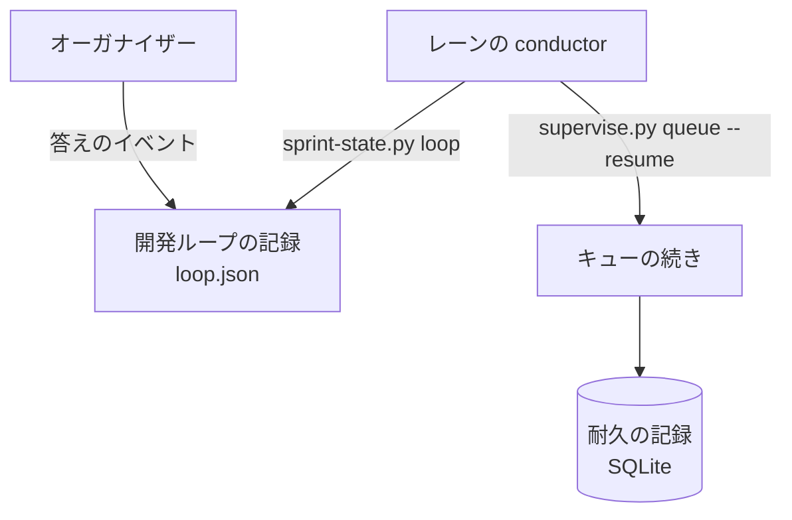
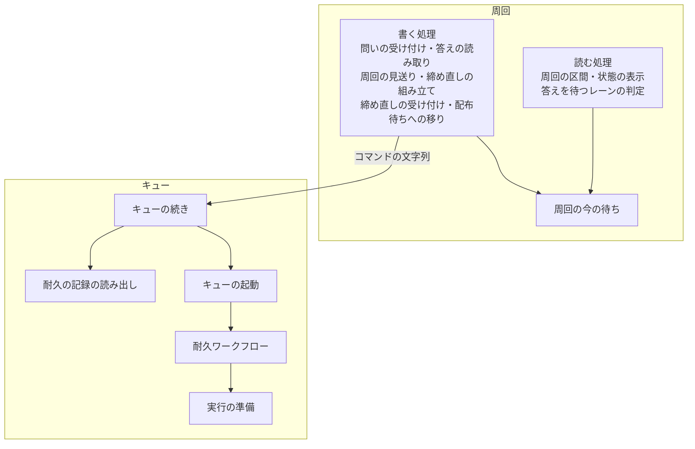
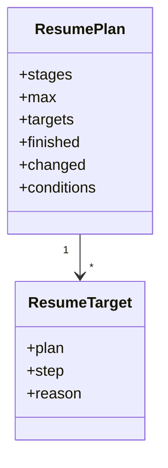
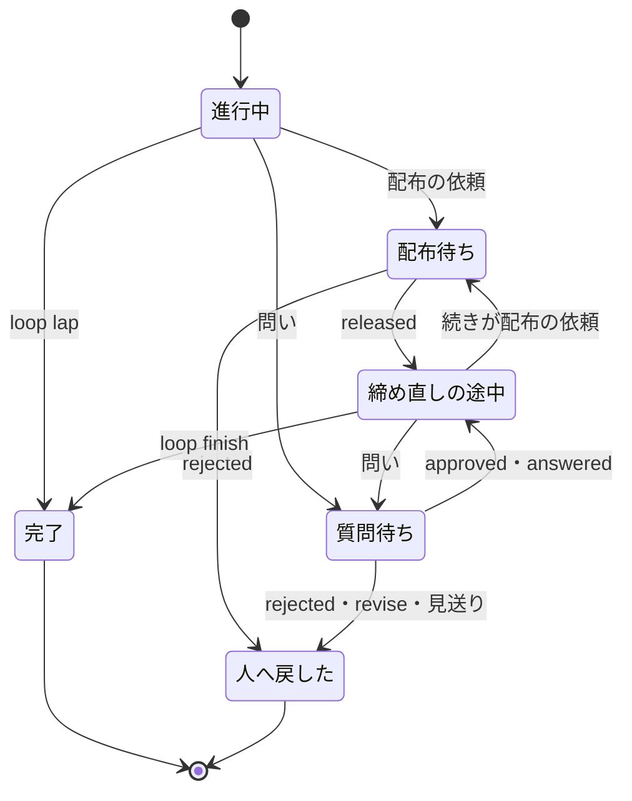
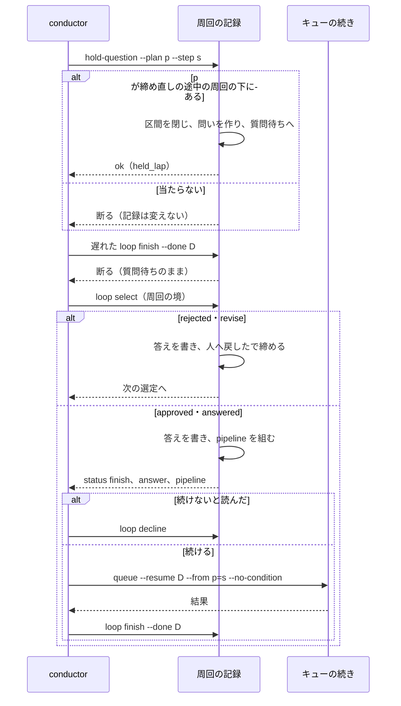
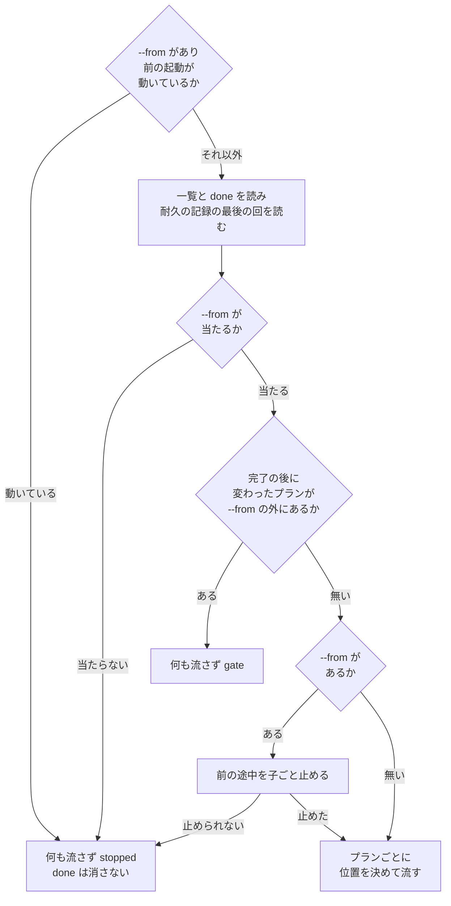

# 開発ループとキューの続き: 保留の周回の問いが必ず当たり、再開の位置が指定と耐久の記録だけで決まる（#2664）

## 目的

- **今どうなっているか**: 配布待ちの周回を締め直すまとめの途中で問いを出すと、`loop hold-question` が「進行中の周回が無い」で断り、答えを当てる場所が無くなる（#2638）。`queue --resume --from` はフルパスを断り（#2639 の 1 つ目）、強制終了した前の起動が残っていると指定を無視する（#2325）。完了したプランが流れ直し（#2349）、問いの答えは中身を読まずに流れる（#2466）
- **誰に効くか**: 開発ループのレーンを回す conductor と、手で締め直す・耐久ワークフローを手で取り消す手当てをしている利用者（carul と ai-plugins）
- **変えると何が成り立つか**: 問いは締め直しの途中でも周回の記録へ当たり、答えの中身を読んでから止まった所から続く。キューの続きの開始の位置は、`--from` の指定と耐久の記録だけで決まる

## 適用範囲

- **働く範囲**: NDF を使うすべてのリポジトリ。開発ループは並列の計画のループのレーンの経路、キューの続きはレーンでない起動も含む
- **プロジェクトごとに違うもの**: 無い。呼び手が渡すのは `--plan`・`--from` の引数だけで、設定を足さない
- **当たるモード**: `standard`・`light`・`operation`（開発ループとキューが流すプランすべて）

## あるべき姿の根拠

| 根拠 | 種類 | 何を示すか |
| --- | --- | --- |
| PRD1（AWS Step Functions の redrive） | 外部の一次情報 | 再実行は完了済みのステップを流さず、失敗したステップから続ける。定義を変えたら新しい実行を始める。キューの続きの「完了は流さない」「中身が変わったら黙って流さない」と同じ形である |
| PRD3（Argo の `retry`） | 外部の一次情報 | 既定は失敗したステップだけを流し直し、成功したノードの流し直しは利用者が明示する。`--from` を明示の指示として扱う要求の前提 2 と同じ形である |
| STD1（RFC 9110 の条件つき要求） | 外部の一次情報 | 読んだ時点の ETag と今の ETag を比べ、違えば操作を行わない。受け入れ条件 12 の判定の形である |
| PRD4（LangGraph の `interrupt`） | 外部の一次情報 | 答えは止まった処理へ値として渡り、続けるかは処理の側のコードが決める。答えの持ち主への渡し方の形である |
| 実測: 外のプロセスの `DBOSClient.list_workflows(workflow_id_prefix=..., load_output=True)` | 実測 | DBOS 3.1.0 で、起動を閉じた後の SQLite から実行の回の ID・状態・出力・作った時刻を読めた（2026-11-06） |
| 「ひとつづつ直すのではなく根本原因を見つけて対処してください」 | 利用者の指示の原文 | 5 件を個別に直さず、今の周回・今の起動の中の値しか見ない所を直す |

要求と受け入れ条件は #2664 の本文にある（コピーは [issue-2664-requirements.md](issue-2664-requirements.md) ）。この文書は「どう作るか」だけを扱う。

## ドメインモデル

### コンテキスト

| コンテキスト | 何の語が 1 つの意味に決まるか |
| --- | --- |
| NDF の開発ワークフロー（`ndf-workflow`） | 周回・保留の周回・質問待ち・キューの続き・実行の回・実行条件 |

### 集約

| 集約 | 持ち主（書き換えてよいもの） | 根 | エンティティ | 値オブジェクト |
| --- | --- | --- | --- | --- |
| 周回 | 開発ループの記録の書き手（`lib/sprint_loop*.py`） | 周回（`loop.json` の `laps` の 1 行） | 問い（`question`）・配布の依頼（`release`）・前の待ちの控え（`held_history`） | 答え・締め直しの区間（`finish`） |
| キューの実行 | キューの実行（`supervise_lib/queue*.py`・`flow.py`） | キューの耐久ワークフロー | プランの実行の回 | 開始のステップ・ステージの並び |

周回はプランをパスで、キューの実行は done（キューが終わったときに書く結果の JSON）のパスで参照する。周回の書き手はキューの耐久の記録を読まず、続きのコマンドを文字列で組むだけである。

### 不変条件

| # | 集約 | 条件 | 破れたときの扱い |
| --- | --- | --- | --- |
| I1 | 周回 | 問いが当たるのは、進行中の周回か締め直しの途中の周回で、`--plan` のプランがその周回のディレクトリの下にあるものである。下に無くても、候補が進行中の周回 1 つだけなら今と同じくそれへ当てる | 断り、記録を変えない（終了コード 1） |
| I2 | 周回 | 保留の周回が今待っているものは結果で決まる。配布待ちは配布の依頼、質問待ちは問いである | 読む箇所を 1 つの関数にし、`release` と `question` の有無で選ばない |
| I3 | 周回 | 問いを当てても、配布の依頼の答えと本番の版は消えない。前の問いと答えは前の待ちの控えへ移り、読める | 控えへ移さずに上書きする実装をテストで落とす |
| I4 | 周回 | `loop finish` が効くのは、今の待ちの締め直しの done だけである。問いの答えを読む前は効かない | 断り、周回は質問待ちのまま（終了コード 1） |
| I5 | 周回 | 周回の秒は、開始から最初の保留までの区間とすべての締め直しの区間の和で、答えを待った時間を含まない | テストで落とす |
| I6 | 周回 | 差し戻しの答え（`rejected`・`revise`）と見送りでは止まったプランを流さず、周回を「人へ戻した」で 1 回だけ締める | pipeline を返さない |
| I7 | 周回 | 届いた答えはどれも、読んだ時刻とともに問いの記録に残る | 読めた答えを捨てる実装をテストで落とす |
| I8 | キューの実行 | 問いで止まったプランは、続きの 1 回で指定のステップから 1 回だけ流れ、頭からは流れない | テストで落とす |
| I9 | キューの実行 | `--from` の対象でないプランの開始の位置は、`--from` の有無で変わらない。完了は流れず、途中は終えたステップから続く | テストで落とす |
| I10 | キューの実行 | `--from` があれば、前の途中の耐久ワークフローは子ごと止まってから流れる。止められないとき・前の起動が動いているときは何も流さない | `stopped` を返す |
| I11 | キューの実行 | done が完了と記録したプランは `--from` なしでは流れない。最後の実行の回が完了で、そのプランの中身のハッシュが今のファイルと違えば、何も流さずに知らせる | `gate` を返す |
| I12 | キューの実行 | 開始のステップを持つプランの実行条件を評価するのは、`--from` の対象・止まった・報告なし・前の途中のプランである。承認ゲートで止まったプランと `--no-condition` の続き、`run --from` では評価しない | テストで落とす |

### ドメインイベント

| # | イベント | 発生元 | 受け手 |
| --- | --- | --- | --- |
| E1 | 周回を保留で締めた | 開発ループの記録 | 周回の境の読み取り |
| E2 | 答えが届き、締め直しの pipeline を組んだ | 周回の境の読み取り | 周回の持ち主（conductor） |
| E3 | 締め直しの途中で問いを送った | まとめのプランの作業 | オーガナイザーと `loop hold-question` |
| E4 | 問いの当て先の周回を引き、質問待ちへ戻した | `loop hold-question` | 周回の境の読み取り |
| E5 | 元の pipeline の `loop finish` が遅れて届いた | 元の pipeline | `loop finish`（断る） |
| E6 | 答えの中身を読み、記録した | 周回の境の読み取り | 問いの記録と周回の持ち主 |
| E7 | 続けないと判断し、周回を締めた | 周回の境の読み取りか `loop decline` | 次の周回の選定 |
| E8 | 止まったプランをステップの続きから流し、残りとまとめを流して締め直した | 周回の持ち主 | `loop finish` |
| E9 | キューの続きが開始の位置を決めた | キューの続き | キューの耐久ワークフロー |
| E10 | `--from` があるため前の途中を子ごと止めた | 耐久の記録の起動 | キューの耐久ワークフロー |
| E11 | プランごとに実行条件を評価し、流すか飛ばすか知らせて止まるかを決めた | キューの続きとプランの実行 | done と conductor |

### 用語

| 用語 | 意味 | 用語集への反映 |
| --- | --- | --- |
| 締め直しの途中 | 保留の周回の答えを読み、残りの工程の pipeline を組んだ後、`loop finish` が締めるまでの間。周回の結果の値ではなく、配布待ちか質問待ちのまま締め直しの区間に終わりの時刻が無い状態である | 追加 |
| 前の待ちの控え | 同じ周回に問いが 2 回以上当たったときの、前の問いと答えの記録 | 追加 |
| 周回の見送り | 質問待ちの周回の答えを持ち主が読み、続けないと決めて「人へ戻した」で締めること | 追加 |
| 前の途中 | 前の起動が done を書けずに落ち、完了していないプランが終えたステップまで進んでいる状態 | 追加 |
| 質問待ち | 作業の途中の問いをオーガナイザーへ送り、止まったプランとステップを残した周回の結果。進行中の周回を締めたものと、締め直しの途中から戻したものがある | 意味の変更 |
| キューの続き | `supervise.py queue --resume <done>`。前の起動のステージの並びを読み、完了したプランを流さず、完了していないプランを終えたステップから続け、後続のステージも流す。開始の位置は `--from` の指定と耐久の記録だけで決まる | 意味の変更 |

## 機能一覧

| # | 機能 | 誰が使うか |
| --- | --- | --- |
| F1 | 締め直しの途中の問いを周回へ当て、質問待ちへ戻す | レーンの conductor・一時レーン |
| F2 | 問いの答えの後に、止まったプランを 1 回だけ続け、残りとまとめを流して締め直す | レーンの conductor |
| F3 | 遅れて届いた `loop finish` を断る | 開発ループの記録（自動） |
| F4 | 周回の秒に、配布待ちと質問待ちの両方の区間を数える | 予算を読む conductor・利用者 |
| F5 | `--from` を名前とパスの両方で受ける | conductor・利用者 |
| F6 | `--from` があるとき、前の途中を止めて指定から流し、ほかのプランの位置を保つ | conductor・利用者 |
| F7 | キューの続きで実行条件を評価し、完了を流さず、変わったプランを知らせて止まる | conductor・利用者 |
| F8 | 問いの答えを読み、記録し、差し戻しは流さず、それ以外は持ち主へ渡す | レーンの conductor |
| F9 | 持ち主が続けないと決めた周回を締める（`loop decline`） | レーンの conductor |

## 外部の調査

| 種類 | 調べるか | 理由 |
| --- | --- | --- |
| 標準・仕様 | 調べる | 「読んだ時点から変わったら操作しない」に公開の仕様がある |
| 主要な製品 | 調べる | 耐久の実行基盤が、途中からの再実行と人の答えをどう解いているかを比べる |
| ライブラリとサービス | 調べる | すでに依存している DBOS の機能で再開の位置を置き換えられるかを決める |

### 標準・仕様

| # | 標準・仕様 | 何を定めているか | 設計への反映 | 出典 |
| --- | --- | --- | --- | --- |
| STD1 | RFC 9110 の条件つき要求（`If-Match`・`ETag`） | 読んだ時点の ETag と今の ETag を強い比較で照らし、偽なら操作を行わない。412 を返してよい | 完了の時の中身のハッシュと今のハッシュを比べ、違えば流さずに知らせる（決定 8・9） | https://www.rfc-editor.org/rfc/rfc9110.html#name-conditional-requests （2026-11-06） |

### 主要な製品

| # | 製品 | どう解いているか | 設計への反映 | 出典 |
| --- | --- | --- | --- | --- |
| PRD1 | AWS Step Functions の redrive | 成功したステップの結果を保ち流さない。失敗したステップから同じ入力で続ける。元の定義を使い、定義を変えたら新しい実行を始める | 完了は流さない。中身が変わったプランは黙って流さない（決定 8） | https://docs.aws.amazon.com/step-functions/latest/dg/redrive-executions.html （2026-11-06） |
| PRD2 | Temporal の `workflow reset` | イベント履歴の指定の位置から再開する。指定（`--event-id`）で位置が決まる | `--from` の指定が前の位置より勝つ（決定 7） | https://docs.temporal.io/cli/workflow （2026-11-06） |
| PRD3 | Argo Workflows の `argo retry` | 既定は失敗したステップだけを流し直す。成功したノードは `--restart-successful` と `--node-field-selector` の明示で流し直す | 完了したプランの流し直しは `--from` の明示だけで行う（決定 9） | https://argo-workflows.readthedocs.io/en/latest/cli/argo_retry/ （2026-11-06） |
| PRD4 | LangGraph の `interrupt` | `Command(resume=...)` の値が `interrupt()` の戻り値になり、続きの分岐はノードのコードが決める | 答えを `metrics.answer` で持ち主へ渡し、持ち主が決める（決定 11） | https://docs.langchain.com/oss/python/langgraph/interrupts （2026-11-06） |

### ライブラリとサービス

| # | 候補 | 版 | ライセンス | 最後のリリースの日付 | 終了のアナウンス | 要件を満たすか | 出典 |
| --- | --- | --- | --- | --- | --- | --- | --- |
| LIB1 | DBOS の `fork_workflow`・`rewind_workflow` | 依存は 3.1.0、最新は 3.4.0 | MIT | 2026-10-28 | 未確認 | 満たさない。`--from` は開始のステップごとに別の耐久ワークフロー（`flow.prefix_of`）で流し、実行条件も流す前に評価する。作りを変える範囲はプランの参照（#2344）より広い。`rewind` は終わった耐久ワークフローだけが対象で、強制終了の途中には使えない | https://docs.dbos.dev/python/tutorials/workflow-management 、`pyproject.toml:33`、https://pypi.org/pypi/dbos/json （2026-11-06） |
| LIB2 | DBOS の `DBOSClient.list_workflows`・`cancel_workflow` | 依存は 3.1.0 | MIT | 2026-10-28（最新 3.4.0 の日付） | 未確認 | 満たす。起動の外から実行の回の状態と出力を読める。子ごとの取り消しは `durable.cancel_others` がすでに使う | `lib/durable.py`、上の実測のスクリプトの実行（2026-11-06） |

### 確かめられなかったこと

| 対象 | 試した手段 | 結果と理由 |
| --- | --- | --- |
| Temporal の reset が実行中の実行を終了させるか | https://docs.temporal.io/cli/workflow | 取得したページの reset の節に書かれていない。PRD2 は位置の指定の形だけを根拠にする |
| DBOS の `fork_workflow` の `start_step` の仕様 | https://docs.dbos.dev/python/tutorials/workflow-management | 取得したページに引数の説明が無い。`DBOSClient` が `fork_workflow`・`rewind_workflow` を持つことは手元の属性で確かめた |
| DBOS の終了のアナウンス | 試していない | PyPI の取り消し（yanked）が偽であることだけを確かめた |

調べた量: 候補 7 件・取得の試み 11 回。

## 構成要素

### システムの文脈と配置

変更はすべて 1 台のコンテナの 1 つのプロセスの中で動く。新しいサービスや常駐は足さない。



### 構成要素の関係



要素ごとの責務の表の「説明」は文書だけの変更で、呼び出しの関係を持たないため図に載せない。

### 要素ごとの責務

| 要素 | 責務 | 変更 |
| --- | --- | --- |
| 周回の今の待ち（`lib/sprint_loop_names.py` の `held_part`） | 結果から配布の依頼か問いを返す唯一の関数（I2）。`parallel_run.py` が書き手を読まずに使えるよう、定数の置き場に置く | 追加 |
| 問いの受け付け（`lib/sprint_loop_gate2.py` の `cmd_hold_question`・`held_target`・`rehold`） | 当て先の周回を引き（I1）、進行中なら今と同じく締め、締め直しの途中なら質問待ちへ戻す（I3）。`sprint_loop.py` から移す | 変更 |
| 問いの答えの読み取り（`lib/sprint_loop_gate2.py` の `settle_question`・`settle_refused`・`finish_result`） | 答えを書き（I7）、`rejected`・`revise` は流さず締める（I6）。ほかは `metrics.answer` を返す | 変更 |
| 周回の見送り（`lib/sprint_loop_gate2.py` の `cmd_decline`、`lib/sprint_loop_cli.py`） | 新しい副命令 `loop decline`（I6） | 追加 |
| 締め直しの組み立て（`lib/sprint_loop_gate2.py` の `finish_pipeline`） | 問いの続きを、止まった場所に合う形で組む（I8。形は「組み立てる pipeline」）。`queue --resume` の形は新しい done を作らず、周回の done の並びへ足さない | 変更 |
| 締め直しの受け付け（`lib/sprint_loop.py` の `cmd_finish`） | 今の待ちの done だけを受ける（I4） | 変更 |
| 周回の区間（`lib/sprint_loop_record.py` の `lap_spans`） | すべての締め直しの区間を足す（I5） | 変更 |
| 配布待ちへの移り（`lib/sprint_loop_gate.py` の `handle_release_pending`） | 同じ周回に前の配布の依頼があれば控えへ移す（I3）。`held_at` は最初の保留の時刻だけを保つ（`setdefault`。I5） | 変更 |
| 周回の状態の表示（`lib/sprint_loop.py` の `cmd_status`） | 今の待ちの答えを出す（受け入れ条件 16） | 変更 |
| 答えを待つレーンの判定（`lib/parallel_run.py` の `held_loops`） | `release or question` の読み方を `held_part` に置き換える（I2。問いの依頼でなく配布の依頼を読むのを防ぐ） | 変更 |
| キューの続き（`supervise_lib/queue_resume.py`） | `--from` があるときの動いている起動の確認（位置を決める前）、位置の決定（I9・I11）、`--from` の照合、知らせて止まる結果、標準エラーの理由の行 | 変更 |
| 耐久の記録の読み出し（`lib/durable.py` の `last_run`） | 起動の外から、接頭辞に当たるプランの耐久ワークフローのうち作った時刻が最新の実行の回の ID・状態・出力を返す。対象は ID が `plan-<パス鍵>-<中身鍵>-<開始>-<回>` の形に完全に一致するものだけで、資源の枠の子（`slot_workflow`。ID が `-t<番号>` で終わる）は含めない。記録のファイルが無ければ None | 追加 |
| 動いている起動の確認（`lib/durable.py` の `launch_busy`） | 起動の外から、実行の鍵の排他を待たずに試し、前の起動が動いているかを返す。取れた排他はすぐ外す | 追加 |
| キューの起動（`supervise_lib/queue.py` の `cmd_queue`） | `restart`・`finished`・`conditions` を耐久ワークフローへ渡す | 変更 |
| キューとプランの耐久ワークフロー（`supervise_lib/flow.py`） | 完了として渡されたプランを流さずに結果へ載せ、実行条件の指示をプランへ渡す。`launch_queue` は `--from` のとき排他を待たずに開く（`lock_timeout=0`） | 変更 |
| 実行の準備（`supervise_lib/engine.py` の `prepare`） | 開始のステップがあっても、指示があれば実行条件を評価する（I12） | 変更 |
| 説明（`supervise_lib/plan.py`、`supervise.py` のヘルプ、`references/loop.md`・`references/asking.md`・`references/parallel.md`） | `references/loop.md` の手順 2' の「答えを読んでから」、実行条件の説明、一時レーンの保留の仕方を振る舞いと揃える | 変更 |

### 同じ前提の既存の規則

1 つの周回に `release` と `question` が同時に入るようになる。そのため、次の 2 種類の読み方を検索した。1 つは `release or question` と読む箇所、もう 1 つはキューの続きの実行条件の「開始のステップがあれば評価しない」を読む箇所である。前者は `lap_spans`・`cmd_status`・`held_loops` の 3 か所、後者は `Engine.prepare` と `plan.py` の説明で、すべて上の表に載せた。`release` と `question` を結果で選ぶ `pending_requests`・`finish_held`・`answered_lap` は新しい状態でも当てはまる。

### 行数の上限

`flow.py` は 499 行で上限 500 行に当たる。モジュールの説明の重複を詰めて増やさない。`sprint_loop.py` は問いの受け付けを `sprint_loop_gate2.py`（248 行）へ移して減らす。行数の例外リスト（`scripts/script-structure-allow/`）の行数を超えないためである。

### モジュール構成

```text
plugins/ndf/scripts/
├── lib/
│   ├── sprint_loop_names.py   # held_part を足す
│   ├── sprint_loop_gate2.py   # 問いの受け付け・答え・見送り・締め直し
│   ├── sprint_loop.py         # cmd_finish・cmd_status。cmd_hold_question を移す
│   ├── sprint_loop_record.py  # lap_spans
│   ├── sprint_loop_gate.py    # handle_release_pending
│   ├── sprint_loop_cli.py     # loop decline
│   ├── parallel_run.py        # held_loops
│   └── durable.py             # last_run・launch_busy
├── supervise_lib/
│   ├── queue_resume.py        # 位置の決定
│   ├── queue.py               # cmd_queue
│   ├── flow.py                # queue_workflow・_plan_args
│   ├── engine.py              # prepare
│   └── plan.py                # 説明
└── supervise.py               # --no-condition
```

## 構造

キューの続きが決める値を型にする。今の `resume_targets` は 3 つ組を返すが、完了と変わったプランが増えるため 1 つの型にまとめる。



| 属性 | 値 |
| --- | --- |
| `targets` | 開始のステップを持つプラン。`reason` は `--from`・前の結果（止まった・報告なし・承認ゲート）・前の起動の開始・前の途中のどれか |
| `finished` | 完了として流さないプランと、done に記録した item の対応 |
| `changed` | 完了の後に中身が変わったプランの一覧 |
| `conditions` | 開始のステップがあっても実行条件を評価するプランの一覧 |

## データ構造

`loop.json` の周回の行に JSON のキーを足す。スキーマの移行は無く、キーが無い行は今と同じに読む。前の問いを上書きしないのは、答えの記録が周回の判断の根拠であり、失うと後から確かめられないためである（事象の記録の形）。

| 場所 | キー | 型 | 空の意味 | 変更 |
| --- | --- | --- | --- | --- |
| `question` | `request`・`plan`・`step`・`plan_name` | 文字列 | — | 既存。`plan` は絶対パスで残す |
| `question` | `answer` | `{result, choice, note, by, read_at}` | まだ読んでいない | 追加 |
| `question` | `prior_finish` | `{done, body}` | 進行中の周回で問いが当たった | 追加 |
| `question` | `declined` | `{reason, at}` | 見送っていない | 追加 |
| `release`・`question` | `finish` | `{started_at, ended_at, done, pipeline, body}` | まだ組んでいない | `body` を追加。`ended_at` は問いが当たった時刻でも入る |
| 周回 | `held_history` | `[{kind, ...}]` | 待ちの置き換えが無い | 追加 |

`body` は pipeline のうち、止まったプランの `run` を除いた残り（queue → wait → `loop finish`）である。

| 操作 | 問いの記録 | 前の待ちの控え | 周回の結果 |
| --- | --- | --- | --- |
| 進行中へ `hold-question` | 作る | — | 質問待ちへ更新 |
| 締め直しの途中へ `hold-question` | 前の問いを控えへ移して作り直す | 作る（前が問いのとき） | 質問待ちへ更新 |
| 周回の境の読み取り | `answer` を更新 | — | 差し戻しなら「人へ戻した」へ更新 |
| `loop decline` | `declined` を更新 | — | 「人へ戻した」へ更新 |
| `loop status` | 読む | 読む | 読む |

## 入出力の契約

コマンドの契約だけが変わる。入力の省略と既存の出力は壊さない。

### `loop hold-question`

| 項目 | 内容 |
| --- | --- |
| 入力 | 変わらない（`--ref`・`--plan`・`--step`・`--parallel`） |
| 成功 | 終了コード 0。`metrics.held_lap` に当たった周回の番号。進行中の周回が別にあるときは `metrics.status: held` で `ndf_next` を返さない（その周回の持ち主の進行を変えない）。それ以外は今と同じ `status: continue` |
| 失敗 | 終了コード 1、`status: stopped`。summary に「問いを当てる周回が見つからない」と渡した `--plan` が出る。記録は変わらない |
| 互換性 | 進行中の周回だけのときは今と同じ |

### `loop finish`

| 項目 | 内容 |
| --- | --- |
| 変更 | `--done` が今の待ちの `finish.done` と一致しないとき、終了コード 1 で断る。答えを読む前の問いには `finish` が無いので必ず断る |
| 比較 | 両方を絶対パスにして比べる |

### `loop select`・`loop pending`

| 項目 | 内容 |
| --- | --- |
| 追加 | `status: finish` のうち質問待ちの周回に `metrics.answer`（`result`・`choice`・`note`）。`pipeline` の形は「組み立てる pipeline」の表のとおり |
| 差し戻し | `rejected`・`revise` は周回を締め、`pipeline` を返さない。`revise` だけ `fixes` に行を足す |

### `loop decline`（新規）

| 項目 | 内容 |
| --- | --- |
| 形 | `sprint-state.py loop decline <名> <周回> --reason <文>` |
| 成功 | 周回を「人へ戻した」で締め、`loop lap` と同じ結果（`ndf_next` など）を返す。組んだ pipeline は流さず、締め直しの区間をこの時刻で閉じる |
| 失敗 | 終了コード 1。質問待ちでない、答えがまだ読まれていない |
| 互換性 | 新しい副命令で、呼ばなければ何も変わらない |

### `queue --resume`

| 項目 | 内容 |
| --- | --- |
| `--from <プラン>=<ステップ>` | `<プラン>` に名前・フルパス・相対パスを受ける。区切りは最後の `=` |
| `--no-condition`（新規） | 開始のステップを持つプランの実行条件を評価しない。質問待ちの続きが使う |
| 当たらない `--from` | 何も流さず `stopped`。summary に「名前かフルパスで渡す」 |
| 前の起動が動いている（`--from` があるとき） | 位置を決める前に `launch_busy` で確かめ、動いていれば done を消さず、何も流さずに `stopped`。`next` に「前の起動が終わってから同じ行を打ち直す」。`--from` が無いときは今と同じく排他が空くまで待つ（受け入れ条件 20） |
| 止められない | 何も流さず `stopped`（`durable.launch` の誤りの経路をそのまま使う）。確かめた後に別の起動が始まったときも、`lock_timeout=0` で開くためこの経路に入る |
| 変わったプラン | 何も流さず `status: gate`・終了コード 10。`items` に変わったプランと、流し直すための `--from` の形。`next` に「流し直すなら `--from`、流さないならプランのファイルを戻す」。done は書き換えない |
| 標準エラー | プランごとに開始の位置と理由を 1 行（`--from`・前の結果・前の起動の開始・前の途中・完了の記録・完了の後に変わった）。実行条件で飛ばしたときはプランの実行が 1 行足す |

### 組み立てる pipeline

| 止まった場所 | 形 |
| --- | --- |
| 周回の最後の done の一覧にある（進行中の周回・締め直しの途中のどちらも） | `queue --resume <D> --from <プラン>=<ステップ> --no-condition && wait <D> && loop finish <名> <周回> --done <D>`。`<D>` はその done |
| 一覧に無く、進行中の周回 | `run <プラン> --from <ステップ> && queue <残りのステージとまとめ（止まったプランを除く）> --done <新しい D> && wait <D> && loop finish`（今の形） |
| 一覧に無く、締め直しの途中（先頭の `run` で止まった） | `run <プラン> --from <ステップ> && <前の body>` |

一覧は `<D>.plans.json` の `plans` で、周回の `dones` の最後の done を読む。`sprint_pipeline` はまとめを周回の done のキューへ入れるため（`lib/sprint_loop_gate.py:93`・`:95`）、まとめの中で止まったプランは進行中の周回でも一覧に載る。前の起動がまだ動いていれば `queue --resume` は `stopped` で返り、同じ行を打ち直せる（`finish_pipeline` は組んだ行を返し直す）。

## 処理の流れ

### 周回の状態



図は主な経路だけを描く。失敗で締める経路（`loop lap --failed`・配布の失敗の答え・`loop finish` の失敗）は今のままで、図から省いた。締め直しの途中は結果の値ではなく、配布待ちか質問待ちのまま区間が開いている状態である。答えの届いた質問待ちを `loop decline` で締めるのは、pipeline を組んだ後でも同じである。

### 締め直しの途中の問いから締め直しまで



### キューの続きの開始の位置



プランごとの位置は次の順に決める。

| 順 | 当たるプラン | 開始 | 理由の語 | 実行条件 |
| --- | --- | --- | --- | --- |
| 1 | `--from` の対象 | 指定のステップ | `--from` | 評価する（前の結果か最後の回の出力が承認ゲートなら評価しない） |
| 2 | done が完了と記録した | 流さず、記録した item を返す | 完了の記録 | — |
| 3 | done が止まった・報告なし | 終えたステップ | 前の結果 | 評価する |
| 4 | done が承認ゲートで止まった | 終えたステップ | 前の結果 | 評価しない |
| 5 | done が無く `--from` があり、最後の回が完了でない | 終えたステップ | 前の途中 | 評価する（最後の回の出力が承認ゲートなら評価しない） |
| 6 | 一覧に開始のステップを残した | 残したステップ | 前の起動の開始 | 評価しない |
| 7 | それ以外 | 頭から | — | 今どおり評価する |

done が無く `--from` も無いときは、今と同じく耐久の記録の途中を続ける（受け入れ条件 20）。5 の行が `--from` のあるときだけなのは、`--from` が無ければ前の途中が止まらず、そのまま続くためである。done が無いプランが承認ゲートで止まったかは、最後の回の出力の `result` が `関門` かで読む（I12）。

## 非機能の実現方式

| 大項目 | 要求の条件 | 実現方式 | 確かめ方 |
| --- | --- | --- | --- |
| 運用・保守性 | `queue --resume` は標準エラーへプランごとの開始の位置と理由を 1 行ずつ出す。`hold-question` の結果に当たった周回の番号が出る | 「入出力の契約」の標準エラーの行と `metrics.held_lap` | 実プロセスのテストで標準エラーと結果の JSON を読む |
| 移行性 | 今の `loop.json` と `done.plans.json` をそのまま読める | キーを足すだけで、無いキーは今と同じに読む。耐久ワークフローの中の呼び出しの順を変えないので形式の版（`FORMAT`）は上げない | 今の形の記録を入力にしたテストを通す |
| 移行性 | 切り戻しは PR の revert で前の形へ戻る。質問待ちへ戻した周回が残っていると、前の版の `loop finish` がその周回を締める | revert の前に質問待ちの周回の有無を `loop status` で見る手順を PR 本文に書く | 手順の記載を PR のレビューで確かめる |

## 決定の記録

決定の本文は [issue-2664-design-decisions.md](issue-2664-design-decisions.md) にある。

## テスト設計

| 受け入れ条件・不変条件 | どの振る舞いで縛るか | どう壊したら落ちるべきか |
| --- | --- | --- |
| 受け入れ条件 1・I3 | 配布待ちの締め直しの途中へ `hold-question` を実行すると質問待ちになり、`question`・`release.answer`・本番の版がそろう | 進行中の周回しか見ない形へ戻すと落ちる。`finish_lap` を通して版を失うと落ちる |
| 受け入れ条件 2・I1 | 進行中と締め直しの途中が同時にあるとき、`--plan` の周回へ当たる。どちらにも当たらなければ断り、記録が同じ | 最新の周回へ当てると落ちる。断る前に書くと落ちる |
| 受け入れ条件 3・I8 | 締め直しのキューの中で止まったプランの pipeline が `queue --resume` の形で、実プロセスでプランが指定のステップから 1 回だけ流れ、まとめが残りを流す。先頭の `run` で止まったときは `run` と前の body の形になる。進行中の周回でまとめの中のプランに問いが当たると、pipeline が `queue --resume` の形で、同じステージで完了したまとめのプランが流れない。最後の done の一覧に無いプランは今の形になる | まとめの全部を新しい done のキューへ入れると落ちる |
| 受け入れ条件 4・I4 | 質問待ちへ戻した周回への `loop finish --done <前の D>` が断られ、周回が質問待ちのまま、答えが当たる | done を見ずに受けると落ちる |
| 受け入れ条件 5・I5 | 配布待ちと質問待ちの区間の両方が秒に入り、答えの待ちが入らない。問い → 続き → 配布の依頼の順でも、`held_at` が最初の保留の時刻のままで、最初の区間に答えの待ちが入らない。今の特性テスト（両方あれば配布待ちを使う）をこの形へ書き換える | 片方だけ足すと落ちる。問いの時刻を区間の終わりへ入れないと落ちる。配布待ちへの移りで `held_at` を上書きすると落ちる |
| 受け入れ条件 6・7 | フルパス・相対パス・名前で同じプランが同じステップから流れる。当たらない値は `stopped` で、文に「名前かフルパスで渡す」が出る | 名前だけの照合へ戻すと落ちる |
| 受け入れ条件 8・I10 | 実プロセスで強制終了した後に `--from` で実行すると、指定のステップから新しい実行の回で流れ、前の途中が取り消される。止められないとき何も流さず `stopped`。前の起動が動いているとき、done が残り、何も流さず `stopped` | 止める条件（`launch_queue` の `fresh`）を広げないと落ちる。排他が空くのを待ってから流すと落ちる |
| 受け入れ条件 9・I9 | 8 のとき、完了したプランは流れず、途中のプランは終えたステップから続く | 途中のプランの位置を決めないと頭から流れて落ちる |
| 受け入れ条件 10・I12 | `--from` の対象の実行条件が飛ばす条件を返すと、流れず結果が完了で、理由に実行条件が出る。承認ゲートで止まったプランと `--no-condition` では評価されない。done が無く最後の回の出力が `関門` のプランも、前の途中として続けるときに評価されない | 開始のステップで評価しない形へ戻すと落ちる。承認ゲートで止まったプランでも評価すると落ちる |
| 受け入れ条件 11・I11 | 完了を含む done の `--resume` で完了が流れず、記録した結果が返る。done を完了へ書き換えた場合も流れない | 耐久の記録だけで判定すると落ちる |
| 受け入れ条件 12・I11 | 完了の後にプランを変えると、何も流れず `gate` と終了コード 10、変わったプランと `--from` が結果に出る。差し込みで書き換わっただけのプランは止まらない。完了の後に新しい中身で流し始めた回があれば止まらない。資源のタグのあるプランでも最後の実行の回の完了を読む | ファイルの中身だけで比べず完了の回を見ない形にすると落ちる。`slot_workflow` の ID まで最新の回として拾うと落ちる |
| 受け入れ条件 13・I6 | `rejected`・`revise` で `pipeline` が無く、周回が「人へ戻した」で、`revise` だけ `fixes` に行がある | 答えの届いた質問待ちへ必ず pipeline を返すと落ちる |
| 受け入れ条件 14 | `approved`・`answered` で `status: finish`・`pipeline`・`metrics.answer` がそろう | `metrics.answer` を落とすと落ちる |
| 受け入れ条件 15・I6 | `loop decline` が周回を「人へ戻した」で締める。答えの前・質問待ちでない周回は断る。本番の版が残る | 締めずに答えだけ書くと落ちる |
| 受け入れ条件 16・I7・I2 | どの答えでも `question.answer` に中身と読んだ時刻が残り、`loop status` に出る。2 回の問いで前の問いが `held_history` に残る。`held_loops` は今の待ちの依頼を読む | `release or question` の読み方を残すと落ちる |
| 受け入れ条件 17 | 上の各行のテストがあること | テストを欠くと実装の完了判定で落ちる |
| 受け入れ条件 18 | 5 件の再現の手順を本番へ出した版で 1 回ずつ通し、閉じるか残すかを各課題の本文に書く | リリース後テストで確かめる |
| 受け入れ条件 19 | 今の `test_hold_question_closes_the_lap_and_the_answer_resumes_the_stopped_plan` が通る | 進行中の周回の当て方を変えると落ちる |
| 受け入れ条件 20 | 今の `killed_queue_continues_from_the_running_step` のテストが通る | `--from` なしで途中を止めると落ちる |
| 受け入れ条件 21 | 今の `test_resume_with_from_and_without_a_listing` と差し込みのテストが通る | 名前の照合（`queue_fill.named`）を広げると落ちる |
| 受け入れ条件 22 | `run --from` は実行条件を評価しない。今の振る舞いは、飛ばす条件のプランを `run` で実行すると完了で何も流さず、`run --from b` で実行すると b が流れることを実測した（2026-11-06、v10.27.33-dev.1）。実装の最初のタスクでテストにする | `prepare` が開始のステップで常に評価すると落ちる |
| 受け入れ条件 23 | 今の `tests/test_sprint_loop.py` が通る | 配布待ちの答えの流れを変えると落ちる |
| 受け入れ条件 24 | 全体テストがマージの前後で通る | — |

## 未確認のまま残ること

| 項目 | 内容 |
| --- | --- |
| #2663 との順序 | #2663 の設計の I3・決定 4 は、`queue --resume --from` が実行条件を評価しない前提で、和が空なら止める。この課題の後は `--from` の経路が評価するため、後からマージする側が「評価する経路では条件に任せる」へ合わせる。#2663 は設計の PR 2669 が未マージ（2026-11-06）で、どちらが先かは未確定 |
| 遅れた `loop finish` の残り | 戻した問いの答えを読み、同じ done で続きを組んだ後に、元の pipeline の `loop finish` が届くと受け付ける。元の pipeline はキューの排他を持つ間に動くため、キューの終わりから `loop finish` までの数秒に問いと答えの両方が入る場合だけに当たる。未確認で、実害が出たら世代の番号を足す |
| 実行条件の評価の実測 | 開始のステップを持つプランで条件が飛ばす条件を返したときの worktree の扱いと報告は、読み取りで確かめた。実プロセスでは未確認で、受け入れ条件 10 のテストで確かめる |
| 止まったプランの残りのプロセス | `--from` で別のステップから流すとき、前のステップの孤児のプロセスは次のステップの開始の片付け（`reap_orphans`）に任せる。プロセスの強制終了を含むため、手動確認（要求の検証手段）で確かめる |
| 同じ `--from` で実行し直したとき | 前の起動が落ちていなければ完了のプランの扱いは done が決める。`--from` の対象が完了のまま実行し直すと流し直す（要求の前提 2） |
| #2342・#2344 への記録 | 要求の前提 1 のとおり、マージの後に両方の課題の本文へ「この課題が先に入れた範囲」を書く。実装の工程で行う |

## 設計の結果

| 課題 | 扱い | 取り込み先 | 触るファイル |
| --- | --- | --- | --- |
| #2664 | 実装する | — | `plugins/ndf/scripts/lib/sprint_loop_names.py`、`plugins/ndf/scripts/lib/sprint_loop_gate2.py`、`plugins/ndf/scripts/lib/sprint_loop.py`、`plugins/ndf/scripts/lib/sprint_loop_record.py`、`plugins/ndf/scripts/lib/sprint_loop_gate.py`、`plugins/ndf/scripts/lib/sprint_loop_cli.py`、`plugins/ndf/scripts/lib/parallel_run.py`、`plugins/ndf/scripts/lib/durable.py`、`plugins/ndf/scripts/supervise_lib/queue_resume.py`、`plugins/ndf/scripts/supervise_lib/queue.py`、`plugins/ndf/scripts/supervise_lib/flow.py`、`plugins/ndf/scripts/supervise_lib/engine.py`、`plugins/ndf/scripts/supervise_lib/plan.py`、`plugins/ndf/scripts/supervise.py`、`plugins/ndf/scripts/tests/test_sprint_loop.py`、`plugins/ndf/scripts/tests/test_supervise_queue_continue.py`、`plugins/ndf/skills/development-workflow/references/loop.md`、`plugins/ndf/skills/development-workflow/references/asking.md`、`plugins/ndf/skills/development-workflow/references/parallel.md` |
