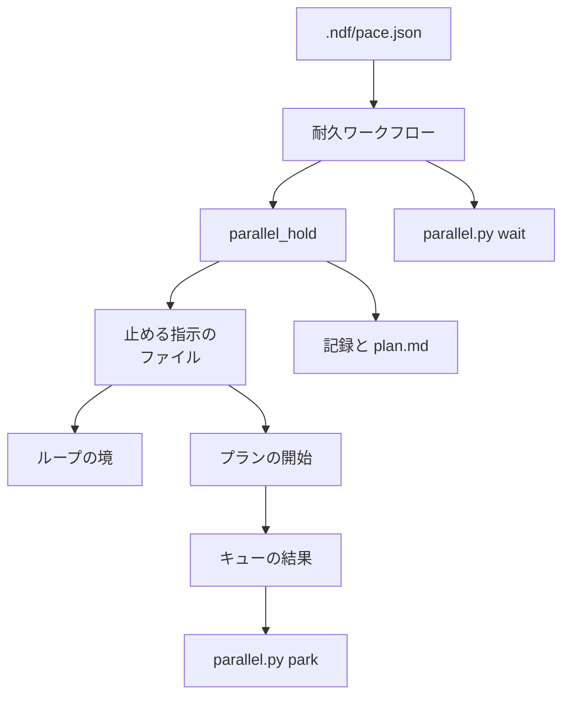
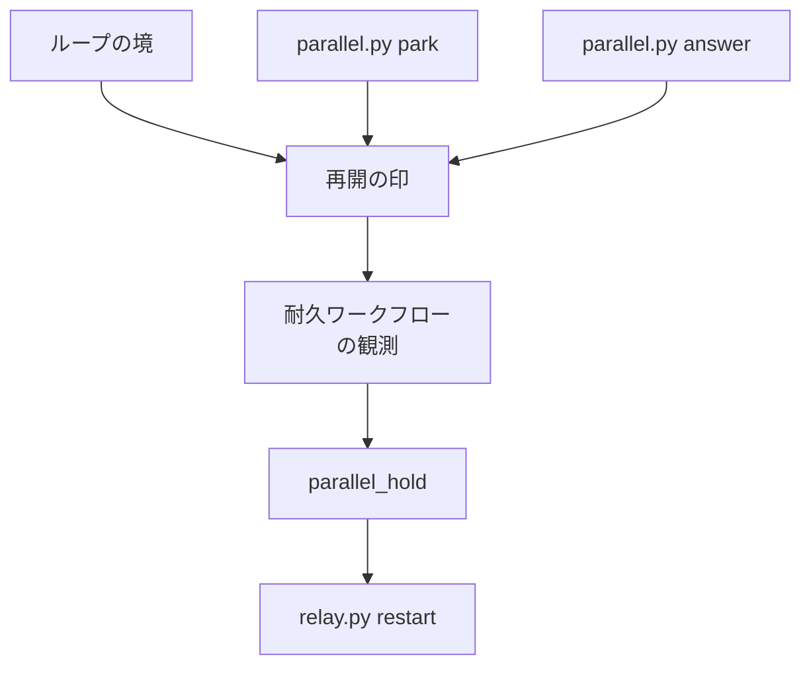
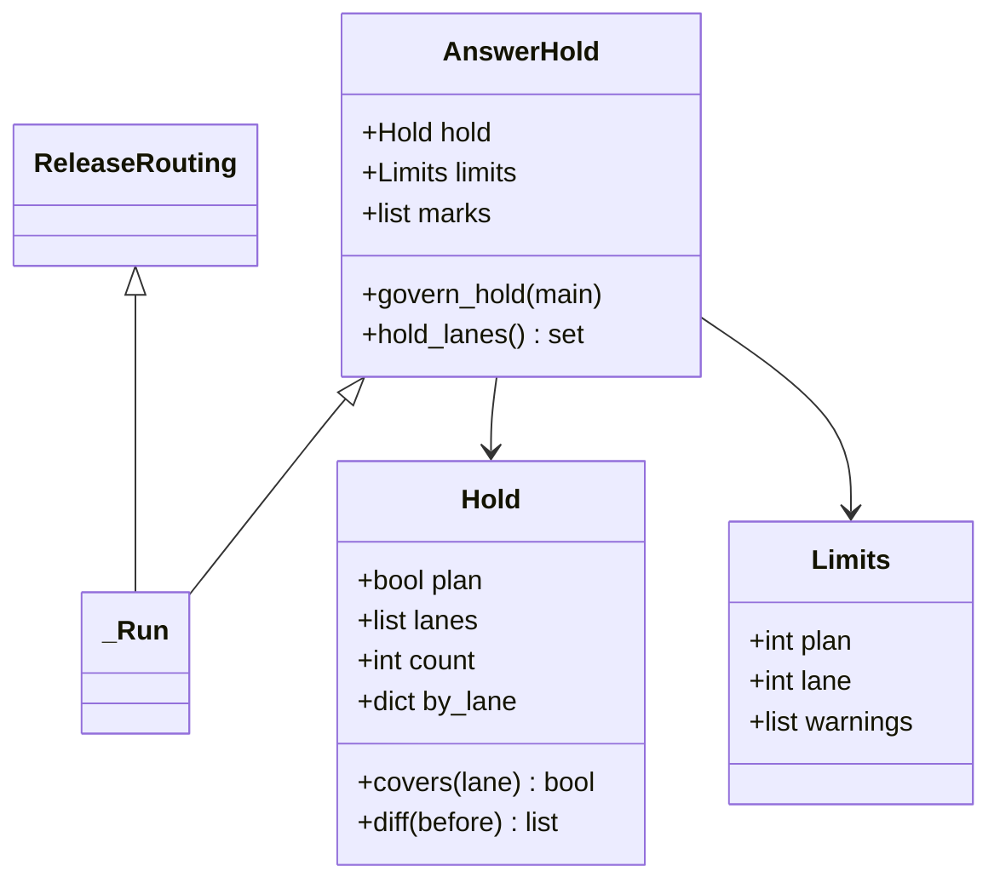
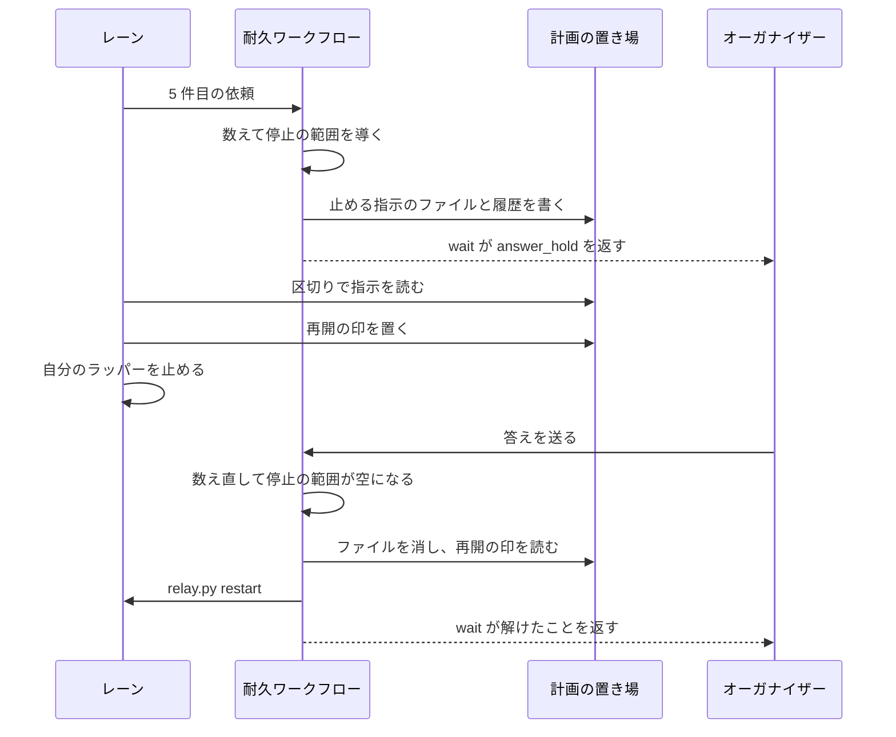
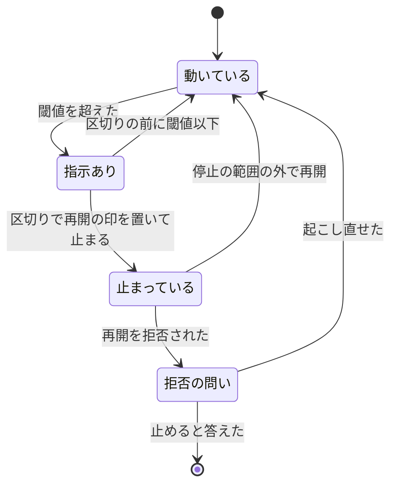

# 並列の計画: 答えを待つ依頼が人の読める量を超えたら、新しい作業を止め、答えたら自動で戻す（#2707）

## 目的

- **今どうなっているか**: 起動回数と周回の上限を外した後（#2505）、答えを待つ依頼が溜まっても作業は止まらない。2026-11-07 の計画 p3 では設計の承認の依頼 7 件が一度に届いた
- **誰に効くか**: 並列の計画で問いへ答える利用者
- **変えると何が成り立つか**: 答え待ちの依頼が閾値を超えると、レーンは区切りで止まり、新しい作業が増えない。答えて閾値以下へ戻ると、人の操作なしでレーンが動き出す

## 適用範囲

- **働く範囲**: 利用先のリポジトリでも働く。対象は `.ndf/parallel/<計画名>/` の計画のレーンだけである。外のオーガナイザーのレーンと Factory の実行ジョブは依頼を一覧へ送らないため、数えるものが無い
- **プロジェクトごとに違うもの**: 2 つの閾値を宣言 `.ndf/pace.json` で受ける。宣言が無ければ既定の 4 と 3 で動く
- **当たるモード**: `standard`

## あるべき姿の根拠

| 根拠 | 種類 | 何を示すか |
| --- | --- | --- |
| 「オーケストレーターに届いた承認待ちや質問(問い)が4つを超えたらすべてのレーンを止める」「各レーンがオーケストレーターに送った問いが3つを超えたらそのレーンを止める」「人間が読み切れないためです」（#2707 の依頼の原文、2026-11-07） | 利用者の指示の原文 | 累計ではなく読む量で止める。閾値は 4 と 3 |
| STD1・PRD1 | 外部の一次情報 | 作業中の量を明示して抑え、量が下がったら新しい仕事を選ぶ形は確立している |
| STD2・PRD2 | 外部の一次情報 | 止めるのは将来の開始だけで、動いている実行は止めない形に前例がある |
| STD3 | 外部の一次情報 | 望む状態と今の状態を毎周突き合わせる制御ループは、通知を取りこぼしても収束する |
| 計画 p3 の 7 件（PR 2669・2694・2696・2697・2679・2704・2703） | 実測 | 閾値の無い状態で、1 回に届く依頼は閾値 4 の 2 倍近くになる |

要求と受け入れ条件は #2707 の本文にある（コピーは [issue-2707-requirements.md](issue-2707-requirements.md) ）。決定の記録は [issue-2707-design-decisions.md](issue-2707-design-decisions.md) に分けた。この文書は「どう作るか」だけを扱う。

## ドメインモデル

### コンテキスト

変更は 1 つのコンテキストに収まる。

| コンテキスト | 何の語が 1 つの意味に決まるか |
| --- | --- |
| `ndf-workflow` | 答え待ちの依頼・計画の閾値・レーンの閾値・答え待ちの停止・止める指示のファイル・再開の印 |

### 集約

| 集約 | 持ち主（書き換えてよいもの） | 根 | エンティティ | 値オブジェクト |
| --- | --- | --- | --- | --- |
| 並列の進行 | 耐久ワークフローの `_Run` | 計画の実行 | 問い | 閾値・答え待ちの停止の範囲 |
| 再開の印 | モジュール `parallel_hold`。レーンと `parallel.py` はこのモジュールを通して再開の印を置き、耐久ワークフローだけが消す | 計画 | 再開の印（レーン名で一意） | 置いた理由・時刻 |
| ループの記録 | 開発ループ（`sprint_loop` 系）。止まった理由に値を 1 つ足す | ループの記録 | 周回 | 止まった条件 |

### 不変条件

| # | 集約 | 条件 | 破れたときの扱い |
| --- | --- | --- | --- |
| I1 | 並列の進行 | 計画全体の件数は問いの一覧の件数である。同じレーンの同じ設計 PR の設計の承認は 1 件にまとめ、リリースの依頼は数えない | テストで落とす |
| I2 | 並列の進行 | レーンの件数は、そのレーンが送った設計の承認と承認ゲートの外の問いだけを数える。まとめた問いは送った各レーンへ 1 件ずつ数え、耐久ワークフローの問いと一時レーンの依頼は数えない | テストで落とす |
| I3 | 並列の進行 | 答え待ちの停止の範囲は、今の問いの一覧と閾値だけから決まる（累計・時刻・止めた履歴に依らない） | テストで落とす |
| I4 | 並列の進行 | 計画全体の停止の間は、レーンを起動せず、新しいリリースを組まない。流れているリリースと依頼の受け付けは続く | テストで落とす |
| I5 | 再開の印 | 再開は再開の印のあるレーンだけに当たり、停止の範囲の外へ戻ったレーンだけに行う。計画全体の停止の間はどのレーンも再開しない | テストで落とす |
| I6 | 再開の印 | 動いているレーンを再開しない（`relay.py restart` は動いているレーンを止める）。動いているレーンの再開の印は消すだけである | テストで落とす |
| I7 | 再開の印 | レーンは再開の印を置いてからラッパーを止める。観測は一覧の後に再開の印を読むため、止まって見えたレーンの再開の印を読み逃さない | テストで落とす |
| I8 | 再開の印 | 再開の印が残るレーンと起こしたばかりのレーンがある間は計画を終えず、依存の判定で止まったと数えない | テストで落とす |
| I9 | 並列の進行 | 閾値を載せていない観測の記録を再生する間、耐久ワークフローの呼び出しを足さない | テストで落とす。足すと記録の再生が `DBOSUnexpectedStepError` で落ちる |
| I10 | 並列の進行 | 止める指示のファイルは一時ファイルからの置き換えで書く。レーンが読めないファイルは「止める指示なし」と読む | テストで落とす |
| I11 | 再開の印 | 答え待ちの停止の範囲にある持ち主のレーンへは、`answer` が起こす 1 行を返さず、再開の印を置く | テストで落とす |
| I12 | 再開の印 | 計画の終わりに、止める指示のファイルと再開の印を消す | テストで落とす |

### ドメインイベント

| # | イベント | 発生元 | 受け手 |
| --- | --- | --- | --- |
| E1 | レーンか一時レーンが依頼を送った | レーン・一時レーン | 耐久ワークフロー |
| E2 | 耐久ワークフローが依頼を一覧へ受け付けた | 耐久ワークフロー | オーガナイザー（`questions`）・E3 |
| E3 | 答え待ちの依頼を数えた | 耐久ワークフロー | E4・E9 |
| E4 | 答え待ちの停止を決めた | 耐久ワークフロー | 止める指示のファイル・記録・E7 |
| E5 | 止める指示がレーンへ届いた | 止める指示のファイル | レーン |
| E6 | レーンが区切りで止まった | レーン | 耐久ワークフロー（再開の印と状態の一覧） |
| E7 | 止めたことを通知した | 耐久ワークフロー | オーガナイザー（`wait`）・利用者 |
| E8 | 依頼へ答えた | オーガナイザー | 耐久ワークフロー・持ち主のレーン |
| E9 | 答え待ちの停止を解いた | 耐久ワークフロー | 止める指示のファイル・記録・E10 |
| E10 | 止めたレーンを再開した | 耐久ワークフロー | 統括役（`relay.py restart`） |
| E11 | 耐久ワークフローが再実行された | `parallel.py run` | 耐久ワークフロー |

### 用語

| 用語 | 意味 | 用語集への反映 |
| --- | --- | --- |
| 答え待ちの依頼 | オーガナイザーに届いて、まだ答えていない依頼 | 要求の同期で追加済み |
| 計画の閾値 | 計画全体の答え待ちの依頼の件数の閾値。既定は 4 | 要求の同期で追加済み |
| レーンの閾値 | 1 つのレーンが送った答え待ちの依頼の件数の閾値。既定は 3 | 要求の同期で追加済み |
| 答え待ちの停止 | 答え待ちの依頼が閾値を超えたため、レーンに新しい作業を始めさせない状態 | 要求の同期で追加済み |
| 止める指示のファイル | 耐久ワークフローが今の答え待ちの停止の範囲を書き、レーンが区切りで読むファイル（`answer-hold.json`）。停止が無ければファイルも無い | 追加（`ndf-workflow`） |
| 再開の印 | 答え待ちの停止が解けたら起こすレーンを示すファイル（`resume/<レーン>.json`）。レーンが止まるとき、または停止の間に答えを受けた持ち主のレーンへ置く | 追加（`ndf-workflow`） |

## 機能一覧

| # | 機能 | 誰が使うか |
| --- | --- | --- |
| F1 | 答え待ちの依頼を計画全体と 1 つのレーンで数える | 耐久ワークフロー |
| F2 | 閾値を超えたら、レーンが区切りで止まる | 利用者・レーン |
| F3 | 止めたこと・解けたことを通知し、記録する | 利用者・オーガナイザー |
| F4 | 閾値以下へ戻ったら、止めたレーンを起こす | 利用者 |
| F5 | 閾値を宣言で変える | プロジェクトの管理者 |

## 構成要素

### 責務

| 要素 | 責務 |
| --- | --- |
| 判定と置き場（新規 `lib/parallel_hold.py`） | 数え方・停止の範囲の導出・閾値の読み出し・止める指示のファイルと再開の印の読み書き・通知の 1 行の組み立て。DBOS を import しない |
| 突き合わせ（新規 `lib/parallel_hold.py` の `AnswerHold`） | `_Run` が継ぐ。停止の範囲が変わったら耐久ステップで書き、再開の印と停止の範囲を突き合わせて再開する |
| 耐久ワークフロー（`lib/parallel_run.py`） | 観測の結果へ閾値と再開の印を載せる。1 周の終わりに突き合わせを呼ぶ。起動・リリース・終わりの判定で停止の範囲を見る。起こす 1 行（`wake`）から停止の範囲のレーンを除く。行数は許容リストの 721 を超えない（`spawn_refusals`・`stall_seconds` と定数を `parallel_repo.py` へ移して埋める） |
| 答えの処理（`lib/parallel_answer.py`） | 停止の範囲にある持ち主のレーンへは起こす 1 行を返さず、再開の印を置く |
| CLI（`parallel.py`、新規 `lib/parallel_hold_cli.py`） | `wait` が通知を返す。`park` を足す。`check`・`start` が閾値の警告を出す。`parallel.py` は 500 行以下を保つ（`_manual_or_none` を `parallel_external_cli.py` へ移す） |
| ループの境（`lib/sprint_loop_record.py`・`lib/sprint_loop.py`） | 止まる条件 `answer_hold` を足す。止まるとき再開の印を置き、`stop_self` を返す。再開で判定し直す。`sprint_loop_record.py` は使われていない `BOUNDARY_CONDITIONS` を消して許容リストの 536 に収める |
| プランの開始（`supervise_lib/engine.py`） | 1 スプリントのレーンのプランは、`prepare` の先頭で止める指示を読み、停止の範囲なら流さずに終える |
| キューの結果（`supervise_lib/queue.py`） | 答え待ちの停止で流さなかったプランがあれば `status: gate` と `next`（`park` の 1 行）を返す |
| 計画の表示（`lib/parallel_plan.py`） | `plan.md` に答え待ちの停止の節を描く |
| 進め方の宣言（`lib/pace.py`） | 節 `parallel` を読む `read_parallel` を足す |
| 契約（`contracts/`） | `pace.json` のキー、`parallel.py` の `park`、ファイル 3 種を足す |
| 手順書・確定仕様 | `references/parallel.md`・`asking.md`・`loop.md`・`docs/specifications/ndf-parallel-organizer.md`・`docs/specifications/ndf-workflow-development-loop.md` |

### 止める経路



### 再開の経路



### 配置

レーンと `run` は同じマシンの別プロセスで動き、計画の置き場はメインディレクトリの `.ndf/parallel/<計画名>/` にある。外の系は増えない。

```text
plugins/ndf/scripts/
├── parallel.py                     # wait・park
├── lib/
│   ├── parallel_hold.py            # 新規: 判定・置き場・突き合わせ
│   ├── parallel_hold_cli.py        # 新規: park
│   ├── parallel_run.py             # 変更
│   ├── parallel_answer.py          # 変更
│   ├── parallel_plan.py            # 変更
│   ├── pace.py                     # 変更
│   ├── sprint_loop.py              # 変更
│   └── sprint_loop_record.py       # 変更
└── supervise_lib/
    ├── engine.py                   # 変更
    └── queue.py                    # 変更
```

## 決定の記録

決定の記録は [issue-2707-design-decisions.md](issue-2707-design-decisions.md) にある。

## 外部の調査

| 種類 | 調べるか | 理由 |
| --- | --- | --- |
| 標準・仕様 | 調べる | 作業中の量の制御と、制御ループに確立した形がある |
| 主要な製品 | 調べる | 開始を止めて動いている実行を残す製品の形を比べる |
| ライブラリとサービス | 調べる | 依存している DBOS のイベントとメッセージで届け方が足りるかを決める |

### 標準・仕様

| # | 標準・仕様 | 何を定めているか | 設計への反映 | 出典 |
| --- | --- | --- | --- | --- |
| STD1 | The Kanban Guide | 開始から完了までの項目を WIP とし、数を明示して制御する。WIP が制御の値を下回ると新しい仕事を選ぶ契機になる。値そのものは定めない | 答え待ちの依頼を WIP と同じ形で扱い、閾値は宣言に置く（決定 6）。下回ったら自動で再開する | https://kanbanguides.org/english/ （2026-11-06） |
| STD2 | Node.js Stream の背圧 | バッファが `highWaterMark` 以上で `write()` が `false` を返し、`drain` まで書かない。`highWaterMark` は "a threshold, not a limit" である | 閾値は受け付けの上限でなく引き金である（要求の前提 2）。依頼は捨てず、新しい作業だけを止める | https://nodejs.org/api/stream.html （2026-11-06） |
| STD3 | Kubernetes のコントローラー | 終わらない制御ループが、今の状態を望む状態へ近づける | 停止の範囲は 1 周ごとに一覧から導き、再開は再開の印と停止の範囲を 1 周ごとに突き合わせる（決定 1・5） | https://kubernetes.io/docs/concepts/architecture/controller/ （2026-11-06） |

### 主要な製品

| # | 製品 | どう解いているか | 設計への反映 | 出典 |
| --- | --- | --- | --- | --- |
| PRD1 | Apache Airflow の pool | 空きが無いと実行可能なタスクは queued で待ち、空きが出ると優先度の順に動く | 開始の抑止を数で決める形として採る。キューで待つ形はプロセスが居座るため、1 スプリントのレーンには採らない（決定 4） | https://airflow.apache.org/docs/apache-airflow/stable/administration-and-deployment/pools.html （2026-11-06） |
| PRD2 | Temporal の Schedule の pause | 将来の Action を止める。開始済みの Workflow Execution は影響を受けない | 動いているプランを打ち切らず、次の開始だけを止める（決定 3） | https://docs.temporal.io/schedule （2026-11-06） |
| PRD3 | Apache Kafka の pause / resume | 消費者が `pause` すると、以降の `poll` から取得を止める。止める判断は読む側が取得の境で効く | レーンが自分の区切りで止める指示を読む形に倣う（決定 2） | https://kafka.apache.org/39/javadoc/org/apache/kafka/clients/consumer/KafkaConsumer.html （2026-11-06） |

### ライブラリとサービス

| # | 候補 | 版 | ライセンス | 最後のリリースの日付 | 終了のアナウンス | 要件を満たすか | 出典 |
| --- | --- | --- | --- | --- | --- | --- | --- |
| LIB1 | DBOS Transact（`set_event` / `send` / `recv`） | 3.1.0（固定） | MIT | 3.1.0 は 2026-09-24（#2649 の調査） | 無し | 通知には満たす。`set_event` はキーごとに上書きされ、`recv` はトピックごとのキューから 1 件消費する。レーンの区切りごとに読む用途には、問いの hook と同じくファイルで足りる（決定 2） | https://docs.dbos.dev/python/tutorials/workflow-communication （2026-11-06）、`dbos/_sys_db.py` の `patch` の読み取り（`uv` の環境、2026-11-06） |

### 確かめられなかったこと

| 対象 | 試した手段 | 結果と理由 |
| --- | --- | --- |
| 人が 1 回に読める依頼の件数の実測 | 試していない | 要求の対象外。閾値の 4 と 3 は利用者の指示の値である |

調べた量: 候補 7 件・取得の試み 11 回。

## 構造

`Hold` と `Limits` は不変の値で、`decide(questions, order, limits)` が `Hold` を返す純粋な関数である。



## データ構造

置き場はどれもメインディレクトリの `.ndf/parallel/<計画名>/` で、コミットしない。

| ファイル | 中身 | 書き手 | 読み手 | 消す時点 |
| --- | --- | --- | --- | --- |
| `answer-hold.json` | 今の停止の範囲 | 耐久ステップ | ループの境・プランの開始・`answer`・`park` | 停止の範囲が空になったとき・計画の終わり |
| `answer-hold-log.jsonl` | 止めた・解けたの履歴（追記） | 耐久ステップ | 人・後の集計 | 消さない |
| `resume/<レーン>.json` | 再開の印 | ループの境・`park`・`answer` | 観測 | 再開したとき・再開の印の要らないレーン・計画の終わり（耐久ステップ） |

### 止める指示のファイル（`answer-hold.json`）

```json
{"version": 1, "plan": true, "lanes": ["a"], "count": 5, "by_lane": {"a": 4, "b": 1}, "limits": {"plan": 4, "lane": 3}, "at": "2026-11-07T01:00:00Z"}
```

### 履歴の 1 行（`answer-hold-log.jsonl`）

1 つの計画で止まった回数は `change: on` の行の数で数える。

```json
{"n": 1, "change": "on", "scope": "plan", "lanes": [], "count": 5, "limit": 4, "reason": "答え待ちの依頼が計画の閾値を超えた", "at": "2026-11-07T01:00:00Z"}
```

| 項目 | 値 |
| --- | --- |
| `change` | `on` / `off` |
| `scope` | `plan` / `lane` |

### 再開の印（`resume/<レーン>.json`）

```json
{"lane": "a", "why": "boundary", "at": "2026-11-07T01:05:00Z"}
```

| `why` の値 | 意味 |
| --- | --- |
| `boundary` | 区切りで止まった |
| `answered` | 停止の間に答えを受けた持ち主のレーン |

### 宣言（`.ndf/pace.json`）

任意の節を足す。

```json
{"parallel": {"answer_limit": {"plan": 4, "lane": 3}}}
```

### 機能ごとの読み書き

| 機能 | 止める指示のファイル | 履歴 | 再開の印 |
| --- | --- | --- | --- |
| F2 レーンが区切りで止まる | 作る・読む | 作る | 作る |
| F3 通知と記録 | — | 作る・読む | — |
| F4 止めたレーンを起こす | 消す | 作る | 読む・消す |

## 入出力の契約

| 名前 | 入力 | 出力 | 失敗の形 | 互換性 |
| --- | --- | --- | --- | --- |
| `parallel.py wait` | 変えない | `metrics.action` に `answer_hold` が増える。`metrics.changes`（直近 8 件の `{n, change, scope, lanes, count, limit, reason, at}`）と `metrics.line`（利用者へ出す 1 行）を持つ | 変えない | 追加。既存の項目は変えない。知らない `action` を読むのはオーガナイザーの手順だけである |
| `parallel.py park <計画名> --lane <名> --done <D>` | キューの done | 停止の範囲に残るなら引継ぎ文書の「次にやること」へ `supervise.py queue --resume <D>` を書き、再開の印を置き、`metrics.next` に自分のラッパーを止める 1 行を返す（0）。停止の範囲を外れていれば何も書かず `metrics.cleared: true` と続きの 1 行を返す（0） | 計画やレーンが無い 1、書けない 2 | 新規 |
| `parallel.py answer` | 変えない | 停止の範囲にある持ち主のレーンでは `metrics.next` が持ち主のレーンを起こす 1 行を含まず、`metrics.held_owners` にレーン名を返す | 変えない | 停止の範囲が無ければ今と同じ |
| `parallel.py check` / `start` | 変えない | 閾値の値が正の整数でなければ `items` に警告（`check` は `warnings` に数える） | 計画を止めない | 追加 |
| `supervise.py queue` / `wait` | 変えない | 答え待ちの停止で流さなかったプランは `result: 流さなかった`・`answer_hold: true`。結果は `status: gate`・`metrics.answer_hold`（計画名とレーン）・`next`（`park` の 1 行） | 変えない | レーン以外の queue は変わらない |
| `sprint-state.py loop` | 変えない | 止まる条件に `answer_hold` が増える。`values` は `{plan, scope, count, limit}`。行は `[ndf-loop] stopped <名> answer_hold`。`metrics.stop_self` を返す | 終了コード 3（今の止まる条件と同じ） | 追加 |
| イベント `answer-hold` | — | `{seq, action: "answer_hold", changes, line, hold}` | — | 新規。`seq` は `pause`・`questions` と同じ連番 |
| 問いの hook | 変えない | 変えない（受け入れ条件 17） | — | 変えない |

## 処理の流れ

### 止めてから再開するまで



### レーンが止める指示を読む時点

| レーン | 読む時点 |
| --- | --- |
| ループのレーン | 周回の境の最初の判定（`user_stop`・`mvv_changed` の次） |
| 1 スプリントのレーン | プランの開始 |

ループのレーンは保留の周回の処理より前に止まる（受け入れ条件 24）。再開された `loop start` は止める指示を読み直し、停止の範囲に残っていれば同じ条件で止まり直す。

### 耐久ワークフローの 1 周の終わりに行う突き合わせ

1. 観測の結果に閾値が無ければ何もしない（I9）
2. `decide` で今の停止の範囲を導く。今までの停止の範囲と違えば、耐久ステップ `parallel.answer-hold` でファイルと履歴と `plan.md` を書く。成功したらイベント `answer-hold` を発行する。書けなければ停止の範囲を進めず、次の 1 周で書き直す
3. 一覧の観測が成功した 1 周だけ、再開の印を分ける。停止の範囲の外で止まっているレーンは再開し、動いているレーンと「止める」と答えたレーンの再開の印は消すだけにする。計画全体の停止の間はどちらもしない
4. 再開を拒否されたレーンは起動の拒否と同じに数え、`NDF_PARALLEL_SPAWN_REFUSALS` 回ごとに `kind: spawn` の問いを立てる。再開の印は残し、次の 1 周で再開し直す
5. 再開したレーンは `revive` へ入れ、`wake` から外す。停止の範囲が空になり `wake` が残れば `notice` を発行する

### 停止の範囲を見る判定

| 判定 | 変更 |
| --- | --- |
| レーンの起動 | 計画全体の停止の間は起動しない。依存の判定では、再開の印のあるレーンを止まったと数えない |
| リリース | 計画全体の停止の間は `open_release` を呼ばない。レーンの停止だけなら呼ぶ。`answer_from_ranges` は今どおり |
| 計画の終わり | 再開の印が残る間は終えない |
| `wake` の付記 | 停止の範囲のレーンを除く。解けた後の通知で添える |

### レーンの状態遷移



### 値の集合への追加

| 足す値 | 足す先 | 変える箇所 |
| --- | --- | --- |
| `answer_hold` | 止まる条件 | `IMMEDIATE_STOPS`（保留の周回の処理より先に止める）・`stopped_result` の `stop_self` の条件・`_RESUME_HANDLERS`・`loop.md` の止まる条件の表 |
| `answer_hold` | `wait` の `action` | `parallel.md` の表へ載せる |

止まる条件 `answer_hold` は上の箇所の規則に当てはまらないため、それらを変える。次の箇所は変えない。

| 変えない箇所 | 理由 |
| --- | --- |
| `lane_waits` と `waiting_lanes` | `waiting_only` だけを見たままでよい（再開の印が同じ役割を持つ） |
| Factory の条件の一覧 | `waiting_only` を持たず（`rg -ln waiting_only factory` は 0 件）、並列の計画のレーンだけの条件を扱わない |

## 非機能の実現方式

| 大項目 | 要求の条件 | 実現方式 | 確かめ方 |
| --- | --- | --- | --- |
| 運用・保守性 | 止めた時刻・解いた時刻・範囲・件数が計画の記録に残り、1 つの計画で何回止まったかを後から数えられる。計画の表示（`plan.md`）に、止めているレーンと理由が載る | `answer-hold-log.jsonl` へ 1 変化 1 行で追記し、`plan.md` に節を描く。計画の要約へ回数 `holds` を足す | 流れのテストで行と節を読む |
| 移行性 | 動いている計画の耐久ワークフローは、版を更新した後の再実行でも記録から続く（`durable.patched` の前例のとおり）。既存の `.ndf/parallel/` と宣言は書き換えない。切り戻しは版を戻すことで行う | 観測の値に閾値が無い記録の再生では新しい呼び出しを足さない。実時間へ戻ると閾値が載り、以後の 1 周で働く（決定 7）。プランの開始の判定は既存の耐久ステップの中で読むため、記録の位置が変わらない | 閾値の無い観測の記録を再生するテスト |
| システム環境 | 閾値は宣言で受け、ai-plugins の値を既定へ埋め込まない（Value 6）。既定の 4 と 3 は利用者の指示の値である | `pace.read_parallel` が宣言を読み、値ごとに正の整数かを見る。リポジトリの宣言へは書かない | 宣言ごとの単体テスト |

## 設計の結果

| 課題 | 扱い | 取り込み先 | 触るファイル |
| --- | --- | --- | --- |
| #2707 | 実装する | — | `plugins/ndf/scripts/parallel.py`、`plugins/ndf/scripts/lib/`、`plugins/ndf/scripts/supervise_lib/engine.py`、`plugins/ndf/scripts/supervise_lib/queue.py`、`plugins/ndf/scripts/tests/`、`plugins/ndf/contracts/`、`plugins/ndf/skills/development-workflow/references/`、`docs/specifications/ndf-parallel-organizer.md`、`docs/specifications/ndf-workflow-development-loop.md`、`docs/glossary/glossary.json`、`docs/glossary.md` |

## テスト設計

| 受け入れ条件・不変条件 | どの振る舞いで縛るか | どう壊したら落ちるべきか |
| --- | --- | --- |
| 条件 1・2・3 / I3 | 4 件で停止の範囲が空、5 件目で計画全体、答えた後は残りの件数で数える | 閾値の比較を `>=` にする。累計で数える |
| 条件 4・6 / I1 | 問いの全種類を数え、リリースの依頼を数えない | `kind` を絞る。`pending` を足す |
| 条件 5 | まとめた問いは 1 件、同じレーンと設計 PR の新旧は 1 件 | キーから設計 PR を外す |
| 条件 7・8 / I2 | 3 件で止めず、4 件目でそのレーンだけ停止の範囲に入る | 計画全体へ広げる |
| 条件 9・10 / I2 | まとめた問いは各レーンへ数え、耐久ワークフローの問いと一時レーンの依頼はレーンの数へ入らない | `merged` を見ない。`kind` の絞りを外す |
| 条件 11 | オーガナイザーの答えを待たずに耐久ワークフローが停止の範囲を書く | 判定を `wait` の側へ移す |
| 条件 12 | ループのレーンが境で `[ndf-loop] stopped <名> answer_hold` と `stop_self` を返し、記録に残る | 条件を `IMMEDIATE_STOPS` から外す |
| 条件 13 | 動いているプランは完了し、次のプランが `流さなかった` になり、キューが `park` の 1 行を返す | 判定を外す。`status` を `ok` のままにする |
| 条件 14 | 区切りの前に停止の範囲が空になると止まらない。`park` が `cleared` を返す | 止める指示を読まずに履歴で判定する |
| 条件 15 / I4 | 流れているリリースは `settle` まで進み、計画全体の停止の間に新しいリリースを組まない | `open_release` の判定を外す |
| 条件 16 / I4・I8 | 停止の間は起動せず、再開の印のあるレーンの依存先も起動しない | `_spawn_ready` の判定を外す |
| 条件 17 | 停止の間も依頼が一覧へ入り `questions` が発行される | 受け付けを止める |
| 条件 18・19・20 | `wait` が停止の範囲・件数・閾値・理由を持つ通知と 1 行を返し、後の変化で前の変化が失われない | `changes` を落とす。`pause` へ載せて上書きさせる |
| 条件 21・22 / I5 | 閾値以下で解け、計画全体が続く間と、レーンが閾値を超える間は再開しない | 再開の条件を片方にする |
| 条件 23 / I5 | 再開の印の無いレーン・`given_up` のレーンを再開しない | 止まったレーンのすべてを再開する |
| 条件 24 / I11 | 答えとマージは送られ、持ち主のレーンを起こす 1 行が返らず、解けた後に起きる | `owner_restart` の判定を外す |
| 条件 25 / I8 | 件数が 0 でも再開の印があれば `finished` にならず、再開の後に終わる | `_run_finished` の判定を外す |
| 条件 26 | 再実行の後も停止の範囲と再開の印が同じで、通知を重ねない | 停止の範囲を記録から導かない |
| 条件 27・28 | 宣言なしで 4 と 3、値を書くとその値、不正な値は既定と警告 | 既定を埋め込む。不正な値で止める |
| 条件 29 | 閾値以下の計画で新しい耐久ステップが呼ばれず、既存の 108 件が通る | 1 周ごとに耐久ステップを呼ぶ |
| 条件 30 / I12 | `stop` は停止の有無に依らず終わり、ファイルと再開の印が残らない | `step_finish` の片付けを外す |
| 条件 31・32 | 手順書と確定仕様の更新、全体テスト | `check-ndf-contracts.py`・全体テストが落ちる |
| I6 | 動いているレーンの再開の印は消すだけで `restart` を実行しない | 状態を見ずに実行する |
| I7 | 再開の印が先でラッパーの停止が後である。観測は一覧の後に再開の印を読む | 読む順を逆にする |
| I9 | 閾値の無い観測の記録を再生して呼び出しの順が変わらない | 観測の前に耐久ステップを足す |
| I10 | 壊れたファイルでレーンが止まらない | 読めないときに止める |

## 未確認のまま残ること

| 項目 | 内容 |
| --- | --- |
| 閾値を超えて増える件数 | 区切りまでの間に依頼は増え続ける（要求の前提 2）。増える数の上限は置かず、実際の計画の履歴で確かめる |
| 未決 1・2 | レーンの数へ設計の承認を含めること、MVV 判定で答えられる依頼を数えることは、要求の候補どおりに設計した。利用者が設計承認ゲートで確かめる |
| 未マージの設計との取り込み | レーンの観測の #2649（PR 2703）が先に入るなら、開発ループの止まりの問いの除外へ `answer_hold` を足す。問いの取り下げは停止の範囲を 1 周ごとに導くため、取り下げの処理の変更は要らない。計画の台帳の #2647（PR 2704）が先に入るなら、`RunState` へ停止の範囲を足し、作り直しの後の最初の 1 周で通知を重ねないようにする。ファイルと再開の印は計画の置き場にあるため台帳へ入れない |
| 止まった後に人が止めたレーン | 再開の印を置いて止まったレーンへ人が `relay.py stop` を実行しても、解けたら再開する。再開の印を消す手段は設計していない |
| 閾値の前後を行き来するとき | 再開の余白を置かない（要求の S11）ため、1 件の増減でレーンの停止と再開が続く。回数は履歴で数えられる |
| 報告の形 | `流さなかった` の結果で報告を書く経路は実装で確かめる（`report_step` と `report_result`） |
